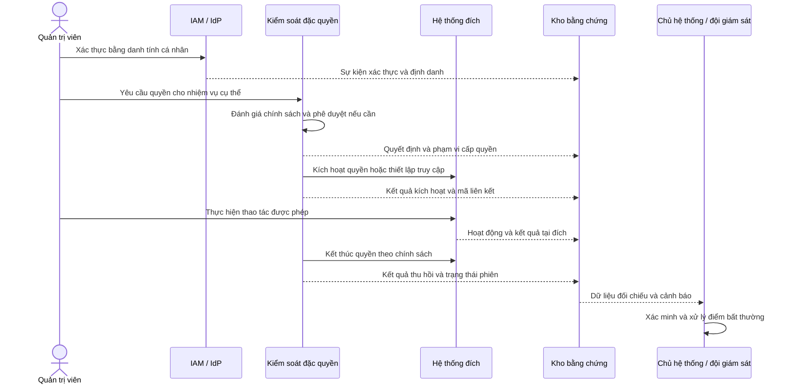

# Accountability của thao tác admin

## 1. Accountability có nghĩa gì trong PAM?

Trong quản trị hệ thống, **accountability** là khả năng xác định và giải trình việc sử dụng đặc quyền: chủ thể nào thực hiện, dựa trên quyền nào, trên tài nguyên nào, vì mục đích gì, đã tạo ra kết quả gì và ai có trách nhiệm xem xét kết quả đó.

Accountability bao gồm cả hai mặt:

- **Bằng chứng kỹ thuật:** có thể nối một thao tác với danh tính, quyết định cấp quyền, phiên hoặc yêu cầu thực thi và kết quả tại hệ thống đích.
- **Trách nhiệm tổ chức:** có người sở hữu quyền, người thực hiện nhiệm vụ và người xử lý khi hoạt động không phù hợp hoặc bằng chứng bị thiếu.

Trong Privileged Access Management (PAM), điều này đặc biệt quan trọng vì thao tác admin có thể thay đổi cấu hình bảo mật, cấp quyền mới, đọc bí mật, khôi phục dữ liệu hoặc ảnh hưởng tới nhiều dịch vụ. Một tài khoản có tên rõ ràng chưa đủ tạo ra accountability nếu không biết tài khoản đó đã làm gì và trong điều kiện nào.

Accountability cũng không đồng nghĩa với mặc định quy lỗi cho người có tên trong log. Credential có thể bị đánh cắp, phiên có thể bị chiếm và công cụ tự động có thể hành động ngoài dự kiến. Bằng chứng phải giúp xác định diễn biến và mức độ chắc chắn của việc quy thuộc, thay vì biến một tên đăng nhập thành kết luận về con người.

### 1.1. Phân biệt với các khái niệm liên quan

| Khái niệm | Câu hỏi chính | Giới hạn nếu đứng riêng |
|---|---|---|
| Authentication — xác thực | Chủ thể đã chứng minh danh tính bằng cách nào? | Không cho biết mọi thao tác sau đăng nhập có hợp lệ không |
| Authorization — cấp quyền | Chủ thể được phép làm gì trong ngữ cảnh này? | Quyền được cấp chưa chứng minh hành động đã xảy ra |
| Audit trail — dấu vết kiểm toán | Hệ thống đã ghi nhận những sự kiện nào? | Có log chưa chắc đã đủ dữ liệu để nối sự kiện hoặc giải thích trách nhiệm |
| Accountability — khả năng quy trách nhiệm và giải trình | Ai sử dụng quyền nào, cho nhiệm vụ gì, với kết quả gì và ai xử lý vấn đề? | Phụ thuộc độ đầy đủ, độ tin cậy của bằng chứng và quy trình tổ chức |
| Non-repudiation — chống chối bỏ | Có cơ chế nào hỗ trợ chứng minh nguồn gốc và tính toàn vẹn của hành vi hoặc dữ liệu? | Không tự hình thành chỉ vì có tên tài khoản hoặc video phiên |

Một lần xác thực bằng MFA là bằng chứng quan trọng về quá trình đăng nhập. Nó không chứng minh tuyệt đối rằng chủ tài khoản đã tự tay thực hiện mọi hành động trong phiên sau đó. Tương tự, chữ ký hoặc hàm băm có thể hỗ trợ kiểm tra dữ liệu nhưng không tự chứng minh dữ liệu đầu vào đã phản ánh đầy đủ sự thật.

## 2. Một thao tác admin cần giải trình những gì?

Xét thao tác khởi động lại dịch vụ xử lý đơn hàng trên môi trường sản xuất. Để giải trình được thao tác này, tổ chức cần trả lời nhiều câu hỏi hơn “ai đã đăng nhập máy chủ”.

| Câu hỏi | Bằng chứng cần có | Ví dụ |
|---|---|---|
| Ai là chủ thể được xác thực? | Định danh ổn định, nguồn danh tính, ngữ cảnh xác thực | Danh tính cá nhân của Lan trong hệ thống công ty |
| Hệ thống đích nhìn thấy tài khoản nào? | Tài khoản hoặc principal thực thi, vai trò có hiệu lực | Tài khoản vận hành được ủy quyền khởi động lại dịch vụ |
| Vì sao cần thao tác? | Yêu cầu công việc, lý do, thay đổi hoặc sự cố liên quan | Mã thay đổi CHG-042 để áp dụng cấu hình đã duyệt |
| Ai hoặc chính sách nào cho phép? | Quyết định cấp quyền, phạm vi, thời hạn, phê duyệt nếu có | Quyền tạm thời cho một dịch vụ trong 30 phút |
| Đã yêu cầu và thực hiện việc gì? | Hành động, tài nguyên, yêu cầu thực thi và sự kiện tại đích | Yêu cầu restart và kết quả restart trên đúng dịch vụ |
| Xảy ra khi nào và qua đường nào? | Thời gian, mã phiên, mã thao tác, nguồn sự kiện, đường truy cập | Phiên do PAM quản lý liên kết với log hệ thống đích |
| Kết quả thực tế là gì? | Trạng thái hoàn tất, lỗi và kiểm tra sau thay đổi | Dịch vụ đã khởi động lại; kiểm tra sức khỏe đạt yêu cầu |
| Quyền kết thúc ra sao? | Kết quả thu hồi quyền, trạng thái phiên và credential liên quan | Vai trò tạm thời đã bị thu hồi tại đích |
| Ai xem xét khi có bất thường? | Chủ hệ thống, người tiếp nhận cảnh báo, hồ sơ xử lý | Đội vận hành xác minh và đội an ninh điều tra khi cần |

Không phải sự kiện nào cũng chứa mọi trường. Điều quan trọng là có thể liên kết các nguồn bằng chứng đáng tin cậy để trả lời toàn bộ chuỗi câu hỏi.

## 3. Tách bốn loại sự kiện thường bị nhầm lẫn

### 3.1. Yêu cầu quyền

Một người gửi yêu cầu sử dụng quyền quản trị trong cửa sổ bảo trì. Sự kiện này thể hiện **ý định và bối cảnh công việc**. Nó không cho biết yêu cầu đã được duyệt, quyền đã mở hay thao tác đã diễn ra.

Một mã ticket cũng chưa đủ nếu nội dung ticket không khớp tài nguyên, nhiệm vụ hoặc thời gian. Ghi một chuỗi ký tự vào trường “lý do” không thay thế việc đối chiếu với công việc thực tế.

### 3.2. Quyết định và kích hoạt quyền

Chính sách hoặc người phê duyệt cho phép yêu cầu, sau đó hệ thống kích hoạt vai trò, cấp credential hoặc thiết lập phiên. Đây là bằng chứng về **quyền đã được cho phép và quyền đã được triển khai**.

Hai trạng thái này vẫn có thể khác nhau: yêu cầu đã duyệt nhưng việc kích hoạt vai trò thất bại. Vì vậy, nên phân biệt quyết định cấp quyền với kết quả thực thi quyết định trên hệ thống đích.

### 3.3. Hoạt động thực tế

Người dùng hoặc workload gửi một lệnh, lời gọi API hoặc thao tác quản trị. Bằng chứng cần chỉ ra **hành động và tài nguyên thực sự được tác động**, cùng principal có hiệu lực tại thời điểm đó.

Một phiên SSH được mở không chứng minh người dùng đã sửa cấu hình. Ngược lại, việc không thấy câu lệnh trong lịch sử shell cũng không chứng minh không có thay đổi: hành động có thể đi qua chương trình khác, API hoặc đường truy cập ngoài cơ chế ghi nhận.

### 3.4. Kết quả và kết thúc quyền

Một công cụ trả về “đã nhận yêu cầu” chưa chắc tác vụ đã hoàn thành. Với tác vụ bất đồng bộ, cần nối mã yêu cầu với kết quả cuối cùng hoặc ghi rõ kết quả chưa xác định.

Tương tự, việc gửi lệnh thu hồi quyền chưa chứng minh quyền đã hết hiệu lực. Có thể vẫn còn phiên đang mở, token đã phát hành hoặc credential chưa được thay. Accountability đòi hỏi ghi đúng trạng thái đã biết, bao gồm thất bại và khoảng trống bằng chứng.

## 4. Chuỗi danh tính: người yêu cầu khác với tài khoản thực thi

Một đường truy cập đặc quyền có thể đi qua nhiều lớp:

```text
Danh tính cá nhân của Lan
    -> yêu cầu được đánh giá theo chính sách
    -> phiên truy cập có mã riêng
    -> tài khoản vận hành tại máy chủ
    -> tiến trình được nâng quyền
    -> thao tác trên dịch vụ cụ thể
```

Nếu log chỉ ghi `root`, ta biết ngữ cảnh quyền cao nhất tại máy chủ nhưng chưa biết ai khởi tạo hành động. Nếu log chỉ ghi `lan.ops`, ta biết một danh tính tại cổng truy cập nhưng chưa biết máy chủ đã thực thi dưới tài khoản hoặc quyền nào.

Cần giữ được các mối liên hệ:

- **Danh tính gốc:** người hoặc workload được xác thực ở đầu luồng.
- **Danh tính thực thi:** tài khoản, principal hoặc vai trò mà hệ thống đích sử dụng.
- **Quan hệ ủy quyền:** cơ chế cho phép danh tính gốc sử dụng danh tính thực thi.
- **Phiên hoặc yêu cầu thực thi:** phạm vi cụ thể mà quan hệ đó được sử dụng.
- **Thao tác và tài nguyên:** hành động được áp dụng trên đối tượng nào.

Định danh nên ổn định và có thông tin nguồn. Tên hiển thị có thể đổi, tên đăng nhập có thể được tái sử dụng và cùng một tên có thể xuất hiện trong nhiều miền danh tính. Lưu định danh ổn định cùng nguồn danh tính giúp giảm nhầm lẫn khi điều tra sau này.

Quan hệ ủy quyền phải được ghi nhận bởi thành phần đáng tin cậy. Một trường `requested_by` do client tự gửi không đủ chứng minh người đó đã khởi tạo thao tác nếu hệ thống không xác thực và ràng buộc trường này với ngữ cảnh thực thi.

## 5. Luồng accountability trong một phiên quản trị



Sơ đồ mô tả các trách nhiệm logic. Kiến trúc thực tế có thể trung chuyển phiên qua PAM hoặc cấp quyền tạm thời trực tiếp tại hệ thống đích. Cả hai cách đều cần liên kết bằng chứng về danh tính, quyền và hoạt động thực tế.

Một thành phần trung gian chỉ quan sát được những gì đi qua nó và những gì giao thức cho phép nhận diện. Do đó, cần kiểm kê cả kết nối trực tiếp, console khẩn cấp, API, tác vụ tự động và các đường truy cập khác. Nếu một đường có thể sử dụng cùng quyền mà không tạo được bằng chứng tương ứng, chuỗi accountability vẫn còn khoảng trống.

## 6. Ví dụ: giải trình một lần khởi động lại dịch vụ

### 6.1. Bối cảnh và giới hạn nhiệm vụ

Lan được giao thay đổi cấu hình kết nối của dịch vụ đơn hàng trong một cửa sổ bảo trì. Chủ hệ thống xác định Lan chỉ cần xem trạng thái và khởi động lại dịch vụ kết nối trên máy chủ đã chỉ định.

Quyền được cấp theo hai nguyên tắc:

- **JIT — Just-in-Time:** kích hoạt quyền khi cần, với thời hạn rõ ràng.
- **JEA — Just Enough Administration:** giới hạn khả năng quản trị vào nhiệm vụ cần thiết, theo khả năng ủy quyền của nền tảng.

Hai nguyên tắc này giúp thu hẹp phạm vi phải giải trình. Tuy nhiên, việc cấp quyền hẹp vẫn cần bằng chứng về sử dụng thực tế; không thể kết luận thao tác an toàn chỉ từ cấu hình vai trò.

### 6.2. Chuỗi bằng chứng mong đợi

1. Sự kiện xác thực xác nhận danh tính cá nhân và ngữ cảnh đăng nhập của Lan.
2. Yêu cầu `REQ-731` liên kết với thay đổi `CHG-042`, tài nguyên đích và thời hạn.
3. Quyết định `DEC-731` cho phép vai trò bảo trì có phạm vi đã định.
4. Kết quả kích hoạt cho biết quyền thực sự có hiệu lực; phiên được gắn mã `SES-204`.
5. Thao tác `OP-902` được quan sát tại hệ thống đích với tài khoản thực thi và tài nguyên cụ thể.
6. Kết quả thực thi được nối với kiểm tra trạng thái dịch vụ sau thao tác.
7. Khi hoàn tất, bằng chứng ghi nhận kết quả thu hồi quyền và cách xử lý phiên liên quan.

Mỗi mã có chức năng khác nhau. Một yêu cầu có thể tạo nhiều phiên, một phiên có thể chứa nhiều thao tác và một thao tác có thể có nhiều lần thử. Không nên dùng duy nhất mã phiên để thay cho mọi loại định danh.

### 6.3. Ví dụ sự kiện có cấu trúc

Bản ghi sau minh họa một sự kiện sau thao tác, không phải cấu hình hoặc chuẩn log bắt buộc của sản phẩm:

```json
{
  "event_id": "EVT-903",
  "event_type": "privileged_action_result",
  "event_time": "2026-11-26T03:15:26Z",
  "received_time": "2026-11-26T03:15:28Z",
  "source_system": "orders-prod-host-02.audit",
  "initiating_identity": {
    "id": "person-1842",
    "authority": "workforce-idp",
    "type": "human"
  },
  "effective_principal": "svc-maintenance",
  "access_request_id": "REQ-731",
  "authorization_decision_id": "DEC-731",
  "change_id": "CHG-042",
  "privileged_session_id": "SES-204",
  "operation_id": "OP-902",
  "attempt_id": "ATT-001",
  "action": "restart_service",
  "target": {
    "asset_id": "host-00291",
    "environment": "production",
    "service": "orders-connection"
  },
  "outcome": "success",
  "result_evidence_id": "TARGET-EVT-5508"
}
```

Ví dụ giả định nguồn thu thập đã liên kết danh tính và quyết định cấp quyền bằng ngữ cảnh được xác thực. Trong triển khai thực tế, không nhất thiết hệ thống đích tự biết mọi trường; một bản ghi liên kết có thể được tạo từ nhiều nguồn và phải lưu tham chiếu về nguồn gốc đó.

Trường `outcome` phản ánh kết quả thao tác theo bằng chứng tương ứng. Nó không tự chứng minh dịch vụ đã đáp ứng toàn bộ yêu cầu nghiệp vụ. Có thể cần bản ghi kiểm tra sức khỏe riêng, chẳng hạn kết nối thành công và luồng xử lý đơn hàng hoạt động đúng.

Bản ghi không chứa mật khẩu, token hay nội dung bí mật. Mã sự kiện và mã phiên phải là tham chiếu phục vụ đối chiếu, không phải giá trị dùng để xác thực hoặc chiếm quyền truy cập.

## 7. Tài khoản dùng chung: nơi thường mất dấu người thực hiện

Một hệ thống cũ chỉ có tài khoản quản trị `admin`. Ba người cùng biết mật khẩu và có thể đăng nhập trực tiếp. Log tại đích ghi `admin` đã thay cấu hình lúc 10 giờ, nhưng không đủ phân biệt người nào đã thực hiện.

Đưa mật khẩu vào vault là bước cải thiện việc lưu giữ và kiểm soát cấp phát bí mật. Nó chưa tự giải quyết được quy thuộc từng thao tác nếu người dùng từng biết mật khẩu, credential còn dùng lại được hoặc có các phiên đồng thời.

| Cách sử dụng | Có thể biết được gì? | Khoảng trống cần xử lý |
|---|---|---|
| Mọi người cùng giữ mật khẩu | Tài khoản chung đã được dùng | Khó xác định người khởi tạo; bí mật có thể đã bị sao chép |
| Vault ghi nhận checkout | Ai đã nhận bí mật vào thời điểm nào | Checkout không chứng minh người đó thực hiện mọi hành động sau đó |
| Phiên được trung chuyển và liên kết với danh tính cá nhân | Có thể nối phiên với người yêu cầu và tài khoản đích | Cần xét kết nối ngoài luồng, mức quan sát và phiên đồng thời |
| Tài khoản cá nhân tại đích cùng cơ chế ủy quyền | Có thể có dấu vết trực tiếp hơn về người dùng và việc nâng quyền | Vẫn phải kiểm soát credential, quyền quá rộng và khả năng sửa log |

Khi hệ thống hỗ trợ, ưu tiên danh tính riêng và cơ chế ủy quyền rõ ràng. Nếu phải giữ tài khoản dùng chung, cần xác định cách liên kết phiên, kiểm soát sử dụng đồng thời, hạn chế đường truy cập trực tiếp và quản lý credential sau sử dụng theo chính sách.

Không nên khẳng định “người checkout là người thực hiện” chỉ vì hai sự kiện gần nhau về thời gian. Nếu thiếu mối liên kết đáng tin cậy, báo cáo phải nêu rõ mức độ bất định và bằng chứng còn thiếu.

## 8. Accountability cho tài khoản dịch vụ và tự động hóa

Tài khoản dịch vụ có thể thay đổi hạ tầng, triển khai ứng dụng, tạo bản sao lưu hoặc đọc bí mật mà không có người ngồi trước màn hình. Accountability của luồng này cần phản ánh đúng chủ thể máy, thay vì cố gán mọi thao tác cho một con người duy nhất.

Cần tách:

- **Danh tính workload:** chương trình hoặc dịch vụ đã xác thực để thực hiện hành động.
- **Lần chạy:** một lần thực thi cụ thể, chẳng hạn mã job hoặc mã pipeline run.
- **Nguồn kích hoạt:** lịch chạy, sự kiện hệ thống hoặc người chủ động khởi chạy.
- **Phiên bản thực thi:** mã nguồn, cấu hình hoặc artifact được sử dụng nếu có thể liên kết đáng tin cậy.
- **Chủ sở hữu dịch vụ:** người hoặc nhóm chịu trách nhiệm về quyền và vận hành của workload.

Ví dụ, một pipeline triển khai nhận vai trò ngắn hạn và cập nhật dịch vụ sản xuất. Log cần nối danh tính pipeline, mã lần chạy, artifact, quyền được cấp và thay đổi tại đích. Người bấm nút chạy có thể là một chủ thể; người sửa pipeline và người phê duyệt phát hành có thể là các chủ thể khác.

Chủ sở hữu tài khoản dịch vụ chịu trách nhiệm quản lý tài khoản, nhưng không vì thế trở thành người trực tiếp thực hiện mọi hành động của tài khoản đó. Khi pipeline chạy theo lịch, cần ghi đúng nguồn kích hoạt là lịch thay vì tạo một tên người giả định.

Credential ngắn hạn giúp giảm thời gian có thể bị lạm dụng nhưng không thay thế việc ghi nhận nguồn gốc. Khi luân chuyển credential tĩnh, cần giữ được liên kết giữa tài khoản, thời điểm thay đổi và các ứng dụng phụ thuộc mà không lưu chính bí mật vào log.

## 9. Thiết kế bằng chứng đủ dùng và đáng tin cậy

### 9.1. Trường dữ liệu và khả năng liên kết

Một mô hình sự kiện nên xác định tối thiểu các nhóm thông tin phù hợp với loại hành động:

| Nhóm | Nội dung cần cân nhắc |
|---|---|
| Nguồn sự kiện | Thành phần phát sinh, loại sự kiện, định danh sự kiện, phiên bản cấu trúc |
| Chủ thể | Danh tính gốc, nguồn danh tính, tài khoản hoặc principal thực thi |
| Bối cảnh quyền | Quyết định cấp quyền, vai trò, phạm vi, thời hạn, yêu cầu công việc |
| Hoạt động | Hành động, tài nguyên, môi trường, mã thao tác và lần thử |
| Thời gian | Thời điểm xảy ra, thời điểm tiếp nhận, múi giờ hoặc quy ước thời gian |
| Kết quả | Thành công, thất bại, đang xử lý hoặc chưa xác định; mã lỗi khi phù hợp |
| Bằng chứng liên quan | Mã phiên, sự kiện tại đích, kết quả kiểm tra, kết quả thu hồi |

Không phải mọi thông tin đều cần lặp lại trong từng dòng log. Có thể tham chiếu tới bản ghi khác nếu tham chiếu vẫn truy xuất được trong thời gian cần thiết và không mất ý nghĩa khi danh tính hoặc cấu hình thay đổi.

Với retry, nên phân biệt thao tác logic và từng lần thử để tránh đếm một thay đổi thành nhiều thay đổi hoặc bỏ qua lần thử thất bại. Với tác vụ bất đồng bộ, giữ mã công việc và trạng thái cuối thay vì coi phản hồi tiếp nhận là hoàn tất.

### 9.2. Thời gian và thứ tự sự kiện

Ghi thời gian theo định dạng nhất quán, có múi giờ hoặc dùng UTC, đồng thời quản lý đồng bộ thời gian giữa các thành phần. Phân biệt thời điểm hành động xảy ra với thời điểm hệ thống thu thập nhận sự kiện.

Một sự kiện đến muộn có thể do hàng đợi hoặc mất kết nối, không nhất thiết là hành động xảy ra muộn. Khi đồng hồ lệch hoặc không biết độ tin cậy của nguồn, không nên dựng thứ tự chính xác chỉ từ timestamp. Mã thao tác, quan hệ cha-con hoặc số thứ tự do nguồn hỗ trợ có thể bổ sung căn cứ.

### 9.3. Tính toàn vẹn và nguồn gốc

Nếu người có quyền quản trị tài nguyên cũng có thể xóa toàn bộ dấu vết của mình, bằng chứng tại máy đích dễ bị suy yếu. Thiết kế thường cần chuyển sự kiện tới nơi lưu trữ được bảo vệ bằng quyền quản trị tách biệt và chính sách truy cập rõ ràng.

Các biện pháp có thể gồm truyền dữ liệu được bảo vệ, kiểm soát quyền ghi/xóa, lưu theo cơ chế chỉ bổ sung hoặc lưu trữ bất biến khi nền tảng hỗ trợ, cùng cơ chế phát hiện khoảng trống hoặc thay đổi bất thường. Chữ ký, chuỗi băm hoặc manifest kiểm tra toàn vẹn có thể hỗ trợ phát hiện sửa đổi trong phạm vi được thiết kế.

Cần hiểu giới hạn: hàm băm khớp chỉ chứng minh dữ liệu không đổi so với giá trị tham chiếu đáng tin cậy. Nó không chứng minh nguồn đã ghi đủ mọi sự kiện, cũng không cứu được dữ liệu nếu giá trị tham chiếu hoặc khóa bảo vệ bị kiểm soát cùng lúc.

Với việc xuất bằng chứng để điều tra, ghi lại nguồn, thời điểm xuất, phạm vi, người thực hiện và giá trị kiểm tra toàn vẹn phù hợp. Quản lý bản gốc và bản phân tích để việc xử lý không làm mất khả năng đối chiếu.

### 9.4. Ghi hình phiên và log tại đích bổ sung cho nhau

Video hoặc bản ghi terminal có thể giúp hiểu bối cảnh phiên tương tác. Log tại đích có thể cung cấp principal, tài nguyên, mã thao tác và kết quả mà hình ảnh không thể hiện rõ.

Tuy nhiên, mức quan sát phụ thuộc giao thức và đường truy cập. Thao tác qua GUI, API, chương trình con, tác vụ nền hoặc đường kết nối khác có thể không hiện đầy đủ trong một bản ghi phiên. Lịch sử shell cũng không phải nguồn bằng chứng đầy đủ vì nó có thể thiếu câu lệnh, bị sửa hoặc không phản ánh hành động ngoài shell.

Đánh giá theo từng đường truy cập thực tế: nguồn nào xác nhận yêu cầu, nguồn nào xác nhận thực thi và nguồn nào xác nhận kết quả. Không dùng một loại bản ghi để mặc định thay thế toàn bộ chuỗi bằng chứng.

## 10. Bảo vệ dữ liệu trong chính hệ thống bằng chứng

Log và bản ghi phiên có thể chứa dữ liệu khách hàng, cấu hình nội bộ, đầu ra truy vấn hoặc bí mật vô tình được hiển thị. Kho bằng chứng vì vậy cũng là tài nguyên nhạy cảm cần quản lý đặc quyền.

Các quyết định cần được xác định rõ:

- Ghi dữ liệu nào để đủ giải trình và dữ liệu nào nên loại bỏ hoặc che theo chính sách.
- Ai được xem, tìm kiếm, xuất và quản trị bằng chứng.
- Thời hạn lưu, điều kiện giữ lại phục vụ điều tra và cách hủy khi hết nhu cầu.
- Cách kiểm tra tính toàn vẹn và ghi nhận hoạt động truy cập kho bằng chứng.
- Cách bảo đảm việc che dữ liệu vẫn giữ được mã liên kết, loại hành động, tài nguyên và kết quả cần thiết.

Không ghi mật khẩu, private key hoặc access token vào log để “đầy đủ hơn”. Với truy vấn cơ sở dữ liệu, cần cân nhắc việc lưu câu lệnh và tham số vì chúng có thể chứa dữ liệu nhạy cảm; lựa chọn mức ghi phù hợp với nhu cầu điều tra và khả năng nền tảng.

Cơ chế che bí mật có giới hạn và không đảm bảo phát hiện mọi cách hiển thị. Cần giảm việc bí mật xuất hiện trong phiên ngay từ thiết kế, chẳng hạn dùng cơ chế trung chuyển hoặc danh tính workload phù hợp thay cho sao chép bí mật thủ công.

## 11. Phân chia trách nhiệm để bằng chứng dẫn đến hành động

| Vai trò | Trách nhiệm chính | Giới hạn cần nhớ |
|---|---|---|
| Người yêu cầu hoặc người thực hiện | Khai đúng nhiệm vụ, sử dụng đúng phạm vi, báo kết quả và sự cố | Không tự xác nhận mọi thao tác của mình là hợp lệ chỉ bằng lời giải trình |
| Chủ hệ thống | Xác định nhiệm vụ quản trị hợp lệ, quyền cần thiết và kết quả vận hành | Cần dữ liệu kỹ thuật để kiểm tra việc thực thi |
| Người hoặc cơ chế phê duyệt | Đánh giá yêu cầu theo chính sách và rủi ro | Phê duyệt không chứng minh thao tác sau đó đúng phạm vi |
| Nhóm IAM/PAM | Quản lý liên kết danh tính, cấp quyền, đường truy cập và ghi nhận theo thiết kế | Không thay thế trách nhiệm của chủ tài nguyên đối với tác động nghiệp vụ |
| Đội giám sát và ứng phó | Phát hiện, đối chiếu và điều tra bất thường | Cần phân biệt nghi vấn, dữ kiện đã xác nhận và phần chưa biết |
| Người quản trị kho bằng chứng | Duy trì khả năng lưu trữ, truy xuất và bảo vệ dữ liệu | Hoạt động quản trị kho cũng cần được ghi nhận và giám sát |

Với thay đổi có tác động lớn, có thể cần tách người yêu cầu, người duyệt và người rà soát theo chính sách. Mức tách trách nhiệm nên phù hợp rủi ro và quy mô tổ chức; việc thêm một bước duyệt không có giá trị nếu người duyệt không biết tài nguyên, nhiệm vụ và quyền được yêu cầu.

Các tác vụ chuẩn hóa có thể được cấp quyền tự động theo chính sách. Accountability trong trường hợp này nằm ở quyết định có thể truy xuất, phiên bản chính sách, phạm vi đã cấp và kết quả thực tế, thay vì bắt buộc mọi thao tác phải có người bấm duyệt.

## 12. Từ giám sát thường xuyên đến điều tra sự cố

### 12.1. Các dấu hiệu nên đối chiếu

Những dấu hiệu sau là căn cứ để kiểm tra thêm, chưa phải kết luận vi phạm:

- Thao tác đặc quyền không có yêu cầu hoặc quan hệ ủy quyền tương ứng.
- Hành động vượt tài nguyên, nhiệm vụ hoặc cửa sổ đã được cho phép.
- Tài khoản dùng chung xuất hiện trên đường truy cập ngoài cơ chế quản lý.
- Quyền đã hết hạn nhưng vẫn có thao tác được chấp nhận tại hệ thống đích.
- Có thay đổi quan trọng nhưng thiếu nguồn bằng chứng mong đợi.
- Chuỗi thao tác bao gồm thay đổi cơ chế logging, chính sách truy cập hoặc tài khoản quản trị.

Cần so sánh với bối cảnh như lịch bảo trì, tác vụ tự động và truy cập khẩn cấp. Ví dụ, một log đến sau thời hạn quyền có thể phản ánh độ trễ thu thập; phải xem thời điểm phát sinh và cơ chế xác nhận hiệu lực tại đích.

### 12.2. Cách tiếp cận khi phát hiện hành động bất thường

Trước hết, giữ lại bằng chứng hiện có và xác định tài nguyên, danh tính, phiên, credential cùng các quan hệ ủy quyền liên quan. Sau đó dựng chuỗi sự kiện từ nhiều nguồn và ghi rõ nguồn nào xác nhận từng kết luận.

Nếu có nguy cơ tiếp diễn, thực hiện các biện pháp ngăn chặn theo quy trình ứng phó: có thể gồm khóa danh tính, thu hồi vai trò, kết thúc phiên, thu hồi token hoặc thay credential. Đây là các hành động khác nhau; cần ghi nhận kết quả tại những điểm thực thi tương ứng.

Việc tài khoản của Lan xuất hiện trong chuỗi không đủ kết luận Lan chủ ý thực hiện thay đổi. Cần xem xét khả năng phiên bị chiếm, workload được kích hoạt thay mặt, credential bị sao chép hoặc dữ liệu nguồn thiếu tin cậy. Báo cáo nên tách rõ dữ kiện, suy luận và vấn đề chưa xác định.

Kết quả xử lý phải quay lại cải thiện kiểm soát: sửa quyền quá rộng, đóng đường truy cập ngoài luồng, bổ sung nguồn log hoặc thay đổi cách liên kết danh tính. Nếu chỉ lưu hồ sơ mà không xử lý điểm yếu, accountability khó tạo ra giá trị vận hành.

## 13. Truy cập khẩn cấp và khi hệ thống ghi nhận gặp sự cố

### 13.1. Đường break-glass

Truy cập khẩn cấp có thể cần thiết khi IdP, cổng PAM hoặc một phụ thuộc quan trọng không hoạt động. Đường này vẫn cần chủ sở hữu, phạm vi, điều kiện sử dụng, cơ chế lấy credential và cách ghi nhận phù hợp với khả năng còn hoạt động.

Khi dùng tài khoản khẩn cấp, cần cố gắng liên kết người sử dụng, lý do, thời gian và hành động. Sau khi khôi phục, đối chiếu bằng chứng, xem xét tính phù hợp, thu hồi quyền tạm thời và xử lý credential đã sử dụng theo chính sách.

Bản giải trình sau sự cố có ích nhưng không thay thế hoàn toàn bằng chứng kỹ thuật bị thiếu. Nếu trong thời gian khẩn cấp không thể ghi nhận đầy đủ, hồ sơ phải nêu rõ khoảng trống và cơ sở của các kết luận còn lại.

### 13.2. Mất kết nối tới kho log

Cần xác định trước hành vi khi không gửi được sự kiện: tiếp tục với bộ đệm bảo vệ tại nguồn, tạm hạn chế một số tác vụ hoặc từ chối hoạt động có rủi ro cao theo chính sách. Lựa chọn phụ thuộc khả năng nền tảng, tác động vận hành và mức chấp nhận rủi ro của tổ chức.

Không nên để hệ thống âm thầm tiếp tục vô thời hạn trong khi không ai biết bằng chứng đang bị mất. Cần theo dõi độ trễ, lỗi gửi, dung lượng bộ đệm và khoảng trống sự kiện; có người nhận và xử lý cảnh báo.

Nếu chọn tiếp tục trong chế độ suy giảm, phải ghi rõ điều kiện, thời hạn, phạm vi và người chịu trách nhiệm. Nếu chọn chặn thao tác, cần kiểm thử ảnh hưởng và đường khôi phục để chính cơ chế ghi nhận không làm mất khả năng xử lý tình huống khẩn cấp.

## 14. Đánh giá mức độ accountability trong thực tế

Không nên chỉ đo số log hoặc số phiên đã ghi hình. Một hệ thống tạo rất nhiều dữ liệu vẫn có thể không trả lời được ai đã thay đổi chính sách bảo mật.

Những chỉ số hữu ích hơn gồm:

- Tỷ lệ thao tác đặc quyền trong phạm vi kiểm kê liên kết được với danh tính gốc và principal thực thi.
- Tỷ lệ thao tác có thể nối với quyết định cấp quyền, nhiệm vụ và kết quả tại đích.
- Mức bao phủ bằng chứng của các đường truy cập đặc quyền đã biết, gồm luồng tương tác và tự động.
- Thời gian phát hiện và xử lý khoảng trống thu thập hoặc sự kiện không nối được.
- Tỷ lệ kết thúc quyền có xác nhận kết quả, thay vì chỉ ghi nhận đã gửi yêu cầu thu hồi.

Mỗi chỉ số phải có mẫu số và giới hạn rõ ràng. “100% phiên qua cổng PAM có bản ghi” chỉ mô tả các phiên qua cổng đó; nó không cho biết các kết nối trực tiếp nằm ngoài cổng đang được kiểm soát ra sao.

Một cách đánh giá thực tế là chọn một thay đổi admin đã hoàn tất và dựng lại toàn bộ chuỗi bằng chứng: từ danh tính, lý do, quyền, thao tác đến kết quả và thu hồi. Nếu phải dựa chủ yếu vào trí nhớ hoặc không thể phân biệt người yêu cầu với tài khoản thực thi, cần cải thiện thiết kế và quy trình.

## 15. Ghi nhớ cốt lõi

Accountability của thao tác admin được xây dựng từ **danh tính đáng tin cậy, quyền có phạm vi, hoạt động có thể đối chiếu, kết quả được xác nhận và trách nhiệm xử lý rõ ràng**.

PAM hỗ trợ chuỗi này bằng kiểm kê đặc quyền, least privilege, JIT/JEA, quản lý credential, kiểm soát phiên và lưu bằng chứng. Hiệu quả cuối cùng phụ thuộc vào việc các cơ chế đó có bao phủ đường truy cập thực tế và liên kết được với sự kiện tại hệ thống đích hay không.

Một hồ sơ tốt cho phép giải thích điều đã xảy ra, cơ sở của kết luận và phần còn chưa biết. Nó giúp kiểm toán và ứng phó sự cố có căn cứ, đồng thời tránh quy trách nhiệm vượt quá những gì bằng chứng thực sự chứng minh.