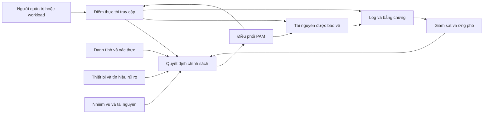

# PAM trong Zero Trust

## 1. PAM đóng vai trò gì trong Zero Trust?

**Zero Trust** là cách tiếp cận bảo vệ tài nguyên trong đó một yêu cầu truy cập không được mặc nhiên tin cậy chỉ vì nó đến từ mạng nội bộ, đã đi qua VPN hoặc sử dụng một tài khoản quen thuộc. Quyết định truy cập cần dựa trên danh tính, tài nguyên đích, hành động được yêu cầu và những điều kiện liên quan; quyền được giới hạn theo nhiệm vụ và được xem xét lại khi có thay đổi có ý nghĩa.

**Privileged Access Management — PAM** quản lý những truy cập có khả năng gây tác động lớn: quản trị hệ thống, thay đổi chính sách, sử dụng credential nhạy cảm, triển khai phần mềm hoặc thao tác với dữ liệu quan trọng. Trong Zero Trust, PAM giúp đưa các nguyên tắc truy cập có điều kiện và quyền tối thiểu vào những hoạt động đặc quyền này.

Ví dụ, một kỹ sư đã đăng nhập VPN vẫn chưa có đủ căn cứ để mở phiên quản trị cơ sở dữ liệu production. Cần xác định người đó là ai, đang dùng thiết bị nào, có nhiệm vụ hợp lệ không, được thao tác trên cơ sở dữ liệu nào, trong thời gian bao lâu và điều gì xảy ra khi thiết bị hoặc phiên bị phát hiện có rủi ro.

Mua một sản phẩm PAM không tự biến toàn bộ hạ tầng thành kiến trúc Zero Trust. PAM là một thành phần cần phối hợp với quản lý danh tính, quản lý thiết bị, chính sách tài nguyên, phân đoạn truy cập và hệ thống giám sát.

Sau bài học trong chương Khái niệm PAM, người học có thể:

- Giải thích cách PAM hỗ trợ các nguyên tắc Zero Trust đối với người quản trị và tài khoản dịch vụ.
- Phân biệt xác thực danh tính, quyết định cấp quyền và thực thi quyền tại tài nguyên.
- Thiết kế vòng đời yêu cầu, cấp, giám sát và thu hồi truy cập đặc quyền.
- Nhận ra các đường truy cập ngoài PAM, các giới hạn của vault, MFA, VPN và ghi hình phiên.
- Xác định bằng chứng cần lưu để điều tra và kiểm tra hiệu lực của chính sách.

## 2. Các nguyên tắc Zero Trust liên quan trực tiếp đến PAM

### 2.1. Không dùng vị trí mạng làm bằng chứng đủ

Mạng nội bộ có thể chứa thiết bị bị chiếm dụng, workload cấu hình sai hoặc tài khoản bị đánh cắp. Việc một kết nối đến từ địa chỉ nội bộ chỉ là một thuộc tính của yêu cầu, không chứng minh người gọi có quyền quản trị tài nguyên.

PAM có thể yêu cầu người dùng đi qua một luồng quản trị được kiểm soát trước khi tới hệ thống đích. Tuy nhiên, nếu tài khoản quản trị vẫn đăng nhập trực tiếp được từ một đường khác, kết nối qua PAM mới chỉ là một trong nhiều lựa chọn. Thiết kế phải nhận diện và kiểm soát những đường truy cập thay thế.

### 2.2. Kiểm tra rõ ràng danh tính và điều kiện truy cập

Một yêu cầu đặc quyền cần được gắn với danh tính có thể quy trách nhiệm. Với con người, đó thường là tài khoản quản trị cá nhân; với tự động hóa, đó là danh tính workload hoặc tài khoản dịch vụ có chủ sở hữu.

Điều kiện truy cập có thể bao gồm phương thức xác thực, trạng thái thiết bị, môi trường đích, nhiệm vụ, thời điểm và tín hiệu rủi ro. Không phải hệ thống nào cũng thu thập được toàn bộ các tín hiệu này; cần ghi rõ nguồn dữ liệu và cách xử lý khi thiếu tín hiệu.

Xác thực mạnh giúp tăng độ tin cậy rằng người dùng đang kiểm soát phương tiện xác thực hợp lệ. Nó không tự chứng minh rằng người dùng cần quyền xóa cơ sở dữ liệu hoặc thay đổi chính sách bảo mật.

### 2.3. Cấp quyền theo nhiệm vụ, tài nguyên và thời hạn

Least privilege giới hạn khả năng thao tác. Just-in-Time access, viết tắt là JIT, giảm thời gian quyền khả dụng. Just Enough Administration, viết tắt là JEA, hướng tới giới hạn hành động quản trị ở mức đủ dùng.

Ba câu hỏi cần được trả lời cùng nhau:

1. Được làm việc gì?
2. Được tác động lên tài nguyên nào?
3. Được thực hiện trong điều kiện và thời gian nào?

Một phiên quản trị toàn hệ thống trong mười phút vẫn có khả năng gây tác động lớn trong mười phút đó. Một vai trò hẹp nhưng tồn tại thường trực vẫn cần được rà soát nhu cầu và điều kiện sử dụng.

### 2.4. Thiết kế với giả định có thể xảy ra xâm nhập

Giả định xâm nhập không có nghĩa là coi mọi người dùng đều độc hại. Nó yêu cầu hệ thống vẫn có biện pháp giới hạn ảnh hưởng nếu một credential, thiết bị hoặc phiên bị chiếm dụng.

Với PAM, cách tiếp cận này thể hiện qua việc giảm quyền thường trực, hạn chế di chuyển sang tài nguyên khác, bảo vệ bí mật, kiểm soát hành động và duy trì bằng chứng độc lập. Thiết kế cũng cần xét việc chính hạ tầng PAM có thể bị tấn công.

### 2.5. Đánh giá lại khi điều kiện thay đổi

Quyết định cấp quyền tại thời điểm bắt đầu phiên không bảo đảm điều kiện luôn giữ nguyên. Thiết bị có thể phát sinh cảnh báo, người dùng có thể rời ca trực hoặc ticket có thể bị hủy.

Đánh giá lại có thể diễn ra theo sự kiện, theo chu kỳ hoặc tại những điểm nhạy cảm của tác vụ, tùy khả năng hệ thống. Không nên diễn giải “xác minh liên tục” thành yêu cầu nhập MFA trước mọi lệnh, cũng không được giả định mọi sản phẩm có thể phản ứng tức thời với mọi thay đổi.

## 3. Xác định đúng đối tượng cần bảo vệ

Đặc quyền không chỉ nằm ở tài khoản có tên `root` hoặc `Administrator`. Trong một hệ thống hiện đại, các quyền sau cũng có thể tạo ra tác động tương đương:

| Đối tượng | Khả năng đặc quyền điển hình | Điều cần đưa vào phạm vi PAM |
| --- | --- | --- |
| Máy chủ và hệ điều hành | Sửa dịch vụ, người dùng, cấu hình, tệp hệ thống | Tài khoản quản trị, đường đăng nhập, nâng quyền trong phiên |
| Cơ sở dữ liệu | Đọc dữ liệu nhạy cảm, sửa schema, cấp quyền | Tài khoản DBA, quyền theo dữ liệu và tác vụ |
| Nền tảng đám mây | Thay chính sách, tạo danh tính, điều khiển tài nguyên | Vai trò quản trị, token và khả năng chuyển vai trò |
| Nền tảng điều phối | Sửa workload, lấy secret, chạy thao tác quản trị | Danh tính quản trị và danh tính workload |
| Pipeline triển khai | Đưa mã và cấu hình vào production | Quyền sửa pipeline, quyền triển khai và credential được dùng |
| Vault và hệ thống PAM | Cấp bí mật, đổi chính sách hoặc tạo phiên | Tài khoản quản trị nền tảng, chính sách và bằng chứng |
| Kho log và bản sao lưu | Đọc dữ liệu tập trung, xóa hoặc sửa bằng chứng | Quyền xem, xuất, xóa và quản trị lưu trữ |

Tài khoản có quyền đọc secret của một quản trị viên có thể nhận được sức mạnh của quản trị viên đó. Người sửa được mã mà một workload đặc quyền sẽ chạy có thể tác động đến tài nguyên thông qua workload. Vì vậy, đánh giá Zero Trust cho PAM cần xem các đường dẫn đến đặc quyền, thay vì chỉ nhìn tên vai trò.

## 4. PAM phối hợp với các thành phần khác như thế nào?

| Thành phần | Trách nhiệm chính trong luồng truy cập | Điểm giao với PAM |
| --- | --- | --- |
| Quản lý danh tính và xác thực | Quản lý vòng đời danh tính, xác thực, nhóm và vai trò | Cung cấp danh tính và thuộc tính để xét yêu cầu đặc quyền |
| Quản lý thiết bị và tín hiệu bảo mật | Cung cấp trạng thái quản lý, tuân thủ hoặc cảnh báo thiết bị | Hỗ trợ quyết định có cho phép quản trị từ thiết bị đó không |
| Cổng truy cập tài nguyên hoặc ZTNA | Kiểm soát kết nối tới ứng dụng, dịch vụ hoặc tài nguyên được hỗ trợ | Hạn chế khả năng tiếp cận đường quản trị trước và trong phiên |
| PAM | Quản lý quyền, credential hoặc phiên đặc quyền | Kích hoạt quyền, môi giới phiên, ghi nhận và hỗ trợ thu hồi |
| Phân quyền tại hệ thống đích | Thực thi quyền đối với thao tác và dữ liệu cụ thể | Bảo đảm vai trò được cấp không làm được nhiều hơn dự kiến |
| Giám sát và điều phối ứng phó | Tổng hợp sự kiện, phát hiện bất thường, kích hoạt quy trình xử lý | Cung cấp tín hiệu để xem xét, hạn chế hoặc kết thúc truy cập |

Các ranh giới trên là cách phân chia trách nhiệm để thiết kế; một sản phẩm có thể đảm nhiệm nhiều vai trò. Điều quan trọng là biết thành phần nào quyết định, thành phần nào thực thi và ai chịu trách nhiệm khi hành vi thực tế khác chính sách.

Ví dụ, cổng truy cập có thể cho phép kết nối tới máy chủ nhưng không biết người dùng được phép sửa bảng dữ liệu nào. Ngược lại, phân quyền ở cơ sở dữ liệu có thể giới hạn bảng nhưng không đủ dữ liệu để biết máy tính người dùng vừa phát sinh cảnh báo bảo mật. Cần phối hợp các lớp này theo khả năng thực tế.

## 5. Từ chính sách đến khả năng thực thi

Có thể tách luồng truy cập thành ba chức năng:

- **Ra quyết định:** tổng hợp yêu cầu và các thuộc tính để quyết định cho phép, từ chối hoặc yêu cầu điều kiện bổ sung.
- **Điều phối thực hiện:** kích hoạt vai trò, phát credential, tạo phiên hoặc gửi lệnh thu hồi theo quyết định.
- **Thực thi:** cho phép hoặc chặn hành động ở cổng truy cập, proxy, agent, hệ điều hành, ứng dụng hoặc hệ thống đích.

Trong tài liệu kiến trúc, nơi ra quyết định thường được gọi là điểm quyết định chính sách, còn nơi áp dụng quyết định là điểm thực thi chính sách. Chức năng điều phối kết nối giữa chúng có thể nằm trong PAM hoặc thành phần khác.

Một quyết định “chỉ cho xem trạng thái dịch vụ” không có hiệu lực nếu hệ thống thực thi chỉ biết cấp shell quản trị toàn máy. Phải có cơ chế chuyển ý định của chính sách thành quyền hoặc hành động mà hệ thống đích thực sự giới hạn được.



Sơ đồ mô tả quan hệ chức năng, không yêu cầu mọi gói tin dữ liệu đi qua cùng một máy chủ PAM. Một số triển khai dùng môi giới phiên; triển khai khác kích hoạt vai trò tại hệ thống đích hoặc dùng agent. Mỗi cách cần xác định rõ nơi thực thi và đường truy cập có thể bỏ qua nơi đó.

### 5.1. Độ tin cậy của dữ liệu đầu vào

Nếu chính sách yêu cầu “thiết bị được quản lý”, thông tin này phải đến từ nguồn có thể tin cậy và được gắn với đúng yêu cầu. Không thể chỉ tin một trường do người gọi tự khai.

Cần xác định:

- Thuộc tính được cung cấp bởi hệ thống nào, được bảo vệ khi truyền và lưu ra sao?
- Dữ liệu còn mới đến mức nào và có thể bị thay đổi trong phiên không?
- Danh tính thiết bị, người dùng và phiên được liên kết bằng cơ chế nào?
- Điều gì xảy ra khi tín hiệu không có, bị lỗi hoặc mâu thuẫn?

Quyết định dựa trên ngữ cảnh chỉ có giá trị khi ngữ cảnh có nguồn gốc và ý nghĩa rõ ràng.

### 5.2. Phân biệt nơi điều khiển và nơi diễn ra truy cập

Chính sách và lệnh thu hồi thuộc phần điều khiển; lệnh quản trị và dữ liệu trả về thuộc đường truy cập thực tế. Hai phần này có thể đi qua những thành phần khác nhau.

Nếu kênh điều khiển báo đã hết hạn nhưng phiên trực tiếp tới máy chủ vẫn hoạt động, hệ thống mới kết thúc quyền trên giao diện điều khiển. Cần đối chiếu với trạng thái tại nơi phiên hoặc token đang được sử dụng.

## 6. Vòng đời truy cập đặc quyền của con người

### Bước 1: Gắn yêu cầu với một danh tính và nhiệm vụ

Người dùng xác thực bằng tài khoản quản trị cá nhân và nêu mục đích, tài nguyên, hành động, thời lượng. Ticket hoặc thay đổi đã duyệt cung cấp ngữ cảnh công việc, nhưng việc có mã ticket không tự chứng minh nội dung yêu cầu phù hợp.

### Bước 2: Đánh giá điều kiện

Hệ thống kiểm tra quyền yêu cầu, trạng thái danh tính, phương thức xác thực, điều kiện thiết bị và các thuộc tính liên quan. Với tác vụ nhạy cảm, có thể yêu cầu xác thực bổ sung hoặc người duyệt độc lập.

Đánh giá dựa trên rủi ro cần được diễn đạt thành hành vi rõ ràng. Một nhãn “rủi ro cao” phải dẫn đến phản ứng đã xác định, chẳng hạn từ chối mở phiên mới hoặc chuyển sang quy trình xem xét, thay vì chỉ hiển thị cảnh báo.

### Bước 3: Cấp khả năng truy cập có phạm vi

PAM có thể kích hoạt vai trò tạm thời, môi giới phiên hoặc cấp credential có điều kiện. Phạm vi cấp cần bám sát tài nguyên và tác vụ đã được chấp thuận.

Nếu cần dùng một tài khoản đích dùng chung, PAM vẫn phải liên kết hoạt động với người yêu cầu. Cũng cần kiểm soát việc lộ credential và đường đăng nhập trực tiếp bằng credential đó.

### Bước 4: Thực thi và quan sát

Hệ thống đích thực thi giới hạn hành động. Các điểm thích hợp ghi lại danh tính, yêu cầu, quyết định, hành động và kết quả. Khi có tín hiệu thay đổi, chính sách có thể yêu cầu đánh giá lại.

Ghi hình phiên hữu ích cho một số giao thức và tác vụ, nhưng không thay thế log cấu trúc hoặc phân quyền. Phiên API, tác vụ nền và hành động dịch vụ có thể cần loại bằng chứng khác.

### Bước 5: Kết thúc quyền và xác nhận hiệu lực

Khi hết hạn, nhiệm vụ hoàn tất hoặc có quyết định thu hồi, cần xử lý những khả năng truy cập đã phát sinh:

- Quyền gán và thành viên nhóm tạm thời.
- Phiên còn hoạt động.
- Token, chứng chỉ hoặc credential đã phát hành.
- Credential đã được người dùng xem hoặc tải xuống.
- Tác vụ nền đang chạy với danh tính đặc quyền.

Không phải mọi cơ chế đều hỗ trợ thu hồi tức thời. Nếu token chỉ hết hiệu lực khi đến hạn, giới hạn đó cần được ghi rõ và được xử lý trong thiết kế bằng thời hạn phù hợp hoặc cơ chế kiểm soát bổ sung.

## 7. Ví dụ: truy cập quản trị khi đang xử lý sự cố

### 7.1. Bối cảnh và yêu cầu

Kỹ sư Linh trực ứng dụng thanh toán cần khởi động lại `payment-api` trên máy `prod-app-03`. Linh đã kết nối VPN, nhưng việc đó chỉ giải quyết một phần khả năng kết nối. Quyết định cấp đặc quyền vẫn cần được thực hiện cho nhiệm vụ cụ thể.

Ticket `INC-7302` ghi nhận phạm vi xử lý. Chính sách minh họa yêu cầu:

| Thuộc tính | Điều kiện hoặc giới hạn |
| --- | --- |
| Danh tính | Tài khoản quản trị riêng của Linh đang hoạt động |
| Nhiệm vụ | Đang trực và được phép xử lý sự cố của ứng dụng |
| Thiết bị | Thiết bị quản trị được quản lý, có tín hiệu trạng thái còn phù hợp |
| Xác thực | Đáp ứng mức xác thực mạnh mà tổ chức quy định cho thao tác |
| Tài nguyên | Dịch vụ `payment-api` trên `prod-app-03` |
| Hành động | Xem trạng thái, đọc phần log được cho phép, khởi động lại dịch vụ |
| Thời gian | Kích hoạt tối đa 20 phút trong ví dụ |
| Kết thúc | Thu hồi quyền tạm, kết thúc phiên theo chính sách, lưu kết quả |

Thời lượng 20 phút chỉ phục vụ ví dụ. Thời hạn thực tế phải phù hợp tác vụ và khả năng vận hành, đồng thời tính đến thời gian hiệu lực của các phiên hoặc token liên quan.

### 7.2. Khi yêu cầu được chấp thuận

PAM kiểm tra điều kiện và điều phối một phiên có khả năng thực thi đúng các thao tác được cấp. Nếu công nghệ chỉ hỗ trợ shell toàn quyền, thiết kế đó chưa thực hiện được giới hạn hành động như bảng trên; cần thêm cơ chế hoặc điều chỉnh rõ mô hình truy cập và kiểm soát.

Linh không được cấp quyền sửa mọi dịch vụ hoặc đọc toàn bộ secret của máy. Nếu chẩn đoán phát sinh nhu cầu thay cấu hình, cần yêu cầu phạm vi phù hợp với tác vụ mới.

### 7.3. Khi điều kiện thay đổi trong phiên

Giả sử hệ thống giám sát thiết bị phát hiện một tín hiệu cần cô lập máy tính đang dùng. Luồng phản ứng có thể gồm:

1. Hệ thống giám sát gửi sự kiện có danh tính thiết bị và thời điểm.
2. Thành phần quyết định xác định các phiên đặc quyền liên quan.
3. Chính sách yêu cầu chặn phiên mới, thu hồi quyền tạm và kết thúc phiên đang mở nếu cơ chế thực thi hỗ trợ.
4. Các token hoặc credential đã phát hành được xử lý theo khả năng thu hồi của từng loại.
5. Nhóm vận hành nhận bằng chứng và tiếp tục xử lý từ thiết bị quản trị khác đáp ứng chính sách.

Bước gửi lệnh kết thúc phiên và bước xác nhận phiên đã kết thúc là hai sự kiện khác nhau. Nếu một điểm thực thi không phản hồi, phải ghi nhận kết quả chưa xác nhận và kích hoạt phương án xử lý phù hợp; không thể báo thu hồi thành công chỉ dựa trên việc đã gửi yêu cầu.

### 7.4. Điều ví dụ này chứng minh

Giá trị của Zero Trust nằm ở việc kết nối quyết định với quyền thực tế và sự thay đổi của điều kiện. Một màn hình đăng nhập có MFA rồi cấp toàn quyền đến hết ngày vẫn thiếu các giới hạn và vòng đời được mô tả trong ví dụ.

Việc xử lý sự cố cũng không nên phụ thuộc vào một đường quản trị duy nhất mà không có phương án khôi phục. Đường khẩn cấp cần được thiết kế trước, có trách nhiệm và bằng chứng riêng.

## 8. Diễn đạt chính sách sao cho có thể triển khai

Đoạn JSON sau mô tả ý định chính sách cho ví dụ. Đây là **dữ liệu minh họa**, không phải cấu hình tương thích với một sản phẩm cụ thể. Các tên hành động, điều kiện và phản ứng phải được ánh xạ sang cơ chế thực thi thực tế.

```json
{
  "policy": "payment-incident-access",
  "subject": {
    "identityType": "humanAdmin",
    "requiredDuty": "paymentOnCall"
  },
  "resource": {
    "environment": "production",
    "host": "prod-app-03",
    "service": "payment-api"
  },
  "allowedActions": [
    "service.status",
    "service.readApprovedLogs",
    "service.restart"
  ],
  "conditions": {
    "requireActiveIncident": true,
    "requireStrongAuthentication": true,
    "requireManagedAdminDevice": true,
    "requireAcceptableDeviceSignal": true
  },
  "activation": {
    "maxDurationMinutes": 20
  },
  "reevaluation": {
    "events": [
      "deviceRiskChanged",
      "identityDisabled",
      "incidentCancelled"
    ],
    "response": [
      "denyNewAccess",
      "revokeTemporaryGrant",
      "requestActiveSessionTermination"
    ]
  },
  "evidence": [
    "request",
    "decision",
    "grant",
    "activity",
    "revocationOutcome"
  ]
}
```

Để biến mô tả thành kiểm soát có hiệu lực, người thiết kế cần trả lời thêm:

- Vai trò hoặc endpoint nào thực thi từng hành động?
- Tín hiệu thiết bị do ai cung cấp, bao lâu thì bị coi là quá cũ?
- Cơ chế nào chuyển sự kiện thay đổi thành yêu cầu đánh giá lại?
- Có quyền kế thừa hoặc tài khoản khác cho phép Linh bỏ qua giới hạn này không?
- Các phiên và token có thể được thu hồi trong giới hạn nào?
- Khi thiếu dữ liệu hoặc không liên lạc được với điểm thực thi, hệ thống xử lý ra sao?

Danh sách hành động được phép trong JSON không tự xóa những quyền khác mà người dùng đã có. Việc áp dụng chính sách phải đi cùng xử lý quyền thường trực, đường truy cập cũ và phân quyền tại tài nguyên.

## 9. Tài khoản dịch vụ và workload trong Zero Trust

Workload không thể được kiểm soát bằng cách yêu cầu người vận hành nhập MFA cho mọi lần gọi API. Cần dùng cơ chế phù hợp với danh tính máy và vòng đời tự động hóa.

### 9.1. Xác minh đúng workload

Danh tính dịch vụ cần gắn được với workload dự kiến, môi trường và chủ sở hữu. Tùy nền tảng, hệ thống có thể dùng danh tính workload, chứng chỉ hoặc cơ chế liên kết danh tính để phát hành credential.

Cần kiểm soát điều kiện để workload nhận được danh tính đó. Nếu bất kỳ pipeline nào cũng lấy được credential của production, việc đổi từ mật khẩu tĩnh sang token ngắn hạn vẫn chưa giải quyết giới hạn người nhận quyền.

### 9.2. Giới hạn quyền và thời hạn

Một job sao lưu có thể cần đọc dữ liệu nguồn và ghi vào vùng sao lưu xác định. Nó không mặc nhiên cần quyền sửa schema, tạo người dùng hoặc xóa mọi bản sao lưu.

Credential ngắn hạn giảm thời gian credential còn hữu ích sau khi bị lộ, nhưng không làm quyền bên trong credential hẹp hơn. Cần kết hợp phạm vi tài nguyên, hành động, môi trường và điều kiện phát hành.

### 9.3. Kiểm soát chuỗi triển khai

Một pipeline có quyền đưa mã lên production có thể gián tiếp tác động bằng quyền của ứng dụng chạy mã đó. Vì vậy, phạm vi cần xem xét bao gồm:

- Người hoặc hệ thống được sửa định nghĩa pipeline.
- Nguồn mã, cấu hình và thành phần được triển khai.
- Điều kiện phê duyệt hoặc kiểm tra trước khi phát hành.
- Danh tính triển khai và danh tính runtime của ứng dụng.
- Quyền truy cập secret mà workload sử dụng sau khi khởi chạy.

Tách danh tính triển khai và danh tính runtime giúp mô tả trách nhiệm rõ hơn, nhưng vẫn phải xem xét khả năng mã được triển khai sử dụng quyền runtime. Chỉ tách tên tài khoản chưa loại bỏ được đường tác động này.

### 9.4. Gắn bằng chứng với lần chạy

Với tự động hóa, bằng chứng nên liên kết được danh tính workload, lần chạy, nguồn kích hoạt, phiên bản được triển khai, tài nguyên đích và kết quả. Khi có người phê duyệt hoặc khởi chạy, cần lưu mối liên hệ với danh tính đó.

Không nên cố gắng thay mọi bằng chứng máy bằng ghi hình màn hình. Log cấu trúc, sự kiện phát hành credential và log hành động ở hệ thống đích thường cần thiết để hiểu một tác vụ tự động.

## 10. Vai trò và giới hạn của vault, MFA, VPN, giám sát

| Cơ chế | Giá trị đóng góp | Giới hạn cần nhớ |
| --- | --- | --- |
| MFA | Tăng độ tin cậy của bước xác thực người dùng | Không quyết định người dùng cần quyền gì; phiên hợp lệ vẫn có thể bị lạm dụng |
| VPN | Bảo vệ hoặc cung cấp một đường kết nối theo thiết kế | Đã vào mạng chưa phải là được quản trị mọi tài nguyên |
| Vault | Kiểm soát lưu trữ và cấp phát bí mật | Một credential toàn quyền vẫn mang toàn quyền khi được sử dụng |
| Luân chuyển credential | Giảm khả năng tiếp tục dùng bí mật cũ | Không bảo đảm mọi phiên, token hay tác vụ đã tạo bị vô hiệu hóa |
| Môi giới phiên | Có thể hạn chế lộ credential và tập trung đường quản trị | Chỉ có hiệu lực đầy đủ khi kiểm soát được đường truy cập thay thế |
| Ghi hình và log phiên | Hỗ trợ quan sát, quy trách nhiệm và điều tra | Không tự ngăn hành động vượt nhu cầu nếu hệ thống vẫn cho phép |
| Phân đoạn truy cập | Hạn chế phạm vi tài nguyên có thể kết nối | Không thay thế quyền ở ứng dụng hoặc cơ sở dữ liệu |

Các cơ chế có giá trị khi được phối hợp theo nhiệm vụ. Không nên coi một cơ chế riêng lẻ là bằng chứng rằng kiến trúc đã đáp ứng toàn bộ mục tiêu Zero Trust.

Đặc biệt, thông điệp “credential không lộ cho người dùng” cần được hiểu theo giao thức và cách triển khai. Môi giới phiên có thể giữ bí mật đăng nhập khỏi người dùng nhưng tài khoản đích vẫn có thể sở hữu quyền rộng, và người dùng vẫn thực hiện được các hành động mà phiên cho phép.

## 11. Thu hồi quyền là một bài toán phân tán

Một lần truy cập có thể tạo ra nhiều trạng thái ở nhiều hệ thống: vai trò tạm trên IAM, phiên trên proxy, kết nối ở máy chủ, token ở ứng dụng và tác vụ nền ở workload. Kết thúc một trạng thái không luôn kết thúc các trạng thái còn lại.

| Trạng thái | Hành động thu hồi có thể cần | Bằng chứng nên có |
| --- | --- | --- |
| Vai trò hoặc nhóm tạm | Gỡ quyền tại nơi quản lý danh tính | Kết quả thay đổi và thời điểm có hiệu lực |
| Phiên qua môi giới | Kết thúc hoặc hạn chế phiên | Xác nhận từ thành phần quản lý phiên |
| Phiên trực tiếp ở hệ thống đích | Kết thúc bằng cơ chế tại đích nếu hỗ trợ | Trạng thái phiên và kết quả thực thi |
| Token đã phát hành | Thu hồi, chặn tại điểm kiểm tra hoặc chờ hết hạn theo thiết kế | Thời hạn và khả năng sử dụng còn lại đã xác định |
| Credential đã lộ | Vô hiệu hóa hoặc luân chuyển phù hợp | Kết quả cập nhật và kiểm tra các bên phụ thuộc |
| Tác vụ nền | Dừng, chuyển giao hoặc tiếp tục theo quyết định vận hành | Danh tính, trạng thái và quyết định xử lý tác vụ |

Không có một thao tác “revoke” trừu tượng bảo đảm mọi trạng thái biến mất ngay. Mỗi nền tảng có cách thực thi khác nhau; thiết kế cần xác định khoảng trễ, trường hợp lỗi và người chịu trách nhiệm.

Ví dụ, khóa khả năng nhận vai trò mới có thể không vô hiệu hóa token đã cấp. Đổi mật khẩu đăng nhập có thể không đóng kết nối cơ sở dữ liệu đang tồn tại. Nếu khoảng thời gian còn hiệu lực gây rủi ro lớn, cần lựa chọn cơ chế khác hoặc bổ sung điểm thực thi có khả năng kiểm tra lại phù hợp.

## 12. Bảo vệ chính hạ tầng PAM và bằng chứng

PAM tập trung những khả năng nhạy cảm: truy cập credential, thay chính sách, môi giới phiên và kết nối tới nhiều tài nguyên. Nó cũng phải được đưa vào mô hình bảo vệ Zero Trust.

Những trách nhiệm cần phân định rõ gồm:

- Ai quản trị hạ tầng PAM và ai được thay chính sách cấp quyền.
- Ai được xem hoặc xuất secret và ai được quản lý khóa bảo vệ chúng.
- Ai được duyệt yêu cầu nhạy cảm, với quy tắc tránh tự duyệt nếu cần phân tách nhiệm vụ.
- Ai được truy cập, xuất hoặc xóa bản ghi phiên và log.
- Ai giám sát thay đổi cấu hình và hành động quản trị trên chính PAM.

Một người vừa thay được chính sách, tự cấp quyền, dùng quyền đó rồi xóa toàn bộ bằng chứng có thể vượt qua nhiều lớp kiểm soát. Cần xem tổ hợp quyền, không chỉ từng vai trò riêng lẻ.

Bản ghi phiên có thể chứa dữ liệu cá nhân, thông tin nghiệp vụ hoặc bí mật vô tình xuất hiện trên màn hình. Phải giới hạn người xem, mục đích sử dụng, khả năng xuất và thời gian lưu theo nhu cầu đã xác định. Thu thập nhiều dữ liệu hơn không tự làm hệ thống an toàn hơn.

Bằng chứng tại nhiều nguồn cần được liên kết bằng mã yêu cầu, mã phiên hoặc thuộc tính tương đương, cùng thời gian có thể đối chiếu. Nếu chỉ ghi tên tài khoản đích dùng chung mà không nối được với người yêu cầu, khả năng quy trách nhiệm sẽ bị hạn chế.

## 13. Triển khai theo phạm vi và chuẩn bị khi thành phần bị lỗi

### 13.1. Chọn một luồng có thể kiểm soát đến tận tài nguyên

Một điểm bắt đầu phù hợp là một nhóm quản trị, một loại tác vụ và một nhóm tài nguyên có chủ sở hữu rõ. Với phạm vi đó:

1. Kiểm kê tài khoản, quyền hiệu lực, credential và mọi đường quản trị.
2. Xác định nhiệm vụ được phép và điều kiện cấp quyền.
3. Chọn nơi ra quyết định, điều phối và thực thi.
4. Kết nối các nguồn danh tính, thiết bị và bằng chứng cần thiết.
5. Kiểm chứng cả hành vi được cho phép và hành vi bị chặn.
6. Chuyển quyền thường trực sang luồng có thời hạn khi đã đáp ứng vận hành.
7. Kiểm soát đường truy cập cũ và rà soát ngoại lệ.

Nếu chỉ bắt người dùng đăng nhập cổng PAM nhưng vẫn giữ một nhóm admin thường trực và đường kết nối trực tiếp, phạm vi đã triển khai chưa được kiểm soát đầy đủ. Cần mô tả đúng mức bao phủ thay vì tính mọi tài nguyên đã được thêm vào danh sách PAM là đã được bảo vệ hoàn chỉnh.

### 13.2. Quy định hành vi khi thiếu tín hiệu hoặc mất kết nối

Không nên để người dùng hoặc hệ thống tự đoán cách xử lý khi dịch vụ danh tính, nguồn trạng thái thiết bị, PAM hoặc điểm thực thi gặp lỗi.

| Tình huống | Quyết định cần có trước |
| --- | --- |
| Không nhận được trạng thái thiết bị còn mới | Có từ chối phiên mới, yêu cầu kênh khác hay chuyển sang quy trình khẩn cấp không? |
| Mất kết nối đến nơi ra quyết định | Phiên đang có xử lý thế nào; có được mở phiên mới theo chính sách dự phòng không? |
| Không gửi được log tới nơi lưu tập trung | Có lưu đệm được bảo vệ không; khi nào phải chặn thao tác nhạy cảm? |
| Điểm thực thi không xác nhận thu hồi | Ai xử lý, bằng đường nào, trong phạm vi nào? |
| PAM không khả dụng trong sự cố lớn | Cơ chế khẩn cấp nào đã được chuẩn bị và ai chịu trách nhiệm? |

Có thể cần chính sách khác nhau cho việc mở phiên mới và duy trì tác vụ đang chạy. Ví dụ, cắt đột ngột một thao tác khôi phục đang diễn ra có thể tạo thêm sự cố, trong khi tiếp tục cho mở phiên mới không kiểm soát lại mở rộng rủi ro. Quyết định phải gắn với tác vụ và tài nguyên cụ thể, được phê duyệt trong thiết kế vận hành.

Một chính sách dự phòng lưu tại điểm thực thi cần có phạm vi, thời hạn và cách bảo vệ chống sửa đổi. Việc không liên lạc được với hệ thống trung tâm không nên mặc nhiên biến thành quyền quản trị không giới hạn.

### 13.3. Thiết kế break-glass

Break-glass là đường truy cập khẩn cấp cho tình huống được xác định trước, chẳng hạn cần khôi phục khi hệ thống nhận dạng chính không hoạt động. Cần có người được phép sử dụng, cách bảo quản credential, phạm vi quyền, cơ chế cảnh báo khả dụng và quy trình kết thúc.

Sau sử dụng cần đối chiếu hành động, thu hồi hoặc thay credential phù hợp, khôi phục kiểm soát thông thường và xem lại lý do phải dùng ngoại lệ. Đường khẩn cấp phải được diễn tập phù hợp; không nên để nó thành đường quản trị hằng ngày hoặc thành một phụ thuộc không thể dùng được khi thành phần chính đã hỏng.

## 14. Kiểm chứng thiết kế và theo dõi hiệu quả

Phần này mô tả việc kiểm chứng khi triển khai hệ thống PAM; không yêu cầu chạy lệnh hoặc triển khai cấu hình từ bài học.

### 14.1. Những tình huống cần kiểm chứng

| Tình huống | Kết quả cần quan sát |
| --- | --- |
| Đúng danh tính, thiết bị, nhiệm vụ và tài nguyên | Cấp đúng phạm vi, lưu quyết định và hoạt động |
| Danh tính hợp lệ nhưng yêu cầu tài nguyên ngoài phạm vi | Bị từ chối tại điểm thực thi thích hợp |
| Có VPN nhưng không đáp ứng điều kiện quản trị | Không mở được phiên đặc quyền chỉ dựa vào vị trí mạng |
| Yêu cầu hết hạn hoặc ticket bị hủy | Không tiếp tục cấp mới; quyền và phiên hiện có được xử lý theo chính sách |
| Thử đường quản trị trực tiếp ngoài PAM | Đường đó bị kiểm soát hoặc được xác định rõ là ngoại lệ có quản lý |
| Tín hiệu rủi ro thay đổi trong phiên | Có liên kết sự kiện, quyết định mới và kết quả xử lý |
| Workload khác xin credential của production | Không được nhận chỉ vì cùng chạy trong mạng nội bộ |
| Gửi yêu cầu thu hồi nhưng điểm thực thi không phản hồi | Không báo thành công giả; có bằng chứng và quy trình xử lý |

Chỉ kiểm tra đăng nhập thành công không chứng minh phân quyền hoạt động. Chỉ kiểm tra người dùng bị từ chối cũng chưa chứng minh luồng vận hành hợp lệ sử dụng được. Cần kiểm chứng cả khả năng thực hiện nhiệm vụ lẫn ranh giới bị cấm.

### 14.2. Chỉ số và ý nghĩa

| Chỉ số | Câu hỏi hỗ trợ trả lời |
| --- | --- |
| Danh tính còn đặc quyền thường trực theo từng nhóm tài nguyên | Quyền tồn tại liên tục còn tập trung ở đâu? |
| Tác vụ đặc quyền đi qua luồng được kiểm soát | Mức bao phủ thực tế của PAM là bao nhiêu? |
| Đường truy cập thay thế và ngoại lệ chưa có thời hạn | Có thể bỏ qua điểm thực thi ở đâu? |
| Thời gian từ tín hiệu cần thu hồi đến khi mất truy cập thực tế | Phản ứng của hệ thống đạt mức nào? |
| Yêu cầu hợp lệ bị chặn, thời gian chờ và số lần gia hạn | Thiết kế có đáp ứng nhu cầu vận hành không? |
| Sự kiện không liên kết được danh tính, phiên và tài nguyên | Bằng chứng còn khoảng trống nào? |
| Lần sử dụng break-glass và kết quả rà soát | Ngoại lệ có đang trở thành cách làm thường xuyên không? |

Mỗi chỉ số cần ghi phạm vi đo và mẫu số khi dùng tỷ lệ. Số lượng tài khoản “đã đưa vào vault” không tương đương tỷ lệ truy cập đặc quyền đã được kiểm soát đến hệ thống đích.

## 15. Tự áp dụng vào một hệ thống quen thuộc

Chọn một nhiệm vụ quản trị mà bạn hiểu, chẳng hạn khởi động lại dịch vụ, khôi phục bản sao lưu hoặc triển khai một phiên bản. Vẽ luồng từ danh tính yêu cầu đến tài nguyên và chỉ ra:

- Nguồn xác minh danh tính, thiết bị hoặc workload.
- Điểm ra quyết định và điểm thực thi quyền.
- Phạm vi hành động, tài nguyên và thời gian.
- Đường truy cập có thể bỏ qua PAM.
- Phản ứng khi điều kiện thay đổi và khi hệ thống trung tâm lỗi.
- Cách xác nhận quyền đã kết thúc.
- Chuỗi bằng chứng để người khác kiểm tra lại được.

Nếu không xác định được nơi thực thi một giới hạn, hãy ghi nhận đó là khoảng trống thiết kế. Nếu một token không thu hồi sớm được, hãy nêu thời gian còn hiệu lực và kiểm soát bổ sung thay vì giả định thao tác xóa vai trò đã giải quyết toàn bộ.

## 16. Ghi nhớ

Trong Zero Trust, PAM quản lý đặc quyền như một chuỗi quyết định và khả năng thực thi gắn với danh tính, tài nguyên, nhiệm vụ và điều kiện. Truy cập từ mạng nội bộ, đăng nhập thành công hoặc một lần phê duyệt đều chưa đủ để suy ra quyền quản trị không giới hạn.

Thiết kế có giá trị khi cấp đúng quyền, kiểm soát đường truy cập, phản ứng được với thay đổi, xác định giới hạn thu hồi và lưu được bằng chứng. Những yêu cầu đó áp dụng cho cả người quản trị, tài khoản dịch vụ và chính hạ tầng PAM.
