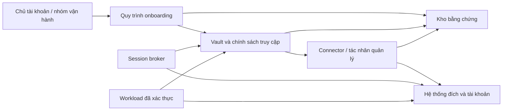

# Onboard account vào vault

## 1. Onboarding trong PAM có nghĩa là gì?

Onboard account vào vault là đưa một tài khoản cùng cơ chế quản lý credential của nó vào phạm vi kiểm soát của hệ thống quản lý truy cập đặc quyền (Privileged Access Management, PAM). Vault bảo vệ secret, kiểm soát bên được sử dụng, hỗ trợ xác minh và luân chuyển credential theo khả năng tích hợp. Quy trình onboarding còn phải xác định chủ sở hữu, quyền thực tế trên hệ thống đích, các bên phụ thuộc và cách xử lý khi credential thay đổi.

Việc tạo một bản ghi và lưu mật khẩu mới chỉ hoàn thành phần lưu giữ. Một tài khoản chỉ được coi là đã quản lý theo phạm vi đã cam kết khi PAM có thể dùng đúng credential cho đúng tài khoản, áp dụng chính sách truy cập, thực hiện các thao tác vòng đời đã được phê duyệt và cung cấp bằng chứng tương ứng. Nếu connector chưa hỗ trợ rotation, trạng thái đó cần được thể hiện rõ; không gán nhãn “tự động quản lý” chỉ vì đã nhập được mật khẩu.

Trong module PAM, đối tượng có thể là tài khoản quản trị máy chủ, tài khoản quản trị cơ sở dữ liệu, danh tính dịch vụ hoặc tài khoản đặc quyền trên hạ tầng nhạy cảm. Onboarding giúp chuyển từ credential phân tán sang quyền sử dụng có kiểm soát, kết hợp least privilege, JIT/JEA, giám sát phiên và truy vết cho kiểm toán, ứng phó sự cố.

Một tình huống điển hình: tác vụ báo cáo production đang dùng tài khoản cơ sở dữ liệu `svc-reporting-prod`, với mật khẩu nằm trong cấu hình của nhiều máy chạy job. Đưa mật khẩu vào vault mà không xử lý các bản sao và phụ thuộc sẽ chưa giải quyết được rủi ro. Nếu bật rotation ngay, job có thể ngừng chạy. Bài học sẽ dùng tình huống này để làm rõ các bước cần thiết.

## 2. Phân biệt tài khoản, credential và bản ghi vault

Ba đối tượng này có vòng đời khác nhau:

| Đối tượng | Ví dụ | Điều cần quản lý |
|---|---|---|
| Tài khoản trên hệ thống đích | Tài khoản cơ sở dữ liệu, tài khoản cục bộ, service principal | ID danh tính, trạng thái, vai trò và quyền thực tế |
| Credential hoặc phương thức xác thực | Mật khẩu, cặp khóa, chứng thư, access key | Bí mật, phiên bản, hiệu lực, thay thế và thu hồi |
| Bản ghi trong vault | Đối tượng tham chiếu tài khoản và các phiên bản secret | Metadata, chính sách truy cập, cơ chế xác minh và rotation |

Một tài khoản có thể có nhiều credential cùng hợp lệ, ví dụ hai khóa được dùng trong giai đoạn chuyển đổi. Một bản ghi vault cũng có thể lưu các phiên bản cũ để phục vụ quy trình kiểm soát; việc lưu phiên bản không có nghĩa credential cũ vẫn còn hiệu lực trên hệ thống đích.

Ngược lại, xóa một secret khỏi vault không tự xóa tài khoản, thay mật khẩu, kết thúc phiên hoặc thu hồi token đã được cấp. Mỗi tác động phải có cơ chế thực thi riêng trên hệ thống liên quan.

Cần xác định nơi có thẩm quyền thay đổi credential. Với tài khoản cục bộ, đó có thể là máy chủ; với tài khoản miền, đó là hệ thống quản lý danh tính của miền; với một credential dùng chung trên nhiều nơi, phạm vi phụ thuộc có thể rộng hơn một host. Tránh tạo nhiều bộ điều khiển rotation độc lập cho cùng một credential vì chúng có thể liên tục ghi đè kết quả của nhau.

## 3. Kiến trúc và ranh giới tin cậy



Connector là thành phần hiểu giao thức và thao tác trên nền tảng đích: đăng nhập để xác minh, đổi mật khẩu, tạo khóa thay thế hoặc thực hiện một thao tác được hỗ trợ. Không phải mọi connector đều có cùng chức năng; cần xác nhận đúng khả năng cho loại tài khoản đang đưa vào quản lý.

Vault thường cần một cách truy cập ban đầu để xác minh hoặc thay credential. Đây là bài toán bootstrap. Có thể sử dụng credential hiện có được bàn giao qua kênh được bảo vệ, một danh tính quản lý riêng hoặc cơ chế cấp quyền do nền tảng hỗ trợ. Không đặt credential bootstrap vào log, ticket, dòng lệnh hay tài liệu hướng dẫn. Sau khi hoàn tất, thu hẹp hoặc loại bỏ quyền bootstrap không còn cần thiết.

Các ranh giới cần chú ý:

- **Giữa người vận hành và vault:** quyền tạo metadata không nhất thiết bao gồm quyền xem secret, đổi chính sách hoặc phê duyệt quyền sử dụng.
- **Giữa vault và connector:** bảo vệ kênh truyền, danh tính dịch vụ, quyền truy cập secret và cấu hình connector.
- **Giữa connector và hệ thống đích:** xác minh đúng host, chứng thư hoặc khóa máy chủ; kết nối được không đồng nghĩa đã kết nối đúng đích.
- **Giữa vault và bên sử dụng:** xác thực workload hoặc broker, giới hạn đúng secret và tác vụ; không dùng một token quản trị vault chung cho mọi ứng dụng.
- **Giữa hệ thống vận hành và bằng chứng:** ghi đủ kết quả mà không đưa secret vào nội dung ghi nhận.

Kho khóa gốc và cơ chế khôi phục của vault thuộc thiết kế bảo vệ chính vault. Không xem việc nhập một tài khoản quản trị thông thường là giải pháp cho khả năng giải mã hoặc khôi phục vault khi mất khóa gốc.

## 4. Xác định phạm vi và chủ sở hữu trước khi nhập

Mỗi tài khoản cần được gắn với một mục đích sử dụng cụ thể. Một tên như `admin` hoặc `svc-prod` không đủ để quyết định quyền truy cập và chính sách rotation.

| Thông tin | Câu hỏi cần trả lời |
|---|---|
| Danh tính | Tài khoản nào, thuộc hệ thống định danh nào, có ID ổn định nào để phân biệt? |
| Tài nguyên | Môi trường, tenant, máy chủ hoặc cụm dịch vụ nào thực sự dùng tài khoản? |
| Chủ sở hữu | Nhóm nào chịu trách nhiệm nghiệp vụ và nhóm nào chịu trách nhiệm kỹ thuật? |
| Quyền | Quyền nào đang có, quyền nào thực sự cần, quyền nào cần loại bỏ? |
| Cách dùng | Người quản trị mở phiên hay workload truy cập qua API, agent hoặc thư viện? |
| Phụ thuộc | Job, service, connection pool, script hoặc hệ thống khác giữ credential ở đâu? |
| Vòng đời | Ai được xác minh, rotation, khôi phục đồng bộ hoặc vô hiệu hóa tài khoản? |
| Khôi phục | Khi mất truy cập, ai xử lý và bằng đường quản trị độc lập nào? |

Tên tài khoản cần đi cùng miền, namespace hoặc tài nguyên có thẩm quyền. `admin` trên hai máy không đương nhiên là cùng một danh tính. Ngược lại, cùng một tài khoản miền được dùng ở nhiều máy không nên bị hiểu thành nhiều tài khoản độc lập có thể tự đổi mật khẩu riêng.

Nên có khóa đối soát để nhận ra bản ghi đã tồn tại, dựa trên loại tài khoản, nơi quản lý danh tính và ID tài khoản phù hợp với nền tảng. Xét cả việc tài khoản bị xóa rồi tạo lại cùng tên: tên giống nhau không bảo đảm danh tính và quyền vẫn như trước.

Nếu chưa biết chủ sở hữu hoặc chưa xác định được phụ thuộc, có thể ghi nhận tài khoản trong diện kiểm kê theo quy trình cho phép, nhưng chưa đưa vào rotation tự động. Trạng thái chưa hoàn tất phải dễ nhận biết và có người chịu trách nhiệm xử lý.

## 5. Phân loại tài khoản và credential

Không áp dụng một quy trình đổi mật khẩu cho mọi đối tượng. Cần phân loại trước khi chọn connector và chính sách.

| Loại | Cách onboarding cần xem xét | Điểm dễ nhầm |
|---|---|---|
| Tài khoản quản trị cá nhân | Ánh xạ đúng người dùng, kiểm soát phiên và quyền được cấp | Vault không tự loại bỏ quyền quản trị thường trực trên đích |
| Tài khoản quản trị dùng chung | Xác thực người dùng bằng danh tính riêng trước khi dùng tài khoản đích, liên kết phiên với người thực hiện | Log đích chỉ có tên tài khoản dùng chung nên cần bằng chứng từ PAM |
| Tài khoản dịch vụ dùng mật khẩu | Kiểm kê mọi consumer, cách lấy secret và cơ chế nạp lại | Đổi mật khẩu có thể làm service hoặc job ngừng hoạt động |
| Khóa SSH | Bảo vệ private key, quản lý public key được tin cậy và phạm vi sử dụng | Lưu private key mới không tự gỡ public key cũ khỏi các đích |
| API key hoặc access key | Xác định quyền của key, khả năng tạo key mới và thu hồi key cũ | Key cũ có thể còn hiệu lực sau khi consumer chuyển sang key mới |
| Chứng thư hoặc credential ngắn hạn | Quản lý danh tính, chính sách cấp phát, trust và thời hạn | Gia hạn, thu hồi và kết thúc phiên là các việc khác nhau |
| Tài khoản do nền tảng tự quản lý credential | Xác nhận mô hình tích hợp được hỗ trợ | Không tự trích xuất hoặc ghi đè secret mà nền tảng đang quản lý |

Với workload có thể xác thực bằng danh tính được bảo đảm bởi nền tảng và nhận credential ngắn hạn, thiết kế nên xem xét mô hình đó để giảm số secret tĩnh. Tuy nhiên, onboarding vẫn cần chủ sở hữu, phạm vi quyền, chính sách cấp phát, nhật ký và khả năng thu hồi. “Không lưu mật khẩu tĩnh” không có nghĩa không còn vòng đời danh tính cần quản lý.

## 6. Preflight kỹ thuật và phụ thuộc

### 6.1. Kiểm tra đường kết nối và đúng đích

Connector cần truy cập được endpoint quản lý và endpoint xác thực cần thiết qua đường mạng được phê duyệt. Kiểm tra phân giải tên, cổng, giao thức, trust của chứng thư hoặc khóa máy chủ và giới hạn nguồn truy cập.

Không tắt kiểm tra chứng thư chỉ để phép thử thành công. Nếu tên máy trỏ nhầm hoặc connector kết nối vào một node không có thẩm quyền đổi credential, kết quả có thể vừa gây mất đồng bộ vừa làm lộ bí mật. Với cụm hoặc dịch vụ có bản sao, cần hiểu nơi ghi thay đổi và độ trễ đồng bộ trước khi chọn điểm xác minh.

### 6.2. Kiểm kê consumer

Một bảng phụ thuộc đơn giản có thể gồm:

| Consumer | Credential đang được nạp thế nào? | Cần làm gì khi thay đổi? |
|---|---|---|
| Job báo cáo định kỳ | Đọc cấu hình khi tiến trình bắt đầu | Chuyển sang lấy secret qua cơ chế được phép; thử một lần chạy mới |
| Service chạy liên tục | Giữ credential trong bộ nhớ hoặc connection pool | Xác định cách nạp lại, mở kết nối mới và xử lý kết nối cũ |
| Công cụ vận hành thủ công | Người dùng nhập mật khẩu | Chuyển sang phiên qua broker hoặc quy trình checkout có kiểm soát |
| Script bảo trì | Đọc file cấu hình trên máy | Thay cách nhận secret và loại bỏ bản sao hoạt động không còn cần thiết |

Kiểm kê phải dựa trên thông tin do chủ hệ thống xác nhận và bằng chứng phù hợp. Tài khoản đăng nhập được vào một máy không chứng minh đã tìm đủ mọi consumer. Các tác vụ chỉ chạy cuối ngày hoặc cuối tháng đặc biệt dễ bị bỏ sót.

### 6.3. Điều kiện vận hành

Trước lần thay credential đầu tiên, cần thống nhất cửa sổ thay đổi, người có thể xử lý sự cố, cách thử chức năng và điều kiện dừng. Xác định chính sách khóa tài khoản, hạn chế số lần xác thực thử và tránh để nhiều connector cùng xác minh sai liên tục.

Danh tính có quyền đổi hoặc reset credential cũng cần least privilege và được quản lý riêng. Nếu cần quyền reconcile để đặt lại mật khẩu khi giá trị trong vault đã sai, phải xác định chính xác nó có thể reset tài khoản nào; không mặc định dùng tài khoản quản trị toàn hệ thống cho mọi tác vụ.

Có thể tách quyền tạo bản ghi, quyền phê duyệt cấu hình, quyền sử dụng secret, quyền rotation và quyền reconcile. Với tài khoản nhạy cảm, quy trình phê duyệt phù hợp giúp tránh một người vừa mở rộng quyền đọc secret vừa tự sử dụng quyền đó mà thiếu giám sát.

## 7. Nhập tài khoản và credential theo trạng thái kiểm soát

### 7.1. Chuẩn bị metadata

Metadata cần đủ để định danh, áp dụng chính sách và vận hành. Ví dụ sau chỉ mô tả một hợp đồng dữ liệu minh họa, không phải cấu hình của một sản phẩm cụ thể và không chứa secret:

```yaml
account_ref: acct-reporting-prod-01
identity_authority: db-cluster-reporting-prod
account_name: svc-reporting-prod
account_type: database-service
resource_ref: reporting-db-prod
owner_group: reporting-operations
environment: production
connector_profile: database-password-profile
credential_ref: vault-object-reference
consumer_groups:
  - reporting-jobs
access_policy_ref: workload-read-reporting-secret
rotation_policy_ref: service-account-with-maintenance-window
onboarding_state: IMPORTED_PENDING_VERIFICATION
```

`credential_ref` là tham chiếu minh họa tới đối tượng được bảo vệ; nó không phải giá trị mật khẩu và không tự cấp quyền truy cập. Danh tính gọi vẫn phải được kiểm tra quyền đối với đối tượng đó. Các ID môi trường, nhóm và tài nguyên cần được xác minh phía máy chủ khi chúng tham gia quyết định bảo mật.

### 7.2. Bàn giao bí mật

Bí mật hiện có phải đi qua cơ chế nhập được bảo vệ, giới hạn người có quyền và tránh hiển thị không cần thiết. Không đưa mật khẩu vào tên đối tượng, lý do yêu cầu, file CSV bàn giao không được kiểm soát hoặc log API. Công cụ nhập hàng loạt cũng phải bảo vệ dữ liệu tạm và báo lỗi theo cách không lộ secret.

Ban đầu, chỉ mở các quyền cần để kiểm tra và hoàn tất onboarding. Chưa cho mọi consumer sử dụng bản ghi vừa nhập và chưa bật rotation định kỳ khi chưa hoàn tất điều kiện. Trạng thái có thể đi theo luồng nghiệp vụ sau:

```text
DISCOVERED
    -> OWNERSHIP_CONFIRMED
    -> IMPORTED_PENDING_VERIFICATION
    -> VERIFIED
    -> ROTATION_VALIDATED
    -> MANAGED
```

Luồng này là mô hình tham khảo để phân biệt mức hoàn thành. Nếu một nền tảng chỉ hỗ trợ lưu giữ và cấp phát secret mà chưa hỗ trợ rotation, cần một trạng thái hoặc ngoại lệ nêu rõ giới hạn thay vì bỏ qua bước rồi báo đã quản lý đầy đủ.

### 7.3. Chống nhập trùng và ghi đè nhầm

Khi nhận lại cùng yêu cầu onboarding, hệ thống nên trả về bản ghi đã tạo hoặc cập nhật có kiểm soát theo khóa đối soát. Không tạo một tài khoản vault mới chỉ vì tác vụ trước bị mất phản hồi. Không ghi đè credential của bản ghi đang hoạt động khi chưa xác minh đó thực sự là cùng danh tính và cùng phạm vi quản lý.

## 8. Xác minh credential đã nhập

Xác minh có ít nhất ba lớp:

1. **Vault:** danh tính quản lý có thể truy cập đúng bản ghi theo chính sách, và có nhật ký phù hợp.
2. **Hệ thống đích:** connector dùng phiên bản credential đang được lưu để xác thực đúng tài khoản ở đúng nơi có thẩm quyền.
3. **Tác vụ dự kiến:** một phép thử tối thiểu, được cho phép, chứng minh quyền cần thiết có thể dùng được mà không thực hiện thay đổi ngoài phạm vi.

Một lệnh đọc trạng thái vô hại có thể đủ cho tài khoản chẩn đoán; tài khoản dịch vụ cần phép thử chức năng gắn với công việc của nó. Phép thử đăng nhập không tự chứng minh least privilege. Quyền thực tế vẫn cần được rà soát bằng cơ chế của hệ thống đích.

Cần xác minh qua đường mà PAM sẽ thực sự dùng. Nếu người vận hành đăng nhập bằng credential trong bộ nhớ của mình còn connector dùng phiên bản khác trong vault, phép thử thủ công không chứng minh bản ghi vault đúng.

Khi xác thực thất bại, phân biệt lỗi mạng, sai đích, tài khoản bị khóa, thiếu quyền đăng nhập và credential không khớp. Giới hạn số lần thử theo chính sách khóa tài khoản. Không chuyển ngay sang reset mật khẩu nếu chưa xác định nguyên nhân và chưa có quyền xử lý được phê duyệt.

## 9. Luân chuyển credential lần đầu

Lần rotation đầu tiên vừa kiểm tra cơ chế quản lý vừa giúp loại bỏ giá trị credential từng được phân phối trước khi đưa vào PAM. Tuy nhiên, nó là một thay đổi có tác động vận hành và phải diễn ra khi phụ thuộc, quyền thực hiện, kế hoạch khôi phục đã sẵn sàng.

### 9.1. Phân biệt verify, rotate và reconcile

| Thao tác | Mục đích | Điều kiện quan trọng |
|---|---|---|
| Verify | Kiểm tra credential trong vault còn dùng được với đích | Đúng endpoint, giới hạn thử, không làm lộ secret |
| Rotate | Thay credential theo vòng đời đã định nghĩa | Có quyền đổi, xử lý consumer và xác minh phiên bản mới |
| Reconcile | Khôi phục đồng bộ khi vault và đích không còn khớp | Có đường quản lý được ủy quyền, chẩn đoán nguyên nhân và bằng chứng |

Một số nền tảng cho tài khoản tự đổi mật khẩu bằng giá trị hiện tại; thao tác reset bằng danh tính quản lý có quyền khác và mức tác động khác. Cần xác nhận connector thực hiện thao tác nào, hỗ trợ kiểu tài khoản nào và có ảnh hưởng tới trạng thái hết hạn hoặc yêu cầu đổi mật khẩu ở lần đăng nhập sau hay không.

Không dùng reconcile như một vòng lặp reset vô hạn để che lỗi cấu hình. Trường hợp một hệ thống khác liên tục thay credential cần được xử lý bằng việc thống nhất nơi quản lý vòng đời, thay vì để hai bộ điều khiển cạnh tranh.

### 9.2. Khi nền tảng cho phép hai credential cùng hiệu lực

Có thể giảm gián đoạn bằng cách tạo một credential thay thế có cùng phạm vi cần thiết, lưu nó có kiểm soát, xác minh, chuyển các consumer và thu hồi credential cũ sau khi đã kiểm tra việc chuyển đổi. Khoảng chồng lấn phải có giới hạn; không để credential cũ tồn tại vô thời hạn vì còn chờ một consumer chưa rõ chủ sở hữu.

Ví dụ, một nền tảng cho phép có hai access key hoạt động. Quy trình phải kiểm tra giới hạn số key, quyền của key mới, tất cả consumer đã chuyển, khả năng thu hồi key cũ và tác động đến các phiên hoặc token dẫn xuất. Vô hiệu hóa key không nhất thiết kết thúc ngay mọi phiên đã được cấp trước đó.

Đây là khả năng của nền tảng đích, không phải đặc tính mặc định của mọi mật khẩu, khóa hay tài khoản. Không giả định có thể áp dụng hai credential song song nếu nền tảng chỉ chấp nhận một giá trị tại một thời điểm.

### 9.3. Khi chỉ có một mật khẩu hoạt động

Với tài khoản dịch vụ có một mật khẩu, cần phối hợp thay đổi theo khả năng thực tế của connector và ứng dụng. Trình tự khái niệm sau minh họa các điểm kiểm soát:

1. Đặt khóa quản lý cho tài khoản, tạo operation ID và kiểm tra trạng thái hiện tại để tránh hai lần rotation đồng thời.
2. Chuẩn bị consumer: tạm dừng job hoặc đưa hệ thống vào chế độ bảo trì phù hợp; xác định cách nạp lại secret và mở kết nối mới.
3. Sinh giá trị mới theo chính sách đích và lưu nó trong trạng thái chờ được bảo vệ, có khả năng khôi phục theo cơ chế của vault. Chưa công bố đây là credential đã hoạt động.
4. Yêu cầu hệ thống đích đặt credential mới bằng thao tác đã được cho phép.
5. Xác minh credential mới từ nguồn đã lưu trong vault, qua điểm xác thực phù hợp. Ghi nhận kết quả bằng operation ID và ID phiên bản, không ghi giá trị.
6. Hoàn tất chuyển phiên bản sử dụng theo cơ chế connector, đồng bộ consumer hoặc làm cho consumer nạp lại đúng phiên bản, rồi thực hiện phép thử chức năng bằng kết nối mới.
7. Khôi phục job, kiểm tra hoạt động và xử lý bản sao credential cũ theo chính sách; xác nhận lịch rotation tiếp theo chỉ sau khi đủ tiêu chí.

Đây không phải thuật toán thay thế tài liệu tích hợp của sản phẩm. Một connector có thể dùng trình tự và cơ chế lưu tạm khác, nhưng thiết kế phải giải thích được cách bảo toàn credential có thể khôi phục, trạng thái đang chờ và việc xác nhận trước khi báo thành công.

Không có giao dịch nguyên tử tự nhiên bao trùm vault, hệ thống đích và mọi consumer. Nếu đích đã đổi mật khẩu nhưng phản hồi bị mất, kết quả là **chưa biết**, không phải chắc chắn thất bại. Cần đối soát trạng thái theo operation ID và thực hiện xác minh có giới hạn. Không liên tiếp sinh mật khẩu mới hoặc thử nhiều giá trị đến mức khóa tài khoản.

Nếu hệ thống chỉ lưu giá trị mới sau khi đổi đích rồi gặp lỗi lưu, có thể mất thông tin cần để truy cập. Vì vậy, cơ chế quản lý phải có khả năng phục hồi được thiết kế trước cho khoảng lỗi này. Secret chờ vẫn phải được bảo vệ chặt chẽ; không dùng file tạm không được kiểm soát làm phương án dự phòng.

### 9.4. Khôi phục khi có lỗi

Khi credential mới hợp lệ nhưng consumer chưa hoạt động, có thể sửa cách nạp secret và hoàn tất chuyển đổi thay vì lập tức quay lại giá trị cũ. Nếu phải đặt lại credential bằng đường quản lý độc lập, thao tác đó cần được cho phép, lưu đúng phiên bản và xác minh lại toàn bộ phần chịu ảnh hưởng.

Khôi phục không có nghĩa luôn phục hồi mật khẩu cũ. Nếu giá trị cũ nghi bị lộ hoặc đã vi phạm chính sách, cần một credential mới được kiểm soát. Trong mọi trường hợp, giữ trạng thái onboarding chưa hoàn tất cho tới khi vault, đích và consumer đã được đối soát. Một lịch job đã bật trở lại chưa đủ chứng minh thay đổi thành công.

## 10. Chuyển đường sử dụng sang PAM

### 10.1. Người quản trị

Người dùng cần xác thực bằng danh tính riêng và, khi chính sách yêu cầu, có MFA hoặc phê duyệt trước khi truy cập tài khoản đích. Broker có thể lấy credential từ vault và mở phiên mà không hiển thị mật khẩu. Bằng chứng phải nối được người dùng thực tế, tài khoản dùng chung, tài nguyên và phiên.

Nếu nghiệp vụ cần checkout secret, cần xác định ai được xem, thời hạn, lý do và cơ chế thay credential sau sử dụng phù hợp. Check-in trong giao diện không chứng minh người dùng đã quên hoặc xóa bản sao mật khẩu. Tác động bảo mật phụ thuộc vào rotation, thu hồi và kiểm soát trên đích.

### 10.2. Workload

Ứng dụng hoặc job cần một danh tính bootstrap để được vault xác thực. Danh tính đó chỉ được đọc đúng đối tượng cần thiết và không được mặc định có quyền liệt kê mọi secret, sửa chính sách hay rotation tài khoản khác.

Không chuyển mật khẩu cơ sở dữ liệu vào vault rồi đặt một token quản trị vault lâu dài trong cùng file cấu hình cũ. Cần chọn cơ chế xác thực workload phù hợp với nền tảng, giới hạn quyền, quản lý thời hạn và cách thay thế danh tính bootstrap. Không để secret xuất hiện trong tham số tiến trình, bản ghi debug hoặc thông báo lỗi.

Consumer phải có hành vi xác định khi secret đổi hoặc vault không sẵn sàng: cách nạp lại, thời gian cache cho phép, giới hạn dữ liệu được lưu và cách xử lý credential hết hiệu lực. Nếu có cache, phải hiểu giới hạn thu hồi và độ trễ cập nhật. Không coi một lần đọc secret là quyền dùng credential vô thời hạn.

### 10.3. Least privilege và JIT/JEA

Quyền đọc secret trong vault và quyền tài khoản trên đích là hai lớp khác nhau. Chỉ cho một workload đọc một mật khẩu không làm tài khoản cơ sở dữ liệu trở thành chỉ đọc. Cần rà soát vai trò, quyền đối tượng và quyền quản trị ở chính hệ thống đích.

Nếu hệ thống hỗ trợ JIT, có thể giảm quyền thường trực bằng credential hoặc vai trò có thời hạn, gắn với tác vụ. Nếu áp dụng JEA, giới hạn lệnh hoặc hành động phải được thực thi bằng cơ chế phù hợp của nền tảng hoặc điểm kiểm soát phiên. Không suy ra các giới hạn này từ tên một policy trong vault.

Hạn sử dụng của phiên hoặc credential cần được thực thi nơi có thể chặn quyền thực tế. Một grant PAM hết hạn nhưng mật khẩu vẫn hợp lệ và có thể dùng trực tiếp sẽ chưa bảo đảm hết quyền truy cập.

## 11. Ví dụ triển khai cho tài khoản báo cáo production

Giả sử `svc-reporting-prod` có quyền đọc một tập dữ liệu báo cáo và được hai máy chạy job sử dụng. Nền tảng đích chỉ có một mật khẩu hoạt động; các job có thể tạm dừng trong cửa sổ thay đổi. Nhóm vận hành đã xác nhận cả hai consumer và cách chúng mở kết nối.

| Giai đoạn | Thao tác | Bằng chứng cần thu được |
|---|---|---|
| Kiểm kê | Xác định tài khoản, quyền, hai máy job và chủ sở hữu | Danh sách phụ thuộc đã được chủ hệ thống xác nhận |
| Chuẩn bị | Chọn connector, kiểm tra đúng đích và quyền đổi credential | Kết quả kiểm tra kết nối, trust và phạm vi quyền quản lý |
| Nhập | Tạo bản ghi bảo vệ secret, chưa cho rotation định kỳ | Account reference, chính sách và sự kiện nhập không chứa secret |
| Xác minh | Dùng phiên bản đã nhập để kết nối qua connector | Xác thực đúng tài khoản, truy vấn tối thiểu được cho phép |
| Chuyển consumer | Cấu hình hai job lấy secret qua danh tính workload giới hạn | Bằng chứng mỗi job chỉ đọc đúng đối tượng được cấp |
| Rotation đầu | Dừng job, thay credential bằng quy trình có phục hồi, nạp phiên bản mới | Operation ID, phiên bản credential, kết quả xác minh và chuyển đổi |
| Thử chức năng | Chạy thử cả hai job bằng kết nối mới | Kết quả công việc đúng, không chỉ là tiến trình còn chạy |
| Bàn giao | Xóa bản sao hoạt động cũ trong phạm vi kiểm soát, đặt lịch và cảnh báo | Checklist nghiệm thu, người chịu trách nhiệm và lịch kiểm tra |

Chạy job thành công trên một kết nối cũ chưa chứng minh mật khẩu mới đúng vì nhiều hệ thống không xác thực lại trên từng câu lệnh. Phải tạo kết nối mới theo cơ chế của ứng dụng để kiểm tra đường xác thực sau rotation.

Nếu một job chỉ chạy cuối tháng, cần phép thử được chủ hệ thống chấp thuận hoặc một kế hoạch xác minh có thời hạn; không đợi đến lần chạy thật rồi mới biết nó giữ mật khẩu cũ. Các bản sao trong kho sao lưu cần được xử lý theo chính sách bảo vệ và lưu giữ; không tự xóa dữ liệu sao lưu chỉ vì đã chuyển secret sang vault.

## 12. Các tình huống lỗi cần phân biệt

| Hiện tượng | Khả năng cần kiểm tra | Cách xử lý trong quy trình onboarding |
|---|---|---|
| Vault lưu bản ghi nhưng connector không đăng nhập được | Sai mật khẩu, sai tài khoản, sai đích, tài khoản bị khóa hoặc không có quyền đăng nhập | Giữ trạng thái chưa xác minh; chẩn đoán trước khi thử lại hoặc reset |
| Xác thực được nhưng không đổi credential được | Connector thiếu quyền, sai thao tác hoặc loại tài khoản không được hỗ trợ | Xác nhận khả năng và phạm vi ủy quyền; không tăng lên quyền quản trị rộng theo mặc định |
| Đích chấp nhận thay đổi nhưng vault chưa báo hoàn tất | Mất phản hồi, lỗi ghi trạng thái hoặc tiến trình gián đoạn | Đối soát operation ID, phiên bản chờ và trạng thái đích; tránh rotation chồng lên nhau |
| Rotation thành công nhưng service lỗi | Consumer giữ bản sao cũ, chưa nạp lại hoặc kết nối mới thất bại | Xác minh từng consumer, xử lý nạp lại và kiểm tra chức năng bằng kết nối mới |
| Credential đổi ngoài quy trình PAM | Quản trị viên khác, hệ thống tự động khác hoặc sự cố bảo mật | Cảnh báo drift, xác minh nguyên nhân và reconcile theo quyền được cấp |
| Hai bản ghi cùng quản lý một tài khoản | Nhập trùng hoặc nhận diện sai phạm vi danh tính | Dừng cơ chế rotation cạnh tranh, đối soát và thống nhất một nơi quản lý vòng đời |
| Tài khoản bị khóa trong lúc xác minh | Thử sai liên tục từ connector hoặc consumer chưa cập nhật | Dừng nguồn thử gây lỗi, sửa phụ thuộc rồi mở khóa theo quy trình được phép |
| Không tìm thấy chủ sở hữu | Metadata thiếu hoặc tổ chức đã thay đổi | Chưa mở rộng quyền sử dụng; chỉ định trách nhiệm và hạn xử lý |

Lỗi onboarding phải để lại trạng thái trung thực. Không báo “managed” khi còn một consumer chưa chuyển đổi hoặc khi xác minh chỉ thành công bằng credential bên ngoài vault. Nếu chấp nhận ngoại lệ, ghi rõ phạm vi, rủi ro còn lại, người chấp thuận và hạn rà soát.

## 13. Tiêu chí nghiệm thu

Có thể dùng checklist sau để bàn giao tài khoản đã đưa vào quản lý:

- [ ] Xác định đúng tài khoản, nơi có thẩm quyền quản lý, tài nguyên và môi trường; đã kiểm tra khả năng trùng bản ghi.
- [ ] Có chủ sở hữu nghiệp vụ, đầu mối kỹ thuật và danh sách consumer trong phạm vi quản lý.
- [ ] Quyền thực tế trên đích đã được đánh giá theo nhu cầu; các quyền vượt mức có phương án xử lý rõ ràng.
- [ ] Secret được nhập qua kênh được bảo vệ, không có giá trị bí mật trong metadata hoặc bằng chứng.
- [ ] Quyền tạo, sử dụng, xem secret, rotation và reconcile được cấp theo vai trò cần thiết.
- [ ] Connector xác minh đúng đích và dùng thành công credential từ vault cho phép thử được chấp thuận.
- [ ] Khả năng rotation đã được kiểm tra trong phạm vi hỗ trợ, hoặc có ngoại lệ nêu rõ chưa quản lý được phần nào.
- [ ] Mọi consumer đã được kiểm tra theo kế hoạch, bao gồm kết nối mới sau thay đổi credential.
- [ ] Có cách nhận diện kết quả chưa biết, đối soát lỗi một phần và khôi phục mà không thử bí mật tùy tiện.
- [ ] Đường sử dụng thông thường đã đi qua cơ chế PAM đã thiết kế; các đường ngoại lệ được kiểm kê và kiểm soát.
- [ ] Bản sao hoạt động không cần thiết đã được loại bỏ hoặc vô hiệu hóa theo quyền và chính sách; credential cũ được xử lý phù hợp với loại credential.
- [ ] Lịch kiểm tra, cảnh báo, người nhận sự cố và tài liệu vận hành đã được bàn giao.

Các mục chưa đạt phải gắn với người chịu trách nhiệm và thời hạn. Đối với loại tài khoản không hỗ trợ rotation tự động, phạm vi nghiệm thu cần ghi rõ là lưu giữ và cấp phát có kiểm soát, kèm quy trình thay đổi thủ công hoặc ngoại lệ được duyệt. Không dùng cùng một nhãn để che sự khác biệt về mức kiểm soát.

## 14. Bằng chứng và theo dõi sau onboarding

Bằng chứng nên cho phép truy từ tài khoản tới sự kiện nhập, xác minh, thay credential, các lần đọc secret hoặc cấp credential và bên sử dụng. Với tài khoản dùng cho phiên quản trị, nối thêm danh tính người dùng, yêu cầu phê duyệt nếu có và session ID.

Những trường hữu ích gồm account reference, ID tài nguyên, operation ID, loại thao tác, danh tính thực hiện, ID phiên bản credential, thời điểm phía máy chủ, kết quả và mã nguyên nhân. Với thay đổi chính sách, lưu lịch sử ai thay đổi và phạm vi thay đổi. ID phiên bản giúp đối soát mà không cần ghi giá trị secret.

Cần phân quyền và bảo vệ kho bằng chứng khỏi sửa hoặc xóa trái phép theo thiết kế. Nhật ký có thể chứa metadata nhạy cảm nên quyền xem và thời gian lưu cũng cần được quản lý. Việc không ghi mật khẩu trong log chưa đủ nếu thông báo lỗi hoặc trace của connector vẫn làm lộ giá trị đó.

Sau bàn giao, theo dõi các tín hiệu như lần xác minh thành công gần nhất, lần rotation thành công gần nhất, số lỗi liên tiếp, credential quá hạn, phụ thuộc chưa xác nhận và drift ngoài quy trình. Đặt ngưỡng theo rủi ro và tần suất sử dụng; không có một chu kỳ rotation cố định phù hợp cho mọi tài khoản.

Khi phát hiện credential có thể bị lộ, hành động ứng phó phải tác động tới hệ thống đích và các quyền dẫn xuất cần xử lý: thay hoặc thu hồi credential, kiểm tra phiên và token liên quan, cập nhật consumer, xác minh phục hồi và giữ bằng chứng. Chỉ khóa quyền đọc bản ghi vault sẽ không vô hiệu hóa một bản sao đã bị lấy ra trước đó.

Chủ sở hữu hoặc phạm vi sử dụng có thể thay đổi sau onboarding. Cần rà soát lại khi đổi consumer, đổi connector, nâng cấp nền tảng hoặc thay cách xác thực. Khi tài khoản không còn cần thiết, chuyển sang quy trình ngừng sử dụng và xử lý quyền trên đích; không chỉ xóa bản ghi để làm danh sách vault trông gọn hơn.

## 15. Bài thực hành thiết kế

Thiết kế một hồ sơ onboarding cho `svc-reporting-prod` mà không sử dụng credential thật. Đầu ra có thể là bảng và sơ đồ trong môi trường học tập:

1. Xác định danh tính tài khoản, hệ thống quản lý credential, quyền đọc cần thiết, chủ sở hữu và hai consumer.
2. Chỉ ra danh tính nào được tạo bản ghi, xác minh, rotation, reconcile và sử dụng secret; giải thích phạm vi của từng quyền.
3. Mô tả phép thử chứng minh secret trong vault đăng nhập được vào đúng đích và phép thử chứng minh từng job hoạt động bằng kết nối mới.
4. Vẽ luồng rotation đầu tiên, nêu nơi bảo vệ credential chờ, thời điểm đổi đích, cập nhật consumer và điểm nghiệm thu.
5. Xử lý trường hợp đích đã đổi mật khẩu nhưng phản hồi bị mất. Nêu trạng thái giữ lại, cách đối soát và hành động không được lặp mù quáng.
6. Liệt kê bằng chứng cần giữ và dữ liệu không được ghi vào log.

Tự đối chiếu thiết kế với ba tình huống: một consumer bị bỏ sót, một lần reset ngoài PAM và một bản ghi vault bị nhập trùng. Trong mỗi tình huống, phải chỉ ra cách phát hiện, người chịu trách nhiệm và cách đưa vault, tài khoản đích cùng consumer về trạng thái đã xác minh.

Kết quả cần chứng minh được cả việc bảo vệ secret lẫn khả năng sử dụng và thay đổi credential trong vận hành. Đó là căn cứ để bàn giao tài khoản vào quản lý PAM với phạm vi kiểm soát rõ ràng.

