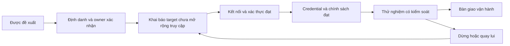
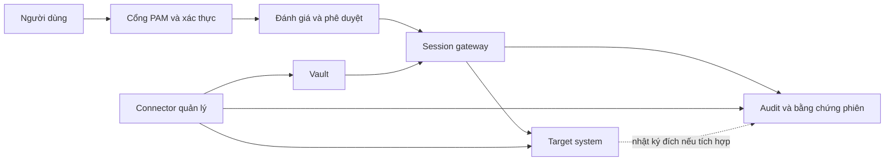

# Onboard target system vào PAM

Onboard target system là quá trình đưa một hệ thống đích vào phạm vi quản lý truy cập đặc quyền của Privileged Access Management (PAM). Hệ thống đích có thể là máy chủ Linux, Windows, cơ sở dữ liệu, thiết bị mạng, cụm hạ tầng hoặc tài nguyên được quản trị qua API.

Kết quả cần đạt không chỉ là xuất hiện một dòng tài sản trong giao diện PAM. Người được cấp phép phải truy cập đúng hệ thống, bằng đúng danh tính và phạm vi quyền, qua đường kết nối đã kiểm soát; credential được quản lý theo thiết kế; phiên và các thay đổi quan trọng có bằng chứng; đội vận hành biết cách xử lý khi luồng PAM gặp lỗi.

Trong chương Onboarding, bài này tập trung vào vòng đời đưa một hệ thống đích vào quản lý. Việc đưa từng tài khoản quản trị hoặc tài khoản dịch vụ vào vault là phần liên quan nhưng cần được kiểm tra riêng. Một target có thể đã được khai báo trong PAM trong khi tài khoản, chính sách hoặc khả năng ghi phiên vẫn chưa sẵn sàng.

## 1. Mục tiêu và khái niệm nền tảng

Sau bài học, người học có thể:

- Xác định thông tin và điều kiện cần trước khi tiếp nhận một hệ thống đích.
- Phân biệt khai báo target, đưa tài khoản vào quản lý và mở quyền truy cập cho người dùng.
- Thiết kế đường kết nối, xác minh danh tính đích và giới hạn quyền của thành phần tích hợp.
- Gắn target với chính sách least privilege, JIT, JEA, quản lý credential và audit phù hợp.
- Xây dựng kiểm thử chấp nhận, kế hoạch quay lui và tiêu chí bàn giao có thể chứng minh.

| Khái niệm | Ý nghĩa trong bài | Ví dụ |
| --- | --- | --- |
| Target system | Hệ thống hoặc tài nguyên mà hoạt động đặc quyền tác động tới | Máy chủ xử lý đơn hàng trong môi trường production |
| Endpoint | Địa chỉ và giao thức để tiếp cận một chức năng của target | FQDN và cổng SSH; địa chỉ API quản trị |
| Managed account hoặc principal | Danh tính có quyền trên target được quản lý hoặc được sử dụng qua PAM | Tài khoản bảo trì, vai trò tạm thời, service principal |
| Credential | Vật liệu dùng để xác thực cho danh tính | Password, SSH key, chứng chỉ hoặc token |
| Connector | Thành phần tích hợp để kết nối, quản lý tài khoản hoặc thực thi một số thao tác | Connector kiểm tra credential và đổi password |
| Session gateway | Thành phần trung gian cho đường truy cập được thiết kế đi qua PAM | Gateway chuyển tiếp SSH hoặc RDP và ghi nhận phiên |
| Owner | Người hoặc nhóm chịu trách nhiệm về hệ thống và việc chấp nhận thay đổi | Nhóm vận hành nền tảng cơ sở dữ liệu |

Một endpoint không nhất thiết tương ứng với một tài sản vật lý. Cụm cơ sở dữ liệu có thể có endpoint chuyển vai trò; một máy chủ có thể có nhiều giao diện quản trị. Cần xác định đơn vị quản lý và ranh giới quyền trước khi tạo target để tránh cấp nhầm quyền cho toàn cụm hoặc bỏ sót một nút.

## 2. Định nghĩa “đã onboard” bằng các trạng thái

Nên biểu diễn tiến độ bằng các trạng thái có tiêu chí rõ ràng thay vì một cờ hoàn thành chung:



Đây là mô hình trạng thái minh họa. Tên trạng thái trong sản phẩm có thể khác, nhưng cần giữ được ý nghĩa: tạo đối tượng target không tự kích hoạt quyền truy cập rộng. Chỉ chuyển sang vận hành sau khi các tiêu chí chấp nhận tương ứng đã đạt và owner xác nhận.

Ví dụ, target có thể kết nối SSH thành công nhưng chưa kiểm tra thu hồi quyền JIT. Trạng thái hợp lý là chưa sẵn sàng cho nhóm sử dụng JIT, thay vì đánh dấu hoàn thành vì có một lần đăng nhập được.

## 3. Thu thập hồ sơ tiếp nhận

### 3.1. Định danh, phạm vi và trách nhiệm

| Nhóm thông tin | Nội dung cần có | Tại sao quan trọng |
| --- | --- | --- |
| Định danh tài sản | Asset ID ổn định, tên hiển thị, loại hệ thống, ranh giới quản lý | Tránh nhầm đối tượng khi tên hoặc IP thay đổi |
| Môi trường | Production, staging, development; vùng mạng hoặc tenant | Ngăn dùng chính sách môi trường thử nghiệm cho hệ thống nhạy cảm |
| Mức độ quan trọng | Chức năng, ảnh hưởng khi gián đoạn, dữ liệu liên quan | Chọn cửa sổ thay đổi, phạm vi pilot và yêu cầu bằng chứng |
| Owner | Nhóm sở hữu, đầu mối vận hành, người chấp nhận bàn giao | Không để target tồn tại mà không có người chịu trách nhiệm |
| Đường quản trị | Giao thức, cổng, endpoint, gateway hoặc agent dự kiến | Thiết kế luồng kết nối và kiểm soát mạng |
| Tài khoản và vai trò | Danh tính con người, tài khoản dùng chung, tài khoản dịch vụ, quyền hiện có | Phân biệt nhu cầu truy cập tương tác và nhu cầu của ứng dụng |
| Phụ thuộc | Dịch vụ, tác vụ định kỳ, cụm HA, tiến trình đang dùng credential | Tránh làm gián đoạn khi đổi credential hoặc thu hồi quyền |
| Quản lý thay đổi | Phạm vi thay đổi, cửa sổ thực hiện, điều kiện dừng, cách quay lui | Giảm rủi ro khi chuyển đường truy cập |
| Bằng chứng | Loại sự kiện, bản ghi phiên, nơi tra cứu và thời hạn lưu theo chính sách | Xác định khả năng chứng minh sau khi đưa vào vận hành |

Dữ liệu discovery có thể là đầu vào, nhưng kết quả quét chưa đủ để chứng minh owner, mức độ quan trọng hoặc tính đúng đắn của tài sản. Không tự động đưa mọi tài khoản tìm thấy vào luân chuyển credential trước khi biết ai đang sử dụng chúng.

### 3.2. Phân loại danh tính trước khi can thiệp

Cần tách ít nhất các nhóm sau:

- **Người quản trị:** ưu tiên giữ được danh tính cá nhân xuyên suốt yêu cầu, phê duyệt và phiên truy cập.
- **Tài khoản quản trị dùng chung:** cần ánh xạ người sử dụng thực tế, giới hạn checkout hoặc truy cập qua trung gian theo thiết kế.
- **Tài khoản dịch vụ:** cần xác định ứng dụng và mọi nơi tiêu thụ credential trước khi thay đổi.
- **Tài khoản tích hợp của PAM:** dùng để kiểm tra, quản lý hoặc khôi phục credential; phải giới hạn quyền và được giám sát.
- **Danh tính khẩn cấp:** phục vụ trường hợp đặc biệt theo quy trình riêng, có kiểm tra và đối soát sau sử dụng.

Không mặc định tài khoản có tên “admin” là tài khoản nhàn rỗi hoặc không có phụ thuộc. Cũng không suy luận tài khoản dịch vụ là ít rủi ro chỉ vì không có người đăng nhập tương tác.

## 4. Thiết kế đường kết nối và ranh giới tin cậy

### 4.1. Tách các luồng cần kiểm tra



Sơ đồ thể hiện các quan hệ logic, không yêu cầu mọi sản phẩm triển khai cùng hướng giao tiếp hoặc cùng số thành phần. Cần kiểm tra đường mạng thực tế của sản phẩm được triển khai, gồm cả các kết nối agent chủ động mở về PAM nếu có.

Ba đường thường bị nhầm với nhau là:

1. Người dùng đến cổng PAM để yêu cầu hoặc mở phiên.
2. Gateway đến hệ thống đích để thiết lập phiên quản trị.
3. Connector đến hệ thống đích để kiểm tra, đổi hoặc xử lý credential.

Truy cập được giao diện PAM không chứng minh gateway tới được target. Mở phiên được cũng không chứng minh connector có đủ quyền đổi password. Mỗi luồng cần có kiểm tra và bằng chứng riêng.

### 4.2. Mở kết nối có giới hạn

Quy tắc mạng cần nêu nguồn, đích, giao thức, cổng và mục đích cụ thể. Ưu tiên cho phép từ các gateway hoặc connector đã được phân công thay vì toàn bộ vùng mạng quản trị.

Kiểm tra DNS, định tuyến, firewall, proxy và thời gian đồng bộ ở những thành phần liên quan. Với hệ thống HA, cần xét nút dự phòng, endpoint chuyển vai trò và hành vi khi gateway được chuyển sang nút khác. Không chỉ kiểm tra một IP rồi giả định tất cả đường phục hồi đều hoạt động.

Nếu mục tiêu là buộc truy cập quản trị đi qua PAM, việc tạo target chưa đủ. Cần triển khai kiểm soát thích hợp trên mạng, cấu hình đích hoặc cơ chế danh tính để hạn chế đường truy cập trực tiếp. Đường khẩn cấp nếu có phải được định nghĩa và quản lý như một ngoại lệ riêng.

### 4.3. Xác minh đúng hệ thống đích

Kết nối TCP thành công chưa chứng minh đã đến đúng máy. Trước khi truyền credential hoặc chấp nhận phiên, cần có cơ chế xác minh danh tính đích phù hợp:

- Với SSH, xác minh host key hoặc chứng chỉ máy chủ theo mô hình tin cậy đã chọn.
- Với giao thức sử dụng TLS, kiểm tra chuỗi tin cậy, tên đích và hiệu lực chứng chỉ theo cấu hình phù hợp.
- Với API hoặc nền tảng đám mây, kiểm tra đúng endpoint, tenant hoặc tài khoản nền tảng, resource ID và phạm vi tài nguyên.

Fingerprint hoặc thông tin tin cậy ban đầu cần được xác nhận qua nguồn có thẩm quyền phù hợp. Không tắt kiểm tra danh tính đích như một bước chuẩn để làm cho kết nối thành công. Khi host key hoặc chứng chỉ thay đổi ngoài dự kiến, cần dừng và xác minh thay vì tự chấp nhận thay đổi.

## 5. Khai báo target với quyền truy cập ban đầu hẹp

Cấu hình minh họa dưới đây mô tả thông tin cần thống nhất. Đây không phải schema import hay API của một sản phẩm cụ thể:

```yaml
target:
  asset_id: asset-linux-orders-02
  display_name: Orders maintenance host 02
  environment: production
  owner_group: platform-orders
  resource_scope: host-only
  endpoint:
    hostname: orders-admin-02.corp.example
    protocol: ssh
    port: 22
  connection:
    gateway_pool_ref: prod-admin-gateways
    trust_profile_ref: verified-ssh-hosts
  credential_management:
    credential_ref: vault-ref-managed-maintenance-account
    connector_profile_ref: linux-maintenance-managed
  access:
    policy_ref: production-maintenance-jit
    allowed_group_ref: pam-onboarding-pilot
    recording_profile_ref: privileged-terminal-evidence
  lifecycle:
    readiness: pilot
    change_ref: CHG-PAM-002
```

Các trường kết thúc bằng `_ref` là tham chiếu logic. Không nhúng password, private key hoặc token trực tiếp vào hồ sơ target. Phạm vi `host-only` trong ví dụ thể hiện chủ đích chỉ quản lý một máy; hệ thống triển khai phải có cơ chế thực tế để bảo đảm phạm vi đó.

Khi khai báo, kiểm tra trùng lặp theo định danh tài sản và ngữ cảnh môi trường. Hai tên khác nhau có thể đang trỏ tới cùng một máy; một IP lại có thể được tái sử dụng cho tài sản khác. Nếu tạo trùng target, người dùng có thể đi qua hai chính sách khác nhau hoặc credential bị hai quy trình luân chuyển đồng thời.

Giữ nhóm được phép sử dụng ở phạm vi pilot. Không gán một nhóm người dùng rộng chỉ vì connector đã kết nối thành công.

## 6. Đưa danh tính và credential vào quản lý

### 6.1. Xác định quyền tối thiểu của tích hợp

Connector có thể cần các khả năng như kiểm tra credential, đổi password của một tập tài khoản hoặc truy vấn thuộc tính đích. Những khả năng này phụ thuộc nền tảng và cách tích hợp. Cần xác định đúng thao tác cần thiết, kiểm thử và giới hạn quyền tương ứng.

Không mặc định mọi connector đều phải có quyền quản trị toàn hệ thống. Nếu bắt buộc phải dùng một quyền mạnh, cần ghi rõ lý do, giới hạn nguồn kết nối, giới hạn tài khoản bị tác động và theo dõi việc sử dụng quyền đó.

Phân biệt các chức năng sau:

| Chức năng | Câu hỏi cần trả lời |
| --- | --- |
| Kiểm tra credential | Credential hiện lưu có xác thực được với đúng tài khoản và đúng target không? |
| Đổi credential | Có thể thay đổi credential và lưu phiên bản mới một cách an toàn không? |
| Đối soát và khôi phục đồng bộ | Khi vault và target không khớp, ai có quyền xác định và khôi phục trạng thái đúng? |
| Cấp danh tính hoặc quyền tạm thời | Quyền được tạo ở đâu, hết hiệu lực thế nào và có thể xác minh thu hồi không? |

Việc kiểm tra credential thành công chỉ chứng minh một khả năng tại thời điểm kiểm tra. Nó không tự chứng minh thao tác đổi credential hoặc phục hồi sau lỗi sẽ thành công.

### 6.2. Cẩn trọng với tài khoản có phụ thuộc

Trước khi bật luân chuyển cho tài khoản dịch vụ, lập danh sách nơi tiêu thụ credential: ứng dụng, Windows service, tác vụ định kỳ, connection pool, file cấu hình, agent hoặc hệ thống tích hợp.

Cần xác định cách cập nhật các bên tiêu thụ, thứ tự thực hiện và hành vi của kết nối đang hoạt động. Một số hệ thống hỗ trợ nhiều credential hoặc khoảng chuyển tiếp; một số hệ thống yêu cầu khởi động lại thành phần. Không giả định có thể đổi password rồi mọi ứng dụng tự dùng giá trị mới.

Với SSH key, cần phân biệt thay đổi khóa được phép ở đích và việc phân phối khóa phía client. Với chứng chỉ hoặc token ngắn hạn, vòng đời cấp, hết hạn và thu hồi có thể thay cho cơ chế đổi password truyền thống. Tiêu chí chấp nhận phải phù hợp loại credential thực tế.

### 6.3. Xử lý trường hợp lệch credential

Trong một lần đổi password, có thể xảy ra tình huống target đã đổi thành công nhưng PAM không nhận được phản hồi hoặc chưa lưu được phiên bản mới. Thử lại mù quáng có thể làm tăng sai lệch hoặc gây khóa tài khoản.

Kế hoạch onboarding cần xác định cách phân biệt thành công, thất bại và chưa rõ kết quả; ai thực hiện đối soát; cơ chế phục hồi đồng bộ nào được hỗ trợ. Theo dõi ngưỡng khóa tài khoản và giới hạn thử xác thực để một bài kiểm thử không trở thành sự cố vận hành.

Không ghi giá trị credential vào ticket hoặc log để làm bằng chứng. Dùng mã tài khoản, tham chiếu phiên bản, thời điểm và kết quả kiểm tra phù hợp.

## 7. Gắn chính sách truy cập với đúng phạm vi

### 7.1. Các chiều của chính sách

Trước khi cho phép sử dụng target, cần thống nhất:

- Ai được yêu cầu truy cập: nhóm, danh tính hoặc workload cụ thể.
- Họ được dùng vai trò hoặc tài khoản nào trên target.
- Điều kiện xác thực, phê duyệt, mục đích và thời gian được phép.
- Thời lượng hiệu lực và cách thu hồi quyền hoặc kết thúc phiên.
- Tập tác vụ được phép nếu áp dụng JEA hoặc cơ chế giới hạn tương đương.
- Cách sử dụng credential: thông qua gateway, cấp phát cho workload hoặc checkout có kiểm soát.
- Yêu cầu ghi phiên, audit và hành vi khi các thành phần bằng chứng bị lỗi.

Áp dụng least privilege ở cả hai phía: chính sách PAM và quyền thực tế tại target. Cho phép một vai trò có tên “maintenance” không có ý nghĩa giới hạn nếu vai trò đó vẫn có toàn quyền trên hệ thống đích.

### 7.2. JIT và JEA cần được thực thi

Với JIT, xác định quyền được cấp vào thời điểm nào, ở thành phần nào, hiệu lực bao lâu và làm sao xác minh đã hết hiệu lực hoặc được thu hồi. Đặt thời hạn trong yêu cầu không đủ nếu quyền tĩnh ở target vẫn tồn tại sau đó.

Với JEA, cần có cơ chế ràng buộc tác vụ phù hợp với nền tảng. Danh sách thao tác trong phiếu phê duyệt không tự chặn người dùng mở shell hoặc gọi một công cụ khác. Kiểm thử cả thao tác được phép và thao tác vượt phạm vi tại nơi thực thi ràng buộc.

Phạm vi khả thi có thể khác nhau giữa target. Nếu hệ thống chỉ hỗ trợ môi giới phiên toàn quyền, phải phản ánh đúng giới hạn đó khi thiết kế quyền và chấp nhận rủi ro; không gắn nhãn JEA chỉ vì đã ghi lại phiên.

### 7.3. Đường không tương tác

Tài khoản dịch vụ hoặc workload thường không mở phiên qua giao diện người dùng. Cần thiết kế riêng cách workload chứng minh danh tính, nhận credential hoặc quyền ngắn hạn và bị giới hạn tài nguyên.

Không bắt một tiến trình tự động dùng chung tài khoản cá nhân để thuận tiện cho onboarding. Cũng không giả định chính sách phê duyệt tương tác của người dùng có thể áp dụng nguyên trạng cho mọi lần chạy tự động.

## 8. Xác minh audit và bằng chứng phiên

Một target được tiếp nhận cần có đường nối giữa người hoặc workload khởi tạo, yêu cầu, quyết định cấp quyền, danh tính hiệu lực và tài nguyên đích.

| Mốc cần quan sát | Bằng chứng mong đợi |
| --- | --- |
| Tạo hoặc sửa target | Chủ thể thực hiện, thời điểm, thuộc tính thay đổi và tham chiếu thay đổi |
| Yêu cầu và quyết định | Request ID, người yêu cầu, phạm vi, người phê duyệt nếu áp dụng, quyết định chính sách |
| Bắt đầu truy cập | Session ID hoặc mã lần sử dụng, target ID, danh tính gốc và danh tính hiệu lực |
| Hoạt động trong phiên | Sự kiện hoặc bản ghi theo khả năng quan sát của giao thức và cấu hình |
| Kết thúc và thu hồi | Kết quả đóng phiên, hết hiệu lực hoặc thu hồi quyền, lỗi cần xử lý |
| Quản lý credential | Kết quả kiểm tra, đổi hoặc đối soát; tham chiếu phiên bản khi cần |

Thử mở lại bản ghi bằng quyền của người được giao kiểm tra, thay vì chỉ thấy thông báo “recording enabled”. Kiểm tra định danh target, mốc thời gian, độ đầy đủ và liên kết giữa sự kiện với đối tượng bản ghi.

Không hứa hẹn nhìn thấy mọi thao tác chỉ vì đã có video hoặc log lệnh. Giao thức, ứng dụng và lớp mã hóa ảnh hưởng khả năng quan sát. Những phần cần nhật ký từ target phải được xác định và tích hợp theo thiết kế.

Giới hạn quyền xem và xuất bản ghi vì chúng có thể chứa dữ liệu nhạy cảm. Đồng thời, kiểm tra luồng bằng chứng khi gateway mất kết nối, tải bản ghi chậm hoặc kho lưu trữ gặp lỗi theo chế độ vận hành đã được phê duyệt.

## 9. Pilot và kiểm thử chấp nhận

Thực hiện trước ở môi trường phù hợp hoặc trên một target đại diện có phạm vi được chấp thuận. Với production, dùng cửa sổ thay đổi, người giám sát và điều kiện dừng rõ ràng.

Kiểm thử chấp nhận cần chứng minh cả hành vi được phép và khả năng từ chối. Ma trận dưới đây là khung tham chiếu, chỉ thực hiện các trường hợp phù hợp với kiến trúc thực tế:

| Nhóm | Kiểm thử | Điều kiện đạt |
| --- | --- | --- |
| Định danh target | Đối chiếu asset ID, endpoint và danh tính máy chủ | Kết nối đúng hệ thống và đúng môi trường |
| Truy cập hợp lệ | Người thuộc nhóm pilot yêu cầu và mở phiên | Đúng tài khoản hoặc vai trò, đúng phạm vi và thời gian |
| Từ chối truy cập | Người ngoài phạm vi yêu cầu target hoặc vai trò không được phép | Bị từ chối và có bằng chứng phù hợp |
| Xác thực và phê duyệt | Thiếu điều kiện bắt buộc hoặc dùng phê duyệt không còn hiệu lực | Không được cấp quyền trái chính sách |
| JIT | Cấp quyền có thời hạn rồi hết hạn hoặc thu hồi | Trạng thái tại target phù hợp chính sách, có thể đối chiếu |
| JEA | Thực hiện một tác vụ được phép và một tác vụ vượt phạm vi | Tác vụ ngoài phạm vi bị chặn tại cơ chế thực thi |
| Credential | Kiểm tra, đổi và xác thực lại nếu mô hình yêu cầu | Vault và target nhất quán, phụ thuộc tiếp tục hoạt động |
| Bằng chứng | Tra cứu sự kiện và mở bản ghi của một phiên thử | Nối được đúng danh tính, target và phiên; chỉ ra phần không quan sát được |
| Đường truy cập trực tiếp | Thử từ nguồn được chỉ định trong phạm vi kiểm thử | Bị hạn chế theo thiết kế; ngoại lệ có kiểm soát |
| Khả năng phục hồi | Kiểm tra chuyển gateway hoặc tình huống lỗi được chấp thuận | Hành vi phù hợp thiết kế, không bỏ qua chính sách âm thầm |
| Khẩn cấp | Xác minh quy trình tiếp cận khẩn cấp đã được duyệt | Có chủ thể chịu trách nhiệm, bằng chứng và đối soát sau dùng |

Không gây lỗi production chỉ để hoàn thành một dòng kiểm thử. Những tình huống gây gián đoạn có thể cần được kiểm tra ở môi trường đại diện hoặc theo một kế hoạch thay đổi riêng. Phần chưa kiểm tra phải được ghi nhận trung thực, có owner và cách xử lý trước khi chấp nhận.

Khi lưu kết quả, dùng mã lần thử, thời điểm, điều kiện, kết quả quan sát và tham chiếu bằng chứng. Không dùng riêng ảnh chụp danh sách target để chứng minh toàn bộ quy trình đã hoạt động.

## 10. Cutover: chuyển sang đường vận hành chính thức

Sau pilot, chuyển quyền sử dụng theo từng nhóm nhỏ thay vì mở ngay cho toàn bộ đội ngũ. Trình tự tham chiếu:

1. Xác nhận các điều kiện chấp nhận và các hạn chế còn lại với owner.
2. Kiểm tra lại endpoint, chính sách, nhóm sử dụng, quyền đích và cấu hình tin cậy.
3. Chốt kế hoạch thay đổi credential và cập nhật các bên phụ thuộc nếu có.
4. Mở luồng PAM cho nhóm vận hành đầu tiên, theo dõi kết quả và tác động dịch vụ.
5. Hạn chế các đường cũ theo thiết kế sau khi luồng mới đã được xác nhận hoạt động.
6. Theo dõi lỗi đăng nhập, khóa tài khoản, phiên thất bại, credential lệch và khoảng trống audit.
7. Mở rộng phạm vi theo kế hoạch, rồi bàn giao đầu mối vận hành và xử lý sự cố.

Chỉ giữ các đường truy cập song song khi có lý do, owner và thời hạn rõ ràng. Nếu đường cũ vẫn mở vô thời hạn, người dùng có thể đi vòng PAM và làm mất lợi ích của việc đưa target vào quản lý.

Với hệ thống HA hoặc cụm, cần xác định cấu hình nào phải nhất quán giữa các nút, credential có được dùng chung không và hành vi khi chuyển vai trò. Tránh để một nút đã đi qua PAM còn nút dự phòng vẫn sử dụng cơ chế cũ.

## 11. Kế hoạch dừng và quay lui

### 11.1. Định nghĩa điều kiện dừng trước

Các điều kiện dừng có thể gồm:

- Danh tính đích không khớp với hồ sơ đã xác nhận.
- Xác thực gây lỗi lặp lại, có dấu hiệu sắp khóa tài khoản hoặc gây tác động dịch vụ.
- Đổi credential khiến một phụ thuộc quan trọng không hoạt động.
- Không thể thu hồi quyền hoặc không xác định được trạng thái quyền thực tế.
- Phiên hoặc sự kiện bắt buộc không được ghi nhận theo cam kết.
- Chưa có người có thẩm quyền tiếp nhận rủi ro hoặc chưa có đường phục hồi phù hợp.

Khi dừng, giữ lại bằng chứng và phân biệt trạng thái chưa thực hiện, đã thực hiện và chưa rõ kết quả. Không tiếp tục thử bằng nhiều credential khác nhau mà chưa hiểu nguyên nhân.

### 11.2. Quay lui phải xét trạng thái bên ngoài PAM

Xóa đối tượng target khỏi PAM không tự khôi phục firewall, quyền ở đích, credential hay cấu hình dịch vụ. Kế hoạch quay lui phải liệt kê các thay đổi đã thực hiện và cách xử lý tương ứng.

| Thay đổi | Cách xem xét khi quay lui |
| --- | --- |
| Khai báo target và nhóm sử dụng | Thu hẹp hoặc vô hiệu hóa đường truy cập mới theo quy trình, giữ dấu vết thay đổi |
| Quyền JIT hoặc tài khoản tạm | Kiểm tra trạng thái ở đích và thu hồi phần còn hiệu lực |
| Credential đã đổi | Đối soát phiên bản đang hiệu lực; khôi phục khả năng hoạt động bằng cơ chế được hỗ trợ |
| Cấu hình ứng dụng phụ thuộc | Cập nhật về một trạng thái nhất quán và xác minh dịch vụ |
| Firewall hoặc agent | Khôi phục theo kế hoạch thay đổi đã duyệt, tránh tạo lỗ hổng truy cập rộng |
| Bản ghi và audit | Giữ nguyên bằng chứng của cả lần thử thành công lẫn thất bại |

Không khôi phục mù quáng một bản cấu hình vault cũ nếu credential ở target đã thay đổi. Cũng không mặc định đổi lại password cũ là cách quay lui thích hợp: nó có thể vi phạm chính sách, không được hệ thống hỗ trợ hoặc đã không còn là bí mật an toàn.

Quay lui thành công cần được xác nhận bằng trạng thái dịch vụ, quyền và credential thực tế, không chỉ bằng việc hoàn tác giao diện.

## 12. Tình huống thực tế: đưa máy chủ bảo trì vào PAM

Nhóm Orders có một máy chủ production quản trị qua SSH. Kỹ sư đang dùng tài khoản quản trị chung; có một tác vụ đêm sử dụng credential riêng. Mục tiêu là đưa truy cập của người quản trị qua PAM, giữ danh tính cá nhân, giới hạn thời gian cấp quyền và ghi phiên.

### Bước 1: Chốt phạm vi

Owner xác nhận asset ID, endpoint, mức độ quan trọng và cửa sổ thay đổi. Nhóm tách tài khoản phục vụ tác vụ đêm khỏi đường truy cập của người quản trị để tránh đổi credential ngoài phạm vi đã kiểm kê.

Đường người dùng được onboard trước. Tài khoản của tác vụ đêm chỉ được thay đổi theo một kế hoạch riêng sau khi biết cách ứng dụng nhận credential mới.

### Bước 2: Xác minh kết nối và tin cậy

Gateway được phép tới SSH của đúng máy chủ. Connector chỉ có các quyền quản lý cần thiết cho tài khoản được chọn. Host key được đối chiếu với hồ sơ tin cậy đã xác nhận; kết nối không dùng chế độ bỏ qua kiểm tra.

Nhóm thử từ chính gateway và connector được phân công. Việc một laptop quản trị đăng nhập được không được dùng thay cho kiểm tra hai đường này.

### Bước 3: Gắn danh tính và chính sách

Nhóm pilot gồm hai kỹ sư có tài khoản cá nhân. Mỗi yêu cầu phải xác định mục đích, target và thời lượng. Quyền đích được giới hạn theo thiết kế, có cơ chế xác minh thu hồi; tác vụ vượt phạm vi phải bị chặn nếu mô hình JEA được áp dụng.

Không mở nhóm vận hành rộng trong giai đoạn này. Tài khoản chung không được biến thành đường tự do để mọi người bỏ qua danh tính cá nhân.

### Bước 4: Thử và quan sát

Một kỹ sư mở phiên hợp lệ; một người ngoài nhóm pilot bị từ chối. Nhóm kiểm tra đúng target, danh tính hiệu lực, bản ghi phiên và sự kiện kết thúc. Sau thời hạn JIT, nhóm đối soát quyền tại đích.

Nếu phiên đóng nhưng quyền chưa được thu hồi, target chưa đạt điều kiện sử dụng JIT. Nhóm xử lý nguyên nhân rồi thực hiện lại kiểm tra liên quan trước khi mở rộng.

### Bước 5: Chuyển giao

Sau khi owner chấp nhận, nhóm mở rộng theo từng đợt và hạn chế đường SSH trực tiếp theo kế hoạch. Các ngoại lệ khẩn cấp có quy trình riêng. Hồ sơ bàn giao chứa thông tin vận hành và tham chiếu bằng chứng, không chứa credential.

## 13. Hồ sơ bàn giao và duy trì sau onboarding

Một bộ bàn giao thực dụng gồm:

- Asset ID, phạm vi tài nguyên, endpoint và owner đã xác nhận.
- Kiểu tích hợp, gateway hoặc connector, các luồng mạng và mô hình tin cậy đích.
- Danh tính được quản lý, loại credential và các phụ thuộc đã biết.
- Chính sách sử dụng, thời hạn quyền, yêu cầu phê duyệt và các ngoại lệ được chấp nhận.
- Kết quả kiểm thử, giới hạn quan sát và các phần chưa hoàn tất có người chịu trách nhiệm.
- Cách tra cứu audit, bản ghi phiên và kết quả quản lý credential.
- Đầu mối xử lý lỗi, kế hoạch phục hồi và điều kiện đưa target về trạng thái hạn chế.
- Tham chiếu thay đổi và xác nhận chấp nhận từ owner.

Onboarding không kết thúc trách nhiệm quản lý. Cần đánh giá lại khi thay owner, chuyển môi trường, nâng cấp hệ điều hành, đổi endpoint, thay host key, thay chính sách đích hoặc thay ứng dụng tiêu thụ credential.

Tài sản được dựng lại có thể giữ nguyên tên DNS nhưng có danh tính máy chủ và phạm vi quyền khác. Tài sản bị loại bỏ cũng cần thu hồi quyền, xử lý credential, dọn chính sách và giữ bằng chứng theo vòng đời quy định. Không tự tin rằng một lần onboard trước đây chứng minh cấu hình hiện tại vẫn an toàn.

Các chỉ số hữu ích gồm target thiếu owner, kiểm tra credential thất bại liên tiếp, bản ghi phiên thiếu, quyền tạm chưa được thu hồi, target không còn liên lạc và ngoại lệ truy cập trực tiếp đã quá thời hạn.

## 14. Lỗi thường gặp và bài thực hành

| Lỗi thường gặp | Hệ quả | Cách xử lý trong thiết kế |
| --- | --- | --- |
| Tạo target xong là đánh dấu hoàn tất | Chưa biết đăng nhập, đổi credential hoặc ghi phiên có hoạt động không | Dùng tiêu chí chấp nhận theo từng khả năng |
| Chỉ nhận diện bằng IP | Dễ quản lý nhầm khi IP thay đổi hoặc được tái sử dụng | Dùng asset ID và xác minh danh tính đích |
| Đổi credential tài khoản dịch vụ trước khi biết phụ thuộc | Làm gián đoạn ứng dụng hoặc tác vụ | Kiểm kê nơi tiêu thụ và thử quy trình cập nhật |
| Dùng tài khoản tích hợp toàn quyền cho mọi target | Tăng phạm vi ảnh hưởng nếu tích hợp bị xâm nhập | Giới hạn quyền và chia phạm vi quản lý phù hợp |
| Bật ghi phiên nhưng không xem lại bằng chứng | Có thể thiếu đoạn, sai target hoặc không truy xuất được | Thử tra cứu và mở bản ghi trong pilot |
| Chỉ kiểm tra người được phép | Không phát hiện chính sách quá rộng | Kiểm tra cả trường hợp từ chối và vượt phạm vi |
| Quay lui bằng cách xóa target | Quyền, credential và thay đổi ở đích còn tồn tại | Quay lui theo trạng thái thực tế của từng thay đổi |
| Giữ đường cũ không có thời hạn | Người dùng tiếp tục đi vòng PAM | Có owner, phạm vi và thời hạn cho từng ngoại lệ |

Để thực hành, chọn một máy chủ tương tác và một dịch vụ có tài khoản tự động, rồi thực hiện thiết kế trên giấy:

1. Lập hồ sơ target, owner, endpoint, phạm vi và phụ thuộc.
2. Vẽ riêng đường phiên người dùng và đường quản lý credential.
3. Xác định cách xác minh danh tính đích trước khi cung cấp credential.
4. Chọn chính sách truy cập và mô tả cách thực thi least privilege, JIT hoặc JEA nếu áp dụng.
5. Viết ma trận kiểm thử gồm trường hợp hợp lệ, bị từ chối, hết hạn quyền và lỗi credential.
6. Đặt điều kiện dừng, kế hoạch quay lui và bằng chứng để xác nhận phục hồi.
7. Xác định chính xác khi nào target đủ điều kiện bàn giao và ai chấp nhận.

Bản thiết kế đạt yêu cầu khi mỗi kết luận “sẵn sàng” đều gắn với một khả năng đã được xác minh. Với một target được onboard đầy đủ, đội vận hành phải biết ai có thể truy cập, quyền được thực thi ở đâu, credential được quản lý thế nào và bằng chứng nào chứng minh đường truy cập đó đang hoạt động đúng.
