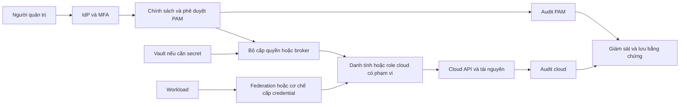

# Onboard cloud account

**Onboard cloud account vào Privileged Access Management (PAM)** là đưa một phạm vi cloud cùng các danh tính và đường truy cập đặc quyền liên quan vào cơ chế quản lý có chủ sở hữu, chính sách và bằng chứng. Kết quả cần đạt là kiểm soát được ai hoặc workload nào được thực hiện hành động gì, trên tài nguyên nào, trong bao lâu, và quyền đó được thu hồi như thế nào.

Bài học thuộc chương **Onboarding**, trong phạm vi bảo vệ tài khoản quản trị, tài khoản dịch vụ và hạ tầng nhạy cảm. Quy trình kết hợp kiểm kê quyền, least privilege, truy cập đúng lúc (JIT), giới hạn hành động (JEA theo cơ chế phù hợp), vault, quản lý vòng đời credential, giám sát phiên và audit phục vụ điều tra, kiểm toán.

Một bản ghi cloud account trong giao diện PAM chưa chứng minh rằng mọi đường quản trị đã được kiểm soát. Onboarding cần bao gồm kết nối kỹ thuật, thiết kế quyền, chuyển đổi cách truy cập, kiểm chứng thu hồi và bàn giao vận hành.

Sau bài học, bạn có thể:

- Phân biệt phạm vi tài nguyên cloud với danh tính dùng để quản trị phạm vi đó.
- Chuẩn bị kết nối PAM–cloud có ranh giới tin cậy và quyền tối thiểu.
- Thiết kế luồng truy cập cho quản trị viên và workload, cùng cơ chế JIT và thu hồi.
- Xác định bằng chứng cần thu thập và các kiểm tra phải đạt trước khi chuyển sang vận hành.

## 1. Cloud account là phạm vi nào?

Từ “account” có thể chỉ nhiều đối tượng khác nhau:

| Đối tượng | Ý nghĩa trong onboarding |
|---|---|
| Phạm vi quản trị tài nguyên | Một account, subscription, project hoặc đơn vị tương đương của nền tảng cloud |
| Tenant hoặc tổ chức danh tính | Nơi quản lý danh tính, quan hệ federation hoặc các chính sách cấp trên |
| Người dùng quản trị | Danh tính cá nhân truy cập console, CLI hoặc API |
| Danh tính workload | Danh tính mà ứng dụng, pipeline hoặc tác vụ tự động dùng để truy cập tài nguyên |
| Role và binding quyền | Định nghĩa hành động và cách danh tính được cấp quyền trên phạm vi tài nguyên |
| Credential | Password, access key, secret, chứng thư hoặc token dùng trong xác thực |

Onboard một phạm vi tài nguyên không đồng nghĩa đưa một mật khẩu quản trị vào vault. Với cloud, nhiều luồng truy cập dựa trên federation, role và token có thời hạn; credential cố định có thể không cần xuất hiện trong luồng người dùng thông thường.

Cần tách hai lớp:

1. **Đăng ký phạm vi cloud:** PAM biết quản lý tài nguyên nào, theo chính sách nào, qua connector nào.
2. **Đưa danh tính và quyền vào quản lý:** xác định người dùng, workload, role, credential và các đường cấp quyền liên quan.

Một phạm vi đã được đăng ký nhưng vẫn có access key quản trị không được kiểm kê là một phạm vi chưa hoàn tất kiểm soát truy cập đặc quyền.

## 2. Xác định kết quả cần đạt trước khi kết nối

Một hồ sơ onboarding cần trả lời ít nhất các câu hỏi sau:

- Phạm vi cloud chính xác là gì và thuộc tổ chức nào?
- Ai sở hữu nghiệp vụ, ai vận hành kỹ thuật, ai phê duyệt truy cập và ai xử lý sự cố?
- Những hành động nào cần quyền đặc biệt, ai thực sự cần thực hiện chúng?
- Người quản trị dùng console, CLI, API hay phiên vào máy ảo?
- Workload nào đang dùng credential hoặc quyền có thể bị ảnh hưởng khi chuyển đổi?
- Những quyền, token hoặc phiên nào cần có thời hạn và cách kiểm chứng thu hồi là gì?
- Dữ liệu audit nằm ở đâu, ai có thể đọc và ai có thể thay đổi cấu hình ghi log?
- Nếu PAM hoặc IdP không hoạt động, đường phục hồi nào còn sử dụng được?

### Ví dụ phạm vi rõ ràng

```text
Phạm vi: một đơn vị tài nguyên cloud cho hệ thống thanh toán production
Định danh: ID do nền tảng cloud cấp, được xác minh trực tiếp
Chủ sở hữu: nhóm Payment Platform
Người dùng: nhóm vận hành production, truy cập theo ca bảo trì
Workload: pipeline triển khai và dịch vụ sao lưu
Hành động nhạy cảm: sửa IAM, thay đổi mạng, đọc secret, quản lý khóa
Mục tiêu: giảm quyền thường trực, cấp quyền có thời hạn, giữ đủ audit
```

Tên hiển thị như `payment-prod` chỉ hỗ trợ con người nhận biết. Nó không thay thế định danh kỹ thuật; cùng một tên có thể xuất hiện trong những tenant hoặc tổ chức khác nhau.

## 3. Kiểm kê trước khi thay đổi quyền

### 3.1 Kiểm kê phạm vi tài nguyên

Thu thập định danh phạm vi, quan hệ với tổ chức hoặc tenant cấp trên, môi trường, nhóm tài nguyên nhạy cảm và các vùng triển khai liên quan. Phân biệt tài nguyên thuộc phạm vi hiện tại với tài nguyên được truy cập qua quan hệ liên phạm vi.

Kiểm kê phải xét cả tài nguyên khu vực và tài nguyên toàn cục theo mô hình của nền tảng. Chỉ liệt kê tài nguyên ở một vùng mặc định có thể bỏ sót đối tượng cần bảo vệ.

### 3.2 Kiểm kê danh tính và quyền hiệu lực

Cần tìm các danh tính cá nhân, tài khoản dùng chung, service identity, role, nhóm, quan hệ federation, credential dài hạn và đường cấp quyền chéo giữa các phạm vi.

Quyền hiệu lực không chỉ đến từ một role trực tiếp. Nó có thể chịu ảnh hưởng của nhóm, quyền kế thừa, chính sách tài nguyên, điều kiện, giới hạn cấp trên hoặc quy tắc từ chối. Vì vậy, đọc một tên role chứa chữ “read” chưa đủ để kết luận mọi khả năng đều chỉ đọc.

Đặc biệt kiểm tra khả năng gián tiếp nâng quyền:

- Sửa chính sách, trust hoặc membership để tự cấp thêm quyền.
- Gán một role đặc quyền cho workload do người dùng kiểm soát.
- Tạo credential mới hoặc thay phương thức xác thực của danh tính khác.
- Sửa mã chạy của một dịch vụ đang có quyền cao.
- Tắt audit, sửa nơi nhận log hoặc quản lý khóa bảo vệ bằng chứng.

### 3.3 Kiểm kê phụ thuộc của credential

Với mỗi secret hoặc access key dài hạn, ghi nhận chủ sở hữu, bên sử dụng, nơi lưu, lần kiểm tra gần nhất, cơ chế cập nhật và phương án thu hồi. Không sao chép giá trị secret vào bảng kiểm kê, ticket hoặc hồ sơ onboarding.

Một credential nhìn có vẻ không còn được dùng có thể vẫn nằm trong tác vụ định kỳ ít chạy. Cần phối hợp với chủ dịch vụ và bằng chứng sử dụng trước khi vô hiệu hóa.

## 4. Kiến trúc kết nối và ranh giới tin cậy



Sơ đồ là mô hình logic. Một giải pháp có thể thực hiện các vai trò này bằng connector, broker, agent hoặc tích hợp khác. Không phải mọi sản phẩm PAM đều hỗ trợ mọi dạng danh tính cloud.

Có ba câu hỏi về trust cần được trả lời độc lập:

1. **Cloud tin danh tính kết nối nào?** Xác định issuer, principal và điều kiện xác thực tương ứng với cơ chế được dùng.
2. **Danh tính đó được làm gì?** Quy định hành động, tài nguyên, điều kiện và giới hạn kế thừa.
3. **PAM cho ai sử dụng khả năng đó?** Ánh xạ người dùng hoặc workload vào đúng role và phạm vi được duyệt.

Một kết nối xác thực thành công không chứng minh ba lớp trên đều đúng. Connector có thể kết nối được nhưng vào nhầm tenant, hoặc được cấp nhiều quyền hơn mục tiêu onboarding.

## 5. Tạo danh tính tích hợp PAM với least privilege

### 5.1 Phân tách nhiệm vụ tích hợp

Tùy nền tảng và khả năng của giải pháp, có thể tách các nhóm quyền:

| Nhiệm vụ | Khả năng cần thiết | Ranh giới cần giữ |
|---|---|---|
| Discovery | Đọc danh tính, role, metadata và tài nguyên trong phạm vi đã chọn | Không mặc nhiên được tạo quyền hoặc đọc mọi secret |
| Cấp quyền JIT | Tạo hoặc điều chỉnh binding, lease hay quyền tạm được cho phép | Chỉ dùng các role, đối tượng nhận và tài nguyên nằm trong chính sách |
| Kết nối hoặc broker | Nhận danh tính phiên hoặc sử dụng role đích | Không tự sửa trust để mở rộng quyền |
| Quản lý credential | Tạo, cập nhật, thu hồi credential thuộc tập được quản lý | Không có quyền quản lý toàn bộ danh tính của tổ chức nếu không cần |
| Audit | Đọc các sự kiện cần cho đối soát và điều tra | Tách khỏi khả năng xóa hoặc tắt log khi có thể |

Không phải cloud nào cũng cho phép diễn đạt đầy đủ mọi giới hạn ở mức IAM. Nếu không thể giới hạn một thao tác như mong muốn, cần ghi nhận khoảng trống và thiết kế cơ chế bù phù hợp, thay vì tuyên bố connector đã có quyền tối thiểu.

### 5.2 Ưu tiên cơ chế có thời hạn và ràng buộc danh tính

Khi nền tảng và giải pháp hỗ trợ, federation hoặc danh tính workload với token có thời hạn có thể giảm nhu cầu giữ credential dài hạn. Trust phải ràng buộc đúng bên phát hành, đối tượng nhận, subject và phạm vi sử dụng theo cơ chế thực tế.

Không nên tin mọi danh tính từ một nguồn chỉ vì nguồn đó là hợp lệ. Một pipeline thử nghiệm và một pipeline triển khai production có thể dùng cùng hệ thống phát token nhưng cần quyền khác nhau.

Với tích hợp từ dịch vụ quản lý nhiều khách hàng hoặc nhiều tenant, cần ràng buộc đúng phạm vi của tổ chức để giảm rủi ro dịch vụ bị sử dụng thay mặt một bên khác ngoài ý muốn. Các điều kiện hỗ trợ chống nhầm bên ủy quyền phải đi cùng kiểm tra trust và phân quyền; một mã tham chiếu riêng lẻ không thay thế được các lớp này.

### 5.3 Khi phải dùng secret dài hạn

Nếu tích hợp yêu cầu client secret hoặc access key:

- Lưu trong kho được bảo vệ, gán chủ sở hữu và hạn chế bên được sử dụng.
- Chỉ đưa vào connector bằng cơ chế tiếp nhận secret phù hợp; không đặt trong manifest hoặc log.
- Xác định thời hạn, luân chuyển, cập nhật bên dùng và cách phát hiện lỗi xác thực sau đổi.
- Kiểm thử thu hồi credential cũ và xử lý công việc đang sử dụng nó.
- Bảo vệ cả danh tính có quyền tạo lại credential, vì đó cũng là một đường duy trì truy cập.

Không dùng danh tính cao nhất của phạm vi cloud như credential tích hợp thường ngày chỉ để tránh thiết kế quyền. Danh tính khẩn cấp hoặc quyền quản trị tối cao cần một quy trình riêng.

## 6. Hồ sơ onboarding tham chiếu

Ví dụ sau chỉ mô tả dữ liệu cần có, không phải cấu hình của một sản phẩm hoặc chính sách cloud có thể triển khai trực tiếp:

```yaml
cloud_onboarding:
  asset_reference: cloud-production-payments
  provider: example-cloud
  scope:
    organization_reference: example-organization
    identity_tenant_reference: example-tenant
    immutable_scope_id: scope-0007
    environment: production
  ownership:
    service_owner: payment-platform
    access_approver: production-duty-approver
    incident_contact: security-operations
  integration:
    identity_mode: federation
    discovery_role_reference: pam-discovery-payments
    access_broker_role_reference: pam-broker-payments
    jit_controller_reference: pam-jit-payments
  human_access:
    identity_group_reference: production-operators
    mfa_required: true
    justification_required: true
    approval_required: true
    maximum_access_minutes: 30
  evidence:
    pam_events_required: true
    cloud_audit_required: true
    correlation_required: true
  recovery:
    break_glass_procedure_reference: emergency-cloud-payments
```

Không có secret trong ví dụ. Các tham chiếu role và procedure phải trỏ tới đối tượng đã được tạo, kiểm soát và xác minh. Tên role không chứng minh nội dung quyền; cần kiểm tra định nghĩa và quyền hiệu lực.

Một môi trường không có tenant riêng hoặc có mô hình tổ chức khác sẽ cần điều chỉnh hồ sơ cho đúng thực tế. Không ép mọi cloud vào một cấu trúc IAM giống nhau.

## 7. Quy trình onboarding theo từng giai đoạn

### Bước 1: Chốt phạm vi, người chịu trách nhiệm và kế hoạch chuyển đổi

Chủ tài nguyên xác nhận phạm vi được quản lý, mức nhạy cảm, danh tính liên quan, cửa sổ thay đổi và người xử lý khi lỗi. Xác định ngay tiêu chí hoàn tất và điều kiện phải dừng hoặc hoàn tác.

Không mở rộng từ một phạm vi thử nghiệm sang toàn bộ tổ chức chỉ vì connector có thể discovery được các phạm vi khác.

### Bước 2: Chuẩn bị điều kiện nền tảng

Kiểm tra kết nối mạng và endpoint được phép, phân giải tên, xác minh chứng thư, khả năng xác thực, cấu hình thời gian và nơi nhận audit. Với một tích hợp federation, kiểm tra các thông tin trust và thời hạn tương ứng.

Những hạn chế cấp tổ chức hoặc chính sách từ chối có thể làm một thao tác không thực hiện được dù role ở phạm vi con có quyền. Cần nhận diện nguyên nhân thật trước khi tăng quyền cho connector.

### Bước 3: Kết nối bằng phạm vi quyền nhỏ nhất đã xác định

Tạo hoặc sử dụng danh tính tích hợp theo thiết kế, cấu hình vào PAM và xác minh định danh phạm vi cloud mà kết nối thực sự nhìn thấy. Nếu bắt đầu bằng chế độ discovery, giữ nguyên ranh giới đọc cho tới khi chuyển giai đoạn có kiểm soát.

Lưu bằng chứng về danh tính tích hợp, quyền được gán, trust và thời điểm cấu hình. Bằng chứng không chứa giá trị credential.

### Bước 4: Discovery và đối chiếu kiểm kê

Đối chiếu kết quả connector với hồ sơ tài nguyên, danh tính và quyền đã chuẩn bị. Những đối tượng không đọc được, vùng chưa quét hoặc tài khoản không có chủ sở hữu phải được ghi nhận rõ.

Discovery không có lỗi kỹ thuật vẫn có thể chưa đầy đủ nếu connector thiếu quyền nhìn thấy một loại tài nguyên. Phải biết phạm vi mà kết quả có thể đại diện.

### Bước 5: Thiết kế role truy cập và cơ chế cấp quyền

Ánh xạ công việc thực tế vào role có phạm vi: chẳng hạn vận hành một dịch vụ, quản lý một nhóm máy hoặc điều tra một tập log. Xét cả hành động có thể gián tiếp nâng quyền, không chỉ các thao tác nghiệp vụ bề ngoài.

Với JIT, xác định cấp quyền bằng cách nào, thời điểm bắt đầu, thời điểm kết thúc, ai thu hồi và ai kiểm tra thu hồi. Một role định nghĩa sẵn có thể tồn tại lâu dài trong khi binding cho người dùng có thời hạn; không bắt buộc mọi triển khai đều tạo role mới cho từng yêu cầu.

### Bước 6: Kết nối audit và kiểm chứng liên kết danh tính

Bảo đảm có thể liên kết người yêu cầu ở PAM với danh tính hoặc role được cloud ghi nhận. Kiểm tra cả hành động cấu hình trust, cấp quyền và truy cập tài nguyên cần giám sát.

Nếu giải pháp không truyền được mã liên kết trực tiếp vào ngữ cảnh phiên cloud, phải có cơ chế ánh xạ khác đủ tin cậy. Chỉ dùng gần đúng theo thời gian có thể không phân biệt được các phiên đồng thời của một tài khoản chung.

### Bước 7: Thử nghiệm với nhóm nhỏ

Chọn một công việc có phạm vi rõ và một nhóm người dùng hoặc workload đại diện. Kiểm tra cả thao tác được phép và bị cấm, thời hạn truy cập, thu hồi, kết nối lại và tình huống phụ thuộc lỗi.

Không dùng việc “đăng nhập được console” làm toàn bộ tiêu chí đạt. Người dùng có thể vào được nhưng quyền quá rộng, không có audit hoặc vẫn giữ token sử dụng được lâu hơn thiết kế.

### Bước 8: Chuyển đổi, giảm quyền cũ và bàn giao

Khi đường truy cập mới và phương án khôi phục đã được chứng minh, giảm hoặc loại bỏ quyền thường trực, credential cũ và đường truy cập không còn cần thiết theo kế hoạch. Ghi nhận ngoại lệ còn tồn tại, chủ sở hữu và thời hạn xử lý.

Bàn giao cho vận hành với hồ sơ quyền, runbook sự cố, giám sát, lịch rà soát và trách nhiệm xử lý công việc thu hồi thất bại. Trạng thái kỹ thuật “đã kết nối” nên được phân biệt với việc hoàn tất toàn bộ chuyển đổi.

## 8. Luồng người dùng: console, CLI, API và máy ảo

### 8.1 Console và CLI/API

Người dùng bắt đầu bằng danh tính cá nhân qua IdP và cơ chế MFA theo chính sách. Sau khi yêu cầu được duyệt, broker hoặc cơ chế JIT cung cấp khả năng sử dụng role trong phạm vi và thời gian cho phép.

Cần xác định rõ:

- Console và CLI có dùng cùng cơ chế cấp quyền không.
- Người dùng có thể tự tạo access key, token khác hoặc quan hệ trust mới không.
- Token có thể được dùng ngoài client hoặc vị trí dự kiến không, và điều kiện nào thực sự được nền tảng thực thi.
- Khi kết nối lại, quyền và thời gian được kiểm tra ra sao.
- Dữ liệu audit phân biệt được người dùng nào phía sau role hoặc tài khoản dùng chung không.

Một công cụ cung cấp credential có thời hạn có thể vẫn làm credential xuất hiện trong bộ nhớ hoặc môi trường client. Không nên mô tả mọi cơ chế broker là credential luôn được giấu khỏi người dùng.

### 8.2 Truy cập máy ảo là một luồng khác

Quyền quản lý máy ảo qua cloud API và quyền đăng nhập SSH/RDP vào hệ điều hành là hai lớp. Quản lý một phạm vi cloud không tự đưa mọi tài khoản cục bộ, khóa SSH hoặc mật khẩu quản trị trong máy ảo vào PAM.

Nếu cần session proxy, phải onboarding tài nguyên, tài khoản đích và đường mạng tương ứng. Việc ghi phiên SSH/RDP cũng không tự ghi lại mọi thao tác cloud console hoặc API.

### 8.3 Giới hạn hành động và JEA

Với cloud API, giới hạn hành động thường được hiện thực qua IAM/RBAC, điều kiện, chính sách tài nguyên và ràng buộc cấp trên. Tính tương đương về mục tiêu là chỉ cho phép công việc cần thiết.

JEA còn có nghĩa cụ thể trong những hệ sinh thái có endpoint quản trị giới hạn. Không nên gọi một role cloud có tên “operator” là đã triển khai JEA nếu chưa xác định những hành động và đường nâng quyền còn được phép.

## 9. Luồng workload và tài khoản dịch vụ

Workload không nên bị buộc sử dụng phiên tương tác của quản trị viên. Quy trình phù hợp thường là ánh xạ workload tới một danh tính riêng và cấp quyền cho đúng ứng dụng, pipeline hoặc tác vụ.

Các điểm cần xác định gồm:

- Bằng chứng nhận diện workload đến từ đâu và ai có thể giả mạo hoặc thay đổi bằng chứng đó.
- Quyền cấp cho môi trường thử nghiệm và production có được tách không.
- Một pipeline có thể chạy mã không tin cậy nhưng vẫn nhận quyền production không.
- Token hoặc secret được giữ ở đâu, ai có quyền đọc và chúng xuất hiện trong log như thế nào.
- Thu hồi hoặc thay danh tính có ảnh hưởng tới kết nối, công việc đang chạy và cơ chế retry ra sao.

Nếu workload có thể dùng federation hoặc danh tính được nền tảng quản lý phù hợp, có thể giảm nhu cầu dùng access key dài hạn. Nếu vẫn phải sử dụng secret, vault và luân chuyển cần đi cùng cập nhật bên dùng và kiểm tra sức khỏe ứng dụng.

Không tự động đổi toàn bộ credential sau khi import mà chưa biết bên phụ thuộc. Một onboarding làm gián đoạn dịch vụ vì credential không được cập nhật đầy đủ chưa đạt mục tiêu vận hành.

## 10. JIT và thu hồi: ba trạng thái cần phân biệt

Trong cloud, cần theo dõi ít nhất ba lớp:

1. **Quyền được yêu cầu và phê duyệt:** PAM cho phép truy cập trong một khoảng thời gian.
2. **Quyền hoặc binding ở cloud:** danh tính có thể được cấp token hoặc thực hiện hành động theo chính sách hiện tại.
3. **Token, phiên và tác vụ đã tồn tại:** chúng có vòng đời và cơ chế thu hồi riêng.

Xóa một phê duyệt ở PAM không mặc nhiên xóa binding cloud. Xóa binding hoặc thay trust có thể ngăn việc cấp mới nhưng chưa chắc vô hiệu mọi token đã được phát hành. Credential hết hạn cũng không tự hoàn tác tác vụ đã khởi chạy hoặc thay đổi đã thực hiện.

### Ví dụ thời hạn

Một yêu cầu được duyệt trong 30 phút. Nếu ở phút thứ 29 người dùng vẫn có thể nhận token với thời hạn dài hơn cửa sổ được duyệt, khả năng sử dụng quyền thực tế có thể vượt 30 phút tùy cơ chế nền tảng.

Thiết kế cần phối hợp thời hạn phê duyệt, điều kiện cấp token, thời hạn token, binding và khả năng chặn hoặc thu hồi thực tế. Nếu không thể chấm dứt ngay một token, phải biết thời gian hiệu lực còn lại và biện pháp ứng phó được hỗ trợ. Không hứa thu hồi tức thời khi chưa kiểm chứng.

### Công việc thu hồi phải có kết quả quan sát được

Hệ thống cần lưu thời hạn bền vững, thực hiện thu hồi và xác minh bằng dữ liệu hoặc phép thử phù hợp. Nếu API từ chối, timeout hoặc có độ trễ áp dụng chính sách, công việc phải được theo dõi đến kết quả thay vì coi là hoàn tất chỉ vì đã gửi yêu cầu.

Độ trễ đồng bộ quyền cũng ảnh hưởng lúc cấp quyền. Người vận hành cần phân biệt “yêu cầu đã được chấp nhận” với “quyền đã có hiệu lực”, để tránh cấp thêm quyền rộng hơn chỉ vì kiểm tra quá sớm.

## 11. Bằng chứng, giám sát và giới hạn quan sát

### 11.1 Chuỗi liên kết cần giữ

```text
Danh tính cá nhân hoặc workload
  → Yêu cầu và quyết định chính sách PAM
  → Quyền hoặc role được cấp tại cloud
  → Token hoặc ngữ cảnh phiên khi có dữ liệu phù hợp
  → Hành động trên tài nguyên
  → Kết quả thu hồi và đối soát
```

Thông tin nên xem xét gồm mã yêu cầu, danh tính, phạm vi cloud bất biến, role, người duyệt, lý do, thời điểm cấp/hết hạn/thu hồi, sự kiện API liên quan và trạng thái audit. Không thu thập giá trị secret hoặc token chỉ để tăng khả năng liên kết.

### 11.2 Phân biệt audit cloud với ghi màn hình

Audit của nền tảng có thể cung cấp các sự kiện API hoặc quản trị trong phạm vi dịch vụ và loại sự kiện được cấu hình. Không phải mọi thao tác dữ liệu đều được thu thập mặc định. Cần kiểm chứng các hành động quan trọng thực sự xuất hiện và có đủ trường để điều tra.

Audit API không phải bản ghi màn hình console. Ngược lại, có video một phiên quản trị cũng chưa chứng minh rằng mọi API hoặc hoạt động nền của workload đều được ghi trong video. Mỗi loại bằng chứng cần có phạm vi được mô tả rõ.

### 11.3 Bảo vệ đường bằng chứng

Log nên được chuyển tới nơi có kiểm soát truy cập, thời hạn lưu và cơ chế bảo vệ tính toàn vẹn phù hợp. Xét quyền xóa log, tắt nguồn ghi và thay khóa mã hóa như những quyền nhạy cảm riêng.

Các cảnh báo hữu ích gồm tạo credential mới, sửa trust, mở rộng quyền connector, dùng quyền tối cao, tắt audit, truy cập qua đường ngoài thiết kế và công việc thu hồi quá hạn. Cần quan sát cả sức khỏe nguồn log để phát hiện khoảng trống bằng chứng.

## 12. Ví dụ: onboarding phạm vi cloud cho dịch vụ thanh toán

Một nhóm vận hành cần khởi động lại nhóm máy ứng dụng và đọc log production. Pipeline triển khai cần cập nhật phiên bản ứng dụng. Các thao tác sửa IAM, thay cấu hình mạng và quản lý khóa chỉ dành cho một nhóm riêng theo yêu cầu có phê duyệt.

### 12.1 Phân chia quyền

| Bên sử dụng | Quyền nghiệp vụ | Những khả năng cần đánh giá để ngăn mở rộng phạm vi |
|---|---|---|
| Nhóm vận hành | Xem trạng thái, đọc log được phép, khởi động lại nhóm tài nguyên cụ thể | Sửa IAM, tạo credential mới, thay workload thành một danh tính quyền cao |
| Pipeline triển khai | Cập nhật phiên bản trong tập tài nguyên triển khai | Sửa trust, tự gán role rộng, triển khai vào phạm vi khác |
| Nhóm quản trị nhạy cảm | Thao tác IAM, mạng hoặc khóa trong yêu cầu được duyệt | Quyền thường trực không cần thiết, tự duyệt yêu cầu, làm mất audit |
| Connector PAM | Discovery, broker hoặc cấp quyền trong tập được quản lý | Quản trị toàn tổ chức, tắt audit, tự mở rộng trust ngoài phạm vi |

Quyền thực tế phải được diễn đạt bằng cơ chế của nền tảng và kiểm tra cả quyền kế thừa. Bảng trên mô tả ý định, chưa phải chính sách kỹ thuật.

### 12.2 Pilot và chuyển đổi

Bắt đầu với một nhóm nhỏ người vận hành và một công việc có thể quan sát kết quả. Xác minh đăng nhập, phạm vi quyền, sự kiện audit, hết thời hạn và khả năng phục hồi. Tiếp đó onboarding pipeline với một danh tính riêng và kiểm tra rằng nguồn chạy không được phép không thể nhận quyền production.

Sau khi các luồng đạt tiêu chí, giảm quyền thường trực cũ và thu hồi credential dư thừa theo kế hoạch. Nếu còn một tài khoản cũ có thể quản trị toàn phạm vi bằng đường trực tiếp, ghi nhận ngoại lệ với người chịu trách nhiệm và thời hạn xử lý; không coi đường đó đã được kiểm soát chỉ vì nhóm pilot dùng PAM.

### 12.3 Một lỗi onboarding cần phát hiện

Connector lấy được token và đọc được tài nguyên, nhưng principal thực tế thuộc phạm vi thử nghiệm có tên giống production. Kiểm tra chỉ dựa trên tên hiển thị sẽ bỏ qua lỗi này.

Cách phát hiện là đối chiếu định danh phạm vi, quan hệ tổ chức/tenant và danh tính mà API xác nhận với hồ sơ onboarding. Khi chưa khớp, dừng các thao tác thay đổi và sửa trust hoặc cấu hình phạm vi trước khi tiếp tục.

## 13. Kiểm chứng trước khi bàn giao

Các tình huống dưới đây dành cho môi trường được phép thử nghiệm. Chúng là đề xuất thực hành, không phải kết quả kiểm thử của một sản phẩm cụ thể.

| Tình huống | Kết quả cần quan sát |
|---|---|
| Xác thực connector | Đúng principal, đúng tenant hoặc tổ chức và đúng định danh phạm vi |
| Thực hiện công việc được cấp | Thành công trong phạm vi role, có audit gắn với yêu cầu |
| Truy cập tài nguyên ngoài phạm vi | Bị từ chối theo chính sách, không nhận thêm quyền ngoài dự kiến |
| Tạo credential hoặc tự nâng quyền khi không được cấp | Bị từ chối; không có đường gián tiếp tạo quyền tương đương |
| Yêu cầu JIT không đủ điều kiện | Không cấp quyền; có lý do và sự kiện liên quan |
| Hết hạn truy cập | Binding và khả năng sử dụng token được xử lý theo cơ chế đã thiết kế |
| Thu hồi thất bại hoặc có độ trễ | Có trạng thái theo dõi, cảnh báo và bước xác minh kết quả |
| Thay credential tích hợp nếu có | Connector tiếp tục hoạt động, credential cũ được xử lý theo kế hoạch |
| Mất PAM, IdP hoặc nguồn audit | Hành vi đúng chính sách, không tự bỏ kiểm soát bắt buộc |
| Dùng đường khẩn cấp | Thực hiện được công việc phục hồi cần thiết và giữ bằng chứng phù hợp |
| Truy tìm một thao tác quản trị | Liên kết được người/workload, yêu cầu, role, phạm vi và hành động cloud |

Kiểm tra từ chối phải được thiết kế với tác động nhỏ và phạm vi đã cho phép; không cần thực hiện hành động phá hoại để chứng minh rằng một quyền nguy hiểm đã bị loại bỏ.

## 14. Xử lý lỗi, rollback và offboarding

### 14.1 Một số lỗi thường gặp

| Hiện tượng | Hướng điều tra |
|---|---|
| Xác thực được nhưng không đọc được tài nguyên | Phạm vi sai, thiếu quyền discovery, chính sách cấp trên hoặc nguồn dữ liệu chưa bao phủ |
| PAM cho phép nhưng cloud từ chối | Binding chưa có hiệu lực, giới hạn cấp trên, điều kiện trust hoặc phạm vi role không khớp |
| Người dùng có quyền vượt nhu cầu | Quyền kế thừa, nhóm khác, trust rộng hoặc khả năng gián tiếp nâng quyền |
| Hết hạn ở PAM nhưng vẫn thao tác được | Token hoặc phiên còn hiệu lực, binding chưa được thu hồi hoặc có đường truy cập khác |
| Ứng dụng lỗi sau luân chuyển | Credential mới chưa cập nhật đủ bên dùng, pool kết nối hoặc tác vụ retry còn dùng bản cũ |
| Thiếu bằng chứng hoạt động | Nguồn audit chưa bật đúng loại sự kiện, lỗi chuyển log hoặc thiếu liên kết danh tính |

Không giải quyết mọi lỗi bằng cách cấp role quản trị toàn quyền cho connector. Cách đó có thể che nguyên nhân và tạo thêm một danh tính có khả năng thay đổi toàn bộ phạm vi cloud.

### 14.2 Rollback có giới hạn

Trước thay đổi, lưu định nghĩa quyền, trust, ánh xạ và các tham chiếu cần khôi phục bằng cơ chế phù hợp. Nếu pilot gây lỗi, dừng cấp quyền mới, xác định các thay đổi đã thực hiện và khôi phục phần cần thiết theo kế hoạch.

Rollback không nên có nghĩa tự động khôi phục mọi credential cũ hoặc quyền rộng đã loại bỏ, nhất là khi có dấu hiệu lộ lọt. Sau rollback vẫn phải xử lý token, binding tạm và tài khoản đã được tạo trong giai đoạn thử nghiệm.

### 14.3 Offboarding không chỉ xóa bản ghi trong PAM

Khi một phạm vi rời khỏi quản lý, cần có quy trình chuyển quyền sở hữu, dừng yêu cầu mới, xử lý công việc đang chạy, thu hồi trust và credential tích hợp, dọn binding được tạo và xác nhận không còn quyền ngoài kế hoạch.

Giữ bằng chứng theo chính sách áp dụng và xác định rõ nơi tiếp nhận trách nhiệm kiểm soát truy cập. Xóa bản ghi PAM trước khi thu hồi kết nối cloud có thể để lại một danh tính đặc quyền không còn được theo dõi.

## 15. Tiêu chí hoàn tất và vận hành liên tục

Một đợt onboarding có thể được coi là hoàn tất khi có bằng chứng cho các điều kiện đã thống nhất:

- Phạm vi cloud, tenant/tổ chức liên quan và chủ sở hữu đã được xác minh.
- Danh tính tích hợp cùng quyền và trust được ghi nhận, có giới hạn phù hợp.
- Danh tính cá nhân và workload được ánh xạ đúng với công việc cần thực hiện.
- Luồng truy cập, thời hạn, thu hồi và các ngoại lệ được kiểm chứng.
- Credential dài hạn còn tồn tại có chủ sở hữu, bên phụ thuộc và vòng đời quản lý.
- Audit và bằng chứng được thu thập, liên kết, bảo vệ và truy xuất được.
- Đường khẩn cấp, xử lý lỗi, rollback và offboarding có người chịu trách nhiệm.
- Quyền cũ hoặc đường truy cập còn ngoài kiểm soát được xử lý hoặc theo dõi như ngoại lệ có thời hạn.

Sau bàn giao, cần phát hiện drift: quyền connector bị mở rộng, trust thay đổi, danh tính mới có quyền cao, credential xuất hiện ngoài vault hoặc audit bị tắt. Việc rà soát định kỳ phải xét quyền hiệu lực và khả năng thu hồi thực tế, cùng các thay đổi về workload và tài nguyên.

Giá trị của onboarding được thể hiện ở khả năng cấp đúng quyền cho công việc, chấm dứt quyền theo thiết kế và truy vết được hành động trên cloud. Những khả năng đó cần tiếp tục được giữ khi tổ chức, hạ tầng và cách vận hành thay đổi.
