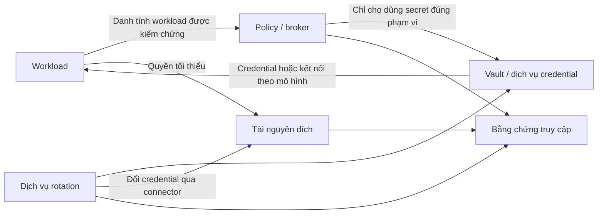

# Onboard service account vào PAM

## 1. Mục tiêu và phạm vi

Service account là danh tính được ứng dụng, dịch vụ, tác vụ nền hoặc công cụ tự động hóa sử dụng để xác thực và thực hiện công việc. Tài khoản này có thể nằm trên hệ điều hành, cơ sở dữ liệu, thư mục danh tính hoặc nền tảng cloud; cơ chế xác thực có thể là mật khẩu, khóa, chứng thư, token hoặc danh tính workload do nền tảng cấp.

Trong bối cảnh quản lý truy cập đặc quyền (Privileged Access Management — PAM), onboard service account là đưa danh tính, quyền và vòng đời credential của nó vào một quy trình kiểm soát có chủ sở hữu, có bằng chứng và không làm gián đoạn các workload đang phụ thuộc.

Không phải mọi service account đều có quyền quản trị. Cần kiểm kê và phân loại theo quyền thực tế; những tài khoản có thể quản trị hạ tầng, đọc dữ liệu nhạy cảm, cấp quyền cho danh tính khác hoặc điều khiển pipeline cần được đánh giá theo tác động tương ứng. Việc tài khoản được gọi là “service” không làm giảm mức rủi ro.

Onboarding đạt yêu cầu khi có thể trả lời và kiểm chứng được các câu hỏi:

- Danh tính phục vụ công việc nào, ai chịu trách nhiệm và những workload nào đang dùng nó?
- Quyền tối thiểu cần thiết là gì, trên tài nguyên nào và có đường truy cập nào ngoài kiểm soát không?
- Workload xác thực với PAM hoặc dịch vụ secret bằng cách nào?
- Credential được cấp, lấy, làm mới, luân chuyển và thu hồi ra sao?
- Khi chuyển đổi hoặc luân chuyển thất bại, hệ thống phát hiện, khôi phục và xác minh trạng thái thế nào?
- Bằng chứng nào chứng minh ứng dụng đã hoạt động với cơ chế mới và quyền cũ không còn tồn tại ngoài kế hoạch?

Chỉ lưu một mật khẩu vào vault chưa hoàn thành những mục tiêu này. Credential có thể vẫn còn trong cấu hình cũ, tài khoản có thể còn quyền quá rộng và không thành phần nào biết cách cập nhật ứng dụng khi mật khẩu thay đổi.

## 2. Phân biệt các thành phần cần quản lý

| Khái niệm | Ví dụ | Điều cần ghi nhận |
|---|---|---|
| Service account | Tài khoản cơ sở dữ liệu cho tác vụ đối soát | Định danh ổn định, nơi tồn tại, quyền, trạng thái và chủ sở hữu |
| Workload sử dụng tài khoản | Một dịch vụ, worker, job định kỳ hoặc pipeline | Môi trường, phiên bản triển khai, số instance và cách lấy credential |
| Credential | Password, private key, chứng thư hoặc token | Cơ chế cấp, hạn dùng, vị trí lưu và cách thay đổi |
| Tài nguyên đích | Cụm cơ sở dữ liệu hoặc API quản trị | Phạm vi truy cập, chủ sở hữu và mức nhạy cảm |
| Danh tính lấy secret | Danh tính workload được PAM xác minh | Điều kiện được dùng secret hoặc mở kết nối |
| Danh tính luân chuyển | Connector hoặc dịch vụ có quyền đổi credential | Phạm vi được đổi và cách bảo vệ quyền đó |

Một service account có thể được nhiều workload sử dụng; một workload cũng có thể dùng nhiều tài khoản. Quan hệ này phải được lập thành danh mục thay vì suy đoán từ tên tài khoản. Sự phân biệt còn giúp tránh cấp quyền đổi credential cho chính ứng dụng chỉ cần quyền sử dụng credential.

Việc đổi tên tài khoản hoặc chuyển vị trí lưu secret không tự loại bỏ quyền hiện hữu. Cần đối chiếu trạng thái tại hệ thống đích, nơi workload chạy và những đường truy cập liên quan.

## 3. Chốt chủ sở hữu, trách nhiệm và phạm vi thay đổi

Trước khi sửa cơ chế xác thực, cần chỉ định một chủ sở hữu chịu trách nhiệm về mục đích sử dụng và vòng đời tài khoản. Một địa chỉ nhóm không có người trực hoặc quyền quyết định rõ ràng thường không đủ cho việc xử lý sự cố.

| Vai trò | Trách nhiệm trong onboarding |
|---|---|
| Chủ ứng dụng hoặc dịch vụ | Xác nhận nhu cầu nghiệp vụ, dependency, cách kiểm tra chức năng và phương án khôi phục |
| Chủ tài nguyên đích | Phê duyệt quyền, hỗ trợ thay đổi credential và xác minh quyền tại đích |
| Đội PAM | Cấu hình đối tượng quản lý, policy, connector, quyền lấy secret và theo dõi rotation |
| Đội vận hành triển khai | Thay cấu hình workload, rollout, kiểm tra instance/job và xử lý lỗi ứng dụng |
| Đội an toàn thông tin | Rà soát đặc quyền, ngoại lệ, bằng chứng và yêu cầu ứng phó sự cố theo phạm vi |

Quyền gửi yêu cầu, phê duyệt và thực thi thay đổi cần được phân định theo mức rủi ro. Người có quyền dùng tài khoản dịch vụ không mặc nhiên có quyền xem plaintext secret, sửa policy hoặc tự cấp thêm quyền cho tài khoản.

Phạm vi thay đổi cần nêu rõ môi trường, tài khoản, workload, tài nguyên đích, lịch thực hiện, điều kiện dừng và người quyết định khi phải khôi phục. Các ngoại lệ như ứng dụng chưa hỗ trợ hot reload phải có chủ sở hữu, thời hạn xử lý và biện pháp kiểm soát trong thời gian chờ.

## 4. Kiểm kê dependency trước khi chạm vào credential

Rủi ro lớn của onboarding là thay credential ở đích trong khi một workload chưa được nhận diện vẫn dùng giá trị cũ. Một tác vụ chỉ chạy cuối tháng có thể không xuất hiện trong quan sát của một ngày.

Cần kết hợp thông tin từ chủ ứng dụng, cấu hình triển khai được phép kiểm tra, danh mục tài nguyên và dấu vết xác thực trong khoảng quan sát phù hợp. Log giúp phát hiện sử dụng thực tế nhưng không chứng minh tuyệt đối rằng không còn dependency, nhất là với job ít chạy hoặc hệ thống dự phòng.

Những vị trí thường phải đối chiếu gồm:

- Dịch vụ hệ điều hành, application pool, container và các replica.
- Scheduled task, batch, cron, job cuối kỳ và tác vụ khôi phục.
- Connection pool, tiến trình giữ kết nối lâu và bộ nhớ đệm credential.
- Pipeline CI/CD, công cụ triển khai, tích hợp với đối tác và script vận hành.
- Hệ thống dự phòng, vùng khôi phục thảm họa và cấu hình khởi động lại.
- Secret được truyền qua biến môi trường, tệp cấu hình, mount, agent hoặc cơ chế native của nền tảng.

Ví dụ một bảng dependency:

| Consumer | Thời điểm sử dụng | Cách nhận credential hiện tại | Cách cập nhật cần xác minh |
|---|---|---|---|
| Dịch vụ đối soát, 3 replica | Liên tục | Cấu hình khi khởi động | Reload có hỗ trợ không, hay phải rolling restart? |
| Job tổng hợp cuối ngày | Theo lịch | Secret được inject khi tạo job | Job mới có lấy phiên bản mới không? |
| Job cuối tháng | Ít chạy | Cấu hình riêng | Có môi trường kiểm tra hoặc lần chạy kiểm chứng phù hợp không? |
| Hệ thống dự phòng | Khi chuyển vùng | Bản cấu hình được đồng bộ | Quyền lấy secret và cơ chế nhận bản mới đã được triển khai chưa? |

Trong bảng làm việc, chỉ ghi định danh hoặc tham chiếu secret; không ghi giá trị credential. Nếu phát hiện secret trong source code, log hoặc artifact cũ, cần xử lý việc lộ credential theo quy trình phù hợp. Chỉ xóa chuỗi khỏi phiên bản hiện tại không làm các bản sao đã lộ mất hiệu lực.

### Hồ sơ tài khoản tối thiểu

Một hồ sơ onboarding nên có ID tài khoản, loại danh tính, môi trường, chủ sở hữu, mức nhạy cảm, quyền thực tế, danh sách consumer, tham chiếu credential, cơ chế xác thực workload, cách rotation và cách thu hồi. Hồ sơ cũng cần ngày rà soát, trạng thái ngoại lệ và bằng chứng nghiệm thu.

Không nên giữ một tài khoản dùng chung cho production và development chỉ vì tiện tích hợp. Tách theo môi trường, ứng dụng hoặc phạm vi quyền giúp giảm ảnh hưởng khi credential bị lộ và cho phép luân chuyển độc lập. Việc tách cần được kiểm tra tại đích, không chỉ bằng cách tạo hai bản ghi secret cùng trỏ đến một tài khoản toàn quyền.

## 5. Chọn mô hình cấp và sử dụng credential

Không phải tài khoản nào cũng nên được onboard theo cùng một cách. Cần xem khả năng của nền tảng, ứng dụng và tài nguyên đích trước khi quyết định.

| Mô hình | Khi phù hợp | Điều phải kiểm chứng |
|---|---|---|
| Danh tính workload hoặc danh tính dịch vụ do nền tảng quản lý | Nền tảng và đích hỗ trợ, quan hệ tin cậy kiểm soát được | Ràng buộc workload, audience, phạm vi và vòng đời token |
| Credential động, thời hạn ngắn | Đích và dịch vụ cấp phát hỗ trợ | Tạo quyền, TTL, gia hạn, thu hồi, tác động đến kết nối và quyền tồn dư |
| Credential tĩnh được vault quản lý và luân chuyển | Ứng dụng hoặc đích cần một tài khoản/password hay khóa tồn tại lâu hơn | Phân phối bản mới, khả năng reload và đồng bộ trạng thái hai phía |
| Broker hoặc proxy kết nối thay | Giao thức và ứng dụng cho phép | Không cần trả secret cho consumer, nhưng vẫn phải ràng buộc danh tính và quyền tại đích |
| Cơ chế tương thích cho ứng dụng cũ | Chưa thể tích hợp theo mô hình khác | Tệp/agent/sidecar được bảo vệ, quyền đọc giới hạn, cập nhật và khởi động lại có kiểm soát |

Danh tính workload có thể giảm nhu cầu lưu secret khởi tạo lâu dài. Tuy nhiên, nó vẫn cần chính sách tin cậy, giới hạn tài nguyên và kiểm soát vòng đời. Một token ngắn hạn cấp quyền quá rộng vẫn có thể gây tác động lớn trong thời gian còn hiệu lực.

Nếu phải dùng một secret để lấy secret khác, cần quản lý cả secret khởi tạo: ai nhận, lưu ở đâu, hạn dùng, rotation và thu hồi. Không nên chuyển mật khẩu cơ sở dữ liệu vào vault rồi để credential truy cập vault có quyền đọc toàn bộ kho nằm cố định trong image ứng dụng.

## 6. Thiết kế quyền tối thiểu cho cả ứng dụng và cơ chế PAM

Phải phân quyền ở hai lớp: **quyền của workload đối với PAM/secret** và **quyền của service account tại tài nguyên đích**. Thu hẹp một lớp không bù cho lớp còn lại quá rộng.

Ví dụ, workload chỉ được đọc đúng một secret nhưng secret đó thuộc tài khoản quản trị toàn bộ cơ sở dữ liệu thì phạm vi tác động vẫn rất lớn. Ngược lại, tài khoản tại đích chỉ có quyền đọc một bảng nhưng workload có thể lấy secret của nhiều tài khoản khác cũng không đáp ứng least privilege.

Thiết kế quyền nên xác định:

- Workload nào được dùng credential nào, trong môi trường nào và để kết nối đến đâu.
- Có thực sự cần trả plaintext secret hay broker có thể thực hiện kết nối thay.
- Hành động tại đích: đọc, ghi, gọi thủ tục, quản trị schema hoặc thao tác hạ tầng nào.
- Có cho đăng nhập tương tác, mở shell hoặc dùng tài khoản từ nguồn mạng khác không.
- Danh tính nào được thay credential và danh tính nào được sửa policy hoặc xóa đối tượng quản lý.
- Cách cấp quyền tạm JIT hoặc giới hạn tác vụ tương đương JEA khi công việc và nền tảng hỗ trợ.

Service account chạy nền thường không thể thực hiện MFA tương tác cho mỗi lần truy cập. Thay vì tạo ngoại lệ chung, cần dùng cơ chế xác thực máy phù hợp, ràng buộc workload và quyền tối thiểu. Người quản trị thao tác onboarding, sửa policy hoặc dùng đường khẩn cấp vẫn chịu kiểm soát xác thực dành cho con người.

Không nên cấm đăng nhập hoặc gỡ quyền trước khi biết ứng dụng phụ thuộc gì. Trước hết xác định nhu cầu thật, kiểm tra quyền cần thiết, sau đó triển khai thay đổi có kiểm chứng. Nếu còn một quyền rộng chưa thể bỏ, ghi rõ lý do, tác động, người chịu trách nhiệm và kế hoạch giảm quyền.

## 7. Thiết kế đường tích hợp và chính sách vận hành



Sơ đồ minh họa mô hình workload nhận credential. Với mô hình broker kết nối thay, broker nằm trên đường đến đích và workload không nhất thiết nhận giá trị secret.

Trước khi chuyển đổi, cần quyết định các hành vi sau:

| Tình huống | Câu hỏi thiết kế |
|---|---|
| Khởi động ứng dụng | Lấy credential trước khi sẵn sàng hay lấy theo nhu cầu? Lỗi thì báo trạng thái gì? |
| Secret hết hạn hoặc thay đổi | Có reload được không, ai kích hoạt và kết nối cũ xử lý thế nào? |
| Vault tạm thời không sẵn sàng | Có cho dùng bản đệm không, trong bao lâu và điều kiện nào phải dừng? |
| Nhiều replica cùng làm mới | Có tránh đồng loạt gọi lại gây quá tải và dùng sai phiên bản không? |
| Lỗi xác thực ở đích | Có giới hạn retry để tránh khóa tài khoản và có cảnh báo phân biệt nguyên nhân không? |
| Thu hồi khẩn cấp | Chặn cấp mới, xử lý bản đệm, token, phiên và kết nối đang hoạt động ra sao? |

Không coi lỗi lấy secret là lý do chuyển sang một mật khẩu mặc định hoặc tài khoản dự phòng toàn quyền. Nếu dùng cache, phải xác định quyền bảo vệ cache, thời hạn sử dụng, cách nhận thay đổi và hành vi khi credential đã bị thu hồi. Bản đệm còn dùng được tại đích cũng có thể kéo dài thời gian truy cập ngoài mong muốn.

Credential không nên được đưa vào tham số dòng lệnh, log chẩn đoán hoặc thông báo lỗi. Biến môi trường cũng không mặc nhiên là nơi lưu bí mật an toàn; cần xem khả năng lộ qua quyền kiểm tra tiến trình, crash dump, công cụ vận hành và cách triển khai thực tế.

## 8. Quy trình onboarding theo các cổng kiểm tra

Để tránh coi một bước cấu hình thành công là hoàn thành toàn bộ công việc, có thể dùng những cổng kiểm tra dưới đây. Tên trạng thái là gợi ý quản trị quy trình, không phải schema bắt buộc của một sản phẩm PAM.

| Cổng | Công việc | Điều kiện đi tiếp |
|---|---|---|
| Kiểm kê | Nhận diện tài khoản, quyền, consumer và chủ sở hữu | Phạm vi được xác nhận; dependency chưa rõ được xử lý hoặc ghi thành rủi ro cụ thể |
| Thiết kế | Chọn mô hình xác thực, policy, rotation và khôi phục | Đội ứng dụng, tài nguyên và PAM thống nhất trách nhiệm, điểm dừng |
| Tích hợp thử | Kiểm tra trong môi trường đại diện phù hợp | Workload xác thực được, quyền đúng và các lỗi chính có hành vi dự kiến |
| Chuẩn bị chuyển đổi | Tạo cấu hình PAM, quyền workload và kế hoạch rollout | Đủ điều kiện kết nối, giám sát, khôi phục và cửa sổ thay đổi |
| Chuyển đổi | Chuyển consumer sang cơ chế đã chọn | Từng consumer được xác minh; không báo thành công chỉ dựa vào portal PAM |
| Xác minh vòng đời | Thử rotation hoặc cơ chế làm mới phù hợp | Credential mới hoạt động, consumer đã cập nhật và credential cũ bị xử lý theo kế hoạch |
| Bàn giao | Lưu bằng chứng, runbook và lịch rà soát | Có người vận hành chịu trách nhiệm, cảnh báo và ngoại lệ rõ ràng |

### Chuẩn bị đối tượng quản lý

Khi đưa tài khoản hiện hữu vào vault, cần xác minh đúng danh tính tại đích và khả năng xác thực/đổi credential trước khi kích hoạt tác vụ tự động. Sai ánh xạ hostname, tenant, database hoặc tài khoản có thể khiến một thay đổi tác động nhầm tài nguyên.

Chỉ truyền credential ban đầu bằng kênh được phép, hạn chế người xem và xóa các bản sao tạm theo quy trình. Không đặt giá trị credential vào ticket hoặc tài liệu bàn giao. Những nơi có thể vẫn còn bản sao phải được xử lý như một phần của chuyển đổi.

### Chuyển đổi consumer

Ứng dụng cần dùng tham chiếu và cơ chế lấy secret mới theo thiết kế. Kiểm tra cả đường khởi động mới lẫn đường xử lý đang chạy. Một tiến trình còn giữ kết nối cũ có thể tiếp tục thành công dù cấu hình mới sai; do đó không thể chỉ nhìn tỷ lệ lỗi hiện tại để kết luận đã chuyển đổi đúng.

Với nhiều replica, có thể rollout theo từng nhóm nếu ứng dụng và mô hình credential hỗ trợ. Nếu chỉ có một mật khẩu hợp lệ tại một thời điểm và ứng dụng không hỗ trợ cập nhật linh hoạt, cần cửa sổ thay đổi hoặc phương án khác đã được kiểm chứng. Không nên hứa chuyển đổi không gián đoạn chỉ vì có vault.

## 9. Luân chuyển credential mà không làm mất đồng bộ

Rotation là một giao dịch phân tán giữa nơi lưu credential, tài nguyên đích và các consumer. Không nên giả định ba phía thay đổi cùng lúc hoặc có thể rollback nguyên tử.

Ví dụ một luồng minh họa cho password của tài khoản cơ sở dữ liệu:

```text
Xác minh dependency và điều kiện thay đổi
    -> Ghi nhận tác vụ rotation và trạng thái ban đầu
    -> Chuẩn bị credential mới trong vùng bảo vệ
    -> Đổi credential tại đích theo giao thức được hỗ trợ
    -> Xác minh trạng thái xác thực tại đích
    -> Cập nhật phiên bản credential được cấp cho consumer
    -> Consumer reload / nhận phiên bản mới / tái tạo kết nối
    -> Kiểm tra chức năng và từng nhóm consumer
    -> Vô hiệu hóa credential cũ nếu còn hiệu lực và theo kế hoạch
    -> Đối soát, lưu bằng chứng và đóng tác vụ
```

Đây là trình tự tư duy, không phải thứ tự thực hiện bắt buộc cho mọi connector. Một sản phẩm có thể cập nhật các phía theo thứ tự khác. Thiết kế phải chỉ rõ credential nào đang có hiệu lực trong mỗi trạng thái, điều gì xảy ra khi timeout và cách xác minh trước khi thử lại.

| Điểm lỗi | Nguy cơ | Hành động cần có trong runbook |
|---|---|---|
| Đích từ chối đổi credential | Vault hoặc tác vụ có thể giữ bản mới chưa dùng được | Xác minh bản đang hợp lệ; không công bố bản chưa được kiểm chứng |
| Đích đã đổi nhưng phản hồi bị mất | Không biết thao tác thành công hay chưa | Đối soát theo cơ chế hỗ trợ; tránh đổi tiếp một cách mù quáng |
| Đích đã đổi, kho secret chưa cập nhật | Consumer nhận bản cũ và bị lỗi | Hạn chế vòng lỗi, khôi phục nhất quán bằng quyền được bảo vệ và xác minh lại |
| Một replica chưa reload | Một phần ứng dụng tiếp tục dùng bản cũ | Xác định consumer lệch phiên bản, sửa/restart có kiểm soát và theo dõi tác động |
| Job ít chạy chưa kiểm chứng | Lỗi chỉ xuất hiện sau khi đã đóng thay đổi | Tổ chức kiểm tra đại diện hoặc giữ điều kiện nghiệm thu chưa hoàn tất |
| Rotation lặp do retry | Thay đổi nhiều lần, consumer không theo kịp | ID tác vụ, khóa/lease phù hợp và xử lý lặp an toàn theo khả năng nền tảng |

Không log giá trị cũ/mới để phục vụ đối soát. Có thể dùng ID phiên bản và trạng thái xác minh, kèm thông tin đủ để người được ủy quyền thực hiện khôi phục qua kênh được bảo vệ.

### Hai credential hoặc hai tài khoản luân phiên

Nếu đích hỗ trợ nhiều khóa hoặc credential đồng thời, có thể cấp bản mới, chuyển consumer, kiểm chứng rồi vô hiệu bản cũ. Nếu dùng hai tài khoản luân phiên, phải kiểm soát quyền tương đương và phạm vi truy cập của cả hai. Khoảng chồng lấp làm tăng số credential có thể sử dụng nên cần thời hạn và bằng chứng dọn dẹp.

Không được giả định mọi database, dịch vụ hay giao thức đều hỗ trợ hai password song song. Phương án hai tài khoản cũng có thể làm thay đổi chủ sở hữu đối tượng, dấu vết audit hoặc quota; cần kiểm tra trước khi áp dụng.

### Rotation và thu hồi phiên là hai việc khác nhau

Đổi password hoặc key không bảo đảm đóng mọi kết nối hoặc vô hiệu mọi token đã phát hành. Một connection pool có thể vẫn hoạt động, khiến kiểm tra chức năng chưa phản ánh khả năng đăng nhập bằng credential mới.

Việc kiểm chứng cần bao gồm một kết nối mới được tạo bằng cơ chế mới, với thao tác chức năng tối thiểu phù hợp. Khi cần thu hồi khẩn cấp, phải xử lý riêng phiên, token, quyền và các kết nối đang mở theo khả năng của đích.

## 10. Kế hoạch khôi phục và xử lý mất kết nối

Runbook cần nêu rõ điều kiện dừng, người có quyền quyết định, cách xác định credential đang có hiệu lực và cách khôi phục dịch vụ. Không nên chờ rotation thất bại mới tìm người giữ quyền thay đổi ở đích.

Cần phân biệt ba tình huống:

1. **Chưa thay đổi tại đích:** có thể dừng rollout và tiếp tục cơ chế cũ nếu cơ chế đó còn an toàn, hợp lệ và nằm trong kế hoạch.
2. **Đã thay đổi tại đích:** quay lại cấu hình ứng dụng cũ có thể vẫn thất bại vì credential cũ không còn hiệu lực. Cần đồng bộ credential hoặc thực hiện thao tác khôi phục được phép tại đích.
3. **Không xác định kết quả:** giữ trạng thái chưa xác minh, giới hạn retry và đối soát trước. Không báo rollback thành công chỉ vì đã gửi lệnh.

Khôi phục không nhất thiết là dùng lại credential cũ. Đích có thể không cho dùng lại, credential có thể đã bị lộ hoặc không còn đáp ứng chính sách. Tùy tình huống, cần cấp một credential mới khác và đưa các consumer về trạng thái nhất quán.

Đối với tài khoản phục vụ ứng phó sự cố, đường break-glass phải được thiết kế trước với quyền tối thiểu khả thi, người được ủy quyền, cách bảo vệ credential và bằng chứng sử dụng. Không để mọi workload tự động chuyển sang tài khoản quản trị dự phòng khi PAM không phản hồi.

Hành vi khi vault hoặc mạng lỗi cũng cần thử trong phạm vi được phép: consumer đang chạy có thể còn dùng kết nối hiện hữu, trong khi một replica khởi động mới không lấy được secret. Giám sát cần phân biệt hai trạng thái để tránh kết luận toàn bộ dịch vụ vẫn sẵn sàng chỉ từ các instance cũ.

## 11. Kiểm tra trước khi nghiệm thu

Các kiểm tra dưới đây là hướng dẫn cho đội triển khai khi onboard thật; chúng cần được thực hiện trong môi trường và cửa sổ được cho phép. Không cần một bộ lệnh chung cho mọi nền tảng, vì chính cách xác thực và thu hồi phụ thuộc tài nguyên cụ thể.

| Nhóm kiểm tra | Tình huống | Bằng chứng mong đợi |
|---|---|---|
| Chức năng | Workload hợp lệ lấy/dùng credential và thực hiện nghiệp vụ cần thiết | Kết quả tại ứng dụng và audit ở đích gắn đúng danh tính |
| Phân quyền âm | Workload khác hoặc môi trường khác yêu cầu cùng secret | Bị từ chối, không lộ giá trị secret |
| Quyền tại đích | Thử tác vụ ngoài nhu cầu bằng cách phù hợp | Đích từ chối; việc lấy đúng secret không mở quyền quản trị rộng hơn |
| Khởi động | Một instance mới khởi động với cấu hình mới | Nhận đúng phiên bản credential và chuyển trạng thái sẵn sàng đúng |
| Rotation/làm mới | Đổi credential hoặc hết hạn theo mô hình đã chọn | Consumer tạo được kết nối mới; trạng thái các phía nhất quán |
| Dependency | Replica, job định kỳ và hệ thống dự phòng được kiểm chứng | Có danh sách kết quả cho từng consumer, không chỉ kiểm tra một instance |
| Lỗi phụ thuộc | Không lấy được secret hoặc không đến được đích | Retry có giới hạn, cảnh báo rõ, không dùng credential mặc định |
| Thu hồi | Chặn danh tính workload hoặc vô hiệu credential trong tình huống thử phù hợp | Chặn cấp mới và xử lý quyền/phiên còn sống theo thiết kế |
| Bằng chứng | Truy từ sự kiện sử dụng đến đối tượng PAM và chủ sở hữu | Có định danh liên kết, mốc thời gian và trạng thái thực thi |

Không thực hiện hành động phá hủy dữ liệu để chứng minh quyền mạnh đã bị gỡ. Chọn kiểm tra quyền hoặc thao tác vô hại phù hợp với nền tảng và môi trường thử nghiệm. Các bài kiểm tra cần phản ánh nguy cơ thật như consumer giữ credential cũ hoặc workload truy cập sai môi trường.

### Điều kiện hoàn thành

Onboarding chỉ nên được nghiệm thu khi:

- Đúng tài khoản, đúng môi trường, có chủ sở hữu và danh sách consumer đã xác nhận.
- Quyền PAM và quyền tại đích khớp nhu cầu; quyền rộng còn tồn tại được ghi thành ngoại lệ cụ thể.
- Workload dùng cơ chế xác thực đã chọn và không phụ thuộc một secret khởi tạo ngoài kiểm soát.
- Các consumer có thể khởi động/tạo kết nối mới theo cơ chế mới.
- Rotation, làm mới hoặc vòng đời credential phù hợp đã được kiểm chứng; khả năng khôi phục có runbook và người chịu trách nhiệm.
- Credential cũ và các bản sao được xử lý theo kế hoạch; quyền, phiên hoặc token tồn dư được xác minh hoặc ghi rõ việc còn phải làm.
- Có bằng chứng, cảnh báo, đầu mối vận hành và lịch rà soát.

Nếu còn consumer chưa rõ hoặc rotation chưa được kiểm chứng, nên giữ trạng thái tương ứng như “đã tích hợp, chưa nghiệm thu vòng đời” thay vì báo onboarding hoàn tất. Tên trạng thái tùy tổ chức nhưng phải phản ánh phần kiểm soát còn thiếu.

## 12. Bằng chứng và giám sát sau bàn giao

Thông tin phục vụ kiểm toán cần liên kết danh tính workload, service account, tài nguyên, tham chiếu secret, policy và kết quả thao tác. Với credential tĩnh, phiên bản secret hoặc ID rotation giúp phân biệt consumer đang dùng cấu hình nào mà không cần ghi giá trị.

| Loại sự kiện | Nội dung nên ghi theo nhu cầu |
|---|---|
| Onboarding và thay đổi policy | Người thực hiện/phê duyệt, phạm vi, thời điểm, phiên bản cấu hình, tham chiếu thay đổi |
| Lấy hoặc dùng secret | Danh tính workload, đối tượng được phép, kết quả, lý do từ chối và mốc thời gian |
| Rotation | ID tác vụ, tài khoản đích, các bước đã xác minh, phiên bản credential và lỗi |
| Cập nhật consumer | Consumer nào đã nhận/reload bản mới, kết quả kết nối mới và lỗi chưa xử lý |
| Thu hồi | Quyết định, hành động tại đích, kết quả xác nhận và quyền/phiên còn tồn dư |
| Truy cập khẩn cấp | Chủ thể, lý do, phạm vi, hoạt động, thời điểm kết thúc và đối soát |

Không nhất thiết ghi nội dung mọi truy vấn hoặc toàn bộ dữ liệu ứng dụng. Cần thu thập phù hợp mức nhạy cảm, mục đích kiểm toán và yêu cầu lưu giữ; bảo vệ quyền đọc và tính toàn vẹn của bằng chứng.

Các tín hiệu cần giám sát sau bàn giao gồm lỗi xác thực tăng, consumer lệch phiên bản credential, rotation quá hạn, credential gần hết hạn, truy cập từ nguồn mới, yêu cầu secret ngoài phạm vi và tài khoản không còn chủ sở hữu. Cũng cần theo dõi tác vụ thu hồi hoặc đồng bộ chưa xác minh để tránh bỏ sót trạng thái không nhất quán.

Với phiên quản trị của con người dùng để thay cấu hình service account, có thể áp dụng proxy và ghi phiên theo policy PAM. Với workload tự động, cần bằng chứng API, nhận diện workload và audit ở tài nguyên phù hợp; không nên giả định mọi kiểu tài khoản dịch vụ đều có thể hoặc cần được ghi màn hình như RDP.

## 13. Tình huống minh họa: tác vụ đối soát production

Một hệ thống có tài khoản `svc_reconcile_prod` dùng để gọi thủ tục đối soát tại cơ sở dữ liệu. Có ba replica xử lý thường xuyên, một job cuối ngày và một job cuối tháng. Mật khẩu hiện được cấu hình trong cơ chế triển khai cũ.

### Phát hiện trước chuyển đổi

Kiểm kê cho thấy tài khoản có quyền quản trị rộng hơn nhu cầu, các replica chỉ nạp cấu hình khi khởi động và job cuối tháng có cấu hình riêng. Chủ ứng dụng xác nhận nhu cầu thật là gọi một nhóm thủ tục và đọc một tập dữ liệu xác định.

Nhóm triển khai thống nhất:

1. Tạo hoặc điều chỉnh vai trò tại đích theo đúng tác vụ; kiểm tra các quyền ngầm và tác động chức năng trước khi gỡ quyền rộng.
2. Dùng danh tính workload riêng cho production, chỉ cho dùng credential của `svc_reconcile_prod`.
3. Tích hợp cơ chế phân phối credential và rollout phù hợp khả năng khởi động lại của ứng dụng.
4. Bổ sung job cuối tháng, hệ thống dự phòng và quyền lấy secret tương ứng vào kế hoạch kiểm chứng.
5. Xây dựng rotation có trạng thái và runbook đối soát khi đích đã đổi mà consumer chưa cập nhật.

### Chuyển đổi và kiểm chứng

Đội triển khai kiểm tra trước ở môi trường đại diện, sau đó thực hiện thay đổi production trong cửa sổ đã duyệt. Từng nhóm consumer được xác nhận tạo kết nối mới thành công và thực hiện đúng nghiệp vụ. Một workload development thử yêu cầu secret production bị từ chối.

Khi thử rotation có kiểm soát, hai replica hoạt động nhưng replica thứ ba lỗi xác thực sau khi tạo lại kết nối. Hệ thống không báo thành công toàn bộ. Đội vận hành phát hiện replica đó chưa nhận cấu hình mới, đưa nó về cùng phiên bản, xác minh kết nối mới rồi mới tiếp tục nghiệm thu.

Job cuối tháng chưa đến lịch chạy được xử lý bằng một phép kiểm chứng đại diện đã được chủ ứng dụng chấp nhận hoặc giữ là một hạng mục nghiệm thu còn mở. Không được bỏ qua chỉ vì các replica thường trực đang hoạt động.

Hồ sơ bàn giao ghi tham chiếu secret, quyền đã gỡ, consumer đã kiểm chứng, ID rotation, ngoại lệ còn lại và cách thu hồi khi workload bị xâm nhập. Không chứa mật khẩu cũ hoặc mới.

## 14. Lỗi thường gặp và câu hỏi tự kiểm tra

| Lỗi | Hệ quả | Cách phòng tránh |
|---|---|---|
| Đổi mật khẩu trước khi biết consumer | Gián đoạn job hoặc hệ thống dự phòng | Kiểm kê dependency, xác nhận với chủ ứng dụng và thử theo lịch phù hợp |
| Chỉ đưa secret vào vault | Quyền rộng và bản sao cũ vẫn tồn tại | Kiểm tra quyền, đường lấy secret, vòng đời và dọn cấu hình cũ |
| Dùng một danh tính lấy mọi secret | Một workload bị xâm nhập ảnh hưởng nhiều hệ thống | Danh tính riêng và policy giới hạn theo tài nguyên/môi trường |
| Dùng tài khoản người thật cho tác vụ nền | Phụ thuộc vòng đời nhân sự và khó truy vết | Danh tính máy chuyên dụng với chủ sở hữu rõ |
| Rotation chỉ báo tác vụ đã gửi | Không biết đích và consumer có đồng bộ không | Xác minh từng mốc, giữ trạng thái chưa xác nhận khi cần |
| Chỉ nhìn kết nối đang sống | Không phát hiện credential mới sai | Kiểm tra khả năng tạo kết nối mới theo cơ chế mới |
| Rollback chỉ bằng cấu hình ứng dụng | Credential cũ có thể đã vô hiệu | Runbook dựa trên trạng thái thực tế ở đích và kho secret |
| Coi đổi mật khẩu là thu hồi mọi quyền | Token hoặc phiên đã có còn dùng được | Xử lý credential, quyền và phiên/token theo từng cơ chế |
| Không rà soát sau bàn giao | Tài khoản mồ côi, quyền và dependency trôi khỏi danh mục | Rà soát chủ sở hữu, sử dụng, quyền và trạng thái rotation theo định kỳ phù hợp |

Để tự kiểm tra thiết kế, hãy trả lời:

1. Nếu workload bị xâm nhập, nó có thể lấy thêm secret nào ngoài nhu cầu hiện tại?
2. Nếu tài khoản tại đích đổi credential thành công nhưng vault timeout, ai xác minh và sửa trạng thái?
3. Nếu một job chỉ chạy mỗi quý, bằng chứng nào cho thấy nó sẵn sàng với cơ chế mới?
4. Nếu vault lỗi khi một replica khởi động lại, ứng dụng retry và báo trạng thái ra sao?
5. Khi thu hồi tài khoản, kết nối, token và quyền nào có thể còn sống sau khi password đổi?
6. Ai có quyền quyết định dừng thay đổi, ai giữ trách nhiệm khôi phục và bằng chứng được lưu ở đâu?

Onboard service account là một phần của quản lý vòng đời đặc quyền. Danh tính có chủ sở hữu, quyền được giới hạn tại cả PAM và tài nguyên, consumer được kiểm kê, credential có vòng đời đã kiểm chứng và trạng thái thực thi có bằng chứng là những điều kiện để tài khoản tiếp tục được vận hành an toàn sau ngày chuyển đổi.
