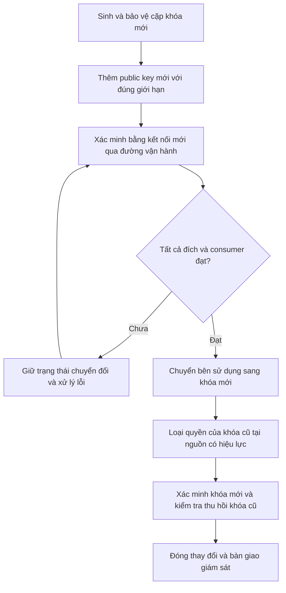

# Onboard SSH key

## 1. Mục tiêu của onboarding khóa SSH vào PAM

Khóa SSH thường được dùng để đăng nhập quản trị máy chủ, chạy tác vụ tự động, triển khai phần mềm hoặc truy cập thiết bị hạ tầng. Một private key có thể mở đường vào nhiều tài khoản trên nhiều hệ thống nếu public key tương ứng đã được cấp quyền ở những nơi đó. Khi khóa được sao chép giữa máy cá nhân, máy chạy job và thư mục cấu hình, tổ chức khó xác định ai đang có khả năng sử dụng quyền đặc biệt.

Onboard SSH key vào hệ thống quản lý truy cập đặc quyền (Privileged Access Management, PAM) là đưa khóa và các quan hệ cấp quyền của nó vào một vòng đời có kiểm soát. Công việc bao gồm xác định chủ sở hữu, bảo vệ private key hoặc cơ chế ký, kiểm kê public key được tin cậy ở đâu, kiểm soát bên sử dụng, xác minh đăng nhập và chuẩn bị thay thế hoặc thu hồi.

Chỉ tải private key vào vault chưa hoàn tất onboarding. Nếu bản sao cũ vẫn nằm ngoài kiểm soát, public key vẫn được tin cậy ở các đích chưa kiểm kê và người dùng vẫn truy cập trực tiếp, phạm vi quyền thực tế vẫn có thể rộng hơn cấu hình PAM.

Trong bài học thuộc chương Onboarding, mục tiêu là quản lý khóa dùng cho tài khoản quản trị, danh tính dịch vụ và hạ tầng nhạy cảm. Quy trình cần hỗ trợ least privilege, cấp quyền có thời hạn khi phù hợp, giới hạn tác vụ, giám sát phiên và bằng chứng cho kiểm toán, ứng phó sự cố. Các bước dưới đây là mô hình kiến trúc và vận hành; khả năng cụ thể phải được đối chiếu với connector, máy chủ SSH và nền tảng thực tế.

## 2. Phân biệt các loại khóa và quan hệ tin cậy

### 2.1. User key và host key

| Thành phần | Được dùng để làm gì? | Bên cần bảo vệ hoặc xác minh |
|---|---|---|
| Private key của người dùng hoặc workload | Ký dữ liệu để chứng minh quyền sử dụng khóa khi xác thực | Người dùng, workload, vault hoặc thành phần ký giữ private key |
| Public key tương ứng | Cho phía đích kiểm tra chữ ký và quyết định có tin khóa đó cho tài khoản hay không | Nơi lưu quy tắc cấp quyền trên máy chủ hoặc dịch vụ danh tính |
| Host key của máy chủ SSH | Chứng minh danh tính máy chủ đối với bên kết nối | Máy chủ giữ private host key; client xác minh public host key hoặc chứng thư tương ứng |
| Khóa của SSH CA | Ký chứng thư SSH theo chính sách | Hệ thống cấp chứng thư, với quyền ký cần được kiểm soát riêng |

User key và host key là hai phía khác nhau của quá trình xác thực. Vault có đúng private user key không có nghĩa broker đã kết nối đúng máy chủ. Tắt xác minh host key để đăng nhập thành công có thể đưa credential hoặc phiên quản trị tới một điểm đích không được tin cậy.

Public key không phải bí mật như private key, nhưng quyền sửa nơi tin cậy public key là quyền nhạy cảm: người có thể thêm khóa của mình vào tài khoản quản trị có thể tạo đường truy cập mới. Cần bảo vệ cả secret lẫn cấu hình cấp quyền.

### 2.2. Khóa không tự gắn với tên tài khoản

Một public key có thể được cấp quyền cho nhiều tài khoản; một tài khoản có thể tin nhiều public key. Quan hệ cần quản lý có dạng:

```text
Chủ sở hữu / bên sử dụng
    -> khóa hoặc cơ chế ký
    -> tài khoản đích
    -> tài nguyên / môi trường
    -> nguồn cấp quyền và các giới hạn
```

Comment ở cuối dòng public key hoặc tên file như `prod-admin` chỉ là nhãn. Chúng không chứng minh danh tính người sở hữu, môi trường được phép dùng hoặc quyền thực tế. Cần định danh khóa bằng thông tin kỹ thuật như fingerprint, rồi liên kết với hồ sơ sở hữu và danh sách đích đã xác minh.

### 2.3. Passphrase không phải rotation của khóa

Passphrase bảo vệ private key được lưu ở dạng mã hóa. Đổi passphrase thường chỉ thay lớp bảo vệ file private key; public key và khả năng xác thực của các bản sao private key đã bị lấy trước đó vẫn giữ nguyên.

Rotation cặp khóa là tạo hoặc tiếp nhận một cặp khóa mới, phân phối public key mới tới đúng nơi cấp quyền, chuyển bên sử dụng và loại bỏ quyền của khóa cũ. Nếu nghi private key cũ đã lộ, chỉ đổi passphrase của bản sao trong vault không giải quyết được rủi ro.

## 3. Chọn mô hình quản lý phù hợp

Không phải mọi khóa SSH đều có thể hoặc nên được nhập thành một file private key trong vault.

| Mô hình | PAM quản lý gì? | Điểm cần xác nhận |
|---|---|---|
| Nhập khóa hiện có vào vault | Private key được bảo vệ, metadata, quyền sử dụng và quan hệ đích | Có đủ căn cứ sở hữu; có thể tồn tại bản sao ngoài kiểm soát |
| Sinh khóa mới trong thành phần tin cậy | Vòng đời khóa mới và việc phân phối public key | Khả năng sinh, dùng, phục hồi và thay thế được hỗ trợ |
| Broker dùng khóa để mở phiên | Ai được mở phiên tới tài khoản nào; broker sử dụng khóa | Private key có bị xuất ra cho người dùng hay không, bằng chứng gắn với phiên |
| Workload lấy khóa hoặc gọi cơ chế ký | Danh tính workload và phạm vi được sử dụng | Quyền vault, thời hạn, cache và cách hạn chế xuất secret |
| Khóa trong phần cứng hoặc bộ ký không cho xuất | Tham chiếu khóa và quyền yêu cầu ký | Không tự giả định có thể xuất private key; xác nhận giao thức tích hợp |
| Chứng thư SSH ngắn hạn | Chính sách cấp chứng thư, principal, thời hạn và trust của đích | Máy chủ tin CA, ràng buộc danh tính và cơ chế thu hồi phù hợp |

Với private key nằm trong thiết bị phần cứng hoặc một bộ ký không cho xuất, onboarding có thể là quản lý danh tính, tham chiếu và quyền sử dụng bộ ký. Không yêu cầu trích xuất private key để ép mô hình đó thành một secret thông thường.

Với chứng thư SSH, máy chủ có thể chấp nhận khóa nhờ chứng thư do CA tin cậy ký, thay vì chỉ nhờ một public key tĩnh trong danh sách. Phải phân biệt chứng thư dành cho người dùng với chứng thư dành cho host, kiểm tra principal, thời hạn và các ràng buộc liên quan. Cấp lại chứng thư cho cùng một public key không đồng nghĩa đã thay private key.

Private key của CA có phạm vi tác động rộng hơn một khóa đăng nhập thông thường. Việc bảo vệ và cấp quyền ký cần một thiết kế riêng; không nhập khóa CA như một credential để các nhóm vận hành tùy ý checkout.

## 4. Kiểm kê trước khi nhập

Một hồ sơ onboarding cần trả lời các câu hỏi sau:

| Nhóm thông tin | Nội dung cần có |
|---|---|
| Chủ thể | Chủ sở hữu, người hoặc workload dùng khóa, đầu mối chịu trách nhiệm |
| Khóa | Fingerprint public key, loại khóa, định dạng, trạng thái mã hóa và khả năng connector sử dụng |
| Đích | ID máy chủ hoặc nhóm đích, môi trường, tenant, tài khoản đăng nhập |
| Nguồn cấp quyền | File, dịch vụ tra cứu public key, cấu hình tập trung hoặc trust chứng thư |
| Phạm vi sử dụng | Shell tương tác, lệnh giới hạn, truyền file, tác vụ định kỳ hoặc tunnel được phép |
| Phụ thuộc | Pipeline, job, agent, script, thiết bị phần cứng và các bản sao đang hoạt động |
| Vòng đời | Người được thay khóa, cách cập nhật đích, cửa sổ chuyển đổi, thu hồi và khôi phục |

Không giới hạn kiểm kê vào một đường dẫn mặc định. Máy chủ có thể dùng nhiều nguồn public key hoặc cơ chế tra cứu động; tài khoản quản trị cũng có thể có cấu hình khác tài khoản thông thường. Cần xác định nguồn có hiệu lực trên nền tảng thực tế, cùng công cụ quản lý cấu hình có thể khôi phục dòng khóa sau khi bị xóa.

Một khóa từng được dùng ở nhiều môi trường không tự trở thành an toàn chỉ vì đã nhập vào vault. Có thể cần tách khóa theo danh tính và phạm vi tin cậy để giảm tác động khi lộ. Khi còn đích chưa rõ chủ sở hữu, ghi nhận giới hạn đó và chưa tuyên bố đã có khả năng thu hồi đầy đủ.

## 5. Đối chiếu public key và private key

Trước khi nhập, cần kiểm tra loại dữ liệu, định dạng và khả năng sử dụng. Không suy ra một file là public key chỉ từ phần mở rộng `.pub`; cũng không coi hai file có cùng tên gốc là một cặp đã được xác minh.

Trong môi trường lab được phép, công cụ OpenSSH có thể hiển thị fingerprint của public key:

```bash
ssh-keygen -lf ./lab-user-key.pub
```

Nếu có quyền sử dụng private key, có thể suy ra public key tương ứng bằng cơ chế được hỗ trợ, chẳng hạn:

```bash
ssh-keygen -y -f ./lab-user-key
```

Lệnh thứ hai xuất public key, không xuất private key. Nếu private key được mã hóa, công cụ có thể yêu cầu passphrase. Không truyền passphrase trong tham số dòng lệnh hoặc đưa nó vào script để tiện chạy tự động. Đây là ví dụ thao tác trong lab, không phải yêu cầu lấy khóa từ hệ thống production.

Đối chiếu fingerprint của public key suy ra với public key đã khai báo và khóa thực sự được tin cậy trên đích. Với khóa trong phần cứng hoặc bộ ký không cho xuất, dùng cách đọc public key và chứng minh khả năng ký do hệ thống đó hỗ trợ.

Việc chứng minh private key khớp public key chỉ xác nhận quan hệ kỹ thuật và khả năng sử dụng tại thời điểm kiểm tra. Nó không chứng minh người bàn giao là chủ sở hữu hợp lệ, không có bản sao khác hoặc khóa chưa từng bị lộ. Các kết luận đó cần quy trình sở hữu, lịch sử phân phối và, khi cần, thay khóa.

Loại khóa, định dạng và cơ chế mã hóa phải phù hợp chính sách mật mã của tổ chức, máy chủ đích và connector. Không âm thầm chuyển private key sang dạng không mã hóa hoặc dùng một loại khóa ngoài chính sách chỉ để connector đọc được. Nếu tích hợp chưa hỗ trợ, ghi nhận giới hạn và chọn mô hình quản lý phù hợp.

## 6. Preflight trên đường truy cập và nguồn cấp quyền

### 6.1. Đúng máy chủ và đúng tài khoản

Xác nhận endpoint, ID tài nguyên, tên tài khoản, môi trường và đường mạng broker hoặc workload sẽ dùng. Kiểm tra public host key hoặc chuỗi trust chứng thư host bằng nguồn đã được xác minh độc lập theo quy trình của tổ chức.

Một lần thu thập host key từ mạng chưa được tin cậy chỉ cho biết phía đầu kia đã trình khóa nào; nó chưa chứng minh máy chủ đó là đúng đích. Khi host key thay đổi, cần đối soát lý do và cập nhật trust có kiểm soát, thay vì chấp nhận tự động mọi khóa mới.

Tài khoản có tồn tại và cho phép kiểu đăng nhập dự kiến không? Có bị khóa, bị hạn chế shell hoặc yêu cầu thêm yếu tố xác thực không? Nếu chính sách yêu cầu kết hợp public key với yếu tố khác, giữ nguyên yêu cầu đó trong thiết kế PAM; không tắt để phép thử onboarding dễ thành công hơn.

### 6.2. Nguồn public key thực sự có hiệu lực

Với máy chủ dùng file kiểu `authorized_keys`, cần xác định đúng đường dẫn có hiệu lực, chủ sở hữu, quyền file và nguồn tạo nội dung. Với hệ thống dùng dịch vụ tra cứu khóa, phải kiểm tra dữ liệu ở nguồn đó. Với chứng thư, xác định CA được tin, principal được chấp nhận và quy tắc chứng thư.

Không thay toàn bộ danh sách khóa bằng một file mới chỉ để thêm khóa PAM. Làm như vậy có thể xóa quyền của nhóm quản trị khác hoặc phá đường khôi phục hợp lệ. Thay đổi phải nhận diện đúng khóa, bảo toàn mục không liên quan và được đọc lại để xác nhận.

Nếu cấu hình được sinh từ công cụ quản lý tập trung, cập nhật nguồn quản lý phù hợp. Xóa dòng trên máy đích nhưng để nguyên nguồn cấu hình có thể khiến khóa cũ xuất hiện trở lại ở lần đồng bộ tiếp theo.

### 6.3. Điều kiện trước khi thay đổi

Cần có người chịu trách nhiệm tại đích, cửa sổ thay đổi nếu cần và một đường quản trị độc lập đã được kiểm tra. Không xóa khóa truy cập duy nhất trước khi có cách xác minh khóa mới và khôi phục.

Danh tính dùng để phân phối public key cần quyền hẹp theo phạm vi tài khoản và tài nguyên. Private key đăng nhập không đương nhiên cần có quyền sửa mọi nơi cấp quyền. Nếu phải dùng danh tính quản lý riêng, bảo vệ nó và giới hạn phạm vi; quyền này có thể tạo đường truy cập mới tới nhiều hệ thống.

## 7. Nhập vào vault và cấu hình quyền sử dụng

### 7.1. Metadata và nội dung bí mật

Ví dụ sau là mô hình dữ liệu minh họa, không phải cấu hình của một sản phẩm cụ thể. Giá trị fingerprint là chỗ giữ chỗ, không phải một khóa có thể sử dụng:

```yaml
key_ref: ssh-key-reporting-prod-v2
credential_type: ssh-user-key
public_key_fingerprint: "SHA256:<fingerprint-da-xac-minh>"
owner_group: reporting-operations
beneficiary_type: workload
private_key_ref: protected-key-object-reference
passphrase_mode: managed-by-supported-connector
target_bindings:
  - resource_ref: report-node-prod-01
    account_name: report-reader
    authorization_source: managed-public-key-source
  - resource_ref: report-node-prod-02
    account_name: report-reader
    authorization_source: managed-public-key-source
usage_policy_ref: reporting-job-ssh-use
onboarding_state: IMPORTED_PENDING_VERIFICATION
```

Private key và passphrase, nếu có, nằm trong các đối tượng được bảo vệ theo mô hình vault; không đưa chúng vào metadata hoặc bằng chứng. Tham chiếu đối tượng không tự cấp quyền sử dụng. Bên gọi vẫn phải được xác thực và kiểm tra quyền theo chính sách.

Passphrase và private key cần được bảo vệ phù hợp với khả năng connector. Nếu cùng một danh tính có thể đọc cả hai, không coi việc lưu thành hai trường là hai lớp phân tách quyền độc lập. Nếu có chuyển đổi định dạng được phép, phải kiểm soát bản tạm, tính toàn vẹn và việc loại bỏ bản sao không còn cần thiết.

### 7.2. Quyền quản lý và quyền sử dụng

Tách các năng lực khi phù hợp: tạo bản ghi, nhập private key, xem hoặc xuất secret, mở phiên, sử dụng cơ chế ký, rotation và thay chính sách. Một người được mở phiên qua broker không nhất thiết được tải private key về máy.

Với workload, cấp danh tính riêng chỉ được sử dụng khóa hoặc đối tượng cần thiết. Không phân phối một token quản trị vault chung cho mọi job. Giới hạn thời gian, phạm vi, nguồn truy cập và cơ chế thay thế danh tính bootstrap theo thiết kế nền tảng.

Nếu broker sử dụng khóa mà không xuất cho người dùng, cần hiểu rõ thành phần nào thực tế giữ hoặc có thể giải mã khóa, cách bảo vệ bộ nhớ, dữ liệu tạm và nhật ký. Nếu khóa đã được xuất ra ngoài, PAM không thể bảo đảm người dùng đã xóa mọi bản sao chỉ bằng một thao tác check-in.

### 7.3. Trạng thái và chống nhập trùng

Có thể mô hình hóa vòng đời onboarding như sau:

```text
INVENTORIED
    -> OWNERSHIP_CONFIRMED
    -> IMPORTED_OR_SIGNER_BOUND
    -> TARGET_BINDINGS_VERIFIED
    -> NEW_KEY_TRANSITION_VALIDATED
    -> MANAGED
```

Đây là mô hình nghiệp vụ tham khảo. Nếu chưa thay khóa hoặc chưa thu hồi hết quyền cũ, trạng thái phải nêu rõ giới hạn. Nhập lại cùng một khóa không được vô tình tạo nhiều bộ điều khiển rotation cạnh tranh; cần đối soát fingerprint, chủ sở hữu và quan hệ đích, thay vì chỉ dựa vào tên file.

## 8. Xác minh đầu cuối qua đường PAM

Thực hiện phép thử bằng chính broker, connector hoặc workload sẽ dùng trong vận hành. Một lần đăng nhập thủ công từ laptop bằng khóa trong SSH agent không chứng minh private key trong vault được dùng thành công.

Phép thử cần xác nhận:

1. Bên gọi được phép truy cập đúng đối tượng trong vault hoặc đúng cơ chế ký.
2. Phía kết nối xác minh đúng danh tính host theo chính sách.
3. Máy chủ chấp nhận đúng public key hoặc chứng thư dự kiến cho đúng tài khoản.
4. Tác vụ kiểm tra tối thiểu được phép thực hiện và quyền ngoài phạm vi bị giới hạn như thiết kế.
5. Kết quả được nối với key reference, fingerprint, tài nguyên, danh tính thực hiện và phiên.

Dùng một kết nối SSH mới để xác minh. Kết nối ghép kênh còn sống hoặc phiên cũ có thể bỏ qua lần xác thực mới, khiến phép thử trông như đã dùng khóa mới. Với phép thử xác định một khóa cụ thể, cũng phải kiểm soát khóa từ agent, cấu hình client và cơ chế xác thực dự phòng. Nếu máy chủ còn yêu cầu yếu tố bổ sung, phép thử phải bao gồm đầy đủ chính sách đó.

Khi có khả năng, đối chiếu fingerprint hoặc định danh chứng thư được máy chủ chấp nhận trong bằng chứng xác thực. Log thành công chỉ có tên tài khoản có thể chưa đủ để chứng minh khóa nào được dùng. Không bật mức trace làm lộ private key, passphrase hoặc dữ liệu phiên nhạy cảm.

Phép thử tác vụ cần an toàn và được chấp thuận: đọc một thông tin trạng thái hoặc chạy công việc chẩn đoán giới hạn, thay vì thử lệnh quản trị có tác động. Đăng nhập được không chứng minh tài khoản có least privilege; quyền trên đích phải được đánh giá riêng.

## 9. Thay khóa có kiểm soát sau khi nhập

### 9.1. Vì sao cần thay khóa hiện có?

Khi private key từng được phân phối rộng, nhập một bản sao vào vault không thu hồi được những bản sao khác. Một lần chuyển sang cặp khóa mới giúp thiết lập lại phạm vi phân phối. Việc này chỉ đạt mục tiêu nếu public key cũ bị loại khỏi mọi nguồn cấp quyền trong phạm vi đã kiểm kê và các consumer chuyển sang cơ chế mới.

Có thể có ngoại lệ chưa thay ngay vì phụ thuộc vận hành. Ngoại lệ phải ghi rõ lý do, chủ sở hữu, phạm vi còn rủi ro và hạn xử lý. Không mô tả một khóa cũ còn dùng ngoài PAM là đã được kiểm soát hoàn toàn.

### 9.2. Luồng thêm mới, xác minh, chuyển đổi, thu hồi

Với mô hình public key tĩnh và nền tảng cho phép nhiều khóa được cấp quyền đồng thời, một luồng thường dùng là:



Các bước cần được diễn giải cụ thể:

1. **Chuẩn bị khóa mới:** sinh trong thành phần tin cậy được phê duyệt hoặc tiếp nhận bằng cơ chế được hỗ trợ; bảo vệ private key, xác định fingerprint và gắn operation ID. Kiểm tra khả năng phục hồi nếu đây là yêu cầu của mô hình lưu giữ.
2. **Cấp quyền mới:** cập nhật public key hoặc nguồn cấp quyền cho đúng tài khoản, đúng đích và đúng ràng buộc. Khóa mới không được vô tình có quyền rộng hơn khóa cũ hoặc rộng hơn yêu cầu hiện tại.
3. **Xác minh từng đích:** sử dụng phiên bản khóa mới từ vault hoặc bộ ký đã gắn, tạo kết nối mới và thực hiện phép thử tối thiểu.
4. **Chuyển consumer:** cập nhật job, broker hoặc workload để dùng key reference mới. Xác nhận từng consumer bằng một lần xác thực mới, không chỉ bằng việc sửa cấu hình.
5. **Thu hồi khóa cũ:** loại bỏ public key cũ hoặc quyền liên quan ở mọi nguồn có hiệu lực; cập nhật cả nguồn quản lý tập trung để tránh bị đưa trở lại.
6. **Đối soát:** xác nhận khóa mới còn hoạt động và khóa cũ không còn được cấp quyền trong phạm vi đã cam kết. Nếu có phép thử từ chối khóa cũ, chỉ thực hiện theo kế hoạch được cho phép, với số lần có giới hạn.
7. **Kết thúc:** xử lý các bản sao private key cũ và dữ liệu tạm theo chính sách; lưu bằng chứng, người chịu trách nhiệm và lịch rà soát tiếp theo.

Không có một giao dịch nguyên tử chung bao trùm vault và mọi máy chủ SSH. Theo dõi trạng thái riêng cho từng bộ `(khóa, tài khoản, tài nguyên, nguồn cấp quyền)`. Một đích thành công không thay thế kết quả của các đích khác.

Ví dụ, sau khi thêm public key mới vào hai máy, máy thứ nhất xác minh thành công còn máy thứ hai chưa đồng bộ nguồn khóa. Quy trình phải giữ trạng thái chuyển đổi, chẩn đoán đích thứ hai và tránh xóa khóa cũ một cách hàng loạt. Nếu chính sách cho phép hoàn tất theo từng đích độc lập, cần chỉ rõ ranh giới đó và các consumer tương ứng.

### 9.3. Idempotency và lỗi một phần

Mỗi thao tác thay khóa cần có operation ID và trạng thái có thể đối soát. Nếu phản hồi cập nhật bị mất, lần thử lại phải kiểm tra trạng thái thực tế trước khi thêm một dòng public key nữa. Thao tác thêm không được tích lũy dòng trùng; thao tác xóa phải nhận diện đúng khóa và quan hệ cấp quyền, bảo toàn các mục không liên quan.

Dòng public key có thể chứa tùy chọn khác nhau hoặc xuất hiện ở nhiều nguồn. Chỉ tìm theo comment hay xóa một dòng đầu tiên trùng tên không đủ để chứng minh thu hồi. Đối soát fingerprint và phạm vi cấp quyền có hiệu lực; cân nhắc cả đường chứng thư nếu khóa đó có thể được cấp chứng thư hợp lệ.

Khóa quản lý theo tài khoản hoặc phạm vi thích hợp giúp tránh hai bộ điều khiển cùng thay cấu hình. Khi chưa biết kết quả, giữ trạng thái chưa hoàn tất và đọc lại nguồn có thẩm quyền. Không sinh liên tiếp nhiều cặp khóa để thử vận may hoặc ghi đè toàn bộ cấu hình.

### 9.4. Khôi phục và thu hồi trong sự cố

Nếu khóa mới chưa hoạt động mà khóa cũ vẫn được phép dùng, có thể giữ cửa sổ chuyển đổi có giới hạn để sửa lỗi. Nếu khóa cũ nghi bị lộ, không coi việc khôi phục quyền cho khóa cũ là cách quay lui mặc định. Cần đường quản trị độc lập hoặc khóa mới khác được phê duyệt để khôi phục an toàn.

Xóa public key thường ngăn lần xác thực mới theo đường đó, nhưng không tự chấm dứt mọi phiên đã mở. Khi cần thu hồi khẩn cấp, phải xác định và xử lý các phiên, kết nối ghép kênh, tunnel hoặc quyền đã được tạo thêm trong phiên theo chính sách ứng phó sự cố.

Chặn đọc private key trong vault chỉ ngăn lấy bản sao mới qua vault; nó không làm bản sao đã bị lấy ra mất khả năng ký. Thực thi thu hồi phải tác động tới trust trên đích, chính sách cấp chứng thư hoặc cơ chế từ chối tương ứng.

## 10. Giới hạn quyền sử dụng sau onboarding

### 10.1. Quyền vault và quyền đích

Một policy vault chỉ cho đọc một private key không giới hạn lệnh mà tài khoản đích có thể thực hiện. Least privilege phải được thực thi ở tài khoản, quyền hệ điều hành, quy tắc nâng quyền và các giới hạn phiên phù hợp.

Tài khoản đích có shell toàn quyền hoặc khả năng nâng quyền không giới hạn có thể làm vô hiệu mục tiêu chẩn đoán hẹp. Nếu công việc chỉ cần lấy một báo cáo trạng thái, cần thiết kế tác vụ và quyền đáp ứng đúng nhu cầu thay vì cấp shell quản trị chung.

### 10.2. Ràng buộc public key và phiên

Một số cơ chế của OpenSSH có thể hỗ trợ giới hạn theo từng khóa; nền tảng và connector cần hỗ trợ đúng cách cấu hình. Các ví dụ sau thể hiện ý nghĩa kiểm soát, không phải một dòng cấu hình có thể áp dụng cho mọi tài khoản:

| Ràng buộc minh họa | Ý nghĩa | Giới hạn cần hiểu |
|---|---|---|
| `from=` | Hạn chế địa chỉ nguồn được chấp nhận | Phải dùng địa chỉ mà máy đích thực sự quan sát, có thể là broker hoặc NAT |
| `command=` | Buộc thực hiện một lệnh hoặc chương trình xử lý xác định | Chương trình phải kiểm tra đầu vào; không chuyển lệnh gốc tùy ý thành shell execution |
| `no-agent-forwarding` | Không cho chuyển tiếp SSH agent qua kết nối đó | Không ngăn các cách khác nếu người dùng đã được lấy private key |
| `no-port-forwarding` | Chặn chức năng chuyển tiếp cổng SSH theo cơ chế đó | Không tự chặn mọi truy cập mạng do chương trình trên đích tạo ra |
| `no-pty` | Không cấp pseudo-terminal | Không đồng nghĩa cấm mọi lệnh không tương tác |
| Giới hạn đích chuyển tiếp | Thu hẹp đích mạng của các kênh được phép | Phải phối hợp với chính sách mạng và loại tác vụ thực tế |

Forced command có thể ảnh hưởng truyền file, công cụ tự động và giao thức con; cần kiểm tra đúng tác vụ thay vì cho rằng khóa hoạt động là mọi giao thức đều hoạt động. Nếu có wrapper xử lý lệnh gốc, cần danh sách tác vụ cho phép và xử lý tham số an toàn, không chỉ so khớp một tiền tố chuỗi.

Agent forwarding cũng là một quan hệ ủy quyền: máy ở phía sau có thể yêu cầu agent thực hiện xác thực trong khi đường chuyển tiếp còn hoạt động. Chỉ bật khi có nhu cầu và mô hình tin cậy rõ ràng; việc không xuất private key không tự loại bỏ rủi ro sử dụng khả năng ký.

### 10.3. JIT/JEA và chứng thư ngắn hạn

Một public key tĩnh thường không tự có thời hạn chỉ vì bản ghi vault được gắn ngày hết hạn. Muốn JIT cần cơ chế thực thi, chẳng hạn cấp quyền vào nguồn khóa theo cửa sổ thời gian hoặc phát chứng thư ngắn hạn với chính sách phù hợp. Khi cửa sổ kết thúc, hệ thống còn phải xử lý các phiên đang chạy theo yêu cầu.

JEA đòi hỏi giới hạn tác vụ thực sự, ví dụ chương trình chẩn đoán được phép và quyền tài khoản hẹp. Tên policy `readonly` không chứng minh một phiên SSH không thể sửa cấu hình hoặc nâng quyền.

Với chứng thư, quản lý danh tính nhận chứng thư, principal, thời gian hiệu lực và các tùy chọn được phép. Chứng thư ngắn hạn giới hạn thời gian có thể bắt đầu xác thực; không tự bảo đảm phiên đang mở sẽ kết thúc đúng lúc chứng thư hết hạn.

## 11. Ví dụ chuyển một workload sang khóa được quản lý

Giả sử workload `reporting-runner` đăng nhập tài khoản `report-reader` trên hai máy báo cáo production để chạy một tác vụ đọc trạng thái. Private key cũ đang được sao chép trong cấu hình của runner. Chủ hệ thống xác nhận chỉ có hai đích thuộc phạm vi thay đổi và tác vụ không cần shell tương tác hay tunnel.

Kế hoạch có thể gồm:

1. Kiểm kê fingerprint cũ, nguồn cấp quyền trên hai máy, các bản sao đang hoạt động và quyền thực tế của `report-reader`.
2. Tạo khóa mới trong thành phần được phê duyệt; bảo vệ private key, gắn chủ sở hữu và chỉ cho danh tính workload sử dụng đúng đối tượng.
3. Thêm public key mới trên hai đích với giới hạn tác vụ và địa chỉ nguồn phù hợp đường truy cập thực tế. Giữ cấu hình không liên quan và kiểm tra nguồn quản lý tập trung.
4. Cho workload thử một kết nối mới tới từng đích bằng khóa mới, xác minh host identity và chạy phép thử đọc trạng thái.
5. Chuyển cấu hình vận hành sang key reference mới; chạy thử công việc đầy đủ với các kết nối mới.
6. Loại bỏ quyền của khóa cũ trên cả hai đích và nguồn cấu hình liên quan; xác minh thu hồi theo kế hoạch.
7. Xử lý bản sao private key cũ trong phạm vi kiểm soát, ghi nhận các giới hạn còn lại và bàn giao giám sát.

Nếu runner dùng một SSH agent hoặc cache lâu dài, bước chuyển cấu hình phải kèm kiểm tra khóa thực sự đã được dùng. Nếu chương trình cũ cố mở tunnel còn thiết kế mới cấm tunnel, cần sửa luồng công việc hoặc điều chỉnh yêu cầu đã được phê duyệt; không tự bỏ hạn chế để phép thử thành công.

Hồ sơ hoàn tất cần chỉ ra từng đích đã nhận public key mới, mỗi phép thử đã dùng fingerprint nào, workload nào thực hiện và khóa cũ đã bị loại quyền ở đâu. Nếu còn một máy chưa xử lý, báo phạm vi chưa hoàn tất thay vì gộp thành một kết quả chung thành công.

## 12. Lỗi thường gặp khi onboard SSH key

| Hiện tượng | Nguyên nhân cần kiểm tra | Cách xử lý theo quy trình |
|---|---|---|
| Vault nhận file nhưng broker không dùng được | Sai định dạng, không hỗ trợ kiểu khóa, thiếu passphrase hoặc thiếu tích hợp bộ ký | Giữ trạng thái chưa xác minh; xác nhận khả năng tích hợp trước khi thay đổi định dạng |
| Public key và private key không khớp | Nhập nhầm phiên bản hoặc dùng nhãn file làm căn cứ | Đối chiếu public key suy ra, fingerprint và hồ sơ sở hữu |
| Kết nối thành công nhưng không phải khóa dự kiến | Agent, cấu hình client, kết nối ghép kênh hoặc xác thực dự phòng | Tạo kết nối mới có kiểm soát và đối chiếu bằng chứng xác thực |
| Server không chấp nhận khóa đã thêm | Sai tài khoản, sai nguồn cấp quyền, quyền file hoặc chính sách xác thực không phù hợp | Chẩn đoán đúng lớp lỗi; không tự nới lỏng mọi kiểm soát |
| Khóa mới chỉ hoạt động trên một đích | Nguồn cấu hình chưa đồng bộ hoặc thiếu một binding | Theo dõi kết quả từng đích, giữ trạng thái chuyển đổi và xử lý phần thiếu |
| Khóa cũ xuất hiện lại sau khi xóa | Công cụ quản lý cấu hình vẫn phát dữ liệu cũ | Sửa nguồn có thẩm quyền và đối soát trạng thái sau đồng bộ |
| Khóa cũ vẫn đăng nhập được | Còn nguồn cấp quyền khác, bản ghi trùng hoặc đường chứng thư còn hợp lệ | Kiểm kê đầy đủ các đường tin cậy và thực thi thu hồi phù hợp |
| Khóa phần cứng không chạy được trong job | Yêu cầu tương tác hoặc giao thức ký không tương thích | Chọn tích hợp được hỗ trợ; không giả lập việc xuất private key hay bỏ yêu cầu bảo vệ |
| Khóa mới đăng nhập được nhưng tác vụ lỗi | Forced command, giới hạn chuyển tiếp hoặc quyền tài khoản khác yêu cầu | Kiểm tra nhu cầu đã duyệt và thử đúng tác vụ, không mở rộng quyền tùy tiện |
| Xóa public key nhưng phiên cũ vẫn hoạt động | Thu hồi đường xác thực không tự kết thúc phiên | Theo dõi và chấm dứt phiên hoặc tunnel liên quan theo chính sách |

Không dùng một lỗi đăng nhập làm lý do tự động xóa mọi ràng buộc nguồn, bỏ xác minh host key hoặc cấp shell toàn quyền. Kết quả onboarding phải cho thấy luồng có kiểm soát hoạt động đúng, không chỉ cho thấy đã tìm được một cách vào máy chủ.

## 13. Bằng chứng và giám sát sau onboarding

Một chuỗi bằng chứng hữu ích cần nối được:

```text
Hồ sơ chủ sở hữu
    -> key reference và fingerprint
    -> tài khoản / tài nguyên / nguồn cấp quyền
    -> quyết định cho phép sử dụng
    -> broker, workload hoặc lần ký
    -> kết quả xác thực và phiên
    -> thay khóa, thu hồi và đối soát
```

Các sự kiện nên có thời điểm phía máy chủ, actor, loại thao tác, kết quả, mã lý do, key reference, fingerprint hoặc định danh chứng thư, tài nguyên, tài khoản và operation ID. Khi có phiên quản trị, bổ sung danh tính người dùng thật và session ID; không chỉ giữ tên tài khoản dùng chung trên đích.

Không ghi private key, passphrase, nội dung đối tượng secret hoặc token truy cập vault vào log. Public key không phải secret, nhưng fingerprint thường đã đủ để đối soát và giúp giảm dữ liệu phải lưu. Nội dung phiên, tham số lệnh và metadata tài nguyên cũng có thể nhạy cảm, cần quyền xem và thời gian lưu phù hợp.

Theo dõi các tín hiệu sau:

- Khóa được sử dụng ở tài nguyên hoặc tài khoản ngoài binding đã duyệt.
- Public key được thêm, xóa hoặc đổi tùy chọn ngoài quy trình quản lý.
- Khóa đã đánh dấu thu hồi vẫn xuất hiện tại nguồn cấp quyền có hiệu lực.
- Nhiều lỗi xác thực liên tiếp, có thể do consumer chưa chuyển hoặc nguồn cấu hình sai.
- Có lượt xuất private key hoặc thay đổi chính sách quyền sử dụng không phù hợp.
- Chủ sở hữu, workload hoặc mục đích sử dụng không còn hợp lệ.

Khả năng phát hiện phụ thuộc vào nguồn log và điểm kiểm soát thực tế. Một sự kiện đọc secret từ vault không chứng minh secret chỉ được dùng ở một nơi; khi private key đã ra ngoài, cần phối hợp log đích, kiểm soát nguồn mạng và quản lý trust.

Với chứng thư, bổ sung thông tin cấp phát và phạm vi principal. Nếu dùng cơ chế thu hồi như danh sách từ chối hoặc KRL trên các máy chủ hỗ trợ, phải bảo đảm nó được phân phối và thực sự áp dụng ở các đích liên quan. Có bản ghi thu hồi tại dịch vụ cấp phát chưa đủ chứng minh máy đích đã nhận và thực thi nó.

## 14. Tiêu chí nghiệm thu

Có thể dùng checklist sau để xác định phạm vi đã hoàn tất:

- [ ] Chủ sở hữu, mục đích sử dụng, loại danh tính và môi trường đã được xác nhận.
- [ ] Public key và private key hoặc bộ ký đã được đối chiếu bằng cơ chế phù hợp; fingerprint gắn với hồ sơ đúng.
- [ ] Mọi tài khoản và tài nguyên thuộc phạm vi onboarding đã được lập binding, có nguồn cấp quyền rõ ràng.
- [ ] Đã phân biệt user key, host trust và quyền ký chứng thư; không nhập nhầm khóa CA hoặc host key như khóa người dùng.
- [ ] Private key và passphrase, nếu có, được bảo vệ theo mô hình đã chọn; quyền xuất secret được giới hạn.
- [ ] Danh tính broker hoặc workload có quyền hẹp; người mở phiên được nhận diện bằng danh tính riêng khi có yêu cầu.
- [ ] Đường truy cập xác minh đúng host identity và đáp ứng đầy đủ chính sách xác thực.
- [ ] Phép thử đầu cuối đã dùng một kết nối mới và đúng khóa hoặc chứng thư dự kiến trên từng đích.
- [ ] Tác vụ cần thiết hoạt động, còn các quyền, tunnel hoặc khả năng nâng quyền ngoài phạm vi được giới hạn bằng cơ chế thực thi phù hợp.
- [ ] Nếu chuyển sang khóa mới, các consumer đã đổi, quyền của khóa cũ đã được đối soát và phần chưa thu hồi được ghi nhận rõ.
- [ ] Có cách xử lý lỗi một phần và đường quản trị độc lập; không phụ thuộc duy nhất vào khóa đang được thay.
- [ ] Có bằng chứng, cảnh báo, đầu mối vận hành và kế hoạch rà soát hoặc thay khóa tiếp theo.

Nghiệm thu cần ghi rõ mức kiểm soát: chỉ lưu giữ, dùng qua broker, dùng cho workload, đã thay khóa hay còn ngoại lệ. Một khóa không thể xuất trong phần cứng và một file private key đã được phân phối có rủi ro vòng đời khác nhau, dù cả hai đều dùng SSH.

Không đặt lịch rotation theo thói quen mà bỏ qua khả năng chuyển đổi an toàn. Chu kỳ và điều kiện thay khóa cần theo chính sách, rủi ro, sự kiện nghi lộ và khả năng nền tảng; mỗi lần thay vẫn phải kiểm soát binding, consumer và thu hồi.

## 15. Bài thực hành thiết kế

Trong một bài lab, giả sử có hai máy báo cáo và một workload chạy tác vụ đọc trạng thái. Sử dụng dữ liệu giả và môi trường được phép; không đưa private key thật vào tài liệu hoặc hệ thống chia sẻ.

1. Vẽ quan hệ giữa chủ sở hữu, workload, key reference, hai tài khoản đích và nguồn cấp quyền của từng máy.
2. Xác định cách đối chiếu cặp khóa và phân biệt fingerprint user key với host key. Nêu bằng chứng nào chứng minh đã tới đúng máy chủ.
3. Thiết kế quyền vault và giới hạn trên đích cho tác vụ chỉ đọc trạng thái. Giải thích vì sao cấm PTY một mình chưa đủ giới hạn lệnh.
4. Mô tả phép thử bằng kết nối mới, cách loại trừ việc dùng phiên cũ hoặc khóa khác và cách biết fingerprint đã được máy chủ chấp nhận.
5. Lập bảng chuyển từ khóa cũ sang khóa mới cho từng đích: đã thêm, đã xác minh, consumer đã chuyển, đã thu hồi cũ và đã đối soát.
6. Xử lý tình huống máy thứ nhất đã dùng khóa mới, máy thứ hai chưa đồng bộ và một job còn giữ khóa cũ trong agent.
7. Mô tả thu hồi khi nghi private key cũ bị lộ, gồm cả phiên đang mở và các nguồn trust có thể cấp quyền lại.

Kết quả cần chứng minh ba điều: khóa được bảo vệ và sử dụng đúng chủ thể, quyền trên từng đích đúng phạm vi, và việc thay hoặc thu hồi có hiệu lực thực tế. Đó là cơ sở để đưa SSH key vào quản lý PAM thay vì chỉ tập trung thêm một bản sao private key.

