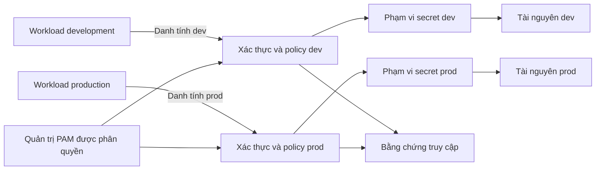

# Tách môi trường trong vault

## 1. Mục tiêu của việc tách môi trường

Trong hệ thống quản lý truy cập đặc quyền (Privileged Access Management — PAM), vault lưu giữ hoặc quản lý credential cho tài khoản quản trị, tài khoản dịch vụ và hạ tầng nhạy cảm. Những credential này có thể mở quyền tại máy chủ, cơ sở dữ liệu, nền tảng cloud hoặc hệ thống tự động hóa.

Tách môi trường trong vault là xây dựng ranh giới để danh tính, ứng dụng, người quản trị và tác vụ tự động hóa của một môi trường chỉ được sử dụng những credential thuộc phạm vi được phép. Một workload development bị xâm nhập không nên vì thế lấy được mật khẩu quản trị production hoặc yêu cầu luân chuyển credential của production.

Mục tiêu không chỉ là làm cây thư mục dễ đọc. Cần kiểm soát đồng thời:

- Nơi secret được tổ chức và định danh.
- Danh tính nào được xác thực, thuộc tính nào được tin cậy và policy nào được áp dụng.
- Quyền đọc, dùng, tạo, sửa, luân chuyển, cấp quyền và xóa secret.
- Credential thực sự truy cập tài nguyên nào, với mức quyền nào.
- Quyền quản trị nền tảng, khóa mã hóa, backup, restore và luồng bằng chứng.

Tách môi trường hỗ trợ least privilege và giảm phạm vi ảnh hưởng của sự cố. Nó cũng giúp áp dụng quy trình khác nhau cho JIT/JEA, phê duyệt, rotation, giám sát và kiểm toán theo mức nhạy cảm.

### Xác định môi trường theo ranh giới thực tế

| Môi trường hoặc khu vực | Câu hỏi cần làm rõ |
|---|---|
| Development | Ai có thể triển khai code, sửa cấu hình hoặc kiểm tra bộ nhớ tiến trình? |
| Test / staging | Có dữ liệu hoặc kết nối thật tới production không? Quy trình quản trị có độc lập không? |
| Production | Credential nào có khả năng thay đổi dịch vụ đang phục vụ hoặc dữ liệu nhạy cảm? |
| Dự phòng / khôi phục thảm họa | Đây là một phần của production hay một môi trường thử nghiệm riêng? |
| Sandbox hoặc môi trường dùng tạm | Ai tạo, ai xóa và credential bị thu hồi khi hết vòng đời thế nào? |

Một cụm dự phòng chứa dữ liệu và credential production vẫn thuộc ranh giới bảo vệ production dù không xử lý tải thường xuyên. Một môi trường staging có credential truy cập production cũng không thể được coi là có mức rủi ro thấp chỉ dựa vào tên gọi.

## 2. Tên thư mục và ranh giới bảo vệ là hai lớp khác nhau

Đường dẫn `prod/payments/database` giúp biểu diễn mục đích, nhưng chỉ ngăn truy cập khi nền tảng có cơ chế phân quyền đúng trên đường dẫn hoặc đối tượng đó. Nếu token được cấp quyền toàn bộ kho, các thư mục `dev`, `staging` và `prod` vẫn cùng nằm trong phạm vi của token.

Có thể lựa chọn nhiều mức tách, tùy khả năng nền tảng và yêu cầu cách ly:

| Mức tách | Tác dụng | Giới hạn cần hiểu |
|---|---|---|
| Nhãn hoặc quy ước tên | Dễ tìm kiếm, phân loại và rà soát | Không tự tạo kiểm soát truy cập |
| Đối tượng, đường dẫn, collection hoặc namespace có ACL/policy | Giới hạn truy cập logic trong cùng nền tảng | Có thể vẫn dùng chung quản trị cấp cao, khóa, tài nguyên vận hành hoặc cơ chế phục hồi |
| Miền quản trị hoặc tenant riêng theo khả năng sản phẩm | Tách cấu hình danh tính và quyền quản trị ở mức cao hơn | Phải xác minh quyền của quản trị viên nền tảng và những dịch vụ dùng chung |
| Instance/cụm và tài khoản hạ tầng riêng | Có thể thu hẹp tác động của lỗi, quyền quản trị và tải giữa môi trường | Cần vận hành nhiều thành phần; vẫn có thể còn chung hệ thống danh tính, pipeline hoặc khóa gốc |
| Khóa và ranh giới hạ tầng độc lập phù hợp | Tăng kiểm soát trên dữ liệu, backup và quyền quản trị hạ tầng | Chỉ hiệu quả khi danh tính sử dụng khóa và đường restore cũng được phân quyền đúng |

Tên gọi `namespace`, `project`, `safe`, `folder` hay `tenant` không có cùng ngữ nghĩa ở mọi sản phẩm. Cần xác định đơn vị đó có phân quyền thật không, có phân tách quản trị không và cấp quyền cha ảnh hưởng cấp con thế nào.

Một thiết kế tách logic có thể đáp ứng nhu cầu trong một phạm vi cụ thể. Với production nhạy cảm, có thể cần tăng mức cách ly ở cụm, quản trị hoặc khóa. Quyết định phải dựa trên quyền thực tế và mức ảnh hưởng chấp nhận được, thay vì mặc định mọi môi trường đều cần một cụm riêng hoặc mọi thư mục riêng đều đủ an toàn.

## 3. Vẽ ranh giới từ workload đến tài nguyên đích



Sơ đồ mô tả hai đường được phép; việc không vẽ một đường nối chưa chứng minh hệ thống đã chặn đường đó. Cần kiểm tra các đường chéo: workload dev dùng secret prod, token dev gọi API quản trị prod, connector dev đổi mật khẩu prod hoặc credential dev đăng nhập được vào đích prod.

Trong mô hình broker, workload có thể chỉ nhận kết nối thay vì nhận secret. Khi đó, broker vẫn phải xác định đúng môi trường và tài nguyên. Che giấu plaintext credential không bù cho việc broker cho phép chọn tùy ý một địa chỉ production.

Ranh giới phải bao phủ cả control plane và data plane: quyền sửa policy, phát hành token, cấu hình connector thuộc đường điều khiển; việc đọc secret, mở phiên hoặc thay credential thuộc đường sử dụng/thực thi. Chặn một API đọc secret chưa đủ nếu người dùng còn có thể tự sửa policy để cấp quyền đọc cho mình.

## 4. Lập danh mục và mô hình đặt tên

Trước khi phân chia vault, cần kiểm kê secret đang tồn tại và những tài nguyên chúng thực sự mở quyền. Những trường cần có gồm:

- ID ổn định của secret và tài khoản đặc quyền được quản lý.
- Môi trường, ứng dụng/dịch vụ, chủ sở hữu và mức nhạy cảm.
- Tài nguyên đích, loại credential và quyền thực tế tại đích.
- Workload, người dùng hoặc broker được sử dụng credential.
- Danh tính thực hiện rotation, vòng đời credential và cơ chế thu hồi.
- Policy, phạm vi lưu trữ, tham chiếu khóa mã hóa nếu được quản lý ở mức đó.
- Các bản sao, phiên bản cũ, backup và ngoại lệ liên quan.

Đường dẫn minh họa có thể là:

```text
dev/payments/database/reconcile-service
staging/payments/database/reconcile-service
prod/payments/database/reconcile-service
prod/payments/host/operations-account
```

Đây là quy ước khái niệm, không phải cú pháp policy hay API của một sản phẩm cụ thể. Nếu nền tảng có ID bất biến, nên liên kết policy, grant và bằng chứng với ID phù hợp để tránh nhầm khi đổi tên hoặc di chuyển đối tượng.

Một hồ sơ metadata có thể biểu diễn như sau, không chứa giá trị secret:

```json
{
  "secret_id": "secret:payments-prod-reconcile",
  "environment": "prod",
  "service": "payments",
  "owner": "team:payments-platform",
  "target_resource_id": "database:payments-prod",
  "target_account_id": "account:reconcile-prod",
  "allowed_workload_id": "workload:reconcile-prod",
  "rotation_identity_id": "connector:db-prod-rotation"
}
```

Nhãn môi trường phải do nguồn có thẩm quyền quản lý. Nếu một requester có thể tự sửa nhãn `prod` thành `dev` để nhận policy dễ hơn, nhãn đó không còn là cơ sở phân quyền đáng tin cậy. Thay đổi nhãn, di chuyển secret và đổi ánh xạ đích cần quyền riêng cùng bằng chứng.

### Không đặt secret vào metadata

Tên, mô tả và nhãn có thể được nhìn thấy bởi nhiều người hơn giá trị secret. Không đưa password, token, private key hoặc thông tin đủ để khôi phục credential vào những trường này. Quyền liệt kê cũng cần được xem xét vì tên tài khoản, hostname hoặc tên ứng dụng có thể là thông tin nhạy cảm.

## 5. Tách danh tính và chuỗi tin cậy

Workload dev và workload prod cần có danh tính và phạm vi được cấp quyền riêng, ngay cả khi chạy cùng một codebase. Cấp cho cả hai một token vault chung có quyền đọc mọi môi trường làm mất ranh giới ở lớp danh tính.

Với con người, cần phân biệt danh tính công việc thường ngày và quyền quản trị production. Việc một kỹ sư được sửa cấu hình development không mặc nhiên cho phép xem secret production. Nếu cần quyền đặc biệt, dùng quy trình cấp quyền có phạm vi và thời hạn phù hợp, chẳng hạn JIT với MFA và phê duyệt theo policy.

Với workload, không dựa vào chuỗi tự khai như `environment=prod` trong request. Môi trường phải được suy ra từ danh tính hoặc thuộc tính đã được kiểm chứng: cơ chế của nền tảng chạy workload, nhà phát hành danh tính được tin cậy, subject, audience và các ràng buộc liên quan.

Nếu dùng token hoặc cơ chế federation, cần xác minh đúng nhà phát hành, người nhận, chủ thể, thời hạn và điều kiện cấp quyền. Kiểm tra `audience` đơn lẻ không chứng minh workload thuộc production. Một hệ thống phát hành danh tính có quyền tùy ý tạo subject production cũng nằm trong ranh giới tin cậy production.

### CI/CD là một đường đi xuyên môi trường cần thiết kế rõ

Pipeline có thể xây dựng artifact trong một khu vực rồi triển khai production. Điều đó không đòi hỏi mọi job build đều có quyền lấy credential production.

Nên tách quyền build, kiểm thử, phê duyệt và triển khai theo quy trình đã chọn. Credential hoặc danh tính triển khai production chỉ được cấp cho bước đủ điều kiện, có phạm vi, thời hạn và bằng chứng. Cần xem ai có thể sửa pipeline, thay đổi code được chạy trong bước có quyền hoặc điều khiển runner; những quyền này có thể gián tiếp dẫn đến quyền truy cập secret.

Đưa một secret production vào biến cấu hình pipeline rồi che ký tự trên log không tạo ra cách ly nếu code không đáng tin cậy trong job vẫn đọc và gửi secret ra ngoài được.

## 6. Thiết kế policy theo môi trường và hành động

Policy nên nêu rõ **chủ thể nào, được làm hành động gì, trên đối tượng nào, trong điều kiện nào**. Không gộp quyền “dùng secret” với quyền quản trị toàn bộ kho.

| Vai trò minh họa | Quyền cần thiết | Quyền không mặc nhiên đi kèm |
|---|---|---|
| Workload dev | Dùng đúng secret dev cho tài nguyên dev đã đăng ký | Đọc secret prod, sửa policy, rotation tài khoản prod |
| Workload prod | Dùng đúng credential cho chức năng production | Liệt kê toàn bộ secret prod hoặc quản trị vault |
| Người vận hành dev | Quản lý phạm vi dev được giao | Cấp quyền production cho bản thân hoặc cho workload dev |
| Connector rotation prod | Thay credential của các tài khoản prod được giao | Xem mọi secret, sửa policy hoặc thay credential tùy ý |
| Người phê duyệt truy cập prod | Duyệt yêu cầu thuộc phạm vi trách nhiệm | Tự sử dụng mọi secret đã phê duyệt |
| Người kiểm toán | Đọc metadata và bằng chứng trong phạm vi | Đọc giá trị credential hoặc thay cấu hình |
| Quản trị nền tảng vault | Thao tác hạ tầng/quản trị theo phạm vi đã quy định | Cần xem xét quyền gián tiếp thay vì mặc định không thể đọc secret |

Tác vụ đọc giá trị secret, sử dụng secret qua broker, liệt kê, ghi phiên bản mới, xóa, rotation, di chuyển và thay ACL có thể là các quyền khác nhau. Cần xác minh sản phẩm thực tế hỗ trợ phân tách đến mức nào.

Mô hình chính sách khái niệm:

```text
allow use(secret) khi:
    subject là workload đã được xác thực
    AND environment của subject từ nguồn tin cậy là prod
    AND subject.id là workload được cấp quyền cho secret.id
    AND secret.environment là prod
    AND target_resource_id khớp tài nguyên đã đăng ký
    AND yêu cầu còn trong hiệu lực và đủ điều kiện vận hành

các yêu cầu ngoài phạm vi: từ chối
```

Mã giả trên không diễn tả cú pháp hoặc thứ tự ưu tiên của một engine cụ thể. Cần quy định rõ hành vi khi thiếu thuộc tính, nhiều rule cùng khớp hoặc có rule cấp rộng ở cấp cha. Không giả định việc không có một rule cho phép tại thư mục con sẽ phủ định quyền đã được cấp ở nơi khác.

Đặc biệt thận trọng với wildcard, nhóm quản trị rộng, policy mặc định và token phát hành sẵn. Một rule cho mọi đường dẫn của ứng dụng có thể bao gồm production nếu cấu trúc đường dẫn không khớp giả định.

## 7. Tách credential tại đích và quản lý khóa mã hóa

Ba bản ghi vault thuộc ba môi trường nhưng cùng chứa một credential có quyền truy cập production không tạo ra ba ranh giới. Cần tách tài khoản, key, role hoặc cơ chế xác thực tại tài nguyên theo thiết kế.

Những điểm phải kiểm tra gồm:

- Credential dev có đăng nhập được vào hệ thống prod hay không.
- Tài khoản có quyền chéo môi trường qua nhóm, role, trust hoặc API quản trị không.
- Broker/connector có thể nhận một secret dev nhưng kết nối tới đích prod không.
- Credential prod có bị sao chép sang staging để chạy thử hoặc phục hồi dữ liệu không.
- Cấu hình backup, triển khai hoặc script khôi phục có đưa credential về cùng một chỗ không.

### Khóa mã hóa bảo vệ phạm vi nào?

Tách khóa theo môi trường có thể giúp giới hạn quyền giải mã dữ liệu hoặc backup, nhưng cần xem khóa đó thực sự bảo vệ đối tượng nào và danh tính nào có quyền dùng nó. Một khóa riêng chỉ có ý nghĩa khi policy khóa, quyền quản trị và đường sử dụng cũng được kiểm soát.

Mã hóa khi lưu không ngăn một vault đang chạy trả plaintext cho một caller được cấp quyền sai. Ngược lại, việc caller không được đọc secret qua API cũng chưa đủ nếu họ có quyền lấy backup và sử dụng khóa giải mã hoặc restore vào một hệ thống mình quản trị.

Không nên khẳng định namespace hoặc thư mục tự có khóa mã hóa độc lập nếu sản phẩm chưa bảo đảm điều đó. Cần phân biệt khóa bảo vệ dữ liệu lưu trữ, khóa bọc khóa, khóa ký token và khóa xác thực credential; chúng có mục đích và vòng đời khác nhau.

Quyền sửa policy, điều khiển hạ tầng chạy vault, đổi cấu hình xác thực, quản lý khóa hoặc phục hồi dữ liệu có thể tạo ra quyền truy cập gián tiếp. Phân tách nhiệm vụ và kiểm soát thay đổi cần xem những đường này, không chỉ quyền đọc secret trên giao diện.

## 8. Tách connector, rotation và quyền thực thi

Luân chuyển credential thường cần một connector có quyền thay đổi tài khoản ở đích. Nếu connector dev giữ credential hoặc quyền mạng để đổi password của tài khoản prod, ranh giới đã bị mở dù quyền đọc secret vẫn tách.

Mỗi tác vụ rotation cần gắn với ID tài khoản, ID tài nguyên, môi trường, phiên bản credential và danh tính thực thi phù hợp. Connector phải giải quyết đích bằng cấu hình đáng tin cậy; không chấp nhận một hostname production do requester dev tự gửi rồi sử dụng credential quản trị để thao tác.

Những kiểm soát cần xem xét:

- Danh tính connector riêng hoặc policy thực thi riêng theo miền tin cậy.
- Giới hạn tài nguyên/tài khoản được thay đổi và kết nối mạng cần thiết.
- Quyền tại đích chỉ đủ cho thao tác được giao, trong mức nền tảng hỗ trợ.
- Không cấp cho consumer quyền rotation chỉ vì consumer cần sử dụng credential.
- Tham chiếu và trạng thái tác vụ đủ để phát hiện thao tác nhầm môi trường.
- Cách đối soát khi đích đã đổi credential nhưng vault hoặc consumer chưa cập nhật.

Lịch rotation có thể khác giữa môi trường, nhưng production không nên bị bỏ mặc chỉ vì sợ gián đoạn. Cần kiểm thử cơ chế cập nhật consumer, thiết kế cửa sổ thay đổi hoặc lựa chọn credential ngắn hạn phù hợp. Các thời hạn cụ thể phải dựa trên nhu cầu và khả năng thực thi, không lấy nguyên lịch development làm chuẩn production.

Rotation là quy trình phân tán. Phản hồi timeout không chứng minh thao tác ở đích chưa xảy ra; retry thiếu kiểm soát có thể làm vault và ứng dụng lệch phiên bản. Runbook cần xác định cách kiểm tra credential hiện hữu qua kênh được bảo vệ, sửa trạng thái và xác minh consumer tạo được kết nối mới.

Đổi credential cũng không bảo đảm mọi phiên hoặc token đã xác thực bị thu hồi. Khi cần chặn quyền production khẩn cấp, phải xử lý grant mới, phiên đang mở, token và quyền tại đích theo cơ chế tương ứng.

## 9. Backup, restore và sao chép giữa môi trường

Backup thường chứa giá trị secret, metadata, policy hoặc cấu hình nhạy cảm tùy loại backup. Vì vậy, việc tách môi trường cần áp dụng cho cả nơi lưu, quyền tải xuống, khóa bảo vệ và nơi được phép restore.

### Không dùng restore như một đường vượt ranh giới

Khôi phục backup production vào một cụm development có thể làm lộ secret cho quản trị viên development hoặc tạo kết nối ngoài ý muốn đến production. Đổi nhãn môi trường sau restore không làm những credential bên trong mất quyền tại hệ thống thật.

Quy trình kiểm thử phục hồi production cần có phạm vi được bảo vệ tương ứng, giới hạn kết nối ra ngoài, kiểm soát danh tính quản trị và kế hoạch xử lý credential sau thử nghiệm. Nếu tạo bộ dữ liệu thử, nên tạo secret hoặc credential thử riêng; không mặc định nhân bản secret production rồi dựa vào tên thư mục để bảo vệ.

Các câu hỏi cần trả lời:

| Chủ đề | Câu hỏi |
|---|---|
| Quyền backup | Ai được tạo, tải, sao chép hoặc xóa backup production? |
| Khóa | Ai có thể dùng khóa để giải mã hoặc phục hồi? Có phụ thuộc chung với development không? |
| Đích restore | Có thể khôi phục vào một miền quản trị yếu hơn không? Ai phê duyệt và xác minh? |
| Chính sách sau restore | Token, policy và cấu hình xác thực nào được phục hồi, cái nào phải cấp lại? |
| Kết nối | Connector hoặc job được restore có tự gọi tài nguyên production không? |
| Tính nhất quán | Secret trong backup có còn khớp credential tại đích sau những lần rotation không? |
| Dọn dẹp | Bản phục hồi, credential thử và quyền tạm được thu hồi thế nào? |

Restore vault về một thời điểm cũ không tự đưa mật khẩu ở tài nguyên về cùng thời điểm. Credential có thể đã được luân chuyển sau backup, khiến bản phục hồi không dùng được hoặc tạo trạng thái chưa xác định. Cần đối soát tại đích trước khi mở lại quyền sử dụng và lịch rotation.

### Chuyển cấu hình khác với chuyển secret

Có thể muốn đưa cấu trúc policy hoặc định nghĩa tích hợp đã kiểm chứng từ staging sang production. Việc này không đòi hỏi sao chép giá trị secret. Cấu hình phải được thay tham chiếu đúng môi trường, kiểm tra quyền, phê duyệt và phát hành có phiên bản.

Một quy trình promotion an toàn cần kiểm tra các tham chiếu: issuer danh tính, audience, ID tài nguyên, nhóm người dùng, khóa và connector. Chỉ thay chuỗi `staging` thành `prod` không đủ để bảo đảm cấu hình đúng.

## 10. Vận hành chung, tính sẵn sàng và giới hạn chia sẻ

Dùng chung một cụm vault có thể tiết kiệm vận hành nhưng tạo phụ thuộc chung về tải, lưu trữ, quyền quản trị, nâng cấp và sự cố. Tách policy không tự làm các yếu tố này độc lập.

Ví dụ, một pipeline thử nghiệm gọi API liên tục có thể tiêu thụ tài nguyên dùng chung, ảnh hưởng việc lấy credential của production. Nếu nền tảng hỗ trợ, cần quota, giới hạn tốc độ, ưu tiên hoặc phân bổ phù hợp; nếu yêu cầu sẵn sàng và phạm vi ảnh hưởng đòi hỏi cao hơn, có thể cần tách thành phần triển khai.

Ngược lại, nhiều cụm riêng làm tăng số lượng cấu hình, khóa, connector, backup và kế hoạch khôi phục cần quản lý. Một cụm production riêng nhưng không có người chịu trách nhiệm hoặc không được thử phục hồi vẫn có rủi ro vận hành đáng kể.

| Loại chia sẻ | Điều cần đánh giá |
|---|---|
| Hệ thống danh tính | Ai có thể phát hành hoặc sửa danh tính đủ điều kiện truy cập production? |
| Cụm và lưu trữ | Tải/lỗi dev có làm suy giảm production không? |
| Quản trị hạ tầng | Ai có thể đọc bộ nhớ, thay binary, truy cập snapshot hoặc cấu hình runtime? |
| Khóa mã hóa và tài khoản cloud | Quyền quản trị có cho phép vượt ranh giới logic không? |
| Pipeline cấu hình | Thay đổi chưa được duyệt ở dev có được triển khai vào prod không? |
| Kho bằng chứng | Ai đọc được metadata và nội dung phiên; ai có thể xóa dấu vết? |
| Đường khẩn cấp | Có dùng chung credential hoặc cho phép vượt môi trường ngoài kế hoạch không? |

Nếu mất vault production, không nên tự động cho ứng dụng dùng secret development hoặc chuyển sang tài khoản toàn quyền dùng chung. Hành vi lỗi phải được thiết kế theo từng consumer: dùng bản đệm được phép trong giới hạn nào, từ chối cấp mới khi nào và ai xử lý tình huống khẩn cấp.

Đường break-glass production cần phạm vi, danh tính, bằng chứng và quy trình đối soát riêng. Nếu nó được dùng khi vault trung tâm lỗi, cần bảo đảm các phụ thuộc của đường khẩn cấp phù hợp với kịch bản đó.

## 11. Quy trình triển khai tách môi trường cho vault đang dùng

Khi vault hiện hữu có dữ liệu trộn lẫn, không nên chỉ di chuyển hàng loạt secret sang đường dẫn mới. Việc đổi ID hoặc đường dẫn có thể làm consumer lỗi, làm policy rộng hơn dự kiến hoặc để quyền cũ tiếp tục tồn tại.

Một quy trình triển khai có thể gồm:

1. **Kiểm kê trạng thái hiện tại:** secret, tài khoản đích, consumer, danh tính, policy, connector, backup và quyền quản trị.
2. **Xác định ranh giới:** môi trường nào cần tách logic, tách quản trị hoặc tách cụm; các thành phần dùng chung nào còn được chấp nhận.
3. **Thiết kế mô hình đích:** ID, quy ước tên, metadata, nguồn danh tính, quyền theo hành động, khóa, rotation và bằng chứng.
4. **Tạo cấu hình có kiểm soát:** policy và danh tính cần thiết, quyền tại đích, connector và liên kết mạng; chưa cấp rộng để tránh lỗi tích hợp.
5. **Thử với một phạm vi đại diện:** kiểm tra truy cập hợp lệ, truy cập chéo, đường quản trị và khả năng cập nhật consumer.
6. **Chuyển consumer:** rollout có kế hoạch, kiểm tra kết nối mới, job ít chạy và hệ thống dự phòng; xử lý tham chiếu cũ theo hành vi sản phẩm.
7. **Thu hồi phần cũ:** token, policy, alias, quyền quản trị và credential dùng chung không còn cần thiết; luân chuyển nếu có nguy cơ credential đã bị dùng ngoài phạm vi mới.
8. **Đối soát và bàn giao:** xác minh trạng thái tại vault, danh tính và tài nguyên đích; lưu bằng chứng, ngoại lệ cùng lịch rà soát.

### Lưu ý khi chuyển đổi

Trong giai đoạn quá độ có thể cần cho cả đường cũ và mới hoạt động trong một thời gian. Khoảng chồng lấp phải có phạm vi, hạn chấm dứt và người chịu trách nhiệm. Không để alias cũ hoặc token cấp rộng tồn tại vô thời hạn vì muốn tránh cập nhật consumer.

Di chuyển hoặc xóa bản ghi không chắc đã vô hiệu credential từng được cấp. Nếu một token dev từng đọc được secret production, cần đánh giá khả năng credential đã bị lộ và xử lý tại đích theo quy trình sự cố, thay vì chỉ sửa policy rồi coi rủi ro đã kết thúc.

Phương án khôi phục phải dựa trên trạng thái thật. Nếu credential ở đích đã đổi, quay lại đường dẫn cũ không khôi phục được giá trị cũ. Nếu sự cố bắt nguồn từ quyền truy cập sai, khôi phục không được tự mở lại policy rộng đã gây ra lỗi.

## 12. Kiểm tra truy cập hợp lệ và truy cập chéo

Kiểm tra cần xác minh cả những việc phải hoạt động và những việc phải bị chặn. Các tình huống dưới đây là hướng dẫn kiểm chứng khi triển khai trong môi trường được phép, không phải yêu cầu thực thi trên hệ thống production bất kỳ.

| Tình huống | Kết quả mong đợi theo thiết kế minh họa |
|---|---|
| Workload dev dùng đúng secret dev cho đích dev | Thành công trong phạm vi đã cấp |
| Workload prod dùng đúng credential prod | Thành công, có bằng chứng và đúng quyền tại đích |
| Token dev yêu cầu đọc hoặc dùng secret prod | Bị từ chối, không trả giá trị secret |
| Workload tự khai nhãn prod trong request | Không được coi là danh tính production chỉ từ thuộc tính tự khai |
| Người quản trị dev sửa policy hoặc role prod | Bị từ chối nếu không có ủy quyền production riêng |
| Connector dev yêu cầu rotation tài khoản prod | Bị từ chối trước khi thay đổi đích |
| Workload được đọc một secret thử liệt kê cả kho prod | Bị giới hạn theo policy liệt kê riêng, không mặc nhiên được xem toàn kho |
| Credential dev được dùng để đăng nhập tài nguyên prod | Bị chặn theo ranh giới danh tính/quyền/đường truy cập đã thiết kế |
| Token hoặc grant production hết hạn | Không tiếp tục được dùng cho yêu cầu mới ngoài hiệu lực |
| Rule wildcard hoặc quyền cha được đưa vào | Kiểm tra cho thấy không cấp quyền chéo ngoài dự kiến |
| Backup prod được yêu cầu restore vào khu vực dev | Bị ngăn hoặc chuyển vào quy trình được kiểm soát phù hợp, không restore tự do |
| Thu hồi quyền khi đang có phiên/token | Chặn cấp mới và xử lý phần quyền đã tồn tại theo cơ chế thực thi |

Với trường hợp từ chối, không chỉ nhìn thông báo giao diện. Cần kiểm tra tác vụ nhạy cảm chưa thực sự xảy ra ở đích và không có giá trị secret rò vào log lỗi hoặc phản hồi phụ.

Với trường hợp cho phép, cần kiểm tra danh tính và quyền thực tế tại đích. Truy cập thành công không có nghĩa least privilege đã đạt nếu ứng dụng đang dùng tài khoản quản trị rộng hơn nhu cầu.

### Cổng nghiệm thu

Một phạm vi tách môi trường nên có bằng chứng cho các điều kiện:

- Danh mục secret và tài nguyên khớp môi trường, có chủ sở hữu và consumer rõ.
- Quyền truy cập trực tiếp, quyền quản trị gián tiếp và wildcard đã được xem xét.
- Danh tính workload không thể tự đổi môi trường để nhận quyền rộng hơn.
- Credential và quyền tại đích không làm mất ranh giới vừa tạo trong vault.
- Rotation, backup/restore và đường khẩn cấp không tạo đường chéo ngoài thiết kế.
- Consumer có thể hoạt động sau chuyển đổi; phần quyền và tham chiếu cũ đã được xử lý.
- Có bằng chứng, cảnh báo và người chịu trách nhiệm đối với ngoại lệ còn lại.

## 13. Bằng chứng kiểm toán và ứng phó khi vượt ranh giới

Bằng chứng cần cho phép trả lời một câu hỏi cụ thể, chẳng hạn: “Vì sao workload này được dùng credential production, policy nào cho phép và nó đã truy cập tài nguyên nào?”

| Nhóm bằng chứng | Trường hoặc thông tin cần cân nhắc |
|---|---|
| Truy cập | Chủ thể, nguồn xác thực, môi trường tin cậy, secret ID, hành động, kết quả và thời điểm |
| Quyết định | Policy/phiên bản, rule hoặc mã lý do, phạm vi grant và thời hạn |
| Thực thi | Broker/connector, tài nguyên đích, tài khoản được sử dụng và kết quả xác nhận |
| Thay đổi quản trị | Ai sửa policy, mapping danh tính, nhãn môi trường, khóa hoặc cấu hình connector |
| Vòng đời | Rotation, phiên bản credential, thu hồi, trạng thái chưa xác minh và đối soát |
| Phục hồi | Ai tạo/tải/restore backup, đích restore và kết quả kiểm tra sau phục hồi |

Không ghi secret, token xác thực đầy đủ hoặc khóa riêng vào log. Metadata, tên tài khoản và bản ghi phiên cũng có thể nhạy cảm; quyền kiểm toán cần được giới hạn và bảo vệ tính toàn vẹn theo nhu cầu.

Những tín hiệu đáng điều tra gồm yêu cầu truy cập prod từ danh tính dev, thay đổi policy cấp rộng, sửa nguồn danh tính production, rotation nhầm môi trường, tải backup bất thường và secret production xuất hiện trong pipeline hoặc khu vực thử nghiệm.

### Xử lý khi phát hiện truy cập chéo

Một luồng ứng phó có thể là:

1. Xác định danh tính, policy, secret, tài nguyên và khoảng thời gian bị ảnh hưởng.
2. Chặn yêu cầu mới qua policy hoặc danh tính phù hợp; bảo toàn bằng chứng cần thiết.
3. Tìm những credential có thể đã bị đọc hoặc sử dụng và các phiên/token đã phát sinh.
4. Luân chuyển hoặc vô hiệu credential tại đích theo kế hoạch kiểm soát tác động; xử lý phiên, token và quyền tồn dư.
5. Sửa nguyên nhân gốc như wildcard, mapping tin cậy, quyền quản trị, cấu hình backup hoặc credential dùng chung.
6. Kiểm chứng ranh giới sau sửa, đối soát trạng thái và cập nhật phạm vi kiểm tra định kỳ.

Chỉ gỡ quyền đọc secret không thu hồi được một password đã bị lấy ra ngoài. Chỉ luân chuyển password cũng có thể chưa đóng mọi phiên đã xác thực. Ứng phó phải theo hết các đường sử dụng có liên quan.

## 14. Tình huống thực hành và lỗi thường gặp

Một nhóm lưu các secret của ứng dụng thanh toán trong ba thư mục `dev`, `staging`, `prod`. Workload dev và prod dùng chung một token. Connector rotation có quyền đổi mật khẩu trên mọi cơ sở dữ liệu. Backup production được đội phát triển tải về để kiểm tra phục hồi.

### Đánh giá tình huống

Cây thư mục đã mô tả môi trường nhưng ranh giới bảo vệ còn thiếu ở nhiều lớp:

- Token chung cho phép một workload bị xâm nhập sử dụng quyền ngoài môi trường của nó.
- Connector có phạm vi thực thi rộng, có thể ảnh hưởng production từ đường vận hành không phù hợp.
- Backup đưa secret production sang miền quản trị khác.
- Chưa biết credential tại đích có dùng chung giữa các môi trường hay không.

Một phương án cải thiện cần gắn với khả năng nền tảng: cấp danh tính workload riêng và policy đúng đối tượng; giới hạn connector theo tài nguyên/môi trường; tách quyền quản trị production; bảo vệ backup và đường restore; xác minh credential độc lập tại đích. Nếu cụm dùng chung vẫn tạo phạm vi ảnh hưởng vượt yêu cầu, xem xét tách cụm hoặc miền hạ tầng tương ứng.

Nhóm cần kiểm tra truy cập hợp lệ sau chuyển đổi, kiểm tra những đường chéo bị chặn và thu hồi token/quyền cũ. Nếu token dev từng đọc được secret prod, đưa những credential bị ảnh hưởng vào quy trình xử lý lộ lọt phù hợp.

| Lỗi thường gặp | Hệ quả | Hướng khắc phục |
|---|---|---|
| Chỉ thêm tiền tố môi trường vào tên | Người có quyền rộng vẫn truy cập mọi secret | Policy và danh tính đúng phạm vi, kiểm tra quyền hiệu lực |
| Một token dùng cho mọi môi trường | Khó truy vết và phạm vi xâm nhập lớn | Danh tính riêng, cấp quyền theo workload và môi trường |
| Ba secret chứa cùng credential mạnh | Ranh giới tồn tại trong giao diện nhưng không có tại đích | Tách tài khoản/credential/quyền phù hợp ở tài nguyên |
| Tin nhãn do requester tự khai | Request có thể tự nâng mức tin cậy | Thuộc tính từ nguồn có thẩm quyền và bảo vệ quyền sửa nhãn |
| Cấp quyền wildcard để sửa nhanh lỗi tích hợp | Mở rộng quyền ngoài mục đích | Sửa mapping hoặc rule cụ thể, kiểm tra cả trường hợp từ chối |
| Backup prod được restore tự do ở dev | Lộ secret và có thể tạo kết nối đến prod | Ranh giới backup/restore, môi trường phục hồi được bảo vệ |
| Tách khóa nhưng dùng chung quản trị toàn quyền | Quyền gián tiếp vẫn vượt môi trường | Kiểm soát danh tính dùng khóa, quản trị hạ tầng và phân tách nhiệm vụ |
| Sửa policy rồi bỏ qua credential từng bị đọc | Secret đã lộ vẫn dùng được ở ngoài vault | Đánh giá lộ lọt, rotation/thu hồi tại đích và xử lý phiên |

Để tự kiểm tra thiết kế, hãy trả lời:

1. Một người quản trị development có thể tác động gián tiếp tới policy, danh tính, khóa hoặc backup production không?
2. Một workload dev có thể nhận token production bằng cách sửa claim hoặc pipeline không?
3. Connector nào có thể đổi credential production, và phạm vi được cưỡng chế ở đâu?
4. Nếu restore backup cũ, làm sao biết secret còn khớp credential đã luân chuyển tại đích?
5. Bằng chứng nào cho thấy truy cập chéo bị chặn ở cả vault và tài nguyên, không chỉ trên giao diện?
6. Khi phát hiện secret production đã bị lấy, làm sao xác nhận credential, token và phiên liên quan đã được xử lý?

Tách môi trường trong vault cần nối liền tổ chức secret, danh tính, policy, quyền tại đích và vòng đời vận hành. Ranh giới được xác minh qua những hành động thực tế bị cho phép hoặc bị chặn, cùng bằng chứng về thay đổi, rotation, phục hồi và thu hồi quyền.
