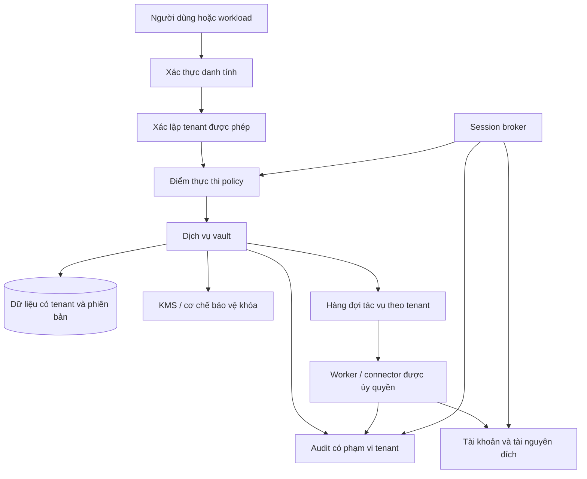

# Tách tenant trong vault

## 1. Tenant là ranh giới quản lý và tin cậy

Trong hệ thống quản lý truy cập đặc quyền (Privileged Access Management, PAM), vault bảo vệ credential của tài khoản quản trị, danh tính dịch vụ và hạ tầng nhạy cảm. Khi nhiều đơn vị dùng chung nền tảng, cần xác định rõ ai được quản lý, sử dụng và nhìn thấy dữ liệu của từng bên. Tenant là một ranh giới giúp tổ chức các quyền và trách nhiệm đó.

Một tenant có thể đại diện cho khách hàng của nhà cung cấp dịch vụ, một đơn vị kinh doanh hoặc một miền quản trị có yêu cầu độc lập. Môi trường production và thử nghiệm cũng có thể là ranh giới riêng tùy mô hình. Không nên suy ra tenant chỉ từ tên thư mục, tiền tố secret hay một nhãn do người dùng tự sửa; ranh giới phải được định nghĩa trong mô hình bảo mật và thực thi ở các thành phần liên quan.

Tách tenant trong vault nghĩa là bảo đảm một chủ thể chỉ thực hiện các thao tác được phép trong tenant được ủy quyền, đồng thời kiểm soát ảnh hưởng qua lại về dữ liệu, quản trị và tài nguyên vận hành. Việc chia giao diện thành hai thư mục chưa đủ nếu API, tác vụ rotation, kho sao lưu hoặc tài khoản trên hệ thống đích vẫn cho phép truy cập chéo.

Ví dụ, nhóm Payments và nhóm Analytics cùng dùng nền tảng PAM. Quản trị viên vault của Analytics không được đọc mật khẩu cơ sở dữ liệu Payments, cấp quyền đọc cho chính mình hoặc yêu cầu connector Payments reset tài khoản quản trị. Ngược lại, một sự kiện lỗi của Payments cũng không nên xuất secret hay thông tin tài nguyên của Payments vào nhật ký mà Analytics được xem.

Bài học thuộc phần Vault, tập trung vào least privilege, cấp quyền JIT/JEA, rotation, giám sát phiên và bằng chứng kiểm toán trong kiến trúc nhiều tenant. Mục tiêu là thiết kế ranh giới có thể kiểm tra, biết phần nào dùng chung và xác định rõ ai vẫn có quyền ở cấp nền tảng.

## 2. Xác định mục tiêu cách ly

Cách ly tenant có nhiều chiều. Một thiết kế cần nêu rõ bảo đảm ở từng chiều thay vì chỉ dùng nhãn “multi-tenant”.

| Chiều cách ly | Điều cần bảo vệ | Ví dụ thất bại |
|---|---|---|
| Secret và metadata | Giá trị credential, phiên bản, tên tài nguyên, chủ sở hữu | Tenant A đoán ID và đọc secret của B |
| Thẩm quyền quản trị | Chính sách, membership, cơ chế cấp quyền và cấu hình bảo mật | Admin A tự sửa policy của B |
| Vòng đời credential | Verify, rotate, reconcile, cấp và thu hồi credential | Job A dùng connector B để reset tài khoản B |
| Mã hóa và khóa | Quyền sử dụng khóa giải mã, dữ liệu mã hóa và bản sao | Một khóa hoặc vai trò quá rộng mở đường giải mã nhiều tenant |
| Phiên và quyền thực tế | Tài khoản đích, grant, broker, phiên đang chạy | Credential của A cũng mở được tài nguyên của B |
| Bằng chứng | Nhật ký, nội dung phiên, báo cáo, tìm kiếm và export | Bộ lọc giao diện đúng nhưng file export chứa dữ liệu B |
| Khả dụng | Hạn mức API, rotation, kết nối và lưu trữ | Một tenant tạo tải lớn làm mọi tenant mất khả năng lấy credential |
| Khôi phục và kết thúc | Backup, restore, di chuyển và offboarding | Restore bản sao A vào tenant B rồi kích hoạt quyền cũ |

Cần xác định đối tượng đe dọa: người dùng của tenant khác, quản trị viên tenant khác, workload bị xâm nhập, connector bị lạm dụng hoặc quản trị viên nền tảng. Một kiến trúc chống được truy cập chéo từ người dùng thông thường chưa chắc chống được người có quyền sửa mã dịch vụ, đọc bộ nhớ hoặc thay chính sách KMS.

Giới hạn bảo đảm phải được công khai trong thiết kế. Nếu quản trị viên nền tảng có khả năng truy cập dữ liệu nhiều tenant, quyền đó cần kiểm soát riêng bằng phân tách trách nhiệm, cấp quyền có thời hạn, phê duyệt và bằng chứng phù hợp.

## 3. Chọn mức tách tenant

Có thể kết hợp nhiều mức tách khác nhau theo rủi ro và chi phí vận hành.

| Mô hình | Cơ chế chính | Lợi ích | Điều vẫn phải kiểm soát |
|---|---|---|---|
| Một dịch vụ, tách logic bằng tenant và policy | Mỗi đối tượng và yêu cầu có tenant; kiểm tra quyền ở mọi thao tác | Dùng chung hạ tầng, vận hành tập trung | Lỗi phân quyền, cache, tác vụ nền và vai trò quản trị rộng |
| Phân vùng hoặc namespace do nền tảng hỗ trợ | Tách miền dữ liệu và chính sách theo khả năng sản phẩm | Giảm nguy cơ nhầm phạm vi, thuận tiện quản trị | Quyền cấp cha, tính năng dùng chung, backup và giới hạn thực tế |
| Tách dịch vụ hoặc cụm theo nhóm tenant | Hạ tầng dịch vụ và dữ liệu độc lập hơn | Giảm phạm vi ảnh hưởng của một số sự cố | IdP, KMS, mạng, pipeline triển khai và quyền quản trị có thể vẫn dùng chung |
| Tách triển khai cho từng tenant | Tài nguyên vận hành riêng theo thiết kế | Ranh giới vận hành rõ, có thể đặt chính sách riêng | Chi phí, độ nhất quán cấu hình và quyền kiểm soát ở lớp dùng chung |

Namespace hoặc đường dẫn không tự chứng minh cách ly mật mã. Hai namespace có thể vẫn dùng cùng tiến trình, hệ thống lưu trữ hoặc cơ chế giải mã. Tương tự, hai cụm riêng vẫn có thể bị một tài khoản quản trị hạ tầng có quyền rộng tác động đồng thời.

Lựa chọn nên dựa trên mức nhạy cảm, yêu cầu độc lập về quản trị, phạm vi ảnh hưởng chấp nhận được, khả năng khôi phục và năng lực vận hành. Không có một mô hình duy nhất phù hợp cho mọi tenant.

## 4. Kiến trúc tham khảo và các điểm thực thi



Ranh giới tenant phải đi cùng yêu cầu qua xác thực, phân quyền, lưu trữ, hàng đợi, connector và bằng chứng. Không đặt toàn bộ trách nhiệm vào một bộ lọc ở API gateway trong khi các đường nội bộ truy cập dữ liệu mà không kiểm tra phạm vi.

Có thể dùng kiểm soát bổ sung ở lớp dữ liệu, chẳng hạn truy vấn có tenant bắt buộc hoặc cơ chế giới hạn hàng của cơ sở dữ liệu khi phù hợp. Cần hiểu vai trò đặc quyền nào có thể bỏ qua các giới hạn đó. Kiểm soát lớp dữ liệu hỗ trợ phòng vệ nhiều lớp; nó không thay thế phân quyền tác vụ tại dịch vụ.

Một nguyên tắc cho các thao tác thông thường là:

```text
Chủ thể đã được xác thực
AND có quyền trong tenant đang hoạt động
AND đối tượng thực sự thuộc tenant đó
AND hành động được policy cho phép trên đối tượng
AND ngữ cảnh sử dụng còn hợp lệ
```

Trường hợp sử dụng tài nguyên dùng chung hoặc quản trị liên tenant cần một quan hệ ủy quyền riêng, rõ phạm vi và được ghi nhận. Không nới lỏng nguyên tắc chung bằng một wildcard để mọi tenant đều truy cập được.

## 5. Xác lập tenant context từ danh tính đáng tin cậy

### 5.1. Chọn tenant không đồng nghĩa được phép dùng tenant

Người dùng có thể gửi tên tenant trong URL, header hoặc nội dung yêu cầu. Đây là thông tin chọn phạm vi, không phải bằng chứng ủy quyền. Dịch vụ phải kiểm tra tenant được chọn có nằm trong phạm vi của danh tính đã xác thực và quyền hiện hành hay không.

Nếu token có claim về tenant, vẫn cần xác minh chữ ký hoặc cơ chế bảo đảm tương ứng, bên phát hành, bên nhận dự kiến, thời hạn và ý nghĩa của claim theo cấu hình tin cậy. Một trường `tenant_id` trong token do ứng dụng khách tự tạo không có giá trị bảo mật.

Không suy ra membership chỉ từ hậu tố email hoặc tên hiển thị. Các hệ thống danh tính khác nhau có thể có tên người dùng trùng nhau; định danh cần gắn với nguồn phát hành và subject phù hợp, rồi ánh xạ tới membership được quản lý.

### 5.2. Một người thuộc nhiều tenant

Một kỹ sư hỗ trợ có thể được phép làm việc ở cả Payments và Analytics. Mỗi thao tác vẫn cần tenant context cụ thể; không hợp nhất mọi quyền thành một tập rộng để tiện dùng.

Khi chuyển tenant trên giao diện, cần hiển thị rõ phạm vi đang hoạt động và xử lý lại các dữ liệu, grant hoặc yêu cầu đang mở. Việc đổi một ô chọn không được khiến credential đang cache của Payments xuất hiện trong màn hình Analytics. Quyết định bảo mật vẫn thuộc máy chủ, không dựa vào trạng thái giao diện.

Đối với tài khoản hỗ trợ liên tenant, có thể yêu cầu chọn tenant, tác vụ, thời hạn, lý do và phê duyệt theo mức rủi ro. Bằng chứng phải cho biết danh tính gốc và quyền được ủy quyền đã sử dụng, không thay người hỗ trợ bằng một tài khoản dùng chung không truy vết được.

### 5.3. Workload và service identity

Workload cần danh tính và phạm vi tenant có thể xác minh. Nếu một runner phục vụ nhiều tenant, mỗi lần chạy phải được ràng buộc với đúng tenant và quyền của tác vụ đó. Không để biến môi trường do khách hàng nhập quyết định secret nào một token hệ thống toàn quyền sẽ đọc.

Danh tính dịch vụ có quyền rộng có thể trở thành confused deputy: nó dùng quyền của mình để làm việc cho một bên không được phép. Để tránh điều này, xác minh cả quyền của bên yêu cầu lẫn phạm vi ủy quyền của dịch vụ, đồng thời gắn tenant vào đối tượng, tác vụ và bằng chứng.

Tenant context cần đi cùng từng request và từng job. Không giữ nó trong một biến dùng chung giữa các yêu cầu hoặc dựa vào giá trị còn sót trên một luồng xử lý được tái sử dụng.

## 6. Phân quyền theo đối tượng và từng thao tác

### 6.1. Kiểm tra phía máy chủ

Mọi đường truy cập cần có kiểm tra tenant, bao gồm đọc secret, xem phiên bản cũ, liệt kê, tìm kiếm, tạo, sửa, xóa, export, rotation, reconcile, khôi phục và sửa policy. Chặn đọc giá trị hiện tại nhưng cho tải phiên bản cũ vẫn là rò rỉ credential.

Mã giả sau minh họa một thao tác đọc thông thường, không phải API của sản phẩm cụ thể:

```text
authorize_read(authenticated_principal, requested_tenant, object_id):
    tenant = resolve_canonical_tenant(requested_tenant)
    require tenant.state == ACTIVE
    require current_membership_allows_tenant(authenticated_principal, tenant)

    object = find_object_within_tenant(tenant.id, object_id)
    if object is absent:
        return non_disclosing_error

    require policy_allows(authenticated_principal, "read", object)
    require current_context_is_acceptable()
    audit_decision_without_secret()
    return authorized_object_reference
```

Đối tượng phải được tìm trong phạm vi tenant đã kiểm tra. Không lấy đối tượng toàn cục chỉ bằng ID rồi tin trường tenant do người dùng gửi để quyết định quyền. Với các phiên bản, attachment hoặc lease liên quan, phải kiểm tra chúng thực sự thuộc đối tượng và tenant đã được cho phép.

ID khó đoán giúp giảm khả năng dò tìm nhưng không thay thế kiểm tra quyền. Truy vấn có tham số và chuẩn hóa định danh cũng cần thiết; không ghép một chuỗi đường dẫn tùy ý vào policy rồi giả định tiền tố giống nhau là cùng phạm vi.

### 6.2. Tách vai trò quản trị tenant và nền tảng

| Vai trò minh họa | Phạm vi có thể cho phép | Quyền không nên ngầm có |
|---|---|---|
| Người sử dụng secret của A | Đọc hoặc sử dụng đối tượng được cấp trong A | Sửa policy, đọc mọi secret của A hoặc truy cập B |
| Quản trị tenant A | Quản lý người dùng và policy trong phạm vi được giao của A | Đổi tenant sở hữu đối tượng, quản trị B hoặc nâng mình thành admin nền tảng |
| Tác nhân rotation của A | Đổi và xác minh credential được ủy quyền của A | Đọc tùy ý secret B hoặc reset tài khoản ngoài phạm vi |
| Người xem audit của A | Xem bằng chứng được cấp của A | Xem log, nội dung phiên hoặc export của B |
| Quản trị nền tảng | Vận hành thành phần được giao, có quyền tăng cường khi cần | Quyền đọc secret mọi tenant mặc định chỉ vì có quyền vận hành |

Một số kiến trúc không thể loại bỏ hoàn toàn khả năng truy cập của quản trị nền tảng. Khi đó, ghi rõ giới hạn, thu hẹp quyền thường trực và áp dụng cơ chế cấp quyền, giám sát tương ứng. Không hứa cách ly khỏi một chủ thể thực tế có thể sửa mã giải mã hoặc chính sách khóa.

### 6.3. Liệt kê, lỗi và cache

Lọc tenant phải diễn ra trước khi phân trang, tổng hợp và export theo mô hình dữ liệu phù hợp. Nếu chỉ lọc trên giao diện, kết quả tổng số, gợi ý tìm kiếm hoặc file tải xuống vẫn có thể lộ thông tin tenant khác.

Phản hồi cho đối tượng không tồn tại và đối tượng ngoài phạm vi cần tránh tiết lộ không cần thiết. Điều này không đồng nghĩa chỉ cần đổi thông báo lỗi là đã chống được mọi kênh suy luận; cần kiểm tra cả mã lỗi, dữ liệu bổ sung và hành vi API.

Cache dữ liệu và quyết định quyền phải có khóa chứa đủ phạm vi, chẳng hạn tenant, object reference, phiên bản, hành động và ngữ cảnh danh tính liên quan. Đừng dùng riêng tên `db-admin` làm cache key vì tên đó có thể xuất hiện ở nhiều tenant. Khi policy hoặc membership đổi, cần cơ chế vô hiệu hóa hoặc giới hạn độ cũ rõ ràng; thời gian sống của cache ảnh hưởng trực tiếp tới độ trễ thu hồi.

## 7. Tách tenant ở lớp mã hóa

### 7.1. Mã hóa không thay thế phân quyền

Mã hóa dữ liệu lưu trữ giúp bảo vệ khi mất đĩa hoặc bản sao dữ liệu theo mô hình khóa tương ứng. Nhưng nếu dịch vụ có thể giải mã rồi trả secret B cho người A vì lỗi phân quyền, mã hóa vẫn không ngăn được truy cập chéo đó.

Cần mô tả ai có thể yêu cầu giải mã, cơ chế xác thực với hệ thống khóa, điều kiện sử dụng và quyền quản trị khóa. Dữ liệu dùng khóa riêng nhưng mọi yêu cầu giải mã đều chạy dưới một danh tính có quyền toàn bộ vẫn còn một ranh giới dùng chung quan trọng.

### 7.2. Khóa theo tenant và envelope encryption

Một mô hình có thể dùng khóa mã hóa dữ liệu cho từng đối tượng hoặc nhóm dữ liệu, sau đó bảo vệ các khóa đó bằng khóa bao bọc theo tenant. Việc chọn granularity phụ thuộc kiến trúc và khả năng quản lý khóa; tên khóa khác nhau chưa đủ chứng minh quyền sử dụng đã tách.

Nếu dùng dữ liệu liên kết được xác thực như tenant ID, object ID và phiên bản trong cơ chế mã hóa phù hợp, có thể giảm nguy cơ tráo ciphertext giữa ngữ cảnh. Tuy nhiên, dữ liệu liên kết không tự xác thực người dùng. Dịch vụ và chính sách khóa vẫn phải ngăn một chủ thể chọn ngữ cảnh của tenant khác để giải mã.

Khóa riêng theo tenant có thể hỗ trợ rotation, giới hạn phạm vi ảnh hưởng và quản lý vòng đời độc lập hơn. Nhưng quyền sửa chính sách KMS, quyền dùng mọi khóa hoặc quyền truy cập tiến trình giải mã vẫn có thể vượt qua ranh giới đó. Cần kiểm soát cả quyền sử dụng lẫn quyền quản trị.

### 7.3. Sao lưu khóa và hủy khóa

Rotation khóa bảo vệ dữ liệu khác với rotation mật khẩu, SSH key hoặc API key trên hệ thống đích. Đổi khóa bao bọc không tự thu hồi một mật khẩu đã bị lộ.

Khả năng khôi phục tenant phải bao gồm quyền và vật liệu khóa cần thiết, được bảo vệ và kiểm tra theo thiết kế. Ngược lại, không tuyên bố đã xóa dữ liệu chỉ vì xóa một bản ghi khóa trong giao diện: còn phải xét phiên bản khóa, bản sao, backup, dữ liệu đã xuất và khả năng khôi phục khóa. Nếu dùng hủy khóa như một biện pháp xóa bằng mật mã, phải xác định rõ phạm vi thực sự bị làm mất khả năng giải mã và tránh ảnh hưởng tenant khác.

## 8. Giữ ranh giới qua hàng đợi và connector

Rotation, reconcile, cấp credential JIT và export thường là tác vụ nền. Đây là nơi dễ mất tenant context vì worker chạy bằng danh tính hệ thống có quyền rộng.

Một job cần gắn tenant, object reference, loại thao tác, phiên bản hoặc điều kiện phù hợp, danh tính yêu cầu và operation ID. Payload phải được bảo vệ tính toàn vẹn và nguồn gửi theo cơ chế hàng đợi; worker vẫn phải đối chiếu với dữ liệu có thẩm quyền và kiểm tra trạng thái, quyền ủy nhiệm khi thực hiện.

Ví dụ, người của Analytics gửi job có tenant Analytics nhưng object ID thuộc Payments. Worker phải từ chối trước khi lấy credential hoặc gọi connector. Chỉ tin tenant trong payload vì nó đã qua gateway sẽ để lại lỗ hổng nếu có đường gửi nội bộ khác.

Khóa chống trùng và trạng thái kết quả cần chứa phạm vi tenant để hai khách hàng dùng cùng request ID không nhận kết quả của nhau. Các thao tác trên cùng một tài khoản thực tế cũng cần cơ chế ngăn cạnh tranh phù hợp. Nếu hai tenant vô tình cùng quản lý một credential đích, chỉ tách khóa điều phối theo tenant sẽ chưa ngăn hai bộ điều khiển đổi qua đổi lại; cần sửa mô hình sở hữu và nơi quản lý vòng đời.

Sự kiện có thể đến muộn hoặc lặp. Worker và broker cần ngăn một sự kiện cũ làm sống lại quyền đã thu hồi. Tùy tác vụ, phải kiểm tra lại membership, trạng thái tenant, policy và hạn grant tại thời điểm kích hoạt. Không dùng một sự kiện “approved” làm quyền đọc bất kỳ secret nào có cùng tên.

## 9. Credential và tài khoản đích cũng phải có phạm vi

Vault chỉ là một phần của đường quyền. Nếu secret của tenant A và tenant B đều là mật khẩu của cùng một tài khoản quản trị toàn hệ thống, người lấy được một bản sao có thể tác động tới cả hai bên. Tách hai bản ghi vault không tạo ra hai phạm vi quyền trên đích.

Ưu tiên thiết kế danh tính, vai trò và tài nguyên đích có phạm vi phù hợp với tenant. Khi cần dùng một tài khoản nền tảng dùng chung, phải coi đó là tài nguyên chung có quy trình truy cập riêng, không mô tả nó như credential tenant thông thường đã được cách ly hoàn toàn.

Các điểm cần kiểm tra gồm:

- Tài khoản cơ sở dữ liệu có chỉ truy cập dữ liệu và thao tác của tenant tương ứng không?
- SSH key, public key hoặc chứng thư có thể đăng nhập vào tài khoản ngoài danh sách tài nguyên đã duyệt không?
- Danh tính reconcile của tenant A có thể reset tài khoản tenant B không?
- Credential đám mây hoặc API key có quyền trên phạm vi nền tảng rộng hơn tenant không?
- Endpoint mà connector gọi có được đối chiếu với tài nguyên đã đăng ký hay bị bên gọi tự thay bằng địa chỉ khác?

Không để người dùng chọn một endpoint tùy ý rồi yêu cầu connector mang credential quản trị tới đó. Binding giữa tenant, credential, tài khoản và tài nguyên đích cần được kiểm tra từ nguồn có thẩm quyền, cùng xác minh danh tính máy chủ và kiểm soát mạng phù hợp.

Session broker cũng phải kiểm tra tenant của grant, người hưởng quyền, secret và đích. Phê duyệt phiên chẩn đoán cho Payments không cho phép đổi resource ID sang Analytics trong lúc mở phiên. Giới hạn JEA hoặc vai trò chỉ đọc phải được thực thi tại điểm phù hợp; tên policy trong vault không tự giới hạn hành động trên hệ thống đích.

Khi credential hoặc quyền JIT hết hạn, cần thực thi ở nơi có thể chặn truy cập thật. Thu hồi token vault không tự làm mật khẩu đã đọc mất hiệu lực, thu hồi chứng thư đã cấp hoặc đóng mọi phiên đang chạy. Thiết kế phải nêu cơ chế, độ trễ và bằng chứng kết thúc quyền cho từng loại credential.

## 10. Audit, tìm kiếm và export theo tenant

Dữ liệu audit cũng có ranh giới tenant. Tên tài khoản, tài nguyên production, thời điểm vận hành và nội dung phiên có thể nhạy cảm ngay cả khi log không chứa mật khẩu.

Sự kiện nên được gắn tenant từ ngữ cảnh đã xác minh phía máy chủ. Không cho bên gọi gửi một trường tenant tùy ý để quyết định sự kiện sẽ xuất hiện ở đâu. Với hoạt động liên tenant được cho phép, ghi rõ tenant của tài nguyên, danh tính thực hiện và phạm vi ủy quyền liên quan theo mô hình sự kiện đã định nghĩa.

| Dữ liệu | Cách giữ phạm vi | Nguy cơ nếu bỏ sót |
|---|---|---|
| Nhật ký quyết định quyền | Tenant, actor, object reference, hành động, kết quả | Không truy được ai đã truy cập chéo |
| Nhật ký connector | Gắn đúng job và tenant, loại secret khỏi nội dung | Lỗi kỹ thuật làm lộ tài nguyên hoặc credential bên khác |
| Nội dung phiên | Quyền xem theo tenant, tài nguyên và mục đích điều tra | Người có quyền xem một tenant tải phiên của tenant khác |
| Tìm kiếm và báo cáo | Áp dụng quyền trước lọc, tổng hợp và export | Kết quả giao diện đúng nhưng số liệu hoặc file tải xuống sai |
| Công cụ hỗ trợ | Cấp quyền tạm, có lý do và bằng chứng | Nhân viên hỗ trợ mặc định nhìn được mọi tenant |

Kho tập trung có thể phục vụ nhiều tenant nếu kiểm soát đọc, truy vấn, lưu giữ và quyền quản trị được thiết kế phù hợp. Tách index hoặc bucket có thể hỗ trợ cách ly, nhưng vẫn phải kiểm tra quyền của dịch vụ tìm kiếm, tài khoản sao lưu và người quản trị hạ tầng.

Không lưu secret, token có thể sử dụng hoặc vật liệu khóa trong audit. Bằng chứng cần đủ để nối yêu cầu, quyết định, grant, lần kích hoạt, phiên và kết quả rotation mà không phải lưu giá trị credential. Với audit quản trị nền tảng, bảo vệ khỏi sửa hoặc xóa trái phép và tránh để chính người vừa cấp quyền có thể tự xóa mọi dấu vết.

## 11. Backup, restore và vòng đời tenant

### 11.1. Tạo và kích hoạt tenant

Một tenant mới nên có ID chuẩn, chủ sở hữu, cấu hình danh tính, policy mặc định, cơ chế khóa, connector, audit và hạn mức phù hợp trước khi được kích hoạt. Không mở quyền đọc secret trong khi phần phân quyền hoặc nguồn danh tính còn ở trạng thái tạm.

Có thể dùng vòng đời nghiệp vụ sau:

```text
PROVISIONING -> VALIDATED -> ACTIVE -> SUSPENDED -> OFFBOARDING -> RETIRED
```

Đây là mô hình tham khảo. Mỗi chuyển trạng thái phải có ý nghĩa thực thi. Chẳng hạn `SUSPENDED` cần xác định việc chặn cấp credential mới, xử lý token, lease và phiên hiện hữu; chỉ đổi nhãn trong cơ sở dữ liệu chưa đủ.

### 11.2. Sao lưu và khôi phục

Backup có thể chứa secret mã hóa, metadata, membership và policy của nhiều tenant. Quyền lấy backup và quyền dùng khóa khôi phục cần được kiểm soát tương ứng; không coi file backup là dữ liệu kỹ thuật vô hại.

Khi restore, cần xác minh nguồn bản sao, tính toàn vẹn, phạm vi tenant, đích khôi phục và quyền thực hiện. Một bản sao tenant A không được tự được kích hoạt trong tenant B chỉ vì người vận hành chọn tên đích khác. Nếu khôi phục sang môi trường điều tra hoặc thử nghiệm, cần cơ chế cách ly và hạn chế giải mã, kết nối tới production theo mục đích đã được duyệt.

Dữ liệu credential trong bản sao có thể cũ hơn hệ thống đích. Khôi phục mật khẩu cũ vào vault không làm mật khẩu đích quay về giá trị cũ. Cần giữ trạng thái cần đối soát, xác minh có kiểm soát và dùng quy trình rotation hoặc reconcile được cho phép.

Policy, membership hoặc grant cũ cũng có thể làm sống lại quyền đã thu hồi. Thiết kế khôi phục phải xử lý độ cũ của dữ liệu ủy quyền và các token, lease hoặc phiên liên quan; không mặc định mọi trạng thái từ backup đều còn hợp lệ. Lịch sử audit cần được bảo toàn theo chính sách, tránh ghi đè hoặc mất dấu việc restore.

### 11.3. Di chuyển đối tượng giữa tenant

Di chuyển một tài khoản từ đơn vị này sang đơn vị khác là thay đổi ranh giới quản trị, không chỉ đổi đường dẫn. Cần xác minh chủ sở hữu mới, quyền cũ và mới, connector, khóa bảo vệ dữ liệu, consumer và bằng chứng cần giữ.

Có thể cần tạo đối tượng mới hoặc thực hiện một quy trình chuyển sở hữu có kiểm soát, tái mã hóa theo mô hình khóa, chuyển consumer và thu hồi quyền ở nguồn. Nếu người của tenant cũ từng biết credential, việc di chuyển bản ghi không xóa kiến thức đó; rotation hoặc thu hồi trên đích có thể cần thiết để thiết lập ranh giới mới.

Không sửa lịch sử audit thành tenant mới để làm như đối tượng luôn thuộc bên đó. Giữ nguồn gốc sự kiện và xác định ai được truy cập bằng chứng trước, trong và sau chuyển đổi. Các cache, hàng đợi và tác vụ còn chờ phải được đối soát để không dùng quyền cũ sau khi đối tượng đã chuyển phạm vi.

### 11.4. Ngừng sử dụng tenant

Offboarding cần xử lý membership, token, credential, tài khoản hoặc quyền trên đích, phiên đang hoạt động, connector, dữ liệu và backup trong phạm vi chính sách. Không chỉ xóa một namespace rồi kết luận mọi quyền đã biến mất.

Phân biệt dữ liệu cần giữ làm bằng chứng với quyền truy cập vận hành cần chấm dứt. Việc hủy khóa cần xét phạm vi ảnh hưởng và các bản sao còn tồn tại; không được làm mất dữ liệu tenant khác do khóa hoặc bản sao dùng chung.

## 12. Khả dụng và hạn mức

Một tenant có thể ảnh hưởng tenant khác mà không đọc được secret: tạo nhiều yêu cầu, rotation, kết nối hoặc dữ liệu audit để chiếm tài nguyên dùng chung. Vì vậy, cách ly cần bao gồm giới hạn vận hành.

Các hạn mức có thể áp dụng theo tenant cho tốc độ API, số phiên đồng thời, số tác vụ rotation, số lần thử lại, kích thước export và dung lượng lưu trữ. Cần phối hợp với giới hạn toàn hệ thống để giữ khả năng bảo vệ nền tảng, đồng thời tránh để một hàng đợi dài chặn mọi tác vụ quan trọng của tenant khác.

Retry nên có giới hạn, khoảng lùi và cách cô lập lỗi. Ví dụ, connector của Analytics bị mất kết nối không nên dùng hết worker khiến Payments không thể thực hiện rotation đã lên lịch. Theo dõi độ trễ, tỷ lệ lỗi và tài nguyên theo tenant bằng nhãn đã chuẩn hóa, không đưa secret hoặc dữ liệu tùy ý vào metric.

Nếu dịch vụ policy hoặc khóa không sẵn sàng, đường cấp quyền mới phải tuân thủ hành vi đã định nghĩa. Dùng cache, nếu được phép, cần hạn về độ cũ và phạm vi; không chuyển sang secret tenant khác hoặc bỏ kiểm tra tenant để duy trì khả dụng.

Break-glass cũng phải giữ phạm vi tenant, danh tính, lý do, thời hạn và bằng chứng. Nếu có quyền khẩn cấp ở cấp nền tảng, cần thể hiện đây là quyền có phạm vi rộng hơn với cơ chế quản trị riêng. Không dùng cùng một credential khẩn cấp được phát tự do cho mọi tenant rồi coi ranh giới vẫn còn nguyên.

## 13. Ví dụ: Payments và Analytics dùng chung nền tảng

Giả sử tổ chức chọn một dịch vụ vault dùng chung với tách tenant logic, kiểm tra quyền ở dịch vụ, ràng buộc dữ liệu và khóa bảo vệ theo mô hình đã định nghĩa. Hai tenant có ID chuẩn riêng, nhóm quản trị riêng, workload riêng và tài khoản cơ sở dữ liệu đích khác nhau.

| Thành phần | Payments | Analytics |
|---|---|---|
| Tenant ID | `tenant-payments` | `tenant-analytics` |
| Workload | `payments-reporting` | `analytics-reporting` |
| Object reference | `cred-payments-reporting` | `cred-analytics-reporting` |
| Tài khoản đích | Tài khoản chỉ có quyền báo cáo Payments | Tài khoản chỉ có quyền báo cáo Analytics |
| Connector | Danh tính và binding trong phạm vi Payments | Danh tính và binding trong phạm vi Analytics |
| Audit | Người được cấp quyền xem bằng chứng Payments | Người được cấp quyền xem bằng chứng Analytics |

Các tên trong bảng là dữ liệu minh họa, không phải secret. Việc tách tenant cần được chứng minh bằng hành vi, chẳng hạn:

1. Workload Payments được phép yêu cầu sử dụng đúng credential Payments cho tác vụ đã định nghĩa.
2. Cùng workload đó đổi header sang Analytics hoặc gửi object reference Analytics thì bị từ chối; không lấy được giá trị, phiên bản cũ hay kết quả rotation.
3. Quản trị viên Analytics chỉ sửa policy trong phạm vi được giao và không thể thay tenant sở hữu đối tượng Payments hoặc tự thêm mình vào membership Payments.
4. Job rotation Payments gọi đúng connector, tài khoản và đích Payments; mọi dữ liệu liên kết được đối chiếu từ nguồn có thẩm quyền.
5. Một người hỗ trợ chưa có ủy quyền cụ thể không được đọc secret chỉ vì có tài khoản vận hành nền tảng.
6. Khi người hỗ trợ có quyền tạm cho một tác vụ Payments, grant vẫn bị giới hạn vào tác vụ, tài nguyên và thời gian đó; quyền Analytics không được suy ra từ grant này.

Nếu tổ chức còn một tài khoản quản trị cơ sở dữ liệu toàn nền tảng có thể tác động cả hai tenant, cần một phạm vi quản trị dùng chung với chủ sở hữu và luồng sử dụng riêng. Không sao chép mật khẩu đó vào cả hai tenant rồi dùng bảng trên để khẳng định tài khoản đích đã cách ly.

Ví dụ cũng cần nêu giới hạn: dịch vụ dùng chung vẫn có quyền giải mã theo cơ chế tích hợp, quản trị viên hạ tầng có thể có khả năng tác động tới tiến trình và hai tenant còn chia sẻ một phần tài nguyên vận hành. Kiểm soát các quyền đó và mức rủi ro còn lại là một phần của thiết kế.

## 14. Ma trận kiểm tra ranh giới tenant

Kiểm tra trong môi trường được phép với secret giả và các danh tính thử riêng. Cần có cả thao tác được phép để chứng minh hệ thống hoạt động, lẫn thao tác bị cấm để chứng minh ranh giới. Không chỉ kiểm tra rằng giao diện đã ẩn một nút.

| Tình huống | Kết quả mong đợi | Bằng chứng cần xem |
|---|---|---|
| Workload A sử dụng đúng object A theo policy | Thành công trong phạm vi đã cấp | Quyết định, object, tenant và kết quả tác vụ |
| Workload A đổi tenant selector sang B | Bị từ chối nếu không có quyền B | Quyết định phía máy chủ, không chỉ lỗi giao diện |
| Người A đoán object ID hoặc version ID của B | Không đọc được dữ liệu hoặc thông tin thừa | Phản hồi và log quyết định đã bảo vệ |
| Người A liệt kê, tìm kiếm, tổng hợp và export | Chỉ có dữ liệu được phép | Trang kết quả, tổng số và file xuất |
| Admin A sửa policy, membership hoặc khóa của B | Bị từ chối | Dữ liệu B giữ nguyên và có sự kiện phù hợp |
| Hai tenant có cùng tên secret | Không lẫn dữ liệu trong cache hoặc API | Object reference và tenant của từng phản hồi |
| Hai tenant dùng cùng idempotency key | Không nhận kết quả tác vụ của nhau | Bản ghi tác vụ có phạm vi đúng |
| Job A mang object hoặc resource của B | Bị từ chối trước lấy secret hoặc đổi đích | Trạng thái job và bằng chứng không thực hiện thay đổi |
| Grant A bị đưa cho broker để mở phiên B | Không mở phiên | Quyết định ở điểm kích hoạt và không có phiên ngoài phạm vi |
| Membership bị thu hồi khi job còn chờ | Xử lý theo chính sách độ mới và ủy quyền, không tự tiếp tục bằng quyền cũ | Thời điểm thu hồi, quyết định khi chạy và giới hạn đã công bố |
| Restore bản sao A vào B ngoài quy trình chuyển phạm vi | Không tự kích hoạt dữ liệu hoặc quyền A trong B | Quyết định restore và trạng thái đích |
| Suspend tenant A | Ngăn cấp quyền mới và xử lý quyền hiện hữu theo thiết kế | Token, lease, phiên và tác vụ đã đối soát |
| Tenant A tạo tải lớn trong giới hạn phép thử | Hạn mức và cơ chế cách ly hoạt động theo thiết kế | Độ trễ, hàng đợi, lỗi và tài nguyên của các tenant |

Với lượt thử bị từ chối, bằng chứng cho người yêu cầu không được tiết lộ thông tin thực tế của tenant khác chỉ để giải thích lý do. Nhóm an ninh có thể cần dữ liệu điều tra rộng hơn, nhưng quyền đó phải được quản lý riêng.

Cần kiểm tra các đường thay thế như API nội bộ, phiên bản API khác, công cụ hỗ trợ, báo cáo định kỳ và tác vụ khôi phục. Một endpoint chính đã đúng không chứng minh mọi đường đọc và quản trị đều đúng. Với kiểm thử tải hoặc thay đổi quyền, dùng phạm vi và giới hạn đã được chấp thuận để kết quả có ý nghĩa vận hành.

## 15. Tiêu chí nghiệm thu thiết kế

Có thể dùng checklist sau để bàn giao một cấu hình nhiều tenant:

- [ ] Tenant có ID chuẩn, chủ sở hữu, vòng đời và mức bảo đảm cách ly được định nghĩa rõ.
- [ ] Danh tính người dùng và workload được ánh xạ từ nguồn tin cậy; tenant selector không tự cấp quyền.
- [ ] Dịch vụ kiểm tra tenant, đối tượng, phiên bản và hành động ở mọi đường truy cập cần thiết.
- [ ] Admin tenant không thể vượt phạm vi được giao hoặc sửa nguồn thuộc tính bảo mật để tự nâng quyền.
- [ ] Quản trị nền tảng, quyền hỗ trợ và break-glass có phạm vi, thời hạn, phê duyệt và bằng chứng phù hợp.
- [ ] Cache, hàng đợi, idempotency, connector và tác vụ nền giữ đúng tenant context, có cách xử lý trạng thái cũ.
- [ ] Credential, danh tính quản lý và tài khoản trên hệ thống đích đã được đối chiếu phạm vi; tài nguyên dùng chung được quản trị riêng.
- [ ] Mô hình khóa mã hóa nêu rõ ai có thể giải mã, ai quản trị khóa và ranh giới nào vẫn dùng chung.
- [ ] Audit, tìm kiếm, nội dung phiên và export áp dụng đúng quyền, không chứa secret.
- [ ] Backup, restore, chuyển tenant và offboarding không làm sống lại quyền cũ hoặc tác động nhầm tenant.
- [ ] Hạn mức, retry, cảnh báo và xử lý sự cố không để một tenant dễ dàng chiếm toàn bộ tài nguyên dùng chung.
- [ ] Ma trận kiểm tra có bằng chứng cho cả thao tác được phép và truy cập chéo bị cấm, cùng các giới hạn chưa được chứng minh.

Mỗi giới hạn quan trọng cần gắn với thành phần thực thi và bằng chứng tương ứng. Ví dụ, giới hạn đọc secret được kiểm tra ở dịch vụ vault, giới hạn giải mã ở cơ chế khóa, giới hạn phiên ở broker hoặc đích, còn quyền đã xuất ra cần cơ chế thu hồi trên hệ thống thực tế.

## 16. Bài thực hành thiết kế

Thiết kế một nền tảng PAM phục vụ Payments và Analytics bằng dữ liệu giả. Không cần truy cập vault thật; đầu ra là sơ đồ, bảng quyền và kế hoạch kiểm tra.

1. Chọn mô hình tách tenant, nêu phần hạ tầng dùng chung và đối tượng đe dọa mà mô hình có thể hoặc chưa thể chống lại.
2. Vẽ đường một workload lấy hoặc sử dụng credential: xác thực, tenant context, policy, object, khóa giải mã, connector hoặc broker và đích.
3. Lập bảng quyền cho người dùng, admin tenant, rotation worker, người xem audit và người hỗ trợ nền tảng. Chỉ ra khả năng nào cần ủy quyền riêng.
4. Xử lý một job có tenant A nhưng object thuộc B; xác định nơi từ chối và dữ liệu audit có thể hiển thị cho từng bên.
5. Thiết kế restore tenant A từ bản sao cũ, gồm kiểm tra credential đích, policy đã thu hồi, grant và quyền dùng khóa.
6. Mô tả cách di chuyển một tài khoản từ A sang B khi người A từng biết mật khẩu. Nêu việc cần làm ngoài thao tác đổi tenant trong dữ liệu.
7. Chọn các phép thử trong ma trận và chỉ rõ bằng chứng nào chứng minh ranh giới được thực thi.

Thiết kế hoàn chỉnh phải nối được tenant của danh tính với tenant của dữ liệu và phạm vi quyền thực tế. Mỗi thành phần dùng chung cần có cơ chế kiểm soát hoặc một giới hạn được ghi nhận rõ để tổ chức đánh giá được mức cách ly của vault.

