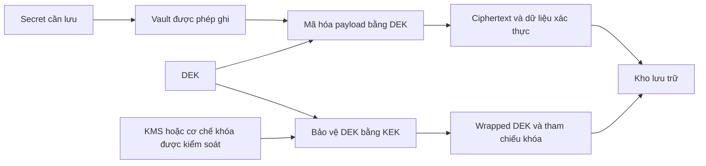

# Vault encryption at rest

Encryption at rest là mã hóa dữ liệu khi dữ liệu được lưu trên phương tiện lưu trữ. Trong credential vault của hệ thống Privileged Access Management (PAM), dữ liệu cần bảo vệ có thể gồm password quản trị, API credential, SSH private key, phiên bản secret, bản sao lưu và một phần metadata nhạy cảm.

Mục tiêu là giảm khả năng một người có được ổ đĩa, snapshot, bản sao cơ sở dữ liệu hoặc tệp backup có thể đọc ngay credential bên trong. Để đạt mục tiêu đó, cần quản lý cả thuật toán, cách dùng khóa, quyền gọi giải mã, dữ liệu phụ trợ và khả năng khôi phục.

Mã hóa dữ liệu lưu trữ không tự quyết định ai được lấy secret qua API của vault. Khi vault đang phục vụ, nó hoặc thành phần được ủy quyền vẫn có thể cần xử lý dữ liệu rõ để cấp phát credential. Vì vậy, bài học này đặt encryption at rest trong toàn bộ kiến trúc PAM: least privilege, phân tách nhiệm vụ, audit, vận hành và ứng phó sự cố.

## 1. Mục tiêu học tập và ba trạng thái dữ liệu

Sau bài học, người học có thể:

- Phân biệt mã hóa ổ đĩa, mã hóa cơ sở dữ liệu và mã hóa ở lớp ứng dụng vault.
- Giải thích envelope encryption với khóa mã hóa dữ liệu và khóa bảo vệ khóa.
- Xác định người hoặc thành phần nào có thể giải mã và bằng chứng nào cần kiểm tra.
- Phân biệt đổi phiên bản khóa, bọc lại khóa dữ liệu và mã hóa lại secret.
- Thiết kế sao lưu, khôi phục và xử lý sự cố mà không nhầm lẫn mã hóa với thu hồi credential.

| Trạng thái dữ liệu | Ví dụ trong PAM | Nhóm kiểm soát liên quan |
| --- | --- | --- |
| At rest | Secret trong kho lưu trữ, snapshot, backup | Mã hóa lưu trữ, quản lý khóa, kiểm soát bản sao |
| In transit | Vault cấp credential tới gateway hoặc workload | Bảo vệ kênh truyền, xác thực các bên và xác minh đích |
| In use | Secret được xử lý trong bộ nhớ để sử dụng hoặc cấp phát | Giới hạn tiến trình, bảo vệ runtime, tránh log hoặc dump chứa secret |

Ba nhóm bổ sung cho nhau. Kết nối được bảo vệ không chứng minh backup đã mã hóa; ổ đĩa được mã hóa cũng không ngăn một tài khoản có quyền hợp lệ gọi API lấy secret.

## 2. Xác định mối đe dọa và ranh giới bảo vệ

Trước khi chọn cơ chế, cần xác định đối tượng tấn công có gì trong tay và có quyền làm gì.

| Tình huống | Encryption at rest có thể giúp gì? | Điều còn phải kiểm soát |
| --- | --- | --- |
| Mất ổ đĩa hoặc thiết bị lưu trữ | Giảm khả năng đọc dữ liệu nếu khóa không bị lấy cùng | Quy trình giữ khóa, trạng thái khóa của thiết bị và bản sao khác |
| Lộ snapshot hoặc database dump | Mã hóa ở lớp phù hợp có thể giữ secret ở dạng ciphertext | Snapshot có chứa khóa hoặc quyền truy cập dịch vụ khóa hay không |
| Quản trị viên cơ sở dữ liệu đọc bảng secret | Mã hóa ứng dụng có thể tách quyền đọc bảng khỏi quyền giải mã | Quyền trên ứng dụng vault, runtime và dịch vụ khóa |
| Tài khoản workload được cấp quyền đọc secret quá rộng | Mã hóa lưu trữ không chặn yêu cầu giải mã hợp lệ theo policy sai | Policy cấp phát, danh tính workload và least privilege |
| Tiến trình vault đang chạy bị chiếm quyền | Kẻ tấn công có thể lạm dụng đường giải mã hoặc dữ liệu trong bộ nhớ | Bảo vệ runtime, hạn chế quyền khóa, phát hiện và ứng phó |
| Quản trị viên dịch vụ khóa cấp thêm quyền giải mã | Có thể làm suy yếu việc tách kho dữ liệu với khóa | Kiểm soát thay đổi policy, phân tách nhiệm vụ và audit |
| Mất hoặc hủy khóa cần thiết | Ciphertext có thể trở nên không khôi phục được | Tính sẵn sàng, lưu giữ khóa và kiểm thử phục hồi |

Một bản sao ciphertext và wrapped DEK nằm cùng nhau không nhất thiết làm mất bảo vệ: wrapped DEK vẫn cần khóa bảo vệ thích hợp để mở. Ngược lại, mã hóa rất mạnh cũng không giúp nhiều nếu cùng thư mục backup chứa cả khóa giải mã sử dụng được và hướng dẫn truy cập không có kiểm soát.

Cần phân biệt quyền đọc dữ liệu lưu trữ với quyền sử dụng khóa. Việc hai thành phần nằm trên hai máy khác nhau chưa chứng minh chúng có ranh giới quyền độc lập.

## 3. Các lớp mã hóa có thể kết hợp

### 3.1. Mã hóa ổ đĩa hoặc volume

Lớp này bảo vệ nội dung thiết bị lưu trữ trong các điều kiện phù hợp, chẳng hạn khi thiết bị bị tháo ra mà không có khả năng mở khóa. Khi volume đã được mở và hệ điều hành phục vụ truy cập, tiến trình có quyền đọc vẫn có thể nhận dữ liệu rõ theo quyền của nó.

Snapshot, bản sao lưu hoặc dịch vụ lưu trữ sao chép có thể có cơ chế mã hóa và quyền khóa riêng. Không suy luận mọi bản sao đều được bảo vệ giống volume gốc nếu chưa kiểm tra đường tạo và lưu bản sao.

### 3.2. Mã hóa ở lớp cơ sở dữ liệu

Một số hệ thống mã hóa tệp dữ liệu, log giao dịch hoặc backup ở lớp cơ sở dữ liệu. Cơ chế này có thể bảo vệ phương tiện lưu trữ nhưng không nhất thiết ngăn người có quyền truy vấn lấy dữ liệu rõ.

Cần xác minh đúng phạm vi: tệp tạm, redo hoặc transaction log, bản sao replica, export và backup có thể đi qua các đường khác nhau. Nhãn “database encryption enabled” chưa đủ để kết luận mọi dạng xuất dữ liệu đều là ciphertext.

### 3.3. Mã hóa ở lớp ứng dụng vault

Vault mã hóa payload trước khi ghi xuống kho lưu trữ. Nếu được thiết kế phù hợp, người chỉ có quyền đọc cơ sở dữ liệu sẽ thấy ciphertext thay vì giá trị credential.

Lớp này cho phép thiết kế ranh giới chi tiết hơn giữa ứng dụng, kho dữ liệu và dịch vụ khóa. Tuy nhiên, nó cũng đặt trách nhiệm lên ứng dụng hoặc thư viện tin cậy về quản lý nonce, xác minh toàn vẹn, gắn ngữ cảnh và xử lý lỗi.

Không tự thiết kế thuật toán hoặc định dạng mật mã cho một vault chỉ dựa trên ví dụ học tập. Khi triển khai, sử dụng cơ chế đã được cung cấp và đánh giá phù hợp, đồng thời xác minh cấu hình và cách vận hành.

### 3.4. Các lớp không thay thế nhau

Một vault có thể kết hợp mã hóa volume, mã hóa cơ sở dữ liệu và mã hóa ứng dụng. Giá trị của việc kết hợp nằm ở các ranh giới được bảo vệ, không phải số lượng nhãn mã hóa.

Ví dụ, mã hóa ứng dụng bảo vệ secret trong database dump, còn mã hóa volume bảo vệ thêm dữ liệu phụ trợ trên thiết bị. Nếu cả hai cùng phụ thuộc một tài khoản quản trị có thể đọc dữ liệu và mở mọi khóa, vẫn cần xem xét điểm tập trung quyền đó.

## 4. Envelope encryption: tách dữ liệu khỏi khóa bảo vệ

Envelope encryption là mô hình dùng một khóa để mã hóa dữ liệu và một khóa khác để bảo vệ khóa dữ liệu. Tên gọi, số tầng và đơn vị cấp khóa khác nhau giữa sản phẩm.

### 4.1. Các thành phần

| Thành phần | Vai trò | Nội dung cần bảo vệ |
| --- | --- | --- |
| Plaintext secret | Giá trị credential trước mã hóa hoặc sau giải mã | Password, token, private key |
| Data Encryption Key — DEK | Khóa mã hóa payload | Giá trị khóa; có thể tồn tại ngắn trong bộ nhớ theo kiến trúc |
| Ciphertext | Payload đã mã hóa | Bảo vệ khỏi sửa trái phép và giữ liên kết đúng đối tượng |
| Key Encryption Key — KEK | Khóa bảo vệ hoặc bọc DEK | Quyền sử dụng, cấu hình, vòng đời và khả năng khôi phục |
| Wrapped DEK | DEK đã được bảo vệ bằng cơ chế bọc khóa | Chỉ được mở qua đường được phép; vẫn cần giữ toàn vẹn và ngữ cảnh |
| Key reference hoặc version | Tham chiếu khóa dùng cho thao tác | Không phải giá trị khóa, nhưng cần đúng và có thể nhạy cảm về metadata |

KEK có thể được quản lý bởi dịch vụ quản lý khóa (KMS), thiết bị bảo mật phần cứng (HSM) hoặc cơ chế tương ứng. KMS là dịch vụ quản lý và cung cấp thao tác khóa; HSM cung cấp một ranh giới phần cứng cho thao tác mật mã theo thiết kế của nó. Hai khái niệm có thể liên quan nhưng không đồng nhất.

Trong mô hình giữ KEK không xuất ra ngoài, thao tác bảo vệ hoặc mở DEK được thực hiện trong ranh giới dịch vụ khóa. Tuy vậy, DEK dạng rõ có thể được đưa cho vault để mã hóa hoặc giải mã payload nếu kiến trúc yêu cầu. Không kết luận rằng mọi dữ liệu rõ đều ở trong HSM chỉ vì hệ thống sử dụng HSM.

### 4.2. Luồng ghi tham chiếu

Luồng logic gồm:

1. Xác thực và cho phép chủ thể ghi secret vào đúng đối tượng.
2. Có DEK phù hợp theo thiết kế cấp khóa; không mặc định mọi sản phẩm cấp một DEK mới cho từng bản ghi.
3. Mã hóa payload bằng cơ chế cung cấp tính bí mật và kiểm tra toàn vẹn phù hợp.
4. Bảo vệ DEK bằng KEK hoặc hệ thống khóa tương ứng.
5. Lưu ciphertext, thông tin cần thiết để giải mã và tham chiếu khóa; không lưu DEK rõ cạnh ciphertext.
6. Giới hạn thời gian và phạm vi xử lý secret hoặc khóa rõ trong bộ nhớ theo khả năng triển khai.

Một số KMS có thể hỗ trợ tạo data key hoặc các thao tác khác giúp thay đổi cách thực hiện luồng trên. Cần đọc đúng tài liệu của sản phẩm khi triển khai, không coi sơ đồ là API bắt buộc.

### 4.3. Luồng đọc tham chiếu

Trước khi đọc, vault xác thực người hoặc workload, đánh giá quyền trên đối tượng và ghi nhận sự kiện theo chính sách. Sau đó vault lấy ciphertext cùng thông tin khóa, yêu cầu mở DEK qua danh tính dịch vụ được phép, xác minh dữ liệu rồi mới cấp phát secret hoặc sử dụng nó thay cho người dùng.

Quyền giải mã ở KMS và quyền lấy secret ở vault là hai lớp khác nhau. Một dịch vụ vault có thể dùng cùng một quyền khóa cho nhiều đối tượng nhưng vẫn phải kiểm tra policy ở từng yêu cầu. Ngược lại, giới hạn quyền ở vault không đủ nếu một chủ thể có thể lấy ciphertext và tự gọi KMS ngoài luồng.

## 5. Toàn vẹn mật mã và gắn đúng ngữ cảnh

### 5.1. Dùng cơ chế có xác thực phù hợp

Mã hóa chỉ cung cấp tính bí mật chưa đủ để phát hiện mọi thay đổi trái phép. Một thiết kế hiện đại thường dùng mã hóa có xác thực, chẳng hạn một cơ chế AEAD được thư viện và sản phẩm hỗ trợ.

AEAD có thể bảo vệ tính bí mật của payload và kiểm tra tính toàn vẹn, gồm cả dữ liệu liên quan được xác thực. Khi xác minh thất bại, hệ thống không được cấp phát một phần secret hoặc cố diễn giải dữ liệu như thể vẫn hợp lệ.

Với cơ chế như AES-GCM, nonce không được tái sử dụng với cùng khóa. Cách tạo và quản lý nonce phải theo yêu cầu của thuật toán và thư viện; không lấy một ví dụ chuỗi cố định làm giá trị thực tế cho mọi bản ghi.

Thiết kế phải xét cả cạnh tranh giữa nhiều writer, khởi động lại và khôi phục snapshot. Nếu bộ đếm nonce bị quay về trạng thái cũ trong khi khóa vẫn giữ nguyên, hệ thống có thể lặp lại nonce. Dùng số ngẫu nhiên cũng cần nguồn ngẫu nhiên phù hợp và cách sử dụng đúng, không phải một bảo đảm tự động cho mọi quy mô.

### 5.2. Additional authenticated data

Dữ liệu liên quan được xác thực (AAD) có thể dùng để gắn ciphertext với tenant, object ID, phiên bản secret hoặc mục đích sử dụng theo thiết kế.

Ví dụ, ciphertext thuộc credential của môi trường development không nên được chấp nhận như credential production chỉ vì một người có thể sao chép hàng dữ liệu. Việc kiểm tra cần dùng ngữ cảnh đáng tin cậy của yêu cầu và đối tượng; nếu chỉ tin cả payload lẫn metadata do cùng một nguồn không tin cậy cung cấp, ràng buộc có thể không đạt mục tiêu.

AAD không phải secret và không được mã hóa chỉ vì nó được xác thực. Không đặt password hoặc token vào AAD. Một số dịch vụ khóa có cơ chế encryption context với đặc tính riêng; chỉ coi nó tương đương một ràng buộc cụ thể sau khi xác minh cách dịch vụ sử dụng.

### 5.3. Toàn vẹn không tự ngăn phát lại bản cũ

Một ciphertext cũ hợp lệ vẫn có thể xác minh thành công nếu được đưa trở lại hệ thống. AEAD không tự chứng minh đó là phiên bản mới nhất hoặc còn được phép sử dụng.

Muốn chống quay lui trái phép, cần quản lý phiên bản, trạng thái và nguồn tham chiếu đáng tin cậy phù hợp. Nếu kẻ tấn công có thể khôi phục đồng thời dữ liệu và mọi bộ đếm phiên bản từ cùng một snapshot cũ, chỉ có trường version nằm trong snapshot đó chưa đủ để phát hiện.

Với PAM, khôi phục một credential cũ cũng không chứng minh credential đó còn khớp hệ thống đích. Trạng thái bí mật lưu trong vault và trạng thái tài khoản thực tế cần được đối soát.

## 6. Kiểm kê toàn bộ dữ liệu lưu trữ

Không giới hạn phạm vi đánh giá ở cột chứa secret. Dữ liệu nhạy cảm có thể xuất hiện trong nhiều thành phần:

| Vị trí | Nguy cơ cần xem xét |
| --- | --- |
| Kho secret chính | Payload, phiên bản cũ, bản ghi đã xóa mềm |
| Database log và replica | Dữ liệu có được mã hóa trước khi đi vào log hoặc sao chép không? |
| Snapshot và backup | Cơ chế mã hóa, tham chiếu khóa, quyền đọc và vùng phục hồi |
| File tạm và vùng xuất | Secret có xuất hiện rõ trong staging, export hoặc công cụ hỗ trợ không? |
| Log, trace và thông báo lỗi | Request hoặc response có chứa password, token hoặc key không? |
| Crash dump, swap và ảnh bộ nhớ | Dữ liệu rõ hoặc DEK có thể bị lưu ra thiết bị hay không? |
| Cache của gateway hoặc workload | Secret đã cấp phát có vòng đời và cách bảo vệ riêng |
| Chỉ mục và metadata | Tên tài khoản, target, owner hoặc đường dẫn có tiết lộ cấu trúc hạ tầng không? |

Một hệ thống có thể mã hóa payload nhưng giữ tên tài khoản, tên máy chủ hoặc tên secret ở dạng rõ để phục vụ tìm kiếm. Điều này không tự làm thiết kế sai, nhưng phạm vi bảo vệ phải được mô tả chính xác và metadata vẫn cần phân quyền.

Tìm kiếm trên trường được mã hóa có thể cần đánh đổi hoặc thiết kế bổ sung. Không chọn mã hóa có tính xác định chỉ để dễ tìm kiếm mà bỏ qua việc nó có thể làm lộ quan hệ bằng nhau hoặc mẫu dữ liệu. Với bài học này, điều cần đạt là nhận diện nhu cầu tìm kiếm và giới hạn, không tự xây cơ chế mật mã.

Trong lúc vault hoạt động, tránh ghi plaintext hoặc khóa vào log, hỗ trợ kỹ thuật và dump không được bảo vệ. Một số biện pháp như hạn chế dump, kiểm soát swap và quản lý bộ nhớ có thể giảm rủi ro, nhưng không nên hứa hẹn có thể xóa sạch mọi bản sao bộ nhớ trong mọi môi trường chạy.

## 7. Quản lý quyền khóa và trạng thái mở khóa vault

### 7.1. Tách nhiệm vụ theo khả năng thực tế

| Vai trò | Khả năng cần thiết | Quyền cần hạn chế hoặc kiểm soát bổ sung |
| --- | --- | --- |
| Vận hành lưu trữ | Duy trì kho dữ liệu, snapshot, backup | Không tự có quyền mở mọi DEK |
| Dịch vụ vault | Dùng khóa theo phạm vi để phục vụ yêu cầu đã được cho phép | Không được quản trị tùy ý policy khóa hoặc xuất KEK |
| Quản trị khóa | Duy trì vòng đời, trạng thái và cấu hình khóa | Kiểm soát quyền tự cấp giải mã, hủy khóa hoặc mở rộng đối tượng sử dụng |
| Quản trị policy PAM | Quản lý ai được dùng secret | Kiểm soát khả năng tự cấp quyền đọc hoặc bỏ qua phê duyệt |
| Kiểm toán hoặc điều tra | Đọc bằng chứng được phân quyền | Không tự sửa sự kiện hoặc thay đổi khóa đang được đánh giá |

Phân tách nhiệm vụ cần xét cả quyền hiệu lực. Một người có thể không có quyền `decrypt` ban đầu nhưng lại có quyền sửa policy để tự cấp quyền đó. Hệ thống nhận dạng, nhóm quản trị nền tảng và quy trình cấp quyền khẩn cấp cũng nằm trong ranh giới cần đánh giá.

Giới hạn danh tính dịch vụ của vault theo khóa, mục đích và phạm vi mà dịch vụ khóa thực sự hỗ trợ. Kiểm soát thay đổi cấu hình và thu thập audit cho các thao tác nhạy cảm như cấp thêm quyền, đổi key reference, vô hiệu hóa và yêu cầu hủy khóa.

### 7.2. Seal, unseal và auto-unseal

Một số vault có trạng thái khóa bảo vệ chưa sẵn sàng, thường được mô tả bằng khái niệm sealed, và cơ chế mở khóa tương ứng. Tên gọi và mô hình khóa khác nhau giữa sản phẩm; không mặc định mọi vault có cùng kiến trúc.

Unseal hoặc auto-unseal là bước làm cho hệ thống có thể tiếp cận khóa cần thiết để vận hành. Nó không đồng nhất với việc cho một người dùng quyền đọc mọi secret. Danh tính gọi API và policy của vault vẫn cần được đánh giá riêng.

Nếu dùng dịch vụ khóa bên ngoài để tự mở khóa, cần xác định vault lấy danh tính nền tảng thế nào và điều gì xảy ra khi danh tính đó bị chiếm quyền. Không đặt một credential toàn quyền cạnh kho dữ liệu rồi coi auto-unseal là đã giải quyết việc bảo vệ khóa.

Nếu dùng quy trình nhiều người hoặc cơ chế ngưỡng được sản phẩm hỗ trợ, quản lý riêng người giữ vật liệu phục hồi, nơi lưu, quyền sử dụng và kiểm thử khôi phục. Không tự chia chuỗi khóa thành các đoạn văn bản và gọi đó là một cơ chế ngưỡng mật mã.

### 7.3. KMS hoặc HSM không sẵn sàng

Vault có thể không đọc hoặc ghi được secret nếu không truy cập được khóa cần thiết. Hành vi cụ thể phụ thuộc việc cache DEK, trạng thái mở khóa và thiết kế sản phẩm.

Không suy luận rằng ngắt quyền KMS sẽ lập tức làm mọi secret không thể đọc: một tiến trình có thể còn giữ DEK hoặc plaintext trong bộ nhớ. Ngược lại, hệ thống không cache khóa có thể mất khả năng phục vụ ngay khi dịch vụ khóa gián đoạn.

Định nghĩa trước chế độ vận hành: từ chối thao tác không thể bảo đảm, cảnh báo, phạm vi cache được phép và quy trình khẩn cấp. Không tự chuyển sang ghi plaintext hoặc dùng một khóa mặc định khi dịch vụ khóa lỗi.

## 8. Phân biệt các loại luân chuyển

### 8.1. Bốn thay đổi khác nhau

| Thay đổi | Điều thay đổi | Điều chưa được bảo đảm tự động |
| --- | --- | --- |
| Đổi credential của target | Password, token hoặc key dùng xác thực ở hệ thống đích | Ciphertext cũ hoặc khóa lưu trữ không tự biến mất |
| Đổi phiên bản KEK | Khóa bảo vệ mới có thể được dùng cho thao tác mới | Wrapped DEK cũ chưa chắc đã được chuyển sang khóa mới |
| Bọc lại DEK — rewrap | Cách bảo vệ DEK bằng KEK mới | Ciphertext payload có thể vẫn dùng cùng DEK |
| Đổi DEK và mã hóa lại | Payload được mã hóa bằng khóa dữ liệu mới | Bản sao, backup hoặc ciphertext đã bị lấy trước đó chưa tự hết giá trị |

Bật tính năng tự luân chuyển khóa ở KMS không tự chứng minh toàn bộ ciphertext hiện có đã được mã hóa lại. Một số hệ thống giữ phiên bản khóa cũ để đọc dữ liệu cũ; một số có thao tác chuyển đổi riêng. Cần xác minh hành vi thực tế của sản phẩm.

### 8.2. Bọc lại DEK

Trong envelope encryption, có thể bảo vệ cùng DEK dưới một KEK mới mà không giải mã lại toàn bộ payload. Tùy khả năng dịch vụ khóa, bước này có thể diễn ra trong ranh giới dịch vụ hoặc cần một đường xử lý khác được kiểm soát.

Sau rewrap, cần xác minh wrapped DEK mới mở được và vẫn gắn đúng ngữ cảnh. Theo dõi đối tượng đã chuyển, chưa chuyển và lỗi; tránh đổi key reference trước khi wrapped DEK tương ứng được lưu đúng.

Không hủy KEK cũ chỉ vì kho dữ liệu đang hoạt động đã chuyển xong. Backup bất biến hoặc snapshot cũ có thể vẫn chứa DEK được bọc dưới KEK đó.

### 8.3. Đổi DEK và mã hóa lại payload

Trường hợp cần thay DEK có thể bao gồm vòng đời khóa theo chính sách hoặc nghi ngờ khóa dữ liệu bị lộ. Quy trình phải tạo ciphertext mới hợp lệ, bảo toàn phiên bản và xử lý an toàn khi công việc bị ngắt.

Thiết kế cần tránh hai writer cùng cập nhật đối tượng hoặc việc retry ghi đè phiên bản mới bằng dữ liệu cũ. Có thể cần kiểm soát phiên bản, cập nhật nguyên tử trong phạm vi hệ thống và trạng thái chuyển đổi rõ ràng.

Thay khóa không làm kẻ tấn công quên dữ liệu đã giải mã. Nếu họ đã lấy ciphertext cùng DEK rõ, việc mã hóa lại dữ liệu hiện tại không bảo vệ được bản sao đã bị lấy. Cần đánh giá credential liên quan có phải luân chuyển ở target hay không.

### 8.4. Trình tự thay đổi khóa tham chiếu

1. Kiểm kê dữ liệu hiện tại, phiên bản cũ, replica và backup phụ thuộc khóa cũ.
2. Chuẩn bị khóa hoặc phiên bản mới cùng policy và đường khôi phục.
3. Thử ghi, đọc và kiểm tra ngữ cảnh trong phạm vi được chấp thuận.
4. Chuyển thao tác mới sang cấu hình mới theo thiết kế.
5. Chuyển dữ liệu cũ bằng rewrap hoặc mã hóa lại nếu mục tiêu yêu cầu.
6. Đối soát số lượng, lỗi và khả năng giải mã sau chuyển đổi.
7. Kiểm tra khôi phục, bao gồm bản sao còn trong thời hạn lưu giữ.
8. Chỉ ngừng dùng hoặc hủy khóa cũ theo điều kiện đã được xác nhận.

Không coi việc một phiên bản secret đọc được sau chuyển đổi là bằng chứng mọi bản sao đã chuyển. Mức xác minh phải phù hợp phạm vi và rủi ro.

## 9. Sao lưu, khôi phục và hủy khóa

### 9.1. Backup cần cả dữ liệu lẫn đường tiếp cận khóa

Một backup có thể nguyên vẹn về tệp nhưng không thể sử dụng nếu mất khóa, thiếu policy, sai tenant dịch vụ khóa hoặc không khôi phục được danh tính dịch vụ.

Hồ sơ phục hồi nên xác định:

- Dữ liệu, cấu hình và metadata mật mã nào cần được phục hồi cùng nhau.
- Key reference và phiên bản khóa nào phục vụ từng thế hệ backup.
- Khóa được lưu giữ, sao chép hoặc cung cấp tính sẵn sàng theo khả năng hệ thống ra sao.
- Ai được phục hồi danh tính, cấp quyền sử dụng khóa và xác nhận kết quả.
- Môi trường phục hồi có được kết nối tới target thật hoặc cấp phát secret hay không.
- Cách giữ audit trong toàn bộ quá trình phục hồi.

Không nhất thiết phải xuất KEK ra tệp để có kế hoạch phục hồi. Với khóa không cho xuất, cần dựa vào khả năng sẵn sàng và khôi phục mà dịch vụ khóa hỗ trợ, đồng thời hiểu giới hạn khi mất tài khoản nền tảng hoặc vùng triển khai.

### 9.2. Khôi phục thử phải kiểm tra khả năng sử dụng

Trong môi trường cô lập phù hợp, kiểm tra giải mã được một tập dữ liệu đại diện bằng policy đúng; thử trường hợp thiếu quyền; đối chiếu metadata và audit. Phục hồi thành công phải bao gồm đường khóa chứ không chỉ việc database khởi động.

Không kết nối tự động một vault phục hồi từ snapshot cũ vào target production để đổi credential. Snapshot có thể chứa giá trị cũ trong khi password ở đích đã được luân chuyển sau thời điểm chụp.

Trước khi mở cấp phát hoặc tự động quản lý credential từ bản phục hồi, cần đối soát trạng thái thực tế. Khôi phục dữ liệu lưu trữ và khôi phục tính nhất quán của credential là hai công việc liên quan nhưng khác nhau.

### 9.3. Vô hiệu hóa và hủy khóa

Vô hiệu hóa khóa có thể chặn một số thao tác nhưng không đồng nghĩa hủy khóa không thể đảo ngược. Hủy khóa có thể làm dữ liệu phụ thuộc không khôi phục được; tác động cần xét cả backup và hồ sơ đang phải giữ.

Cryptographic erasure chỉ có ý nghĩa trong phạm vi giả định phù hợp: các khóa cần thiết thực sự không còn dùng được và không còn bản sao plaintext, DEK hoặc khóa khác có thể mở dữ liệu. Không gọi việc xóa một key reference trong cơ sở dữ liệu là đã hủy dữ liệu mật mã.

Nếu một KEK bảo vệ dữ liệu của nhiều đối tượng, hủy KEK có thể ảnh hưởng tất cả chúng. Đơn vị cấp khóa và cấu trúc phụ thuộc quyết định độ hạt của việc hủy, không phải mong muốn xóa một secret riêng lẻ.

## 10. Bằng chứng và kiểm thử chấp nhận

Chỉ báo “encryption enabled” là điểm bắt đầu. Cần chứng minh phạm vi, đường sử dụng khóa và khả năng phục hồi theo thiết kế.

| Nội dung kiểm tra | Bằng chứng hoặc kết quả cần có |
| --- | --- |
| Phạm vi mã hóa | Sơ đồ dữ liệu chỉ rõ kho chính, log, replica, backup, file tạm và phần metadata còn rõ |
| Tách quyền | Chủ thể chỉ đọc kho dữ liệu không tự giải mã được; quyền hiệu lực và khả năng sửa policy đã được xem xét |
| Cơ chế mật mã | Tài liệu cấu hình và cách sản phẩm quản lý nonce, xác thực dữ liệu, khóa và phiên bản |
| Đúng ngữ cảnh | Dữ liệu hoặc wrapped DEK đưa sang đối tượng sai bị từ chối nếu thiết kế cam kết ràng buộc này |
| Toàn vẹn | Ciphertext bị thay đổi trong thử nghiệm được chấp thuận không được cấp phát như secret hợp lệ |
| Lỗi dịch vụ khóa | Hành vi khi mất quyền hoặc mất kết nối phù hợp thiết kế, không hạ xuống plaintext |
| Chuyển khóa | Đọc được dữ liệu sau chuyển đổi; trạng thái lỗi và dữ liệu chưa chuyển được theo dõi |
| Backup | Khôi phục được cả dữ liệu và đường khóa trong môi trường phù hợp |
| Dữ liệu phụ trợ | Không có secret hoặc khóa rõ trong log, export và công cụ hỗ trợ ngoài phạm vi được chấp nhận |
| Audit | Có bằng chứng thay đổi policy, cấu hình khóa, lỗi giải mã và thao tác quản trị quan trọng |

Những kiểm thử sửa ciphertext, ngắt KMS hoặc phục hồi backup có thể gây tác động lớn. Thực hiện trong môi trường và phạm vi được phê duyệt; không tạo hỏng dữ liệu production để chứng minh một tính năng.

Kiểm thử đọc tệp không nên tạo thêm một bản dump plaintext không được quản lý. Ưu tiên phương pháp kiểm tra và công cụ phù hợp với sản phẩm, bảo vệ dữ liệu thử và ghi lại giới hạn của kết quả.

### Audit cần phân biệt các lớp

Sự kiện KMS có thể cho biết danh tính dịch vụ đã thực hiện thao tác khóa. Nó chưa chắc xác định người cuối đang yêu cầu secret hoặc tác vụ cụ thể ở target.

Audit của vault cần giữ liên kết người hoặc workload, object ID, phiên bản secret và mã yêu cầu phù hợp. Liên kết với KMS theo khả năng thực tế; cache hoặc xử lý theo lô có thể làm không tồn tại quan hệ một-một giữa lần đọc secret và lần gọi dịch vụ khóa.

Không ghi plaintext, DEK hoặc KEK vào audit. Ngay cả encryption context và tên tài nguyên cũng cần được xem xét vì có thể tiết lộ thông tin nhạy cảm.

## 11. Ứng phó khi nghi có lộ dữ liệu hoặc khóa

Phân loại đối tượng bị lộ trước khi quyết định biện pháp:

| Điều bị lộ hoặc bị chiếm quyền | Câu hỏi cần giải quyết |
| --- | --- |
| Chỉ có bản sao dữ liệu đã mã hóa | Khóa và quyền giải mã có độc lập, cơ chế mã hóa có được dùng đúng, metadata nào đã lộ? |
| Danh tính có thể gọi giải mã | Phạm vi khóa và ciphertext mà danh tính tiếp cận được là gì; có cache hoặc secret đã cấp phát không? |
| DEK | Payload nào dùng DEK đó; có phiên bản, bản sao hoặc backup tương ứng bị lấy không? |
| KEK hoặc quyền quản trị khóa | Có thể mở những DEK nào; có thay đổi policy hay khóa mới ngoài dự kiến không? |
| Tiến trình vault | Những secret và khóa nào có thể đã có trong bộ nhớ hoặc được truy xuất qua ứng dụng? |

Giữ bằng chứng, hạn chế đường truy cập bị ảnh hưởng và phối hợp với owner các hệ thống đích. Việc thay khóa lưu trữ có thể cần đi cùng thu hồi hoặc luân chuyển credential ở target, xử lý token đã cấp và kiểm tra phiên đặc quyền.

Không hủy khóa ngay chỉ để làm cho dữ liệu không đọc được mà chưa đánh giá tác động phục hồi và yêu cầu giữ bằng chứng. Cũng không coi việc ngừng quyền KMS là đã thu hồi mọi secret được phát trước đó.

Kết luận về mức độ ảnh hưởng cần dựa trên phạm vi quyền và dữ liệu thực tế. Không mặc định có ciphertext bị lấy là mọi secret đã lộ; cũng không mặc định còn mã hóa là không cần điều tra.

## 12. Tình huống: lộ snapshot của credential vault

Một nhóm phát hiện snapshot cơ sở dữ liệu của vault đã được cấp quyền đọc nhầm. Vault dùng mã hóa ứng dụng với envelope encryption; snapshot chứa ciphertext, wrapped DEK và metadata. KEK được quản lý qua KMS, còn dịch vụ vault có danh tính được phép thực hiện thao tác khóa.

### Bước 1: Xác định phạm vi

Nhóm xác định snapshot nào bị ảnh hưởng, thời điểm và quyền của đối tượng đã tiếp cận. Cần kiểm tra họ có quyền KMS, khả năng sửa policy hoặc truy cập danh tính dịch vụ vault hay không, thay vì chỉ nhìn quyền đọc snapshot.

Nếu metadata còn rõ, tên tài khoản và tài nguyên có thể đã bị lộ dù payload chưa giải mã được. Phạm vi sự cố phải phản ánh cả phần này.

### Bước 2: Kiểm tra đường giải mã

Nhóm đối chiếu policy khóa, thay đổi quyền và audit. Không có sự kiện KMS bất thường là một bằng chứng cần xem xét nhưng chưa đủ để khẳng định tuyệt đối không ai có plaintext: cần xét cache, bản sao khóa, log ứng dụng và các đường truy cập khác.

### Bước 3: Chọn biện pháp theo kết quả

Nếu quyền và khóa độc lập vẫn được bảo vệ, nhóm xử lý quyền snapshot, metadata bị lộ và các điểm kiểm soát liên quan. Nếu phát hiện khả năng lạm dụng giải mã, nhóm mở rộng phạm vi điều tra và xử lý credential ở target theo đánh giá rủi ro.

Đổi KEK rồi rewrap dữ liệu hiện tại không xóa snapshot đã bị lấy. Nếu snapshot đó vẫn mở được bằng khóa cũ còn tồn tại, cần đánh giá và quản lý phụ thuộc một cách rõ ràng.

### Bước 4: Kiểm tra phục hồi trước thay đổi không thể đảo ngược

Trước khi hủy khóa cũ, nhóm đối chiếu các backup còn thời hạn và thử phục hồi theo kế hoạch. Với backup bất biến không thể bọc lại, việc giữ khả năng khôi phục có thể còn phụ thuộc khóa cũ; quyết định xử lý cần xét đầy đủ yêu cầu và có chủ thể chịu trách nhiệm.

Tình huống cho thấy encryption at rest có giá trị khi ranh giới khóa được bảo vệ, đồng thời cần được kiểm chứng bằng quyền, luồng dữ liệu và bằng chứng vận hành.

## 13. Các hiểu nhầm thường gặp

| Hiểu nhầm | Cách hiểu chính xác hơn |
| --- | --- |
| Bật mã hóa ổ đĩa là quản trị viên database không đọc được secret | Quyền đọc khi hệ thống hoạt động còn phụ thuộc lớp ứng dụng và cơ sở dữ liệu |
| Dùng HSM thì plaintext không bao giờ ra ngoài HSM | Phạm vi xử lý phụ thuộc kiến trúc; vault hoặc consumer có thể vẫn nhận dữ liệu rõ |
| Đổi phiên bản KEK là mọi dữ liệu cũ đã được mã hóa lại | Cần phân biệt phiên bản mới, rewrap và thay DEK |
| Mã hóa có xác thực tự ngăn khôi phục bản ghi cũ | Bản cũ hợp lệ có thể vẫn xác minh được; cần quản lý phiên bản đáng tin cậy |
| Xóa secret trong vault là mọi bản sao không thể giải mã | Backup, phiên bản cũ, cache và bản sao khóa có vòng đời riêng |
| KMS ngừng hoạt động thì chắc chắn không ai đọc được secret | DEK hoặc plaintext có thể còn cache hoặc đã được cấp phát |
| Backup giải nén được là phục hồi thành công | Cần có khóa, policy, danh tính và khả năng đối soát trạng thái target |
| Thay khóa lưu trữ là đã đổi password quản trị | Credential tại target có vòng đời độc lập |

## 14. Bài thực hành thiết kế

Thiết kế một vault giả định lưu password quản trị và API credential, dùng kho dữ liệu tách biệt với dịch vụ khóa.

1. Vẽ dữ liệu rõ, ciphertext, DEK, wrapped DEK và KEK; chỉ ra nơi nào có thể xử lý plaintext.
2. Lập ma trận quyền cho quản trị lưu trữ, dịch vụ vault, quản trị khóa và kiểm toán.
3. Xác định lớp mã hóa nào bảo vệ snapshot, log, backup và metadata.
4. Mô tả cách gắn ciphertext với tenant, object ID và phiên bản; chỉ ra giới hạn chống phát lại.
5. Lập kế hoạch đổi KEK và giải thích dữ liệu nào cần rewrap hoặc mã hóa lại.
6. Xác định vì sao một backup cũ còn cần khóa cũ và cách kiểm chứng phục hồi.
7. Mô tả hành vi khi KMS gián đoạn hoặc danh tính dịch vụ bị thu hồi quyền.
8. Phân biệt biện pháp khi chỉ lộ snapshot với khi DEK hoặc đường giải mã bị chiếm quyền.

Bản thiết kế đạt yêu cầu khi giải thích được ai có thể đọc credential, bằng con đường nào và trong điều kiện nào. Với credential vault trong PAM, mã hóa dữ liệu lưu trữ chỉ phát huy đầy đủ giá trị khi vòng đời khóa, quyền sử dụng và khả năng phục hồi được quản lý cùng nhau.
