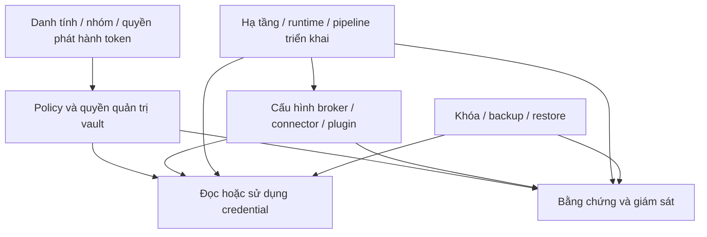

# Vault administrator separation

## 1. Phân tách quản trị viên vault là gì?

Trong quản lý truy cập đặc quyền (Privileged Access Management — PAM), vault bảo vệ credential của tài khoản quản trị, tài khoản dịch vụ và hạ tầng nhạy cảm. Người vận hành vault có thể cần duy trì tính sẵn sàng, cấu hình tích hợp hoặc xử lý sự cố, nhưng không vì thế mà cần sử dụng mọi tài khoản được lưu trong vault.

**Vault administrator separation** là thiết kế phân tách trách nhiệm và quyền hạn giữa những người hoặc dịch vụ quản trị vault, quản lý policy, sử dụng credential, quản lý khóa, phục hồi hệ thống và kiểm tra bằng chứng. Mục tiêu là hạn chế khả năng một chủ thể tự tạo ra, sử dụng rồi che giấu một quyền đặc biệt.

Một ví dụ về kết quả mong muốn:

> Người vận hành được kiểm tra sức khỏe và thực hiện tác vụ bảo trì đã được phép, nhưng không được tự sửa policy để đọc credential production. Người đề nghị mở rộng quyền không tự phê duyệt yêu cầu đó. Người kiểm toán đọc được bằng chứng nhưng không được sửa credential hoặc xóa dấu vết.

Đây là một yêu cầu về quyền thực tế, không chỉ là đặt ba tài khoản có tên khác nhau. Nếu cùng một người giữ mọi tài khoản và có thể tự cấp lại quyền, tác dụng phân tách còn rất hạn chế.

### Ba khái niệm liên quan

| Khái niệm | Câu hỏi chính |
|---|---|
| Least privilege | Mỗi chủ thể có đúng những quyền cần cho nhiệm vụ không? |
| Separation of duties — SoD | Những nhiệm vụ hoặc quyền kết hợp nguy hiểm có được tách không? |
| Dual control / phê duyệt độc lập | Một hành động nhạy cảm có cần một bên đủ thẩm quyền khác tham gia trước khi thực hiện không? |

Ba cơ chế bổ trợ nhau. Một tài khoản có ít quyền vẫn có thể nằm trong một tổ hợp nguy hiểm; một ticket có hai người tham gia cũng chưa tạo ra dual control kỹ thuật nếu người thực thi có thể bỏ qua ticket và gọi API trực tiếp.

## 2. Xác định phạm vi bảo đảm trước khi chia role

Cần tách rõ quyền ở API của vault với quyền điều khiển hệ thống chạy vault. Một người không có quyền đọc secret qua API vẫn có thể có khả năng thay binary, cài plugin, đổi cấu hình xác thực, đọc bộ nhớ hoặc phục hồi dữ liệu vào một hệ thống do mình kiểm soát.

Vì vậy, không nên khẳng định “vault admin không thể lấy secret” chỉ dựa trên role trong giao diện. Thiết kế cần chỉ ra quyền nào bị ngăn bằng kỹ thuật, quyền nào được kiểm soát bằng quy trình và những thành phần nào vẫn thuộc miền tin cậy đặc biệt.

Những tình huống cần đưa vào phân tích gồm:

- Quản trị viên vô tình sửa policy hoặc connector sai phạm vi.
- Tài khoản quản trị bị chiếm dụng rồi dùng để tự mở rộng quyền.
- Một người cố tình dùng kết hợp nhiều quyền để đọc hoặc sử dụng credential.
- Quản trị viên hạ tầng hoặc pipeline thay mã chạy bên trong vault/broker.
- Người quản lý backup và khóa phục hồi dữ liệu ngoài phạm vi cho phép.
- Nhiều chủ thể thông đồng, hoặc một người kiểm soát cả danh tính phê duyệt lẫn danh tính thực thi.

### Những lớp quyền phải xem cùng nhau



Sơ đồ thể hiện những đường cần phân tích, không khẳng định mọi sản phẩm đều cho phép các thao tác này theo cùng một cách. Mỗi đường phải được xác minh theo khả năng triển khai: ai được thực hiện, điều kiện gì, có phê duyệt độc lập không và bằng chứng nằm ở đâu.

## 3. Xây dựng danh mục thao tác quản trị

Trước khi tạo role, cần chia công việc thành thao tác cụ thể. Quyền tên chung như `administrator` hoặc `manage` thường che khuất những hành động có mức tác động khác nhau.

| Miền công việc | Ví dụ thao tác | Rủi ro cần xem xét |
|---|---|---|
| Vận hành dịch vụ | Xem sức khỏe, khởi động lại, thay cấu hình được phép | Gián đoạn truy cập; quyền thay runtime có thể dẫn tới tiếp cận secret |
| Quản trị policy | Tạo rule, sửa ACL, thay nhóm được truy cập | Tự cấp quyền hoặc mở rộng phạm vi cho chủ thể khác |
| Quản trị danh tính | Cấu hình nguồn xác thực, mapping role, phát hành/thu hồi token | Giả mạo hoặc tạo một danh tính được tin cậy |
| Quản lý secret | Tạo, ghi phiên bản, đọc, dùng, xóa, di chuyển | Lộ credential, mất dữ liệu, phá ánh xạ policy |
| Rotation và tích hợp | Sửa connector, chọn tài khoản đích, thay credential | Đổi nhầm tài khoản, đưa secret đến đích không tin cậy |
| Quản lý khóa | Dùng, thay, vô hiệu hoặc khôi phục khóa theo cơ chế | Mất khả năng truy cập hoặc tạo đường giải mã/phục hồi |
| Backup và restore | Tạo, tải, phục hồi, thay đích phục hồi | Nhân bản secret và policy sang miền khác |
| Quản lý bằng chứng | Cấu hình đích log, quyền xem, thời hạn lưu | Che giấu hành vi hoặc lộ nội dung nhạy cảm |
| Truy cập khẩn cấp | Kích hoạt role cứu hộ hoặc credential phục hồi | Vượt các ràng buộc thông thường nếu không được kiểm soát |

Một số thao tác cần tách nhỏ hơn. Ví dụ, quyền yêu cầu rotation không nhất thiết phải có quyền xuất credential; quyền xem trạng thái connector không nên bao gồm quyền sửa đích kết nối. Khả năng tách đến đâu tùy sản phẩm và cơ chế thực thi.

## 4. Thiết kế vai trò theo nhiệm vụ

Bảng dưới đây là mô hình trách nhiệm mong muốn để thiết kế, không phải danh sách role có sẵn của một nhà cung cấp. Những quyền gián tiếp ở hạ tầng vẫn phải được đánh giá riêng.

| Vai trò | Quyền trực tiếp cần có | Quyền cần tách hoặc hạn chế |
|---|---|---|
| Người vận hành vault | Quan sát sức khỏe, thực hiện tác vụ vận hành trong phạm vi | Đọc mọi secret, tự cấp role, tự tắt audit hoặc thay code tùy ý |
| Người soạn policy | Đề xuất và kiểm tra policy theo tài nguyên được giao | Tự phê duyệt và phát hành mọi thay đổi nhạy cảm |
| Người phê duyệt | Xác nhận thay đổi/yêu cầu trong phạm vi trách nhiệm | Tự sử dụng credential hoặc tự duyệt yêu cầu của mình |
| Chủ tài nguyên / secret | Xác nhận nhu cầu, consumer, quyền và vòng đời | Quản trị toàn bộ vault hoặc secret của đơn vị khác |
| Dịch vụ rotation | Thay credential cho những tài khoản đích được giao | Sửa policy, chọn đích tùy ý hoặc xuất mọi secret |
| Người dùng / workload | Dùng đúng credential hay kết nối cho nhiệm vụ | Quản trị vault, liệt kê toàn kho hoặc lấy credential khác |
| Người kiểm toán | Đọc bằng chứng và metadata cần thiết | Sửa policy, đọc secret nếu không có nhu cầu riêng, xóa log |
| Người giữ quyền khóa / khôi phục | Tham gia tác vụ khóa và phục hồi được phân công | Một mình kiểm soát đủ mọi thành phần để vượt quy trình |
| Quản trị hạ tầng | Quản lý hạ tầng theo nhiệm vụ được phê duyệt | Quyền truy cập runtime không giám sát, triển khai code ngoài quy trình |

Không phải tổ chức nào cũng có đủ người cho chín vai trò riêng biệt. Có thể kết hợp một số nhiệm vụ ít xung đột, nhưng cần nhận diện những tổ hợp không được phép và áp dụng kiểm soát phù hợp. Không nên ghi một sơ đồ nhiều role rồi bỏ qua việc cùng một người giữ toàn bộ quyền hiệu lực.

Quyền workload cũng thuộc mô hình này. Một automation dùng để cấu hình policy có thể có tác động lớn hơn nhiều người vận hành, dù nó không có giao diện đăng nhập tương tác.

## 5. Nhận diện những tổ hợp quyền nguy hiểm

Phân tách nhiệm vụ phải xét cả quyền trực tiếp lẫn quyền có thể đạt được qua một hoặc nhiều bước.

| Tổ hợp quyền | Đường vượt kiểm soát có thể xảy ra |
|---|---|
| Sửa policy + tự gán role | Tự cấp quyền dùng hoặc đọc credential |
| Quản lý nhóm danh tính + phê duyệt truy cập | Thêm mình vào nhóm đủ điều kiện rồi phê duyệt quyền |
| Sửa connector + dùng credential | Đổi đích hoặc hành vi connector để đưa secret ra ngoài |
| Triển khai plugin/runtime + quản lý vận hành | Chạy code có thể quan sát secret trong thời gian xử lý |
| Đọc backup + kiểm soát khóa/restore | Phục hồi secret ngoài miền quản trị dự kiến |
| Thực hiện hành động nhạy cảm + xóa/tắt audit | Khó phát hiện và điều tra hành vi |
| Đề nghị + tự phê duyệt + tự phát hành | Một người có thể hoàn tất toàn bộ đường cấp quyền |

Không phải mọi tổ hợp luôn dẫn tới khai thác thành công trong mọi sản phẩm. Bảng là cơ sở để kiểm tra quyền và cơ chế thực thi thật, thay vì chỉ đánh dấu hai role có tên khác nhau.

### SoD tĩnh và SoD theo từng giao dịch

- **SoD tĩnh:** ngăn một chủ thể đồng thời giữ những role xung đột, chẳng hạn role phát hành policy production và role phê duyệt cùng phạm vi.
- **SoD theo giao dịch:** cho phép một người tham gia nhiều loại công việc, nhưng không được phê duyệt chính yêu cầu mình tạo hoặc thực hiện trong cùng giao dịch.

Khi kiểm tra độc lập, cần dựa vào danh tính người chịu trách nhiệm, không chỉ username. Hai tài khoản do cùng một người điều khiển không tự tạo thành hai người phê duyệt độc lập. Với danh tính máy, cần xét người hoặc hệ thống nào có thể điều khiển automation đó.

Cũng cần kiểm tra nhóm lồng nhau, role kế thừa, quyền ở cấp cha, token dài hạn và quyền tạm chưa bị gỡ. Một role nhìn có vẻ đúng nhưng quyền hiệu lực lại rộng hơn mô hình phân công sẽ làm kiểm soát mất tác dụng.

## 6. Biến phê duyệt thành điều kiện thực thi

Đối với thay đổi nhạy cảm, quy trình có thể yêu cầu người khác phê duyệt trước khi phát hành. Nhưng ticket được duyệt chỉ có giá trị cưỡng chế khi đường thực thi thật buộc phải kiểm tra điều kiện đó hoặc được kiểm soát tương đương.

Một luồng mẫu cho thay đổi policy production:

1. Người đề nghị mô tả lý do, chủ thể được cấp quyền, secret/tài nguyên, hành động và thời hạn.
2. Hệ thống lưu phiên bản hoặc dấu nhận diện nội dung được đề nghị để tránh phê duyệt một bản rồi phát hành bản khác.
3. Người đủ thẩm quyền, khác người đề nghị theo quy tắc SoD, kiểm tra phạm vi và tác động.
4. Điểm phát hành xác minh phê duyệt còn hiệu lực, đúng nội dung, đúng phạm vi và chưa bị thu hồi.
5. Một danh tính thực thi chuyên dụng triển khai đúng thay đổi đã được chấp nhận trong phạm vi quyền của nó.
6. Hệ thống ghi trạng thái thực thi, phiên bản policy và kiểm tra kết quả; thay đổi sai hoặc lỗi được xử lý theo kế hoạch.

Nếu người đề nghị vẫn có thể trực tiếp gọi API sửa policy ngoài luồng này, cần bỏ hoặc hạn chế đường đó, hoặc ghi nhận rõ mức bảo đảm chỉ là quy trình. Bảo vệ cổng phê duyệt không đủ nếu quyền sửa database cấu hình, pipeline hoặc danh tính triển khai vẫn cho phép bỏ qua.

### Ví dụ một hợp đồng thay đổi

```json
{
  "change_id": "change:policy-482",
  "scope": "vault:prod-payments",
  "action": "policy.publish",
  "proposed_version": "payments-access-v12",
  "requester_id": "person:linh",
  "approver_id": "person:nam",
  "approval_reference": "approval:482",
  "executor_id": "automation:policy-publisher",
  "expires_at": "2026-11-26T05:00:00Z"
}
```

Đây là dữ liệu minh họa, không phải schema sản phẩm hoặc một bằng chứng xác thực tự thân. Engine cần kiểm tra nguồn tin cậy, liên kết phê duyệt với đúng nội dung, thẩm quyền của các bên, thời hạn và chống sử dụng lại ngoài phạm vi.

## 7. JIT/JEA cho công việc quản trị vault

Người quản trị không nhất thiết cần giữ đặc quyền mạnh thường trực. Có thể tách quyền quan sát thường ngày khỏi những quyền được kích hoạt tạm cho tác vụ cụ thể.

Ví dụ, một kỹ sư được xem sức khỏe dịch vụ thường xuyên. Khi cần bảo trì production, họ yêu cầu role bảo trì trong một khoảng thời gian có giới hạn, qua xác thực và phê duyệt phù hợp. Role đó chỉ cho các tác vụ cần thiết, không tự bao gồm quyền đọc secret hoặc phát hành policy.

| Công việc | Phạm vi quyền gợi ý | Điều kiện cần kiểm tra |
|---|---|---|
| Xem sức khỏe | Chỉ số vận hành và metadata được phép | Không lộ secret qua endpoint chẩn đoán |
| Bảo trì có kế hoạch | Tác vụ quản trị đã được định nghĩa | Đúng cửa sổ, phạm vi, khả năng khôi phục và bằng chứng |
| Rotation thủ công | Tài khoản đích và thao tác cụ thể | Connector đúng phạm vi, kết quả được xác minh |
| Sửa mapping danh tính | Cấu hình cụ thể có tác động được đánh giá | Phê duyệt độc lập và kiểm tra chống tự nâng quyền |
| Khôi phục khẩn cấp | Quyền cứu hộ tối thiểu khả thi | Điều kiện kích hoạt, lưu bằng chứng và đối soát sau dùng |

JEA chỉ có ý nghĩa khi giới hạn được cưỡng chế. Một menu tác vụ hẹp nhưng vẫn mở được shell toàn quyền trên máy chủ vault có thể không bảo đảm phạm vi mong muốn. Quyền thao tác với runtime cũng cần được tính đến ngay cả khi không có quyền đọc secret qua API.

Đến hạn JIT, không chỉ xóa role trong giao diện. Cần xem token quản trị, phiên API, phiên shell và quyền ở hạ tầng có còn hiệu lực không. Hệ thống phải phân biệt đã yêu cầu thu hồi với đã xác minh thu hồi.

Quyền tạm cũng không thay thế SoD. Cấp toàn quyền trong một thời gian ngắn vẫn có thể cho phép một người tự sửa policy, lấy credential và thay dấu vết nếu những đường đó không được tách.

## 8. Phân tách quyền khóa, mở vault và phục hồi

Quản lý khóa là một miền trách nhiệm riêng vì khóa có thể quyết định khả năng giải mã, mở dịch vụ hoặc khôi phục dữ liệu. Tuy vậy, vai trò của từng loại khóa khác nhau giữa các kiến trúc.

| Cơ chế | Điều nó có thể hỗ trợ | Điều không nên tự suy ra |
|---|---|---|
| Mã hóa dữ liệu lưu trữ | Bảo vệ dữ liệu khi bị lấy khỏi đường truy cập bình thường | Mọi quản trị viên runtime đều không thể tiếp cận plaintext |
| KMS/HSM | Kiểm soát sử dụng và bảo vệ khóa theo khả năng triển khai | Người điều khiển dịch vụ có quyền gọi giải mã không thể lạm dụng |
| Chia quyền giữ vật liệu mở/khôi phục theo ngưỡng | Tránh một người riêng lẻ có đủ vật liệu cho tác vụ đó | Mọi lần đọc secret đều cần cùng số người tham gia |
| Nhiều người phê duyệt một thay đổi | Giảm hành động đơn phương nếu được cưỡng chế đúng | Có chống thông đồng hoặc chống quyền bypass tuyệt đối |

Ví dụ, một cơ chế cần hai trong ba người giữ phần vật liệu khôi phục có thể bảo vệ một tác vụ mở hoặc phục hồi cụ thể. Nó không tự có nghĩa hai người phải chấp nhận từng yêu cầu đọc secret sau khi dịch vụ đã hoạt động. Ngược lại, quy trình hai người phê duyệt policy cũng không thay thế việc bảo vệ khóa.

Cần ghi rõ ai giữ phần nào, cách xác minh người tham gia, nơi lưu, cách thay thế khi mất quyền hoặc nghỉ việc và cách thử khả năng khôi phục. Những người giữ phần vật liệu khác nhau phải thực sự độc lập theo yêu cầu; lưu mọi phần dưới một tài khoản cloud hoặc một người quản trị có thể làm mất ý nghĩa ngưỡng.

Không lưu vật liệu khôi phục chỉ trong chính vault mà nó dùng để mở lại. Phải có phương án truy cập trong kịch bản lỗi dự kiến, được bảo vệ phù hợp và không tạo bản sao không kiểm soát.

### Backup và restore cũng là quyền tiếp cận secret

Một người có thể không đọc được secret production qua API nhưng có quyền lấy backup rồi restore vào hệ thống mình quản trị. Vì vậy, cần xem xét riêng người tạo/tải backup, người quản lý khóa, người cho phép restore và người điều khiển đích restore.

Restore có thể khôi phục cả policy, token hoặc cấu hình xác thực tùy loại dữ liệu. Quy trình phải xác định phần nào được phục hồi, phần nào cần cấp lại và cách ngăn mở lại quyền đã bị thu hồi.

Ngoài ra, backup cũ có thể không còn khớp credential đã được đổi tại đích. Phục hồi kho lưu trữ thành công chưa chứng minh tài khoản quản trị hoặc ứng dụng đã hoạt động đúng; cần đối soát credential và trạng thái hệ thống đích trước khi nghiệm thu.

## 9. Bảo vệ bằng chứng khỏi người thực hiện hành động

Nếu một quản trị viên có thể thực hiện hành động nhạy cảm rồi xóa mọi log liên quan, việc phân tách còn thiếu một thành phần quan trọng. Cần thiết kế quyền ghi, đọc, cấu hình và xóa bằng chứng phù hợp với những người quản trị khác nhau.

Những nguyên tắc thực tế gồm:

- Chuyển sự kiện đến nơi lưu được bảo vệ theo phạm vi quyền khác khi yêu cầu cần.
- Hạn chế người thực hiện thao tác thay đổi cấu hình audit hoặc xóa bằng chứng.
- Ghi lại chính các thay đổi đích log, quyền log, thời hạn lưu và trạng thái ngừng thu thập.
- Dùng cơ chế bảo vệ tính toàn vẹn, lưu giữ và kiểm soát truy cập theo khả năng nền tảng.
- Theo dõi độ trễ, lỗi chuyển sự kiện và khoảng trống bằng chứng thay vì chỉ kiểm tra có file log hay không.

Một kho log được gọi là “immutable” vẫn cần xem ai được thay policy lưu giữ, quản trị tài khoản hạ tầng hoặc xóa cả tài nguyên. Không nên tuyên bố chống sửa tuyệt đối nếu cùng một chủ thể vẫn kiểm soát toàn bộ những lớp này.

Tính toàn vẹn của bản ghi đã nhận không bảo đảm một thành phần bị xâm nhập đã tạo ra đầy đủ sự kiện đúng. Có thể cần đối chiếu thêm dấu vết từ hệ thống danh tính, pipeline, hạ tầng, tài nguyên đích và các điểm thực thi độc lập.

| Sự kiện | Bằng chứng cần cân nhắc |
|---|---|
| Cấp role quản trị | Ai đề nghị/phê duyệt, chủ thể nhận, phạm vi, thời hạn, nguồn cấp |
| Phát hành policy | Phiên bản, nội dung được nhận diện, người tham gia, danh tính thực thi và kết quả |
| Dùng secret hoặc broker | Chủ thể, secret/tài nguyên, hành động, quyết định và kết quả thực thi |
| Thay connector/plugin | Phiên bản, cấu hình đích, quy trình triển khai và quyền đi kèm |
| Tác vụ khóa/restore | Người tham gia, phạm vi, điều kiện kích hoạt, đích và kết quả xác nhận |
| Thu hồi | Thời điểm yêu cầu, điểm thực thi, token/phiên/quyền được xử lý và phần chưa xác minh |
| Break-glass | Lý do, danh tính, hành động, thời hạn, thông báo và đối soát sau dùng |

Không ghi password, token đầy đủ, private key hoặc vật liệu khôi phục vào log để chứng minh thao tác. Metadata và bản ghi phiên cũng cần quyền đọc phù hợp. Người kiểm toán không mặc nhiên cần giá trị credential để xác nhận rằng quyền đã được cấp đúng.

## 10. Kiểm soát vòng đời quyền và thay đổi quản trị

Phân tách nhiệm vụ có thể đúng khi triển khai rồi dần sai khi nhân sự đổi vai trò, nhóm lồng nhau thay đổi hoặc automation được bổ sung quyền. Cần quản lý quyền hiệu lực xuyên suốt vòng đời.

### Khi cấp hoặc thay đổi quyền

1. Xác nhận danh tính, người chịu trách nhiệm và nhiệm vụ cần thực hiện.
2. Xác định role, phạm vi tài nguyên, môi trường và thời hạn.
3. Kiểm tra xung đột với quyền đã có, kể cả quyền qua nhóm, hạ tầng, pipeline, khóa và backup.
4. Hoàn tất phê duyệt trong phạm vi được ủy quyền.
5. Cấp quyền qua đường được kiểm soát và xác minh quyền hiệu lực.
6. Ghi bằng chứng cùng cách thu hồi và lịch rà soát.

Thay đổi role không chỉ là thao tác trong vault. Một người được thêm vào nhóm ở nhà cung cấp danh tính có thể tự động nhận quyền quản trị vault. Do đó, quyền sửa nhóm, claim, trust và token phát hành cũng phải nằm trong phạm vi SoD.

Với automation, cần xác định ai có thể sửa code, cấu hình hoặc secret khởi tạo của nó. Một danh tính triển khai được cấp quyền hẹp vẫn có thể bị điều khiển sai nếu mọi kỹ sư đều sửa được bước pipeline chạy với danh tính đó.

### Khi chuyển việc hoặc thu hồi

Phải xử lý những role không còn phù hợp, token quản trị, phiên đang tồn tại, quyền ở hạ tầng và vật liệu khôi phục liên quan. Không nên chỉ vô hiệu tài khoản đăng nhập rồi bỏ qua token đã được cấp trước đó hoặc khóa mà người đó từng giữ.

Nếu có nguy cơ credential đặc biệt đã bị biết hoặc sao chép, cần luân chuyển theo quy trình kiểm soát tác động. Việc gỡ thành viên nhóm không làm một bản sao credential ở ngoài hệ thống tự mất hiệu lực.

Rà soát định kỳ nên kiểm tra quyền hiệu lực và sử dụng thực tế, không chỉ danh sách role danh nghĩa. Những role chưa dùng, quyền vượt phạm vi, quyền tạm quá hạn và ngoại lệ không còn chủ sở hữu cần được xử lý.

## 11. Bootstrap và break-glass có kiểm soát

Giai đoạn khởi tạo vault có thể cần một quyền rất mạnh để cấu hình nguồn danh tính, policy và các cơ chế quản trị ban đầu. Nếu credential khởi tạo hoặc quyền tương đương bị giữ lại không kiểm soát, nó trở thành đường vượt mọi phân tách đã xây dựng.

Sau bootstrap, cần xử lý quyền khởi tạo theo khả năng nền tảng: giảm quyền, thu hồi hoặc bảo quản dưới cơ chế khẩn cấp đã được thiết kế. Phải xác minh không còn script, file cấu hình hoặc pipeline nào phụ thuộc quyền khởi tạo rộng để chạy thường ngày.

### Thiết kế đường khẩn cấp

Break-glass được dùng khi quy trình bình thường không đáp ứng được một tình huống khẩn cấp dự kiến, chẳng hạn nguồn danh tính không sẵn sàng hoặc cấu hình sai làm mất quyền quản trị. Nó không nên là tài khoản toàn quyền dùng tiện cho công việc thường ngày.

Cần xác định:

- Điều kiện kích hoạt và người đủ thẩm quyền quyết định.
- Danh tính hoặc credential nào được dùng, nơi bảo vệ và cách lấy khi hệ thống trung tâm lỗi.
- Phạm vi, thời hạn và các tác vụ thực sự cần thiết.
- Mức tham gia độc lập khả thi trong kịch bản, cùng phương án nếu một bên không sẵn sàng.
- Cách lưu bằng chứng, cảnh báo và đối soát khi kênh tập trung bị gián đoạn.
- Cách đóng quyền, xử lý phiên/token và luân chuyển credential sau sử dụng khi cần.

Nếu mục tiêu là xử lý lỗi nguồn danh tính, không thể chỉ dựa vào việc đăng nhập chính nguồn đó để lấy credential cứu hộ. Tương tự, yêu cầu phê duyệt qua một dịch vụ đang hỏng cần có phương án đã được chấp thuận trước.

Không nên tạo ngoại lệ ngầm kiểu “khi policy engine lỗi thì cấp toàn quyền”. Đường khẩn cấp cần được nhận diện như một phần của mô hình quyền, có chủ sở hữu và được thử theo phạm vi phù hợp.

## 12. Kiểm chứng việc phân tách bằng các tình huống cụ thể

Kiểm chứng phải trả lời cả hai mặt: người được giao nhiệm vụ có làm được việc cần thiết không, và có thể tự vượt sang quyền xung đột không. Các tình huống sau là hướng dẫn thiết kế kiểm tra trong môi trường được phép, không phải thao tác tự động thực hiện trên hệ thống thật.

| Tình huống | Kết quả mong đợi theo mô hình phân tách |
|---|---|
| Người vận hành xem sức khỏe dịch vụ | Thành công mà không trả giá trị secret |
| Người vận hành gọi trực tiếp API đọc secret ngoài phạm vi | Bị từ chối, không chỉ bị ẩn nút trên giao diện |
| Người soạn policy tự phát hành thay đổi nhạy cảm của mình | Không hoàn tất nếu thiếu phê duyệt độc lập bắt buộc |
| Nội dung policy thay đổi sau phê duyệt | Phê duyệt cũ không dùng cho nội dung mới ngoài phạm vi đã chấp nhận |
| Người quản trị dev gán cho mình role production | Bị chặn theo phạm vi và nguồn cấp quyền |
| Connector rotation thay credential đúng tài khoản | Thành công và có xác nhận ở đích |
| Connector nhận một đích tùy ý ngoài danh mục | Bị từ chối trước khi thực hiện |
| Người kiểm toán cố sửa policy hoặc xóa log | Bị từ chối theo quyền đã thiết kế |
| Role JIT hết hạn khi token quản trị còn tồn tại | Yêu cầu mới/phiên/token được xử lý theo cơ chế thu hồi đã xác định |
| Một người riêng lẻ thử tác vụ phục hồi cần nhiều bên | Không thể hoàn tất nếu không đủ điều kiện thực thi thật |
| Người vận hành thử tắt audit hoặc đổi đích log | Bị chặn hoặc phải đi qua đường quản trị độc lập được quy định |
| Automation bị thay code nhưng dùng danh tính phát hành policy | Kiểm soát pipeline ngăn code chưa được phép chạy với quyền đó |

Đối với quyền hạ tầng, cần ghi rõ kết quả phân tích thay vì giả định API ACL bảo vệ được runtime. Nếu một quyền đặc biệt vẫn có khả năng tiếp cận plaintext hoặc vượt kiểm soát, phải đưa nó vào miền tin cậy và áp dụng những biện pháp bảo vệ tương xứng.

### Tiêu chí nghiệm thu

Một thiết kế nên có các bằng chứng sau:

- Danh mục thao tác, role và quyền hiệu lực khớp với trách nhiệm được giao.
- Những tổ hợp nguy hiểm đã được nhận diện, chặn hoặc ghi nhận thành ngoại lệ có chủ sở hữu.
- Phê duyệt bắt buộc gắn với đúng thay đổi và không dễ bị bỏ qua qua API/pipeline khác.
- Quyền runtime, danh tính, khóa, backup và bằng chứng được đưa vào phân tích.
- Role tạm, token, phiên và quyền tại đích có quy trình thu hồi được kiểm chứng.
- Đường bootstrap/khẩn cấp có giới hạn, cách truy cập và đối soát khả thi.
- Người vận hành vẫn hoàn thành được nhiệm vụ hợp lệ trong mức quyền đã giao.

## 13. Tình huống minh họa: quản trị vault production

Một nhóm đang dùng một tài khoản quản trị chung để xem sức khỏe, sửa policy, chạy rotation và xử lý sự cố. Credential tài khoản chung do nhiều người biết. Cùng tài khoản đó có thể sửa cấu hình log và phê duyệt yêu cầu sử dụng credential production.

### Vấn đề

Không xác định chắc ai thực hiện hành động; một người có thể tự cấp quyền rồi sử dụng credential. Việc sửa log có thể làm thiếu bằng chứng. Ngoài ra, nhóm chưa kiểm kê ai có quyền triển khai code lên máy chủ vault và ai có quyền tải backup.

### Phương án tổ chức quyền

1. Cấp danh tính cá nhân và danh tính máy riêng, xử lý credential chung cùng các phụ thuộc trước khi thu hồi nó.
2. Tách quyền quan sát/vận hành thường ngày khỏi sửa policy và đọc/dùng secret.
3. Dùng một luồng đề nghị, phê duyệt độc lập và phát hành policy; danh tính triển khai chỉ thực hiện nội dung đã được chấp nhận.
4. Giới hạn rotation theo tài khoản đích và connector, không cho người gọi tự chọn đích ngoài phạm vi.
5. Đưa bằng chứng đến kho được bảo vệ và tách quyền thay cấu hình/xóa bằng chứng khỏi người thực hiện tác vụ nhạy cảm.
6. Kiểm soát quyền runtime, pipeline, khóa và backup như các quyền có thể ảnh hưởng đến secret; xác định phần nào vẫn thuộc miền tin cậy đặc biệt.
7. Dùng JIT cho công việc bảo trì, có thu hồi và đường khẩn cấp được thiết kế trước.

Trong một lần bảo trì, kỹ sư được cấp role có thời hạn để thực hiện tác vụ đã định. Khi cần đổi mapping danh tính, họ phải tạo một yêu cầu khác vì tác vụ này có thể ảnh hưởng quyền truy cập. Một người có thẩm quyền khác phê duyệt, và automation phát hành đúng nội dung đã được xác nhận.

Nếu kỹ sư đồng thời có quyền sửa tùy ý code của automation phát hành, sự phân tách trên chưa đủ. Nhóm phải bảo vệ đường triển khai đó hoặc ghi nhận mức bảo đảm còn thiếu. Chỉ có hai trường tên “requester” và “approver” trong ticket không giải quyết quyền bypass này.

### Bằng chứng cần có sau tác vụ

Hồ sơ cần nối người đề nghị, người phê duyệt, nội dung/phiên bản thay đổi, danh tính thực thi, kết quả, thời hạn và xác nhận thu hồi. Khi có phiên bảo trì được ghi theo policy, tham chiếu bản ghi cần gắn vào cùng chuỗi. Hồ sơ không chứa giá trị secret hoặc credential khẩn cấp.

## 14. Lỗi thường gặp và câu hỏi tự kiểm tra

| Lỗi | Hệ quả | Cách xử lý |
|---|---|---|
| Coi role tên “vault admin” là một mức quyền chuẩn | Bỏ sót khác biệt giữa sản phẩm và cấu hình | Liệt kê hành động và quyền hiệu lực cụ thể |
| Ẩn chức năng trên giao diện nhưng API vẫn cho phép | Có thể bỏ qua luồng kiểm soát | Cưỡng chế tại điểm thực thi và kiểm tra API thật |
| Một người giữ nhiều danh tính phê duyệt | Phê duyệt hình thức, không độc lập | Xét người hoặc hệ thống thực sự điều khiển các danh tính |
| Người sửa policy có thể tự gán role | Tự nâng quyền | Tách quyền phát hành, gán role và phê duyệt theo phạm vi |
| Bỏ qua quyền nhóm danh tính hoặc pipeline | Quyền gián tiếp vượt mọi rule trong vault | Đưa nguồn cấp quyền và đường triển khai vào SoD |
| Nghĩ chia phần khóa nghĩa là mọi lần đọc đều cần quorum | Đánh giá sai mức bảo vệ | Ghi rõ tác vụ nào thực sự cần ngưỡng tham gia |
| Cho quyền backup và restore nhưng không đánh giá khả năng đọc dữ liệu | Tạo đường tiếp cận secret ngoài API | Bảo vệ khóa, backup, đích restore và người tham gia |
| Chỉ gỡ role khi JIT hết hạn | Token/phiên còn quyền | Thu hồi và đối soát ở các điểm thực thi liên quan |
| Người thao tác cũng xóa hoặc tắt toàn bộ log | Khó phát hiện và điều tra | Tách quyền bằng chứng, theo dõi thay đổi và khoảng trống audit |
| Quyền khởi tạo được dùng mãi cho vận hành | Giữ lại đường toàn quyền ngoài kiểm soát | Xử lý sau bootstrap và dùng cơ chế khẩn cấp có quản trị |

Để tự kiểm tra thiết kế, hãy trả lời:

1. Một người có thể từ quyền vận hành đi đến đọc hoặc sử dụng secret bằng những bước nào?
2. Ai có thể sửa nguồn danh tính, nhóm, pipeline hoặc code của thành phần phát hành quyền?
3. Người phê duyệt có thực sự độc lập với người đề nghị và người điều khiển automation thực thi không?
4. Cơ chế nhiều người tham gia bảo vệ thao tác nào: mở vault, restore, sửa policy hay từng lần dùng secret?
5. Ai có quyền lấy backup, sử dụng khóa và chọn đích phục hồi? Có một chủ thể nào kiểm soát đủ cả chuỗi không?
6. Khi quyền tạm hết hạn, token, phiên và quyền ở hạ tầng được xác minh đã hết hiệu lực như thế nào?
7. Bằng chứng nào còn đáng tin cậy nếu một quản trị viên cố tắt log hoặc thay runtime?

Phân tách quản trị viên vault cần phản ánh cả nhiệm vụ thường ngày và những đường quyền gián tiếp. Một mô hình có thể vận hành được phải gắn quyền tối thiểu, kiểm soát tổ hợp xung đột, phê duyệt được cưỡng chế, quản lý khóa/khôi phục và bằng chứng vào cùng vòng đời cấp, sử dụng và thu hồi đặc quyền.
