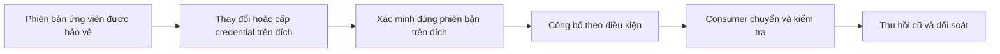

# Vault versioning

## 1. Vì sao vault cần quản lý phiên bản?

Trong hệ thống quản lý truy cập đặc quyền (Privileged Access Management, PAM), credential thay đổi theo thời gian: mật khẩu quản trị được luân chuyển, SSH key được thay thế, API key được cấp mới hoặc một giá trị bị nhập sai cần được xử lý. Nếu mỗi lần thay đổi chỉ ghi đè giá trị trước đó, nhóm vận hành khó biết ai đã thay đổi, consumer nào còn dùng giá trị cũ và trạng thái nào đã dẫn tới sự cố.

Vault versioning là cơ chế lưu và quản lý các phiên bản của đối tượng secret cùng metadata, quan hệ và trạng thái cần thiết. Nó giúp truy vết thay đổi, điều phối chuyển đổi và hỗ trợ khôi phục theo chính sách. Giá trị quan trọng nhất không phải là có nhiều bản sao, mà là biết phiên bản nào được phép cấp phát, phiên bản nào thực sự còn dùng được trên hệ thống đích và ai được quyền truy cập chúng.

Ví dụ, mật khẩu tài khoản dịch vụ `svc-reporting-prod` đã đổi từ phiên bản V7 sang V8. Vault còn giữ V7 để đối soát, nhưng cơ sở dữ liệu chỉ chấp nhận mật khẩu V8. Việc chọn V7 trong giao diện không làm cơ sở dữ liệu quay lại mật khẩu cũ. Ngược lại, nếu connector chưa đổi mật khẩu đích, lưu V8 thành công chưa chứng minh V8 đăng nhập được.

Bài học thuộc chương Vault, tập trung vào tài khoản quản trị, danh tính dịch vụ và hạ tầng nhạy cảm. Versioning cần gắn với least privilege, rotation, cấp quyền có thời hạn, giám sát phiên và bằng chứng kiểm toán. Các mô hình trong bài là thiết kế tham khảo, không phải hợp đồng API hay tên trạng thái bắt buộc của một sản phẩm cụ thể.

## 2. Phân biệt bốn loại thay đổi

| Khái niệm | Thay đổi điều gì? | Không tự bảo đảm điều gì? |
|---|---|---|
| Phiên bản secret | Giá trị hoặc nội dung credential được vault quản lý | Credential đó đã có hiệu lực trên đích |
| Revision của đối tượng hoặc metadata | Policy reference, trạng thái, con trỏ cấp phát hoặc thuộc tính quản lý | Giá trị secret đã được thay trên đích |
| Rotation credential | Mật khẩu, khóa hoặc quyền xác thực thực tế | Mọi consumer đã chuyển và mọi phiên cũ đã kết thúc |
| Rotation khóa mã hóa | Khóa bảo vệ dữ liệu lưu trữ hoặc khóa bao bọc | Mật khẩu, SSH key hay API key đã bị lộ mất hiệu lực |

Backup là cơ chế khôi phục dữ liệu theo phạm vi và thời điểm sao lưu. Nó khác với lịch sử phiên bản trong kho đang hoạt động. Versioning không thay backup, còn backup không thay cơ chế điều phối rotation và consumer.

Cũng cần phân biệt credential tĩnh với credential được cấp động. Một đối tượng mật khẩu tĩnh có thể có một phiên bản đang được cấp phát cho các consumer. Với credential động, mỗi lần cấp có thể tạo một danh tính hoặc lease riêng, có hạn và phạm vi riêng. Không nên ép mọi lease vào mô hình một con trỏ “current” dùng chung rồi làm mất thông tin chủ thể và thời hạn.

## 3. Mô hình dữ liệu của phiên bản

### 3.1. Object reference và version reference

Object reference định danh đối tượng credential ổn định, ví dụ credential của một tài khoản dịch vụ. Version reference định danh một nội dung cụ thể trong lịch sử đối tượng đó. Consumer có thể yêu cầu phiên bản đang được cấp phát hoặc, nếu được phép, một phiên bản xác định.

Định danh phiên bản có thể là số hoặc một ID không mang thứ tự. Không mặc định mọi nền tảng dùng bộ đếm chung hoặc số lớn nhất luôn là phiên bản được phép sử dụng. Một phiên bản mới nhất theo thời gian có thể chỉ là ứng viên đang chờ xác minh.

Mỗi phiên bản nên có nội dung bất biến theo mô hình đã chọn. Nếu cần sửa giá trị secret, tạo phiên bản mới thay vì thay nội dung của phiên bản cũ nhưng giữ nguyên ID. Metadata trạng thái có thể thay đổi theo quy trình, nhưng cần lịch sử ai thay đổi, lúc nào và vì sao.

### 3.2. Các trường cần quản lý

| Nhóm dữ liệu | Nội dung minh họa | Mục đích |
|---|---|---|
| Phạm vi | Tenant, object reference, tài nguyên và tài khoản đích | Tránh dùng nhầm phiên bản cho đối tượng hoặc tenant khác |
| Định danh | Version reference, revision của đối tượng | Truy vết và kiểm soát cập nhật cạnh tranh |
| Nguồn gốc | Actor, thời điểm tạo, operation ID, lý do | Giải thích phiên bản hình thành từ đâu |
| Trạng thái cấp phát | Ứng viên, được công bố, ngừng cấp phát | Phân biệt giá trị mới lưu với giá trị được phép sử dụng |
| Xác minh đích | Kết quả, thời điểm, tài nguyên và cách xác minh | Biết credential đã được kiểm tra ở đâu và khi nào |
| Vòng đời | Hết hạn, đánh dấu xóa, hủy nội dung, căn cứ lưu giữ | Quản lý khả năng truy cập và lưu dữ liệu |
| Quan hệ | Phiên bản trước, operation rotation, consumer liên quan | Đối soát quá trình chuyển đổi |

Một kết quả “valid” cần gắn thời điểm và phạm vi kiểm tra. Credential có thể bị đổi ngoài PAM sau đó, nên một lần xác minh thành công không phải bằng chứng có hiệu lực mãi mãi.

Không dùng giá trị secret hoặc một hash mật khẩu được công khai như ID đối soát trong log. Các giá trị có độ ngẫu nhiên thấp có thể bị dò từ hash. Opaque version reference và operation ID thường đã đủ để nối bằng chứng mà không đưa nội dung secret ra ngoài.

### 3.3. Con trỏ cấp phát và nội dung lịch sử

Ví dụ metadata sau không chứa secret và không phải cấu hình của sản phẩm cụ thể:

```json
{
  "tenant_ref": "tenant-reporting",
  "object_ref": "cred-reporting-prod",
  "object_revision": 42,
  "published_version_ref": "version-008",
  "versions": [
    {
      "version_ref": "version-007",
      "publication_state": "SUPERSEDED",
      "rotation_operation_ref": "rotation-previous"
    },
    {
      "version_ref": "version-008",
      "publication_state": "PUBLISHED",
      "rotation_operation_ref": "rotation-current"
    }
  ]
}
```

`SUPERSEDED` ở đây chỉ nói phiên bản không còn được cấp phát mặc định. Muốn biết credential cũ đã bị thu hồi trên đích hay chưa, phải có trạng thái và bằng chứng ở quy trình thực thi. Không suy ra từ một nhãn trong vault.

## 4. Ba trạng thái cần theo dõi độc lập

Một thiết kế dễ kiểm soát cần tách ba câu hỏi:

1. **Vault lưu gì?** Phiên bản đã được ghi đầy đủ, được bảo vệ và có thể đọc theo quyền hay chưa?
2. **Vault cấp phát gì?** Phiên bản nào được trả cho một consumer trong ngữ cảnh hiện tại?
3. **Hệ thống đích chấp nhận gì?** Credential nào thực sự xác thực được, còn hiệu lực hoặc đã bị thu hồi?

Ba trạng thái có thể lệch nhau trong lúc rotation hoặc khi lỗi xảy ra. Chẳng hạn V8 đã được lưu ở trạng thái chờ nhưng đích vẫn dùng V7; hoặc đích đã đổi sang V8 nhưng thao tác công bố chưa hoàn tất. Thiết kế phải biểu diễn được trạng thái chuyển tiếp thay vì chỉ có một cờ thành công hoặc thất bại.



Đây là luồng khái niệm, không phải thứ tự cố định cho mọi loại credential. Ví dụ, có nền tảng sinh API key ở phía đích và chỉ trả secret một lần; khi đó phải tiếp nhận, lưu an toàn và xử lý lỗi ngay trong quy trình cấp key, thay vì giả định vault luôn sinh được giá trị trước.

## 5. Dùng versioning trong rotation

### 5.1. Tài khoản chỉ có một mật khẩu hoạt động

Giả sử hai job báo cáo dùng một tài khoản cơ sở dữ liệu chỉ chấp nhận một mật khẩu. Một kế hoạch chuyển từ V7 sang V8 cần phối hợp cả vault, connector và consumer:

| Thời điểm minh họa | Vault | Hệ thống đích | Consumer |
|---|---|---|---|
| 09:00 | V7 được cấp phát | Chấp nhận V7 | Các job hoạt động bình thường |
| 09:04 | Đặt trạng thái chuyển đổi, chuẩn bị V8 được bảo vệ | Chưa đổi | Tạm dừng job và kiểm soát yêu cầu mở mới theo kế hoạch |
| 09:05 | V8 là ứng viên, chưa cấp phát thông thường | Chấp nhận V7 | Đã sẵn sàng nạp phiên bản mới |
| 09:06 | Lưu kết quả thao tác và xác minh V8 | Đổi sang V8 | Chưa khôi phục công việc trước khi đủ kiểm tra |
| 09:07 | Công bố V8 theo điều kiện; V7 ngừng cấp phát | Xác minh V8 bằng kết nối mới | Cả hai job lấy đúng V8 và được thử chức năng |
| 09:10 | Hoàn tất đối soát, lưu bằng chứng | Không còn chấp nhận mật khẩu V7 theo cơ chế đích | Khôi phục công việc và theo dõi lỗi |

Các thời điểm chỉ minh họa trình tự. Độ dài cửa sổ phụ thuộc hệ thống, không phải khuyến nghị cố định. Khoảng giữa đổi đích và chuyển consumer cần được thiết kế rõ: tạm dừng tác vụ, ngăn mở kết nối mới hoặc áp dụng cơ chế chuyển đổi mà nền tảng hỗ trợ. Không giả định luôn có thể đổi một mật khẩu duy nhất mà không gây gián đoạn.

Nếu credential mới do vault hoặc thành phần tin cậy sinh, cơ chế quản lý cần bảo vệ và có thể phục hồi giá trị đó trước khoảng lỗi mà đích đã đổi nhưng vault chưa hoàn tất trạng thái. Không dùng file tạm không được kiểm soát để giữ giá trị ứng viên.

Một phản hồi timeout sau lời gọi đổi mật khẩu không chứng minh đích chưa đổi. Cần operation ID, trạng thái đang chờ và xác minh có giới hạn. Không liên tiếp tạo V9, V10 rồi reset đích vì mỗi lần chưa nhận được phản hồi.

### 5.2. Nhiều credential có thể cùng hiệu lực

Với nền tảng hỗ trợ nhiều API key hoặc nhiều public key, có thể tạo credential mới, xác minh, chuyển consumer rồi thu hồi credential cũ. Versioning cần phản ánh khoảng chồng lấn có giới hạn và kết quả từng đích, không chỉ một nhãn “đã rotate”.

Nếu phía đích chỉ trả giá trị API key một lần, phải xử lý việc lưu an toàn ngay khi cấp. Khi nhận phản hồi không đầy đủ hoặc mất giá trị, có thể cần đối soát key ID và thu hồi key mới bị bỏ dở theo khả năng nền tảng. Không giả định có thể lấy lại secret từ metadata.

Với SSH key được tin trên nhiều máy, mỗi binding khóa, tài khoản và tài nguyên cần được xác minh riêng. Xóa private key cũ khỏi vault không tự xóa public key cũ trên các máy. Lịch sử phiên bản có thể hỗ trợ truy vết fingerprint và quá trình thay khóa, nhưng việc thu hồi vẫn phải thực thi ở nguồn cấp quyền có hiệu lực.

### 5.3. Không coi một lần ghi vault là giao dịch toàn hệ thống

Vault có thể bảo đảm một cập nhật cục bộ nguyên tử trong phạm vi triển khai của nó, nhưng không mặc định có giao dịch chung với máy chủ, cơ sở dữ liệu và mọi consumer. Quy trình rotation cần xử lý lỗi một phần, thử lại có kiểm soát và đối soát trạng thái thực tế.

Nếu phiên bản mới đã dùng được nhưng consumer lỗi, có thể hoàn tất chuyển đổi bằng cách sửa consumer. Nếu credential đích không khớp giá trị trong vault, cần quy trình reconcile có thẩm quyền. Không dùng versioning để che trạng thái mất đồng bộ hoặc tự động báo thành công chỉ vì đã tạo được version ID.

## 6. Cập nhật cạnh tranh và compare-and-set

### 6.1. Nguy cơ lost update

Hai tác nhân có thể cùng đọc revision 42 của một đối tượng. Tác nhân A muốn công bố V8, tác nhân B muốn công bố V9. Nếu cả hai ghi mà không điều kiện, lần ghi sau có thể thay con trỏ và trạng thái mà không biết về thay đổi trước.

Compare-and-set (CAS) hoặc cơ chế cập nhật có điều kiện yêu cầu trạng thái hiện tại vẫn khớp điều kiện đã đọc. Ví dụ, công bố V8 chỉ thành công nếu revision của đối tượng vẫn là 42. Sau khi A thành công, B phải nhận xung đột, đọc lại và đánh giá tiếp; không tự thử lại bằng một tùy chọn ghi đè vô điều kiện.

Revision của đối tượng khác với version reference của secret. Điều kiện CAS cần đúng ngữ nghĩa: tạo phiên bản mới và công bố phiên bản có thể là hai thao tác khác nhau. Không lấy số phiên bản trong một màn hình rồi giả định nó luôn bảo vệ được mọi thay đổi metadata.

### 6.2. Công bố theo điều kiện

Mã giả sau minh họa điểm kiểm soát, không phải mã triển khai hoàn chỉnh:

```text
publish_candidate(principal, tenant, object_ref, candidate_ref, expected_revision):
    verify_current_authority_and_tenant(principal, tenant)

    transaction:
        object = lock_object_within_tenant(tenant, object_ref)
        require object.revision == expected_revision
        candidate = find_version_within_object(object, candidate_ref)
        require candidate.is_available_for_publication
        require candidate.rotation_operation_is_current
        require target_verification_is_acceptable(candidate)
        require consumer_transition_conditions_are_satisfied()

        set_published_version(object, candidate)
        advance_object_revision(object)
        append_audit_and_outbox_without_secret()
    commit
```

Điều kiện công bố có thể khác theo chiến lược consumer, nhưng phải được định nghĩa rõ. Bằng chứng xác minh cần đúng đích, đúng phiên bản và đủ mới theo chính sách. Việc thu hồi quyền quản trị hoặc thay đổi trạng thái tenant cũng cần được xét ở thời điểm phù hợp, không chỉ lúc bắt đầu tác vụ.

CAS bảo vệ cập nhật trong kho trạng thái; nó không tự ngăn hai tiến trình cùng đổi mật khẩu trên đích. Cần điều phối operation, quyền gọi connector và trạng thái tài khoản thực tế. Khóa có thời hạn cũng không đủ nếu một worker cũ vẫn có thể tiếp tục thao tác sau khi khóa hết hạn; thiết kế cần cách ngăn hoặc nhận diện kết quả cũ theo khả năng tích hợp.

### 6.3. Idempotency

Một yêu cầu tạo phiên bản hoặc công bố bị mất phản hồi có thể được gửi lại. Khóa chống trùng cần gắn với tenant, đối tượng, loại thao tác và nội dung yêu cầu tương ứng. Cùng khóa và cùng yêu cầu trả lại kết quả đã có hoặc trạng thái đang chờ; cùng khóa với yêu cầu khác phải bị xử lý như xung đột.

Không tạo một phiên bản mới cho mỗi lần HTTP retry rồi xem lịch sử dài là bằng chứng rotation đã diễn ra nhiều lần. Versioning phải phân biệt lần thử truyền thông với thay đổi nghiệp vụ thực sự. Sự kiện bất đồng bộ chỉ nên chứa tham chiếu cần thiết, không mang giá trị secret để tiện đồng bộ.

## 7. Consumer đọc phiên bản như thế nào?

### 7.1. Theo phiên bản được công bố hoặc pin phiên bản

| Cách đọc | Phù hợp khi | Rủi ro cần quản lý |
|---|---|---|
| Đọc phiên bản đang được phép cấp phát | Consumer cần theo rotation được quản lý | Phải xử lý cache, chuyển phiên bản và quyền đọc hiện hành |
| Pin version reference | Một tác vụ cần biết chính xác dữ liệu đã dùng | Phiên bản có thể hết hiệu lực trên đích, bị thu hồi hoặc không còn được phép đọc |
| Đọc lịch sử để điều tra | Người có thẩm quyền cần đối soát sự cố | Không nên mở rộng thành quyền dùng lại credential cũ tùy ý |

Pin một phiên bản giúp truy vết, không tạo quyền truy cập vĩnh viễn. Consumer vẫn cần được phép đọc phiên bản đó và dùng credential trên đích. Với credential hết hạn hoặc bị thu hồi, một version ID còn tồn tại trong vault không làm nó hợp lệ trở lại.

Từ “latest” có thể được sản phẩm định nghĩa khác nhau. Nếu nó là phiên bản mới được lưu gần nhất, dùng nó trực tiếp có thể lấy phải ứng viên chưa kiểm tra. Hợp đồng consumer cần nói rõ đọc phiên bản được công bố hay đọc bản ghi mới nhất theo thời gian.

### 7.2. Cache và kết nối đang hoạt động

Cache cần gắn đủ tenant, object, version và ngữ cảnh quyền liên quan, có hạn và cách cập nhật. Khi policy thu hồi quyền, khả năng tiếp tục dùng bản sao trong cache là một giới hạn thực tế cần được xem xét. Không coi việc xóa cache ở một tiến trình là đã xóa mọi bản sao credential.

Kết nối cơ sở dữ liệu hoặc SSH đã mở có thể tiếp tục hoạt động sau khi credential thay đổi. Vì vậy, phép thử consumer sau rotation phải có lần xác thực mới. Kết quả một job trên connection pool cũ chưa chứng minh đã chuyển sang phiên bản mới.

Nếu consumer gặp lỗi xác thực, có thể nạp lại phiên bản theo cơ chế được cho phép, nhưng phải giới hạn retry và hiểu nguyên nhân. Không thử lần lượt mọi phiên bản lịch sử để tìm giá trị còn đăng nhập được; việc này có thể khóa tài khoản, dùng lại credential đã thu hồi hoặc che mất drift.

Nếu cần nhất quán trong một tác vụ nhiều bước, có thể chốt version reference lúc bắt đầu và ghi vào bằng chứng. Khi tác vụ kéo dài qua hạn quyền, phải có quy tắc gia hạn, cấp credential mới hoặc dừng; không dùng pinning để vượt giới hạn thời gian JIT.

## 8. Khôi phục dữ liệu khác với rollback credential

### 8.1. Ba việc dễ bị gọi chung là restore

| Thao tác | Tác động trong vault | Việc vẫn phải xác minh |
|---|---|---|
| Mở lại một phiên bản bị đánh dấu xóa | Có thể cho đọc lại nội dung nếu cơ chế hỗ trợ và policy cho phép | Credential có còn hiệu lực, còn được phép dùng hay không |
| Sao chép nội dung cũ thành phiên bản mới | Tạo một thay đổi có nguồn gốc từ lịch sử | Đích có chấp nhận giá trị đó và consumer có chuyển đúng không |
| Khôi phục từ backup | Đưa dữ liệu về trạng thái của bản sao | Sai lệch với đích, quyền đã thu hồi và các thay đổi sau thời điểm sao lưu |

Ngữ nghĩa cụ thể phụ thuộc nền tảng. Thiết kế vận hành phải nêu rõ thao tác đang thực hiện, không dùng một nút “Restore” để suy ra đã khôi phục toàn bộ đường xác thực.

Nếu chọn mô hình sao chép nội dung V7 thành V9, giữ V7 bất biến và ghi nguồn gốc của V9, actor, lý do và operation ID. V9 là một phiên bản mới về mặt lịch sử, nhưng giá trị có thể vẫn là mật khẩu cũ. Một ID mới không làm credential cũ trở nên an toàn hoặc hợp lệ.

### 8.2. Điều kiện trước khi dùng lại nội dung cũ

Cần kiểm tra ít nhất:

- Phiên bản còn nội dung có thể khôi phục theo cơ chế được phép, chưa bị hủy ngoài khả năng phục hồi đã công bố.
- Người thực hiện có quyền trên đúng tenant, đối tượng, phiên bản và loại thao tác.
- Giá trị cũ không bị nghi lộ, không thuộc diện cấm sử dụng lại và phù hợp chính sách hiện hành.
- Có kế hoạch xử lý hệ thống đích, consumer và khoảng gián đoạn nếu cần đổi lại credential.
- Có phép thử đầu cuối, giới hạn retry và phương án khôi phục độc lập.

Nếu V7 đã bị nghi lộ, hướng xử lý thường cần một credential mới được kiểm soát và thu hồi giá trị cũ trên đích. Không khôi phục V7 chỉ vì nó từng là phiên bản hoạt động ổn định.

Với tài khoản một mật khẩu, đưa nội dung V7 vào V9 chưa thay mật khẩu đích đang là V8. Nếu thực sự cần thay đích, phải thực hiện qua quy trình được ủy quyền và xác minh lại. Với API key đã bị thu hồi hoặc SSH key đã bị loại trust, việc đọc lại private material từ vault cũng không khôi phục quyền trên đích.

### 8.3. Tránh rollback mù khi sự cố xảy ra

Consumer lỗi có thể do cache, sai endpoint, tài khoản bị khóa, quyền tác vụ không đủ hoặc sai cấu hình. Không mặc định mọi lỗi sau rotation đều cần quay về phiên bản trước.

Một quy trình xử lý nên xác định phiên bản đích đang chấp nhận, phiên bản vault đang cấp phát và phiên bản từng consumer thực sự dùng. Từ đó chọn hoàn tất chuyển đổi, sửa consumer, reconcile hoặc cấp credential mới. Trạng thái chưa biết cần được đối soát thay vì tự động đổi con trỏ qua lại giữa các giá trị.

## 9. Phân quyền đối với lịch sử phiên bản

### 9.1. Quyền đọc hiện tại không mặc định bao gồm lịch sử

Các phiên bản cũ có thể chứa credential đã từng có quyền rộng, private key chưa thu hồi ở hết mọi nơi hoặc dữ liệu nhạy cảm được xóa khỏi phiên bản hiện tại. Vì vậy, lịch sử là một bề mặt truy cập cần quản lý riêng.

| Năng lực | Đối tượng có thể cần | Kiểm soát cần xem xét |
|---|---|---|
| Sử dụng phiên bản được công bố | Workload hoặc broker thực hiện tác vụ | Đúng tenant, object, mục đích và ngữ cảnh |
| Xem metadata lịch sử | Người vận hành hoặc điều tra được giao | Không tiết lộ nội dung secret hoặc dữ liệu tenant khác |
| Đọc nội dung phiên bản cũ | Nhóm khôi phục hoặc điều tra được ủy quyền | Giới hạn phiên bản, thời gian, lý do và bằng chứng |
| Tạo ứng viên | Tác nhân nhập hoặc rotation | Không tự có quyền công bố hoặc đọc toàn bộ lịch sử |
| Công bố hoặc khôi phục | Vai trò quản lý theo quy trình | Kiểm tra điều kiện, phân tách trách nhiệm theo rủi ro |
| Hủy nội dung phiên bản | Vai trò vòng đời dữ liệu | Phạm vi rõ, xác nhận ảnh hưởng và bằng chứng |

Các năng lực này là mô hình quyền tham khảo. Nếu sản phẩm không tách được một số quyền, cần ghi nhận và dùng kiểm soát bổ sung; không tuyên bố đã phân tách chỉ vì tài liệu đặt tên vai trò khác nhau.

Kiểm tra quyền trên lịch sử phải dùng policy hiện hành, không tự phục hồi quyền đọc vì người dùng từng có quyền lúc phiên bản được tạo. Việc gia nhập một nhóm mới cũng không nhất thiết cho phép xem mọi credential trong quá khứ.

### 9.2. Mọi đường đọc đều cần giữ phạm vi

API đọc theo version reference, export, preview, restore, sao lưu và công cụ hỗ trợ đều có thể dẫn tới nội dung lịch sử. Kiểm tra tenant, object và quyền phiên bản ở phía máy chủ. Một version ID hợp lệ thuộc đối tượng khác không được chấp nhận chỉ vì cùng số thứ tự.

Danh sách phiên bản và metadata cũng cần giới hạn. Tên tài nguyên, người tạo và thời điểm thay đổi có thể tiết lộ thông tin vận hành dù giá trị secret được che. Không chỉ lọc giao diện mà để API tìm kiếm hoặc file export chứa lịch sử ngoài quyền.

### 9.3. Credential nhiều thành phần

Một đối tượng có thể cần nhiều trường phối hợp, chẳng hạn private key và tham chiếu passphrase, hoặc danh tính tài khoản và giá trị xác thực. Versioning cần bảo toàn quan hệ giữa các thành phần; đọc private key mới cùng passphrase cũ có thể làm consumer lỗi.

Cần định nghĩa thế nào là một phiên bản nhất quán và cách tham chiếu tới thành phần ở đối tượng khác. Thay đổi metadata nhạy cảm như tài nguyên đích cũng cần quy trình và xác minh, không để người sửa một trường endpoint đưa credential cũ tới máy chủ không được phép.

## 10. Giữ, xóa mềm và hủy phiên bản

### 10.1. Trạng thái lưu giữ khác trạng thái hiệu lực

Một phiên bản có thể ngừng cấp phát nhưng vẫn được giữ cho điều tra. Nó cũng có thể bị đánh dấu xóa trong vault nhưng credential còn hợp lệ trên đích. Cần theo dõi riêng việc lưu nội dung, cho phép đọc và thu hồi khả năng xác thực.

| Trạng thái hoặc thao tác minh họa | Ý nghĩa có thể thiết kế | Không được suy ra |
|---|---|---|
| Ngừng cấp phát | Không trả mặc định cho consumer thông thường | Credential đã bị thu hồi |
| Xóa mềm | Nội dung được giữ nhưng đường đọc thông thường bị chặn, có khả năng mở lại theo policy | Mọi bản sao đã biến mất |
| Hủy nội dung tại kho đang hoạt động | Không còn đọc hoặc mở lại nội dung qua cơ chế đó | Backup, export hoặc cache không còn dữ liệu |
| Xóa đối tượng | Loại đối tượng theo quy trình vòng đời | Tài khoản đích đã bị vô hiệu hóa |

Đây là ngữ nghĩa cần được xác nhận khi dùng nền tảng cụ thể. Một từ như “delete” hoặc “destroy” trong API không tự mô tả toàn bộ phạm vi dữ liệu ngoài dịch vụ.

Nếu xóa phiên bản đang được công bố, hệ thống cần hành vi rõ ràng: từ chối thao tác khi chưa chuyển, chuyển theo quy trình được duyệt hoặc dừng cấp phát có kiểm soát. Không âm thầm chọn một phiên bản cũ hơn chỉ vì nó còn đọc được.

### 10.2. Chính sách retention

Số lượng và thời gian giữ phiên bản nên dựa trên nhu cầu khôi phục, điều tra, rủi ro secret tồn tại lâu và phụ thuộc consumer. Không giữ mọi private key mãi mãi chỉ vì có thể cần rollback, cũng không tự hủy phiên bản còn cần cho quy trình chuyển đổi chưa hoàn tất.

Các điều kiện cần xem xét trước khi hủy gồm trạng thái công bố, operation đang chờ, consumer pin phiên bản, yêu cầu lưu bằng chứng và phạm vi thu hồi trên đích. Nếu credential bị lộ, việc thu hồi quyền xác thực có thể cần thực hiện ngay dù vẫn giữ metadata hoặc nội dung theo quy trình điều tra; phụ thuộc consumer không phải lý do bỏ qua ứng phó.

Giới hạn số phiên bản có thể gây lỗi khi tạo ứng viên hoặc dẫn tới tự dọn dữ liệu theo cách sản phẩm định nghĩa. Cần kiểm tra chính sách và dung lượng trước khi thay đổi đích. Không để quy trình đã đổi mật khẩu rồi mới biết vault không thể lưu phiên bản mới hoặc vừa tự loại mất dữ liệu phục hồi cần thiết.

### 10.3. Mã hóa và hủy dữ liệu

Lưu nhiều phiên bản làm tăng lượng secret cần bảo vệ. Dữ liệu, khóa giải mã, bản sao và quyền sử dụng khóa đều cần được quản lý. Đổi khóa bao bọc có thể không tạo phiên bản credential mới vì giá trị xác thực trên đích không đổi.

Nếu dùng hủy khóa như cách làm mất khả năng giải mã, phải xác định khóa đó bảo vệ những phiên bản và tenant nào, còn bản sao khóa ở đâu và có dữ liệu đã xuất hay không. Hủy một khóa dùng chung có thể ảnh hưởng nhiều đối tượng; xóa một mục metadata không chứng minh mọi bản sao secret đã được xóa.

## 11. Versioning khi khôi phục từ backup

Một bản sao lưu lúc V7 đang được công bố có thể được khôi phục sau khi đích đã đổi sang V8. Vault mới khôi phục sẽ có dữ liệu cũ và có thể thiếu giá trị cần để truy cập đích. Lịch sử phiên bản trong bản sao cũng chỉ phản ánh những gì đã được sao lưu tại thời điểm đó.

Quy trình phục hồi cần xác định phạm vi và độ cũ của bản sao, khóa giải mã cần thiết, trạng thái tài khoản đích và các thay đổi quyền sau thời điểm sao lưu. Có thể cần giữ hệ thống trong trạng thái đối soát, chưa cho rotation tự động hoặc cấp phát đại trà trước khi xác minh.

Không tự đổi đích về V7 để làm nó khớp dữ liệu khôi phục, đặc biệt khi V7 đã bị thu hồi vì nghi lộ. Cần dùng đường quản lý độc lập hoặc quy trình reconcile được ủy quyền để thiết lập credential mới và lưu, xác minh đúng cách.

Backup cũng có thể làm sống lại policy, token hoặc trạng thái operation đã cũ. Khôi phục dữ liệu không mặc định phục hồi quyền sử dụng trước kia. Cần đối soát các trạng thái ủy quyền, lease và phiên theo kiến trúc, giữ bằng chứng phục hồi và ngăn sự kiện cũ công bố lại phiên bản đã bị thu hồi.

Một phiên bản đã bị hủy theo phạm vi cam kết có thể không còn khả năng phục hồi. Không lập kế hoạch dựa trên giả định luôn có backup cứu được mọi trường hợp; khả năng và giới hạn khôi phục phải được kiểm tra theo chính sách lưu dữ liệu và khóa.

## 12. Bằng chứng kiểm toán và quan sát vận hành

Versioning cần giúp trả lời các câu hỏi cụ thể: ai tạo V8, vì sao tạo, V8 được công bố khi nào, consumer nào dùng nó, V7 ngừng cấp phát lúc nào và quyền của V7 trên đích đã bị thu hồi ra sao.

Chuỗi bằng chứng có thể có dạng:

```text
Yêu cầu thay đổi
    -> operation rotation hoặc nhập credential
    -> object reference và candidate version
    -> kết quả thay đổi, xác minh trên đích
    -> quyết định công bố và revision
    -> lần cấp phát hoặc phiên của consumer
    -> ngừng cấp phát, thu hồi cũ và lưu giữ
```

Một sự kiện hữu ích thường có tenant, object reference, version reference, actor, thời điểm phía máy chủ, loại thao tác, kết quả, mã lý do và operation ID. Với công bố, ghi tham chiếu trước và sau cùng revision hoặc điều kiện liên quan. Với phiên quản trị, nối thêm danh tính người dùng thực tế, grant và session ID khi có.

Cần ghi các quyết định từ chối hoặc thao tác thất bại quan trọng, nhất là truy cập lịch sử, export, restore và hủy nội dung. Người vận hành phải phân biệt một request đã bị từ chối, một tác vụ đang chờ và một thay đổi đích có kết quả chưa biết.

Không ghi secret, private key, passphrase hoặc token sử dụng được vào log. Phản hồi lỗi và dữ liệu debug cũng cần được kiểm soát; việc che trường secret trong giao diện chưa đủ nếu trace connector vẫn ghi giá trị. Quyền xem audit và quyền sửa hoặc xóa bằng chứng phải được quản lý phù hợp.

Có thể theo dõi số ứng viên tồn đọng, thời gian từ tạo đến công bố, xung đột CAS, consumer còn pin phiên bản cũ, lỗi xác thực sau chuyển đổi và các lần đọc lịch sử bất thường. Một lần đọc secret từ vault không chứng minh mọi lần dùng sau đó đều đã được quan sát; cần kết hợp bằng chứng tại broker hoặc hệ thống đích theo mô hình sử dụng.

Đối với rotation, chỉ số thành công cần dựa trên trạng thái đã cam kết: ghi secret thành công, đích đã xác minh, consumer đã chuyển hoặc toàn bộ quy trình đã kết thúc là các mốc khác nhau. Không gộp chúng thành một con số mà không nói rõ ý nghĩa.

## 13. Ma trận kiểm tra thiết kế

Các tình huống dưới đây dùng để kiểm tra trong môi trường được phép, bằng credential giả hoặc tài khoản lab. Chúng không yêu cầu thực hiện trên hệ thống production.

| Tình huống | Hành vi cần đạt | Bằng chứng chính |
|---|---|---|
| Tạo V8 làm ứng viên | Lưu được nhưng consumer thông thường chưa tự đọc V8 | Trạng thái, quyền đọc và con trỏ công bố |
| Công bố V8 sau kiểm tra hợp lệ | Chuyển tham chiếu có điều kiện, giữ lịch sử V7 | Revision, audit và kết quả xác minh |
| Hai người cùng cập nhật từ một revision | Chỉ cập nhật thỏa điều kiện thành công; bên còn lại nhận xung đột | Kết quả CAS và con trỏ cuối cùng |
| Gửi lại cùng yêu cầu sau mất phản hồi | Không tạo phiên bản hoặc operation mới ngoài ý muốn | Khóa chống trùng và kết quả đã lưu |
| Người chỉ có quyền hiện tại yêu cầu V7 | Chỉ đọc được nếu có quyền lịch sử tương ứng | Quyết định phía máy chủ, không chỉ trạng thái nút giao diện |
| Người tenant A đưa version ID của B | Không đọc, export hoặc khôi phục được nội dung B | Phạm vi truy vấn, quyết định và phản hồi không tiết lộ thừa |
| Đích đã đổi nhưng phản hồi timeout | Giữ trạng thái chưa biết và đối soát có kiểm soát | Operation ID, xác minh đích, không reset lặp mù |
| Consumer vẫn dùng kết nối cũ | Không coi đây là bằng chứng V8 đã được dùng | Kết quả một lần xác thực mới và version reference thực tế |
| Phiên bản đang công bố bị yêu cầu xóa | Hành vi theo chính sách, không tự fallback sang giá trị cũ | Quyết định và trạng thái cấp phát |
| Khôi phục nội dung V7 thành V9 | Giữ nguồn gốc, đánh giá lại quyền và hiệu lực đích | Lịch sử V9, kiểm tra policy và kết quả đầu cuối |
| V7 đã nghi bị lộ | Không tự dùng lại V7 để sửa lỗi consumer | Quyết định ứng phó, credential mới và thu hồi trên đích |
| Restore bản sao chỉ có V7 trong khi đích ở V8 | Chưa cấp phát hoặc rotate đại trà trước khi đối soát | Trạng thái phục hồi và quy trình reconcile được phép |
| Phiên bản bị hủy tại kho hoạt động | Không đọc hoặc mở lại qua đường đã cam kết; phạm vi backup được giải thích | Kết quả API và chính sách lưu dữ liệu, khóa |

Ngoài API chính, kiểm tra đường đọc theo version, export, công cụ hỗ trợ, job nền và cache. Một phép thử giao diện thành công không chứng minh các đường khác có cùng kiểm soát. Bằng chứng nên chỉ ra thành phần thực thi và giới hạn quan sát được, thay vì chỉ đánh dấu một ô “đã bật versioning”.

## 14. Tiêu chí nghiệm thu

Một thiết kế versioning cho credential có thể được bàn giao khi các điểm sau đã rõ:

- [ ] Phân biệt object reference, version reference, revision và operation rotation; biết thành phần nào tạo và kiểm tra từng ID.
- [ ] Nội dung phiên bản không bị thay âm thầm dưới cùng ID; lịch sử metadata và thay đổi trạng thái có thể truy vết.
- [ ] Hợp đồng consumer nêu rõ đọc phiên bản được công bố hay bản mới lưu nhất, và cách xử lý pinning.
- [ ] Có cơ chế bảo vệ ứng viên, xác minh đúng đích, công bố theo điều kiện và xử lý lỗi một phần.
- [ ] CAS hoặc kiểm soát cạnh tranh có ngữ nghĩa rõ; không nhầm kiểm soát dữ liệu vault với khóa thao tác trên hệ thống đích.
- [ ] Retry có idempotency và đối soát; không tạo nhiều phiên bản để che một kết quả chưa biết.
- [ ] Quyền đọc hiện tại, lịch sử, tạo, công bố, khôi phục và hủy được giới hạn theo tenant và khả năng thực tế của nền tảng.
- [ ] Consumer được kiểm tra bằng xác thực mới sau chuyển đổi, có hạn cache và quy tắc xử lý lỗi.
- [ ] Rotation hoặc thu hồi trên đích được chứng minh riêng với việc ngừng cấp phát hay xóa phiên bản trong vault.
- [ ] Retention, xóa mềm, hủy nội dung và backup có phạm vi cùng giới hạn được công bố rõ.
- [ ] Khôi phục không làm sống lại credential bị lộ hoặc quyền đã thu hồi; có kế hoạch reconcile độc lập.
- [ ] Audit nối được phiên bản với yêu cầu, actor, đích và consumer mà không lưu giá trị secret.

Nếu nền tảng chưa hỗ trợ một cơ chế, ghi nhận giới hạn và quy trình bổ sung. Ví dụ, không có thao tác công bố riêng có thể đòi hỏi điểm điều phối khác hoặc tách đối tượng ứng viên khỏi đối tượng cấp phát theo thiết kế được hỗ trợ. Không tự giả định các nhãn minh họa trong bài tồn tại sẵn dưới dạng tính năng sản phẩm.

## 15. Bài thực hành thiết kế

Giả sử vault lưu credential cho hai job báo cáo, tài khoản đích chỉ có một mật khẩu hoạt động. V7 đang được dùng và cần chuyển sang V8. Dùng dữ liệu giả để xây dựng:

1. Bảng metadata cho đối tượng và hai phiên bản, phân biệt trạng thái lưu, công bố và hiệu lực đích.
2. Trình tự chuyển đổi, gồm bảo vệ ứng viên, tạm dừng hoặc điều phối consumer, đổi đích, xác minh và kiểm tra bằng kết nối mới.
3. Tình huống hai tác nhân cùng đọc revision 42, chỉ ra điều kiện cập nhật và cách xử lý bên gặp xung đột.
4. Quy tắc cho workload đọc phiên bản hiện tại, nhóm điều tra đọc lịch sử và người được hủy nội dung.
5. Phương án khi đích đã đổi sang V8 nhưng vault chưa hoàn tất công bố do mất phản hồi.
6. Phương án khi một consumer còn pin V7 và V7 vừa bị đánh dấu nghi lộ; không dùng việc pin làm lý do trì hoãn thu hồi cần thiết.
7. Kế hoạch phục hồi từ bản sao cũ, cùng bằng chứng cần để tránh cấp phát credential sai hoặc quyền đã thu hồi.

Đầu ra cần giải thích được tại mỗi thời điểm vault giữ gì, consumer được nhận gì và đích chấp nhận gì. Khi ba trạng thái đó được quản lý rõ, versioning mới hỗ trợ vòng đời credential trong PAM một cách có thể vận hành và kiểm chứng.

