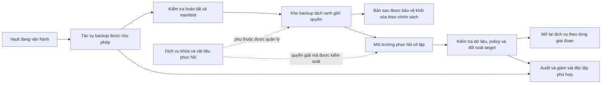

# Vault backup trong PAM

Vault backup là việc tạo và quản lý bản sao có thể khôi phục của dữ liệu và trạng thái cần thiết để credential vault tiếp tục vận hành sau mất dữ liệu, lỗi thay đổi, tấn công hoặc sự cố hạ tầng. Trong Privileged Access Management (PAM), bản sao có thể chứa password quản trị, API credential, SSH private key, phiên bản secret và chính sách chi phối ai được sử dụng chúng.

Backup của vault đồng thời là tài sản phục hồi quan trọng và một tập dữ liệu nhạy cảm. Nếu bị đọc hoặc giải mã trái phép, nó có thể mở đường tới nhiều hệ thống đặc quyền. Nếu không thể khôi phục, tổ chức có thể mất khả năng truy cập có kiểm soát vào các hệ thống đó.

Một điểm đặc thù của PAM là trạng thái credential ở vault và trạng thái tại hệ thống đích thay đổi độc lập. Khôi phục đúng một snapshot cũ không có nghĩa password trong snapshot vẫn dùng được, quyền JIT đã hết hiệu lực hay policy cũ còn phù hợp. Do đó, phục hồi cần bao gồm cả dữ liệu, khóa, quyền và đối soát bên ngoài vault.

## 1. Mục tiêu và các khái niệm cần phân biệt

Sau bài học, người học có thể:

- Xác định dữ liệu và phụ thuộc phải có để phục hồi vault.
- Phân biệt backup với replica, snapshot hạ tầng và export secret.
- Đặt mục tiêu RPO/RTO theo ảnh hưởng vận hành thay vì chỉ theo lịch chạy job.
- Bảo vệ backup, khóa và đường truy cập phục hồi bằng các ranh giới quyền phù hợp.
- Thiết kế trình tự khôi phục cô lập, đối soát credential và kiểm tra trước khi mở cấp phát.
- Đánh giá một lần diễn tập bằng kết quả đọc, sử dụng và quản lý credential có kiểm soát.

| Khái niệm | Ý nghĩa | Giới hạn cần nhận diện |
| --- | --- | --- |
| Backup | Bản sao phục vụ quay về một trạng thái có thể khôi phục | Chỉ hữu ích nếu có đủ phụ thuộc và đã kiểm chứng phục hồi |
| Replica | Bản sao đang được đồng bộ để phục vụ khả năng sẵn sàng hoặc đọc | Có thể sao chép nhanh cả thao tác xóa và dữ liệu hỏng |
| Snapshot | Trạng thái được chụp tại một mốc theo cơ chế cụ thể | Chưa chắc nhất quán ở lớp ứng dụng hoặc bao phủ mọi thành phần |
| Export secret | Xuất giá trị hoặc đối tượng secret ra ngoài | Có thể thiếu policy, metadata và làm tăng nguy cơ lộ plaintext |
| High availability — HA | Khả năng tiếp tục phục vụ khi một thành phần lỗi | Không tự cung cấp lịch sử dữ liệu độc lập để phục hồi |
| Disaster recovery — DR | Khôi phục dịch vụ sau sự cố lớn theo kế hoạch | Bao gồm con người, danh tính, mạng, khóa và xác nhận nghiệp vụ |

Replica có thể giúp giảm gián đoạn khi một nút lỗi, nhưng nếu một quản trị viên xóa sai hàng loạt secret và thao tác được sao chép, replica có thể mất cùng dữ liệu. Backup cần có các mốc khôi phục và cơ chế bảo vệ phù hợp với tình huống này.

Không coi việc xuất toàn bộ password ra một bảng tính là phương án backup mặc định. Nó có thể phá vỡ kiểm soát cấp phát, tạo thêm plaintext và vẫn không khôi phục được trạng thái vận hành của vault.

## 2. Xác định phạm vi phải khôi phục

### 2.1. Dữ liệu và cấu hình

| Nhóm | Ví dụ | Câu hỏi phục hồi |
| --- | --- | --- |
| Secret và phiên bản | Password, token, private key, phiên bản đang hiệu lực và lịch sử cần giữ | Có thể giải mã đúng đối tượng và phiên bản không? |
| Metadata | Object ID, target ID, owner, môi trường, liên kết danh tính | Có nối đúng secret với tài sản và người chịu trách nhiệm không? |
| Policy và quyền | Quyền đọc, phê duyệt, nhóm sử dụng, cấu hình thời hạn | Có khôi phục nhầm quyền đã bị thu hồi sau mốc backup không? |
| Tích hợp | Connector, gateway, endpoint, cấu hình tin cậy và tham chiếu credential | Có thể kết nối đúng đích mà không kích hoạt nhầm thao tác không? |
| Trạng thái công việc | Lần luân chuyển, thao tác đang chờ, lịch và trạng thái đối soát | Có nguy cơ thực hiện lại một thay đổi đã xảy ra ở target không? |
| Cấu hình vận hành | Phiên bản phần mềm, tham số cần thiết, phụ thuộc lưu trữ | Môi trường phục hồi có tương thích với định dạng backup không? |
| Audit và bằng chứng | Nhật ký thay đổi, cấp phát, luân chuyển, khóa và sự kiện backup | Có giải thích được những gì đã xảy ra sau mốc phục hồi không? |

Không phải mọi nhóm dữ liệu đều nằm trong cùng một bản backup. Audit có thể được giữ ở kho độc lập; bản ghi phiên có thể thuộc một dịch vụ khác. Cần chỉ rõ ranh giới và cách liên kết, không mặc định backup vault chứa cả video phiên.

Các tài nguyên bên ngoài như tài khoản IdP, cấu hình KMS, DNS, rule mạng và chứng chỉ có thể là điều kiện phục hồi chứ không nằm trong payload backup. Cần có cách tái thiết hoặc tiếp cận chúng theo kế hoạch được kiểm tra.

### 2.2. Khóa và vật liệu phục hồi

Ciphertext chỉ có thể sử dụng khi còn đường giải mã phù hợp. Hồ sơ phụ thuộc cần xác định key reference, phiên bản khóa, cơ chế mở khóa vault và danh tính được phép dùng khóa.

Không nhất thiết phải xuất khóa KMS hoặc HSM ra tệp để có backup đầy đủ. Một số khóa được thiết kế không cho xuất; khả năng phục hồi phụ thuộc tính sẵn sàng, quyền và phương thức khôi phục được dịch vụ khóa hỗ trợ.

Nếu sản phẩm sử dụng recovery material hoặc cơ chế nhiều người để mở khóa, vật liệu này cần được quản lý theo quy trình riêng. Không gom toàn bộ dữ liệu backup và mọi vật liệu đủ để giải mã vào một nơi mà cùng một người có thể lấy dễ dàng.

Cũng không giữ vật liệu phục hồi duy nhất bên trong chính vault đang cần phục hồi. Đây là một phụ thuộc vòng có thể khiến kế hoạch không thực hiện được.

## 3. RPO và RTO phải phản ánh dịch vụ PAM

### 3.1. RPO: có thể mất bao nhiêu trạng thái?

Recovery Point Objective (RPO) là mục tiêu về mức mất dữ liệu tính theo thời gian. Với vault, khoảng mất trạng thái có thể gồm secret mới, lần luân chuyển, thay đổi quyền và tác vụ đang thực hiện.

Lịch backup mỗi 15 phút không chứng minh RPO luôn đạt 15 phút. Job có thể thất bại, bản sao chưa chuyển xong, dữ liệu chưa nhất quán hoặc bản gần nhất không giải mã được. Phải xét mốc phục hồi có thể dùng thực tế.

RPO của vault cũng không tự bằng RPO của hệ thống đích. Target có thể đã đổi password sau snapshot, trong khi vault được phục hồi chưa biết thay đổi đó.

### 3.2. RTO: khi nào dịch vụ thực sự dùng được?

Recovery Time Objective (RTO) là mục tiêu thời gian khôi phục dịch vụ theo phạm vi đã định nghĩa. Với PAM, không nên dừng đồng hồ chỉ vì một tiến trình vault đã khởi động.

Mốc hoàn thành có thể cần bao gồm: mở khóa an toàn, xác thực và policy đúng, giải mã được dữ liệu, các credential quan trọng được đối soát, audit hoạt động và một đường truy cập đại diện đã được xác nhận.

Nếu xác định các cấp phục hồi khác nhau, cần công bố rõ. Ví dụ, giai đoạn đầu chỉ phục vụ một tập tài sản quan trọng bằng quy trình được kiểm soát, giai đoạn sau mới mở toàn bộ luân chuyển tự động.

### 3.3. Ví dụ có sai lệch credential

| Thời điểm | Sự kiện |
| --- | --- |
| 10:00 | Backup hợp lệ gần nhất chứa credential phiên bản 41 |
| 10:12 | Vault đổi password tại target sang phiên bản 42 |
| 10:15 | Job backup kế tiếp thất bại |
| 10:20 | Kho dữ liệu chính mất khả năng phục vụ |
| 10:45 | Vault phục hồi đã khởi động từ backup 10:00 |
| 11:35 | Hoàn tất đối soát tài sản ưu tiên và mở lại dịch vụ theo tiêu chí chấp nhận |

Trong ví dụ, trạng thái được khôi phục lùi 20 phút so với mốc sự cố. Nếu mục tiêu là RPO không quá 15 phút thì chưa đạt. Vault khởi động sau 25 phút, nhưng thời gian phục hồi dịch vụ theo tiêu chí đã chọn là 75 phút.

Password phiên bản 41 không được coi là hiện hành chỉ vì đọc được sau phục hồi. Target có thể vẫn yêu cầu phiên bản 42. Cần đối soát hoặc dùng cơ chế phục hồi credential được hỗ trợ, tránh thử lặp lại password cũ gây khóa tài khoản.

## 4. Tạo bản sao nhất quán

### 4.1. Nhất quán nội bộ vault

Ưu tiên cơ chế snapshot hoặc backup được sản phẩm và backend hỗ trợ. Cần biết cơ chế đó bao phủ dữ liệu, chỉ mục, log và trạng thái giao dịch như thế nào.

Sao chép các tệp đang thay đổi ở những thời điểm khác nhau có thể tạo một tập dữ liệu không cùng mốc. Một snapshot lưu trữ có thể đủ để phục hồi trong một số kiến trúc nhưng không phải mặc định cho mọi vault.

Các điểm cần xác minh gồm:

- Điều kiện tạo backup: từ nút nào, khi nào và với trạng thái cluster nào.
- Dữ liệu cần đi cùng nhau: snapshot, log bổ sung hoặc manifest theo cơ chế được hỗ trợ.
- Yêu cầu dừng, checkpoint hoặc cơ chế phối hợp nếu sản phẩm cần.
- Khả năng đọc và khôi phục với phiên bản phần mềm hoặc backend dự kiến.
- Cách nhận biết backup hoàn tất, chưa hoàn tất và hỏng.

Với hệ thống nhiều nút, không ghép tùy ý các tệp từ các nút khác nhau thành một bản backup. Thông tin nhận dạng cluster, trạng thái đồng thuận và thứ tự log cần được xử lý theo phương pháp phục hồi của sản phẩm.

### 4.2. Nhất quán với các hệ thống bên ngoài

Ngay cả backup nội bộ hoàn toàn nhất quán vẫn có thể không phản ánh trạng thái hiện tại của target. Các thao tác bên ngoài không tự nằm trong cùng giao dịch với snapshot vault.

Ví dụ, target đã đổi password nhưng vault chưa ghi xong kết quả trước khi sự cố xảy ra. Hoặc snapshot chứa một công việc chờ thu hồi trong khi target đã thu hồi xong. Khi phục hồi, cần biểu diễn trạng thái chưa rõ và đối soát thay vì thực hiện lại mù quáng.

Các grant JIT, token và phiên đang tồn tại cũng cần được xem xét. Khôi phục vault không tự đóng phiên đã mở hoặc thu hồi quyền ở đích. Đồng thời, dữ liệu cũ có thể không biết những quyền đã cấp sau mốc backup.

### 4.3. Audit phải tiếp tục sau mốc phục hồi

Nếu có kho audit độc lập, dùng nó để hỗ trợ dựng lại thay đổi giữa mốc backup và sự cố theo phạm vi dữ liệu có thực. Audit không nhất thiết chứa đủ secret hoặc trạng thái để phát lại toàn bộ giao dịch.

Không tạo sự kiện thành công giả để lấp khoảng trống. Giữ rõ mốc phục hồi, dữ liệu gửi bù, phần chưa đối soát và phần không thể khôi phục.

## 5. Kiến trúc và ranh giới bảo vệ backup



Sơ đồ là kiến trúc tham chiếu. Điều quan trọng là quyền chiếm vault hoặc tài khoản backup không mặc nhiên cho phép phá hủy mọi bản sao và mọi khóa cần phục hồi.

### 5.1. Hạn chế quyền tác vụ backup

Danh tính tạo backup cần quyền đúng phạm vi. Không mặc định phải dùng tài khoản quản trị cao nhất hoặc có quyền xuất plaintext secret. Nếu cơ chế snapshot được hỗ trợ đã đáp ứng nhu cầu, không thay bằng luồng đọc từng secret qua API chỉ vì dễ viết script.

Tách quyền ghi bản sao mới khỏi quyền xóa lịch sử hoặc sửa chính sách lưu giữ khi nền tảng cho phép. Kiểm soát riêng quyền quản trị kho, khóa và danh tính phục hồi.

### 5.2. Bảo vệ dữ liệu, đường truyền và khóa

Mã hóa backup theo thiết kế, bảo vệ kênh chuyển và xác minh đúng đích lưu. Xem xét cả file tạm, vùng staging, retry, log và artifact của tác vụ backup.

Mã hóa ở lớp lưu trữ không nhất thiết bảo vệ bản sao trước người có quyền đọc qua dịch vụ lưu trữ đang hoạt động. Nếu payload đã được vault mã hóa, vẫn phải bảo vệ khóa và metadata; nếu có lớp mã hóa backup bổ sung, phải kiểm kê thêm phụ thuộc khóa của lớp đó.

Không in khóa, secret hoặc vật liệu mở khóa vào log để hỗ trợ kiểm tra. Dùng định danh bản sao, tham chiếu khóa và kết quả xác minh phù hợp.

### 5.3. Chống xóa và sao chép độc lập

Có thể kết hợp bản sao ở ranh giới tài khoản hoặc hạ tầng khác, cơ chế lưu bất biến theo thời hạn và kiểm soát xóa. Lựa chọn phải xét mô hình đe dọa, chi phí và khả năng phục hồi.

Nhật ký “đã sao chép sang nơi khác” không chứng minh bản sao độc lập nếu cùng một credential có thể xóa cả hai nơi. Tương tự, backup bất biến không giải quyết việc mất khóa hoặc mã hóa một trạng thái đã hỏng.

## 6. Lịch, lưu giữ và vòng đời khóa

### 6.1. Lịch backup theo mục tiêu phục hồi

Tần suất cần dựa trên mức thay đổi và mục tiêu đã thống nhất. Một vault luân chuyển nhiều credential quan trọng có nhu cầu khác với một kho ít thay đổi; tuy nhiên, tần suất cao không thay thế kiểm tra tính đúng đắn.

Có thể cần bản sao trước một thay đổi lớn, chẳng hạn nâng cấp hoặc chuyển backend, bên cạnh lịch định kỳ. Phải xác định mốc bản sao đã hoàn tất và có thể dùng trước khi thực hiện bước thay đổi có rủi ro.

Không đánh dấu thành công khi tác vụ mới gửi yêu cầu snapshot hoặc mới tạo tệp cục bộ nhưng chưa đưa vào kho lưu cuối. Mốc hoàn tất cần phản ánh cam kết thực tế của thiết kế.

### 6.2. Lưu giữ theo nhu cầu và rủi ro

Giữ nhiều mốc giúp phục hồi khi lỗi chỉ được phát hiện muộn, nhưng mỗi bản sao cũng chứa lịch sử secret và policy. Cần cân đối nhu cầu phục hồi, yêu cầu tổ chức và mức nhạy cảm thay vì giữ vô thời hạn vì thuận tiện.

Quy trình lưu giữ phải xét bản sao phụ, staging, bản sao phục hồi thử và dữ liệu đã xuất. Nếu có khóa bảo toàn phục vụ điều tra, việc hết thời hạn thông thường không đồng nghĩa được phép xóa mọi đối tượng liên quan.

Xóa credential khỏi vault chính không tự xóa credential đó khỏi backup cũ. Phân biệt việc ngừng sử dụng tại target với việc xóa dữ liệu lưu trữ theo vòng đời.

### 6.3. Khóa phải tồn tại đủ lâu để đọc backup

Backup cũ có thể chứa DEK được bảo vệ bởi phiên bản KEK cũ. Chuyển kho hiện tại sang khóa mới chưa chứng minh các backup đó đã được chuyển đổi.

Nếu backup bất biến không thể chỉnh sửa, kế hoạch lưu giữ cần duy trì đường giải mã thích hợp hoặc có phương án tạo bản sao chuyển đổi được hỗ trợ. Không hủy khóa cũ chỉ dựa trên việc vault hiện tại vẫn hoạt động.

Ngược lại, giữ khóa lâu không có nghĩa mở quyền giải mã rộng cho mọi người. Tách việc duy trì khả năng khôi phục khỏi việc cho phép sử dụng khóa hằng ngày.

## 7. Manifest và kiểm tra sau mỗi lần tạo bản sao

Manifest là hồ sơ mô tả bản backup và các phụ thuộc cần thiết. Nó không thay thế payload và không nên chứa secret.

Ví dụ mô hình dữ liệu học tập sau không phải định dạng bắt buộc của một sản phẩm:

```yaml
backup_manifest:
  backup_id: vault-prod-backup-20261126-1000
  source_cluster_ref: pam-vault-production
  environment: production
  capture_started_at: '2026-11-26T10:00:00+07:00'
  capture_completed_at: '2026-11-26T10:02:00+07:00'
  recovery_point_ref: product-supported-snapshot-checkpoint
  format_profile_ref: approved-vault-backup-format
  software_version_ref: recorded-source-version
  payload_ref: protected-backup-object-reference
  integrity_manifest_ref: protected-checksum-manifest
  key_dependencies_ref: approved-key-dependency-inventory
  configuration_bundle_ref: compatible-configuration-bundle
  retention_profile_ref: production-vault-backup-retention
  owner_group: pam-platform-operations
  change_or_job_ref: backup-job-782
```

Thời điểm hoàn tất không nhất thiết là mốc dữ liệu được chụp. `recovery_point_ref` cần ánh xạ tới thông tin mà sản phẩm cung cấp, như mốc snapshot hoặc checkpoint phù hợp; không tự suy diễn từ tên tệp.

Mỗi lần tạo bản sao nên xác nhận:

1. Cơ chế backup báo hoàn tất, không còn ở trạng thái đang tạo hoặc lỗi.
2. Payload và các thành phần bắt buộc đã có ở kho lưu cuối.
3. Định danh, môi trường, định dạng và mốc phục hồi khớp hồ sơ.
4. Kích thước và đặc điểm bất thường được phát hiện theo ngữ cảnh, không dùng kích thước như bằng chứng duy nhất.
5. Thông tin toàn vẹn đã được tạo và bảo vệ theo thiết kế.
6. Tham chiếu khóa, lưu giữ và quyền truy cập khớp chính sách.
7. Job thất bại hoặc bản sao chưa xác minh được không bị tính như một mốc phục hồi đạt yêu cầu.

Checksum giúp phát hiện thay đổi khi giá trị tham chiếu được bảo vệ. Nó không chứng minh backup đầy đủ ở lớp ứng dụng hoặc có thể giải mã. Nếu một người sửa được cả payload và checksum, cần một cơ chế bảo đảm nguồn gốc phù hợp hơn, chẳng hạn manifest được bảo vệ độc lập hoặc ký theo thiết kế.

Không gọi mọi bản sao vừa tạo là đã được restore test. Theo dõi riêng trạng thái tạo thành công, kiểm tra toàn vẹn, giải mã thử và phục hồi diễn tập.

## 8. Runbook khôi phục theo từng giai đoạn

### Giai đoạn 1: Khoanh vùng và chọn mốc

Xác định loại sự cố: mất hạ tầng, dữ liệu hỏng, xóa nhầm, sai policy hay bị chiếm quyền. Loại sự cố quyết định mốc nào đáng tin và thành phần nào được phép tái sử dụng.

Nếu nghi bị xâm nhập, bản gần nhất có thể đã chứa cấu hình hoặc policy do kẻ tấn công sửa. Cần đối chiếu thời điểm và bằng chứng, không tự chọn bản mới nhất chỉ vì tuổi bản sao nhỏ nhất.

Giữ lại các bằng chứng cần thiết và xác định người điều phối phục hồi. Không ghi đè mọi trạng thái cũ trước khi hiểu phạm vi điều tra.

### Giai đoạn 2: Chuẩn bị môi trường cô lập

Dựng môi trường tương thích theo đường phục hồi được hỗ trợ. Kiểm soát danh tính, mạng, chứng chỉ và quyền sử dụng khóa trước khi đưa payload vào.

Cô lập ở đây cần có hiệu lực: ngăn vault phục hồi tự cấp phát cho client production, tự kết nối target để đổi credential hoặc nhận các tác vụ chưa được kiểm tra. Môi trường phục hồi vẫn chứa secret thật nên cần bảo vệ như một môi trường nhạy cảm.

Đảm bảo chỉ có một phía được quyền đóng vai trò phục vụ chính tại thời điểm chuyển đổi. Nếu cluster cũ có thể hoạt động trở lại, cần cơ chế ngăn hai phía cùng cấp phát hoặc cùng luân chuyển credential theo kế hoạch được hỗ trợ.

Không giả định một nhãn môi trường “DR” tự ngăn kết nối ra production. Cần kiểm tra rule mạng, địa chỉ dịch vụ, đăng ký connector và các cơ chế tự động.

### Giai đoạn 3: Khôi phục dữ liệu và đường khóa

Xác minh payload, manifest và phụ thuộc rồi thực hiện restore theo cơ chế sản phẩm. Khôi phục cấu hình và danh tính cần thiết trong phạm vi đã được chấp thuận.

Kiểm tra mở khóa, giải mã và đọc các đối tượng đại diện bằng quyền phù hợp. Không ghi giá trị secret ra báo cáo để chứng minh giải mã được; dùng kết quả kiểm tra và định danh tham chiếu.

Nếu thiếu khóa, sai phiên bản hoặc không tương thích, dừng để xử lý nguyên nhân. Không bỏ qua lỗi toàn vẹn hoặc đổi sang cách đọc dữ liệu không được hỗ trợ nhằm làm cho dịch vụ có vẻ đã lên.

### Giai đoạn 4: Kiểm tra policy và danh tính

Policy trong backup là policy tại mốc cũ. Có thể có nhân viên đã nghỉ, workload đã ngừng, nhóm đã đổi hoặc ngoại lệ đã bị thu hồi sau mốc đó.

Đối chiếu với nguồn thẩm quyền hiện tại theo quy trình tổ chức, kiểm tra các quyền nhạy cảm và tránh mở rộng cấp phát trước khi xử lý khác biệt. Không mặc định việc kết nối IdP hiện tại sẽ tự sửa mọi quyền được lưu trong vault.

Kiểm tra credential của connector, gateway và chính danh tính vận hành backup. Những credential này cũng có thể đã đổi hoặc bị thu hồi sau snapshot.

### Giai đoạn 5: Đối soát hệ thống đích

Ưu tiên các tài sản quan trọng và những credential có khả năng đã thay đổi trong khoảng mất trạng thái. Dùng bằng chứng độc lập, cơ chế kiểm tra có giới hạn và quy trình reconciliation được hỗ trợ.

Với mỗi đối tượng, phân biệt: đang khớp, không khớp, chưa kiểm tra và chưa rõ kết quả. Tránh gộp mọi đối tượng chưa biết thành trạng thái thất bại rồi tự đổi password hàng loạt.

Kiểm tra công việc luân chuyển đang dở, grant JIT, token và phiên đặc quyền. Hành động nào cần thực hiện lại, bỏ qua hay xử lý thủ công phải dựa trên trạng thái thực tế ở đích.

### Giai đoạn 6: Mở dịch vụ có kiểm soát

Mở từng tập người dùng, workload và tài sản theo mức độ sẵn sàng. Thử một đường truy cập đại diện: xác thực, quyết định quyền, lấy hoặc sử dụng credential, bằng chứng và kết thúc truy cập.

Chỉ bật lại scheduler, luân chuyển và các tác vụ quản lý tự động sau khi xác nhận cấu hình và trạng thái liên quan. Không để một công việc cũ được phát lại làm thay đổi target ngoài dự kiến.

Ghi mốc phục hồi dịch vụ theo tiêu chí đã thống nhất, owner xác nhận và phần còn hạn chế. Tiếp tục theo dõi trước khi mở toàn bộ phạm vi.

## 9. Đối soát credential: phần đặc thù của PAM

| Tình huống sau restore | Cách tiếp cận |
| --- | --- |
| Password trong backup cũ hơn password ở target | Kiểm tra có giới hạn và dùng quy trình khôi phục đồng bộ được hỗ trợ; không ép target về giá trị cũ tùy tiện |
| Vault ghi công việc đang chờ nhưng target đã đổi xong | Đối soát trước khi retry, tránh tạo lần đổi ngoài dự kiến |
| Snapshot có token đã hết hạn | Xin quyền mới qua cơ chế hợp lệ nếu được phép; không kéo dài hiệu lực bằng cách sửa metadata cục bộ |
| Token ở target còn hiệu lực nhưng không có trong snapshot | Đánh giá qua provider và audit; restore không tự thu hồi token đó |
| Quyền JIT được cấp sau mốc backup | Kiểm tra trạng thái đích và thời hạn; xử lý quyền còn tồn tại theo chính sách |
| Service account đổi password sau snapshot | Xét cả ứng dụng phụ thuộc, cache và quá trình cập nhật; tránh khôi phục một phía |
| Tài khoản tích hợp đã đổi hoặc bị khóa | Khôi phục đường quản lý theo quy trình riêng trước khi kiểm tra hàng loạt |

Giới hạn tốc độ và số lần thử để tránh khóa tài khoản hoặc làm quá tải API. Một lỗi xác thực có thể do credential cũ, đích sai, tài khoản khóa, mạng hoặc policy; cần chẩn đoán thay vì chỉ thử thêm.

Không sử dụng credential nghi đã bị lộ để quay lui cho nhanh. Trong sự cố bảo mật, phục hồi khả năng truy cập có thể cần đi cùng cấp credential mới và thu hồi đường cũ tại target.

Nếu một nhóm tài sản chưa đối soát được, có thể giữ ở trạng thái hạn chế thay vì mở cấp phát toàn bộ. Giới hạn phải được công bố với owner và có phương án xử lý tiếp.

## 10. Diễn tập và tiêu chí chấp nhận

Restore test phải kiểm tra cả dữ liệu và khả năng vận hành theo phạm vi đã chọn. Không chỉ xác nhận rằng phần mềm báo hoàn tất bước nhập snapshot.

| Nhóm kiểm tra | Kết quả cần chứng minh |
| --- | --- |
| Lựa chọn bản sao | Xác định đúng mốc, định dạng, môi trường và mức tin cậy |
| Tính toàn vẹn | Payload và manifest được kiểm tra bằng phương pháp đã chọn |
| Đường khóa | Danh tính được phép giải mã được; danh tính ngoài phạm vi bị từ chối |
| Dữ liệu | Đối tượng và phiên bản đại diện đọc được, liên kết đúng metadata |
| Policy | Truy cập hợp lệ được phép, trường hợp ngoài phạm vi bị chặn |
| Tích hợp | Kết nối đúng target và đúng mô hình tin cậy trong phạm vi thử |
| Credential | Phát hiện và xử lý được ít nhất một trường hợp lệch trạng thái có kiểm soát |
| Tác vụ tự động | Không thực hiện lại thay đổi cũ ngoài dự kiến; có thể tiếp tục an toàn khi được bật |
| Audit | Có dấu vết của lần phục hồi và truy cập thử; khoảng trống được mô tả |
| RPO/RTO | Ghi mốc phục hồi và thời gian hoàn tất đúng định nghĩa |
| Kết thúc diễn tập | Môi trường, bản sao tạm và quyền cấp thêm được xử lý theo quy trình |

Chọn mẫu theo mức độ quan trọng và loại tích hợp. Một password kiểm tra thành công không đại diện cho API token, SSH key và service account có phụ thuộc.

Có thể tăng dần phạm vi: kiểm tra metadata, phục hồi cô lập, kiểm thử tích hợp đại diện và diễn tập chuyển dịch vụ được chấp thuận. Những bước có nguy cơ gián đoạn production cần kế hoạch phù hợp.

Thử phục hồi một bản cũ hơn và một bản liên quan tới thế hệ khóa trước nếu chúng còn nằm trong cam kết lưu giữ. Nếu chỉ thử bản mới nhất cùng khóa hiện tại, có thể bỏ sót vấn đề khi cần phục hồi sâu hơn.

## 11. Giám sát và bằng chứng vận hành

Cần theo dõi khả năng phục hồi chứ không chỉ số lần job báo thành công:

| Chỉ số hoặc tín hiệu | Ý nghĩa |
| --- | --- |
| Tuổi mốc backup hợp lệ gần nhất | Cho thấy khoảng trống dữ liệu có thể mất đang tăng đến đâu |
| Tuổi bản gần nhất đã restore test | Cho biết mức độ cập nhật của bằng chứng phục hồi |
| Job thất bại hoặc chạy quá lâu | Có thể làm trễ mốc phục hồi dù lịch vẫn tồn tại |
| Sao chép chưa hoàn tất | Bản cục bộ có thể chưa có ở ranh giới lưu trữ độc lập |
| Lỗi quyền hoặc khóa | Có nguy cơ không tạo được bản sao hoặc không giải mã được khi cần |
| Xóa hoặc đổi retention bất thường | Có thể làm suy yếu khả năng phục hồi |
| Thay đổi kích thước hoặc định dạng bất thường | Cần điều tra, dù chưa đủ để kết luận backup hỏng |
| Lỗi diễn tập và thời gian xử lý | Phản ánh khoảng cách giữa kế hoạch và khả năng thực tế |

Nếu tác vụ backup không chạy, hệ thống vẫn cần phát hiện được việc không có tín hiệu mới. Cảnh báo chỉ dựa trên thông báo lỗi của job có thể bỏ sót scheduler đã dừng hoàn toàn.

Audit nên có ai hoặc tiến trình nào tạo, đọc, sao chép, phục hồi, xóa bản sao và thay đổi policy lưu giữ hoặc quyền khóa. Kết quả diễn tập cần ghi thời điểm, phạm vi, hạn chế, owner và bằng chứng tham chiếu.

Không log secret, khóa, token truy cập kho backup hoặc recovery material. Ngay cả manifest cũng cần quyền truy cập phù hợp vì có thể tiết lộ cấu trúc hạ tầng.

## 12. Tình huống: phục hồi sau một thay đổi làm hỏng dữ liệu

Nhóm PAM nâng cấp một thành phần lưu trữ và phát hiện vault không phục vụ ổn định. Trước thay đổi đã có backup hợp lệ, nhưng trong thời gian sau snapshot vẫn có một số lần luân chuyển credential và thay đổi quyền.

### Bước 1: Dừng mở rộng tác động

Nhóm tạm dừng các thay đổi liên quan theo kế hoạch, giữ bằng chứng và xác định phần dữ liệu đáng tin. Backup trước nâng cấp được chọn vì có định dạng tương thích và đã được kiểm tra theo quy trình.

Nhóm không bật đồng thời cluster cũ và cluster phục hồi như hai phía phục vụ độc lập. Đường cấp phát và thao tác target của môi trường phục hồi được chặn cho tới khi hoàn tất kiểm tra cần thiết.

### Bước 2: Khôi phục và kiểm tra nội bộ

Dữ liệu được nhập vào môi trường phù hợp; đường khóa được xác nhận; các đối tượng mẫu giải mã được. Policy trong snapshot được đối chiếu với các thay đổi quyền đã diễn ra sau mốc đó.

Một quyền truy cập khẩn cấp xuất hiện trong snapshot nhưng đã bị thu hồi trước sự cố. Nhóm giữ trạng thái thu hồi theo nguồn thẩm quyền hiện tại thay vì mở lại chỉ vì backup có chứa quyền.

### Bước 3: Xử lý sai lệch ở target

Audit độc lập cho thấy một số password đã đổi sau snapshot. Nhóm ưu tiên tài sản quan trọng, giới hạn thử xác thực và dùng cơ chế phục hồi đồng bộ được hỗ trợ.

Một service account cần phối hợp với ứng dụng tiêu thụ credential; nhóm không đổi riêng phía vault rồi coi là xong. Các đối tượng chưa đủ bằng chứng tiếp tục được hạn chế.

### Bước 4: Mở lại có kiểm soát

Nhóm thử đường truy cập đại diện, xác nhận audit, rồi mở cho nhóm vận hành đầu tiên. Scheduler chỉ được bật lại sau khi các tác vụ đang dở được phân loại.

Báo cáo phục hồi ghi cả mốc snapshot, khoảng mất trạng thái, thời điểm dịch vụ đạt tiêu chí và những tài sản chưa mở. Sau khi ổn định, nhóm tạo mốc backup mới theo cơ chế hỗ trợ và theo dõi kết quả.

## 13. Sai lầm thường gặp

| Sai lầm | Hệ quả | Cách xử lý |
| --- | --- | --- |
| Coi replica là backup duy nhất | Xóa nhầm hoặc dữ liệu hỏng có thể lan sang bản sao | Duy trì mốc phục hồi độc lập theo mô hình rủi ro |
| Chỉ backup payload mà bỏ quên khóa | Có dữ liệu nhưng không giải mã được | Kiểm kê đầy đủ đường khóa và kiểm thử phục hồi |
| Lưu backup và mọi khóa cùng quyền quản trị | Một sự cố có thể làm lộ hoặc phá hủy toàn bộ khả năng phục hồi | Tách ranh giới quyền và kiểm soát thay đổi |
| Coi job thành công là restore được | Có thể bỏ sót định dạng, khóa hoặc phụ thuộc thiếu | Theo dõi restore test và tiêu chí chấp nhận riêng |
| Restore rồi bật luân chuyển ngay | Có thể thực hiện lại tác vụ cũ hoặc làm lệch credential | Cô lập, đối soát rồi mới bật tự động hóa |
| Mở lại policy từ snapshot mà không rà soát | Quyền đã bị thu hồi có thể sống lại | Đối chiếu nguồn thẩm quyền và thay đổi sau snapshot |
| Hủy khóa cũ sau khi chuyển kho hiện tại | Backup cũ không còn đọc được | Kiểm kê phụ thuộc khóa trong toàn bộ thời hạn lưu giữ |
| Giữ bản diễn tập không được quản lý | Tạo thêm một vault chứa secret production | Kiểm soát vòng đời môi trường thử và các bản sao tạm |

## 14. Bài thực hành thiết kế

Thiết kế kế hoạch backup cho một vault quản lý password quản trị, API credential và một số service account có phụ thuộc ứng dụng.

1. Liệt kê dữ liệu, cấu hình, khóa, danh tính và dịch vụ ngoài vault cần để phục hồi.
2. Đặt RPO/RTO minh họa, định nghĩa mốc đo và giải thích vì sao lịch backup chưa đủ để chứng minh đạt mục tiêu.
3. Vẽ đường tạo bản sao và các ranh giới quyền; chỉ ra ai có thể đọc, giải mã, xóa hoặc thay đổi lưu giữ.
4. Soạn manifest không chứa secret và xác định cách bảo vệ tính toàn vẹn.
5. Viết runbook phục hồi cô lập, gồm kiểm tra policy cũ và ngăn hai phía cùng phục vụ.
6. Tạo một tình huống password đã đổi sau snapshot và mô tả cách đối soát mà không thử lặp lại vô hạn.
7. Thiết kế bài restore test có cả đường khóa, quyền truy cập, audit và thời gian phục hồi.
8. Xác định cách kết thúc diễn tập, xử lý bản sao tạm và giữ bằng chứng.

Kế hoạch đạt yêu cầu khi có thể phục hồi một trạng thái có ý nghĩa vận hành, không chỉ lấy lại một tập tệp. Với credential vault trong PAM, bản sao phải vừa được bảo vệ như dữ liệu đặc quyền, vừa được kiểm chứng như một công cụ phục hồi.
