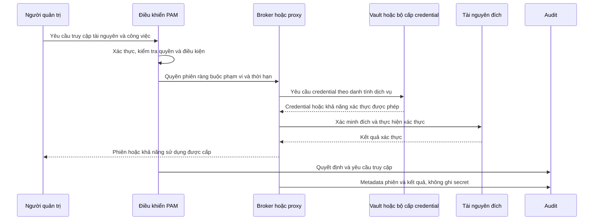

# Credential injection

Trong Privileged Access Management (PAM), **credential injection** là cơ chế một thành phần được tin cậy đưa credential vào quá trình xác thực hoặc vào runtime của ứng dụng để bên sử dụng thực hiện công việc được phép. Người quản trị có thể không cần xem mật khẩu, còn ứng dụng có thể không cần giữ secret trong source code hay cấu hình tĩnh.

Bài học thuộc chương **Credential management**, trong phạm vi bảo vệ tài khoản quản trị, tài khoản dịch vụ và hạ tầng nhạy cảm. Trọng tâm là phối hợp injection với kiểm kê quyền, least privilege, JIT/JEA, vault, luân chuyển credential, giám sát phiên và lưu bằng chứng phục vụ kiểm toán, ứng phó sự cố.

Injection mô tả cách chuyển hoặc sử dụng credential; nó không tự xác định quyền của tài khoản đích, không tự cấp quyền JIT và không bảo đảm credential không thể bị lộ. Các bảo đảm thực tế phụ thuộc vào nơi credential xuất hiện, thành phần nào xử lý nó và người tấn công có thể kiểm soát thành phần nào.

Sau bài học, bạn có thể:

- Phân biệt injection cho phiên quản trị với delivery cho workload.
- Mô tả đường đi của credential và các ranh giới tin cậy.
- Chọn cách tích hợp phù hợp với giao thức, runtime và yêu cầu kiểm soát.
- Phối hợp injection với thời hạn, luân chuyển, thu hồi và audit.
- Xây dựng tình huống kiểm chứng việc sử dụng đúng quyền và hạn chế lộ secret.

## 1. Injection thay đổi điều gì trong cách sử dụng credential?

Xét một luồng truyền thống:

```text
Người quản trị lấy mật khẩu → Sao chép vào client → Đăng nhập máy đích
```

Credential có thể đi qua giao diện hiển thị, clipboard, lịch sử, file cấu hình hoặc công cụ ghi màn hình. Khi nhiều người dùng chung một tài khoản, khả năng quy trách nhiệm cũng trở nên khó khăn nếu không có dữ liệu bổ sung.

Một luồng có broker hoặc proxy có thể là:

```text
Người quản trị yêu cầu phiên
  → PAM kiểm tra danh tính và quyền
  → Broker nhận credential được phép từ vault
  → Broker xác thực với máy đích
  → Người quản trị sử dụng phiên được kiểm soát
```

Nếu kiến trúc hỗ trợ đúng, người dùng nhận khả năng sử dụng phiên thay vì nhận giá trị credential. Tuy nhiên, broker vẫn có thể xử lý credential trong bộ nhớ, và máy đích vẫn phải chấp nhận phương thức xác thực đó.

Với workload, injection có thể chuyển secret vào một file runtime được bảo vệ hoặc qua một giao diện nội bộ. Trong trường hợp này, ứng dụng thường vẫn nhận được giá trị secret; lợi ích chính là kiểm soát nơi cấp, vòng đời và cách phân phối, không phải làm secret biến mất khỏi runtime.

### Các khái niệm liên quan

| Cơ chế | Vai trò | Khác biệt cần hiểu |
|---|---|---|
| Secret checkout hoặc reveal | Cấp giá trị cho người yêu cầu | Người nhận có thể sao chép và dùng ngoài luồng được quản lý |
| Credential injection | Đưa credential vào một luồng xác thực hoặc runtime | Phải xác định bên nào nhìn thấy hoặc có thể đọc credential |
| Credential brokering | Làm trung gian cấp hoặc sử dụng credential theo chính sách | Có thể trả credential hoặc giữ việc sử dụng ở phía broker |
| Federation | Dùng quan hệ tin cậy để nhận danh tính hoặc token | Có thể giảm nhu cầu giữ password hoặc key dài hạn |
| Credential động | Cấp danh tính hoặc credential theo yêu cầu với vòng đời giới hạn | Vẫn cần delivery hoặc tích hợp để bên dùng sử dụng được |
| Session recording | Ghi bằng chứng hoạt động phiên | Không tự bảo vệ credential và không thay thế policy |

Tên gọi có thể khác nhau giữa sản phẩm. Cần mô tả luồng thực tế thay vì chỉ dựa vào tên tính năng.

## 2. Bắt đầu bằng mô hình đường đi của secret

Một thiết kế cần trả lời:

- Credential được sinh hoặc lấy từ đâu?
- Thành phần nào được quyền yêu cầu credential đó?
- Credential xuất hiện ở client, broker, agent, file hay bộ nhớ nào?
- Bên nhận xác minh danh tính máy đích hoặc dịch vụ đích bằng cách nào?
- Credential có thể được dùng lại ở tài nguyên khác không?
- Khi kết thúc công việc, điều gì được thu hồi và điều gì có thể còn tồn tại?



Sơ đồ thể hiện mô hình tham chiếu cho phiên quản trị. Luồng workload có thể không dùng session proxy và cần được mô tả riêng.

### 2.1 Ranh giới người dùng–broker

Người dùng phải được xác thực và chỉ được chọn tài nguyên hoặc profile đã cấp. Không để một tham số do client gửi trực tiếp quyết định mọi đường dẫn secret mà broker sẽ đọc.

Nếu broker có quyền đọc rộng và tin một yêu cầu tùy ý, nó có thể trở thành đường lấy secret thay mặt người không có quyền. Cần ánh xạ từ tài nguyên được duyệt sang credential bằng dữ liệu được bảo vệ.

### 2.2 Ranh giới broker–vault

Broker cần danh tính dịch vụ riêng, quyền hẹp và cơ chế xác thực được bảo vệ. Quyền lấy credential cho một nhóm máy không nên mặc nhiên bao phủ mọi namespace hoặc mọi môi trường.

Nếu vault không có quyền riêng cho “use without reveal”, sự phân tách có thể được thực hiện ở kiến trúc: chỉ broker được đọc giá trị, còn người dùng chỉ được yêu cầu sử dụng broker. Cần kiểm soát mọi API hoặc chức năng khác có thể làm lộ giá trị.

### 2.3 Ranh giới broker–đích

Phải xác minh đúng đích trước khi gửi hoặc sử dụng credential. Ví dụ, SSH cần kiểm tra danh tính máy chủ theo cơ chế host key hoặc chứng thư được triển khai; kết nối TLS cần kiểm tra danh tính dịch vụ theo cơ chế phù hợp.

Một endpoint do người dùng tùy ý sửa có thể khiến credential bị gửi tới máy không đúng. Vì vậy, quyền sửa metadata tài nguyên, DNS, trust store và cấu hình connector cũng là quyền nhạy cảm.

## 3. Injection cho phiên quản trị

### 3.1 SSH

Một proxy có thể nhận credential từ vault rồi xác thực tới máy đích bằng password, khóa hoặc chứng thư theo khả năng tích hợp. Người dùng kết nối tới proxy bằng danh tính cá nhân và không nhất thiết nhận credential đích.

Cần xác định rõ:

- Khóa riêng được giữ ở đâu và thành phần nào được quyền sử dụng.
- Nếu dùng cơ chế ký hoặc agent, ai có thể yêu cầu thao tác xác thực.
- Tài khoản đích là cá nhân, dùng chung hay được tạo tạm thời.
- Kênh chuyển tệp, forwarding và các khả năng ngoài shell được kiểm soát ra sao.
- Log ở đích liên kết với danh tính cá nhân phía PAM như thế nào.

Giữ khóa trong một dịch vụ ký hoặc phần cứng không xuất khóa có thể giảm nơi chứa khóa riêng. Tuy nhiên, nếu kẻ tấn công có thể sử dụng giao diện ký hoặc agent như chủ thể hợp lệ, khả năng xác thực vẫn có thể bị lạm dụng. Cần kiểm soát quyền sử dụng, không chỉ việc xuất giá trị khóa.

### 3.2 RDP và ứng dụng đồ họa

Một giải pháp có thể thiết lập kết nối bằng credential được quản lý rồi cung cấp phiên cho người dùng. Cơ chế cụ thể phụ thuộc giao thức, phương thức đăng nhập và tích hợp sản phẩm.

Nếu credential phải được đưa vào client phía người dùng, agent hoặc tiện ích giao diện, ranh giới tin cậy rộng hơn mô hình broker giữ credential hoàn toàn ở phía máy chủ. Cần đánh giá khả năng đọc bộ nhớ, sửa client, can thiệp luồng autofill và lưu cấu hình đăng nhập.

Không tự giả định việc che ô mật khẩu hoặc vô hiệu clipboard ngăn được mọi cách lấy credential. Người có quyền cao trên máy chạy client hoặc thành phần xử lý secret có thể có khả năng quan sát sâu hơn giao diện.

### 3.3 MFA và đăng nhập ở đích

MFA vào PAM và MFA hoặc điều kiện đăng nhập ở hệ thống đích là những kiểm soát khác nhau. Injection không tự thay thế yêu cầu của đích nếu không có cơ chế ủy quyền hoặc tích hợp hợp lệ.

Không coi việc lưu chung password với toàn bộ vật liệu tạo yếu tố thứ hai rồi tự động sử dụng là giữ nguyên tính độc lập của các yếu tố. Thiết kế cần nêu rõ hệ thống nào xác thực người dùng và đích tin kết quả đó theo cơ chế nào.

## 4. Delivery cho workload

Một workload có thể lấy secret trực tiếp từ vault, nhận từ agent hoặc sidecar, đọc file runtime hay sử dụng một dịch vụ trung gian. Lựa chọn phụ thuộc khả năng ứng dụng và mục tiêu kiểm soát.

| Cách tích hợp | Lợi ích có thể có | Điểm cần xử lý |
|---|---|---|
| Truy xuất qua API khi cần | Chủ động lấy bản hiện tại, dễ gắn với danh tính ứng dụng | Ứng dụng xử lý secret, lỗi kết nối, cache và gia hạn |
| Agent hoặc sidecar cấp secret | Tách bớt logic tích hợp khỏi ứng dụng | Danh tính agent, quyền giữa các tiến trình, volume và kênh giao tiếp |
| File runtime được bảo vệ | Phù hợp ứng dụng đọc cấu hình từ file | Quyền file, nơi lưu, backup, reload và xóa sau sử dụng |
| Biến môi trường | Dễ dùng với một số ứng dụng | Có thể đi vào công cụ chẩn đoán, tiến trình con hoặc crash report tùy môi trường |
| Tham số dòng lệnh | Dễ tích hợp với công cụ cũ | Có thể xuất hiện trong thông tin tiến trình, lịch sử và log; tránh đưa secret vào khi có lựa chọn phù hợp |
| Broker giữ kết nối tới đích | Có thể giữ credential khỏi ứng dụng phía gọi | Tăng phụ thuộc vào broker và phải kiểm soát giao thức, phiên, quyền sử dụng |
| Federation hoặc danh tính nền tảng | Giảm secret dài hạn phải phân phối | Cần trust, phạm vi token và quyền workload được cấu hình đúng |

Không có một cách phù hợp cho mọi runtime. Ví dụ, file trên vùng lưu trữ tạm có thể giảm nguy cơ tồn tại lâu dài, nhưng vẫn cần xét quyền đọc, swap, snapshot và cơ chế backup thực tế. Không nên gọi một cách delivery là an toàn chỉ từ tên phương tiện lưu.

### 4.1 Phân tách danh tính

Mỗi ứng dụng và môi trường nên có danh tính với quyền cần thiết. Không dùng một token vault toàn quyền cho nhiều workload rồi dựa vào việc từng ứng dụng tự chọn đúng đường dẫn.

Danh tính của agent hoặc sidecar cũng phải được giới hạn. Nếu một agent dùng chung có thể cấp secret cho nhiều ứng dụng, cần cơ chế xác minh ứng dụng gọi và tránh truy cập chéo qua socket, volume hoặc endpoint nội bộ.

### 4.2 Bootstrap

Ứng dụng cần một cách xác thực với nơi cấp secret. Khi có thể, dùng bằng chứng danh tính từ nền tảng hoặc federation phù hợp. Nếu phải dùng một secret khởi tạo, secret đó vẫn cần vòng đời quản lý riêng.

Không giải quyết bài toán bằng cách đưa một token quyền rộng vào source code, image hoặc cấu hình chung. Việc chuyển mật khẩu cơ sở dữ liệu ra khỏi cấu hình nhưng đặt một token lấy mọi mật khẩu vào đó chỉ thay vị trí của rủi ro.

### 4.3 Secret vẫn có thể nằm trong bộ nhớ

Sau khi ứng dụng đọc secret, giá trị có thể xuất hiện trong bộ nhớ, thư viện kết nối và các bản sao nội bộ. Hạn chế log, dump và quyền chẩn đoán giúp giảm khả năng lộ, nhưng không nên hứa xóa sạch mọi bản sao bằng một lệnh xóa biến, đặc biệt với runtime quản lý bộ nhớ.

Người có khả năng kiểm soát tiến trình hoặc hệ điều hành có thể tiếp cận dữ liệu mà ứng dụng đang sử dụng. Least privilege, cô lập runtime và bảo vệ máy chạy ứng dụng vẫn là các lớp cần thiết.

## 5. Thiết kế một luồng injection có kiểm soát

### Bước 1: Kiểm kê tài nguyên, tài khoản và bên sử dụng

Xác định tài nguyên đích, tài khoản, chủ sở hữu, loại credential, quyền thực tế và những bên đang phụ thuộc. Phân biệt tài khoản người quản trị, tài khoản dịch vụ và tài khoản khẩn cấp.

Một credential có thể đang được dùng bởi tác vụ định kỳ hoặc nhiều instance ứng dụng. Thông tin này ảnh hưởng trực tiếp tới cách luân chuyển và ngừng cấp giá trị cũ.

### Bước 2: Chọn mô hình và phạm vi tin cậy

Quyết định credential sẽ được giữ ở broker, cấp cho client hay đưa vào runtime ứng dụng. Ghi rõ các thành phần có thể quan sát hoặc sử dụng nó, cùng giả định về quyền quản trị trên những thành phần đó.

Nếu mục tiêu là người dùng không nhận password, phải kiểm chứng credential không đi vào client do người dùng kiểm soát qua một đường khác.

### Bước 3: Xác thực và đánh giá chính sách

Kiểm tra danh tính cá nhân hoặc workload, tài nguyên, profile tài khoản, mục đích và thời hạn. Áp dụng MFA, phê duyệt và điều kiện phù hợp cho luồng người dùng; dùng cơ chế danh tính máy cho workload.

Không để client tự khai một nhóm quyền hoặc tự chọn một credential quản trị ngoài tập được cấp.

### Bước 4: Cấp hoặc lấy credential

Sử dụng credential hiện có, credential động hoặc một khả năng xác thực khác theo thiết kế. Danh tính tích hợp chỉ có quyền cần cho tập tài nguyên được phục vụ.

Với credential động, giới hạn role cấp phát và quyền ở đích. Cấp credential mới cho mỗi yêu cầu nhưng luôn tạo tài khoản toàn quyền không đáp ứng least privilege.

### Bước 5: Xác minh bên nhận và thực hiện injection

Broker xác minh máy đích; agent xác minh workload; ứng dụng xác minh dịch vụ cần kết nối. Thực hiện delivery bằng kênh và cơ chế đã chọn, tránh đưa secret vào các trường có thể được ghi log hoặc hiển thị ngoài dự kiến.

### Bước 6: Theo dõi sử dụng và xử lý kết thúc

Ghi nhận yêu cầu, đối tượng, tài khoản hoặc profile, mã phiên/lease và kết quả. Khi công việc kết thúc hoặc hết thời hạn, đóng những khả năng liên quan, thu hồi hoặc luân chuyển theo cơ chế thực tế và kiểm tra các việc còn tồn đọng.

## 6. Mô hình cấu hình tham chiếu

Ví dụ dưới đây biểu diễn ý định thiết kế, không phải cú pháp của một sản phẩm PAM và không chứa giá trị credential:

```yaml
credential_injection_model:
  flow_reference: payments-linux-maintenance
  requester_group_reference: payments-production-operators
  target_asset_reference: payment-api-01
  managed_account_reference: maintenance-operator
  credential_profile_reference: prod-payments/linux-maintenance
  delivery_mode: brokered_session
  controls:
    personal_identity_required: true
    mfa_required: true
    approval_required: true
    maximum_access_minutes: 30
    target_identity_verification_required: true
    reveal_credential_to_requester: false
    session_recording_required: true
  lifecycle:
    reevaluate_on_reconnect: true
    credential_cleanup_according_to_type: true
    verify_cleanup_result: true
```

Mỗi trường cần được ánh xạ tới khả năng thật của giải pháp. Ví dụ, `reveal_credential_to_requester: false` chỉ là yêu cầu; phải xác minh cả chức năng reveal, API đọc secret, client, export và các đường quản trị gián tiếp.

Với workload, mô hình có thể thay nhóm người dùng bằng danh tính máy và thay phiên tương tác bằng phương thức delivery runtime. Không nên giữ nguyên điều kiện MFA của người dùng rồi coi workload đã đáp ứng mà không có cơ chế tương ứng.

## 7. Phối hợp với JIT, JEA và quyền tại đích

Injection và JIT giải quyết hai câu hỏi khác nhau:

- Injection: credential hoặc khả năng xác thực được đưa vào luồng sử dụng thế nào?
- JIT: danh tính được cấp quyền khi nào và trong bao lâu?

Một hệ thống có thể inject mật khẩu của tài khoản quản trị thường trực. Người dùng không nhìn thấy mật khẩu nhưng tài khoản vẫn có quyền cao tồn tại lâu dài. Để giảm quyền thường trực, cần thêm cơ chế cấp quyền hoặc danh tính có thời hạn theo khả năng hệ thống đích.

JEA hoặc cơ chế giới hạn hành động tại đích nhằm giảm những gì người dùng có thể làm. Session proxy sử dụng credential tự động không tự hạn chế shell, công cụ quản trị hoặc quyền cơ sở dữ liệu. Các role, endpoint giới hạn và quyền hệ điều hành cần được thiết kế riêng.

### Phân biệt các thời hạn

| Thời hạn | Điều được giới hạn |
|---|---|
| Thời hạn yêu cầu/phê duyệt | Khoảng thời gian công việc được cho phép |
| Thời hạn token truy cập vault | Khi nào bên gọi còn yêu cầu credential được |
| Thời hạn credential hoặc lease | Khi nào credential có thể hết hiệu lực theo cơ chế đích |
| Thời lượng phiên | Bao lâu kết nối đã thiết lập được tiếp tục |
| Thời hạn quyền ở đích | Khi nào binding, nhóm hoặc quyền tạm phải bị thu hồi |

Hết hạn một lớp không bảo đảm những lớp khác đã chấm dứt. Chứng thư hoặc token hết hạn có thể ngăn xác thực mới nhưng không tự đóng một kết nối đã xác thực. Cần định nghĩa và kiểm chứng hành vi trên toàn luồng.

## 8. Luân chuyển và cập nhật bên sử dụng

### 8.1 Injection lúc khởi động không tự cập nhật runtime

Một ứng dụng nhận secret khi khởi động có thể tiếp tục giữ giá trị cũ trong bộ nhớ. Thay secret trong vault hoặc file không tự khiến thư viện kết nối dùng giá trị mới.

Cần biết ứng dụng hỗ trợ reload, theo dõi thay đổi hay cần restart. Với connection pool, các kết nối hiện có và kết nối mới có thể có hành vi khác nhau khi credential đổi. Điều đó cần được kiểm chứng với dịch vụ đích.

### 8.2 Một chuỗi thay đổi tham chiếu

```text
Chuẩn bị credential hoặc phiên bản mới
  → Làm cho bên sử dụng nhận được bản mới
  → Kiểm tra xác thực và sức khỏe dịch vụ
  → Thu hồi hoặc ngừng sử dụng bản cũ theo cơ chế hỗ trợ
  → Xác minh trạng thái cuối và lưu bằng chứng
```

Chuỗi này không phải quy trình phổ quát cho mọi đích. Một số hệ thống chỉ có một mật khẩu hiệu lực, số khác hỗ trợ nhiều key hoặc danh tính song song. Cách chuyển đổi phải dựa trên khả năng thực tế.

Không giả định việc đổi credential ở đích và lưu vào vault là một giao dịch nguyên tử. Nếu lỗi xảy ra giữa hai bước, hệ thống cần nhận diện kết quả chưa chắc chắn và đối soát trước khi thử lại.

### 8.3 Cache và gia hạn

Cache có thể giảm phụ thuộc tức thời vào vault nhưng làm tăng số nơi giữ secret và độ trễ thu hồi. Cần giới hạn phạm vi, thời gian, quyền đọc, cơ chế làm mới và hành vi khi không thể lấy bản mới.

Gia hạn credential động phải nằm trong chính sách và không kéo dài vượt công việc được phép. Tránh để mọi instance cùng gia hạn hoặc lấy lại secret vào một thời điểm gây quá tải; cách phân tán tải vẫn phải bảo đảm thời hạn và quyền hợp lệ.

## 9. Những đường lộ thường bị bỏ sót

| Đường lộ | Ví dụ | Cách giảm khả năng lộ |
|---|---|---|
| Log và telemetry | Ghi request, response hoặc cấu hình kết nối có password | Không thu thập trường secret; kiểm soát log ở cả thư viện và proxy |
| Tham số dòng lệnh | Credential xuất hiện trong lệnh gọi chương trình | Dùng giao diện nhận secret phù hợp khi công cụ hỗ trợ |
| Biến môi trường | Công cụ chẩn đoán hoặc tiến trình con nhận dữ liệu không cần thiết | Giới hạn phạm vi và đánh giá hành vi runtime |
| File runtime | Quyền đọc rộng, file tồn tại sau khi tiến trình kết thúc | Quyền tối thiểu, nơi lưu phù hợp, vòng đời và dọn dẹp rõ ràng |
| Bộ nhớ và dump | Debug hoặc crash report chứa dữ liệu runtime | Hạn chế quyền chẩn đoán, bảo vệ dump và giảm dữ liệu thu thập |
| Giao diện và clipboard | Autofill vào ứng dụng không đúng hoặc lưu trong clipboard | Xác minh ngữ cảnh ứng dụng và tránh chuyển qua clipboard khi có thể |
| Bản ghi phiên | Secret hiện trên màn hình hoặc đầu ra terminal | Hạn chế việc hiển thị từ đầu, kiểm soát quyền xem và phạm vi ghi |
| Backup, snapshot và image | File secret hoặc bộ đệm bị sao chép | Kiểm tra nội dung, quyền truy cập và vòng đời bản sao |
| Endpoint hoặc metadata bị sửa | Broker gửi credential tới máy khác | Bảo vệ ánh xạ tài nguyên và xác minh danh tính đích |

Che bằng dấu sao hoặc redaction không bảo đảm loại bỏ mọi biến thể của secret. Giá trị có thể bị biến đổi, xuất hiện ở một log khác hoặc nằm trong dữ liệu nhị phân. Thiết kế nên giảm nơi secret xuất hiện trước, rồi dùng các lớp kiểm soát phát hiện và hạn chế bổ sung.

Nếu phiên cần được ghi để kiểm toán, phải xác định ai có quyền xem bản ghi và cách bảo vệ dữ liệu nhạy cảm. Không nên tạo một kho secret mới dưới dạng video hoặc terminal recording mà không có kiểm soát tương ứng.

## 10. Xử lý lỗi và thu hồi

### 10.1 Vault hoặc nguồn cấp credential không khả dụng

Đối với yêu cầu mới chưa có credential hợp lệ, không tự dùng một mật khẩu dự phòng được hardcode hoặc bỏ bước chính sách. Nếu có cơ chế cache được cho phép, phải tuân thủ giới hạn và biết dữ liệu có thể đã bị thu hồi hay chưa.

Phiên đã xác thực có thể vẫn tiếp tục, tùy kiến trúc và chính sách. Tiếp tục phiên hiện có không đồng nghĩa được mở phiên mới hoặc tự gia hạn quyền.

### 10.2 Xác thực đích thất bại

Nguyên nhân có thể là credential lệch phiên bản, tài khoản bị khóa, quyền thay đổi, sai đích hoặc lỗi trust. Tránh lặp lại nhanh không giới hạn vì có thể khóa tài khoản hoặc làm tăng ảnh hưởng sự cố.

Không tự tắt xác minh máy chủ để làm đăng nhập thành công. Cần xác định đúng nguyên nhân, đối soát trạng thái và xử lý theo quyền vận hành đã được cấp.

### 10.3 Kết thúc phiên và credential đã phát ra

Cần phân biệt:

1. Thu hồi quyền yêu cầu injection mới.
2. Thu hồi token của broker hoặc workload nếu cần.
3. Vô hiệu credential ở đích hoặc thu hồi lease theo khả năng tích hợp.
4. Kết thúc phiên và kiểm tra tác vụ còn tồn tại.
5. Dọn file runtime, cache hoặc bản sao thuộc phạm vi có thể quản lý.

Xóa file secret hoặc thu hồi quyền đọc vault không vô hiệu một bản sao mà bên sử dụng đã có. Đổi password cũng không mặc nhiên dừng mọi phiên đã mở. Khi có sự cố, cần đánh giá từng lớp thay vì coi một hành động thu hồi là hoàn tất toàn bộ.

### 10.4 Broker hoặc proxy lỗi

Mất node có thể làm mất phiên đang xử lý; một node khác không mặc nhiên tiếp quản được trạng thái giao thức. Khi kết nối lại, cần kiểm tra quyền còn hiệu lực, ánh xạ phiên và trạng thái tại đích.

Một tác vụ đã chạy ở đích có thể tiếp tục sau khi người dùng mất kết nối. Người vận hành cần tránh thực hiện lặp công việc khi chưa biết lần trước đã hoàn tất hay chưa.

## 11. Ví dụ: bảo trì dịch vụ và ứng dụng sử dụng cơ sở dữ liệu

Một hệ thống thanh toán có hai nhu cầu khác nhau:

| Bên sử dụng | Nhu cầu | Mô hình phù hợp để đánh giá |
|---|---|---|
| Kỹ sư vận hành | Bảo trì dịch vụ trên máy Linux trong 30 phút | Phiên qua broker với tài khoản có quyền giới hạn |
| Ứng dụng đơn hàng | Kết nối cơ sở dữ liệu liên tục | Danh tính workload, credential phù hợp vòng đời ứng dụng và cơ chế delivery runtime |

### 11.1 Phiên của kỹ sư

Kỹ sư xác thực bằng danh tính cá nhân, cung cấp lý do và nhận phê duyệt. PAM ánh xạ yêu cầu tới máy và tài khoản đã định trước. Broker lấy credential hoặc khả năng xác thực từ nguồn được quản lý, xác minh máy đích và tạo phiên.

Tài khoản ở máy đích chỉ có quyền cần cho công việc. Phiên được giới hạn thời gian và ghi bằng chứng theo chính sách. Người dùng không được tự thay tham chiếu sang tài khoản quản trị toàn hệ thống hoặc gọi một API khác để lấy mật khẩu.

Khi hết thời hạn, hệ thống đóng phiên theo chính sách, xử lý quyền tạm thời và credential theo loại được dùng. Kết quả cleanup được theo dõi, bao gồm các tác vụ còn hoạt động ở đích khi cần.

### 11.2 Luồng của ứng dụng

Ứng dụng xác thực bằng danh tính workload chỉ thuộc môi trường production của dịch vụ đó. Nó nhận credential từ profile runtime, không được chọn profile quản trị hoặc đọc secret của ứng dụng khác.

Nếu dùng file runtime, quyền file chỉ cho bên cần thiết; ứng dụng có cơ chế reload hoặc khởi động lại phù hợp khi credential thay đổi. Nếu dùng credential động, quy trình gia hạn và cập nhật pool kết nối được kiểm chứng.

Log ghi nhận danh tính, profile, kết quả cấp và trạng thái gia hạn mà không ghi giá trị. Khi ứng dụng ngừng hoạt động hoặc bị nghi ngờ xâm nhập, đội vận hành biết cách ngăn cấp mới, thu hồi ở đích và xử lý các kết nối hiện có.

### 11.3 Bằng chứng liên kết

Với người dùng, chuỗi bằng chứng liên kết danh tính cá nhân, yêu cầu, quyết định, mã phiên, tài khoản đích và hoạt động quan sát được. Với workload, chuỗi liên kết danh tính máy, profile, phiên bản hoặc lease, thời điểm cấp và các sự kiện tại đích phù hợp.

Nếu tài khoản đích dùng chung, log ở đích có thể không tự xác định người dùng cá nhân. Cần giữ ánh xạ từ PAM và kiểm soát các đường truy cập trực tiếp có thể làm sai lệch việc quy trách nhiệm.

## 12. Kiểm chứng trong thực hành

Các tình huống sau dành cho môi trường được phép, dùng tài khoản và dữ liệu thử nghiệm. Đây là gợi ý thực hành, không phải báo cáo kết quả kiểm thử của sản phẩm cụ thể.

| Tình huống | Điều cần quan sát |
|---|---|
| Người dùng mở phiên đúng tài nguyên | Chỉ sử dụng credential hoặc profile được cấp, có bằng chứng liên kết |
| Thay tham chiếu tới secret hoặc tài khoản khác | Không được vượt phạm vi bằng tham số client |
| Dùng sai namespace hoặc môi trường | Bị từ chối hoặc phát hiện trước khi credential tới bên nhận sai |
| Endpoint hoặc danh tính máy đích không khớp | Không gửi credential để vượt qua lỗi xác minh |
| Người dùng thử chức năng reveal, đọc API hoặc export | Hành vi đúng thiết kế tách sử dụng khỏi đọc giá trị |
| Workload khác gọi agent hoặc đọc file runtime | Không truy cập được dữ liệu ngoài phạm vi của nó |
| Chạy ứng dụng với logging và chẩn đoán theo cấu hình thực tế | Không xuất hiện secret ở những đầu ra đã xác định cần kiểm soát |
| Luân chuyển khi có nhiều instance đang chạy | Bản mới được sử dụng đúng; lỗi và trạng thái cũ được xử lý |
| Hết thời hạn hoặc thu hồi | Phân biệt rõ yêu cầu mới, credential, phiên và tác vụ tại đích |
| Vault, broker hoặc nguồn ghi phiên lỗi | Không tự mở rộng quyền; hành vi phù hợp chính sách đã công bố |
| Phiên kết thúc bất thường | Xác định trạng thái đích, bản ghi và công việc cleanup còn lại |

Kiểm tra hạn chế lộ secret cần bám vào mô hình đe dọa. Quan sát không thấy secret trên giao diện chưa chứng minh nó không xuất hiện trong bộ nhớ hoặc một công cụ quản trị có quyền cao hơn.

### Tiêu chí bàn giao

Một luồng injection sẵn sàng vận hành khi đã xác định chủ sở hữu, quyền của mọi thành phần, đường đi của credential, cách xác minh bên nhận, cơ chế thay đổi credential và thu hồi từng lớp. Cần có audit đủ để điều tra cùng runbook cho lỗi xác thực, lỗi luân chuyển, mất nguồn secret và nghi ngờ lộ lọt.

Giá trị của credential injection là giảm việc phân phối và thao tác secret ngoài kiểm soát, đồng thời tạo một đường sử dụng có chính sách và bằng chứng. Hiệu quả đó phụ thuộc vào quyền tối thiểu, danh tính đáng tin cậy và vòng đời được quản lý từ vault tới tài nguyên đích.
