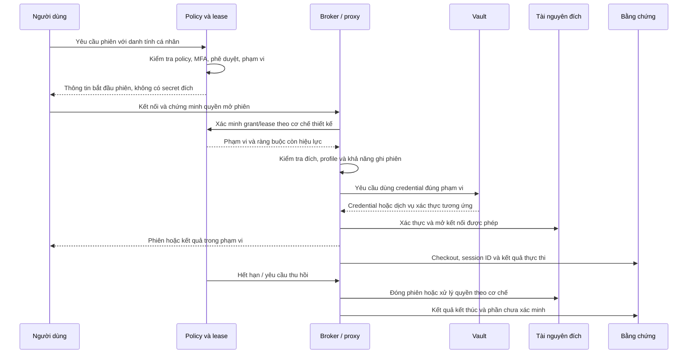

# Credential checkout không hiển thị plaintext

## 1. Checkout để sử dụng quyền, không nhất thiết để nhận secret

Trong hệ thống quản lý truy cập đặc quyền (Privileged Access Management — PAM), credential checkout thường gắn với việc cho một chủ thể sử dụng tài khoản được quản lý trong một phạm vi và thời gian nhất định. Tùy sản phẩm, từ “checkout” có thể chỉ thao tác lấy giá trị secret, giữ chỗ tài khoản hoặc cấp quyền mở một phiên. Cần xác định rõ ngữ nghĩa trước khi thiết kế.

Trong bài này, **checkout không hiển thị plaintext** là luồng cấp quyền sử dụng credential thông qua một thành phần được tin cậy, trong đó người dùng không cần được nhận giá trị password, private key hoặc token của tài khoản đích. Broker, proxy hoặc cơ chế tích hợp thực hiện xác thực với tài nguyên thay cho người dùng theo policy.

Ví dụ, một kỹ sư được phép mở phiên quản trị máy chủ trong 15 phút. Họ xác thực bằng danh tính cá nhân, được phê duyệt theo yêu cầu và nhận phiên SSH qua PAM. Password hoặc private key của tài khoản máy chủ được broker sử dụng, không được trả về trình duyệt để kỹ sư sao chép.

Mục tiêu là giảm việc chia sẻ, sao chép và sử dụng credential ngoài đường kiểm soát, đồng thời giữ khả năng gắn hoạt động đặc quyền với đúng người và mục đích. Checkout vẫn phải tuân theo least privilege, JIT/JEA, giám sát phiên, thu hồi và lưu bằng chứng.

### Phân biệt ba tình huống

| Tình huống | Secret có đến phía người dùng không? | Mức bảo vệ thực tế |
|---|---|---|
| Giao diện thay password bằng dấu chấm nhưng API đã trả giá trị | Có | Chỉ che hiển thị; có thể vẫn lấy từ phản hồi, bộ nhớ hoặc công cụ trình duyệt |
| Launcher cục bộ nhận credential và điền vào ứng dụng | Có thể có ở endpoint hoặc tiến trình cục bộ | Phụ thuộc khả năng bảo vệ endpoint, launcher và công cụ được mở |
| Broker/proxy phía máy chủ xác thực thay, client chỉ nhận phiên hoặc kết nối được ủy quyền | Không cần trả credential đích cho client | Giảm khả năng lấy credential từ client; broker/proxy trở thành ranh giới tin cậy quan trọng |

Ẩn nút “copy” hoặc đặt trường password ở chế độ không nhìn thấy không chứng minh credential chưa được phân phối. Cần kiểm tra dữ liệu thực sự đi qua những thành phần nào.

## 2. Xác định mục tiêu bảo vệ và giới hạn

Thiết kế nên nêu một mục tiêu có thể kiểm chứng, chẳng hạn:

> Người yêu cầu chỉ nhận quyền bắt đầu một phiên trên tài nguyên được duyệt. Credential tái sử dụng của tài khoản đích không được trả trong API, URL, file tải xuống, clipboard hoặc cấu hình client. Thành phần thực hiện xác thực dùng credential trong phạm vi và thời hạn đã cấp.

Mục tiêu này khác với khẳng định credential không bao giờ tồn tại ở dạng có thể sử dụng trong toàn hệ thống. Password thường phải được xử lý ở thành phần thực hiện xác thực; khóa phần mềm có thể được nạp vào bộ nhớ; token cần được xuất trình theo giao thức. Một số thiết kế dùng phần cứng hoặc dịch vụ ký để giữ private key không xuất được, nhưng đó là cơ chế riêng phải được xác minh.

Những mối đe dọa cần xem xét gồm:

- Người dùng cố lấy credential từ phản hồi ứng dụng, launcher hoặc log.
- Endpoint người dùng bị xâm nhập và đọc được bộ nhớ, file hoặc cấu hình cục bộ.
- Broker/proxy bị chiếm dụng và quan sát hoặc lạm dụng credential trong lúc xử lý.
- Người dùng sử dụng grant cho sai tài nguyên hoặc phát lại grant đã dùng.
- Tài khoản đích quá mạnh, cho phép tạo đường truy cập mới hoặc đọc secret khác.
- Credential từng bị lộ trước checkout vẫn có thể được dùng qua đường trực tiếp.

Không hiển thị credential không tự làm tài khoản đích ít quyền hơn. Một phiên root hoặc quản trị toàn quyền có thể cho phép thay cấu hình xác thực, tạo tài khoản mới hoặc lấy secret khác trên máy chủ. Phải giới hạn quyền/tác vụ tại đích theo nhu cầu và đánh giá những khả năng còn lại.

## 3. Những thành phần tham gia

| Thành phần | Trách nhiệm | Dữ liệu cần hạn chế |
|---|---|---|
| Người dùng hoặc workload | Đề nghị hành động, xác thực và sử dụng quyền được cấp | Không mặc nhiên nhận credential đích hoặc quyền sửa policy |
| Policy engine | Đánh giá danh tính, tài nguyên, hành động, điều kiện và thời hạn | Chỉ cần dữ liệu quyết định; không nhất thiết cần giá trị secret |
| Dịch vụ lease/grant | Ghi phạm vi quyền, trạng thái kích hoạt và thu hồi | Không dùng một lease ID đơn giản làm bằng chứng đủ quyền |
| Broker / session proxy | Xác minh grant, dùng credential và thực thi giới hạn | Credential, trạng thái phiên và khả năng chọn đích |
| Vault | Lưu/giữ hoặc cung cấp cơ chế sử dụng credential theo quyền | Không cấp quyền đọc toàn kho cho mọi broker |
| Connector hoặc endpoint | Kết nối, thiết lập quyền tạm, thực thi profile hoặc thu hồi | Chỉ được thao tác tài nguyên/tài khoản được giao |
| Hệ thống đích | Xác thực và cưỡng chế quyền thực tế | Không dựa riêng vào metadata PAM để giới hạn quyền |
| Hệ thống bằng chứng | Liên kết quyết định, checkout, phiên và kết quả thu hồi | Không ghi credential vào log hoặc bản ghi phiên |

Broker có thể vừa gọi control plane để kiểm tra quyết định vừa nằm trên data plane chuyển tiếp phiên. Điều này không cho phép broker tự phát hành quyền, sửa policy hoặc đọc mọi secret. Quyền của nó cần được giới hạn theo tài nguyên, môi trường và hành động.

## 4. Chọn mô hình sử dụng phù hợp

| Mô hình | Cách sử dụng credential | Điều kiện và giới hạn |
|---|---|---|
| SSH/RDP qua proxy hoặc gateway | Thành phần phía máy chủ xác thực đến đích, người dùng dùng phiên được điều phối | Cần hỗ trợ giao thức, bảo vệ proxy, xác minh đích và cơ chế ghi/giới hạn phiên phù hợp |
| Proxy cơ sở dữ liệu | Kết nối đến database theo ánh xạ danh tính và tài khoản được phép | Không phải mọi proxy chuyển tiếp TCP đều có thể thay mặt xác thực hoặc giới hạn truy vấn |
| API broker | Thực hiện lời gọi hoặc cấp khả năng sử dụng API trong phạm vi được duyệt | Phải giới hạn hành động, đích và dữ liệu đầu vào; không biến broker thành công cụ gọi tùy ý |
| Launcher trên endpoint | Lấy hoặc nhận credential rồi mở client cục bộ | Người có quyền đủ mạnh trên endpoint có thể tiếp cận credential tùy cách triển khai |
| Workload nhận secret từ vault | Ứng dụng dùng secret để xác thực đến đích | Người vận hành có thể không thấy qua giao diện, nhưng ứng dụng vẫn là bên nhận secret |
| Dịch vụ ký / khóa không xuất theo khả năng nền tảng | Bên được phép yêu cầu thao tác mật mã thay vì lấy private key | Phải ràng buộc quyền ký và ngữ cảnh; không xuất khóa không có nghĩa không thể lạm dụng thao tác ký |

Nếu yêu cầu là credential đích không được chuyển đến máy người dùng, phải chọn một luồng đáp ứng điều kiện đó. Một launcher tự điền password có thể giảm thao tác thủ công, nhưng không nên được mô tả là không phân phối credential nếu nó vẫn nhận giá trị tại endpoint.

Với workload tự động, cần phân biệt “không hiển thị cho con người” với “không chuyển secret cho workload”. Nếu ứng dụng phải nhận secret, cần kiểm soát danh tính workload, bộ nhớ, cấu hình, log, thời hạn và rotation phù hợp. Tài khoản máy không cần dùng luồng MFA tương tác cho mỗi lần chạy; nó cần cơ chế xác thực máy được kiểm chứng.

## 5. Luồng checkout qua broker/proxy



Sơ đồ là luồng logic. Một nền tảng có thể dùng quyết định có chữ ký và xác minh cục bộ thay vì gọi trực tuyến mỗi lần; chính sách phải xác định độ mới dữ liệu và hành vi thu hồi tương ứng.

### Các cổng trước khi kết nối

1. Xác định chủ thể từ nguồn xác thực đáng tin cậy, không tin một trường username do client tự gửi.
2. Chuẩn hóa tài nguyên, tài khoản và hành động theo danh mục quản lý; không dùng tùy ý hostname hoặc tài khoản do người dùng chỉ định.
3. Đánh giá policy với quyền, MFA, ticket, phê duyệt, thiết bị và tín hiệu liên quan.
4. Chỉ cấp grant/lease sau khi đủ điều kiện; trạng thái chờ phê duyệt chưa cho phép lấy secret hay mở phiên.
5. Broker xác minh grant, người kết nối, phạm vi, audience, thời hạn và trạng thái sử dụng/thu hồi.
6. Xác nhận profile quyền, khả năng ghi phiên và các ràng buộc bắt buộc có thể thực thi.
7. Xác minh tài nguyên đích bằng cơ chế phù hợp, chẳng hạn host key hoặc chứng thư được tin cậy theo giao thức, trước khi dùng credential.

Nếu broker dùng credential với một máy chủ giả mạo hoặc đích sai, việc không hiển thị cho người dùng vẫn không đạt mục tiêu bảo vệ. Chọn đúng tài nguyên và kiểm tra danh tính đích là một phần của luồng sử dụng secret.

## 6. Hợp đồng checkout: tham chiếu thay vì giá trị secret

Client có thể cần một định danh phiên hoặc dữ liệu bắt đầu kết nối. Phản hồi không nên chứa password, private key hoặc credential tái sử dụng của tài khoản đích.

Ví dụ phản hồi minh họa:

```json
{
  "checkout_id": "checkout-734",
  "grant_id": "grant-734",
  "subject_id": "user:an",
  "resource_id": "server:payments-prod-02",
  "account_id": "account:payments-operator",
  "action": "session.start",
  "profile_id": "service-restart",
  "broker_id": "broker:prod-a",
  "activate_before": "2026-11-26T03:01:00Z",
  "access_expires_at": "2026-11-26T03:15:00Z",
  "credential_delivery": "broker_only",
  "obligations": {
    "record_session": true,
    "credential_export": false,
    "file_transfer": false
  }
}
```

Đây không phải schema của một sản phẩm, cũng không phải bằng chứng xác thực tự thân. Các ID giúp liên kết; quyền mở phiên cần được chứng minh bằng giao thức có xác thực và bảo vệ tính toàn vẹn. Một người biết `checkout_id` không được vì thế chiếm phiên của người khác.

Nếu client nhận một token bắt đầu phiên, token đó vẫn là dữ liệu nhạy cảm dù không phải password đích. Cần giới hạn chủ thể/audience, thời hạn, phạm vi, số lần sử dụng theo thiết kế và tránh rò qua URL, log, lịch sử trình duyệt hoặc header chẩn đoán. Mã hóa đường truyền không tự ngăn phát lại một token bị lộ.

Hạn kích hoạt và hạn truy cập là hai khái niệm khác nhau. Một grant chỉ được bắt đầu dùng trước mốc quy định; quyền truy cập không tự kéo dài thêm toàn bộ thời lượng nếu người dùng kích hoạt gần cuối khoảng được duyệt. Thời hạn cụ thể cần lấy nhỏ nhất trong những giới hạn áp dụng.

## 7. Tách quyền sử dụng khỏi quyền xem và quyền quản trị

Trong policy PAM, nên phân biệt ít nhất những hành động sau nếu nền tảng hỗ trợ:

| Hành động logic | Ý nghĩa |
|---|---|
| Đề nghị checkout | Gửi yêu cầu cho tài khoản hoặc profile được phép đề nghị |
| Sử dụng qua broker | Cho broker mở kết nối hoặc thực hiện tác vụ trong phạm vi |
| Đọc/xuất secret | Trả giá trị credential cho người gọi; cần quyền riêng |
| Luân chuyển credential | Thay credential tại đích và đồng bộ trạng thái |
| Quản trị policy | Thay đối tượng, điều kiện và chủ thể được cấp quyền |
| Phê duyệt | Xác nhận một yêu cầu theo phạm vi trách nhiệm |
| Xem bằng chứng | Đọc metadata hoặc bản ghi phiên được phép |

Không nên ánh xạ mọi hành động thành một quyền “checkout” rộng rồi trông chờ giao diện ngăn xem password. Cần kiểm tra cả API, CLI, launcher, download, phiên bản secret cũ, chức năng export và đường truy cập trực tiếp khác.

Một người có quyền sửa policy hoặc tự gán role có thể mở đường đọc credential dù role hiện tại không cho đọc. Quyền quản trị danh tính, nhóm, broker, plugin và runtime cũng phải được xem xét như những quyền có tác động gián tiếp.

Quy tắc mặc định, quyền kế thừa và cách kết hợp rule khác nhau giữa nền tảng. Phải kiểm tra quyền hiệu lực và các trường hợp từ chối, không suy ra rằng một rule hẹp tự động vô hiệu mọi quyền cấp rộng khác.

## 8. Thực thi phiên và giới hạn tác vụ

Không hiển thị credential giúp hạn chế sao chép secret, nhưng mục đích cuối cùng vẫn là kiểm soát quyền tại hệ thống đích. Cần kết hợp checkout với profile, role hoặc cơ chế thực thi phù hợp.

Ví dụ, một kỹ sư chỉ cần khởi động lại dịch vụ không nên mặc nhiên nhận shell root toàn quyền. Policy có thể chỉ cấp profile JEA cho tác vụ đó, qua endpoint hoặc quyền hệ thống hỗ trợ. Một danh sách lệnh đơn giản có thể bị vượt nếu công cụ được phép mở shell, thực thi code hoặc truy cập tệp có quyền cao; cần đánh giá ranh giới thật.

Với một phiên proxy, các giới hạn có thể gồm:

- Chỉ kết nối đúng tài nguyên và tài khoản đã được duyệt.
- Thời hạn truy cập, giới hạn không hoạt động và quy tắc kết nối lại.
- Ghi phiên hoặc sự kiện theo yêu cầu, bắt đầu trước hoạt động cần kiểm soát.
- Chuyển tệp, clipboard, forwarding, tunnel hoặc chức năng khác theo khả năng giao thức và policy.
- Đánh giá lại hoặc kết thúc khi có tín hiệu thu hồi/rủi ro theo cơ chế được thiết kế.

Không giả định mọi giao thức hoặc client đều hỗ trợ đầy đủ các giới hạn này. Nếu một ràng buộc bắt buộc không được thực thi, phải chặn luồng tương ứng hoặc chọn mô hình khác đáp ứng được yêu cầu.

### Lưu ý theo kiểu xác thực

Trong SSH dùng public key, private key không cần được gửi sang máy chủ đích; thành phần giữ khóa thực hiện thao tác xác thực tương ứng. Điều này không tự bảo vệ khóa phần mềm khỏi người kiểm soát máy broker. Khóa không xuất được hoặc dịch vụ ký có thể thay đổi cách bảo vệ, nhưng quyền yêu cầu ký vẫn phải được giới hạn.

Với RDP hoặc cơ chế đăng nhập khác, cách xử lý và ủy quyền credential phụ thuộc chế độ xác thực và nền tảng. Không nên khẳng định một gateway bất kỳ loại bỏ mọi dạng credential delegation. Cần xác minh đúng luồng đang triển khai.

Với database hoặc API, proxy phải thực sự hỗ trợ cơ chế xác thực và ánh xạ quyền cần dùng. Một đường chuyển tiếp được mã hóa chỉ bảo vệ truyền tải, không tự tạo chức năng checkout, thay danh tính hoặc giới hạn truy vấn.

### Quyền mạnh có thể tạo đường truy cập mới

Nếu tài khoản đích được phép tạo user, thêm khóa đăng nhập hoặc sửa cơ chế xác thực, người dùng có thể tạo một đường không còn phụ thuộc checkout ban đầu. Việc secret gốc chưa bao giờ hiển thị không ngăn được hành động này.

Do đó, cần kiểm kê quyền thật, giới hạn tác vụ, kiểm soát thay đổi và đối soát cấu hình/đường truy cập tồn dư. Các đường trực tiếp như SSH bằng khóa cũ, API quản trị hoặc tài khoản cục bộ cũng phải được quản lý theo policy.

## 9. Lease, check-in và quyền truy cập đồng thời

Checkout cần có trạng thái đủ rõ để phân biệt yêu cầu, quyền đã cấp và phiên đang sử dụng. Có thể dùng mô hình khái niệm sau:

| Trạng thái | Ý nghĩa |
|---|---|
| Chờ điều kiện | Yêu cầu chưa đủ phê duyệt/xác thực; chưa được dùng credential |
| Đã cấp, chưa kích hoạt | Có grant hợp lệ nhưng chưa mở phiên; bị giới hạn bởi hạn kích hoạt |
| Đang sử dụng | Broker đã xác minh và phiên/tác vụ đã hoạt động |
| Đang kết thúc/thu hồi | Đã yêu cầu đóng nhưng còn chờ xác nhận hoặc dọn quyền |
| Đã kết thúc | Những điều kiện kết thúc bắt buộc đã được xác minh |
| Chưa xác minh kết quả | Có lỗi/timeout khiến chưa biết đầy đủ trạng thái đích |

Tên trạng thái tùy nền tảng. Điều quan trọng là không báo kết thúc thành công chỉ vì người dùng bấm check-in hoặc một message đã được gửi.

**Check-in** trong mô hình này là kết thúc quyền sử dụng/lease theo quy trình; nó không phải thao tác gửi trả password từ người dùng, vì người dùng chưa nhận password đó. Check-in có thể kích hoạt đóng phiên, gỡ quyền tạm, rotation hoặc những tác vụ đã được policy quy định.

### Một tài khoản có được checkout đồng thời không?

Cần quyết định theo tác vụ và tài khoản. Một số quy trình yêu cầu sử dụng độc quyền để tránh xung đột và làm rõ trách nhiệm. Một số tài khoản hoặc hệ thống hỗ trợ nhiều phiên, nhưng vẫn phải liên kết từng phiên với người yêu cầu.

Giữ chỗ độc quyền trong PAM chỉ kiểm soát những đường tuân theo PAM. Nó không ngăn người đã biết credential đăng nhập trực tiếp nếu đường đó vẫn mở. Nếu cần bảo đảm chặt hơn, phải kết hợp kiểm soát kết nối, quyền tại đích và vòng đời credential.

Việc kích hoạt grant một lần hoặc giành quyền sử dụng tài khoản phải được thực hiện có kiểm soát đồng thời. Hai yêu cầu đến gần nhau không được cùng vượt qua một kiểm tra “chưa ai dùng” rồi mở hai phiên trái policy. Nếu nền tảng hỗ trợ retry, cần ID tác vụ và cách đối soát để tránh tạo phiên trùng.

## 10. Rotation và thu hồi sau checkout

Không hiển thị plaintext giảm phân phối credential nhưng không loại bỏ nhu cầu quản lý vòng đời. Credential vẫn có thể bị lộ ở broker, hệ thống đích, tích hợp cũ hoặc một lần truy cập trước đó.

Policy có thể yêu cầu rotation theo lịch, sau một lần sử dụng nhạy cảm hoặc khi nghi ngờ lộ lọt. Không nên mặc định đổi password sau mọi check-in là phù hợp cho tất cả tài khoản: tài khoản dịch vụ dùng chung có thể có consumer khác bị ảnh hưởng.

Trước khi rotation, cần biết:

- Tài khoản còn phiên hoặc lease hợp lệ nào không.
- Workload nào sử dụng cùng credential và cập nhật bản mới bằng cách nào.
- Hệ thống đích có hỗ trợ nhiều credential trong giai đoạn chuyển đổi không.
- Connector nào được phép đổi và kết quả được xác minh ra sao.
- Cách xử lý khi đích đã đổi nhưng vault hoặc consumer chưa đồng bộ.

Một luồng kết thúc có thể gồm:

```text
Nhận check-in / hết hạn / sự kiện thu hồi
    -> Chặn kích hoạt hoặc cấp quyền mới theo phạm vi
    -> Yêu cầu đóng phiên và xử lý quyền tại đích
    -> Xác minh kết quả ở các điểm thực thi
    -> Rotation hoặc vô hiệu credential nếu policy yêu cầu
    -> Đối soát vault, tài nguyên và các consumer liên quan
    -> Ghi kết quả hoặc giữ trạng thái chưa xác minh để khắc phục
```

Đổi password thường không tự đóng mọi phiên đã xác thực. Gỡ thành viên nhóm có thể không làm token đang dùng mất quyền ngay. Thời hạn của lease trong PAM cũng không tự cưỡng chế thời hạn của phiên tại đích.

Cần xác định cơ chế thực sự dừng quyền: proxy đóng kết nối, endpoint gỡ quyền, dịch vụ vô hiệu token hoặc hệ thống đích chấm dứt phiên theo khả năng hỗ trợ. Độ trễ từ quyết định thu hồi đến khi quyền không còn sử dụng được phải được quan sát.

Nếu một bước thu hồi chưa hoàn tất, lưu rõ phần còn sống và kích hoạt khắc phục. Không nên chỉ đánh dấu checkout “returned” rồi bỏ qua tài khoản hoặc phiên vẫn hoạt động.

## 11. Xử lý lỗi mà không chuyển sang lộ credential

| Tình huống | Hành vi cần thiết kế |
|---|---|
| Không lấy được quyết định hợp lệ | Không dùng lỗi làm lý do cấp quyền; trả trạng thái có thể theo dõi |
| Vault không sẵn sàng | Không mở phiên cần credential chưa lấy được; chỉ dùng cơ chế đệm nếu đã được cho phép và có giới hạn |
| Broker không ghi được phiên bắt buộc | Không mở phiên mới yêu cầu ghi; phiên đang chạy xử lý theo policy mất ghi nhận |
| Xác minh danh tính đích thất bại | Chặn trước khi dùng credential với đích không tin cậy |
| Kết nối timeout sau bước xác thực | Đối soát vì phiên tại đích có thể đã được tạo; không retry mù quáng |
| Grant hết hạn hoặc bị thu hồi trước kích hoạt | Từ chối kích hoạt; không tái sử dụng quyết định cũ |
| Broker khởi động lại | Đánh dấu phiên gián đoạn và đối soát lease/quyền còn tồn tại |
| Không ghi được bằng chứng theo yêu cầu | Áp dụng cơ chế chặn hoặc đệm bền vững đã được chấp thuận, không tự bỏ qua |

Một lỗi proxy không nên tự làm xuất hiện nút “xem password” cho mọi người có quyền kết nối. Nếu cần đường tiết lộ credential cho tình huống đặc biệt, đó phải là hành động riêng, có quyền, điều kiện, bằng chứng và xử lý sau sử dụng tương ứng.

Đường break-glass cần được thiết kế trước cho các lỗi dự kiến. Nếu nó cho phép nhận credential, phải thừa nhận rằng luồng đó có mức phân phối secret khác với checkout qua broker và áp dụng kiểm soát phù hợp.

### Dọn dẹp trạng thái một phần

Mở phiên có thể thất bại sau khi đã tạo quyền JIT, lấy credential hoặc giữ chỗ tài khoản. Luồng lỗi cần dọn quyền tạm, đóng kết nối một phần và cập nhật lease khi có thể. Nếu chưa biết kết quả, giữ trạng thái chưa xác minh và đối soát thay vì báo đã hoàn tác.

Không đưa raw exception, chuỗi kết nối có password hoặc payload từ vault vào thông báo lỗi. Dùng mã lỗi và định danh tương quan đủ cho vận hành, đồng thời bảo vệ thông tin chi tiết cần thiết trong phạm vi được phép.

## 12. Giữ secret ngoài log, URL và bằng chứng phiên

Một luồng không trả credential cho người dùng vẫn có thể làm lộ nó qua các kênh phụ. Thiết kế phải xem xét toàn bộ đường xử lý, không chỉ phản hồi chính.

| Kênh có thể lộ | Điểm cần kiểm soát |
|---|---|
| API và phản hồi lỗi | Không đưa trường secret hoặc đối tượng nội bộ chứa secret vào kết quả |
| URL và cấu hình client | Không nhúng password/token tái sử dụng trong đường dẫn, file launcher hoặc chuỗi kết nối tải xuống |
| Log ứng dụng/APM | Không ghi body secret, header nhạy cảm hoặc tham số xác thực |
| Dòng lệnh và tiến trình | Tránh truyền credential theo cách lộ qua kiểm tra tiến trình hoặc công cụ vận hành |
| File tạm, dump và bộ nhớ | Hạn chế quyền, vòng đời và khả năng thu thập; không coi việc xóa một biến là bảo đảm xóa mọi bản sao |
| Clipboard và tự điền | Xác minh credential có thực sự được chuyển đến endpoint hay không |
| Ghi phiên | Không để bước điền/xác thực credential bị đưa vào bản ghi không được phép |
| Chẩn đoán và support bundle | Kiểm soát nội dung, quyền tải và cách xử lý dữ liệu nhạy cảm |

Redaction là lớp bổ trợ, không nên là lý do ghi secret trước rồi hy vọng mọi nơi đều che đúng. Thiết kế nên hạn chế việc secret đi vào hệ thống log ngay từ nguồn.

Bản ghi phiên còn có thể chứa dữ liệu ứng dụng hoặc secret khác mà người dùng hiển thị từ tài nguyên đích. Không nên hứa mọi nội dung nhạy cảm sẽ tự động được che chỉ vì credential đăng nhập không hiển thị. Cần quyền xem, bảo vệ tính toàn vẹn và chính sách lưu giữ phù hợp.

### Bằng chứng cần nối với nhau

Hồ sơ kiểm toán nên liên kết chủ thể cá nhân/workload, yêu cầu, phê duyệt, policy/phiên bản, checkout ID, grant ID, tài nguyên, tài khoản, broker, session ID, thời hạn và kết quả thu hồi. Giá trị credential không phải dữ liệu cần thiết để tạo chuỗi liên kết đó.

Khi nhiều người dùng cùng một tài khoản đích, log ở đích có thể chỉ ghi tên tài khoản chung. Bằng chứng PAM giúp ánh xạ phiên với người yêu cầu, nhưng cần bảo đảm tính liên kết và độ tin cậy. Không nên giả định hệ thống đích tự biết danh tính cá nhân nếu giao thức không truyền hoặc ánh xạ được thông tin đó.

## 13. Kiểm chứng luồng không hiển thị plaintext

Các tình huống dưới đây là hướng dẫn kiểm tra khi triển khai trong môi trường được phép. Mục tiêu là xác minh luồng dữ liệu và giới hạn quyền thật, không chỉ quan sát giao diện.

| Tình huống | Bằng chứng mong đợi |
|---|---|
| Người dùng hợp lệ mở phiên qua broker | Hoạt động đúng phạm vi; client không nhận credential đích |
| Kiểm tra phản hồi và cấu hình client | Không có password, private key hoặc secret đích trong các dữ liệu được trả |
| Người có quyền kết nối gọi API reveal/export | Bị từ chối nếu không có quyền riêng |
| Sửa resource/account/broker trong yêu cầu | Không dùng được grant cho phạm vi khác |
| Một người khác dùng checkout ID hoặc token đã lấy | Không chiếm được quyền ngoài ràng buộc danh tính/giao thức |
| Kích hoạt lại grant một lần đã dùng | Bị từ chối hoặc xử lý lặp theo đúng ngữ nghĩa đã thiết kế, không tạo phiên ngoài policy |
| Grant hết hạn hoặc bị thu hồi | Không mở được phiên mới; phiên hiện hữu được xử lý theo cơ chế thu hồi |
| Hai checkout cùng tranh một tài khoản độc quyền | Không cùng kích hoạt trái policy |
| Đích giả mạo hoặc sai danh tính | Broker không dùng credential với đích đó |
| Recorder hoặc audit lỗi | Luồng áp dụng đúng hành vi đã quy định, không bỏ ràng buộc bắt buộc |
| Mở phiên thất bại sau khi cấp quyền JIT | Quyền một phần được dọn hoặc ghi rõ chưa xác minh để khắc phục |
| Rotation sau sử dụng | Vault/đích/consumer đồng bộ theo kế hoạch; không coi phiên cũ tự hết chỉ vì password đổi |

Nếu kiểm tra phát hiện launcher nhận secret trên máy người dùng, cần mô tả đúng mô hình và đánh giá rủi ro endpoint. Không đổi tên tính năng để coi đó là broker phía máy chủ.

Nếu phát hiện secret trong log hoặc payload đã phát, sửa luồng và xử lý credential có thể đã lộ theo phạm vi ảnh hưởng. Chỉ thêm dấu che cho log tương lai không vô hiệu các bản sao cũ.

### Tình huống minh họa

Kỹ sư An cần khởi động lại một dịch vụ thanh toán production. Họ có quyền đề nghị profile `service-restart`, không có quyền đọc credential. Policy yêu cầu MFA, ticket đúng tài nguyên và phê duyệt độc lập; thời hạn trong tình huống là 15 phút.

An nhận dữ liệu bắt đầu phiên, kết nối tới broker và được ánh xạ với grant đã duyệt. Broker xác minh đích, chuẩn bị ghi phiên, dùng credential từ vault và mở đúng profile. Một yêu cầu đổi resource ID sang máy chủ khác bị từ chối. Một lời gọi API đọc password bằng danh tính của An cũng bị từ chối.

Khi kết thúc, broker đóng phiên, hệ thống gỡ quyền tạm và đối soát. Rotation được thực hiện nếu policy của tài khoản yêu cầu, sau khi xử lý các consumer hoặc phiên còn liên quan. Hồ sơ ghi người phê duyệt, policy, checkout, phiên và kết quả thu hồi, không ghi password.

Nếu profile thực tế vẫn cho An mở shell root và tạo khóa đăng nhập riêng, luồng chưa đạt mục tiêu giới hạn tác vụ dù password không hiển thị. Nhóm cần sửa cơ chế thực thi tại đích và xử lý đường truy cập mới được tạo nếu có.

## 14. Lỗi thường gặp và câu hỏi tự kiểm tra

| Lỗi | Hệ quả | Hướng xử lý |
|---|---|---|
| Che ô password nhưng API vẫn trả giá trị | Người dùng hoặc mã độc vẫn lấy được secret | Kiểm tra payload và giữ credential khỏi client theo mô hình đã chọn |
| Cho quyền kết nối đồng thời với quyền reveal | Secret có thể bị lấy ra dùng ngoài đường giám sát | Tách hành động và kiểm tra mọi API/đường export |
| Coi launcher cục bộ tương đương broker phía máy chủ | Đánh giá sai rủi ro endpoint | Vẽ luồng dữ liệu và xác định nơi credential được xử lý |
| Broker tin hostname hoặc account do client tự khai | Có thể sử dụng credential sai đích | Ánh xạ tài nguyên từ danh mục tin cậy, ràng buộc grant và kiểm tra đích |
| Không bảo vệ token bắt đầu phiên | Quyền mở phiên có thể bị chiếm hoặc phát lại | Giới hạn và bảo vệ token như một khả năng truy cập nhạy cảm |
| Cấp shell mạnh cho tác vụ hẹp | Người dùng vượt mục đích và tạo đường truy cập tồn dư | Least privilege/JEA được cưỡng chế tại điểm phù hợp |
| Check-in chỉ đổi trạng thái trên portal | Phiên hoặc quyền vẫn hoạt động | Xác nhận đóng phiên, gỡ quyền và đối soát tại đích |
| Rotation sau mọi checkout mà không kiểm kê consumer | Gián đoạn dịch vụ hoặc trạng thái credential không nhất quán | Policy theo loại tài khoản, dependency và khả năng cập nhật |
| Log toàn bộ dữ liệu để tiện điều tra | Secret rò vào bằng chứng hoặc hệ thống chẩn đoán | Thu thập tối thiểu cần thiết, ngăn secret vào log từ nguồn |

Để tự kiểm tra thiết kế, hãy trả lời:

1. Credential đích có đi qua API, endpoint hoặc tiến trình nào do người dùng kiểm soát không?
2. Quyền dùng credential và quyền xem credential được cưỡng chế khác nhau ở đâu?
3. Điều gì ngăn một grant bị dùng cho tài nguyên khác, người khác hoặc một lần mở phiên bổ sung?
4. Broker kiểm chứng danh tính đích và khả năng thực thi ràng buộc trước khi dùng secret như thế nào?
5. Khi check-in hoặc hết hạn, điểm nào thực sự đóng phiên và gỡ quyền tại đích?
6. Một tài khoản dịch vụ dùng chung chịu tác động gì khi credential được luân chuyển sau checkout?
7. Nếu proxy hoặc recorder lỗi, có đường nào tự động tiết lộ credential mà không qua quyền riêng không?
8. Bằng chứng nào chứng minh client không nhận secret và phiên đã kết thúc đúng phạm vi?

Credential checkout không hiển thị plaintext cần được thiết kế như một luồng cấp và thực thi quyền. Việc giữ credential ở thành phần được tin cậy phải đi cùng phạm vi rõ, quyền sử dụng tách biệt, kiểm soát phiên, vòng đời credential và bằng chứng xác nhận kết quả thực tế.
