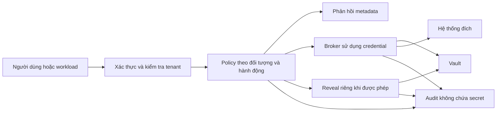

# Credential masking

## 1. Credential masking giải quyết vấn đề gì?

Credential masking là cách che hoặc thay thế biểu diễn của thông tin xác thực trong một ngữ cảnh hiển thị hay xử lý dữ liệu. Ví dụ, giao diện báo tài khoản đã có mật khẩu nhưng không hiện giá trị; log ghi `[REDACTED]` thay cho access token; bản ghi phiên không hiển thị trường nhập bí mật đã được nhận diện.

Trong quản lý truy cập đặc quyền (Privileged Access Management, PAM), credential có thể là mật khẩu quản trị, private key SSH, passphrase, API key, token hoặc bí mật dùng để cấp quyền cho dịch vụ. Những giá trị này có thể đi qua vault, broker, connector, ứng dụng khách và hệ thống quan sát. Masking giúp giảm việc tiết lộ không cần thiết trên các đường đó.

Điểm cốt lõi là **không hiển thị một giá trị khác với không cấp quyền đọc giá trị đó**. Một ô mật khẩu hiện dấu chấm nhưng vẫn chứa secret trong trang web chỉ che khỏi người nhìn màn hình. Nếu API đã gửi secret về trình duyệt, người có quyền điều khiển trình duyệt có thể lấy giá trị qua dữ liệu phản hồi, trạng thái ứng dụng hoặc công cụ kiểm tra.

Ví dụ, kỹ sư vận hành cần mở phiên chẩn đoán production qua PAM nhưng không cần biết mật khẩu tài khoản đích. Thiết kế phù hợp có thể cho broker sử dụng credential trong vault để mở phiên, còn trình duyệt chỉ nhận thông tin phiên và metadata được phép. Việc tải mật khẩu về rồi che bằng dấu sao tạo ra một bề mặt tiếp xúc lớn hơn nhu cầu nghiệp vụ.

Bài học thuộc chương Credential management, tập trung vào tài khoản quản trị, danh tính dịch vụ và hạ tầng nhạy cảm. Mục tiêu là kết hợp masking với least privilege, quyền sử dụng có thời hạn, giới hạn tác vụ, vault, rotation, giám sát phiên và bằng chứng kiểm toán.

## 2. Phân biệt masking với các cơ chế bảo vệ khác

| Cơ chế | Mục đích | Giới hạn cần hiểu |
|---|---|---|
| Che hiển thị | Giảm người nhìn thấy giá trị trên màn hình | Giá trị có thể vẫn ở trong client, DOM hoặc bộ nhớ |
| Redaction | Loại bỏ hoặc thay phần nhạy cảm khỏi dữ liệu được xuất ra | Không bảo vệ các bản gốc hoặc bản sao đã đi đường khác |
| Kiểm soát truy cập | Quyết định ai được đọc, sử dụng hoặc thay credential | Cần thực thi phía máy chủ và ở các đường thay thế |
| Mã hóa | Bảo vệ tính bí mật theo mô hình khóa khi lưu hoặc truyền | Thành phần được phép giải mã vẫn có thể thấy plaintext |
| Tokenization hoặc tham chiếu đối tượng | Thay giá trị bằng một định danh dùng trong luồng cho phép | Định danh không tự cấp quyền; dịch vụ phân giải vẫn cần kiểm tra |
| Hash | Tạo biểu diễn một chiều cho mục đích phù hợp | Không thay vault cho credential cần được dùng lại để xác thực với đích |
| Rotation và thu hồi | Thay hoặc làm mất hiệu lực credential | Không tự xóa giá trị khỏi log, clipboard hay bản ghi cũ |

Base64 hoặc một dạng encoding khác không phải masking hay mã hóa bảo mật. Người nhận có thể chuyển nó về biểu diễn ban đầu. Cũng không nên coi việc chỉ hiện vài ký tự cuối là luôn an toàn: credential ngắn, cấu trúc dễ đoán hoặc nhiều phần hiển thị ở các nơi khác nhau có thể làm lộ quá nhiều thông tin.

Với mật khẩu của người dùng đăng nhập vào chính một dịch vụ, hệ thống thường dùng cơ chế kiểm tra mật khẩu phù hợp thay vì lưu dạng có thể đọc lại. Với credential PAM phải trình cho hệ thống khác, kiến trúc có thể cần truy xuất hoặc sử dụng bí mật. Hai bài toán này khác nhau; masking không giải quyết việc chọn mô hình lưu trữ.

## 3. Xác định bề mặt có thể lộ credential

Trước khi chọn cách che, cần biết secret có thể xuất hiện ở đâu và ai có thể tiếp cận từng nơi.

| Bề mặt | Ví dụ rò rỉ | Hướng kiểm soát |
|---|---|---|
| Giao diện | Ô password, tooltip, thuộc tính HTML, nội dung bị CSS che | Không gửi giá trị nếu không có quyền và nhu cầu đọc |
| API | JSON, header, query string, nội dung lỗi | Hợp đồng phản hồi phân loại dữ liệu, kiểm tra quyền và giới hạn nội dung |
| Log và trace | Request body, lỗi SDK, biến debug, connection string | Redact trước khi xuất, ưu tiên schema cho phép trường cụ thể |
| Clipboard | Sao chép ngầm, lịch sử clipboard, đồng bộ thiết bị | Sao chép có chủ đích, hiểu giới hạn của việc xóa sau đó |
| Tự động hóa | Echo, shell tracing, tham số tiến trình, artifact | Tránh đưa secret qua đường dễ ghi nhận, kiểm soát đầu ra |
| Phiên quản trị | Terminal, ứng dụng đích, truyền file, bản ghi màn hình | Credential injection và kiểm soát theo giao thức khi phù hợp |
| Bộ nhớ và dữ liệu tạm | Client state, cache, crash dump, file tạm | Giảm thời gian giữ, bảo vệ quyền truy cập và đường chẩn đoán |
| Hệ thống quan sát | Session replay của web, analytics, thông báo lỗi | Không thu thập vùng dữ liệu nhạy cảm hoặc loại bỏ từ nguồn |

Cần phân biệt người nhìn màn hình, người dùng có quyền điều khiển client, quản trị viên broker, quản trị viên hệ thống đích và người đọc kho log. Masking có thể giảm một kiểu tiết lộ nhưng không chống được mọi chủ thể trong số đó.

Nếu một thành phần phải giải mã và trình credential cho đích, thành phần đó nằm trong ranh giới tin cậy. Việc người dùng không thấy mật khẩu không chứng minh quản trị viên của thành phần đó không thể tiếp cận nó. Thiết kế cần nêu rõ ai có khả năng đọc hoặc sử dụng secret và cách kiểm soát quyền tương ứng.

## 4. Tách quyền xem metadata, sử dụng và đọc secret

Không nên gom mọi thao tác vào một quyền chung tên là “access credential”. Các nhu cầu khác nhau cần quyền có phạm vi khác nhau.

| Năng lực | Ví dụ | Dữ liệu cần nhận |
|---|---|---|
| Xem metadata | Biết tài khoản đã cấu hình credential và lần kiểm tra gần nhất | Metadata được phép, không nhất thiết có giá trị secret |
| Sử dụng qua broker | Mở phiên đã được duyệt | Tham chiếu phiên; broker nhận khả năng dùng credential |
| Đọc hoặc reveal | Lấy giá trị khi nghiệp vụ thực sự cần | Secret trong một phản hồi được bảo vệ, có kiểm tra quyền riêng |
| Thay thế | Nhập hoặc rotation credential | Kết quả thao tác và version reference, không cần phản hồi lại giá trị |
| Đọc lịch sử | Điều tra hoặc khôi phục phiên bản cũ | Chỉ nội dung lịch sử được ủy quyền |
| Export | Bàn giao hoặc khôi phục trong quy trình đặc biệt | Dữ liệu và phạm vi đã được phê duyệt |

Một người được mở phiên không đương nhiên được đọc private key. Một người được thay credential cũng không nhất thiết phải xem credential cũ. Quyền sửa policy hoặc cấp quyền reveal cũng cần được quản lý, tránh tự nâng quyền mà thiếu kiểm soát.



Mỗi nhánh phải kiểm tra đúng tenant, đối tượng, phiên bản nếu có, hành động và ngữ cảnh. Một cờ `can_reveal` trên giao diện chỉ giúp trình bày chức năng; máy chủ vẫn phải kiểm tra ở thời điểm nhận yêu cầu reveal.

## 5. Thiết kế API và biểu mẫu không làm lộ secret

### 5.1. Trả metadata thay vì secret đã được che ở client

Một API cho màn hình tổng quan có thể trả dữ liệu như sau. Đây là hợp đồng minh họa, không phải API của một sản phẩm cụ thể:

```json
{
  "credential_ref": "cred-reporting-prod",
  "version_ref": "version-008",
  "credential_present": true,
  "actions": {
    "use": true,
    "reveal": false,
    "replace": false
  }
}
```

Phản hồi không chứa giá trị credential. Client có thể hiển thị “Đã cấu hình” hoặc một dấu che cố định theo thiết kế. Không cần gửi secret xuống rồi dùng JavaScript thay nội dung hiển thị thành dấu sao.

Trường `credential_present` và metadata chỉ được trả cho người có quyền biết thông tin đó. Không để endpoint này trở thành cách dò xem tài khoản hoặc tenant khác có secret hay không. Các cờ hành động là gợi ý giao diện, không thay kiểm tra quyền khi gọi API thực hiện hành động.

Nếu dùng dấu che, không để độ dài dấu che tiết lộ độ dài thực tế khi không có nhu cầu. Với credential đặc biệt ngắn, không tự áp dụng quy tắc hiện đầu hoặc cuối. Nếu cần phân biệt các API key, có thể dùng key ID hoặc version reference được phép hiển thị thay vì lấy một phần giá trị secret làm nhãn.

### 5.2. Không lưu secret ẩn trong trang

`input type="password"`, CSS làm mờ hoặc một trường HTML ẩn không ngăn người dùng có quyền điều khiển client đọc dữ liệu đã nhận. Không đặt secret trong thuộc tính, state được tuần tự hóa, source map, biến toàn cục hoặc dữ liệu khởi tạo trang để tiện thao tác về sau.

Luồng metadata nên dùng dữ liệu metadata ngay từ nguồn phù hợp, không truy xuất secret rồi mới bỏ đi ở bước serialize cuối. Cách sau mở thêm khả năng lộ qua debug, exception hoặc middleware. Nếu kiến trúc buộc đi qua một dịch vụ có khả năng giải mã, vẫn cần giới hạn đường sử dụng và tránh lấy giá trị khi không cần.

### 5.3. Phân biệt giữ nguyên, thay thế và xóa

Một lỗi phổ biến là biểu mẫu nhận giá trị `********` từ API, sau đó gửi lại chuỗi đó khi người dùng chỉ sửa tên tài khoản. Nếu máy chủ coi đây là mật khẩu mới, credential thật có thể bị ghi đè bằng dấu che.

Hợp đồng cập nhật cần phân biệt rõ ba ý định:

| Ý định | Dữ liệu cần gửi | Tác động mong muốn |
|---|---|---|
| Giữ nguyên | Hành động giữ nguyên hoặc bỏ trường theo quy tắc đã định nghĩa | Không thay credential |
| Thay thế | Hành động thay thế và dữ liệu bí mật qua kênh nhập được bảo vệ | Tạo thay đổi theo quy trình và quyền phù hợp |
| Xóa hoặc ngừng sử dụng | Hành động rõ ràng, có quyền và kiểm tra ảnh hưởng | Xử lý theo vòng đời, không nhầm với ô nhập trống |

Ví dụ yêu cầu giữ nguyên có thể là:

```json
{
  "credential_action": "keep",
  "expected_revision": 42
}
```

Đây là một lựa chọn thiết kế, không phải ngữ nghĩa chung của mọi PATCH API. Máy chủ phải xác định rõ trường bị thiếu, giá trị rỗng và `null` nghĩa là gì. Không dựa vào việc một chuỗi trông giống dấu sao để đoán ý định; dấu che là dữ liệu trình bày, không phải một sentinel bí mật trong nội dung credential.

Thay credential còn cần đối soát với hệ thống đích, consumer và versioning. Một màn hình che tốt không làm việc thay mật khẩu trên đích trở thành giao dịch an toàn một cách tự động.

## 6. Luồng reveal khi thực sự cần đọc giá trị

### 6.1. Quyết định đọc phải diễn ra riêng

Một luồng reveal có thể yêu cầu xác thực còn hiệu lực, tenant và đối tượng đúng, quyền đọc hiện hành, mục đích và mức bảo đảm bổ sung theo chính sách. Với credential nhạy cảm, có thể cần xác thực tăng cường hoặc phê duyệt trước khi đọc.

Grant hoặc quyết định reveal nên gắn với chủ thể, tenant, object, phiên bản nếu có, hành động và thời hạn. Không dùng một lần phê duyệt chung để cho người dùng đọc mọi secret hoặc mọi phiên bản lịch sử. Khi yêu cầu thực sự tới máy chủ, kiểm tra lại điều kiện cần thiết; không chỉ tin rằng nút reveal đã được bật vài phút trước.

Không để một liên kết thông báo, thao tác xem trước hoặc chức năng tải trước của client vô tình lấy secret. Luồng đọc phải có hành động có chủ đích và cơ chế bảo vệ yêu cầu phù hợp với cách xác thực, gồm chống yêu cầu giả mạo khi áp dụng. Secret không nằm trong URL vì URL có thể đi vào lịch sử, log, referrer hoặc công cụ quan sát.

### 6.2. Giảm lưu giữ trên client và đường truyền

Sau khi cho phép đọc, phản hồi cần đi qua kênh được bảo vệ và có chính sách cache phù hợp, chẳng hạn không cho HTTP cache lưu phản hồi nhạy cảm bằng `Cache-Control: no-store`. Đồng thời cần kiểm tra proxy, gateway, CDN, logger và middleware không ghi nội dung.

Chỉ thị cache không xóa dữ liệu khỏi mọi nơi. Khi secret đã tới client được phép đọc, nó có thể nằm trong bộ nhớ, công cụ kiểm tra hoặc đã được người dùng sao chép. Cần tránh lưu vào local storage, persistent state, analytics, session replay của web và báo cáo lỗi. Thu hẹp thời gian tồn tại trong state ứng dụng, nhưng không hứa đã xóa tuyệt đối khỏi bộ nhớ của một môi trường do người khác kiểm soát.

Lỗ hổng script trong trang hoặc quyền của thành phần client có thể làm lộ secret đã reveal. Các biện pháp bảo vệ ứng dụng và giới hạn thu thập dữ liệu cần được áp dụng cùng việc giảm số lần và số nơi nhận plaintext.

### 6.3. Thời gian hiển thị, quyền đọc và hiệu lực credential

| Khoảng thời gian | Kiểm soát điều gì? | Không tự thực hiện điều gì? |
|---|---|---|
| Thời gian ô reveal mở | Cách trình bày trên giao diện | Xóa bản sao người dùng đã lấy |
| Thời hạn quyền reveal | Cho phép yêu cầu đọc mới | Làm credential đã đọc hết hiệu lực trên đích |
| Hạn credential hoặc lease | Khả năng xác thực theo cơ chế đích | Bảo đảm mọi phiên đang chạy đã kết thúc |

Khi hết thời gian hiển thị, giao diện có thể đóng vùng secret và bỏ state liên quan. Đây là giảm tiếp xúc, không phải thu hồi một giá trị đã lộ. Nếu nghiệp vụ yêu cầu credential không thể tiếp tục dùng sau thời hạn, cần cơ chế cấp ngắn hạn, rotation hoặc thu hồi ở đích và xử lý phiên theo thiết kế.

### 6.4. Clipboard và bằng chứng

Không tự sao chép secret chỉ vì người dùng mở trang hoặc reveal. Nếu cho phép copy, đó là một quyền hoặc hành động có chủ đích theo thiết kế. Không ghi nội dung clipboard vào audit hay analytics.

Tự xóa clipboard sau một khoảng thời gian có giới hạn: lịch sử clipboard hoặc công cụ đồng bộ có thể đã lưu giá trị, và việc xóa mù có thể ghi đè nội dung mới người dùng vừa sao chép. Nếu triển khai, cần hành vi phù hợp khả năng nền tảng; không coi đây là bằng chứng mọi bản sao đã bị xóa.

Audit có thể ghi đã yêu cầu đọc, quyết định cho phép hoặc từ chối, phản hồi đã được cấp và hành động copy được client báo. Các sự kiện này không chứng minh secret chưa được sao chép bằng cách khác hoặc đã được dùng đúng mục đích. Bằng chứng sử dụng cần nguồn ở broker hoặc hệ thống đích khi có.

## 7. Redaction trong log, trace và lỗi

### 7.1. Không thu thập trước, che sau như đường duy nhất

Ưu tiên schema log chỉ cho phép những trường đã biết an toàn thay vì ghi toàn bộ request rồi hy vọng bộ lọc tìm được mọi secret. Header xác thực, cookie, nội dung nhập secret, connection string, query có chữ ký và private key đều có thể xuất hiện dưới nhiều định dạng.

Redaction cần diễn ra trước khi dữ liệu rời thành phần tạo log, được xếp hàng, buffer, gửi tới exporter hoặc lưu trữ. Nếu chỉ che ở màn hình xem log, bản gốc và index có thể vẫn chứa plaintext.

Ví dụ một sự kiện được xây dựng từ metadata đã kiểm tra:

```text
event = {
    tenant_ref: trusted_context.tenant,
    actor_ref: trusted_context.subject,
    credential_ref: validated_object.reference,
    version_ref: metadata.version_reference,
    action: controlled_action_code,
    result: controlled_result_code,
    reason_code: controlled_reason_code,
    correlation_id: validated_correlation_id
}
emit_audit(event)
```

Không thêm toàn bộ object, request body hoặc nội dung exception vào sự kiện đó để tiện debug. Reason code có cấu trúc thường an toàn và dễ tổng hợp hơn một chuỗi lỗi tự do có thể chứa credential.

### 7.2. Bộ lọc bổ sung phải xử lý nhiều dạng dữ liệu

Bộ lọc nên hiểu cấu trúc trường nhạy cảm, tên header không phân biệt hoa thường, dữ liệu lồng nhau và định dạng đã được hệ thống chấp nhận. Regex có thể hỗ trợ phát hiện thứ cấp, nhưng không bảo đảm nhận diện mọi password hoặc token tùy ý.

Một secret có thể bị chia thành nhiều đoạn, đổi encoding hoặc ghép vào câu lỗi. Việc đăng ký một giá trị để che theo exact match không đồng nghĩa mọi biến thể đều được che. Cũng không nên cố giải mã tùy ý mọi dữ liệu log như giải pháp chính; giảm thu thập và phân loại ngay tại nguồn là cơ sở quan trọng hơn.

Nếu cơ chế xử lý trường nhạy cảm gặp lỗi, không chuyển sang ghi nguyên nội dung để tránh mất log. Có thể bỏ phần nhạy cảm hoặc toàn bộ payload đó, giữ metadata và mã lỗi an toàn theo thiết kế. Việc mất khả năng redact phải được quan sát mà không tự tạo một sự kiện làm lộ dữ liệu.

## 8. Masking trong workload và tự động hóa

### 8.1. Chương trình cần giá trị thật hoặc một năng lực sử dụng tương đương

Nếu ứng dụng phải xác thực bằng mật khẩu, thay mật khẩu bằng `[REDACTED]` trong phản hồi dành cho ứng dụng sẽ làm xác thực thất bại. Masking không thể thay thế credential trong giao thức cần giá trị thật.

Thiết kế cần phân biệt kênh metadata, kênh sử dụng và kênh đọc secret. Một workload có thể nhận credential qua cơ chế được bảo vệ, hoặc gọi thành phần thực hiện thao tác thay nó khi giao thức và nền tảng hỗ trợ. Ví dụ, bộ ký có thể thực hiện ký mà không xuất private key; broker có thể mở phiên mà không gửi mật khẩu cho trình duyệt.

Danh tính workload phải được xác thực và chỉ có quyền với đúng tenant, credential, phiên bản hoặc loại cấp phát cần thiết. Không dùng token quản trị vault chung để đổi lấy mọi secret rồi dựa vào masking trong log để coi rủi ro đã được kiểm soát.

### 8.2. Giảm đường xuất hiện plaintext

Secret trong tham số dòng lệnh có thể bị ghi vào lịch sử, log tác vụ hoặc thông tin tiến trình theo khả năng nền tảng và quyền quan sát. Biến môi trường cũng có thể xuất hiện trong dump, chẩn đoán hoặc dữ liệu tiến trình; nó không tự là một kho secret an toàn.

Cần dùng cách nhận credential được ứng dụng và nền tảng hỗ trợ, bảo vệ quyền truy cập và hạn chế dữ liệu tạm. Nếu phải ghi file tạm, phải có chính sách quyền, thời gian tồn tại và dọn dẹp tương ứng; không giả định một file có tên kín đáo là đã được bảo vệ. Không in secret để xác nhận rằng công cụ đã lấy đúng giá trị.

Trong pipeline, các chế độ echo, shell tracing, debug HTTP và in toàn bộ cấu hình có thể lộ credential. Ngoài log chính, cần xét artifact, báo cáo lỗi, file cấu hình xuất ra và thông báo gửi tới hệ thống khác. Một bộ lọc chỉ áp dụng cho console không bảo vệ các đầu ra đó.

Một số cơ chế che log dựa trên giá trị đã đăng ký. Khi secret bị cắt đoạn, thêm ký tự, xuống dòng hoặc đổi encoding, exact match có thể không còn nhận diện. Vì vậy, consumer cần tránh tạo các biểu diễn đó trong đầu ra, thay vì cố chứng minh bộ lọc sẽ bắt được mọi cách biến đổi.

### 8.3. Lỗi thư viện và thời gian lưu

Driver cơ sở dữ liệu, SDK hoặc công cụ hệ thống có thể trả lỗi chứa connection string hoặc nội dung phản hồi nhạy cảm. Trước khi đưa lỗi vào log và hệ thống hỗ trợ, cần ánh xạ sang thông tin an toàn, giữ mã lỗi có ích nhưng bỏ dữ liệu bí mật.

Giới hạn thời gian giữ plaintext trong bộ nhớ theo khả năng triển khai, nhưng không khẳng định đã xóa tuyệt đối các bản sao trong một runtime có garbage collection hoặc trong mọi crash dump. Bảo vệ quyền debug, dump và hệ thống báo lỗi là phần của ranh giới tin cậy.

Nếu dùng cache credential, cần hạn, quyền đọc và cách xử lý khi secret đổi hoặc bị thu hồi. Masking một màn hình quản trị không làm credential đã cache hết hiệu lực. Phép thử sau rotation phải có xác thực mới trên đích, không chỉ dựa vào kết nối cũ vẫn hoạt động.

## 9. Masking trong phiên PAM và bản ghi phiên

### 9.1. Ưu tiên giảm việc người dùng nhận secret khi không cần

Một broker có thể lấy credential từ vault, trình nó cho hệ thống đích qua cơ chế tích hợp và mở phiên cho người được phép. Trình duyệt không cần nhận private key hoặc mật khẩu chỉ để hiển thị một phiên đã mở.

Dù vậy, broker, connector và hệ thống đích vẫn có thể tiếp xúc với plaintext hoặc khả năng sử dụng credential. Quyền vận hành các thành phần đó, dữ liệu tạm và khả năng debug cần được kiểm soát. “Không hiển thị cho người dùng” không đồng nghĩa secret không tồn tại ở bất kỳ đâu.

Việc inject credential phải theo khả năng giao thức. Không đưa mật khẩu vào một câu lệnh rồi cho rằng cửa sổ phiên đã che nên nó sẽ không xuất hiện trong danh sách tiến trình, lịch sử hoặc log đích.

### 9.2. Che màn hình khác với che dữ liệu ghi nhận

Trong terminal, chế độ không echo có thể ngăn ký tự nhập xuất hiện trên màn hình, nhưng một hệ thống ghi nhận đầu vào có thể đã thu các ký tự đó trước khi hiển thị. Tương tự, che vùng màn hình ở trình xem bản ghi không chứng minh stream gốc hoặc video lưu trữ đã được loại bỏ dữ liệu nhạy cảm.

Cần xác định điểm thu thập và điểm redaction: dữ liệu phím nhập, đầu ra terminal, khung hình, sự kiện giao thức hoặc file truyền qua phiên. Nếu nền tảng hỗ trợ nhận diện trường bí mật, kiểm tra redaction ở đúng luồng trước các đích lưu và export liên quan. Không giả định mọi giao thức, ứng dụng và giao diện tự vẽ đều được nhận diện như nhau.

Giữ bằng chứng cần thiết về xác thực, quyết định cấp quyền và hành động đặc quyền, nhưng không lưu giá trị secret chỉ để phục vụ audit. Việc che trường nhạy cảm nên có metadata phù hợp để giải thích khoảng đã được xử lý, tránh tắt toàn bộ giám sát một cách không kiểm soát.

### 9.3. Masking không giới hạn quyền thực thi

Một tài khoản có shell quản trị rộng có thể đọc file cấu hình, trích xuất secret khác hoặc tạo credential mới. Che mật khẩu dùng để vào phiên không tự ngăn các hành động đó.

Least privilege và JEA cần thực thi ở tài khoản, lệnh được phép, quyền nâng quyền và điểm kiểm soát phù hợp. Một phiên chẩn đoán chỉ đọc phải được giới hạn bằng cơ chế thật, không chỉ gắn nhãn “readonly” trong giao diện PAM.

Giám sát và phát hiện secret trong đầu ra có thể hỗ trợ giảm rủi ro, nhưng không bảo đảm nhận diện mọi giá trị tùy ý mà một người có quyền cao cố tình xuất ra. Ranh giới quyền và đường sử dụng vẫn là nền tảng của kiểm soát.

## 10. Khi phát hiện credential đã lộ

Lộ secret trong response cho người không có quyền, log, artifact hoặc bản ghi phiên là vấn đề cần xử lý theo phạm vi tiếp xúc thực tế. Sửa giao diện thành dấu sao chỉ xử lý một biểu hiện, không làm giá trị đã phát tán mất hiệu lực.

Một quy trình ứng phó có thể gồm:

1. Xác định credential, phiên bản, tài nguyên, consumer và khoảng thời gian bị ảnh hưởng bằng tham chiếu và bằng chứng phù hợp.
2. Hạn chế đường tiếp tục phát tán: log, export, thông báo, công cụ hỗ trợ hoặc endpoint trả thừa dữ liệu.
3. Đánh giá nơi đã nhận bản sao, ai có thể truy cập và các phiên hoặc token có thể đã được tạo từ credential đó.
4. Rotation hoặc thu hồi trên hệ thống đích theo loại credential và kế hoạch vận hành; cập nhật consumer, kiểm tra bằng kết nối mới.
5. Xử lý phiên, public key được tin, API key, token dẫn xuất hoặc quyền khác theo cơ chế thực thi liên quan.
6. Bảo vệ bằng chứng và xử lý dữ liệu đã ghi ở index, export, artifact và backup theo quyền cùng chính sách lưu giữ.
7. Sửa nguồn rò rỉ, kiểm tra các đường thay thế và ghi rõ giới hạn của việc dọn dữ liệu đã phát tán.

Không tự xóa toàn bộ bằng chứng hoặc backup để làm biến mất dấu vết. Việc giữ bằng chứng và giảm tiếp xúc cần được phối hợp theo quy trình; quyền truy cập có thể cần thu hẹp trong khi vẫn bảo toàn dữ liệu điều tra.

Lịch sử vault cũng cần kiểm soát. Nếu đã tạo phiên bản mới nhưng người dùng vẫn được đọc phiên bản cũ bị lộ, đường truy cập đó còn tồn tại. Ngược lại, khóa quyền đọc phiên bản cũ không thu hồi các bản sao đã có; phải xử lý hiệu lực trên đích và các phiên liên quan.

## 11. Ví dụ: phiên chẩn đoán production không cần reveal

Giả sử kỹ sư trực cần mở phiên chẩn đoán trong 20 phút vào một tài nguyên production. Tài khoản đích được giới hạn đúng tác vụ và credential do vault quản lý. Nghiệp vụ không yêu cầu kỹ sư xem hoặc sao chép giá trị.

| Bước | Hành vi thiết kế | Dữ liệu có thể xuất hiện ở client hoặc audit |
|---|---|---|
| Xem tài nguyên | API trả metadata đã được cấp quyền | Tên hiển thị được phép, trạng thái credential, action được phép |
| Xin quyền | Kiểm tra chủ thể, tenant, tài nguyên, tác vụ và thời hạn | Request reference và trạng thái quyết định |
| Mở phiên | Broker kiểm tra grant và dùng đúng credential trong vault | Session reference; không gửi credential cho trình duyệt |
| Thực hiện tác vụ | Đích hoặc điểm kiểm soát thực thi giới hạn quyền | Bằng chứng phiên được thu theo chính sách và khả năng giao thức |
| Kết thúc | Chấm dứt quyền hoặc phiên theo thiết kế, xử lý lease hay rotation khi cần | Kết quả kết thúc, các thao tác thu hồi và lỗi cần xử lý |

Nếu người dùng tự gọi API reveal hoặc đổi version reference, máy chủ phải đánh giá quyền riêng và từ chối khi không được phép. Che hoặc ẩn nút reveal không đủ để đáp ứng yêu cầu này.

Nếu phiên lỗi, broker trả mã lỗi và correlation ID phù hợp; không đưa connection string kèm mật khẩu vào thông báo cho kỹ sư. Đường log nội bộ, trace của connector và báo cáo hỗ trợ cũng cần áp dụng cùng nguyên tắc dữ liệu tối thiểu.

Đối với một job thực sự cần credential để xác thực trực tiếp, có thể có một kênh nhận secret được cấp riêng cho workload. Không thay giá trị bằng dấu che trong kênh đó; thay vào đó kiểm soát danh tính, phạm vi, thời hạn, cách sử dụng và đầu ra của job.

## 12. Ma trận kiểm tra masking

Thực hiện các phép thử trong môi trường được phép với credential giả, dễ nhận biết và không dùng ở hệ thống thật. Mục tiêu là kiểm tra dữ liệu thực sự đi qua từng đường, không chỉ quan sát màn hình.

| Tình huống | Kết quả cần đạt | Bằng chứng cần xem |
|---|---|---|
| Người chỉ có quyền metadata mở trang | Không có giá trị secret trong response, DOM hoặc dữ liệu khởi tạo | Phản hồi API và state client liên quan |
| Người không có quyền reveal gọi API trực tiếp | Bị từ chối phía máy chủ | Quyết định quyền và phản hồi không chứa secret |
| Người A thay tenant, object hoặc version sang B | Không đọc được secret hoặc lịch sử của B | Kiểm tra phạm vi và phản hồi không tiết lộ thừa |
| Quyền reveal hết hạn hoặc bị thu hồi | Yêu cầu đọc mới tuân thủ policy hiện hành | Thời điểm quyết định và trạng thái grant |
| Người dùng chỉ sửa metadata của biểu mẫu | Credential không bị thay bằng dấu che | Revision, version reference và lịch sử thay đổi |
| Gửi trường rỗng, thiếu trường hoặc `null` | Hành vi đúng hợp đồng đã công bố | Quyết định giữ nguyên, thay hoặc xóa rõ ràng |
| Reveal hợp lệ | Chỉ cấp đúng giá trị được phép qua luồng bảo vệ | Tenant, object, phiên bản, quyền và cấu hình cache |
| Đóng vùng reveal hoặc rời trang | Không giữ trong persistent state ngoài thiết kế | State, storage và các hệ thống thu thập phía client |
| Copy credential | Chỉ khi có hành động và quyền phù hợp; không log nội dung | Sự kiện metadata, không có giá trị clipboard |
| Lỗi có header hoặc body nhạy cảm | Log và trace không chứa credential | Dữ liệu tại nguồn, collector, index và export |
| Trường nhạy cảm lồng nhau hoặc header đổi hoa thường | Cơ chế phân loại và lọc xử lý đúng cấu trúc | Sự kiện đã xử lý qua đường thực tế |
| Bộ lọc redaction gặp lỗi | Không ghi nguyên payload như một cơ chế fallback | Metadata lỗi an toàn và không có raw secret |
| Pipeline bật chế độ chẩn đoán được phép thử | Không phát tán secret qua log hoặc artifact | Console, file đầu ra, báo cáo và thông báo |
| Ứng dụng đích không echo mật khẩu | Không suy ra bản ghi đầu vào đã an toàn chỉ từ màn hình | Stream hoặc dữ liệu ghi nhận theo khả năng giao thức |
| Masking ở trình xem bản ghi | Đã kiểm tra dữ liệu gốc và export theo yêu cầu bảo vệ | Bản lưu, index và đường tải xuống, không chỉ giao diện xem |
| Workload hợp lệ cần xác thực trực tiếp | Nhận và dùng credential theo kênh được cấp; đầu ra không lộ | Kết quả xác thực mới và metadata phiên bản |
| Credential giả bị đưa vào log để thử quy trình sự cố | Phát hiện và xử lý theo phạm vi, không chỉ đổi UI | Bằng chứng chặn nguồn, rotation hoặc thu hồi và đối soát |

Với giá trị thử được chia đoạn hoặc đổi encoding, cần đánh giá giới hạn bộ lọc và sửa đường thu thập dữ liệu thay vì chỉ thêm một regex cho từng mẫu. Với giao thức hoặc ứng dụng chưa hỗ trợ redaction đáng tin cậy, ghi rõ giới hạn và cân nhắc thay đường sử dụng hoặc cách ghi nhận.

Không yêu cầu mọi phản hồi đều chỉ có dấu che: một phản hồi reveal hợp lệ hoặc kênh cấp credential cho workload có thể cần chứa giá trị thật. Điều cần chứng minh là đúng chủ thể, đúng quyền, đúng phạm vi và không có bản sao ngoài thiết kế. Ngược lại, mọi endpoint chỉ phục vụ metadata phải không nhận hoặc trả secret một cách không cần thiết.

## 13. Tiêu chí nghiệm thu

Có thể dùng checklist sau để đánh giá một luồng credential masking:

- [ ] Đã phân loại giá trị secret, metadata nhạy cảm và dữ liệu được phép hiển thị; không mặc định mọi tên tài khoản đều công khai.
- [ ] Quyền xem metadata, sử dụng qua broker, reveal, thay thế, lịch sử và export có phạm vi rõ theo tenant và đối tượng.
- [ ] API metadata không gửi secret xuống client để che bằng CSS hoặc trường password.
- [ ] Giao diện dùng dấu che hoặc trạng thái mà không tiết lộ độ dài hay phần giá trị không cần thiết.
- [ ] Hợp đồng cập nhật phân biệt giữ nguyên, thay thế và xóa; dấu che không bị dùng như giá trị credential.
- [ ] Reveal có hành động có chủ đích, kiểm tra quyền hiện hành, bảo vệ yêu cầu và audit phù hợp.
- [ ] Đường phản hồi nhạy cảm hạn chế cache, log, trace, analytics, session replay và lưu trữ phía client.
- [ ] Copy, thời gian hiển thị và xóa state có hành vi rõ; không hứa đã thu hồi hoặc xóa mọi bản sao.
- [ ] Redaction diễn ra trước các điểm xuất dữ liệu cần bảo vệ; khi lỗi không ghi raw payload như fallback.
- [ ] Tự động hóa và connector không đưa secret vào dòng lệnh, debug, lỗi hoặc artifact ngoài mô hình đã được kiểm soát.
- [ ] Bản ghi phiên được đánh giá ở điểm thu thập và lưu trữ, không chỉ ở trình xem; giới hạn giao thức được ghi nhận.
- [ ] Credential injection, least privilege và JEA được thực thi bằng cơ chế phù hợp, không dựa vào tên policy hay trạng thái masked.
- [ ] Có quy trình xử lý rò rỉ gồm hiệu lực credential trên đích, consumer, phiên và dữ liệu đã phát tán.
- [ ] Bằng chứng nối được yêu cầu, quyết định và sử dụng mà không chứa giá trị secret.

Mỗi điểm cần có thành phần chịu trách nhiệm và bằng chứng tương ứng. Chẳng hạn, API chịu trách nhiệm không trả thừa dữ liệu, client chịu trách nhiệm không lưu vào persistent state ngoài thiết kế, logger chịu trách nhiệm loại nội dung nhạy cảm và hệ thống đích chịu trách nhiệm thực thi thu hồi credential.

Nếu một kiểm soát chưa được hỗ trợ, ghi rõ phạm vi còn tiếp xúc và cách giảm rủi ro được chấp thuận. Không ghi “đã masked” như một kết quả chung cho cả UI, log, bộ nhớ và bản ghi phiên khi thực tế chỉ kiểm tra một màn hình.

## 14. Bài thực hành thiết kế

Thiết kế một luồng PAM cho hai nhu cầu: kỹ sư mở phiên chẩn đoán mà không đọc mật khẩu và một workload cần nhận credential để xác thực trực tiếp. Dùng dữ liệu giả, không đưa credential production vào tài liệu hay công cụ thử.

1. Vẽ đường dữ liệu của mỗi nhu cầu và chỉ ra thành phần nào nhận plaintext, tham chiếu hoặc khả năng sử dụng credential.
2. Lập bảng quyền cho metadata, use, reveal, replace và history. Xác định đối tượng, tenant, thời hạn và bằng chứng cần có.
3. Viết một phản hồi metadata không chứa secret và mô tả hợp đồng giữ nguyên, thay thế, xóa khi sửa biểu mẫu.
4. Thiết kế luồng reveal có kiểm tra quyền riêng. Phân biệt hạn hiển thị, hạn quyền đọc và hiệu lực credential trên đích.
5. Liệt kê các điểm thu log, trace, replay và artifact; chọn dữ liệu được phép ghi và hành vi khi bộ lọc lỗi.
6. Chọn phép thử chứng minh client không nhận secret khi chỉ có quyền metadata, và phép thử chứng minh workload hợp lệ vẫn xác thực được.
7. Mô tả xử lý khi một private key hoặc mật khẩu đã xuất hiện trong bản ghi. Chỉ ra việc cần làm ngoài sửa dấu che ở giao diện.

Kết quả cần cho thấy masking làm giảm tiết lộ ở từng bề mặt cụ thể, còn quyền đọc, sử dụng và thu hồi credential được thực thi ở đúng nơi. Đó là cơ sở để quản lý credential trong PAM với phạm vi tiếp xúc có thể hiểu và kiểm tra được.

