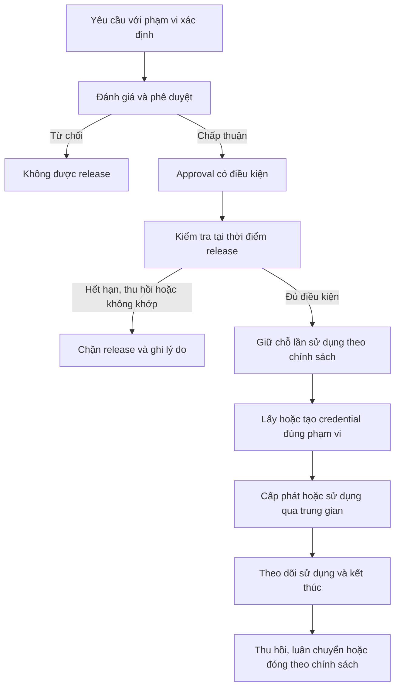

# Credential release sau approval

Credential release sau approval là bước PAM cho phép một người, workload hoặc thành phần trung gian sử dụng credential sau khi yêu cầu đã được phê duyệt và các điều kiện cấp phát hiện tại đều thỏa mãn. Credential có thể là password quản trị, SSH key, API credential hoặc quyền ngắn hạn được tạo theo chính sách.

Phê duyệt là một quyết định cho một phạm vi cụ thể. Nó không nên trở thành quyền đọc vault không giới hạn. Từ thời điểm phê duyệt đến thời điểm cấp phát, tài khoản người yêu cầu, trạng thái target, quyền đích hoặc mức rủi ro có thể thay đổi. Vì vậy, PAM cần kiểm tra lại trước khi lấy và sử dụng bí mật.

Trong chương Credential management, bài này tập trung vào ranh giới giữa một approval hợp lệ và hành động cấp phát thực tế. Mục tiêu là duy trì least privilege, giới hạn thời gian, giữ danh tính người sử dụng và tạo bằng chứng đủ để kiểm toán hoặc ứng phó sự cố.

## 1. Mục tiêu và thuật ngữ

Sau bài học, người học có thể:

- Phân biệt yêu cầu, approval, quyết định cấp phát và credential đã được tiết lộ hoặc sử dụng.
- Xác định những thuộc tính cần ràng buộc trong approval.
- Thiết kế kiểm tra tại thời điểm release và giới hạn quyền của dịch vụ cấp phát.
- Phân biệt hiển thị secret, cấp phát cho workload và sử dụng credential qua gateway hoặc broker.
- Xử lý retry, phát lại, cấp phát đồng thời và lỗi giao nhận mà không giả định có thể thu hồi thông tin đã lộ.
- Xây dựng bằng chứng nối từ người yêu cầu đến truy cập thực tế và thu hồi.

| Khái niệm | Ý nghĩa trong bài |
| --- | --- |
| Access request | Đề nghị sử dụng một quyền, danh tính hoặc credential trên tài nguyên xác định |
| Approval | Quyết định chấp thuận một phạm vi và điều kiện đã được mô tả |
| Release authorization | Quyết định hiện tại rằng một lần cấp phát cụ thể được phép thực hiện |
| Credential release | Hành động cấp phát bí mật hoặc cho thành phần được phép sử dụng nó |
| Checkout hoặc lease | Bản ghi theo dõi quyền sử dụng, thời hạn và các điều kiện theo thiết kế |
| Secret disclosure | Giá trị bí mật đã được đưa ra ngoài ranh giới giữ bí mật ban đầu |
| Credential use | Credential được dùng để xác thực hoặc thực hiện hành động tại hệ thống đích |

Các thuật ngữ có thể khác giữa sản phẩm. Điều cần giữ là sự khác biệt giữa chấp thuận, cấp phát, sử dụng và kết thúc quyền. Một approval thành công chưa chứng minh credential đã được lấy; một lần lấy credential cũng chưa chứng minh người dùng chỉ thực hiện đúng một hành động.

## 2. Approval phải chấp thuận điều gì?

### 2.1. Ràng buộc với một phạm vi không mơ hồ

| Thuộc tính | Ví dụ minh họa | Lý do cần ràng buộc |
| --- | --- | --- |
| Người hoặc workload yêu cầu | Subject ID ổn định, nguồn định danh | Tránh chuyển approval cho người khác |
| Tài nguyên | Target ID, môi trường, tenant và phạm vi con nếu có | Tránh dùng approval development cho production |
| Danh tính hiệu lực | Tài khoản quản trị hoặc vai trò được phép | Tránh đổi sang tài khoản có quyền mạnh hơn |
| Mục đích và tác vụ | Bảo trì dịch vụ Orders | Giúp người phê duyệt đánh giá nhu cầu và giới hạn |
| Phương thức cấp phát | Mở phiên qua gateway hoặc cấp token cho workload | Hiển thị password có rủi ro khác với sử dụng qua trung gian |
| Thời gian | Khoảng được release, thời điểm kết thúc quyền | Ngăn dùng lại phê duyệt cũ ngoài cửa sổ đã chấp thuận |
| Số lần hoặc chế độ sử dụng | Một lần mở phiên, một checkout hoặc chính sách nhiều lần | Tránh biến approval một lần thành cấp phát không giới hạn |
| Điều kiện | Xác thực bổ sung, thiết bị, nguồn mạng, kiểm soát phiên | Gắn quyết định với ngữ cảnh cần thiết |
| Chính sách | Policy ID và phiên bản hoặc dấu vết quyết định | Giải thích cơ sở chấp thuận và xử lý khi policy thay đổi |

Approval nên tham chiếu một bản mô tả phạm vi đã được cố định hoặc được kiểm soát phiên bản. Nếu người yêu cầu có thể sửa target, tài khoản hoặc phương thức release sau khi được duyệt mà vẫn giữ approval cũ, quyết định có thể bị dùng sai.

Không ghi giá trị secret vào approval hoặc ticket. Người phê duyệt cần biết credential thuộc đối tượng nào và có quyền gì, không cần xem password để quyết định nhu cầu sử dụng.

### 2.2. Gắn với đối tượng logic hay phiên bản credential?

Cần định nghĩa rõ approval áp dụng cho tài khoản hoặc vai trò logic, hay cho một phiên bản credential cụ thể. Hai cách có mục đích khác nhau.

Nếu approval cho phép mở phiên bằng tài khoản bảo trì và password được luân chuyển định kỳ mà quyền không đổi, có thể dùng phiên bản hiện hành theo chính sách đã thiết kế. Nếu approval yêu cầu một phiên bản xác định phục vụ nghiệp vụ đặc thù, thay phiên bản có thể đòi hỏi đánh giá lại.

Không mặc định mọi lần rotation đều làm approval vô hiệu, cũng không mặc định đổi credential không bao giờ ảnh hưởng approval. Khi danh tính, phạm vi quyền, target hoặc mức tiết lộ thay đổi, cần đánh giá lại theo chính sách và lấy approval mới nếu phạm vi đã khác.

Với credential động, bí mật có thể chỉ được tạo sau approval. Khi đó, approval ràng buộc mẫu vai trò, tài nguyên, thời hạn và điều kiện cấp; kết quả được tạo phải được đối chiếu với các ràng buộc đó.

### 2.3. Người phê duyệt phải có thẩm quyền

Thẩm quyền approval cần dựa trên tài nguyên, môi trường và mức rủi ro. Nếu yêu cầu phân tách nhiệm vụ, kiểm tra người yêu cầu không tự phê duyệt cho mình, kể cả qua tài khoản khác hoặc luồng ủy quyền không phù hợp.

Ủy quyền, nhiều cấp duyệt và quorum cần có quy tắc rõ: ai có thể thay ai, trong thời gian nào, một người được tính như bao nhiêu người và thay đổi nào làm yêu cầu phải duyệt lại.

Thay đổi thẩm quyền của người đã phê duyệt sau thời điểm quyết định cần có cách xử lý được định nghĩa trước. Tổ chức có thể quy định đánh giá lại các approval chưa dùng trong một số tình huống; không nên để hành vi phụ thuộc vào suy đoán của người vận hành.

## 3. Chọn phương thức release theo nhu cầu

| Phương thức | Luồng sử dụng | Điểm cần kiểm soát |
| --- | --- | --- |
| Sử dụng qua session gateway | Gateway lấy hoặc sử dụng credential để mở phiên | Người dùng vẫn có quyền hành động ở target; cần giới hạn phiên, quyền đích và audit |
| Broker hoặc proxy cho API | Thành phần trung gian giữ credential và thực hiện hoặc cho phép một phạm vi gọi API | Giới hạn đích, hành động, audience hoặc scope; không thành đường dùng secret tùy ý |
| Credential hoặc token cho workload | Workload đã được xác thực nhận vật liệu cần dùng | Policy theo danh tính workload, kênh cấp phát, cache, thời hạn và thu hồi |
| Hiển thị hoặc cho tải secret | Người được phép nhận giá trị bí mật | Sau khi tiết lộ không thể bảo đảm xóa mọi bản sao; cần điều kiện và xử lý sau sử dụng |

Ưu tiên phương thức đáp ứng nhu cầu với mức tiết lộ và quyền phù hợp. Không mô tả gateway là loại bỏ mọi rủi ro: người dùng có thể vẫn thực hiện tác vụ có tác động lớn nếu quyền tại target quá rộng.

Approval chỉ cho phép mở phiên không mặc nhiên cho phép bấm xem password. Quyền đọc giá trị secret và quyền sử dụng credential qua trung gian cần được phân biệt nếu kiến trúc hỗ trợ.

Với workload, người phê duyệt có thể chấp thuận policy hoặc một lần chạy theo mô hình tổ chức. Mỗi lần release vẫn phải xác thực workload thật; một tên ứng dụng do client tự khai báo không đủ chứng minh danh tính.

## 4. Tách vòng đời approval và vòng đời release



Approval có thể đang hợp lệ trong khi một lần release cụ thể thất bại. Ngược lại, approval có thể bị thu hồi sau khi credential đã được tiết lộ; khi đó cần xử lý truy cập còn tồn tại thay vì chỉ thay trạng thái approval.

Không dùng một cờ `approved=true` làm toàn bộ điều kiện cho API lấy secret. Cần có định danh quyết định, phạm vi được chấp thuận, thời hạn, trạng thái sử dụng và các kiểm tra hiện tại.

Một mô hình có thể theo dõi các trạng thái release như `requested`, `authorized`, `reserved`, `release_attempted`, `released`, `delivery_uncertain`, `denied`, `failed` và `closed`. Đây là tên minh họa; điều quan trọng là không gộp lỗi chắc chắn chưa tiết lộ với trường hợp có thể đã tiết lộ.

## 5. Kiểm tra lại ngay trước release

### 5.1. Danh tính và ngữ cảnh hiện tại

Xác thực chủ thể đang gửi yêu cầu release. Không chỉ tin request ID hoặc đường dẫn trong email approval. Kiểm tra chủ thể có khớp người hoặc workload được phê duyệt và còn quyền sử dụng luồng này hay không.

Nếu chính sách yêu cầu xác thực bổ sung hoặc ngữ cảnh thiết bị, kiểm tra độ mới và tính phù hợp tại thời điểm release. Một lần xác thực từ lâu không mặc định đáp ứng mọi yêu cầu nhạy cảm.

Với gateway hoặc workload được nhận credential thay người dùng, kiểm tra cả danh tính thành phần nhận và ngữ cảnh người khởi tạo nếu áp dụng. Không để caller tùy ý đổi địa chỉ nhận secret.

### 5.2. Approval và đối tượng đích

Kiểm tra approval tồn tại, không bị thu hồi, còn trong cửa sổ sử dụng và khớp phạm vi. Đối chiếu target, môi trường, tài khoản hoặc vai trò, phương thức release và giới hạn số lần.

Xác minh target chưa bị ngừng quản lý hoặc cách ly; secret đúng đối tượng; trạng thái tài khoản và credential không thuộc trường hợp bị chặn theo chính sách. Dùng định danh ổn định thay vì chỉ so tên hiển thị.

Đánh giá quyền hiện tại và các thay đổi có ý nghĩa sau approval. Nếu policy mới siết quyền hoặc một sự cố khiến target bị cách ly, approval cũ không nên tự trở thành đường vượt qua kiểm soát hiện hành. Cách giải quyết policy thay đổi phải được thiết kế rõ.

### 5.3. Thời gian và thời hạn có hiệu lực

Cần tách ít nhất ba mốc:

- Hạn được dùng approval để bắt đầu release.
- Thời điểm kết thúc quyền hoặc phiên được chấp thuận.
- Thời hạn thực tế của credential, token hoặc grant ở hệ thống đích.

Ví dụ, approval cho phép bắt đầu release từ 02:00 đến 02:10 UTC, còn quyền truy cập phải kết thúc trước 02:30 UTC. Một lần release lúc 02:05 không tự cho phép thêm 30 phút đến 02:35.

Nếu yêu cầu thời lượng không vừa khoảng còn lại, hệ thống có thể từ chối hoặc giảm thời lượng theo chính sách đã công bố. Đối với token hoặc grant ngắn hạn, không cấp hiệu lực vượt quá các giới hạn áp dụng và khả năng provider.

Với password tĩnh, đặt `checkout_until` trong PAM không làm password hết hiệu lực tại target. Cần cơ chế thực thi riêng như hạn chế phiên, thay credential hoặc quản lý quyền đích phù hợp.

### 5.4. Mã giả kiểm tra

Ví dụ sau minh họa ràng buộc, không phải API của một sản phẩm:

```text
subject = authenticate_current_caller(request)
approved_scope = load_approval(request.approval_id)
verify_subject_and_scope(subject, request, approved_scope)
verify_approval_state_and_time(approved_scope, trusted_now)
decision = evaluate_current_release_policy(subject, approved_scope, context)
deny_unless_permitted(decision)
reservation = reserve_allowed_use_atomically(approved_scope, request.idempotency_key)
credential_handle = obtain_credential_for_bound_target(reservation)
perform_bound_release(credential_handle, reservation)
record_release_outcome_without_secret(reservation, outcome)
```

Việc kiểm tra và giữ chỗ cần được thiết kế để các yêu cầu đồng thời không cùng tiêu thụ một quyền dùng một lần. Phần lấy credential không được nhận một secret path hoặc target tùy ý nằm ngoài phạm vi đã kiểm tra.

Đây là mô tả logic, chưa giải quyết mọi chi tiết như giao dịch phân tán, lỗi tiến trình, thời hạn giữ chỗ hoặc chất lượng audit. Khi triển khai, phải định nghĩa hành vi cho từng điểm lỗi.

## 6. Chống phát lại và xử lý cấp phát đồng thời

### 6.1. Dùng một lần phải có trạng thái được thực thi

Một approval có giới hạn một lần không thể chỉ dựa vào giao diện ẩn nút sau khi bấm. Hai request có thể đến từ hai tab, hai gateway hoặc một client retry gần như cùng lúc.

Cần cơ chế cập nhật nguyên tử hoặc điều phối tương đương cho giới hạn sử dụng. Trạng thái giữ chỗ phải gắn với approval, chủ thể, đối tượng, phương thức release và lần thao tác cụ thể.

Giới hạn số lần cần có nghĩa rõ ràng. Một lần mở phiên có thể gồm nhiều bước giao thức; một checkout không nhất thiết tương đương một lần xác thực ở target. Không dùng approval một lần để hứa rằng password tĩnh chỉ có thể bị sử dụng một lần sau khi đã hiển thị.

Nếu cho phép nhiều lần, định nghĩa số lần, cửa sổ, giới hạn đồng thời và phạm vi từng lần. Đừng để việc retry trở thành cách mở thêm phiên không giới hạn.

### 6.2. Idempotency có phạm vi

Idempotency key giúp nhận diện các lần gửi lại của cùng một thao tác khi thiết kế hỗ trợ. Nó cần được ràng buộc với danh tính, approval và tham số quan trọng.

Nếu một key cũ được dùng lại với target, người nhận hoặc phương thức khác, hệ thống phải phát hiện xung đột. Không lấy một key do client tự chọn làm bằng chứng rằng caller được phép nhận kết quả trước đó.

Trả trạng thái của thao tác đã có có thể an toàn hơn thực hiện release lần nữa. Nếu cho phép nhận lại một kết quả chứa secret, phải có chính sách riêng về xác thực, thời hạn, lưu trữ và số lần tiết lộ; không mặc định replay một response bí mật là vô hại.

Không cache response plaintext vô thời hạn chỉ để làm retry dễ hơn. Trong luồng qua trung gian, có thể dùng định danh thao tác hoặc phiên đã được ràng buộc thay cho cấp lại bí mật.

### 6.3. Không có giao nhận chắc chắn chỉ từ một lỗi timeout

Xét chuỗi: PAM lấy password, gửi response và mất kết nối trước khi client xác nhận. Có ít nhất hai khả năng: client chưa nhận được, hoặc client đã nhận nhưng xác nhận bị mất.

Do đó, không gán trường hợp này thành “chưa release” rồi tự động trả lại lượt sử dụng. Nên giữ trạng thái như `delivery_uncertain`, coi credential có khả năng đã được tiết lộ và xử lý theo mức rủi ro.

Nếu lỗi chắc chắn xảy ra trước khi credential có thể được cấp phát hoặc sử dụng, có thể hủy giữ chỗ theo chính sách. Tiêu chí phải dựa trên điểm lỗi quan sát được, không chỉ dựa vào việc client báo thất bại.

Với lệnh mở phiên, target có thể đã chấp nhận xác thực dù gateway chưa nhận phản hồi. Cần đối soát phiên hoặc thao tác trước khi mở thêm, tránh tạo nhiều phiên ngoài dự kiến.

## 7. Thiết kế ranh giới dịch vụ cấp phát

### 7.1. Dịch vụ approval không cần đọc mọi secret

Thành phần phê duyệt cần biết phạm vi và ngữ cảnh để quyết định. Thành phần release cần quyền sử dụng đúng credential theo quyết định hiện tại. Không nên biến việc có approval thành quyền truy vấn tùy ý vào kho secret.

Nếu dùng một authorization artifact hoặc tham chiếu giữa các dịch vụ, thành phần nhận phải kiểm tra tính xác thực, đối tượng nhận, thời hạn, phạm vi và trạng thái sử dụng theo mô hình tin cậy.

Một chữ ký hợp lệ không tự ngăn phát lại hoặc chứng minh quyết định vẫn còn hiệu lực sau khi bị thu hồi. Cần cơ chế kiểm tra phù hợp với thời hạn và yêu cầu thu hồi của hệ thống.

Nếu artifact hoạt động như bearer capability, việc lấy được nó có thể mở quyền truy cập trong phạm vi tương ứng. Không đưa artifact đó vào URL, log hoặc thông báo không được bảo vệ.

### 7.2. Chặn việc dùng quyền dịch vụ để đổi đối tượng

Dịch vụ release có thể có quyền vault mạnh hơn người dùng cuối. Nó phải dùng đối tượng đã được ràng buộc bởi quyết định, không dùng một đường dẫn secret tùy ý từ caller.

Ví dụ, request được duyệt cho `asset:orders-prod-02` với tài khoản bảo trì không được phép thay một tham số để lấy credential quản trị domain. Kiểm tra chỉ ở giao diện không đủ; backend thực hiện thao tác phải giữ ràng buộc.

Đích nhận cũng cần cố định hoặc được suy ra từ cấu hình tin cậy: gateway được phân công, workload đã xác thực hoặc kênh người dùng đã được cho phép. Không gửi secret tới một callback URL do người yêu cầu tự thay sau approval.

### 7.3. Bảo vệ kênh và dữ liệu phụ trợ

Cấp phát qua kênh được bảo vệ và xác minh đúng bên nhận theo kiến trúc. Hạn chế lưu secret trong browser cache, log, tracing, thông báo lỗi, file tạm và công cụ hỗ trợ.

Nếu cho hiển thị secret, giao diện cần làm rõ thao tác đang tiết lộ bí mật. Các hạn chế sao chép hoặc thời gian hiển thị chỉ là biện pháp hỗ trợ; chúng không chứng minh người dùng chưa ghi nhớ, chụp lại hoặc lưu ở nơi khác.

Với workload, tránh truyền secret trong tham số dòng lệnh hoặc URL nếu có thể làm lộ qua lịch sử, quan sát tiến trình hoặc access log. Cách phân phối cụ thể cần phù hợp môi trường và không mở rộng quyền đọc ngoài consumer được phép.

## 8. Audit từ approval đến kết thúc sử dụng

| Mốc | Nội dung nên có |
| --- | --- |
| Tạo yêu cầu | Request ID, chủ thể, mục đích, target, danh tính hiệu lực, phương thức và thời gian đề nghị |
| Phê duyệt | Approval ID, người có thẩm quyền, phạm vi đã chấp thuận, điều kiện và thời điểm |
| Đánh giá release | Danh tính hiện tại, policy hoặc decision reference, kết quả và mã lý do |
| Giữ chỗ sử dụng | Release ID, approval liên quan, giới hạn và trạng thái giữ chỗ |
| Lấy hoặc tạo credential | Tham chiếu đối tượng và phiên bản khi phù hợp, thành phần thực hiện, kết quả |
| Cấp phát hoặc mở phiên | Bên nhận đã được ràng buộc, phương thức, session hoặc operation ID, kết quả quan sát |
| Lỗi giao nhận | Điểm lỗi, khả năng đã tiết lộ, trạng thái chưa rõ và hành động tiếp theo |
| Kết thúc | Check-in, đóng phiên, thu hồi quyền, luân chuyển hoặc lỗi cần xử lý |

Không ghi password, token, private key hoặc response body chứa bí mật vào audit. Tham chiếu secret version không phải giá trị secret và vẫn cần phân quyền phù hợp.

Nên phân biệt `release_intent_recorded`, `credential_obtained`, `delivery_attempted` và kết quả cuối theo khả năng quan sát. Một response HTTP thành công không chứng minh người dùng chưa sao chép secret; một timeout cũng không chứng minh secret chưa tới nơi.

Nếu yêu cầu bằng chứng bền vững trước release, thiết kế cần có điểm xác nhận lưu phù hợp. Ghi intent trước và kết quả sau có thể giúp điều tra, nhưng không tự tạo một giao dịch nguyên tử bao phủ vault, mạng và hệ thống đích.

Khi tiến trình dừng giữa các bước, trạng thái dở phải được đối soát. Không tự bổ sung sự kiện thành công chỉ để chuỗi audit có vẻ hoàn chỉnh.

Nối danh tính gốc với danh tính hiệu lực ở target. Gateway có thể dùng tài khoản chung, còn người yêu cầu là một tài khoản cá nhân; chỉ ghi tài khoản chung sẽ làm mất trách nhiệm theo người.

## 9. Kết thúc quyền và xử lý credential sau release

### 9.1. Check-in là một tín hiệu quản lý

Người dùng bấm check-in có thể cho biết họ đã xong việc. Nó không chứng minh mọi bản sao secret đã bị xóa, session đã đóng hoặc token đã hết hiệu lực.

Với credential tĩnh đã được tiết lộ, chính sách có thể yêu cầu luân chuyển sau sử dụng. Việc thay đổi cần xét phụ thuộc và các checkout khác; không đổi password của một service account dùng chung mà chưa điều phối các consumer.

Nếu checkout độc quyền là yêu cầu, phải có cơ chế thực thi và xử lý ngoại lệ. Một ô đánh dấu trong request không ngăn hai người biết cùng password qua một kênh khác.

### 9.2. Credential ngắn hạn và quyền JIT

Credential hoặc grant ngắn hạn có thể giới hạn hiệu lực nếu hệ thống đích thực thi đúng thời hạn. Theo dõi kết quả tạo, hết hạn và thu hồi; không coi thời hạn trong metadata PAM là đủ.

Thu hồi approval sau release cần kích hoạt hành động phù hợp nếu chính sách yêu cầu: chặn cấp phát mới, kết thúc phiên khi được hỗ trợ, thu hồi quyền đích hoặc luân chuyển credential đã tiết lộ.

Đổi password hoặc client secret không nhất thiết đóng phiên đã xác thực hay vô hiệu hóa mọi access token đã cấp. Xử lý các đối tượng đó theo cơ chế của hệ thống đích và provider.

### 9.3. Giới hạn tác vụ JEA

Approval chỉ cho phép một tập tác vụ cần được nối tới cơ chế thực thi tại gateway, endpoint hoặc môi trường tương ứng. Ghi “chỉ khởi động lại dịch vụ” trong lý do không tự chặn một shell toàn quyền.

Nếu nền tảng không thể giới hạn tác vụ như yêu cầu, phải điều chỉnh mô hình quyền hoặc đánh giá lại phạm vi trước release. Bản ghi phiên hỗ trợ giám sát và điều tra, không tự thay thế cơ chế chặn hành động.

## 10. Lỗi và đường khẩn cấp

| Tình huống | Hành vi cần xác định |
| --- | --- |
| Approval service không phản hồi | Không tự chuyển yêu cầu chưa xác minh thành đã được duyệt; dùng cơ chế ngoại lệ đã thiết kế nếu cần |
| Policy đã thay đổi | Đánh giá theo quy tắc hiện hành và yêu cầu duyệt lại khi phạm vi không còn phù hợp |
| Vault không lấy được credential | Ghi thất bại hoặc chưa rõ đúng điểm lỗi; không gửi secret cũ không được xác minh để thay thế |
| Credential không khớp target | Đối soát hoặc khôi phục theo quy trình; không thử lặp lại vô hạn |
| Audit chưa đạt mức bền vững bắt buộc | Áp dụng chế độ vận hành đã phê duyệt; không âm thầm bỏ yêu cầu bằng chứng |
| Bên nhận mất kết nối | Giữ trạng thái có thể đã tiết lộ và xử lý retry có kiểm soát |
| Hết hạn trong khi chờ cấp phát | Kiểm tra lại trước hành động tiếp theo, không kéo dài quyền chỉ vì hàng đợi chậm |

Việc dùng quyết định đã cache hoặc artifact còn hạn khi dịch vụ trung tâm gián đoạn chỉ phù hợp nếu có mô hình tin cậy và quy tắc thu hồi đã được thiết kế. Không coi cache là lý do mặc định để bỏ kiểm tra.

Break-glass là một quy trình khẩn cấp riêng với người chịu trách nhiệm, phạm vi, thời hạn, cảnh báo và đối soát sau sử dụng. Nó không nên là nhánh ẩn tự cho phép release mỗi khi workflow bình thường gặp lỗi.

Trong sự cố nghi lộ credential, bảo toàn bằng chứng và phối hợp với owner. Có thể cần thu hồi hoặc thay credential tại target, xử lý token và phiên đã cấp, không chỉ hủy một approval trong PAM.

## 11. Tình huống: release cho bảo trì production

An cần bảo trì một máy chủ Orders trong khoảng 02:00–02:30 UTC. Yêu cầu chỉ cho phép mở một phiên qua gateway bằng vai trò bảo trì, có xác thực bổ sung và giới hạn tác vụ theo khả năng thực thi đã cấu hình.

### Bước 1: Phê duyệt đúng phạm vi

Người có thẩm quyền chấp thuận `req-205` thành `approval-571`. Phạm vi được cố định: An, target Orders production, vai trò bảo trì, phương thức gateway, một lần mở phiên và thời điểm kết thúc quyền trước 02:30.

Approval cho phép bắt đầu release đến 02:10. Nó không cho phép An xem password hoặc đổi sang target khác.

### Bước 2: Kiểm tra trước release

Lúc 02:05, An xác thực và yêu cầu mở phiên. PAM đối chiếu danh tính, xác thực bổ sung, trạng thái approval, policy hiện tại và target. Thời lượng đề nghị được giới hạn để không vượt 02:30.

Password có thể đã được rotation sau thời điểm approval. Nếu phạm vi được duyệt là tài khoản logic với quyền không đổi, hệ thống lấy phiên bản hiện hành theo policy. Nếu tài khoản nay có quyền khác ngoài phạm vi được duyệt, cần dừng để đánh giá lại.

### Bước 3: Giữ chỗ và mở phiên

Hai tab cùng gửi yêu cầu. Cơ chế giữ chỗ chỉ cho một lần sử dụng mới; request còn lại nhận trạng thái thao tác đã tồn tại hoặc bị từ chối theo quy tắc.

Gateway được ràng buộc với đúng target lấy credential và mở phiên. Audit nối An, approval, release ID, tài khoản hiệu lực và session ID.

### Bước 4: Giao nhận chưa rõ

Giả sử gateway đã gửi xác thực tới target nhưng kết nối điều khiển bị gián đoạn. PAM không tự kết luận chưa có phiên rồi cấp thêm một lần mở mới. Nó giữ trạng thái chưa rõ và đối soát gateway hoặc target.

Nếu phiên đã tồn tại, quy trình xử lý phiên đó theo chính sách. Nếu cần release mới, phải có quyết định phù hợp thay vì tự xóa dấu vết lượt dùng trước.

### Bước 5: Kết thúc và xác minh

Phiên kết thúc, quyền tạm được thu hồi hoặc hết hiệu lực theo cơ chế đích. Nếu còn lỗi thu hồi, hồ sơ chưa được mô tả là hoàn tất an toàn chỉ vì An đã đóng cửa sổ.

Nếu một ngoại lệ cho phép hiển thị password, việc kết thúc cửa sổ hiển thị cũng không thu hồi bản sao. Phải áp dụng chính sách sau tiết lộ dành riêng cho phương thức đó.

## 12. Ma trận kiểm thử chấp nhận

Các trường hợp dưới đây phục vụ thiết kế và kiểm thử trong môi trường được chấp thuận. Không cần dùng credential production để kiểm tra hành vi logic.

| Trường hợp | Kết quả cần đạt |
| --- | --- |
| Người đúng, approval hợp lệ, target và phương thức khớp | Release đúng phạm vi và có bằng chứng |
| Người khác dùng approval của An | Bị từ chối dù biết approval ID |
| Thay target, tài khoản hoặc secret path | Bị từ chối hoặc yêu cầu đánh giá mới |
| Approval mở phiên được dùng để xem password | Bị chặn nếu chưa được phép phương thức tiết lộ đó |
| Approval hết hạn, bị thu hồi hoặc chưa tới cửa sổ | Không release mới ngoài điều kiện |
| Chủ thể đã bị vô hiệu hóa sau approval | Xử lý theo policy hiện tại, không chỉ tin trạng thái approved cũ |
| Hai yêu cầu đồng thời dùng approval một lần | Không tạo hai lần cấp phát mới trái giới hạn |
| Retry cùng idempotency key và cùng ngữ cảnh | Nhận trạng thái hoặc kết quả theo chính sách, không tạo thao tác mới ngoài ý muốn |
| Idempotency key cũ nhưng tham số khác | Phát hiện xung đột và chặn dùng sai |
| Timeout sau khi đã có thể tiết lộ | Giữ trạng thái chưa rõ, không tự hoàn lại lượt dùng |
| Thời gian chờ làm vượt hạn truy cập | Từ chối hoặc giảm thời lượng đúng quy tắc |
| Policy hoặc quyền target thay đổi có ý nghĩa | Đánh giá lại và duyệt mới khi cần |
| Thu hồi approval sau release | Chặn release mới và xử lý truy cập còn tồn tại theo thiết kế |
| Log hoặc tracing ở nhánh lỗi | Không chứa secret, token nhạy cảm hoặc thông tin đủ để cấp phát trái phép |
| Check-in hoặc kết thúc phiên | Phân biệt tín hiệu kết thúc với kết quả thu hồi thực tế |

Ghi kết quả bằng định danh thao tác, điều kiện, kết quả quan sát và tham chiếu audit. Không lưu giá trị credential vào báo cáo kiểm thử.

## 13. Chỉ số vận hành và lỗi thiết kế thường gặp

Các chỉ số hữu ích gồm thời gian từ approval đến release, tỷ lệ release bị từ chối sau approval, approval hết hạn chưa dùng, thao tác giao nhận chưa rõ, số lần phát lại bị chặn và công việc thu hồi hoặc luân chuyển chưa hoàn tất.

Thời gian chờ dài có thể phản ánh workflow khó dùng, nhưng không nên khắc phục bằng cách mở hạn approval vô thời hạn. Cần xem lại quy trình, lịch bảo trì và cách cấp quyền trong phạm vi phù hợp.

| Lỗi thiết kế | Hệ quả | Cách xử lý |
| --- | --- | --- |
| Chỉ kiểm tra cờ approved | Bỏ qua danh tính, phạm vi và thay đổi hiện tại | Có quyết định release với ràng buộc đầy đủ |
| Approval không cố định target hoặc phương thức | Có thể đổi đối tượng hoặc tăng mức tiết lộ | Ràng buộc phạm vi và kiểm soát phiên bản |
| Giới hạn một lần chỉ nằm trên giao diện | Request đồng thời có thể cấp phát nhiều lần | Thực thi giới hạn ở backend bằng trạng thái bền vững |
| Timeout được coi là chắc chắn chưa tiết lộ | Retry có thể làm lộ thêm hoặc mở thêm phiên | Theo dõi trạng thái chưa rõ và đối soát |
| Check-in được coi là đã thu hồi password | Bản sao đã lấy vẫn có thể dùng | Thực thi xử lý credential tại target theo chính sách |
| Approval cho tác vụ hẹp nhưng cấp shell toàn quyền | Quyền thực tế vượt phạm vi được chấp thuận | Áp dụng cơ chế quyền đích và giới hạn tác vụ phù hợp |
| Dịch vụ release tin secret path từ caller | Quyền dịch vụ có thể bị dùng để lấy secret khác | Suy ra đối tượng từ quyết định đã được ràng buộc |
| Chỉ có audit approval | Không biết ai đã nhận hoặc dùng credential | Nối release, phiên, sử dụng và thu hồi |

## 14. Bài thực hành thiết kế

Thiết kế hai luồng: người quản trị mở phiên SSH qua gateway và workload nhận token gọi API sau khi một lần chạy được chấp thuận.

1. Xác định các trường approval và phân biệt đối tượng logic với phiên bản credential.
2. Chọn phương thức release, danh tính bên nhận và cách ngăn đổi đích cấp phát.
3. Liệt kê kiểm tra hiện tại trước khi lấy secret hoặc tạo token.
4. Thiết kế giới hạn một lần, idempotency và hành vi khi hai request đến đồng thời.
5. Mô tả ba lỗi: trước khi lấy credential, sau khi gửi nhưng chưa có xác nhận và sau khi target đã chấp nhận xác thực.
6. Xác định điều gì thực thi thời hạn ở PAM và ở hệ thống đích.
7. Lập chuỗi audit không chứa secret, gồm cả trạng thái chưa rõ và lỗi thu hồi.
8. Viết tiêu chí đóng hồ sơ sau check-in hoặc kết thúc phiên.

Bản thiết kế đạt yêu cầu khi mỗi lần release đều có phạm vi được chấp thuận, quyết định hiện tại và bằng chứng về kết quả quan sát. Một approval chỉ có ý nghĩa kiểm soát khi được nối tới cách credential thực sự được cấp phát, sử dụng và kết thúc quyền.
