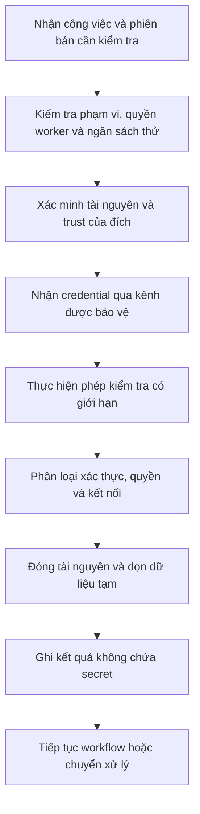

# Credential validation

**Credential validation** trong Privileged Access Management (PAM) là quá trình kiểm tra một credential có đáp ứng những điều kiện xác thực đã xác định hay không, với đúng tài khoản, tài nguyên đích và ngữ cảnh sử dụng. Kết quả phải chỉ rõ điều gì đã được kiểm tra, tại thời điểm nào và còn những giới hạn nào.

Bài học thuộc chương **Credential management**, trong phạm vi kiểm soát tài khoản quản trị, tài khoản dịch vụ và hạ tầng nhạy cảm. Validation hỗ trợ kiểm kê quyền, least privilege, JIT/JEA, vault, luân chuyển credential, giám sát phiên và lưu bằng chứng phục vụ kiểm toán, ứng phó sự cố.

Một secret có trong vault chưa chứng minh rằng hệ thống đích vẫn chấp nhận nó. Ngược lại, một lần kết nối thất bại chưa đủ để kết luận secret sai: nguyên nhân có thể là mạng, trust, tài khoản bị khóa, điều kiện truy cập hoặc lỗi tạm thời. Thiết kế validation cần phân biệt được các trường hợp này trước khi tự động thu hồi, thay đổi hoặc cấp lại credential.

Sau bài học, bạn có thể:

- Phân biệt kiểm tra cấu trúc, xác thực, kiểm tra quyền và kiểm tra sức khỏe kết nối.
- Thiết kế luồng validation có giới hạn tác động và không làm lộ secret.
- Phân loại kết quả thành được xác nhận, bị từ chối hoặc chưa đủ căn cứ.
- Phối hợp validation với luân chuyển, đồng bộ credential và vòng đời quyền.
- Xác định dữ liệu audit, cách xử lý lỗi và các tình huống thực hành cần kiểm chứng.

## 1. Validation cần trả lời câu hỏi nào?

Một yêu cầu kiểm tra phải có phạm vi rõ ràng:

```text
Credential hoặc phiên bản nào?
  → Dùng cho danh tính nào?
  → Xác thực với tài nguyên nào?
  → Bằng phương thức và ngữ cảnh nào?
  → Cần chứng minh xác thực hay cả một tập quyền cụ thể?
```

Ví dụ, mật khẩu được chấp nhận trên một máy Linux không chứng minh tài khoản có quyền vận hành dịch vụ cần thiết. Một token hợp lệ về chữ ký cũng không chứng minh dịch vụ đích sẽ chấp nhận token đó. Một cổng TCP đang mở không chứng minh credential đúng.

### Các lớp kiểm tra

| Lớp | Câu hỏi | Giới hạn |
|---|---|---|
| Cấu trúc và metadata | Dữ liệu có đúng loại, đủ trường và phù hợp chính sách cơ bản không? | Password đúng định dạng vẫn có thể không khớp ở đích |
| Trust của đích | Có đang trao đổi với đúng máy hoặc dịch vụ không? | Chưa chứng minh credential được chấp nhận |
| Xác thực | Đích hoặc cơ quan có thẩm quyền có chấp nhận credential trong ngữ cảnh này không? | Chưa chứng minh tài khoản có đúng quyền nghiệp vụ |
| Phân quyền | Danh tính có thực hiện được tập thao tác đã xác định không? | Một phép thử không chứng minh mọi quyền hiệu lực |
| Sức khỏe luồng sử dụng | Bên sử dụng thực tế có hoàn thành được bước cần thiết không? | Kết quả phụ thuộc đường mạng, client và thời điểm kiểm tra |

Khi báo cáo, nên giữ các lớp này tách biệt. Một nhãn xanh chung cho tất cả có thể che việc xác thực thành công nhưng quyền quá rộng, hoặc secret chưa được kiểm tra vì mạng đang lỗi.

## 2. Định nghĩa đầu vào trước khi lấy secret

Một công việc validation cần các tham chiếu và điều kiện sau:

- ID tài nguyên, endpoint được phép và danh tính máy đích cần xác minh.
- ID tài khoản hoặc danh tính, loại credential và phương thức xác thực.
- Tham chiếu đối tượng vault cùng phiên bản cần kiểm tra.
- Mục tiêu kiểm tra: cấu trúc, xác thực hay một tập quyền cụ thể.
- Danh tính worker, đường kết nối và ngữ cảnh được sử dụng.
- Timeout, ngân sách thử, điều kiện dừng và chủ sở hữu xử lý lỗi.
- Các sự kiện cần ghi và quy tắc bảo vệ secret trong runtime.

Không để client tùy ý truyền một địa chỉ đích rồi yêu cầu validator gửi credential quản trị tới đó. Ánh xạ giữa tài nguyên, tài khoản và credential phải đến từ dữ liệu được bảo vệ.

### Xác định đúng phiên bản

Nếu chỉ ghi “đã kiểm tra secret X”, kết quả có thể bị gán nhầm sau khi secret đổi. Cần liên kết với phiên bản hoặc một định danh công việc đủ rõ theo khả năng hệ thống.

Không dùng việc ghi plaintext, một phần password hoặc hash password vào log để phân biệt phiên bản. Tham chiếu phiên bản được hệ thống quản lý thường phù hợp hơn và tránh tạo dữ liệu có thể hỗ trợ dò giá trị hoặc liên kết secret ngoài mục đích.

### Xác định đúng ngữ cảnh

Một credential có thể được phép từ connector nhưng bị từ chối từ ứng dụng vì điều kiện mạng, thiết bị, tenant hoặc phương thức xác thực khác nhau. Kiểm tra qua connector chỉ chứng minh kết quả trong ngữ cảnh connector đó.

Nếu mục tiêu là bảo đảm workload thực sự hoạt động, cần kiểm tra hoặc quan sát luồng workload phù hợp, thay vì suy ra hoàn toàn từ một phép đăng nhập của worker PAM.

## 3. Validation theo từng loại credential

### 3.1 Password

Có thể kiểm tra sự tồn tại của tài khoản, trạng thái chính sách liên quan và thực hiện xác thực theo giao thức đích hỗ trợ. Các thao tác và mức thông tin trả về khác nhau giữa hệ thống.

Không nên giả định mọi lỗi xác thực đều chỉ ra password sai. Nhiều hệ thống cố ý trả lỗi chung để không tiết lộ tài khoản có tồn tại hay đang bị khóa.

Việc thử đăng nhập có thể tăng bộ đếm lỗi, cập nhật thời điểm sử dụng hoặc tạo phiên. Cần giới hạn số lần thử, đóng tài nguyên đã mở và bảo đảm không gây khóa tài khoản dịch vụ.

### 3.2 Khóa SSH

Kiểm tra có thể bao gồm định dạng khóa, khả năng sử dụng khóa riêng hoặc dịch vụ ký, quan hệ với khóa công khai và việc đích chấp nhận xác thực.

Khóa hợp lệ về cấu trúc không chứng minh khóa công khai còn được cho phép trên máy đích. Một lần SSH thành công cũng chưa chứng minh quyền `sudo`, khả năng truyền tệp hoặc những kênh khác đáp ứng chính sách.

Xác minh host key hoặc chứng thư của máy đích trước khi thực hiện xác thực theo thiết kế. Không tự tắt kiểm tra danh tính đích khi validation báo lỗi trust.

### 3.3 Chứng thư và khóa riêng

Tùy mục đích, có thể cần kiểm tra thời hạn, chuỗi tin cậy, mục đích sử dụng, định danh, trạng thái thu hồi và bằng chứng sở hữu khóa riêng. Chứng thư có chữ ký hợp lệ chưa đủ nếu không đúng bên nhận hoặc không phù hợp mục đích.

Việc không liên lạc được với nguồn kiểm tra thu hồi không tự chứng minh chứng thư bị thu hồi. Cần phân loại theo chính sách và cơ chế xác minh thực tế, bao gồm độ mới của dữ liệu được dùng.

Một khóa không xuất được từ dịch vụ khóa vẫn có thể bị lạm dụng qua quyền sử dụng. Validation cần kiểm soát danh tính được yêu cầu ký hoặc xác thực, không chỉ kiểm tra rằng không thể tải khóa riêng về.

### 3.4 Token và credential cloud/API

Cách kiểm tra phụ thuộc loại token và hợp đồng xác thực của dịch vụ:

- Token có chữ ký cần được kiểm chứng theo thuật toán, khóa, issuer, đối tượng nhận và điều kiện thời gian mà cơ chế yêu cầu.
- Token opaque có thể cần kiểm tra qua một cơ quan có thẩm quyền hoặc dịch vụ đích; không thể suy nội dung bằng cách giải mã như token tự chứa.
- Token hợp lệ cho một dịch vụ không mặc nhiên dùng được ở dịch vụ khác.
- Thành công ở một API nhận diện danh tính chưa chứng minh mọi thao tác nghiệp vụ đều được phép.

Không nhúng một token thật vào ví dụ, log hoặc công cụ chẩn đoán không được quản lý. Metadata thời hạn do một nguồn không được xác minh cung cấp cũng chưa phải căn cứ để kết luận token hợp lệ.

### 3.5 Credential dùng một lần hoặc có thời hạn rất ngắn

Một phép kiểm tra có thể tiêu thụ mã dùng một lần hoặc làm giảm đáng kể thời gian sử dụng còn lại. Không nên áp dụng một bước đăng nhập thử chung cho mọi loại credential.

Có thể cần xác minh điều kiện cấp phát trước, rồi dùng kết quả xác thực của chính giao dịch được phép làm bằng chứng. Cách này phải được thiết kế theo phương thức xác thực thực tế, không tạo một lần sử dụng ngoài dự kiến chỉ để cập nhật trạng thái trong PAM.

## 4. Luồng validation tham chiếu



### Bước 1: Xác minh thẩm quyền công việc

Worker chỉ nhận các tài nguyên, loại credential và phép thử nằm trong phạm vi được cấp. Một kết quả validation thành công không được dùng để mở rộng sang các tài khoản chưa được onboarding.

Công việc cần có mã định danh và phiên bản để tránh xử lý kết quả cũ như kết quả hiện tại. Nếu credential thay trong lúc công việc đang chạy, hệ thống phải nhận diện thay đổi trước khi cập nhật trạng thái.

### Bước 2: Kiểm tra điều kiện trước xác thực

Kiểm tra cấu hình, trạng thái công việc luân chuyển, thời gian và ngân sách thử. Nếu tài khoản đang bị khóa hoặc đích chưa được xác minh, có thể cần dừng trước khi gửi credential.

Worker phải phân biệt lỗi điều kiện chuẩn bị với kết quả đích từ chối credential. Không để một lỗi cấu hình bị ghi thành password không hợp lệ.

### Bước 3: Thực hiện phép thử tối thiểu

Chọn một thao tác đủ chứng minh mục tiêu, có phạm vi và timeout rõ ràng. Nếu chỉ cần kiểm tra xác thực, không tự chạy lệnh quản trị hoặc đọc dữ liệu nghiệp vụ.

Nếu cần xác nhận quyền, dùng tập quyền và đối tượng kiểm tra đã xác định. Một truy vấn nhỏ vẫn có thể đọc dữ liệu nhạy cảm hoặc giữ lock tùy hệ thống, vì vậy phải hiểu tác động thay vì gọi mọi thao tác đọc là vô hại.

### Bước 4: Phân loại và đóng tài nguyên

Ghi nhận kết quả ở từng lớp, đóng session hoặc connection đã tạo, giải phóng tài nguyên và xử lý dữ liệu tạm theo khả năng runtime. Nếu timeout xảy ra sau khi đích đã xác thực, có thể vẫn tồn tại phiên cần dọn.

### Bước 5: Cập nhật workflow đúng phiên bản

Kết quả phải gắn với credential đã thử và thời điểm quan sát. Nếu công việc phát hiện trạng thái chưa chắc chắn hoặc sai lệch, chuyển tới quy trình xử lý thay vì tự ghi đè secret hoặc reset tài khoản.

## 5. Phân loại kết quả để tránh tự động hóa sai

Một mô hình hữu ích là giữ ít nhất ba khả năng cho xác thực:

- **Được xác nhận:** có bằng chứng phù hợp rằng phép xác thực đã được chấp nhận trong ngữ cảnh đã kiểm tra.
- **Bị từ chối:** có phản hồi từ bên có thẩm quyền cho thấy phép xác thực không được chấp nhận; nguyên nhân cụ thể có thể vẫn chưa biết.
- **Chưa đủ căn cứ:** không hoàn tất được phép kiểm tra hoặc không tin cậy được kết quả.

Không gộp “chưa đủ căn cứ” thành “credential sai”.

| Quan sát | Cách hiểu phù hợp | Hành động tham chiếu |
|---|---|---|
| Không phân giải được tên hoặc không kết nối được | Chưa chứng minh gì về credential | Điều tra đường kết nối và cấu hình |
| Danh tính máy đích không khớp | Không có trust hợp lệ để tiếp tục | Dừng trước khi gửi secret, kiểm tra ánh xạ và trust |
| Đích trả lỗi xác thực chung | Phép xác thực bị từ chối, nguyên nhân có thể chưa rõ | Giới hạn thử lại, đối chiếu trạng thái tài khoản và log được phép |
| Có thông tin đáng tin cậy về tài khoản bị khóa hoặc vô hiệu | Trạng thái tài khoản cản trở xác thực | Chuyển chủ sở hữu xử lý; không tự reset password chỉ để thử |
| Xác thực thành công nhưng thao tác nghiệp vụ bị từ chối | Credential được chấp nhận, quyền hoặc điều kiện chưa đáp ứng | Kiểm tra quyền hiệu lực và mục tiêu sử dụng |
| Xác thực thành công nhưng quyền vượt thiết kế | Có sai lệch quyền cần xử lý | Hạn chế cấp phát theo chính sách và rà soát quyền |
| Bị rate limit hoặc timeout | Kết quả chưa chắc chắn hoặc bị giới hạn dịch vụ | Tôn trọng giới hạn, kiểm tra tài nguyên có thể còn tồn tại |
| Credential hết thời hạn theo kiểm chứng hợp lệ | Không phù hợp để cấp sử dụng mới theo cơ chế đó | Cấp lại hoặc xử lý vòng đời qua workflow được phép |

Sản phẩm có thể dùng những trạng thái khác. Điều cần giữ là ngữ nghĩa đủ rõ để một lỗi mạng không kích hoạt hành động thay đổi credential không cần thiết.

## 6. Tránh khóa tài khoản và tác động ngoài dự kiến

### 6.1 Ngân sách thử ở mức tài khoản

Nhiều validator, proxy và ứng dụng có thể cùng dùng một tài khoản. Giới hạn ba lần thử trên mỗi worker không ngăn được tổng số lần thử lớn nếu nhiều worker chạy đồng thời.

Cần phối hợp số lần thử theo tài khoản hoặc phạm vi phù hợp, xét cả hoạt động ngoài PAM và chính sách khóa thực tế. Không suy ra một số lần thử luôn an toàn khi chưa biết bộ đếm, cửa sổ thời gian và các nguồn xác thực khác.

### 6.2 Phối hợp với luân chuyển

Không chạy các phép thử dùng bản cũ trong khi workflow đang thay credential mà không có cơ chế phối hợp. Điều đó vừa tạo kết quả sai lệch vừa có thể làm khóa tài khoản.

Có thể cần khóa công việc, phiên bản, hàng đợi hoặc cơ chế điều phối được hệ thống hỗ trợ. Một khóa hết hạn không tự bảo đảm worker cũ đã dừng; cần xét những công việc tiếp tục chạy sau khi mất thẩm quyền.

### 6.3 Thử lại có giới hạn

Lỗi kết nối tạm thời có thể phù hợp với thử lại có backoff và jitter, nhưng vẫn phải giới hạn tổng thời gian và số lần. Lỗi xác thực bị từ chối không nên bị thử lại nhanh liên tục với cùng dữ liệu.

Nếu nền tảng có độ trễ áp dụng thay đổi, có thể cần cửa sổ chờ và lịch kiểm tra được thiết kế trước. Độ trễ đó không phải lý do bỏ kiểm tra trust, tăng quyền hoặc dùng credential cũ vô hạn.

### 6.4 Phép kiểm tra vẫn có dấu vết

Một lần đăng nhập có thể tạo audit, cập nhật last-used, chiếm slot kết nối hoặc tạo phiên tại đích. Điều này có thể chấp nhận được nhưng cần được biết và gắn mã công việc để phân biệt với hoạt động quản trị khác.

Không xóa log của đích để làm validation trông như không có tác động. Dữ liệu hoạt động của validator là một phần bằng chứng vận hành.

## 7. Validation trong vòng đời credential

| Thời điểm | Mục tiêu | Điều cần tránh |
|---|---|---|
| Onboarding | Xác minh ánh xạ tài nguyên, tài khoản và credential được tiếp nhận | Kết luận toàn bộ quyền đã an toàn chỉ vì đăng nhập được |
| Trước cấp sử dụng theo chính sách | Giảm nguy cơ giao một credential đã biết không phù hợp | Tạo quá nhiều lần đăng nhập thử hoặc kéo dài độ trễ không cần thiết |
| Sau luân chuyển | Xác nhận phiên bản mới khớp ở đích trong ngữ cảnh đã chọn | Thử bản cũ liên tục hoặc phát hành bản chưa được xác nhận như thể đã đạt |
| Theo lịch | Phát hiện drift, credential bị đổi ngoài PAM hoặc trạng thái tài khoản thay đổi | Quét đồng loạt gây quá tải hay khóa nhiều tài khoản |
| Khi có sự cố | Xác định lớp lỗi và phạm vi ảnh hưởng | Dùng validation như một phép thử đăng nhập không giới hạn |
| Sau khôi phục | Đối soát dữ liệu vault với trạng thái hiện tại ở đích | Tin rằng bản backup luôn chứa credential còn hiệu lực |

### Độ mới của kết quả

Một lần thành công chỉ là quan sát tại một thời điểm. Password có thể bị thay ở đích ngay sau đó; quyền có thể bị thu hồi hoặc token có thể hết hạn.

Chính sách có thể quy định kết quả gần nhất được dùng trong bao lâu để hỗ trợ một quyết định, nhưng khoảng thời gian đó không biến kết quả thành bảo đảm tuyệt đối. Cần ghi thời điểm kiểm tra và các điều kiện quan trọng để người vận hành hiểu giới hạn.

### Không bỏ qua quyền và JEA

Validation có thể xác nhận một tài khoản đăng nhập được, nhưng least privilege và JEA hoặc cơ chế hạn chế hành động cần được đánh giá riêng. Chạy một lệnh vận hành thành công chưa chứng minh người dùng không thể chạy nhiều lệnh khác có quyền cao hơn.

Cần phối hợp dữ liệu cấu hình quyền, audit và các phép thử từ chối có phạm vi. Không dùng một cờ “credential valid” để thay thế toàn bộ kiểm tra quyền đặc biệt.

## 8. Ví dụ: kiểm tra sau luân chuyển tài khoản dịch vụ

Giả sử một ứng dụng sử dụng tài khoản cơ sở dữ liệu do PAM quản lý. Vault và máy đích đang dùng phiên bản `v11`; workflow chuẩn bị chuyển sang `v12`.

### 8.1 Luồng thông thường

```text
Ghi nhận công việc và phiên bản cần thay
  → Thực hiện thay đổi theo cơ chế của đích
  → Giữ phiên bản mới trong trạng thái được kiểm soát
  → Validation đúng tài khoản, đích và ngữ cảnh
  → Cập nhật bên sử dụng theo kế hoạch
  → Xác nhận sức khỏe và xử lý bản cũ
```

Thứ tự chi tiết phụ thuộc khả năng đích: một số hệ thống chỉ có một password hiệu lực, số khác hỗ trợ nhiều key hoặc danh tính song song. Không mặc định có thể giữ cả hai phiên bản cùng hoạt động.

### 8.2 Lỗi sau khi đích đã thay đổi

Tại thời điểm máy đích đã chấp nhận `v12`, kết nối từ worker bị mất trước khi nhận đủ kết quả hoặc lưu hoàn tất. Trạng thái công việc trở nên chưa chắc chắn.

Không nên lập tức kết luận `v12` sai, xóa giá trị mới hoặc khôi phục `v11` trong vault như thể đích chưa thay đổi. Cần bảo vệ dữ liệu cần cho reconciliation, kiểm tra trạng thái quan sát được theo quy trình và xác nhận lại quyền thực thi công việc.

Nếu thử xác thực `v12` thành công, kết quả giúp chứng minh phiên bản mới được đích chấp nhận. Nó vẫn chưa chứng minh mọi instance ứng dụng đã nhận bản mới hoặc pool kết nối không còn dùng trạng thái cũ.

### 8.3 Kết quả cho ứng dụng

Ứng dụng có thể cần reload, restart hoặc làm mới pool. Một phép thử của connector trên đường mạng riêng chưa chứng minh ứng dụng truy cập được bằng cấu hình thực tế.

Cần kết hợp kết quả validation của PAM với tín hiệu sức khỏe phù hợp từ ứng dụng. Nếu một bên thất bại, giữ thông tin phân loại để biết đang lỗi credential, quyền, đường mạng hay cập nhật bên sử dụng.

## 9. Hồ sơ kết quả không chứa secret

Ví dụ dưới đây là dữ liệu giả minh họa mô hình báo cáo, không phải kết quả một phép validation đã chạy:

```yaml
validation_observation:
  job_reference: validation-example-008
  asset_reference: orders-database-production
  account_reference: orders-runtime-account
  credential_reference: prod-payments/orders-runtime
  credential_version_reference: v12
  validation_profile_reference: database-authentication-check
  execution_context_reference: payments-validation-connector
  checks:
    target_identity: confirmed
    authentication: accepted
    expected_permission_probe: passed
  scope_notes:
    full_effective_permissions_reviewed: false
    application_instances_verified: false
  outcome: confirmed_within_tested_scope
  secret_value_recorded: false
```

Trong hệ thống thực, bổ sung thời điểm, thời lượng, phiên bản policy hoặc profile, người hoặc dịch vụ kích hoạt và trạng thái cleanup khi có. Những trường như `passed` phải đến từ bước kiểm tra thật, không chỉ vì connector trả một phản hồi chung.

Cần bảo vệ quyền ghi kết quả. Một bên không đáng tin cậy không nên có thể tự đánh dấu credential đã được xác nhận để bỏ qua điều kiện cấp phát.

### Metadata cũng cần phân quyền

Tên tài khoản, endpoint, namespace và các lỗi chi tiết có thể tiết lộ cấu trúc hạ tầng. Người xem dashboard không nhất thiết cần mọi dữ liệu mà worker có.

Có thể dùng mã tham chiếu và phân quyền xem chi tiết theo trách nhiệm. Không vì muốn che secret mà xóa hết ngữ cảnh cần thiết để điều tra; cần chọn dữ liệu đủ dùng và được bảo vệ.

## 10. Policy và danh tính cho validator

Validator cần danh tính dịch vụ riêng với quyền phù hợp từng nhiệm vụ:

- Đọc hoặc sử dụng những credential được giao, theo khả năng tách quyền của giải pháp.
- Đọc metadata cần thiết để xác minh tài nguyên, tài khoản và phiên bản.
- Thực hiện phép kiểm tra đã định trước tại đích.
- Ghi kết quả và audit theo cơ chế được kiểm soát.
- Dọn các tài nguyên mà chính phép kiểm tra tạo ra trong phạm vi được phép.

Không tự cấp cho validator quyền reset mọi mật khẩu, quản lý mọi policy hoặc sửa toàn bộ tài khoản chỉ vì validation có thể thất bại. Quyền kiểm tra và quyền sửa chữa có thể cần hai danh tính hoặc workflow khác nhau.

Nếu một credential dùng để validation có quyền quản trị cao ở đích, worker xử lý nó là tài sản nhạy cảm. Cần hardening, bảo vệ bộ nhớ và dump, hạn chế log, giảm đường mạng và kiểm soát người có quyền quản trị worker.

Không nên đưa secret vào tham số dòng lệnh hoặc các đầu ra chẩn đoán có thể thu thập rộng. Sau sử dụng, hạn chế thời gian giữ secret và xử lý dữ liệu tạm theo khả năng nền tảng; không hứa loại bỏ mọi bản sao trong bộ nhớ chỉ bằng xóa một biến.

## 11. Audit và giám sát vận hành

Một chuỗi bằng chứng cần liên kết được:

```text
Sự kiện kích hoạt
  → Công việc validation
  → Tài nguyên, tài khoản và phiên bản credential
  → Danh tính cùng ngữ cảnh worker
  → Phép kiểm tra và kết quả từng lớp
  → Hành động tiếp theo cùng kết quả cleanup
```

Các dữ liệu hữu ích gồm kết quả bị từ chối, lỗi trust, giới hạn thử, công việc chưa chắc chắn, độ trễ hoàn tất và tỷ lệ credential chưa được xác nhận trong cửa sổ quy định.

### Tín hiệu nên theo dõi

- Nhiều tài khoản cùng lỗi kết nối trên một connector: có thể là lỗi mạng hoặc thành phần dùng chung.
- Một tài khoản bị từ chối sau thay đổi ngoài PAM: có thể có drift hoặc sự cố cần đối soát.
- Số lần thử tăng nhanh từ nhiều worker: có nguy cơ khóa tài khoản hoặc lỗi điều phối.
- Validation thành công nhưng cấp sử dụng hoặc ứng dụng thất bại: cần so sánh ngữ cảnh và phiên bản.
- Quyền tài khoản vượt profile: cần xử lý kiểm soát đặc quyền dù credential vẫn xác thực được.
- Kết quả quá cũ hoặc thiếu dữ liệu: cần phản ánh chất lượng quan sát, không chỉ hiển thị lần thành công cuối cùng.

Audit ở vault, worker và đích có thể cung cấp những phần khác nhau của bằng chứng. Giữ mã liên kết và đồng bộ thời gian giúp đối chiếu; không giả định một bản ghi phiên hoặc một log đăng nhập tự mô tả đầy đủ toàn bộ công việc.

## 12. Thực hành kiểm chứng quy trình

Trong môi trường lab được phép, dùng tài khoản và dữ liệu giả, xác định trước chính sách khóa và giới hạn ảnh hưởng. Các tình huống sau là gợi ý học tập, không phải báo cáo rằng một hệ thống cụ thể đã được kiểm thử.

| Tình huống | Điều cần quan sát |
|---|---|
| Credential đúng, đúng đích | Kết quả xác thực được xác nhận và có tham chiếu phiên bản |
| Credential bị đích từ chối | Không thử vô hạn, không tự reset ngoài quy trình |
| Mất mạng hoặc dịch vụ không đáp ứng | Được phân loại chưa đủ căn cứ, không tự gắn nhãn password sai |
| Danh tính máy đích không khớp | Dừng trước khi gửi credential và có sự kiện trust phù hợp |
| Tài khoản bị khóa hoặc vô hiệu trong lab | Quy trình xử lý không làm tăng tác động hoặc tự mở khóa ngoài quyền |
| Xác thực được nhưng thiếu quyền nghiệp vụ | Tách kết quả xác thực khỏi kết quả quyền |
| Quyền vượt mức dự kiến | Phát hiện sai lệch theo khả năng đánh giá, không coi chỉ đăng nhập được là đạt |
| Credential đổi trong lúc kiểm tra | Kết quả không bị gán cho phiên bản mới chưa được thử |
| Worker lỗi sau khi đã kết nối | Phiên hoặc tài nguyên thử được đối soát và cleanup |
| Luân chuyển gặp kết quả chưa chắc chắn | Reconciliation diễn ra trước hành động thử lại có tác động |
| Token hết hạn hoặc sai đối tượng nhận | Bị xử lý theo cơ chế kiểm chứng token phù hợp |
| Kiểm tra secret dùng một lần | Không tiêu thụ credential ngoài luồng đã thiết kế |

Kiểm chứng nên bao gồm cả việc log không chứa secret và người không có quyền không thể tự sửa trạng thái kết quả. Các phép thử cần có điều kiện dừng, cách khôi phục và bằng chứng phù hợp với mục tiêu học tập.

## 13. Điều kiện bàn giao vận hành

Một quy trình credential validation sẵn sàng bàn giao khi đã xác định:

- Mỗi loại credential có phép kiểm tra và phạm vi kết luận rõ ràng.
- Tài nguyên, tài khoản, phương thức và phiên bản được liên kết chính xác.
- Danh tính worker, quyền lấy secret và quyền thực thi ở đích được giới hạn.
- Ngân sách thử, điều phối, timeout, cleanup và xử lý khóa tài khoản có người chịu trách nhiệm.
- Kết quả được phân biệt giữa xác thực, quyền, trust và khả năng kết nối.
- Luân chuyển, cấp sử dụng và reconciliation không dựa vào một nhãn hợp lệ thiếu ngữ cảnh.
- Audit đủ để điều tra nhưng không chứa giá trị credential.
- Quy trình xử lý lỗi, quyền sửa chữa và khả năng phục hồi đã được kiểm chứng trong phạm vi phù hợp.

Validation tạo ra bằng chứng có giới hạn về khả năng sử dụng credential tại một thời điểm. Giá trị của nó nằm ở việc giúp PAM quyết định và xử lý đúng từng lớp lỗi, đồng thời duy trì quyền tối thiểu, vòng đời credential và khả năng truy vết từ vault tới hệ thống đích.
