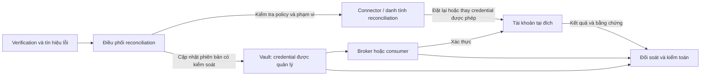

# Credential reconciliation trong PAM

## 1. Credential reconciliation giải quyết vấn đề gì?

Trong hệ thống quản lý truy cập đặc quyền (Privileged Access Management — PAM), vault giữ một phiên bản credential để broker, người dùng được phép hoặc ứng dụng xác thực đến tài nguyên. Tuy nhiên, credential ở hệ thống đích có thể thay đổi ngoài luồng PAM, hoặc một tác vụ rotation có thể hoàn tất ở đích nhưng chưa cập nhật được vault.

Khi đó xuất hiện **credential drift**: trạng thái mà PAM đang quản lý không còn khớp trạng thái xác thực thực tế. Vault có thể trả một mật khẩu cũ, broker không mở được phiên, ứng dụng lỗi khi tạo kết nối mới và dịch vụ rotation không thể dùng credential hiện tại để đổi tiếp.

**Credential reconciliation** là quá trình đưa credential được quản lý và trạng thái xác thực tại đích về một trạng thái nhất quán, có thể xác minh. Với nhiều sản phẩm PAM quản lý password, reconciliation thường được thực hiện bằng cách dùng một danh tính khôi phục được ủy quyền để đặt lại password của tài khoản đích, rồi đồng bộ giá trị được bảo vệ vào vault. Tên gọi và trình tự cụ thể phụ thuộc sản phẩm và connector.

Reconciliation không nhất thiết là đọc password đang tồn tại ở đích để chép ngược về vault. Nhiều hệ thống không cung cấp khả năng đọc lại password hiện tại. Cách khôi phục thường là đặt một credential mới được phép, không phải cố khôi phục plaintext từ dữ liệu xác thực của hệ thống.

Trong quản lý tài khoản quản trị, tài khoản dịch vụ và hạ tầng nhạy cảm, mục tiêu không dừng ở việc “mật khẩu đã đổi”. Cần biết đúng tài khoản đã được xử lý, vault và đích đã khớp, consumer đã nhận đúng credential, quyền được giới hạn và bằng chứng đủ để kiểm toán hoặc ứng phó sự cố.

## 2. Phân biệt verify, rotation và reconciliation

| Hoạt động | Mục đích chính | Có cần biết credential hiện tại không? | Điểm kết thúc cần xác minh |
|---|---|---|---|
| Verification | Kiểm tra credential hoặc trạng thái xác thực được quản lý có còn hợp lệ | Thường dùng credential hoặc cơ chế kiểm tra hiện có | Kết quả hợp lệ/không hợp lệ hoặc chưa xác định, trên đúng đích |
| Rotation | Thay credential theo lịch, policy hoặc sự kiện | Tùy giao thức: dùng credential hiện tại hoặc một danh tính được ủy quyền khác | Credential mới được chấp nhận, vault và consumer được cập nhật |
| Reconciliation | Khôi phục tính nhất quán khi credential không khớp, mất đồng bộ hoặc không còn dùng được theo trạng thái đã quản lý | Có thể dùng quyền đặt lại độc lập với credential bị sai | Trạng thái vault–đích nhất quán và ảnh hưởng vận hành đã được xử lý |

Trong một số sản phẩm, rotation và reconciliation dùng các tài khoản hoặc API khác nhau. Một số khác gộp nhiều bước dưới cùng một workflow. Khi thiết kế, cần mô tả hành vi thật thay vì dựa vào tên nút trong giao diện.

Ví dụ:

- Vault giữ phiên bản `v41`; đích đã nhận credential mới từ một tác vụ rotation nhưng cập nhật vault thất bại. Đây là trạng thái mất đồng bộ sau thay đổi.
- Một quản trị viên đổi password trực tiếp tại đích. Credential trong vault không còn dùng được, nhưng nguyên nhân và tính hợp lệ của thay đổi cần được điều tra.
- Tài khoản bị khóa, đích mất kết nối hoặc connector gọi nhầm tài nguyên. Những tình huống này có thể gây lỗi xác thực nhưng chưa đủ để kết luận password drift.

Không nên kích hoạt đặt lại credential cho mọi lỗi đăng nhập. Chẩn đoán sai có thể gây gián đoạn, che khuất sự cố hoặc thay đổi nhầm một tài khoản vẫn đang hoạt động.

## 3. Mô hình trạng thái giữa vault, đích và consumer

Có thể phân tích ba phía chính:

| Phía | Trạng thái cần biết |
|---|---|
| Vault/PAM | Secret ID, tài khoản đích, phiên bản đã công bố, phiên bản đang xử lý, tác vụ hiện hữu và policy |
| Hệ thống đích | Tài khoản chính xác, trạng thái hoạt động/khóa/hết hạn, cơ chế xác thực và kết quả thao tác được xác nhận |
| Consumer | Broker, replica, service, job hoặc pipeline đang dùng phiên bản nào và cách nhận bản mới |

Dữ liệu ở phía đích không nhất thiết cho biết giá trị credential hiện tại. Một API có thể chỉ cho biết tài khoản tồn tại, có khóa nào được cài, token nào còn hiệu lực hoặc thao tác đổi password đã thành công. Cần dùng những bằng chứng được nền tảng hỗ trợ, không coi một nhãn phiên bản trong vault là chứng minh trạng thái thực tế ở đích.



Sơ đồ mô tả quan hệ logic. Thứ tự cập nhật vault và đích phải theo thiết kế connector; không có giả định rằng các phía cùng nằm trong một giao dịch nguyên tử.

## 4. Nhận diện drift và loại trừ lỗi khác

Những tín hiệu thường dẫn đến yêu cầu kiểm tra gồm lỗi đăng nhập tăng sau rotation, một tác vụ đặt lại bị timeout, phát hiện thay đổi ngoài PAM hoặc consumer mới khởi động không kết nối được.

Trước khi thay credential, cần kiểm tra:

1. **Đúng đối tượng:** Secret ID có trỏ đúng tài nguyên, môi trường, tenant/domain và tài khoản không? Có nhầm tài khoản cùng tên ở hệ thống khác không?
2. **Đường kết nối:** DNS, mạng, TLS/host identity, endpoint và giao thức có đúng không?
3. **Trạng thái tài khoản:** Tài khoản có bị khóa, vô hiệu, hết hạn hoặc bị hạn chế đăng nhập theo policy không?
4. **Trạng thái tác vụ:** Có rotation/reconciliation đang chạy, vừa timeout hoặc còn chờ cập nhật không?
5. **Phiên bản:** Consumer có dùng bản cũ trong cache không? Broker có đọc đúng đối tượng hoặc alias không?
6. **Đích phân tán:** Việc đổi credential có đang chờ sao chép giữa những nút xác thực hay không, nếu nền tảng có cơ chế này?
7. **Dấu vết thay đổi:** Có sự kiện thay đổi ngoài quy trình, hoạt động khẩn cấp hoặc dấu hiệu xâm nhập không?

Verification cũng có thể tạo dấu vết và làm tăng bộ đếm đăng nhập thất bại. Không nên gọi kiểm tra liên tục với nhiều phiên bản nghi ngờ cho đến khi khóa tài khoản. Cần giới hạn tần suất, số lần thử và dùng tín hiệu chẩn đoán phù hợp.

Một kết nối cũ còn sống không chứng minh credential trong vault còn hợp lệ. Connection pool hoặc phiên đã xác thực có thể tiếp tục hoạt động dù credential dùng cho lần đăng nhập mới đã thay đổi.

| Kết quả quan sát | Kết luận phù hợp |
|---|---|
| Credential được quản lý tạo được kết nối mới tới đúng đích | Có bằng chứng credential được chấp nhận tại thời điểm kiểm tra |
| Đích trả lỗi xác thực với tài khoản đúng | Cần phân tích password/key, trạng thái tài khoản và policy; chưa tự suy ra nguyên nhân |
| Không đến được endpoint | Chưa xác định tính hợp lệ của credential |
| Tác vụ đổi bị timeout | Kết quả thay đổi chưa xác định; có thể đích đã thực hiện |
| Một consumer lỗi, các consumer khác hoạt động | Kiểm tra phiên bản, cache và đường kết nối của consumer đó trước |

## 5. Xác định nguồn có thẩm quyền và phạm vi khôi phục

Reconciliation cần một quy tắc rõ về trạng thái mong muốn. Không thể luôn chọn “vault đúng” hoặc “đích đúng” mà bỏ qua policy và ngữ cảnh.

Một thiết kế có thể quy định PAM điều phối credential của tài khoản được onboard; thay đổi ngoài luồng phải được xem xét và khi được phép sẽ thiết lập một credential mới qua reconciliation. Trong một tích hợp khác, một hệ thống danh tính hoặc dịch vụ cấp credential bên ngoài là nguồn có thẩm quyền, PAM cần làm mới tham chiếu hoặc tích hợp đúng quy trình thay vì tự đặt password.

Trước khi thực hiện, cần xác định:

- Loại credential và thao tác được hệ thống đích hỗ trợ.
- Ai phê duyệt khôi phục, trong phạm vi tài nguyên và môi trường nào.
- Có được tự động thực hiện khi phát hiện drift hay cần người quyết định.
- Điều kiện chặn: sự cố đang điều tra, dependency chưa biết, thay đổi khác đang chạy hoặc thiếu quyền an toàn.
- Consumer, phiên và dịch vụ nào chịu ảnh hưởng khi credential được đổi.
- Cách xác minh, khôi phục vận hành và xử lý kết quả chưa xác định.

Nếu nghi ngờ tài khoản bị chiếm dụng, đặt lại password có thể cần thiết nhưng chưa hoàn thành ứng phó. Cần bảo toàn bằng chứng phù hợp, chặn đường truy cập trái phép, xem quyền/khóa mới được tạo và xử lý phiên hoặc token hiện hữu.

### Một yêu cầu reconciliation nên chứa gì?

```json
{
  "task_id": "reconcile-218",
  "managed_account_id": "account:payments-batch-prod",
  "target_resource_id": "database:payments-prod",
  "secret_id": "secret:payments-batch-prod",
  "expected_vault_revision": "rev-41",
  "reason": "POST_ROTATION_STATE_UNCERTAIN",
  "approval_reference": "change:218",
  "connector_id": "connector:payments-prod-db"
}
```

Ví dụ chỉ chứa định danh và metadata, không có secret. Đây không phải schema của một sản phẩm. Dịch vụ thực thi vẫn phải xác minh chủ thể, phạm vi, phê duyệt và tính toàn vẹn; dữ liệu requester tự gửi không tự tạo quyền đặt lại credential.

## 6. Quản lý tài khoản hoặc danh tính reconciliation

Danh tính reconciliation thường có quyền đặt lại credential mà không cần biết credential đang sai. Đây là một quyền đặc biệt nhạy cảm: kẻ kiểm soát nó có thể thay credential và làm gián đoạn hoặc chiếm quyền một tài khoản khác.

Nguyên tắc least privilege cần áp dụng cho chính cơ chế khôi phục:

| Miền quyền | Giới hạn cần xem xét |
|---|---|
| Tài khoản đích | Chỉ những tài khoản hoặc nhóm tài nguyên được giao |
| Môi trường | Tách phạm vi production với development và các miền tin cậy khác |
| Thao tác | Đặt lại/thay credential theo nhu cầu; không mặc nhiên kèm shell, quản trị toàn hệ thống hoặc quyền đọc mọi secret |
| Truy cập vault | Chỉ dùng credential khôi phục và ghi các đối tượng được quản lý theo workflow |
| Cấu hình connector | Không cho requester đổi hostname, account hoặc hành vi thực thi tùy ý |
| Vòng đời | Có chủ sở hữu, bảo vệ, rotation, kiểm tra hiệu lực và cách thu hồi riêng |

Nếu đích cho phép, dùng cơ chế ủy quyền chuyên biệt hoặc quyền tạm JIT thay cho tài khoản quản trị toàn quyền thường trực. Nếu chưa thể thu hẹp đủ, phải ghi rõ phạm vi tin cậy và kiểm soát bù đắp phù hợp; không coi tên “reconcile account” là một bảo đảm quyền tối thiểu.

Cần tách người sử dụng credential, người đề nghị reconciliation, người phê duyệt và quyền sửa policy/connector theo mức rủi ro. Một người có thể tự sửa connector để reset tài khoản bất kỳ rồi tự phê duyệt sẽ làm mất ranh giới kiểm soát.

### Tránh vòng phụ thuộc không khôi phục được

Credential của danh tính reconciliation cũng có thể hết hạn hoặc mất đồng bộ. Cần biết ai hoặc cơ chế nào có thể khôi phục nó, bảo vệ quyền đó ra sao và liệu kịch bản lỗi có làm mất cả đường bình thường lẫn đường cứu hộ không.

Không giả định một tài khoản có thể luôn tự khôi phục khi chính credential của nó không dùng được. Đường break-glass hoặc cấp lại đặc biệt cần được thiết kế trước, có phạm vi, người được ủy quyền và bằng chứng.

## 7. Quy trình reconciliation cho password được quản lý

Một workflow mẫu gồm các cổng sau. Thứ tự chi tiết phải phù hợp sản phẩm và giao thức, nhưng mỗi cổng cần có kết quả đủ rõ.

1. **Tiếp nhận và phân loại:** xác định tín hiệu, tài khoản, tài nguyên, mức khẩn cấp và nguyên nhân đã biết/chưa biết.
2. **Xác minh điều kiện:** loại trừ nhầm mapping, lỗi kết nối hoặc tài khoản bị khóa; kiểm tra policy và phê duyệt.
3. **Điều phối:** chặn tác vụ thay đổi xung đột, ghi task ID và revision dự kiến; xử lý yêu cầu checkout mới theo policy.
4. **Chuẩn bị:** kiểm kê consumer, cửa sổ thay đổi, khả năng khôi phục, danh tính reconciliation và cách giữ credential mới an toàn.
5. **Thực hiện:** tạo/đặt credential mới qua connector được ủy quyền trên đúng tài khoản đích.
6. **Đồng bộ:** cập nhật phiên bản trong vault theo cơ chế kiểm soát đồng thời; không ghi đè thay đổi mới của một tác vụ khác.
7. **Xác minh đích:** dùng cơ chế được phép để kiểm tra một lần xác thực mới hoặc trạng thái tương đương trên đúng tài nguyên.
8. **Cập nhật consumer:** reload, cấp lại cấu hình, tạo kết nối mới hoặc rollout theo thiết kế ứng dụng.
9. **Đối soát:** xác nhận các phía, xử lý credential/phiên/quyền cũ theo policy và ghi những phần chưa hoàn tất.
10. **Đóng tác vụ:** chỉ đánh dấu theo mức hoàn thành đã chứng minh; lưu bằng chứng và nguyên nhân để ngăn lặp lại.

Không cần trả credential mới cho người đề nghị để họ xác minh thủ công nếu broker hoặc connector có thể thực hiện kiểm tra. Luồng checkout không hiển thị plaintext vẫn có thể được duy trì trong reconciliation.

Nếu sản phẩm hỗ trợ giữ phiên bản chờ trước khi thay đổi tại đích, trạng thái chờ phải được bảo vệ và không cấp nhầm cho consumer. Nếu cập nhật vault sau khi đổi ở đích, cần phương án xử lý khi bước cập nhật đó lỗi. Không tự giả định mọi connector dùng cùng một trình tự.

## 8. Điều phối đồng thời và kết quả chưa xác định

Reconciliation phải phối hợp với rotation, checkout, thao tác thủ công và những bộ điều khiển khác. Một khóa theo secret ID có thể chưa đủ nếu hai bản ghi khác nhau cùng trỏ tới một tài khoản đích. Phạm vi điều phối cần dựa trên định danh chuẩn của tài nguyên và tài khoản thực sự bị thay đổi.

Các cơ chế có thể cần gồm:

- Một tác vụ chủ động cho cùng tài khoản trong phạm vi được điều phối.
- Task ID và trạng thái để nhận diện retry của cùng yêu cầu.
- Kiểm tra revision hoặc cơ chế tương đương khi cập nhật vault để tránh ghi đè trạng thái mới hơn.
- Giới hạn thời gian giữ quyền điều phối và cách xử lý worker thực thi cũ còn chạy sau timeout.
- Đối soát định kỳ để tìm tác vụ dở dang và thay đổi ngoài luồng.

Khóa phân tán trong bộ điều phối không tự ngăn một runner cũ tiếp tục đổi password ở đích sau khi mất lease. Nếu giao thức/đích hỗ trợ fencing hoặc kiểm tra thế hệ tác vụ, có thể dùng để hạn chế tình huống này; nếu không, phải thừa nhận giới hạn và thiết kế điều phối, hủy tác vụ, kiểm tra trạng thái phù hợp.

Tương tự, kiểm tra revision ở vault bảo vệ bản ghi vault, không tự bảo vệ thao tác ngoài hệ thống đích. Không được coi một lần ghi có điều kiện thành công là bằng chứng toàn bộ giao dịch phân tán đã nguyên tử.

### Bảng xử lý điểm lỗi

| Điểm lỗi | Trạng thái có thể xảy ra | Cách xử lý cần thiết kế |
|---|---|---|
| Chưa gửi thay đổi đến đích | Chưa có bằng chứng đích thay đổi | Dừng an toàn, giải phóng phần chuẩn bị và ghi nguyên nhân |
| Đích trả lỗi rõ ràng | Có thể từ chối do quyền hoặc policy | Xác minh ngữ nghĩa lỗi; không công bố credential chưa được chấp nhận |
| Timeout sau khi gửi yêu cầu | Đích có thể đã đổi hoặc chưa đổi | Giữ trạng thái chưa xác định, đối soát trước khi thử lại |
| Đích đã đổi, cập nhật vault thất bại | Credential mới có thể chỉ nằm trong trạng thái tác vụ được bảo vệ | Khôi phục đồng bộ qua cơ chế đã thiết kế, không lộ giá trị vào log/ticket |
| Revision vault đã thay đổi | Có tác vụ khác hoặc thay đổi mới hơn | Không ghi đè mù quáng; xác định thứ tự và trạng thái đích |
| Vault và đích khớp, consumer chưa cập nhật | Nghiệp vụ có thể gián đoạn khi kết nối mới | Giữ hạng mục consumer chưa hoàn tất, triển khai cập nhật có kiểm chứng |

Một thao tác đặt lại password không nhất thiết idempotent theo cách API thể hiện. Retry có thể tạo password khác hoặc đụng chính sách lịch sử mật khẩu. Cần dùng ngữ nghĩa cụ thể của connector và task ID, không tạo một secret mới cho mỗi vòng retry rồi mất dấu bản đang có hiệu lực.

Không thử tuần tự nhiều password nghi ngờ một cách không giới hạn để tìm bản đúng. Ngoài nguy cơ khóa tài khoản, cách làm này còn mở rộng số nơi xử lý secret và làm khó xác định trạng thái. Dùng quy trình đối soát được sản phẩm/đích hỗ trợ và quyền khôi phục được bảo vệ.

## 9. Consumer, cửa sổ thay đổi và khôi phục vận hành

Reconciliation cho tài khoản dịch vụ có thể tác động đến nhiều consumer: replica, batch, scheduled job, hệ thống dự phòng hoặc pipeline. Cần kiểm kê cả những consumer ít chạy, không chỉ những kết nối đang hoạt động.

| Consumer | Điều cần xác minh sau reconciliation |
|---|---|
| Broker mở phiên quản trị | Lấy đúng phiên bản, kết nối đúng tài nguyên và áp dụng profile được phép |
| Dịch vụ nhiều replica | Mỗi replica nhận credential mới theo cơ chế reload/rollout |
| Connection pool | Có thể tạo kết nối mới; kết nối cũ không che giấu lỗi cấu hình |
| Job ít chạy | Có kiểm tra đại diện hoặc hạng mục nghiệm thu chưa đóng |
| Hệ thống dự phòng | Có quyền lấy bản mới và không giữ cấu hình cũ ngoài quản lý |

Cách cập nhật phụ thuộc ứng dụng: đọc secret theo nhu cầu, nhận qua agent, reload cấu hình hoặc restart có kiểm soát. Nếu ứng dụng và đích chỉ hỗ trợ một password tại một thời điểm, không nên cam kết không gián đoạn khi chưa có cơ chế chuyển đổi đã kiểm chứng.

Nếu đích hỗ trợ nhiều credential đồng thời, có thể sử dụng một khoảng chồng lấp có giới hạn để chuyển consumer. Nếu dùng hai tài khoản thay phiên, phải kiểm tra quyền, chủ sở hữu đối tượng, dấu vết audit và phạm vi ảnh hưởng của cả hai. Không mặc định mọi hệ thống hỗ trợ mô hình này.

### Khôi phục không nhất thiết là quay lại password cũ

Sau khi đích đã đổi, khôi phục cấu hình consumer cũ có thể chỉ làm nó tiếp tục gửi credential không còn hợp lệ. Restore một bản backup vault cũ cũng không làm tài khoản ở đích quay về cùng thời điểm.

Runbook cần chỉ rõ:

1. Ai quyết định dừng thay đổi hoặc chuyển sang khôi phục.
2. Cách xác định credential hoặc cơ chế xác thực đang có hiệu lực mà không đưa giá trị vào kênh không được phép.
3. Cách khôi phục một trạng thái nhất quán, có thể bằng một credential mới khác thay vì dùng lại bản cũ.
4. Consumer nào cần reload/rollout và tiêu chí dịch vụ đã hồi phục.
5. Cách xử lý các tác vụ còn chạy, lease, phiên và quyền tạm.

Một credential cũ có thể không được dùng lại do policy hoặc vì nghi ngờ đã lộ. Trong trường hợp đó, ưu tiên tạo trạng thái mới an toàn và cập nhật consumer theo quy trình, thay vì cố rollback về một giá trị không còn phù hợp.

### Reconciliation không thay thế thu hồi quyền

Đổi password thường không chấm dứt mọi phiên đã xác thực. Token, kết nối cơ sở dữ liệu hoặc quyền được cấp trước đó có thể còn sống. Với sự cố xâm nhập, cần xử lý riêng phiên, token, quyền, khóa được cài thêm và những đường truy cập tồn dư theo khả năng của hệ thống.

## 10. Reconciliation theo từng loại credential

Không thể áp dụng nguyên xi thao tác reset password cho mọi credential. Cần phân tích trạng thái và quyền theo loại tích hợp.

| Loại credential | Vấn đề có thể cần đối soát | Hướng xử lý theo khả năng nền tảng |
|---|---|---|
| Password hệ điều hành/directory/database | Password trong vault không được đích chấp nhận | Xác minh tài khoản, đặt lại qua quyền ủy quyền và đồng bộ consumer |
| SSH key | Private key được quản lý không khớp public key được cho phép hoặc chính sách đăng nhập | Kiểm tra key ID/fingerprint và cấu hình tin cậy; cài khóa mới/thu hồi khóa cũ trong phạm vi được phép |
| API key | Key ID bị vô hiệu, secret mất hoặc quyền thay đổi | Kiểm tra trạng thái qua API quản trị; cấp key thay thế, chuyển consumer và vô hiệu bản cũ khi phù hợp |
| Chứng thư | Hết hạn, sai danh tính, trust hoặc không khớp private key | Cấp/triển khai chứng thư đúng quy trình; kiểm tra trust và xử lý khóa bị nghi lộ |
| Credential động/lease | Lease bị mất theo dõi, backend thu hồi hoặc trạng thái không nhất quán | Đối soát với dịch vụ cấp, cấp lại/thu hồi theo cơ chế hỗ trợ; không tự biến thành password tĩnh |
| Danh tính workload/federation | Subject, audience, issuer, thời hạn hoặc trust sai | Sửa quan hệ tin cậy/ánh xạ có kiểm soát, cấp lại token theo quy trình, xử lý token cũ khi cần |

Với SSH, máy chủ thường giữ public key được phép hoặc tin cậy một cơ chế xác thực tương ứng; không thể lấy lại private key chỉ từ public key. Nếu private key mất hoặc bị lộ, cần một quy trình cấp/cài khóa và thu hồi phù hợp, không tìm cách “đọc ngược” từ máy chủ.

Với API key, một số dịch vụ chỉ trả secret tại lúc tạo. Nếu giá trị không còn truy xuất được, có thể cần tạo key mới thay vì đồng bộ lại giá trị cũ. Số key đồng thời, thời gian chuyển đổi và quyền tạo/xóa phụ thuộc dịch vụ.

Với chứng thư hoặc token, cần phân biệt hiệu lực mật mã, trust, quyền và trạng thái thu hồi. Cấp một chứng thư mới không tự vô hiệu mọi chứng thư hoặc token cũ. Mức bảo đảm thu hồi còn phụ thuộc cách hệ thống sử dụng thông tin thu hồi và thời hạn.

## 11. Trạng thái kết quả, bằng chứng và chỉ số

Một báo cáo reconciliation nên nói rõ đã xác minh đến đâu. Có thể tách các mức kết quả logic:

| Mức kết quả | Ý nghĩa |
|---|---|
| Chưa xác định | Chưa đủ bằng chứng để biết thao tác đích đã xảy ra hay credential nào đang được chấp nhận |
| Đã đồng bộ vault–đích | Credential được quản lý đã được kiểm chứng tại đích theo cơ chế hỗ trợ |
| Đã kiểm chứng consumer | Những consumer trong phạm vi đã dùng được cơ chế/phiên bản mới |
| Đã xử lý phần quyền cũ | Credential, phiên, token và quyền tồn dư được xử lý theo policy hoặc ghi ngoại lệ rõ |

Các mức này là mô hình quản trị vận hành, không phải tên trạng thái bắt buộc của sản phẩm. Không nên báo “đã khôi phục toàn bộ” khi mới xác nhận một lần đăng nhập từ connector.

### Bằng chứng tối thiểu theo nhu cầu

- Task ID, tài khoản được quản lý, tài nguyên đích và secret ID.
- Tín hiệu khởi phát, phân loại nguyên nhân và trạng thái trước khi thực hiện.
- Chủ thể đề nghị, phê duyệt, policy và danh tính/connector thực thi.
- Revision/phiên bản liên quan, thời điểm gửi yêu cầu và kết quả xác nhận.
- Phương pháp verification, đích thực tế, kết quả và thời điểm quan sát.
- Consumer đã cập nhật, hạng mục chưa kiểm chứng và ảnh hưởng dịch vụ.
- Tác vụ thu hồi/rotation bổ sung, quyền tồn dư, lỗi và cách khắc phục.

Không ghi password cũ/mới, private key, token đầy đủ hoặc credential reconciliation vào log. Request ID, phiên bản và kết quả xác minh thường đủ để liên kết workflow mà không cần sao chép secret vào hệ thống bằng chứng.

Những chỉ số hữu ích gồm thời gian phát hiện đến xác minh đồng bộ, số tác vụ chưa xác định, số tài khoản lặp lại drift, tỷ lệ consumer chưa cập nhật và số tác vụ ngoài cửa sổ cho phép. Cần phân biệt lỗi mạng, lỗi mapping, lỗi quyền và drift thật để chỉ số không dẫn tới hành động tự động sai.

Việc drift lặp lại có thể cho thấy còn thao tác ngoài luồng, hai bộ điều khiển cùng quản lý một tài khoản, policy không phù hợp hoặc consumer dùng cấu hình cũ. Reconciliation liên tục mà không sửa nguyên nhân có thể che dấu một vấn đề quản trị hoặc sự cố bảo mật.

## 12. Tình huống minh họa: rotation bị mất phản hồi

Một tài khoản `svc_settlement_prod` phục vụ ba replica và một job cuối tháng. Vault đang công bố revision `rev-41`. Trong tác vụ rotation, connector gửi yêu cầu đổi password rồi gặp timeout trước khi ghi kết quả đầy đủ. Sau đó, một replica khởi động lại bị lỗi đăng nhập; hai replica còn kết nối cũ vẫn hoạt động.

### Cách xử lý phù hợp

1. Ghi nhận kết quả rotation chưa xác định; không kết luận đích chưa đổi chỉ vì timeout.
2. Kiểm tra đúng tài khoản/đích, trạng thái tài khoản, mạng và những bằng chứng tác vụ có thể lấy theo cơ chế được hỗ trợ.
3. Ngăn một rotation/reconciliation khác chạy xung đột cho cùng tài khoản trong phạm vi điều phối.
4. Xác định phạm vi ảnh hưởng và kế hoạch cập nhật replica/job; hoàn tất điều kiện thực hiện reconciliation nếu cần.
5. Dùng danh tính reconciliation được ủy quyền để thiết lập một credential mới theo workflow của connector.
6. Đồng bộ vault có kiểm tra revision, xác minh đăng nhập mới tại đúng đích và cập nhật các replica theo kế hoạch.
7. Kiểm tra job cuối tháng bằng phương pháp đại diện được chấp nhận hoặc giữ hạng mục đó chưa nghiệm thu.
8. Xử lý phiên/quyền cũ theo policy, lưu kết quả và điều tra vì sao rotation không hoàn tất.

Hai replica vẫn chạy không phải bằng chứng rằng `rev-41` còn đúng. Chúng có thể chỉ đang giữ kết nối đã xác thực trước thay đổi. Ngược lại, một replica lỗi chưa đủ để đặt lại password ngay nếu nguyên nhân chỉ là nó đọc nhầm secret hoặc không đến được endpoint.

Nếu một tác vụ khác đã thay đổi revision vault trong lúc khôi phục, tác vụ hiện tại không được ghi đè mù quáng. Cần đối soát tác vụ và trạng thái đích để xác định bước tiếp theo.

### Cách báo cáo kết quả

Một báo cáo có thể nêu vault–đích đã đồng bộ, ba replica đã tạo kết nối mới thành công, job cuối tháng chưa kiểm chứng và một hạng mục điều tra còn mở. Báo cáo này chính xác hơn việc chỉ ghi “reconciliation thành công” dù còn dependency chưa được xác nhận.

## 13. Các tình huống cần kiểm tra khi triển khai

Các kiểm tra dưới đây dành cho thiết kế hoặc thử nghiệm trong phạm vi được cho phép. Không cần đặt lại credential production chỉ để chứng minh một nhánh workflow.

| Tình huống | Kết quả mong đợi |
|---|---|
| Credential hiện tại hợp lệ | Không đặt lại không cần thiết; lưu verification phù hợp |
| Đích không truy cập được | Giữ kết quả xác thực chưa xác định, không coi là password drift |
| Tài khoản bị khóa | Phân loại đúng; chỉ mở khóa nếu policy/quyền riêng cho phép |
| Mapping sai môi trường/tài khoản | Dừng trước thay đổi, không reset đối tượng ngoài phạm vi |
| Người không đủ quyền đề nghị hoặc thực thi | Bị từ chối, có bằng chứng, không lộ credential |
| Credential drift được xác nhận và đủ điều kiện | Thực hiện trên đúng đích, đồng bộ và kiểm chứng kết quả |
| Timeout sau yêu cầu đổi | Giữ trạng thái chưa xác định và đối soát trước retry |
| Hai tác vụ cùng nhắm một tài khoản | Không đồng thời thay đổi ngoài ngữ nghĩa điều phối được thiết kế |
| Revision vault mới hơn dự kiến | Không ghi đè, yêu cầu đối soát |
| Danh tính reconciliation hết hạn hoặc sai quyền | Dừng/khôi phục qua đường được phép, không tự nâng quyền |
| Một consumer chưa nhận bản mới | Không đóng nghiệm thu consumer; cảnh báo và khắc phục |
| Reset sau nghi ngờ xâm nhập | Có xử lý phiên/token/quyền liên quan, không chỉ đổi password |

Cần kiểm tra cả log lỗi, payload và dữ liệu chẩn đoán để bảo đảm không lộ secret. Với kiểm tra tác vụ thành công, cần dùng bằng chứng từ đích và consumer phù hợp; chỉ một trạng thái xanh trên portal không chứng minh toàn bộ chuỗi đã hoàn tất.

## 14. Lỗi thường gặp và câu hỏi tự kiểm tra

| Lỗi | Hệ quả | Cách khắc phục |
|---|---|---|
| Reset cho mọi lỗi đăng nhập | Đổi credential không cần thiết, có thể gián đoạn dịch vụ | Chẩn đoán mapping, mạng, trạng thái tài khoản và phiên bản trước |
| Cho rằng reconciliation luôn đọc password từ đích | Thiết kế không phù hợp khả năng hệ thống | Xác định cơ chế reset/cấp lại/đối soát theo loại credential |
| Danh tính khôi phục có quyền toàn miền không được quản lý | Phạm vi ảnh hưởng lớn nếu bị chiếm dụng | Giới hạn tài nguyên/thao tác, bảo vệ và quản lý vòng đời riêng |
| Timeout được coi là thất bại chắc chắn | Retry có thể đổi lần nữa và làm lệch trạng thái | Giữ kết quả chưa xác định, đối soát theo giao thức |
| Hai controller cùng quản lý một tài khoản | Credential liên tục bị ghi đè và drift lặp lại | Chốt quyền điều phối, kiểm tra đồng thời và phát hiện tác vụ ngoài luồng |
| Chỉ cập nhật vault rồi báo xong | Credential có thể chưa hợp lệ tại đích | Verification và bằng chứng thực thi tại đúng tài nguyên |
| Dùng kết nối cũ để kiểm chứng | Không phát hiện consumer không đăng nhập mới được | Kiểm tra kết nối mới hoặc cơ chế xác minh tương đương |
| Rollback chỉ bằng restore vault cũ | Vault có thể lại không khớp password ở đích | Khôi phục dựa trên trạng thái thật, đối soát các phía |
| Reset password được coi là đã thu hồi mọi quyền | Phiên, token hoặc khóa khác còn hoạt động | Xử lý quyền và phiên/token theo từng cơ chế |
| Reconciliation lặp lại mà không điều tra | Che khuất thay đổi ngoài luồng hoặc xâm nhập | Phân tích nguyên nhân và sửa kiểm soát gốc |

Để tự kiểm tra thiết kế, hãy trả lời:

1. Bằng chứng nào phân biệt drift với lỗi mạng, sai mapping hoặc tài khoản bị khóa?
2. Ai hoặc hệ thống nào có thẩm quyền quyết định trạng thái credential mong muốn?
3. Danh tính reconciliation có thể reset những tài khoản nào, và ai khôi phục chính danh tính đó?
4. Nếu timeout xảy ra sau khi đích đã đổi, cách nào xác định và đồng bộ lại trạng thái mà không lộ secret?
5. Một runner cũ còn chạy sau khi mất lease có thể tiếp tục thay đổi đích không?
6. Consumer ít chạy, hệ thống dự phòng và kết nối cũ được kiểm chứng thế nào?
7. Những phiên, token hoặc quyền nào có thể còn sống sau khi đặt lại credential?
8. Báo cáo có phân biệt đã đồng bộ vault–đích, đã hồi phục consumer và đã xử lý quyền tồn dư không?

Credential reconciliation cần được vận hành như một workflow khôi phục đặc quyền có kiểm soát. Kết quả có giá trị khi đúng tài khoản được xử lý, trạng thái vault–đích được xác minh, consumer được cập nhật và những phần quyền còn tồn tại được nhận diện bằng bằng chứng.
