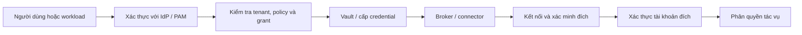

# Xử lý credential không hợp lệ

## 1. Hiểu đúng tín hiệu credential không hợp lệ

Trong quản lý truy cập đặc quyền (Privileged Access Management, PAM), credential có thể là mật khẩu quản trị, private key SSH, passphrase, API key, chứng thư hoặc token dùng cho một tài khoản dịch vụ. Khi một lần truy cập thất bại, hệ thống cần xác định credential thực sự không còn dùng được hay một lớp khác đang ngăn truy cập.

Thông báo “invalid credentials” là một tín hiệu quan sát, chưa phải kết luận nguyên nhân. Mật khẩu có thể đúng nhưng tài khoản đang bị khóa; private key có thể đúng nhưng public key chưa được cấp quyền trên máy đích; token có thể còn hạn nhưng được phát cho một đối tượng nhận khác. Lỗi mạng, sai endpoint hoặc thiếu quyền thực hiện tác vụ cũng có thể bị một connector tổng hợp thành thông báo chung.

Mục tiêu xử lý là khôi phục đường sử dụng hợp lệ với phạm vi quyền cần thiết, hạn chế gián đoạn, ngăn khóa tài khoản do thử lại và giữ bằng chứng. Không nên mặc định reset mật khẩu hoặc mở rộng quyền mỗi khi một phiên bị từ chối.

Ví dụ, hai job báo cáo dùng tài khoản `svc-reporting-prod`. Một lần rotation đã đổi mật khẩu trên cơ sở dữ liệu nhưng mất phản hồi trước khi vault hoàn tất trạng thái. Vault còn cấp V7 trong khi đích đã chấp nhận V8. Nếu các job và connector cùng thử V7 liên tục, lỗi mất đồng bộ có thể biến thành khóa tài khoản và gián đoạn rộng hơn.

Bài học thuộc chương Credential management, tập trung vào tài khoản quản trị, danh tính dịch vụ và hạ tầng nhạy cảm. Cách xử lý cần gắn với kiểm kê phụ thuộc, least privilege, JIT/JEA, vault, rotation, giám sát phiên và bằng chứng kiểm toán, ứng phó sự cố.

## 2. Phân biệt các lớp lỗi

Một luồng truy cập PAM có thể đi qua nhiều lớp:



| Lớp lỗi | Ví dụ | Hướng kiểm tra ban đầu |
|---|---|---|
| Danh tính gọi PAM | Token của workload hết hạn, người dùng chưa đáp ứng MFA | Phiên xác thực và danh tính bootstrap của bên gọi |
| Quyền truy cập vault | Không được đọc secret hoặc phiên bản cần dùng | Tenant, object, policy và hành động được cấp |
| Kết nối và trust | Timeout, sai DNS, chứng thư hoặc host key không khớp | Đường mạng và danh tính đích, trước khi gửi credential |
| Định dạng hoặc mở secret | Private key không được connector hỗ trợ, passphrase không khớp | Phiên bản và khả năng tích hợp, không lập tức reset tài khoản đích |
| Xác thực đích | Mật khẩu không khớp, key bị thu hồi, token không hợp lệ cho đích | Đúng tài khoản, credential, phiên bản và ngữ cảnh |
| Trạng thái tài khoản | Bị khóa, vô hiệu hóa, hết hạn hoặc đã xóa | Trạng thái từ nguồn có thẩm quyền và mục đích vòng đời |
| Phân quyền tác vụ | Đăng nhập được nhưng không được đọc một tài nguyên | Quyền trên đích, không kết luận credential sai |
| Kết quả thay đổi chưa biết | Lời gọi đổi mật khẩu timeout | Operation đang chờ và trạng thái thực tế của đích |

Không suy ra nguyên nhân chỉ từ một mã HTTP hoặc chuỗi lỗi chung. Ý nghĩa phụ thuộc giao thức và connector. Nên chuẩn hóa mã nguyên nhân từ kết quả có cấu trúc, giữ nguồn và độ chắc chắn, đồng thời cho phép trạng thái chưa xác định.

Quyền đọc secret trong vault bị từ chối không phải lý do reset mật khẩu trên cơ sở dữ liệu. Tương tự, đăng nhập thành công nhưng một lệnh bị từ chối không phải lý do cấp quyền quản trị toàn hệ thống.

## 3. Thu thập ngữ cảnh tối thiểu và có phạm vi

Trước khi thử lại hoặc thay đổi credential, xác định đối tượng và phạm vi bị ảnh hưởng.

| Nhóm dữ liệu | Nội dung cần đối soát |
|---|---|
| Danh tính | Người hoặc workload gọi, tenant, tài khoản đích và nơi quản lý danh tính |
| Tài nguyên | ID ổn định, môi trường, endpoint, node hoặc cụm thực sự được truy cập |
| Credential | Object reference, version reference, loại credential và trạng thái cấp phát |
| Sự kiện | Thời điểm, mã lỗi đã chuẩn hóa, connector và bước thất bại |
| Thay đổi gần nhất | Rotation, reset thủ công, restore vault, thay trust hoặc cập nhật consumer |
| Phụ thuộc | Job, service, broker, agent và cache có thể đang dùng cùng credential |
| Điều phối | Operation ID, khóa quản lý, trạng thái thử lại hoặc reconcile đang chạy |

Không ghi mật khẩu, private key, passphrase hoặc token vào ticket, log và thông báo. Không in giá trị hoặc một hash mật khẩu ra ngoài để so sánh. Dùng tham chiếu phiên bản, fingerprint của public key khi phù hợp, operation ID và bằng chứng xác thực đã được kiểm soát.

Phân biệt phạm vi một binding với toàn bộ credential. Một SSH key bị từ chối trên một máy không chứng minh khóa không hợp lệ trên mọi máy. Một node cơ sở dữ liệu chưa đồng bộ cũng không nhất thiết có cùng trạng thái với điểm xác thực có thẩm quyền.

Nếu nhiều bản ghi vault hoặc nhiều consumer cùng trỏ tới một tài khoản thực tế, cần nhận diện quan hệ đó. Giới hạn retry theo từng request riêng lẻ sẽ không đủ khi hàng chục consumer cùng thử sai vào một tài khoản có chính sách khóa chung.

## 4. Khoanh vùng và ngăn lỗi lan rộng

Khi xuất hiện chuỗi lỗi xác thực, ưu tiên kiểm soát nguồn thử lại trước khi thực hiện nhiều thay đổi:

1. Xác định credential và tài khoản thực tế đang bị tác động, cùng các consumer dùng chúng.
2. Giảm hoặc dừng retry tự động không có ích trong phạm vi bị ảnh hưởng; tránh dừng toàn bộ nền tảng khi lỗi chỉ thuộc một đối tượng.
3. Kiểm tra operation thay đổi credential đang chạy để không khởi động một rotation hoặc reconcile cạnh tranh.
4. Ghi trạng thái nghi vấn và phân loại bước thất bại, giữ bằng chứng không chứa secret.
5. Chỉ cho một đường kiểm tra có điều phối thực hiện phép thử cần thiết trong ngân sách cho phép.

Ngân sách thử phải dựa trên chính sách khóa tài khoản, nguồn thử khác và mức chắc chắn về nguyên nhân. Không có một số lần retry cố định an toàn cho mọi nền tảng. Các consumer chưa kiểm kê có thể vẫn đang gửi mật khẩu cũ dù connector đã dừng.

Có thể dùng circuit breaker theo tài khoản hoặc phạm vi credential: khi vượt điều kiện lỗi, tạm ngừng các lần thử mới và chỉ mở lại theo kiểm tra có kiểm soát. Khoảng nghỉ không tự sửa credential sai; nó giúp tránh tiếp tục gây khóa và tạo thời gian đối soát.

Các phiên đã mở cần được xử lý theo rủi ro. Một lỗi mạng tạm thời không tự là lý do kết thúc mọi phiên đang chạy. Nếu nghi credential bị lộ hoặc tài khoản bị thu hồi có chủ đích, việc chấm dứt phiên và chặn quyền mới có thể là phần cần thiết của ứng phó.

## 5. Xác minh credential có kiểm soát

### 5.1. Dùng đúng đường vận hành

Phép thử cần dùng đúng phiên bản trong vault, đúng danh tính quản lý, đúng tài khoản và đúng đích mà broker hoặc workload sẽ sử dụng. Một quản trị viên đăng nhập được bằng mật khẩu trong bộ nhớ của mình không chứng minh bản ghi vault đang đúng.

Xác minh danh tính máy chủ trước khi gửi credential. Không bỏ kiểm tra chứng thư hoặc tự chấp nhận host key mới để vượt qua lỗi kết nối. Sai đích vừa làm kết luận chẩn đoán sai vừa có thể làm lộ thông tin xác thực.

Với credential nhiều thành phần, kiểm tra chúng có cùng ngữ cảnh: username, miền, private key, tham chiếu passphrase và version reference. Đừng ghép private key mới với passphrase cũ hoặc dùng mật khẩu đúng cho một tài khoản khác có cùng tên hiển thị.

### 5.2. Tạo một lần xác thực mới

Connection pool, phiên SSH ghép kênh hoặc phiên hiện hữu có thể tiếp tục hoạt động mà không xác thực lại. Cần một kết nối mới có kiểm soát để chứng minh credential hiện tại dùng được. Với SSH, tránh để agent hoặc cấu hình dự phòng âm thầm dùng một khóa khác rồi báo phép thử thành công.

Chỉ thực hiện tác vụ kiểm tra tối thiểu đã được cho phép. Nếu xác thực thành công nhưng thao tác kiểm tra bị từ chối vì quyền đối tượng, ghi nhận hai kết quả riêng. Không chạy lệnh thay đổi cấu hình hoặc nâng quyền chỉ để kiểm tra khả năng đăng nhập.

Kết quả xác minh cần gắn với tài nguyên, tài khoản, version reference, thời điểm và phương pháp. Nó chứng minh trạng thái tại thời điểm kiểm tra, không bảo đảm credential không thể bị thay ngoài quy trình sau đó.

### 5.3. Kiểm tra dữ liệu mà không làm lộ

Lỗi có thể đến từ consumer thêm ký tự xuống dòng, chuyển encoding, xử lý escape sai hoặc đọc nhầm phiên bản. Không tự áp dụng `trim` hay biến đổi secret để làm nó “sạch” hơn: khoảng trắng có thể là một phần hợp lệ của giá trị.

Đối soát đường lấy và truyền credential bằng cơ chế bảo vệ phù hợp, không in cả giá trị vào log để so sánh. Nếu cần kiểm tra định dạng, trả mã lỗi có cấu trúc và phạm vi dữ liệu tối thiểu. Metadata như version reference hữu ích hơn việc đưa độ dài thực hoặc hash của mật khẩu vào thông báo hỗ trợ.

## 6. Chính sách retry theo loại lỗi

Retry chỉ có ích khi nguyên nhân có khả năng thay đổi và tác động của lần thử được kiểm soát. Với lỗi xác thực đã có căn cứ credential không khớp, gửi lại cùng giá trị thường không sửa được gì.

| Tình huống | Cách xử lý retry |
|---|---|
| Lỗi mạng hoặc dịch vụ tạm thời trước bước xác thực | Có thể thử lại có giới hạn, khoảng lùi và jitter theo chính sách |
| Timeout khi xác thực | Đánh giá tác động và ngân sách; không mặc định lần thử chưa tới đích |
| Có bằng chứng giá trị hiện tại không khớp | Dừng lặp giá trị đó; đối soát phiên bản và chọn biện pháp khôi phục |
| Tài khoản bị khóa hoặc vô hiệu hóa | Dừng nguồn thử; không lặp unlock hoặc tự bật tài khoản |
| Token hết hạn theo vòng đời bình thường | Xin credential mới nếu danh tính và quyền hiện hành cho phép |
| Timeout sau thao tác đổi credential | Giữ kết quả chưa biết, đối soát operation trước khi làm thay đổi mới |
| Tín hiệu đồng bộ đích đang trễ sau rotation đã biết | Chỉ probe trong kế hoạch và ngân sách đã định nghĩa, không thử vô hạn |

Khoảng lùi cần được phối hợp ở mức phạm vi tài khoản, không chỉ ở từng tiến trình. Nếu mỗi job đều tự cho phép ba lần thử, tổng số lần có thể vẫn vượt ngưỡng khóa của hệ thống đích. Cần tính đến consumer ngoài PAM chưa hoàn tất chuyển đổi.

Khóa chống trùng giúp cùng một yêu cầu được gửi lại không tạo thêm operation ngoài ý muốn. Nhưng idempotency trong kho dữ liệu PAM không tự bảo đảm lời gọi reset ở đích chỉ chạy một lần. Connector cần cơ chế xác định kết quả, điều phối và đối soát theo khả năng nền tảng.

Không thử lần lượt các mật khẩu hoặc private key trong lịch sử để tìm một giá trị còn hoạt động. Cách này có thể gây khóa, dùng lại credential đã thu hồi và che khuất nguồn sai lệch. Chỉ kiểm tra một ứng viên cụ thể khi có căn cứ từ operation đã được ủy quyền và trong phạm vi probe đã định nghĩa.

## 7. Chọn biện pháp theo bằng chứng

| Bằng chứng quan sát | Biện pháp phù hợp để xem xét | Điều cần tránh |
|---|---|---|
| Credential hiện tại từ vault xác thực được, một consumer vẫn lỗi | Sửa binding, cache, cách nạp hoặc danh tính consumer; thử lại bằng kết nối mới | Reset tài khoản chỉ vì consumer chưa cập nhật |
| Vault và đích không khớp sau thay đổi được xác nhận | Đối soát operation, hoàn tất chuyển đổi hoặc reconcile theo quyền | Ghi đè nhiều lần mà không biết giá trị nào đang có hiệu lực |
| Có reset ngoài PAM chưa rõ căn cứ | Xác minh người thực hiện và mục đích, giữ bằng chứng, xử lý như dấu hiệu cần điều tra | Mặc định mọi drift đều vô hại hoặc mọi drift đều là tấn công |
| Tài khoản bị khóa do nhiều consumer dùng giá trị cũ | Dừng nguồn thử, sửa phụ thuộc, mở khóa bằng quy trình được phép rồi xác minh | Mở khóa liên tục trong khi nguồn thử sai vẫn chạy |
| Tài khoản bị vô hiệu hóa có chủ đích | Kiểm tra vòng đời, quyết định thu hồi và chủ sở hữu | Tự bật lại để làm dashboard hết lỗi |
| Đăng nhập được nhưng tác vụ thiếu quyền | Đánh giá quyền cần thiết theo least privilege | Cấp quyền quản trị rộng hoặc bỏ JEA |
| Credential nghi bị lộ hoặc đã bị thu hồi | Cấp mới hoặc rotation, thực thi thu hồi và xử lý phiên liên quan | Dùng lại phiên bản cũ vì nó từng hoạt động |
| Danh tính gọi vault không hợp lệ | Sửa cơ chế xác thực hoặc cấp quyền cho workload theo quy trình | Chuyển sang token quản trị vault dùng chung |

Các thao tác thường bị nhầm cần được phân biệt:

- **Verify:** kiểm tra credential, không chủ đích thay giá trị.
- **Refresh consumer:** làm consumer nạp phiên bản đang được phép dùng; không tự thay credential đích.
- **Rotate:** tạo hoặc chuyển sang credential mới và xử lý việc thu hồi cũ.
- **Reconcile:** khôi phục đồng bộ khi thông tin quản lý không còn khớp, thường cần một đường quản lý được ủy quyền riêng.
- **Unlock hoặc enable:** thay trạng thái tài khoản, có ý nghĩa vòng đời và rủi ro riêng.

Chọn biện pháp tối thiểu đáp ứng nguyên nhân đã xác định. Nếu chưa đủ bằng chứng hoặc nền tảng không hỗ trợ khôi phục an toàn, giữ trạng thái chưa hoàn tất và chuyển người chịu trách nhiệm, kèm dữ liệu đã chuẩn hóa để họ tiếp tục.

## 8. Điểm riêng theo loại credential

### 8.1. Mật khẩu

Xác định tài khoản thuộc máy cục bộ, miền hay hệ thống danh tính khác. Đổi trên sai nơi có thẩm quyền có thể không tác động tới điểm đang xác thực. Với cụm hoặc cơ chế đồng bộ, cần hiểu điểm ghi và điểm kiểm tra để không kết luận sai trong khoảng chuyển tiếp.

Tình trạng hết hạn hoặc yêu cầu đổi mật khẩu ở lần đăng nhập sau có thể không được connector không tương tác hỗ trợ. Cần quy trình phù hợp với nền tảng; không tự tắt chính sách mật khẩu hoặc dùng một tài khoản có quyền rộng hơn để bỏ qua vấn đề.

### 8.2. SSH key và passphrase

Tách lỗi mở private key tại connector khỏi lỗi máy chủ từ chối public key. Kiểm tra định dạng, passphrase, cặp khóa, nguồn cấp quyền trên đích, tài khoản và giới hạn nguồn hoặc tác vụ. Khóa đúng nhưng không được cấp quyền ở một binding là một vấn đề khác với private key hỏng.

Host key xác minh máy chủ, không phải public key của tài khoản đăng nhập. Nếu host trust thay đổi, xác minh nguồn gốc thay đổi trước; không nhập lại user key hoặc bỏ xác minh máy chủ như cách sửa mặc định.

### 8.3. Token, API key và chứng thư

Kiểm tra thời hạn, trạng thái thu hồi, bên phát hành, đối tượng nhận dự kiến và phạm vi tác vụ theo loại credential. Một token còn hạn nhưng sai audience hoặc tenant không được sửa bằng cách bỏ kiểm tra các trường đó.

Với chứng thư và credential có cửa sổ hiệu lực, kiểm tra thời gian bằng nguồn đáng tin cậy và xử lý độ lệch đồng hồ theo chính sách. Không thay giờ tùy ý hoặc tắt kiểm tra thời hạn để làm credential được chấp nhận.

Credential JIT hết hạn có thể là hành vi đúng. Cấp lại phải dựa trên nhu cầu, grant và quyền hiện hành; không tự kéo dài một phiên công việc đã hết quyền. Mã lỗi giới hạn tốc độ hoặc thiếu quyền cũng cần phân biệt với key không khớp theo giao thức, không chỉ qua một chuỗi thông báo chung.

## 9. Reconcile và rotation an toàn

### 9.1. Điều kiện trước khi thay đổi

Reconcile có thể cần danh tính quản lý độc lập với credential đang lỗi. Danh tính đó phải được ủy quyền đúng tài khoản và tài nguyên, được bảo vệ và có bằng chứng sử dụng. Không mặc định dùng tài khoản quản trị toàn hệ thống cho mọi lần mất đồng bộ.

Xác minh tenant, binding giữa tài khoản với tài nguyên, policy hiện hành và quyền của tác nhân khôi phục. Endpoint không được do một tham số chưa kiểm tra quyết định rồi nhận credential quản lý có quyền cao. Một yêu cầu sửa lỗi của tenant này không cho phép reset tài khoản tenant khác.

Cần biết consumer nào chịu ảnh hưởng, cách tạm dừng hoặc chuyển đổi, cách nạp secret và đường quản trị độc lập khi lỗi. Nếu tài khoản đã bị vô hiệu hóa vì thu hồi có chủ đích, quyết định đó phải được tôn trọng; reconcile không được âm thầm mở lại quyền.

### 9.2. Trình tự khái niệm

Với tài khoản một mật khẩu mà hệ thống quản lý có thể sinh giá trị mới, quy trình có thể gồm:

1. Nhận quyền điều phối cho tài khoản thực tế, kiểm tra operation đang có và tạo operation ID.
2. Ghi phạm vi, trạng thái hiện tại và kế hoạch consumer; ngăn các tác nhân tiếp tục thử credential đã biết sai.
3. Tạo giá trị mới theo chính sách, bảo vệ trong trạng thái ứng viên có khả năng phục hồi theo thiết kế. Chưa công bố như giá trị đã hoạt động.
4. Gọi thao tác thay đổi hoặc reset được phép bằng connector và danh tính quản lý đúng phạm vi.
5. Đối soát kết quả; xác minh phiên bản mới từ nguồn đã lưu trong vault bằng lần xác thực mới tới đúng đích.
6. Công bố hoặc hoàn tất trạng thái bằng cập nhật có điều kiện, tránh ghi đè operation hay revision đã thay đổi.
7. Chuyển từng consumer, kiểm tra chức năng bằng kết nối mới và khôi phục lưu lượng có kiểm soát.
8. Thu hồi credential cũ hoặc xử lý quyền còn lại theo cơ chế đích; kết thúc phiên khi chính sách yêu cầu.
9. Ghi bằng chứng, giải phóng điều phối và tiếp tục giám sát trước khi đóng sự cố.

Đây là mô hình tham khảo. Với API key do đích sinh và chỉ trả secret một lần, phải có cơ chế tiếp nhận, lưu an toàn và xử lý key bị tạo dở. Với SSH key tin trên nhiều máy, cần trạng thái từng binding và việc loại public key cũ tại nguồn có hiệu lực. Không áp dụng một thuật toán mật khẩu cho mọi loại credential.

CAS hoặc revision bảo vệ cập nhật trạng thái vault, không tự làm lời gọi từ xa trở thành đúng một lần. Nếu không có cơ chế điều phối và nhận diện kết quả cũ, một worker chậm vẫn có thể thực hiện thay đổi sau khi operation khác đã bắt đầu. Thiết kế cần xử lý theo khả năng connector và đích, không chỉ dựa vào một cờ đang chạy.

### 9.3. Xử lý từng khoảng lỗi

| Khoảng lỗi | Trạng thái cần giữ | Hướng xử lý |
|---|---|---|
| Chưa gọi đích, tạo ứng viên thất bại | Chưa thay credential đích theo operation này | Sửa phần lưu giữ hoặc cấu hình trước khi thay đổi |
| Đích trả thất bại có thể xác định | Ghi rõ kết quả và nguyên nhân | Chẩn đoán; không tự suy ra từ timeout rằng đích chưa đổi |
| Đích có thể đã đổi, phản hồi mất | Kết quả chưa biết | Đối soát operation và một ứng viên cụ thể có căn cứ, trong ngân sách |
| Credential mới xác minh được, công bố lỗi | Chuyển đổi chưa hoàn tất | Hoàn tất cùng operation và phiên bản, tránh sinh thêm giá trị mới |
| Công bố xong, một consumer lỗi | Khôi phục consumer chưa hoàn tất | Sửa cách nạp, binding hoặc cache, kiểm tra bằng kết nối mới |
| Phát hiện credential bị lộ | Sự cố bảo mật còn cần xử lý | Thu hồi hoặc thay mới, kiểm tra phiên và quyền dẫn xuất, giữ bằng chứng |

Không mặc định quay lại giá trị cũ. Nếu nó đã bị lộ, hết hạn hoặc bị thu hồi, khôi phục giá trị đó có thể làm sống lại rủi ro. Ngay cả khi rollback được phép, nó vẫn là thay đổi cần thực thi trên đích, phối hợp consumer và xác minh, không chỉ đổi một tham chiếu trong vault.

Sau khi restore vault từ bản sao cũ, credential lưu giữ có thể không khớp đích. Không reset đích về mật khẩu từ backup chỉ để làm hai bên giống nhau. Cần đối soát và dùng đường khôi phục được ủy quyền để thiết lập trạng thái hợp lệ.

### 9.4. Khi đường khôi phục thông thường không dùng được

Nếu thiếu quyền, mất danh tính quản lý hoặc connector không hỗ trợ thao tác an toàn, giữ trạng thái cần xử lý và chuyển tới đúng chủ sở hữu. Không sửa policy thành cho phép mọi secret hoặc đổi sang tài khoản dùng chung có quyền rộng mà thiếu căn cứ.

Break-glass, nếu có, phải được chuẩn bị trước với danh tính, phạm vi, thời hạn, lý do, bằng chứng và hậu kiểm. Nó không phải nhánh tự động cho mọi lỗi xác thực. Các thao tác khẩn cấp vẫn cần xử lý credential và quyền trên đích sau sử dụng theo kế hoạch.

## 10. Ví dụ: timeout trong rotation tài khoản báo cáo

Giả sử hai job dùng cùng tài khoản `svc-reporting-prod`, nền tảng đích chỉ chấp nhận một mật khẩu và hai job có thể tạm dừng trong cửa sổ bảo trì. Quy trình đã lưu V8 an toàn ở trạng thái ứng viên, còn V7 đang là phiên bản được công bố.

Lời gọi đổi mật khẩu bị timeout. Một metadata sự cố minh họa có thể là:

```json
{
  "tenant_ref": "tenant-reporting",
  "credential_ref": "cred-reporting-prod",
  "published_version_ref": "version-007",
  "pending_version_ref": "version-008",
  "operation_ref": "rotation-241",
  "health_state": "UNKNOWN_AFTER_CHANGE",
  "failed_stage": "target_change_ack",
  "consumer_state": "PAUSED_BY_PLAN",
  "next_action": "RECONCILE_OPERATION_STATE"
}
```

Đây không phải cấu hình của một sản phẩm cụ thể và không chứa secret. Trạng thái mô tả điều đã biết, không khẳng định mật khẩu mới sai chỉ vì không nhận được phản hồi.

Nhóm xử lý thực hiện:

1. Giữ hai job tạm dừng theo kế hoạch, chặn rotation hoặc reconcile cạnh tranh và đối chiếu operation.
2. Xác minh đúng endpoint, tài khoản, trạng thái khóa và version reference ứng viên.
3. Dùng connector được phép kiểm tra V8 từ nguồn đã lưu trong vault, qua một kết nối mới với số lần giới hạn.
4. Nếu V8 xác thực được, hoàn tất công bố V8 theo revision và operation hiện hành; không tạo V9 chỉ để chạy lại toàn bộ thay đổi.
5. Cho từng job nạp V8, tạo kết nối mới và chạy phép thử chức năng được chấp thuận.
6. Khôi phục lưu lượng, theo dõi lỗi và lưu kết quả cho cả hai consumer trước khi đóng sự cố.

Nếu tài khoản đã bị khóa, phép thử V8 có thể không xác định được giá trị đúng. Cần xác minh trạng thái bằng nguồn có thẩm quyền, dừng mọi nguồn thử sai và chỉ mở khóa theo quy trình được phép. Không xen kẽ unlock và thử nhiều mật khẩu.

Nếu V8 cũng bị từ chối mà chưa rõ nguyên nhân, không thử ngẫu nhiên V7 rồi các phiên bản cũ. Giữ trạng thái chưa xác định, kiểm tra bằng chứng thao tác và chọn reconcile có thẩm quyền khi đủ căn cứ. Nếu có dấu hiệu reset ngoài quy trình, điều tra nguồn thay đổi trước khi kết luận đã phục hồi.

Một job thành công trên connection pool cũ chưa hoàn tất bước nghiệm thu. Bằng chứng cần cho thấy job đã xác thực lại bằng phiên bản được phép và thực hiện đúng tác vụ, với quyền vẫn nằm trong phạm vi ban đầu.

## 11. Bằng chứng, trạng thái và cảnh báo

Hồ sơ xử lý cần nối được sự kiện thất bại với credential, phiên bản, tài khoản, tài nguyên, quyết định khôi phục, operation và consumer. Các trường hữu ích gồm thời điểm phía máy chủ, actor, tenant, mã bước thất bại, mã nguyên nhân, mức chắc chắn, số lần probe đã dùng và kết quả.

Không đưa raw exception, request body, connection string có secret hoặc nội dung private key vào bằng chứng. Mã lỗi có cấu trúc và correlation ID giúp điều tra mà không phát tán credential. Quyền xem dữ liệu sự cố và log cũng cần phù hợp phạm vi tenant, đối tượng và mục đích.

Có thể tổ chức trạng thái theo mô hình:

```text
HEALTHY -> SUSPECT -> DIAGNOSING -> REMEDIATING -> VALIDATING -> HEALTHY
                         |              |
                         +-> WAITING_OWNER
                                        +-> UNKNOWN_OUTCOME -> DIAGNOSING
```

Đây là mô hình nghiệp vụ tham khảo. `HEALTHY` phải gắn với thời điểm, version và các binding đã kiểm tra. Không đánh dấu cả đối tượng hoàn toàn ổn chỉ vì một máy xác minh thành công trong khi các consumer khác còn lỗi.

Theo dõi các tín hiệu như lỗi xác thực liên tiếp theo tài khoản, thời gian operation ở trạng thái chưa biết, số consumer còn dùng phiên bản cũ, lần xác minh gần nhất và drift ngoài quy trình. Cảnh báo cần gom các sự kiện liên quan để giảm trùng lặp nhưng không làm mất dấu sự cố chưa giải quyết.

Tách các mốc thành công: vault đã lưu, đích đã xác minh, consumer đã chuyển và quyền cũ đã xử lý. Thời gian khôi phục chỉ có ý nghĩa khi nêu rõ đang đo đến mốc nào. Kết quả một thao tác reset thành công không tự chứng minh toàn bộ dịch vụ đã phục hồi.

## 12. Ma trận kiểm tra quy trình xử lý

Kiểm tra bằng tài khoản lab, credential giả và tình huống lỗi được phép. Không cần tạo lỗi trên tài khoản production để chứng minh runbook đầy đủ.

Một ví dụ về retry: giả sử riêng bài lab quy định khóa sau năm lần sai trong một cửa sổ thời gian. Hai consumer, mỗi bên tự cho phép ba lần, có thể tạo sáu lần sai và chạm điều kiện khóa. Đây là ví dụ về tổng tác động, không phải khuyến nghị ngưỡng khóa hay số retry cho hệ thống thật. Ngân sách thực tế phải tính trạng thái hiện tại và mọi nguồn xác thực liên quan.

| Tình huống | Hành vi cần đạt | Bằng chứng cần xem |
|---|---|---|
| Vault từ chối quyền đọc | Xử lý danh tính hoặc policy đúng phạm vi, không reset đích | Quyết định quyền và không có thao tác đổi credential ngoài ý muốn |
| Mất kết nối hoặc host trust không khớp | Chẩn đoán kết nối hoặc trust, không bỏ kiểm tra bảo mật | Bước thất bại và cấu hình đích đã được xác minh |
| Credential đúng, tác vụ thiếu quyền | Phân loại lỗi phân quyền, giữ least privilege | Xác thực thành công và quyết định tác vụ riêng |
| Hai consumer cùng thử mật khẩu cũ | Cơ chế giới hạn tổng tác động hoạt động theo thiết kế | Số lần ở đích, circuit breaker và trạng thái consumer |
| Tài khoản bị khóa | Dừng nguồn thử trước khi mở khóa được phép | Nguồn thử đã xử lý, quyết định unlock và xác thực mới |
| Tài khoản bị vô hiệu hóa có chủ đích | Không tự bật lại | Quyết định vòng đời và không có thay đổi trái phép |
| Consumer giữ cache cũ, vault có phiên bản đúng | Refresh hoặc sửa consumer, không reset vô ích | Version reference thực dùng và lần xác thực mới |
| Private key không mở được vì passphrase sai | Chẩn đoán phía credential bundle hoặc connector | Bước mở khóa cục bộ, không nhầm với lỗi xác thực máy chủ |
| Token JIT hết hạn, grant cũng đã hết | Không tự gia hạn vượt quyền | Quyết định cấp lại hoặc từ chối theo policy hiện hành |
| Timeout sau đổi mật khẩu | Giữ trạng thái chưa biết và đối soát cùng operation | Ledger, ứng viên có căn cứ và không reset lặp mù |
| Worker chậm và một operation khác cạnh tranh | Cơ chế điều phối nhận diện hoặc ngăn kết quả cũ theo khả năng đích | Operation, revision và trạng thái tài khoản thực tế |
| V8 xác thực được nhưng công bố lỗi | Hoàn tất cùng phiên bản theo điều kiện | Version reference, revision và kết quả công bố |
| Một job còn dùng connection pool cũ | Chưa báo hoàn tất chỉ dựa vào job đó | Kết quả kết nối mới và phép thử chức năng |
| Credential nghi bị lộ | Thay hoặc thu hồi, xử lý phiên theo rủi ro | Bằng chứng đích, consumer và các quyền liên quan |
| Restore vault từ bản sao cũ | Đối soát trước khi cấp phát hoặc đổi đích đại trà | Trạng thái phục hồi và reconcile được ủy quyền |

Với lỗi xác thực, phép thử cũng phải có giới hạn để không tự tạo khóa tài khoản. Với mutation bị timeout, mô phỏng riêng trường hợp đích đã thay và trường hợp chưa thay; chỉ kiểm tra nhánh thất bại đơn giản sẽ bỏ sót nguy cơ kết quả chưa biết.

Kiểm tra log, trace, ticket và thông báo cùng kết quả kỹ thuật. Một quy trình khôi phục thành công nhưng đã ghi mật khẩu vào log vẫn để lại sự cố bảo mật cần xử lý. Khi thử với nhiều tenant hoặc tài khoản trùng tên, xác nhận thao tác khôi phục không vượt binding đã được ủy quyền.

## 13. Tiêu chí xác nhận phục hồi và bàn giao

Có thể dùng checklist sau để kết thúc hoặc chuyển giao xử lý:

- [ ] Xác định rõ lớp lỗi, độ chắc chắn, tenant, tài khoản, tài nguyên và credential version bị ảnh hưởng.
- [ ] Các nguồn retry đã được điều phối theo phạm vi tài khoản; giới hạn và nguồn chưa biết được ghi nhận.
- [ ] Trạng thái khóa, vô hiệu hóa hoặc hết hạn đã được kiểm tra từ nguồn phù hợp, không tự đảo quyết định thu hồi có chủ đích.
- [ ] Đã phân biệt verify, refresh consumer, rotate, reconcile và thay trạng thái tài khoản; có căn cứ cho biện pháp đã chọn.
- [ ] Người hoặc tác nhân khôi phục có quyền hiện hành đúng phạm vi, danh tính quản lý được bảo vệ và đích đã được xác minh.
- [ ] Operation cạnh tranh và kết quả chưa biết được xử lý; không còn reset đang chạy mà chưa đối soát.
- [ ] Vault đang cấp phát đúng phiên bản được phép; việc công bố và lịch sử thay đổi có bằng chứng.
- [ ] Credential đã được xác minh trên đúng đích bằng một lần xác thực mới, trong ngân sách cho phép.
- [ ] Mọi consumer thuộc phạm vi bàn giao đã nạp đúng credential và có phép thử chức năng phù hợp; phần chưa kiểm tra được nêu rõ.
- [ ] Quyền thực tế vẫn đáp ứng least privilege và JEA; không có thay đổi mở rộng quyền chỉ để bỏ qua lỗi.
- [ ] Credential cũ, phiên đang chạy và quyền dẫn xuất đã được xử lý theo nguyên nhân và chính sách áp dụng.
- [ ] Bằng chứng không chứa giá trị secret, có actor, operation, version, thời điểm và kết quả đủ để truy vết.
- [ ] Có người chịu trách nhiệm, thời gian theo dõi và điều kiện cảnh báo lại; trạng thái chờ chủ sở hữu không bị ghi thành đã phục hồi.

Nếu mới xác minh được một phần, báo đúng phạm vi đó. Ví dụ, “credential V8 dùng được trên đích, còn một consumer chưa chuyển” là kết quả hữu ích và trung thực hơn một trạng thái thành công chung.

Khi không thể tiếp tục an toàn, chuyển giao kèm metadata đã chuẩn hóa, bước đã thực hiện, số lần thử, operation còn chờ và điều kiện cần đáp ứng tiếp. Không gửi secret qua tin nhắn hoặc yêu cầu người khác thử nhiều giá trị lịch sử để rút ngắn chẩn đoán.

## 14. Bài thực hành thiết kế

Dùng bối cảnh hai job báo cáo và một tài khoản cơ sở dữ liệu trong lab. Không đưa credential thật vào tài liệu hoặc công cụ chia sẻ.

1. Phân loại bốn tín hiệu: vault từ chối đọc, endpoint timeout, đăng nhập thành công nhưng truy vấn bị từ chối, và mật khẩu bị từ chối sau rotation. Nêu điều gì đã biết và điều gì chưa thể kết luận.
2. Vẽ phạm vi retry của hai job và connector. Với chính sách khóa giả định của lab, chứng minh vì sao giới hạn riêng từng tiến trình có thể chưa đủ.
3. Thiết kế phép verify dùng đúng version reference qua một kết nối mới, không có fallback sang mật khẩu hoặc khóa khác và không log giá trị.
4. Mô tả tình huống V8 đã được đích chấp nhận nhưng phản hồi đổi mật khẩu bị mất. Chỉ ra trạng thái giữ lại, probe có căn cứ và bước hoàn tất công bố.
5. Mô tả phương án khi tài khoản bị khóa do consumer còn giữ V7; xác định thứ tự xử lý nguồn thử, unlock được phép và kiểm tra lại.
6. Nêu trường hợp không được tự bật lại tài khoản hoặc khôi phục V7, gồm thu hồi có chủ đích và nghi lộ credential.
7. Lập bộ bằng chứng và tiêu chí kết thúc: phiên bản vault, trạng thái đích, kết quả từng consumer và các quyền hoặc phiên đã thu hồi.

Đầu ra cần cho thấy mỗi quyết định khôi phục dựa trên bằng chứng, có giới hạn tác động và có điểm xác nhận. Đó là cơ sở để xử lý credential không hợp lệ trong PAM mà vẫn giữ được kiểm soát quyền và khả năng vận hành.

