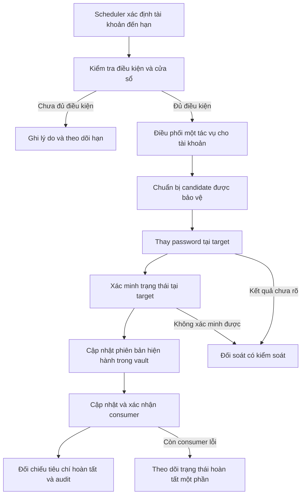

# Rotation theo lịch

Rotation theo lịch là việc PAM chủ động thay password của tài khoản được quản lý theo một chính sách thời gian đã xác định. Mục tiêu là giới hạn thời gian một password có thể tiếp tục được sử dụng, giảm phụ thuộc vào thay đổi thủ công và tạo bằng chứng về vòng đời credential.

Trong hệ thống Privileged Access Management, tài khoản có thể thuộc máy chủ, cơ sở dữ liệu, thiết bị mạng hoặc một dịch vụ nhạy cảm. Một lần rotation đúng phải duy trì được tính nhất quán giữa password ở hệ thống đích, giá trị trong vault và các bên tiêu thụ credential. Đến giờ chạy job chưa có nghĩa việc thay đổi đã thành công.

Bài học tập trung vào password của tài khoản đặc quyền được PAM quản lý. Chính sách cho tài khoản người dùng thông thường cần được đánh giá theo bối cảnh riêng; không suy rộng rằng mọi password đều phải đổi với cùng một chu kỳ. Với token, chứng chỉ hoặc workload identity, cơ chế cấp mới và hết hạn có thể khác với đổi password.

## 1. Mục tiêu và giới hạn của rotation định kỳ

Sau bài học, người học có thể:

- Phân biệt lịch chạy, thời điểm đến hạn, tuổi password và cửa sổ bảo trì.
- Thiết kế chu kỳ theo rủi ro, khả năng hệ thống đích và phụ thuộc ứng dụng.
- Mô tả luồng rotation từ kiểm tra điều kiện đến xác nhận target, vault và consumer.
- Xử lý chạy trùng, lịch bị bỏ lỡ, lỗi mạng và kết quả chưa rõ mà không làm lệch credential.
- Xây dựng chỉ số và bằng chứng để biết rotation có thực sự hoàn tất đúng hạn hay không.

Rotation định kỳ giúp quản lý vòng đời nhưng không thay thế least privilege, JIT/JEA, giám sát phiên và thu hồi truy cập. Một password mới vẫn nguy hiểm nếu tài khoản có quyền quá rộng hoặc nhiều workload không liên quan cùng sử dụng.

Nếu nghi password đã bị lộ, không chờ tới lịch tiếp theo. Cần kích hoạt quy trình ứng phó phù hợp, đồng thời xét token, phiên hoặc quyền đã được tạo bằng credential đó. Đổi password không tự đóng mọi phiên đã xác thực.

## 2. Các mốc thời gian không được đánh đồng

| Khái niệm | Ý nghĩa |
| --- | --- |
| Schedule | Quy tắc xác định khi nào tác vụ được xem xét hoặc khởi chạy |
| Due time | Mốc một credential cần được rotation theo chính sách |
| Maintenance window | Khoảng được phép thực hiện thay đổi có thể tác động dịch vụ |
| Last attempt | Lần gần nhất hệ thống đã thử thực hiện |
| Last verified success | Lần gần nhất có đủ xác nhận thành công theo tiêu chí đã định nghĩa |
| Password age | Khoảng thời gian password hiện hành đã có hiệu lực, dựa trên dữ liệu đáng tin cậy |
| Overdue | Đã vượt mốc phải hoàn tất theo chính sách mà chưa có kết quả đạt yêu cầu |

Một lần thử thất bại không được làm password trở nên mới hơn. Cập nhật `last_attempt` rồi dùng nó thay cho `last_success` có thể che giấu nhiều ngày không rotation thành công.

Nếu target đã đổi nhưng consumer chưa cập nhật, cần theo dõi riêng tuổi credential tại target và trạng thái hoàn tất toàn quy trình. Không ép cả hai vào một trường thành công chung.

Nếu không biết password hiện hành bắt đầu có hiệu lực khi nào, trạng thái nên là chưa xác minh cùng kế hoạch xử lý. Ngày tạo đối tượng trong vault không tự chứng minh tuổi password ở target.

## 3. Chọn kiểu lịch phù hợp

### 3.1. Lịch theo mốc thời gian cố định

Ví dụ: một nhóm tài khoản được xử lý trong cửa sổ bảo trì đã thống nhất vào một ngày trong tuần. Ưu điểm là dễ điều phối nhân sự và phụ thuộc; hạn chế là những lần thất bại cần được theo dõi riêng để không chờ vô thức đến kỳ sau.

Quy tắc phải ghi múi giờ, cách xử lý ngày không tồn tại trong lịch tháng và hành vi khi cửa sổ rơi vào thời gian hệ thống không cho thay đổi. Không mặc định mọi scheduler hiểu cron hoặc lịch tháng giống nhau.

### 3.2. Lịch dựa trên lần thành công đã xác minh

Ví dụ minh họa: đến hạn sau một khoảng thời gian tính từ lần rotation thành công. Cách này gắn chu kỳ với tuổi credential, nhưng cần quy tắc cho cửa sổ bảo trì và mức trễ được chấp nhận.

Công thức khái niệm có thể là:

```text
due_at = verified_password_effective_at + policy_interval
eligible_window = approved_window_that_can_meet(due_at, policy_rules)
```

Đây không phải công thức đủ cho mọi triển khai. Cần xác định `due_at` là thời điểm bắt đầu được phép đổi hay hạn phải hoàn tất. Nếu đó là hạn tối đa, chờ tới cửa sổ đầu tiên sau hạn có thể làm vi phạm chính sách.

### 3.3. Lịch kết hợp giới hạn tuổi và cửa sổ

Một thiết kế có thể chạy bộ kiểm tra thường xuyên, xác định tài khoản sắp đến hạn, rồi xếp vào cửa sổ phù hợp trước hạn tối đa. Khi không có cửa sổ đáp ứng, tạo cảnh báo hoặc ngoại lệ có thời hạn thay vì dời vô hạn.

Các giá trị như chu kỳ, biên cảnh báo và cửa sổ cần được tổ chức lựa chọn theo rủi ro và khả năng vận hành. Bài học không ấn định một số ngày chung cho mọi tài khoản.

### 3.4. Múi giờ và thay đổi thời gian

Lưu thời điểm tuyệt đối đủ rõ và giữ thông tin múi giờ của chính sách khi cần giải thích lịch. Múi giờ có thay đổi giờ theo mùa có thể xuất hiện giờ bị bỏ qua hoặc lặp lại; hành vi scheduler phải được xác định.

Dùng nguồn thời gian đáng tin cậy phù hợp và phát hiện độ lệch lớn. Không để một thay đổi đồng hồ làm cùng tài khoản bị xử lý hai lần hoặc bỏ qua kiểm tra quá hạn.

## 4. Thiết kế chính sách theo loại tài khoản

| Nhóm tài khoản | Đặc điểm cần xét | Hướng thiết kế |
| --- | --- | --- |
| Tài khoản quản trị tương tác | Có checkout hoặc phiên đang mở | Điều phối với sử dụng hiện tại và chính sách sau tiết lộ |
| Tài khoản dịch vụ | Có ứng dụng, tác vụ hoặc connection pool phụ thuộc | Kiểm kê consumer và cách cập nhật trước khi bật lịch |
| Tài khoản tích hợp của PAM | Dùng để quản lý tài khoản khác | Tránh làm mất đường quản lý hoặc tạo phụ thuộc vòng |
| Tài khoản khẩn cấp | Cần khả năng sử dụng khi một phần hạ tầng lỗi | Rotation và kiểm tra theo runbook, duy trì đường phục hồi phù hợp |
| Tài khoản dùng chung trên nhiều nút | Có thể được đồng bộ hoặc dùng bởi nhiều thành phần | Xác định đơn vị rotation và thứ tự xác nhận các bên |

Chọn chu kỳ dựa trên tác động nếu credential bị lộ, mức quyền, tần suất tiết lộ, khả năng phát hiện, giới hạn kỹ thuật và chi phí gián đoạn. Tài khoản không có owner hoặc chưa biết phụ thuộc chưa đủ điều kiện để bật một lịch thay đổi tự động rộng.

Không để nhiều đối tượng PAM cùng quản lý một password thực tế mà không có điều phối. Ví dụ, một tài khoản miền được tham chiếu bởi nhiều target vẫn có thể chỉ có một credential cần rotation; đổi độc lập theo từng máy có thể gây xung đột.

## 5. Điều kiện sẵn sàng trước khi bật lịch

### 5.1. Hồ sơ tài khoản và phụ thuộc

Cần xác định target, principal ID, owner, môi trường, mức quyền và nơi lưu credential. Liệt kê mọi consumer đã biết cùng cách reload, restart hoặc lấy lại giá trị.

Với tác vụ thưa kỳ, phải biết lịch chạy tiếp theo hoặc có cách xác nhận chủ động. Một ứng dụng hoạt động bình thường ngay sau rotation chưa chứng minh một batch hằng tuần đã nhận password mới.

### 5.2. Khả năng thay đổi ở target

Kiểm tra connector hỗ trợ đúng nền tảng và thao tác cần dùng. Phân biệt đổi password bằng credential hiện hành với reset bằng một danh tính quản lý khác; quyền và bằng chứng của hai đường có thể khác nhau.

Xác định các ràng buộc như độ dài, tập ký tự được chấp nhận, lịch sử password, tuổi tối thiểu, hạn dùng và ngưỡng khóa tài khoản. Candidate mới phải được sinh bằng cơ chế ngẫu nhiên phù hợp và tương thích với các bên liên quan.

Không giảm độ mạnh hoặc tái sử dụng một mẫu password dễ đoán để làm automation thuận tiện. Đồng thời, không giả định một chuỗi hợp lệ ở target sẽ được mọi consumer xử lý đúng nếu chúng có lỗi escaping hoặc giới hạn cấu hình.

### 5.3. Kết nối và tin cậy

Kiểm tra từ đúng connector được phân công, không chỉ từ máy của người quản trị. Xác minh endpoint, danh tính máy chủ và quyền tài khoản tích hợp.

Lỗi kết nối không nên được suy thành password sai để rồi thử nhiều lần. Cần phân loại lỗi mạng, xác thực, quyền, policy và trạng thái hệ thống.

### 5.4. Phương án phục hồi

Trước khi bật lịch, xác định cách đối soát khi vault và target lệch, ai xử lý, quyền nào cần thiết và khi nào phải dừng cấp phát. Không giữ credential phục hồi duy nhất trong một đường phụ thuộc vào chính tài khoản đang bị đổi.

Nếu nền tảng chỉ cho một password có hiệu lực và consumer không cập nhật liền mạch, có thể cần cửa sổ bảo trì. Không hứa hẹn không gián đoạn khi kiến trúc không cung cấp điều kiện đó.

## 6. Luồng rotation tham chiếu



Đây là trình tự logic tham chiếu. Thứ tự một số bước phụ thuộc khả năng target, vault và consumer. Các điểm bất biến cần giữ là không mất candidate sau khi target đã đổi, không cấp phát nhầm phiên bản chưa được xác nhận và không mô tả hoàn tất khi phụ thuộc bắt buộc còn lỗi.

### 6.1. Chuẩn bị trạng thái bền vững

Tạo operation ID, ràng buộc tài khoản, target, phiên bản đang biết và policy áp dụng. Candidate mới cần được bảo vệ và có đường khôi phục phù hợp trước khi thực hiện thay đổi bên ngoài.

Không chỉ giữ candidate trong bộ nhớ rồi đổi target và hy vọng ghi vault thành công sau đó. Nếu tiến trình dừng sau khi target đổi, hệ thống có thể mất giá trị cần để truy cập.

Ngược lại, lưu candidate không đồng nghĩa được đánh dấu là password đang hoạt động. Cần phân biệt phiên bản chuẩn bị với phiên bản đã được xác minh tại target.

### 6.2. Thay đổi và xác minh

Thực hiện bằng connector có quyền phù hợp, theo dõi kết quả và xác minh bằng phương pháp được nền tảng hỗ trợ. Giới hạn số lần xác thực và chọn thao tác kiểm tra có tác động tối thiểu.

Nếu có độ trễ đồng bộ giữa các nút hoặc endpoint, xác định phạm vi cần xác minh và thời gian chờ được phép. Không dựa vào một endpoint thuận lợi rồi bỏ qua nơi consumer thực sự xác thực.

### 6.3. Cập nhật consumer và đóng tác vụ

Sau khi phiên bản mới đủ điều kiện sử dụng, cập nhật các consumer theo kế hoạch. Có thể là làm mới tham chiếu secret, reload cấu hình, tạo kết nối mới hoặc khởi động lại có kiểm soát.

Xác nhận consumer đang dùng credential mới theo mức quan sát mà kiến trúc cung cấp. Một kết nối cũ còn hoạt động không chứng minh kết nối mới sẽ xác thực được.

Chỉ đánh dấu hoàn tất toàn quy trình khi đạt tiêu chí đã định nghĩa cho target, vault và consumer bắt buộc. Các lần thành công kỹ thuật ở từng bước vẫn cần được ghi riêng để xử lý lỗi chính xác.

## 7. Phân tán tải và kiểm soát chạy trùng

### 7.1. Không dồn mọi tài khoản vào cùng một phút

Nếu hàng nghìn tài khoản cùng đến hạn, connector, vault, hệ thống xác thực và ứng dụng có thể bị dồn tải. Phân nhóm theo môi trường, loại target và khả năng xử lý; đặt giới hạn đồng thời phù hợp.

Jitter có thể phân tán thời điểm bắt đầu trong một khoảng cho phép. Khoảng này phải nằm trong cửa sổ và không đẩy thời điểm hoàn tất dự kiến vượt hạn tối đa. Không thêm độ trễ ngẫu nhiên vô hạn rồi vẫn báo lịch đáp ứng chính sách.

Tránh thay đồng thời tất cả tài khoản phục hồi hoặc các tài khoản có cùng một phụ thuộc quan trọng. Xem xét phạm vi ảnh hưởng thay vì chỉ giới hạn tổng số job.

### 7.2. Một luồng điều phối cho cùng credential

Scheduler, thao tác thủ công và rotation do sự cố cần đi qua cơ chế điều phối chung hoặc có ràng buộc tương đương. Một job thủ công không nên âm thầm đua với job theo lịch.

Có thể dùng khóa theo đối tượng, kiểm tra phiên bản và trạng thái tác vụ. Nếu dùng lease có thời hạn, phải xử lý trường hợp worker cũ vẫn chạy sau khi lease hết hạn.

Fencing chỉ có hiệu lực nếu thành phần thực hiện hoặc hệ thống đích thực sự kiểm tra được quyền của tác vụ mới nhất. Không coi một cột lock trong database là đã ngăn mọi thao tác cũ ở target bên ngoài.

Định danh lần rotation cần giúp nhận diện cùng một ý định thay đổi. Các lần gửi lại của cùng tác vụ nên tham chiếu operation hiện có, không tự trở thành nhiều lần đổi password mới.

### 7.3. Khi bỏ lỡ cửa sổ

Nếu scheduler hoặc connector ngừng hoạt động, cần quy tắc xử lý khi phục hồi: bỏ qua, chạy bù có giới hạn, xếp cửa sổ mới hoặc báo ngoại lệ. Cách chọn phụ thuộc chính sách và độ khẩn cấp.

Không phát lại tất cả các mốc lịch đã bỏ lỡ thành nhiều lần đổi liên tiếp. Thông thường cần đánh giá trạng thái credential hiện tại và ý định rotation còn cần thiết, thay vì chạy lại máy móc từng thời điểm.

Nếu đã quá hạn, việc dời lịch cần được ghi nhận là trễ hoặc ngoại lệ có owner, lý do và thời điểm xử lý. Không sửa lịch để xóa dấu vết vi phạm.

## 8. Retry, timeout và trạng thái chưa rõ

### 8.1. Phân loại điểm lỗi

| Điểm lỗi | Trạng thái có thể biết | Hướng xử lý |
| --- | --- | --- |
| Trước khi gửi thay đổi tới target | Chưa có bằng chứng target đã đổi | Sửa điều kiện, retry trong giới hạn hoặc dời lịch có kiểm soát |
| Target từ chối rõ ràng | Có kết quả từ chối cho thao tác cụ thể | Xác định policy, quyền hoặc điều kiện sai; không thử vô hạn |
| Mất phản hồi sau khi gửi thay đổi | Chưa biết target đã đổi hay chưa | Giữ candidate và operation, đối soát trước lần thay đổi mới |
| Target đã xác minh, vault chưa chuyển phiên bản | Password mới có thể đã hiệu lực ở đích | Hoàn tất đồng bộ theo trạng thái đã biết, tránh cấp phát bản cũ |
| Vault đã chuyển, consumer còn lỗi | Hoàn tất một phần | Cập nhật hoặc phục hồi consumer, không coi là chưa đổi target |
| Mất quyền hoặc tài khoản bị khóa | Không thể tiếp tục kiểm tra an toàn | Dừng thử lặp, cảnh báo và xử lý theo runbook |

Một timeout không chứng minh target chưa đổi. Nếu từ password A chuyển sang B rồi mất phản hồi, tạo ngay C để retry có thể làm khó đối soát và gây lỗi thêm.

Candidate B và trạng thái tác vụ cần được bảo vệ đủ để có thể xác định kết quả. Cách xác nhận có thể gồm kiểm tra được hỗ trợ, log target hoặc đối soát qua tài khoản quản lý phù hợp.

### 8.2. Retry có giới hạn

Retry cần có số lần, khoảng chờ, thời hạn và tiêu chí dừng. Phân biệt lỗi tạm thời với lỗi cấu hình hoặc quyền không thể tự phục hồi.

Backoff và jitter giảm dồn tải nhưng không thay thế kiểm tra trạng thái. Đặc biệt, retry thao tác đổi password có thể không idempotent: lịch sử password hoặc tuổi tối thiểu có thể khiến cùng một thao tác không thể lặp lại như lần đầu.

Nếu không thể xác định trạng thái trong giới hạn, chuyển sang `reconciliation_required` hoặc trạng thái tương đương, có owner và cảnh báo. Không chuyển thành thành công chỉ để hàng đợi hết lỗi.

### 8.3. Hoàn tất một phần

Ví dụ target và vault đã dùng B, nhưng một ứng dụng vẫn cache A. Trạng thái phải cho biết bước nào đã thành công và consumer nào còn thiếu.

Không tự đổi target về A chỉ vì consumer chưa reload. A có thể không được chấp nhận theo lịch sử, đã bị nghi lộ hoặc đã được các consumer khác bỏ. Thường cần xử lý tiếp để các bên về một trạng thái nhất quán, theo khả năng nền tảng.

Nếu thực sự phải quay lui, đó là một thao tác thay đổi có điều kiện và kiểm chứng, không phải việc chỉ đặt lại con trỏ phiên bản trong vault.

## 9. Theo dõi trạng thái và chính sách minh họa

Một mô hình theo dõi có thể dùng các trạng thái sau:

| Trạng thái minh họa | Ý nghĩa |
| --- | --- |
| `scheduled` | Có ý định thực hiện theo lịch hoặc hạn |
| `deferred` | Chưa chạy vì một điều kiện đã được ghi rõ |
| `prechecked` | Đã kiểm tra điều kiện tại thời điểm tương ứng |
| `candidate_prepared` | Candidate được bảo vệ, chưa coi là hiện hành |
| `target_change_attempted` | Đã thử tác động target, cần kết quả quan sát |
| `target_verified` | Có bằng chứng phù hợp rằng credential mới hoạt động tại đích |
| `consumers_pending` | Còn phụ thuộc chưa được xác nhận cập nhật |
| `succeeded` | Đạt tiêu chí hoàn tất của chính sách |
| `failed` | Có thất bại xác định, kèm phạm vi và bước lỗi |
| `reconciliation_required` | Chưa đủ thông tin để kết luận trạng thái cuối |

Tên trạng thái không quan trọng bằng ý nghĩa và các điều kiện chuyển. Một tác vụ `failed` vẫn có thể đã thay đổi target; trường bước và kết quả phải giữ được thông tin đó.

Cấu hình học tập dưới đây không phải schema của sản phẩm:

```yaml
rotation_policy:
  policy_id: managed-production-passwords
  scope_ref: approved-production-account-group
  owner_group: pam-platform-operations
  schedule:
    mode: due_time_with_maintenance_window
    timezone: Asia/Ho_Chi_Minh
    interval_profile_ref: approved-password-age-profile
    window_profile_ref: production-maintenance-windows
    missed_window_action: alert_and_reschedule_with_owner
  execution:
    serialization_scope: managed_credential
    concurrency_profile_ref: connector-capacity-profile
    retry_profile_ref: bounded-rotation-retries
    require_target_verification: true
    consumer_plan_ref: approved-dependent-services
  completion:
    criteria_profile_ref: target-vault-consumer-consistency
    overdue_action_ref: privileged-credential-escalation
  evidence:
    audit_profile_ref: privileged-password-lifecycle
```

Các tham chiếu cần có nội dung cụ thể trong thiết kế triển khai: khoảng thời gian, giới hạn tải, tiêu chí xác minh và người chịu trách nhiệm. Không coi việc khai báo `require_target_verification: true` là bằng chứng connector đã thực hiện được kiểm tra.

## 10. Lịch và các sự kiện ngoài lịch

Rotation theo lịch có thể cùng tồn tại với rotation sau checkout, sau một phiên hoặc khi có sự cố. Cần một quy tắc tránh thay đổi thừa và đảm bảo các yêu cầu bảo mật vẫn được đáp ứng.

Nếu vừa có một lần rotation thành công do sự kiện, scheduler cần đánh giá lại hạn theo chính sách. Với lịch cố định, có thể vẫn có một mốc kiểm tra tiếp theo; với lịch dựa trên tuổi password, mốc đến hạn có thể thay đổi.

Không tự xem lần thay đổi ngoài PAM là thành công của PAM nếu chưa xác minh và đồng bộ. Một quản trị viên đổi password trực tiếp có thể làm vault lệch ngay cả khi password mới đáp ứng độ tuổi.

Với checkout hoặc phiên đang hoạt động, xác định khi nào được trì hoãn, khi nào vẫn phải đổi và ảnh hưởng đến người dùng. Ngoại lệ trì hoãn phải có thời hạn và không biến thành cách giữ password vô thời hạn.

Trong sự cố nghi lộ, quyết định ưu tiên xử lý phải xét cả phạm vi ảnh hưởng dịch vụ. Thay đổi khẩn cấp cần điều phối nhưng không bị chặn máy móc chỉ vì chưa đến giờ của lịch thường.

## 11. Audit và chỉ số vận hành

### 11.1. Chuỗi bằng chứng

Mỗi lần rotation cần nối được policy, tài khoản, target, operation và kết quả từng bước. Các trường hữu ích gồm:

- Account ID, target ID, môi trường và owner.
- Policy ID, phiên bản và mốc đến hạn hoặc lần lịch tương ứng.
- Thời điểm xếp hàng, bắt đầu, thử thay đổi, xác minh và hoàn tất.
- Danh tính scheduler, worker hoặc người khởi tạo.
- Tham chiếu phiên bản cũ và candidate hoặc phiên bản mới khi phù hợp.
- Kết quả target, kết quả cập nhật vault, consumer còn thiếu và mã lỗi đã được làm sạch.
- Lý do trì hoãn, ngoại lệ, người chịu trách nhiệm và hạn xử lý.

Không ghi password cũ hoặc mới, request chứa secret, khóa giải mã hay dump response của connector vào audit. Tham chiếu phiên bản đủ để đối chiếu mà không làm lộ giá trị.

Nếu dùng hàng đợi sự kiện, cần theo dõi mất kết nối, trùng sự kiện và khoảng trống. Audit thành công của scheduler chỉ chứng minh đã điều phối, không thay cho bằng chứng target.

### 11.2. Đo điều có ý nghĩa

| Chỉ số | Cách diễn giải |
| --- | --- |
| Tài khoản đến hạn và quá hạn | Khả năng đáp ứng chính sách theo phạm vi tài khoản thực |
| Tuổi password đã xác minh | Giới hạn tuổi credential, không dùng lần thử cuối làm thay thế |
| Tỷ lệ hoàn tất toàn quy trình | Bao gồm các tiêu chí consumer bắt buộc, không chỉ lệnh đổi thành công |
| Độ trễ hàng đợi và thời gian xử lý | Giúp phát hiện cửa sổ hoặc năng lực connector không đủ |
| Lỗi theo nhóm target và connector | Nhận diện vấn đề tích hợp hoặc quyền |
| Tác vụ cần đối soát | Phạm vi trạng thái chưa rõ chưa được giải quyết |
| Consumer chưa chuyển | Nguy cơ gián đoạn hoặc dùng credential cũ |
| Số lần bị khóa hoặc tăng lỗi xác thực | Dấu hiệu retry, cấu hình hoặc cập nhật phụ thuộc có vấn đề |

Tỷ lệ thành công cao có thể che một nhóm tài khoản quan trọng luôn bị bỏ qua. Báo cáo cần thể hiện mẫu số, tài khoản bị loại trừ, ngoại lệ và mức quan trọng.

Cảnh báo việc không có lần chạy mới hoặc không có kết quả mới, không chỉ lỗi được worker chủ động gửi. Scheduler đã dừng có thể không phát ra lỗi nào.

## 12. Tình huống: rotation tài khoản ứng dụng Orders

Một tài khoản cơ sở dữ liệu có bốn consumer: hai nhóm ứng dụng, một worker chạy lâu và một tác vụ định kỳ. Chính sách yêu cầu hoàn tất trong một cửa sổ đã được owner chấp thuận, với hạn của lần này là 02:30.

### Bước 1: Trước cửa sổ

Nhóm xác nhận đủ consumer, cách reload và giới hạn đồng thời. Connector có đường quản lý hợp lệ; vault giữ phiên bản hiện hành A; chưa có tác vụ khác đang đổi cùng credential.

Một candidate B được chuẩn bị trong ranh giới bảo vệ phù hợp và gắn với operation cụ thể. B chưa được coi là credential hiện hành.

### Bước 2: Target thay đổi nhưng mất phản hồi

Lúc 02:01, connector gửi yêu cầu đổi sang B rồi gặp timeout. Worker giữ trạng thái chưa rõ, không tạo C để thử đổi lại ngay và không báo hoàn tất.

Qua phương pháp xác minh được hỗ trợ, nhóm xác định B đã có hiệu lực tại target. Vault chuyển phiên bản hiện hành theo kết quả đã biết và tiếp tục kế hoạch consumer.

### Bước 3: Một consumer còn giữ A

Hai nhóm ứng dụng nhận cấu hình mới, tác vụ định kỳ được kiểm tra theo kế hoạch, nhưng worker chạy lâu vẫn cache A. Job ở trạng thái hoàn tất một phần; mốc target đổi đã được ghi nhưng quy trình chưa đóng.

Nhóm reload worker theo runbook và kiểm tra một kết nối mới. Không chỉ quan sát tác vụ đang chạy trên một kết nối cũ.

### Bước 4: Hoàn tất có bằng chứng

Lúc 02:09, target, vault và bốn consumer đạt tiêu chí. Operation được đóng với các mốc riêng, không lấy thời điểm retry thay cho thời điểm password có hiệu lực.

Nếu consumer chưa khắc phục trước 02:30, báo cáo phải thể hiện phần chưa hoàn tất và việc vượt hạn theo định nghĩa chính sách. Không đổi tiêu chí giữa chừng để đạt một con số đẹp.

## 13. Kiểm thử chấp nhận trước khi mở rộng

Các trường hợp sau dùng để thiết kế và thử trong môi trường được chấp thuận; không yêu cầu gây lỗi trên tài khoản production.

| Trường hợp | Điều kiện đạt |
| --- | --- |
| Chạy đúng lịch trong cửa sổ | Đúng tài khoản, target, policy và giới hạn tải |
| Đến hạn nhưng có điều kiện không đạt | Có lý do, cảnh báo và xử lý hạn; không bỏ qua âm thầm |
| Scheduler dừng rồi phục hồi | Không bỏ mất trạng thái quá hạn hoặc đổi liên tiếp cho mọi mốc đã lỡ |
| Hai worker cùng nhận một tài khoản | Không tạo hai thay đổi cạnh tranh ngoài kiểm soát |
| Chạy thủ công trùng lịch | Được điều phối với operation đang tồn tại |
| Target từ chối password mới | Không chuyển candidate thành hiện hành sai |
| Timeout sau khi gửi thay đổi | Giữ trạng thái chưa rõ và đối soát trước khi thay đổi mới |
| Target đổi xong nhưng vault ghi lỗi | Có đường khôi phục candidate và hoàn tất đồng bộ |
| Consumer không reload được | Trạng thái hoàn tất một phần rõ, không báo toàn bộ thành công |
| Password cũ có thời gian chấp nhận chuyển tiếp | Tiêu chí thu hồi được hiểu đúng, không suy từ việc password mới dùng được |
| Connector mất quyền hoặc tài khoản khóa | Retry có giới hạn, không làm tác động lan rộng |
| Thay policy hoặc múi giờ | Lịch mới được tính đúng và không chạy trùng không chủ đích |
| Log và tracing ở nhánh lỗi | Không lộ password, candidate hoặc vật liệu bảo vệ |
| Khôi phục vault từ backup cũ | Đối soát target trước khi bật lại lịch tự động |

Xác minh password mới hoạt động không luôn chứng minh password cũ đã hết hiệu lực ở mọi nơi. Nếu nền tảng có thời gian chuyển tiếp hoặc sao chép chậm, cần kiểm tra theo cách được hỗ trợ và giới hạn thử để tránh gây khóa.

Hoàn tất kiểm thử cần có owner chấp nhận, giới hạn đã biết và runbook xử lý lỗi. Sau đó mở rộng theo nhóm phù hợp, quan sát ảnh hưởng trước khi triển khai rộng.

## 14. Lỗi thường gặp và bài thực hành

| Lỗi | Hệ quả | Cách xử lý |
| --- | --- | --- |
| Dùng `last_attempt` để tính tuổi password | Chuỗi thất bại vẫn có vẻ tuân thủ | Tách lần thử khỏi kết quả target và hoàn tất đã xác minh |
| Bật lịch khi chưa biết consumer | Ứng dụng mất kết nối sau thay đổi | Kiểm kê và thử quy trình cập nhật trước |
| Thử đổi password mới ở mọi retry | Tăng sai lệch và khó điều tra | Giữ operation, candidate và đối soát điểm lỗi |
| Dồn mọi tài khoản vào cùng mốc | Quá tải connector hoặc dịch vụ xác thực | Phân nhóm, giới hạn đồng thời và phân tán trong cửa sổ |
| Dời lịch để xóa quá hạn | Mất bằng chứng về khả năng đáp ứng chính sách | Giữ lịch sử và quản lý ngoại lệ có trách nhiệm |
| Thấy phiên cũ còn chạy là kết luận không ảnh hưởng | Bỏ sót lỗi của kết nối mới | Kiểm tra đường xác thực và consumer mới |
| Quay lui chỉ bằng con trỏ vault | Vault và target có thể lệch | Thay đổi và xác minh trạng thái thực tế ở các bên |
| Rotation được coi là thu hồi mọi truy cập | Bỏ sót session, token và quyền còn tồn tại | Xử lý vòng đời truy cập bằng cơ chế đích phù hợp |

Hãy thiết kế một chính sách rotation cho tài khoản quản trị tương tác và một tài khoản dịch vụ có ba consumer:

1. Chọn kiểu lịch, múi giờ, ý nghĩa của hạn và cách xử lý cửa sổ bị bỏ lỡ.
2. Xác định tuổi password từ dữ liệu nào và trường hợp nào phải coi là chưa rõ.
3. Liệt kê điều kiện sẵn sàng, quyền connector, ràng buộc password và phương án phục hồi.
4. Vẽ luồng candidate, target, vault và từng consumer; đánh dấu nơi có thể xảy ra thay đổi một phần.
5. Mô tả điều phối khi scheduler, người vận hành và quy trình sự cố cùng yêu cầu rotation.
6. Viết cách xử lý timeout sau khi target có thể đã đổi password.
7. Chọn bằng chứng hoàn tất và chỉ số quá hạn mà không ghi giá trị secret.
8. Thiết kế kiểm thử giới hạn cho retry, consumer cache và phục hồi từ backup.

Bản thiết kế đạt yêu cầu khi có thể giải thích password nào đang có hiệu lực, ai còn phụ thuộc vào phiên bản cũ và bằng chứng nào xác nhận lần rotation đã hoàn tất. Lịch là điểm khởi đầu của quy trình; kết quả cần đạt là credential được thay đổi đúng hạn và các bên trở về trạng thái nhất quán.
