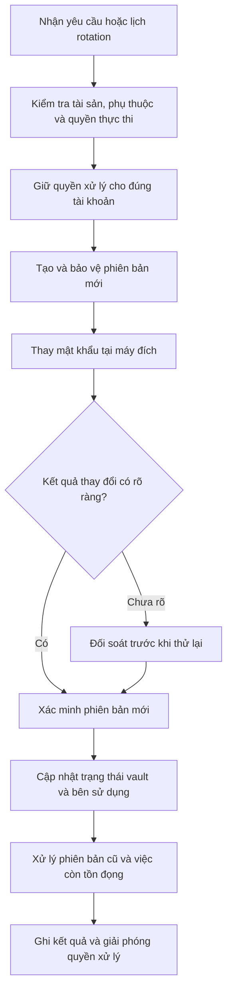

# Rotation local administrator

**Rotation local administrator** là quy trình thay mật khẩu của tài khoản quản trị cục bộ trên một máy, đồng bộ credential được quản lý và xác minh kết quả theo chính sách. Trong Privileged Access Management (PAM), mục tiêu là giảm thời gian một mật khẩu bị sao chép còn có thể được dùng, hạn chế việc dùng chung credential giữa các máy và giữ khả năng truy vết khi sử dụng đặc quyền.

Bài học thuộc chương **Password rotation**, trong phạm vi bảo vệ tài khoản quản trị, tài khoản dịch vụ và hạ tầng nhạy cảm. Nội dung kết hợp kiểm kê quyền, least privilege, JIT/JEA, vault, credential injection, giám sát phiên và bằng chứng phục vụ kiểm toán, ứng phó sự cố.

Trọng tâm là tài khoản quản trị cục bộ trên máy Windows thông thường. Những nguyên tắc về kiểm kê, đồng bộ, xác minh và xử lý lỗi cũng có thể áp dụng cho tài khoản đặc quyền cục bộ trên hệ thống khác, nhưng cơ chế thay mật khẩu, quyền thực thi và cách phục hồi phải được thiết kế theo nền tảng.

Sau bài học, bạn có thể:

- Xác định đúng tài khoản cục bộ và phân biệt với danh tính miền hoặc cloud.
- Thiết kế một workflow luân chuyển có trạng thái, quyền thực thi và bằng chứng rõ ràng.
- Xử lý phụ thuộc, máy offline và kết quả đổi mật khẩu chưa chắc chắn.
- Phân biệt xác minh mật khẩu mới với chấm dứt phiên, thu hồi quyền và xử lý máy bị xâm nhập.
- Đề xuất các kiểm tra trước khi đưa rotation vào vận hành rộng.

## 1. Xác định đúng đối tượng cần luân chuyển

Một máy có thể có nhiều danh tính được phép quản trị: tài khoản tích hợp sẵn, tài khoản cục bộ bổ sung, người dùng miền được đưa vào nhóm quản trị và danh tính do nền tảng quản lý. Không phải tất cả đều có mật khẩu được lưu và thay tại máy đó.

| Đối tượng | Nơi quản lý danh tính hoặc credential | Cách tiếp cận |
|---|---|---|
| Tài khoản quản trị cục bộ | Cơ chế tài khoản cục bộ của máy | Luân chuyển theo từng máy và tài khoản |
| Người dùng miền có quyền quản trị máy | Hệ thống danh tính miền và quyền trên máy | Không coi đổi mật khẩu cục bộ là đã thay credential miền |
| Danh tính quản lý tài nguyên cloud | Hệ thống IAM của cloud | Có vòng đời role, token hoặc key riêng |
| Tài khoản dịch vụ dùng để chạy tác vụ trên máy | Tùy loại tài khoản thực tế | Kiểm kê bên phụ thuộc trước khi thay credential |
| Danh tính khẩn cấp | Theo thiết kế phục hồi | Có quy trình bảo vệ, sử dụng, đối soát và luân chuyển riêng |

Tên `Administrator` không phải định danh duy nhất đáng tin cậy. Tài khoản có thể được đổi tên hoặc tên hiển thị khác theo môi trường. Nên liên kết ID tài sản với định danh tài khoản cục bộ do nền tảng cung cấp, đồng thời giữ tên hiện tại để hỗ trợ vận hành.

Khi thực hiện xác thực, phải chỉ rõ ngữ cảnh tài khoản cục bộ theo cơ chế được dùng, tránh vô tình kiểm tra một tài khoản miền trùng tên. Máy có vai trò danh tính đặc thù hoặc appliance có thể không áp dụng được playbook của máy thành viên thông thường.

### Một credential riêng cho mỗi máy

Nếu nhiều máy dùng cùng mật khẩu quản trị cục bộ, việc lộ một máy có thể làm tăng khả năng truy cập các máy khác chấp nhận credential đó. Luân chuyển cần tạo credential riêng theo từng đối tượng được quản lý, thay vì thay đồng loạt bằng một mật khẩu chung mới.

Tách credential không thay thế việc hạn chế đường mạng, quyền đăng nhập và các đường nâng quyền khác. Nó giảm một nguồn tái sử dụng đặc quyền trong mô hình phòng vệ nhiều lớp.

## 2. Luân chuyển giải quyết và chưa giải quyết điều gì?

Luân chuyển có thể hỗ trợ:

- Làm giảm thời gian một bản sao mật khẩu cũ còn hữu ích cho xác thực mới, theo cơ chế thực tế của đích.
- Loại bỏ credential dùng chung hoặc tồn tại quá lâu ngoài kiểm soát.
- Đưa việc thay mật khẩu vào workflow có chủ sở hữu, lịch và audit.
- Phối hợp với checkout hoặc phiên quản trị để xử lý credential sau sử dụng.
- Phát hiện sai lệch khi mật khẩu bị thay ngoài PAM.

Luân chuyển không tự:

- Giảm quyền của tài khoản quản trị cục bộ.
- Kết thúc mọi phiên, token đăng nhập hoặc tiến trình đã tồn tại.
- Thu hồi quyền của một người vẫn có thể yêu cầu credential mới qua PAM.
- Xóa tài khoản, tác vụ hoặc cơ chế duy trì truy cập do kẻ tấn công đã tạo.
- Làm một máy đã bị xâm nhập trở lại trạng thái đáng tin cậy.

Nếu máy vẫn bị kiểm soát bởi kẻ tấn công, mật khẩu mới cũng có thể tiếp tục bị lấy hoặc sử dụng. Trong ứng phó sự cố, cần phối hợp cô lập, điều tra và phục hồi trạng thái tin cậy với thời điểm thay credential.

## 3. Kiểm kê trước khi bật tự động hóa

Một hồ sơ quản lý tối thiểu nên có:

| Nhóm thông tin | Nội dung cần xác định |
|---|---|
| Tài sản | ID ổn định, tên máy, môi trường, chủ sở hữu, mức nhạy cảm |
| Tài khoản | ID cục bộ, tên hiện tại, trạng thái và quyền thực tế |
| Cơ chế thay đổi | Agent, connector từ xa hoặc cơ chế quản lý được nền tảng hỗ trợ |
| Nguồn quản lý | Thành phần có thẩm quyền thay mật khẩu và nơi giữ phiên bản hiện hành |
| Bên sử dụng | Người quản trị, proxy, dịch vụ, tác vụ định kỳ và automation |
| Chính sách | Sự kiện kích hoạt, giới hạn thời gian, điều kiện cấp sử dụng và ngoại lệ |
| Phục hồi | Đường khẩn cấp, người xử lý và điều kiện dùng quyền sửa chữa |
| Bằng chứng | Sự kiện đổi, xác minh, đồng bộ, cấp sử dụng và lỗi còn tồn đọng |

### 3.1 Một bên có thẩm quyền luân chuyển

Không để hai bộ quản lý độc lập cùng thay mật khẩu một tài khoản mà không có thiết kế phối hợp. Ví dụ, một cơ chế quản lý cục bộ của nền tảng và một connector PAM đều có thể hoạt động đúng theo lịch riêng nhưng liên tục làm dữ liệu của bên kia lạc hậu.

Chọn nguồn có thẩm quyền cho từng tài khoản, xác định cách bên khác nhận hoặc sử dụng credential và kiểm chứng trạng thái. Cùng một tài khoản đích được tạo thành nhiều bản ghi vault cũng có thể gây xung đột nếu mỗi bản ghi có worker riêng.

### 3.2 Kiểm kê phụ thuộc ít xuất hiện

Tài khoản quản trị cục bộ có thể đã được dùng cho dịch vụ, tác vụ định kỳ, công cụ sao lưu hoặc script. Một số công việc chỉ chạy theo tuần hoặc tháng nên không xuất hiện trong khoảng quan sát ngắn.

Thay mật khẩu có thể ảnh hưởng lần đăng nhập hoặc khởi chạy tiếp theo trong khi tiến trình hiện tại vẫn hoạt động. Vì vậy, hệ thống chưa lỗi ngay sau rotation chưa đủ chứng minh không có phụ thuộc.

Nếu một dịch vụ thường xuyên cần dùng tài khoản quản trị cục bộ toàn quyền, nên đánh giá tách sang danh tính dịch vụ có quyền phù hợp. Việc chuyển đổi này cần kế hoạch riêng; không tự thay loại tài khoản trong cùng một thao tác đổi mật khẩu mà chưa hiểu tác động.

## 4. Chọn cơ chế và giới hạn quyền thực thi

### 4.1 Agent tại máy

Agent có thể thực hiện thay đổi thông qua cơ chế cục bộ được hỗ trợ. Cần bảo vệ danh tính agent, kênh điều khiển, gói cập nhật và quyền người có thể gửi lệnh cho agent.

Agent có quyền cao là thành phần nhạy cảm. Cần giới hạn tác vụ, kiểm tra tài nguyên được quản lý và tránh một giao diện đổi mật khẩu trở thành kênh thực thi tùy ý.

### 4.2 Connector quản lý từ xa

Connector cần kết nối tới giao diện quản lý phù hợp với hệ điều hành và chính sách mạng. Không mặc định mở mọi giao thức quản trị từ mọi nơi chỉ để rotation hoạt động.

Xác minh đúng máy, bảo vệ kênh và chỉ cấp quyền thực hiện thay đổi trên tập tài sản được quản lý. Quyền cần thiết tùy giao thức và cơ chế phân quyền; không coi tài khoản quản trị toàn miền là yêu cầu mặc định.

### 4.3 Thay bằng credential hiện tại hoặc bằng danh tính sửa chữa

Một cơ chế có thể dùng credential hiện tại để thay mật khẩu của chính tài khoản. Cơ chế khác dùng một danh tính được ủy quyền để đặt lại credential. Hai luồng có yêu cầu quyền và điều kiện lỗi khác nhau.

Nếu vault đã lệch mật khẩu, luồng dùng credential hiện tại có thể không còn hoạt động. Khi đó cần reconciliation hoặc đường sửa chữa đã được thiết kế. Không tự chuyển sang một danh tính quyền rộng không nằm trong chính sách.

### 4.4 Bảo vệ ánh xạ đích

Worker không nên nhận một endpoint tùy ý rồi gửi credential quản trị tới đó. Tên máy, địa chỉ, định danh tài sản, trust và tài khoản cần được ánh xạ qua dữ liệu được kiểm soát.

Nếu có lỗi xác minh danh tính máy hoặc chứng thư của kênh, dừng và điều tra. Không bỏ kiểm tra trust để làm lần rotation tiếp tục.

## 5. Chính sách tạo mật khẩu và tiếp nhận vào vault

Mật khẩu mới cần được tạo bằng nguồn ngẫu nhiên mật mã phù hợp, đáp ứng chính sách thực tế của máy và tương thích với mọi thành phần phải xử lý nó. Không dùng một quy luật suy ra từ tên máy, ngày hoặc mật khẩu trước.

Cần kiểm tra các giới hạn được hỗ trợ như độ dài, tập ký tự, lịch sử và những điều kiện thay mật khẩu liên quan. Connector hoặc ứng dụng không xử lý đúng ký tự đặc biệt có thể làm chuỗi bị biến đổi khi truyền.

Không giải quyết lỗi bằng cách giảm bí mật thành mẫu dễ đoán. Nên sửa phương thức truyền, khả năng tương thích hoặc chọn một profile được thiết kế và đánh giá phù hợp.

### Bảo vệ giá trị trong quá trình thay đổi

- Không đưa mật khẩu vào log, ticket, tham số dòng lệnh hoặc thông báo lỗi có thể bị thu thập rộng.
- Giới hạn thành phần được đọc hoặc sử dụng giá trị mới.
- Lưu candidate và dữ liệu cần khôi phục ở nơi được bảo vệ trước khi tạo tác động không thể suy ra lại tại đích, theo thiết kế của giải pháp.
- Không cấp candidate cho người dùng như credential đã được xác nhận nếu workflow chưa đạt điều kiện phát hành.
- Giữ tham chiếu phiên bản và trạng thái công việc để đối soát, thay vì ghi giá trị hoặc hash mật khẩu vào audit.

Cách lưu candidate, giữ phiên bản trước và chuyển bản hiện hành khác nhau giữa sản phẩm. Điều cốt yếu là không mất credential vừa đặt thành công chỉ vì worker lỗi, đồng thời không làm lộ các phiên bản cho bên không có quyền.

## 6. Workflow luân chuyển có trạng thái



Sơ đồ là mô hình tham chiếu, không phải đặc tả giao dịch của một sản phẩm.

### Bước 1: Kiểm tra điều kiện

Xác nhận đúng máy và tài khoản, trạng thái kết nối, chính sách hiệu lực, công việc đang chạy, phiên quản trị và phụ thuộc. Chọn cửa sổ phù hợp cho những tác vụ có thể bị ảnh hưởng.

Một máy không kết nối được không nên bị ghi là đã đổi mật khẩu. Một tài khoản đang vô hiệu cũng không nên bị tự động bật lại chỉ để workflow đi qua bước xác thực.

### Bước 2: Điều phối theo tài khoản đích

Đảm bảo chỉ bên có thẩm quyền thực hiện thay đổi cho tài khoản đó. Giữ mã công việc, phiên bản trước, phiên bản mới và trạng thái bước bằng cơ chế bền vững.

Nếu worker chuyển vai trò, cần ngăn worker cũ tiếp tục thay mật khẩu. Khóa có thời hạn không tự chứng minh một tiến trình treo đã dừng; cơ chế điều phối hoặc cô lập phải xét tác động ở máy đích.

### Bước 3: Chuẩn bị và áp dụng bản mới

Tạo candidate, bảo vệ nó và thực hiện thay đổi qua cơ chế được hỗ trợ. Chỉ sử dụng quyền cần thiết và không thay các thuộc tính tài khoản ngoài phạm vi công việc.

Không tự bỏ chính sách mật khẩu hoặc mở quyền đăng nhập từ xa để vượt qua lỗi. Các thay đổi cấu hình như vậy phải có mục tiêu, kiểm soát và bằng chứng riêng.

### Bước 4: Xác minh và đối soát

Kiểm tra phiên bản mới bằng phương thức có giới hạn và đúng tài khoản cục bộ. Phân biệt xác thực thành công với việc được phép thực hiện quản trị từ xa.

Nếu phản hồi đổi mật khẩu bị mất, trạng thái có thể là đã đổi tại đích nhưng chưa được ghi nhận. Chuyển sang đối soát thay vì lập tức tạo thêm mật khẩu ngẫu nhiên và áp dụng lại.

### Bước 5: Đồng bộ và hoàn tất

Cập nhật nguồn credential hiện hành, bên sử dụng và các tham chiếu cần thiết theo khả năng giải pháp. Xác nhận những việc còn tồn đọng, xử lý bản cũ và ghi kết quả cuối.

Không coi việc gửi lệnh thành công là tương đương đã hoàn tất. Tiêu chí cần bao gồm trạng thái ở đích, dữ liệu vault và các phụ thuộc nằm trong phạm vi chuyển đổi.

## 7. Xác minh mật khẩu mới đúng cách

### 7.1 Đúng máy và đúng danh tính cục bộ

Phép thử phải ràng buộc với tài sản đã xác minh và ngữ cảnh tài khoản cục bộ. Một đăng nhập bằng tài khoản miền cùng tên không chứng minh mật khẩu cục bộ vừa đổi là đúng.

Khi có khả năng, đối chiếu danh tính được đích xác nhận với hồ sơ quản lý. Không chỉ dựa vào chuỗi tên hiển thị.

### 7.2 Xác thực và quyền từ xa là hai lớp

Một tài khoản có thể xác thực được nhưng không được phép đăng nhập qua một giao thức cụ thể. Các chính sách đăng nhập, hạn chế token hoặc điều kiện quản trị từ xa có thể ảnh hưởng kết quả.

Nếu xác thực đã thành công nhưng thao tác quản trị bị từ chối, không nên tự kết luận mật khẩu sai rồi đổi tiếp. Cần phân loại quyền, phương thức truy cập và mục tiêu kiểm tra.

### 7.3 Kiểm soát số lần thử

Mỗi lần xác thực thất bại có thể ảnh hưởng bộ đếm khóa. Nhiều connector, proxy và dịch vụ có thể cùng dùng tài khoản, nên giới hạn ở một worker chưa đủ bảo vệ toàn bộ tài khoản.

Dùng ngân sách thử phù hợp chính sách thực tế, phối hợp các nguồn trong phạm vi quản lý và dừng khi cần điều tra. Không mặc định một số lần thử cố định luôn an toàn trên mọi máy.

### 7.4 Kiểm tra giá trị cũ

Mục tiêu là credential cũ không còn được dùng cho xác thực mới theo thiết kế, nhưng không phải mọi workflow đều cần liên tục thử đăng nhập bằng mật khẩu cũ. Phép thử từ chối cũng có tác động và có thể gây khóa tài khoản.

Có thể kết hợp phản hồi thay đổi, xác minh bản mới và phép thử âm có kiểm soát khi thật sự cần, theo cơ chế nền tảng. Không coi việc một phiên cũ vẫn hoạt động là bằng chứng rằng thay mật khẩu đã thất bại; phiên đó có vòng đời riêng.

## 8. Phụ thuộc dịch vụ, tác vụ và phiên quản trị

### 8.1 Dịch vụ hoặc tác vụ dùng tài khoản cục bộ

Nếu bên sử dụng giữ credential cũ, lỗi có thể chỉ xuất hiện khi dịch vụ restart, tác vụ đến lịch hoặc kết nối mới được tạo. Cần cập nhật đúng nơi cấu hình và kiểm tra tại những điểm phù hợp.

Không truyền mật khẩu mới qua email, script tạm hoặc ticket để cập nhật thủ công không kiểm soát. Dùng cơ chế delivery được quản lý, có người chịu trách nhiệm và audit.

Nếu phát hiện quá nhiều phụ thuộc vào một tài khoản quản trị cục bộ, cân nhắc tách danh tính và giảm quyền như một thay đổi kiến trúc có kế hoạch. Luân chuyển thường xuyên hơn không sửa được quyền quá rộng của tài khoản dịch vụ.

### 8.2 Session proxy và credential injection

Proxy cần lấy đúng phiên bản hiện hành khi mở phiên mới. Nếu có cache, phải quy định cách làm mới và không tiếp tục dùng bản cũ ngoài giới hạn.

Người dùng được phép mở phiên không nên mặc nhiên được xem password. Ngược lại, người đã từng nhận password có thể giữ một bản sao, nên quyền đọc vault bị thu hồi chưa đủ vô hiệu bản sao đó.

### 8.3 Phiên đang hoạt động

Đổi mật khẩu không tự bảo đảm đóng mọi phiên RDP, kết nối quản trị hoặc tiến trình đã chạy. Nếu yêu cầu là kết thúc khả năng hoạt động của người dùng, cần xử lý quyền mở phiên mới và những phiên, token hoặc tác vụ đang tồn tại theo khả năng đích.

JIT giới hạn thời điểm có quyền; JEA hoặc cơ chế giới hạn hành động giảm phạm vi thao tác. Rotation xử lý vòng đời credential. Các kiểm soát này bổ sung cho nhau.

## 9. Máy offline, clone và khôi phục snapshot

### 9.1 Máy không kết nối được

Đặt trạng thái rõ rằng công việc chưa thực hiện hoặc chưa xác nhận, có lịch kiểm tra lại và người xử lý khi quá hạn. Không thay nhãn phiên bản vault thành đã áp dụng chỉ vì đã tạo candidate.

Với máy di động hoặc máy chỉ online theo lịch, cơ chế agent và chính sách cập nhật cần phù hợp thực tế. Khi máy trở lại, xác minh đúng tài sản và trạng thái hiện tại trước khi tiếp tục công việc cũ.

### 9.2 Máy clone hoặc được triển khai từ image

Không để một mật khẩu quản trị dùng chung trong image trở thành credential lâu dài trên mọi bản sao. Quy trình cấp máy cần đưa từng đối tượng vào quản lý và thiết lập credential riêng theo thiết kế.

Phải có cách nhận diện từng máy, tránh hai máy cùng bị ánh xạ vào một bản ghi tài khoản. Tên máy hoặc địa chỉ có thể thay đổi hoặc được tái sử dụng, nên cần cơ chế định danh tài sản đáng tin cậy.

### 9.3 Khôi phục snapshot hoặc backup

Khôi phục máy có thể đưa mật khẩu cục bộ về phiên bản trước, trong khi vault giữ bản mới. Khôi phục vault có thể gây chiều sai lệch ngược lại.

Cần reconciliation theo nguồn và thời điểm phục hồi, xác minh trạng thái ở đích và xử lý quyền truy cập tạm thời. Không tự phát hành credential trong backup như thể đó chắc chắn là giá trị hiện hành.

Bản backup hoặc snapshot cũng là dữ liệu nhạy cảm. Phân quyền truy cập và khả năng phục hồi phải xét cả rủi ro liên quan tới tài khoản đặc quyền.

## 10. Xử lý lỗi và kết quả chưa chắc chắn

| Tình huống | Cách hiểu | Hướng xử lý tham chiếu |
|---|---|---|
| Không kết nối được trước khi thay | Chưa có bằng chứng credential đổi | Ghi việc chờ hoặc lỗi kết nối, không đánh dấu hoàn tất |
| Máy từ chối candidate do chính sách | Chưa đạt điều kiện thay theo phản hồi đã xác nhận | Điều tra profile và chính sách thực tế, không tự nới cấu hình bảo vệ |
| Timeout trong khi áp dụng | Có thể đích đã đổi hoặc chưa đổi | Giữ trạng thái chưa rõ, đối soát trước khi thử tiếp |
| Đích đã đổi nhưng ghi vault lỗi | Có nguy cơ mất đồng bộ | Bảo vệ phiên bản cần thiết và phục hồi workflow có thẩm quyền |
| Vault có bản mới nhưng đích chưa đổi | Candidate chưa phải credential hiện hành đã xác nhận | Không cấp như bản đã áp dụng; xử lý bước còn thiếu |
| Xác thực mới thất bại | Có thể sai phiên bản, sai ngữ cảnh, khóa tài khoản hoặc lỗi khác | Phân loại trước, giới hạn lần thử |
| Xác thực được nhưng quản trị từ xa bị cấm | Có thể là chính sách quyền hoặc giao thức | Không đổi mật khẩu liên tục để chữa lỗi quyền |
| Bên sử dụng chưa cập nhật | Credential và cấu hình runtime chưa đồng bộ | Cập nhật theo kế hoạch và kiểm tra sức khỏe |
| Hai hệ thống cùng thay password | Xung đột nguồn có thẩm quyền | Dừng xung đột, xác định nguồn chính và đối soát |

### Không tự giả định thao tác lặp là an toàn

Đặt lại cùng một mật khẩu có thể bị chính sách lịch sử hoặc cơ chế của đích xử lý khác nhau. Tạo một mật khẩu khác mỗi lần thử lại cũng có thể làm mất khả năng xác định bên nào đang giữ bản hiện hành.

Cần thiết kế retry ở mức workflow: mã công việc, phiên bản, kết quả quan sát và quyền thực thi. Không chỉ lặp nguyên một lệnh mạng khi timeout.

### Rollback và sửa chữa

Rollback không luôn có nghĩa đặt lại mật khẩu trước. Bản trước có thể đã lộ, bị chính sách từ chối hoặc không phù hợp trạng thái hiện tại. Đôi khi phương án tốt hơn là đi tiếp tới một phiên bản mới được bảo vệ và xác nhận.

Đường sửa chữa cần danh tính và quyền riêng nếu cần, được sử dụng theo quy trình có audit. Không xóa tài khoản, bỏ chính sách hoặc mở mọi cổng quản trị chỉ để đưa dashboard về trạng thái thành công.

## 11. Chính sách và hồ sơ kết quả minh họa

Ví dụ sau mô tả ý định vận hành, không phải cấu hình triển khai trực tiếp của một sản phẩm:

```yaml
local_administrator_rotation_model:
  asset_reference: production-windows-app-07
  local_account_reference: managed-local-maintenance-account
  credential_owner: windows-platform-team
  authoritative_rotation_controller: designated-pam-controller
  password_profile_reference: local-admin-profile
  controls:
    unique_credential_per_asset: true
    target_identity_verification_required: true
    durable_workflow_state_required: true
    protected_candidate_required: true
    coordinate_with_active_jobs: true
    validate_new_credential: true
    bounded_authentication_attempts: true
  completion_requirements:
    target_change_confirmed: true
    vault_current_version_confirmed: true
    dependent_consumers_handled: true
    outstanding_cleanup_recorded: true
  failure_handling:
    uncertain_outcome_requires_reconciliation: true
    offline_asset_is_not_completed: true
    automatic_security_policy_relaxation: false
```

Trong hiện thực hóa, từng yêu cầu phải có thành phần chịu trách nhiệm và cách quan sát. Một trường `true` trong hồ sơ không chứng minh connector hoặc máy đích đã thực thi được điều đó.

### Bằng chứng cho một lần rotation

Nên lưu ID tài sản, ID tài khoản, mã công việc, phiên bản trước/sau theo tham chiếu được quản lý, nguồn kích hoạt, danh tính worker, thời điểm các bước, kết quả thay và xác minh, tình trạng bên sử dụng cùng việc còn tồn đọng.

Không lưu password, private key hoặc hash password để đối chiếu phiên bản. Kết quả xác minh cần nêu phạm vi đã thử; không biến một lần đăng nhập thành tuyên bố mọi quyền và dịch vụ đều đã được kiểm tra.

## 12. Ví dụ vận hành một nhóm máy ứng dụng

Một nhóm có ba máy Windows chạy ứng dụng nội bộ. Mỗi máy có một tài khoản bảo trì cục bộ riêng do PAM quản lý. Người vận hành dùng session proxy; một tác vụ cũ trên máy thứ ba vẫn sử dụng tài khoản này.

### 12.1 Chuẩn bị

Nhóm đối chiếu tài sản, định danh tài khoản, quyền và đường mạng. Mật khẩu được quản lý riêng theo từng máy. Tác vụ cũ được ghi nhận là phụ thuộc cần xử lý, thay vì bỏ qua vì nó chưa chạy trong ngày.

Chọn một máy đại diện để pilot, xác minh đường truy cập khẩn cấp và công việc luân chuyển không xung đột với một bộ quản lý khác.

### 12.2 Thực hiện

Worker giữ quyền xử lý, tạo và bảo vệ candidate, thay trên máy pilot, xác minh đúng tài khoản cục bộ rồi đồng bộ nguồn hiện hành. Proxy được kiểm tra khả năng mở phiên mới bằng bản được quản lý.

Nếu mọi điều kiện đạt, mở rộng theo đợt phù hợp với mức ảnh hưởng. Máy có tác vụ phụ thuộc được xử lý theo kế hoạch cập nhật riêng; không xoay đồng loạt trước khi biết cách duy trì tác vụ.

### 12.3 Lỗi cần phân loại

Sau khi đổi trên máy thứ hai, phép xác minh bị timeout do đường mạng lỗi. Worker ghi kết quả chưa rõ và không tiếp tục đổi thêm nhiều bản mới. Khi kết nối ổn định, workflow đối soát phiên bản đã chuẩn bị và trạng thái được đích chấp nhận.

Trong khi đó, một phiên RDP cũ vẫn còn hoạt động. Điều này được xử lý theo chính sách phiên, không tự coi là bằng chứng password mới chưa có hiệu lực.

### 12.4 Bàn giao

Nhóm giữ bằng chứng thay đổi, xác minh, phiên mới, trạng thái tác vụ và ngoại lệ. Dashboard phân biệt hoàn tất, chờ máy online, chưa rõ kết quả và cần người xử lý. Không gộp mọi trạng thái thành thành công chỉ vì lịch đã chạy.

## 13. Thực hành kiểm chứng và vận hành liên tục

Trong môi trường lab được phép, dùng tài khoản thử và biết rõ chính sách khóa. Các tình huống sau là hướng dẫn học tập, không phải kết quả kiểm thử thực tế của một hệ thống cụ thể.

| Tình huống | Điều cần xác nhận |
|---|---|
| Thay mật khẩu bình thường | Đích, vault và tham chiếu phiên bản thống nhất |
| Tài khoản được đổi tên | Quản lý vẫn đúng danh tính cục bộ, không nhầm tài khoản khác |
| Có tài khoản miền trùng tên | Phép xác minh không thành công nhầm bằng danh tính miền |
| Máy offline trước khi chạy | Không tạo kết quả hoàn tất giả; có kế hoạch tiếp tục |
| Mất kết nối trong lúc đổi | Kết quả chưa rõ được đối soát trước retry |
| Worker lỗi sau khi đích đổi | Có dữ liệu bảo vệ cần thiết để phục hồi trạng thái |
| Hai worker cùng nhận việc | Chỉ bên có thẩm quyền được tác động tài khoản |
| Có dịch vụ hoặc tác vụ dùng password cũ | Phụ thuộc được cập nhật và quan sát tại thời điểm phù hợp |
| Phiên cũ tồn tại sau rotation | Được xử lý riêng theo yêu cầu thu hồi phiên |
| Phục hồi snapshot hoặc dữ liệu vault cũ | Phát hiện lệch phiên bản và có reconciliation |
| Endpoint không đúng danh tính | Không gửi hoặc sử dụng credential ngoài đích được tin cậy |
| Log và đầu ra chẩn đoán | Không chứa giá trị password hoặc dữ liệu xác thực nhạy cảm |

Các chỉ số vận hành hữu ích gồm tỷ lệ tài khoản có chủ sở hữu, số credential dùng chung còn tồn tại, thời gian từ yêu cầu đến hoàn tất, số công việc chưa rõ kết quả, số máy quá hạn do offline, lỗi bên sử dụng và thời gian hoàn tất đối soát.

Rà soát cả tài khoản quản trị cục bộ mới xuất hiện hoặc thay đổi ngoài PAM. Một workflow luôn chạy thành công trên tài khoản đã đăng ký chưa chứng minh mọi tài khoản đặc quyền của máy đều đã được quản lý.

Rotation đạt giá trị khi credential riêng được thay và đồng bộ có kiểm chứng, người dùng nhận đúng khả năng truy cập, phụ thuộc được duy trì và các lỗi được xử lý có trách nhiệm. Những điều kiện đó cần được giữ cùng quyền tối thiểu, giám sát phiên và bằng chứng trong suốt vòng đời máy.
