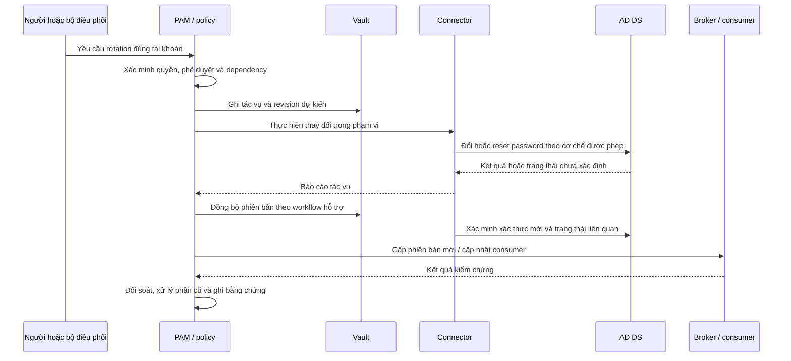

# Rotation domain administrator

## 1. Mục tiêu và phạm vi

Rotation domain administrator là luân chuyển password của một tài khoản có đặc quyền quản trị miền bằng quy trình kiểm soát được. Trong bài này, môi trường tham chiếu là Active Directory Domain Services (AD DS). Những hệ thống quản lý danh tính khác có mô hình tài khoản, quyền và giao thức riêng; không áp dụng nguyên xi quy trình AD DS cho mọi nền tảng.

Trong hệ thống quản lý truy cập đặc quyền (Privileged Access Management — PAM), rotation cần duy trì tính nhất quán giữa vault, danh tính tại miền và những thành phần được phép sử dụng tài khoản. Với đặc quyền cấp miền, một sai sót có thể ảnh hưởng nhiều máy chủ, cơ chế quản trị và đường khôi phục, nên phạm vi tác động phải được xác định trước.

Mục tiêu thực tế gồm:

- Giảm thời gian sử dụng một password đã được chia sẻ, biết hoặc nghi ngờ bị lộ.
- Không phải tiết lộ plaintext cho người thực hiện nếu connector/broker có thể thay mặt thao tác.
- Bảo đảm đúng tài khoản được đổi và vault giữ credential được miền chấp nhận.
- Kiểm chứng việc sử dụng hợp lệ qua các đường quản trị cần thiết.
- Xử lý dependency, quyền tạm, phiên và token liên quan theo policy.
- Lưu bằng chứng về người đề nghị, phê duyệt, thực thi, kết quả và phần chưa xác minh.

Đổi password không tự làm một tài khoản đặc quyền trở thành tài khoản ít quyền. Rotation cần đi cùng kiểm kê quyền, least privilege, JIT/JEA khi phù hợp và hạn chế đường truy cập quản trị.

## 2. Xác định đúng đối tượng cần rotation

“Domain administrator” có thể được dùng để chỉ tài khoản Administrator tích hợp của miền, một thành viên của nhóm quản trị miền hoặc một tài khoản có quyền mạnh thông qua cơ chế ủy quyền khác. Cần ghi nhận danh tính và quyền hiệu lực, không suy ra chỉ từ tên đăng nhập.

| Đối tượng | Điểm cần phân biệt |
|---|---|
| Tài khoản Administrator tích hợp của miền | Có thể đã được đổi tên; cần định danh ổn định và đúng miền thay vì chỉ tìm chuỗi `Administrator` |
| Tài khoản cá nhân có quyền quản trị miền | Nên tách khỏi tài khoản làm việc thường ngày và được quy trách nhiệm theo từng người |
| Tài khoản dùng chung qua PAM | Cần nối từng phiên với danh tính cá nhân, có policy sử dụng và kiểm soát đồng thời |
| Tài khoản dịch vụ đang có quyền quản trị miền | Cần kiểm kê dependency và xem có thể giảm quyền; rotation không hợp thức hóa đặc quyền quá mức |
| Tài khoản quản trị cục bộ của máy thành viên | Không phải cùng một đối tượng với tài khoản miền; có vòng đời và cơ chế quản lý riêng |
| Tài khoản/credential khôi phục đặc biệt | Có mục đích và workflow riêng; không tự gộp vào password của tài khoản quản trị miền |

Tài khoản directory thuộc miền được sao chép giữa các domain controller theo cơ chế của AD DS. Không nên thiết kế việc đổi password cùng một tài khoản như một tập password độc lập cần đặt lại lần lượt trên từng domain controller.

Password của tài khoản quản trị miền cũng khác với vật liệu xác thực Kerberos của miền hoặc credential phục hồi riêng của domain controller. Khi xảy ra xâm nhập, cần đánh giá những thành phần thực sự bị ảnh hưởng; chỉ rotation một tài khoản không thể được coi là khôi phục toàn bộ miền.

### Hồ sơ tài khoản cần có

Hồ sơ quản lý nên chứa ID/SID hoặc định danh ổn định phù hợp, miền, tên đăng nhập hiện tại, chủ sở hữu, nhóm/ủy quyền hiệu lực, secret ID trong vault, connector, đường xác thực, consumer, đường khôi phục và lịch sử tác vụ. Không ghi giá trị password vào hồ sơ hoặc ticket.

## 3. Kiểm kê dependency và đường truy cập

Trước rotation có kế hoạch, cần biết tài khoản được dùng ở đâu. Một tài khoản được xem là chỉ phục vụ quản trị có thể thực tế đang chạy service, scheduled task, script hoặc pipeline cũ.

| Dependency hoặc đường truy cập | Điều cần kiểm tra |
|---|---|
| Broker/session proxy | Cách lấy phiên bản credential mới, profile quyền và hành vi với phiên đang mở |
| Trạm quản trị hoặc công cụ chuyên dụng | Có lưu password, dùng phiên xác thực cũ hoặc cấu hình đăng nhập tự động không |
| Windows service hoặc tác vụ nền | Có dùng tài khoản này để chạy không; cấu hình đổi bằng cách nào |
| Scheduled task/job ít chạy | Khi nào xác thực lại, có kiểm tra đại diện và người chịu trách nhiệm không |
| Script và CI/CD | Credential có nằm ngoài vault hoặc được inject bằng một danh tính quá rộng không |
| Hệ thống dự phòng/khôi phục | Có giữ cấu hình cũ và có dùng được khi miền hoặc PAM suy giảm không |
| Công cụ quản trị bên ngoài PAM | Có đường đăng nhập trực tiếp bằng password từng được biết không |

Cần kết hợp thông tin chủ hệ thống, cấu hình trong phạm vi được phép và dấu vết xác thực. Log của một ngày không đủ chứng minh không có job chỉ chạy hàng tháng hoặc khi phục hồi.

Nếu phát hiện tài khoản quản trị miền chạy một ứng dụng chỉ cần quyền hẹp, ghi nhận đây là vấn đề quyền quá mức. Với thay đổi có kế hoạch, có thể cần tách dependency sang danh tính ít quyền trước hoặc trong một kế hoạch riêng được kiểm soát. Với nghi ngờ lộ lọt, phải cân đối việc cô lập và khôi phục dịch vụ theo quy trình sự cố, không trì hoãn vô thời hạn chỉ vì dependency khó xử lý.

### Không dùng trạng thái “dịch vụ vẫn chạy” làm bằng chứng

Một service, phiên quản trị hoặc connection pool có thể tiếp tục hoạt động sau đổi password nhờ trạng thái xác thực đã thiết lập. Nó có thể chỉ lỗi khi tạo phiên mới hoặc khởi động lại. Vì vậy, kế hoạch kiểm chứng phải bao gồm đường xác thực mới phù hợp, không chỉ quan sát tiến trình đang sống.

## 4. Thiết kế quyền cho connector rotation

Connector cần một cơ chế được AD DS cho phép để thay password của tài khoản mục tiêu. Cần phân biệt hai dạng thao tác:

- **Đổi password với credential hiện tại:** dựa vào khả năng xác thực và quyền thay đổi của chính tài khoản theo giao thức được hỗ trợ.
- **Đặt lại password bằng danh tính được ủy quyền:** sử dụng một quyền riêng, thường quan trọng khi credential hiện tại không còn hợp lệ hoặc cần reconciliation.

Khả năng sử dụng, yêu cầu quyền và ngữ nghĩa lỗi phụ thuộc connector, policy và tài khoản. Không nên cấp Domain Admin cho mọi connector chỉ để tránh xử lý lỗi quyền.

Quyền đặt lại password một tài khoản quản trị miền bản thân nó là đặc quyền rất mạnh: người nắm quyền có thể kiểm soát credential của tài khoản đó. Dù chỉ nhắm một tài khoản, phải bảo vệ danh tính reset tương xứng với tác động của tài khoản mục tiêu.

| Lớp kiểm soát | Yêu cầu cần xác định |
|---|---|
| Phạm vi tài khoản | Connector chỉ thao tác những tài khoản đã được onboard và được giao |
| Phạm vi miền/môi trường | Không dùng danh tính development để thay credential production |
| Kết nối và giao thức | Dùng đường xác thực/thay password được hỗ trợ và được bảo vệ phù hợp; xác minh đúng đích |
| Policy và phê duyệt | Người gọi không thể tự chọn một tài khoản bất kỳ rồi yêu cầu reset |
| Cấu hình connector | Hạn chế quyền sửa endpoint, domain mapping, plugin hoặc mã thực thi |
| Vòng đời danh tính thực thi | Có chủ sở hữu, bảo vệ credential, rotation và cách khôi phục riêng |

Những cơ chế bảo vệ tài khoản/nhóm quản trị trong AD DS có thể làm việc ủy quyền thông thường không hoạt động như với tài khoản khác. Cần kiểm tra quyền hiệu lực và các cơ chế bảo vệ liên quan; không mở rộng ACL hoặc vô hiệu bảo vệ hàng loạt chỉ để tác vụ rotation chạy được.

Với tài khoản quản trị mạnh, cần bảo vệ cả máy chạy connector, pipeline triển khai, quyền runtime và những người có thể thay code. Không có quyền đọc password qua API vault chưa có nghĩa không thể quan sát hoặc lạm dụng credential tại thành phần đang sử dụng nó.

## 5. Chọn điều kiện và thời điểm thực hiện

Rotation có thể xuất phát từ lịch policy, sau sử dụng nhạy cảm, thay đổi nhân sự, quy trình khẩn cấp hoặc nghi ngờ lộ credential. Không có một chu kỳ thời gian chung trong bài này; chu kỳ cần phù hợp mức rủi ro, loại tài khoản và khả năng thực thi của tổ chức.

Đối với rotation có kế hoạch, cần xác nhận:

1. Đúng tài khoản, đúng miền, quyền và mapping đã được kiểm chứng.
2. Có người chịu trách nhiệm nghiệp vụ/hạ tầng và điều kiện phê duyệt theo phạm vi.
3. Domain controller cần thiết, kết nối và trạng thái directory sẵn sàng cho thay đổi.
4. Chính sách password áp dụng cho tài khoản và khả năng connector sinh/gửi password tương thích.
5. Consumer, phiên và job đã được kiểm kê; cửa sổ tác động và cách kiểm chứng rõ ràng.
6. Không có rotation/reconciliation khác đang thay cùng tài khoản.
7. Có kế hoạch đối soát, khôi phục và đường khẩn cấp khả thi.
8. Có nơi lưu bằng chứng, cảnh báo và khả năng theo dõi phần chưa hoàn tất.

Password mới cần được sinh bằng cơ chế ngẫu nhiên phù hợp và đáp ứng policy có hiệu lực của tài khoản. Không tự đặt một độ dài hoặc bộ ký tự rồi giả định mọi miền và connector đều chấp nhận. Những ràng buộc về lịch sử, tuổi password, chính sách riêng và giao thức phải được kiểm tra trong thiết kế tích hợp.

Nếu password bị nghi lộ, mục tiêu ưu tiên có thể là ngăn sử dụng trái phép và xử lý quyền đang sống. Kế hoạch sự cố cần xác định các bước đó cùng việc bảo toàn bằng chứng; không chỉ chạy rotation theo lịch thông thường rồi báo xong.

## 6. Workflow rotation có kiểm soát

Đây là luồng logic, không quy định mọi sản phẩm phải ghi vault sau khi đổi ở AD DS. Một số thiết kế có thể lưu phiên bản chờ trước khi thay đổi. Điều bắt buộc là biết credential nào có thể đang có hiệu lực tại mỗi mốc và không cấp một phiên bản chưa được kiểm chứng cho consumer.

### Những cổng thực thi quan trọng

- **Định danh:** dùng ID ổn định và domain mapping đã quản trị; không tin tên hiển thị hoặc hostname tùy ý từ requester.
- **Điều phối:** định danh tác vụ và kiểm soát xung đột trên cùng tài khoản thực, kể cả khi nhiều secret ID trỏ đến nó.
- **Thay đổi:** chỉ thực hiện bằng connector được ủy quyền, trên đường được bảo vệ và đúng mục tiêu.
- **Đồng bộ:** cập nhật vault có kiểm soát revision hoặc cơ chế tương đương để tránh ghi đè tác vụ mới hơn.
- **Xác minh:** kiểm tra việc xác thực mới tại đúng đích và khả năng vận hành liên quan.
- **Kết thúc:** không đóng tác vụ khi còn kết quả chưa xác định, consumer chưa được cập nhật hoặc quyền còn phải xử lý.

Không cần trả password cho người phê duyệt hoặc người vận hành để họ biết rotation đã thành công. Connector và broker có thể cung cấp kết quả xác minh cùng tham chiếu bằng chứng mà không xuất plaintext.

## 7. Domain controller và replication

Một thay đổi password được tiếp nhận qua domain controller phù hợp rồi được lan truyền theo cơ chế của AD DS. Đây là một yếu tố vận hành phải đưa vào xác minh, đặc biệt khi có nhiều site, kết nối suy giảm hoặc lỗi replication.

Cần phân biệt:

| Mốc | Điều có thể kết luận |
|---|---|
| Một domain controller tiếp nhận thay đổi | Có bằng chứng thao tác được chấp nhận tại điểm đó theo giao thức |
| Xác thực mới thành công qua một đường kiểm tra | Credential được chấp nhận trên đường đó tại thời điểm kiểm tra |
| Những đường quản trị/consumer đã được kiểm chứng | Các đường đã thử có thể dùng cơ chế mới theo kết quả ghi nhận |
| Trạng thái replication và các dependency đạt tiêu chí | Có cơ sở đóng phần kiểm chứng trong phạm vi đã xác định |

Không nên đánh đồng một lần đăng nhập thành công với việc mọi domain controller và mọi consumer đã hội tụ. Cơ chế chọn DC, chuyển tiếp xác thực, cache và replication có thể làm kết quả khác với giả định của người kiểm tra.

Vai trò PDC emulator có ý nghĩa trong một số hành vi password/xác thực của AD DS, nhưng không phải một bảo đảm rằng toàn bộ miền lập tức có trạng thái giống nhau hoặc rằng mọi kiểm tra chỉ cần thực hiện qua một endpoint. Thiết kế cần dựa vào đường thực tế mà connector và consumer sử dụng.

Không cố “đồng bộ” bằng cách reset liên tiếp cùng tài khoản trên từng DC như những tài khoản độc lập. Khi có bất thường replication, cần xử lý nguyên nhân hạ tầng theo quy trình, giới hạn retry và giữ trạng thái chưa xác minh ở những phần chưa đủ bằng chứng.

Với domain controller chỉ đọc hoặc cấu hình cache đặc thù, phải xem chính sách và khả năng của đường xác thực liên quan; không cố phân phối credential quản trị mạnh tới một vị trí chỉ để phép thử thuận tiện hơn.

## 8. Verification sau đổi password

Verification cần tạo bằng chứng về credential mới mà không dùng một phiên đã xác thực từ trước để kết luận. Cách kiểm tra phải phù hợp policy và giao thức của tài khoản; không vô hiệu hóa cơ chế bảo vệ chỉ để một phương pháp kiểm tra cũ hoạt động.

Một kế hoạch verification có thể gồm:

1. Xác nhận tác vụ thay đổi có kết quả rõ hoặc đã được đối soát qua cơ chế hỗ trợ.
2. Tạo một ngữ cảnh xác thực mới bằng credential được quản lý trên đúng miền/tài khoản, qua đường được phép.
3. Ghi endpoint/DC hoặc thông tin đường xác thực có thể quan sát được, thời điểm và kết quả.
4. Kiểm tra một hành động quản trị tối thiểu, vô hại, trong phạm vi được phép nếu cần chứng minh đường sử dụng; không thực hiện tác vụ phá hủy để thử quyền.
5. Kiểm chứng broker, công cụ quản trị và những consumer có liên quan sau khi nhận bản mới.
6. Đánh giá trạng thái replication và các đường quan trọng theo tiêu chí đã chốt.

Xác thực thành công chỉ chứng minh được một phần: nó không tự chứng minh mọi quyền quản trị đã đúng, mọi job đã cập nhật hoặc password cũ không còn được chấp nhận ở mọi ngữ cảnh. Báo cáo phải giữ rõ những giới hạn này.

### Giới hạn việc thử password cũ

Không lặp thử password cũ trên mọi DC hoặc công cụ để tìm một kết quả từ chối. Những lần thử có thể gây cảnh báo, ảnh hưởng bộ đếm thất bại hoặc khóa tài khoản theo cấu hình, đồng thời làm tăng số nơi xử lý credential.

Nếu policy yêu cầu kiểm chứng bản cũ đã không còn sử dụng được, cần phương pháp, số lần, thời điểm và đường kiểm tra được cho phép. Diễn giải kết quả theo giao thức, replication và hành vi chuyển đổi của hệ thống; không áp đặt một giả định chung rằng mọi nơi phải từ chối đồng thời ngay sau thao tác.

### Tránh làm lộ credential trong lúc kiểm tra

Không đưa password vào ticket, lệnh được ghi lịch sử, tham số tiến trình, URL hoặc log chẩn đoán. Nếu có ghi phiên bảo trì, cần kiểm tra bước xác thực không vô tình đưa credential vào bằng chứng. Người xác nhận kết quả có thể đọc trạng thái và tham chiếu kiểm tra mà không cần thấy password.

## 9. Phiên, Kerberos ticket và quyền còn tồn tại

Rotation password không phải cơ chế thu hồi toàn bộ hoạt động đã xác thực. Trong AD DS, cần quan tâm cả phiên đăng nhập, kết nối quản trị, ngữ cảnh xác thực và Kerberos ticket đã được cấp.

Một tài khoản có thể đã thiết lập phiên trước khi đổi password. Những phiên hoặc ticket đó không nên được coi là đã vô hiệu chỉ vì vault đã chuyển sang phiên bản mới. Hiệu lực còn lại phụ thuộc giao thức, thời hạn, trạng thái phiên và cơ chế của tài nguyên.

| Đối tượng còn tồn tại | Điều cần đánh giá |
|---|---|
| Phiên qua PAM proxy | Proxy có thực sự đóng kết nối khi check-in/thu hồi không? |
| Phiên trực tiếp ngoài PAM | Có được phát hiện, xác định chủ thể và xử lý theo quy trình không? |
| Kerberos ticket đã cấp | Thời hạn, khả năng tiếp tục sử dụng và biện pháp xử lý trong kịch bản cụ thể |
| Phiên công cụ hoặc ứng dụng | Có đang giữ trạng thái xác thực cũ hoặc dùng lại kết nối không? |
| Quyền JIT | Nhóm/role đã gỡ nhưng phiên/token có còn quyền đã nhận trước đó không? |
| Đường truy cập mới do tài khoản tạo | Có user, key, tác vụ hoặc thay đổi policy ngoài mong muốn không? |

Với rotation định kỳ, policy có thể cho phép một số phiên hợp lệ kết thúc theo kế hoạch. Với nghi ngờ xâm nhập, có thể cần chặn cấp mới, đóng phiên, xử lý endpoint và kiểm tra những thay đổi đã xảy ra. Hành vi phải được xác định trước và thực thi ở nơi có khả năng dừng quyền thật.

Không dùng việc rotation một tài khoản quản trị miền để kết luận mọi vật liệu xác thực của miền đã được thay đổi. Nếu sự cố có dấu hiệu ảnh hưởng sâu hơn đến directory, khóa hoặc cơ chế cấp ticket, cần phạm vi điều tra/khôi phục tương ứng theo quy trình sự cố riêng.

## 10. Timeout, lỗi một phần và reconciliation

Rotation đi qua ít nhất vault, connector và AD DS; các phía không tự có giao dịch nguyên tử chung. Tác vụ có thể mất phản hồi sau khi password đã được đổi tại miền.

| Điểm lỗi | Trạng thái có thể xảy ra | Cách xử lý cần thiết kế |
|---|---|---|
| Chưa gửi yêu cầu thay đổi | Chưa có bằng chứng credential ở miền bị đổi | Dừng, ghi nguyên nhân và dọn phần chuẩn bị |
| Miền từ chối thay đổi | Password/policy/quyền hoặc trạng thái có thể không đáp ứng | Phân loại lỗi; không công bố bản chưa được chấp nhận |
| Timeout sau khi gửi | Miền có thể đã đổi hoặc chưa đổi | Giữ kết quả chưa xác định, đối soát trước khi retry |
| Miền đã đổi, vault chưa cập nhật | Broker/consumer có thể tiếp tục lấy bản cũ | Khôi phục nhất quán qua workflow được bảo vệ |
| Vault có revision mới hơn dự kiến | Có tác vụ khác hoặc thay đổi ngoài luồng | Không ghi đè mù quáng; kiểm tra trạng thái và quyền điều phối |
| Vault và miền khớp, consumer lỗi | Cấu hình/cache/đường xác thực consumer có thể chưa đúng | Giữ hạng mục consumer chưa hoàn tất và khắc phục |
| Không thể xác minh ở một đường quan trọng | Chưa đủ bằng chứng kết thúc toàn bộ | Báo phạm vi đã xác minh và phần còn chờ |

Retry không được tạo một password khác trong mỗi vòng rồi mất dấu bản đang hiệu lực. Cần task ID, trạng thái và ngữ nghĩa xử lý lặp phù hợp connector. Một distributed lock của bộ điều phối cũng không tự ngăn một runner cũ tiếp tục thao tác ở đích sau khi nó mất lease; giới hạn này phải được xử lý trong thiết kế thực thi.

### Khi cần reconciliation

Nếu credential trong vault không còn dùng được hoặc kết quả thay đổi không thể khôi phục theo đường bình thường, có thể cần reconciliation bằng quyền đặt lại độc lập được ủy quyền. Trước khi reset tiếp, phải loại trừ sai mapping, lỗi mạng, trạng thái khóa và replication chưa đủ rõ.

Reconciliation thường không phải đọc password hiện tại từ AD DS. Nó có thể thiết lập một credential mới rồi đưa vault, miền và consumer về trạng thái nhất quán theo khả năng sản phẩm.

Quyền reconciliation cho tài khoản quản trị miền phải được bảo vệ như đặc quyền có khả năng kiểm soát tài khoản đó. Không dùng một tài khoản reset toàn quyền không được kiểm kê làm cách sửa nhanh cho mọi lỗi rotation.

## 11. Kế hoạch khôi phục và đường khẩn cấp

Runbook phải có người quyết định dừng, người thực hiện khôi phục, nguồn quyền hợp lệ và cách xác minh kết quả. Không chờ mất quyền quản trị mới tìm nơi giữ credential khẩn cấp.

Cần phân biệt:

1. **Chưa đổi tại miền:** có thể dừng tác vụ và giữ trạng thái cũ nếu vẫn an toàn, hợp lệ và được xác minh.
2. **Đã đổi tại miền:** quay lại cấu hình vault/consumer cũ chưa chắc khôi phục được xác thực.
3. **Chưa biết kết quả:** không coi thao tác rollback đã gửi là bằng chứng đã khôi phục.

Khôi phục có thể cần đặt một password mới khác và đồng bộ lại, thay vì dùng lại password cũ. Policy lịch sử, tình trạng lộ lọt hoặc cơ chế connector có thể khiến quay lại bản cũ không phù hợp.

### Tránh phụ thuộc vòng

Nếu PAM đăng nhập quản trị bằng chính tài khoản đang rotation, connector dùng credential đó và đường khẩn cấp cũng chỉ truy cập được sau khi xác thực qua cùng miền, một lỗi có thể làm mất cả đường xử lý thông thường lẫn đường phục hồi.

Cần phân tích những phụ thuộc này và thiết kế đường cứu hộ phù hợp: danh tính được bảo vệ, khả năng truy cập khi thành phần cần thiết lỗi, phạm vi tối thiểu khả thi, điều kiện nhiều bên tham gia khi được quy định và bằng chứng sử dụng.

Không giữ một password quản trị miền dùng chung trong tài liệu để “phòng khi cần”. Không tự động chuyển broker/consumer sang tài khoản toàn quyền dự phòng khi rotation lỗi. Đường break-glass phải là một cơ chế được quản trị, có thông báo và đối soát sau sử dụng.

Nếu kịch bản khẩn cấp cho phép người được ủy quyền nhận credential, cần ghi nhận đó là một đường tiết lộ riêng, có quyền và xử lý sau dùng tương ứng. Quyền mở phiên qua broker không mặc nhiên cho phép xem password.

## 12. Bằng chứng, trạng thái nghiệm thu và giám sát

Một sự kiện “password changed” không đủ để chứng minh rotation đã hoàn thành trong phạm vi vận hành. Cần nối quyết định, thao tác miền, phiên bản vault, verification và consumer.

| Nhóm bằng chứng | Nội dung cần cân nhắc |
|---|---|
| Định danh | Tài khoản/ID ổn định, miền, secret ID, tài nguyên và mapping liên quan |
| Quyết định | Lý do rotation, chủ thể đề nghị/phê duyệt, policy và cửa sổ thay đổi |
| Thực thi | Task ID, connector, danh tính thực thi, thời điểm gửi và kết quả/timeout |
| Đồng bộ | Revision/phiên bản vault, trạng thái chờ hoặc đã công bố, lỗi xung đột |
| Verification | Đường xác thực/endpoint quan sát được, thời điểm, ngữ cảnh mới và kết quả |
| Consumer | Thành phần đã cập nhật, phép kiểm chứng chức năng và hạng mục còn mở |
| Thu hồi/khôi phục | Phiên/quyền xử lý, reconciliation hoặc break-glass và kết quả xác nhận |

Không ghi password cũ/mới, token đầy đủ hoặc credential connector vào log. Metadata, tài khoản quản trị và bản ghi phiên cũng có thể nhạy cảm nên cần quyền đọc, tính toàn vẹn và lưu giữ phù hợp.

Có thể tách kết quả thành những mốc rõ:

- Thao tác thay đổi đã được xác nhận tại directory.
- Credential trong vault đã được kiểm chứng qua đường xác thực mới.
- Các đường quản trị và consumer trong phạm vi đã được kiểm chứng.
- Phiên/quyền tồn dư đã được xử lý theo policy hoặc có ngoại lệ rõ.
- Các hạng mục chưa xác minh, lỗi hoặc điều tra còn mở đã có người chịu trách nhiệm.

Những mốc này là mô hình báo cáo, không phải schema trạng thái bắt buộc. Không báo “hoàn tất toàn bộ” khi một job hoặc đường quản trị quan trọng chưa được kiểm tra.

Giám sát nên phát hiện lỗi xác thực tăng, rotation quá hạn, tác vụ chưa xác định, thay đổi password ngoài PAM, consumer lệch phiên bản và sử dụng tài khoản qua đường không dự kiến. Các dấu hiệu cần được phân loại; tăng lỗi đăng nhập có thể do mạng hoặc policy, không luôn là lý do reset tiếp.

## 13. Tình huống minh họa

Một tổ chức dùng tài khoản `adm_ops_prod` có quyền quản trị miền cho các tác vụ được phê duyệt qua broker. Vault đang có revision `rev-27`. Trong kiểm kê, đội vận hành còn phát hiện một scheduled task cũ dùng cùng tài khoản và một công cụ quản trị tại site dự phòng.

### Chuẩn bị

Chủ tài nguyên xác nhận mục đích từng dependency. Scheduled task được đánh giá để chuyển sang danh tính có quyền hẹp hơn theo kế hoạch; nếu chưa chuyển xong, ảnh hưởng và cách cập nhật phải có người chịu trách nhiệm. Connector và danh tính rotation được kiểm tra phạm vi, quyền hiệu lực và đường khôi phục.

Nhóm thống nhất tiêu chí xác minh: credential mới được chấp nhận qua đường connector, broker mở được ngữ cảnh xác thực mới, công cụ ở site dự phòng được kiểm tra, những dependency còn trong phạm vi được cập nhật và các phiên cần kết thúc được xác nhận.

### Lỗi xảy ra giữa tác vụ

Connector gửi yêu cầu đổi password rồi timeout. Broker chưa nhận phiên bản mới và một lần mở phiên mới thất bại. Một phiên đã chạy trước đó vẫn còn hoạt động.

Cách xử lý phù hợp là:

1. Ghi kết quả thay đổi chưa xác định, không kết luận miền chưa đổi.
2. Ngăn một tác vụ khác đổi cùng tài khoản trong phạm vi điều phối.
3. Kiểm tra mapping, kết nối, trạng thái tài khoản, bằng chứng connector và directory qua cơ chế được hỗ trợ.
4. Khôi phục trạng thái vault–miền theo workflow sản phẩm; nếu cần, dùng reconciliation được ủy quyền thay vì đoán password.
5. Xác minh đăng nhập mới và cập nhật broker/dependency theo kế hoạch.
6. Kiểm tra site dự phòng và trạng thái replication liên quan; giữ phần chưa xác minh nếu kết nối site đang lỗi.
7. Xử lý phiên còn sống theo policy, lưu bằng chứng và điều tra nguyên nhân timeout.

Phiên cũ vẫn chạy không chứng minh password trong vault còn đúng. Việc broker đã mở được phiên mới ở một đường cũng chưa đủ chứng minh site dự phòng đã sẵn sàng.

### Báo cáo có thể nghiệm thu

Một báo cáo chính xác có thể nêu vault–miền đã đồng bộ, broker đã xác thực mới thành công, scheduled task đã được xử lý, nhưng kiểm chứng site dự phòng còn chờ một hạng mục mạng. Chỉ đóng toàn bộ phạm vi khi các tiêu chí đã chốt được đáp ứng hoặc ngoại lệ được ghi nhận rõ theo quy trình.

## 14. Kiểm tra thiết kế và lỗi thường gặp

Các tình huống sau dùng để lập kế hoạch kiểm tra trong môi trường và cửa sổ được cho phép. Không cần tác động domain production chỉ để thử một nhánh lỗi.

| Tình huống | Kết quả mong đợi |
|---|---|
| Đúng tài khoản và đủ điều kiện | Thay đổi trong phạm vi, không xuất plaintext cho người không cần |
| Tên tài khoản trùng ở miền khác | Mapping/ID ngăn thay đổi sai đối tượng |
| Connector không đủ quyền | Dừng và báo rõ, không tự cấp Domain Admin hoặc sửa ACL rộng |
| Password không đáp ứng policy | Không công bố bản chưa được chấp nhận, xử lý theo connector |
| Timeout sau khi gửi | Giữ kết quả chưa xác định, đối soát trước retry |
| Rotation/reconciliation đồng thời | Không thay đổi xung đột ngoài ngữ nghĩa đã thiết kế |
| Revision vault thay đổi giữa tác vụ | Không ghi đè mù quáng |
| Một site/đường xác thực chưa kiểm chứng | Báo phần còn mở, không suy từ một phép thử thành toàn miền |
| Consumer còn cấu hình cũ | Phát hiện khi tạo xác thực mới, có bước cập nhật/khôi phục |
| Thu hồi sau nghi ngờ lộ lọt | Xử lý phiên, ticket/token và đường truy cập liên quan theo phạm vi sự cố |
| Đường khẩn cấp cần dùng | Truy cập được theo kịch bản, có quyền hạn và bằng chứng rõ |

Những lỗi thường gặp gồm:

| Lỗi | Hệ quả | Cách phòng tránh |
|---|---|---|
| Chọn tài khoản chỉ bằng tên `Administrator` | Đổi nhầm tài khoản hoặc bỏ sót tài khoản đã đổi tên | Định danh ổn định và đúng miền, xác minh trước thay đổi |
| Quên service/job đang dùng tài khoản | Gián đoạn khi chúng xác thực lại | Kiểm kê dependency, kiểm chứng job ít chạy và giảm quyền theo kế hoạch |
| Cấp Domain Admin cho connector để sửa mọi lỗi | Tăng mạnh phạm vi ảnh hưởng | Phân tích quyền cần thiết và bảo vệ danh tính thực thi |
| Reset cùng tài khoản lần lượt trên mọi DC | Tạo thay đổi chồng chéo, khó đối soát | Thao tác theo cơ chế AD DS và kiểm tra replication/đường sử dụng |
| Chỉ kiểm tra một phiên đã mở | Không phát hiện credential mới sai | Dùng ngữ cảnh xác thực mới phù hợp |
| Timeout được coi là chưa đổi | Retry có thể làm mất đồng bộ thêm | Giữ trạng thái chưa xác định và đối soát |
| Restore vault cũ được coi là rollback password miền | Credential có thể lại không khớp | Khôi phục dựa trên trạng thái thật của các phía |
| Đổi password được coi là thu hồi toàn bộ đặc quyền | Phiên/ticket hoặc thay đổi tồn dư còn hiệu lực | Quy trình thu hồi và ứng phó riêng theo cơ chế |
| Chia sẻ password để nhiều người xác minh | Tăng số bản sao và mất kiểm soát | Broker/connector kiểm chứng, người vận hành đọc bằng chứng |

Để tự kiểm tra thiết kế, hãy trả lời:

1. Định danh nào bảo đảm connector đổi đúng tài khoản trong đúng miền?
2. Tài khoản có quyền mạnh vì nhóm, ủy quyền hay cơ chế nào, và có thật sự cần giữ quyền đó không?
3. Consumer nào chỉ xác thực lại khi khởi động, đến kỳ chạy hoặc chuyển site?
4. Danh tính rotation/reset có thể tác động đến những tài khoản nào và ai bảo vệ nó?
5. Nếu timeout sau khi AD DS đã đổi password, cách nào khôi phục vault mà không lộ credential?
6. Verification chứng minh điều gì ở từng đường xác thực, và phần nào chưa được kiểm chứng?
7. Những phiên, ticket và quyền nào còn có thể sống sau rotation?
8. Nếu cả miền hoặc PAM suy giảm, đường khẩn cấp có còn truy cập được đúng kịch bản không?

Rotation tài khoản quản trị miền cần được vận hành như một thay đổi đặc quyền có phạm vi lớn. Kết quả đáng tin cậy đến từ đúng định danh, quyền connector được kiểm soát, trạng thái vault–directory được đối soát, đường sử dụng được kiểm chứng và phần đặc quyền còn tồn tại được xử lý bằng bằng chứng.
