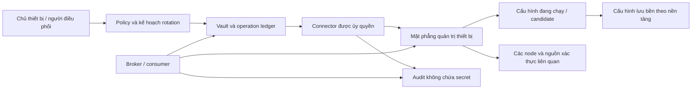

# Rotation network device password

## 1. Mục tiêu và phạm vi

Rotation network device password là luân chuyển mật khẩu dùng để quản trị thiết bị mạng như router, switch, firewall, thiết bị VPN hoặc cân bằng tải. Trong quản lý truy cập đặc quyền (Privileged Access Management, PAM), quy trình phải phối hợp vault, connector, thiết bị và các bên đang sử dụng tài khoản đó.

Mục tiêu không dừng ở việc thiết bị chấp nhận một lệnh đổi mật khẩu. Cần bảo đảm giá trị mới được bảo vệ, xác thực được bằng một phiên mới, có hiệu lực ở đúng nguồn danh tính, được lưu bền theo cơ chế thiết bị và được các consumer sử dụng đúng. Với cụm nhiều node, còn phải biết thay đổi đã tới những node nào.

Ví dụ, PAM đổi mật khẩu tài khoản local trên firewall active nhưng chưa lưu cấu hình hoặc chưa đồng bộ sang standby. Phiên quản trị cũ vẫn hoạt động và connector báo thành công. Khi thiết bị khởi động lại hoặc đổi vai trò, mật khẩu có thể trở về trạng thái khác với vault. Đây là lỗi vòng đời credential, dù lệnh ban đầu không trả lỗi.

Bài học thuộc chương Password rotation, tập trung vào tài khoản quản trị và danh tính dịch vụ trên hạ tầng mạng nhạy cảm. Cách triển khai cần gắn với least privilege, quyền JIT/JEA khi phù hợp, vault, giám sát phiên và bằng chứng kiểm toán, ứng phó sự cố. Tên trạng thái và mô hình dưới đây là tham khảo, không phải lệnh hoặc API dùng chung cho mọi hãng thiết bị.

## 2. Xác định đúng loại mật khẩu cần thay

Trước khi tạo một job rotation, phải xác định nơi có thẩm quyền quản lý credential và chức năng của nó.

| Loại bí mật | Nơi quản lý hoặc sử dụng | Điều cần phân biệt |
|---|---|---|
| Mật khẩu tài khoản local | Cơ sở tài khoản trên thiết bị hoặc cụm | Có thể riêng từng node hoặc được đồng bộ, tùy nền tảng |
| Mật khẩu tài khoản AAA tập trung | Hệ thống danh tính hoặc dịch vụ xác thực trung tâm | Đổi trên thiết bị có thể không tác động tới mật khẩu đang được dùng |
| Mật khẩu nâng mức đặc quyền | Bước chuyển sang chế độ hoặc vai trò đặc quyền | Có thể khác mật khẩu đăng nhập ban đầu |
| Shared secret giữa thiết bị và dịch vụ AAA | Quan hệ tin cậy giữa client và server xác thực | Không phải mật khẩu của người quản trị; cần phối hợp hai phía |
| Credential của công cụ quản lý | NMS, hệ thống backup cấu hình, tự động hóa hoặc API client | Có nhiều consumer, cache và phiên đang hoạt động |
| Bí mật giao thức khác | Credential giám sát, khóa giao thức hoặc bí mật dịch vụ | Có vòng đời và phụ thuộc riêng, không gộp tùy tiện vào job đổi mật khẩu quản trị |

AAA là Authentication, Authorization và Accounting: xác thực, phân quyền và ghi nhận hoạt động. Một thiết bị có thể dùng nhiều nguồn danh tính theo một chuỗi phương thức. Cách chuyển sang nguồn dự phòng phụ thuộc cấu hình và nền tảng; không mặc định một lần AAA từ chối sẽ tự chuyển sang tài khoản local.

Tài khoản local và tài khoản tập trung có thể trùng tên nhưng là hai danh tính khác nhau. Nếu phép thử đăng nhập đang đi qua AAA, thành công của nó không chứng minh mật khẩu local vừa thay đã hoạt động. Phải biết nguồn xác thực thực tế được dùng.

Mật khẩu đăng nhập và mật khẩu nâng quyền cũng không được coi là cùng một giá trị chỉ vì cả hai thuộc một thiết bị. Nếu connector cần cả hai, các tham chiếu và phiên bản phải được quản lý nhất quán theo quy trình được hỗ trợ.

## 3. Kiểm kê thiết bị, tài khoản và phụ thuộc

Mỗi đối tượng rotation cần có thông tin đủ để nhận diện và điều phối.

| Nhóm thông tin | Nội dung cần xác định |
|---|---|
| Tài nguyên | ID thiết bị hoặc cụm, vai trò mạng, môi trường, tenant và chủ sở hữu |
| Điểm quản trị | Địa chỉ quản trị, API hoặc giao thức, đường mạng và nguồn được phép |
| Danh tính đích | Tên tài khoản, local hay tập trung, miền hoặc nguồn có thẩm quyền |
| Quyền | Quyền đăng nhập, quyền đổi mật khẩu, quyền lưu cấu hình và mức tác vụ cần dùng |
| Nền tảng | Dòng thiết bị, phiên bản phần mềm, connector profile và khả năng đã được kiểm tra |
| Cấu hình | Thay đổi tác động ngay hay qua candidate/commit; cách lưu bền và hoàn tác |
| Cụm | Các node, địa chỉ từng node, cơ chế đồng bộ, tài khoản dùng chung hay riêng |
| Consumer | Broker, script, NMS, backup cấu hình, công cụ tự động và người dùng được phép |
| Khôi phục | Đường quản trị độc lập, người chịu trách nhiệm, cửa sổ và điều kiện dừng |

Một địa chỉ quản trị ảo có thể chỉ đưa tới node đang active. Kiểm tra qua địa chỉ đó chưa chứng minh standby hoặc mọi thành viên stack đã có trạng thái phù hợp. Cần danh sách binding giữa credential, tài khoản và từng tài nguyên thực sự chịu tác động.

Nếu nhiều bản ghi hoặc nhiều hệ thống tự động cùng quản lý một tài khoản, cần thống nhất nơi điều khiển vòng đời. Hai job đổi cùng mật khẩu có thể làm vault và thiết bị liên tục mất đồng bộ, kể cả khi mỗi job riêng lẻ chạy đúng lệnh.

Consumer không chỉ là người mở phiên. Một hệ thống backup cấu hình chạy cuối tuần có thể vẫn giữ mật khẩu cũ và gây khóa tài khoản sau khi rotation đã đóng. Phải biết cách nạp lại, thời gian cache và cách thử từng consumer theo mức tác động.

## 4. Preflight và ranh giới quản trị



Trước thay đổi, xác minh đường quản trị bằng giao thức được bảo vệ và danh tính máy chủ bằng host key, chứng thư hoặc cơ chế trust phù hợp. Không tự hạ xuống giao thức không bảo vệ hoặc bỏ xác minh máy chủ khi connector gặp lỗi.

Danh tính rotation chỉ cần quyền phù hợp với phạm vi tài khoản, thao tác và thiết bị. Quyền đổi mật khẩu không nên mặc nhiên kéo theo quyền sửa mọi chính sách mạng. Với quyền lưu cấu hình hoặc quản trị rộng không thể tách trong nền tảng, ghi rõ giới hạn và bổ sung kiểm soát vận hành phù hợp.

Xác nhận điều kiện cửa sổ bảo trì, tình trạng thiết bị, operation cấu hình khác và đường khôi phục độc lập. Một phiên console phụ thuộc cùng nguồn AAA đang lỗi không đương nhiên là đường khôi phục độc lập. Kiểm tra cả quyền và khả năng tiếp cận đường đó theo quy trình cho phép.

Rotation là thay đổi trên mặt phẳng quản trị, nhưng lỗi lệnh hoặc lưu cấu hình không đúng có thể ảnh hưởng dịch vụ mạng. Connector không được đồng thời sửa routing, firewall policy hoặc cấu hình ngoài phạm vi chỉ để thuận tiện đăng nhập.

## 5. Chuẩn bị mật khẩu và connector profile

Mật khẩu mới cần được sinh bằng cơ chế tin cậy, đáp ứng chính sách tổ chức và giới hạn thực tế của thiết bị. Giới hạn có thể liên quan độ dài, tập ký tự, lịch sử mật khẩu hoặc cách nhập qua API và CLI. Kiểm tra các giới hạn trong môi trường được phép trước khi triển khai production.

Không sinh một giá trị rồi tự cắt, bỏ khoảng trắng hoặc thay ký tự để connector gửi được. Việc biến đổi có thể làm vault giữ một giá trị còn thiết bị nhận giá trị khác. Đừng hạ độ mạnh một cách âm thầm; cần chọn tập ký tự và chiều dài tương thích ngay trong chính sách sinh.

Connector profile phải phù hợp nền tảng, phiên bản phần mềm và phương thức quản lý. Với CLI tương tác, cần xử lý chế độ lệnh, prompt, phân trang, xác nhận, lỗi cú pháp, command authorization và phản hồi bất thường. Một dấu nhắc quay lại không chứng minh lệnh đã áp dụng đúng.

Một số giao diện phân biệt nhập mật khẩu mới với nhập một biểu diễn đã mã hóa hoặc hash. Không sao chép chuỗi trong cấu hình rồi coi đó là mật khẩu plaintext có thể đăng nhập. Cách đọc và ghi phải theo ngữ nghĩa của nền tảng; không đoán từ nhãn một trường hoặc tự chuyển định dạng ngoài khả năng hỗ trợ.

Secret đi qua connector có thể xuất hiện trong dòng lệnh cấu hình, echo của terminal, trace hoặc exception. Cần bảo vệ các điểm đó trước khi đưa dữ liệu tới log, bản ghi phiên và hệ thống hỗ trợ. Lưu tham chiếu phiên bản và mã kết quả, không lưu câu lệnh đầy đủ có mật khẩu. Che ở giao diện xem log chưa đủ nếu stream gốc vẫn chứa giá trị.

## 6. Quy trình rotation đầu cuối

### 6.1. Tạo operation và bảo vệ ứng viên

Một quy trình thường có các bước sau:

1. **Xác nhận phạm vi:** đúng tenant, thiết bị, nguồn danh tính, tài khoản và loại mật khẩu; policy và cửa sổ thay đổi còn hợp lệ.
2. **Điều phối:** nhận quyền thực hiện trên tài khoản và tài nguyên cấu hình liên quan, kiểm tra không có rotation hoặc thay đổi xung đột.
3. **Preflight:** xác minh đường quản trị, trust, trạng thái tài khoản, quyền thao tác, consumer và phương án khôi phục.
4. **Chuẩn bị phiên bản:** sinh và lưu mật khẩu ứng viên trong vault theo cơ chế bảo vệ có thể phục hồi; gắn operation ID và revision cần thiết.
5. **Áp dụng:** connector thực hiện đúng thao tác đổi credential theo profile, không sửa phần cấu hình ngoài phạm vi.
6. **Xác minh:** tạo phiên mới dùng đúng ứng viên từ vault, đúng nguồn xác thực và tác vụ kiểm tra tối thiểu.
7. **Hoàn tất cấu hình:** commit, xác nhận hoặc lưu bền theo nền tảng, rồi kiểm tra kết quả và các node liên quan.
8. **Công bố:** cập nhật phiên bản được cấp phát theo điều kiện đã định nghĩa, ngăn ghi đè một operation khác.
9. **Chuyển consumer:** nạp lại credential, thử bằng kết nối mới và kiểm tra chức năng từng consumer.
10. **Kết thúc:** xử lý quyền hoặc phiên cũ theo chính sách, lưu bằng chứng, giải phóng điều phối và theo dõi sau thay đổi.

Trình tự giữa áp dụng, commit và xác minh phải được điều chỉnh theo nền tảng. Có thiết bị chỉ dùng cấu hình mới sau commit; có thiết bị thay ngay giá trị đang chạy; có cơ chế yêu cầu xác nhận trước hạn để tránh tự hoàn tác. Không áp một chuỗi lệnh cố định cho mọi thiết bị.

Với hệ thống một mật khẩu, khoảng giữa thay đích và chuyển consumer có thể gây lỗi xác thực. Cần kế hoạch tạm dừng, điều phối hoặc chuyển đổi được nền tảng hỗ trợ. Không mặc định thiết bị chấp nhận hai mật khẩu đồng thời để đạt thay đổi không gián đoạn.

### 6.2. Theo dõi trạng thái thay vì một cờ thành công

Mã giả sau thể hiện ranh giới xử lý, không phải lệnh CLI hoặc mã triển khai hoàn chỉnh:

```text
rotate_network_account(binding, expected_revision, operation_key):
    authorize_current_scope(binding)
    operation = get_or_create_idempotent_operation(operation_key, binding)
    require_no_conflicting_change(operation)
    validate_management_path_and_recovery_plan(binding)

    candidate = stage_protected_password(operation)
    outcome = connector.apply_password(binding, candidate)
    if outcome is uncertain:
        record_unknown_outcome(operation)
        return pending_reconciliation

    require outcome.accepted
    verify_fresh_authentication_using_candidate(binding, candidate)
    complete_commit_or_persistence_if_required(operation)
    verify_durable_and_cluster_conditions(operation)
    publish_version_conditionally(expected_revision, operation, candidate)
    validate_consumer_transition(operation)
    record_completion_with_evidence(operation)
```

Cần định nghĩa rõ điều kiện từng bước và thứ tự phù hợp profile. Không giữ giao dịch cơ sở dữ liệu mở trong suốt các lời gọi mạng dài; trạng thái operation cần được ghi theo các điểm có thể phục hồi. Điều phối thao tác từ xa và cập nhật nguyên tử trong vault là hai trách nhiệm khác nhau.

Idempotency giúp một lần retry không tạo thêm operation vô tình, nhưng không tự bảo đảm lệnh ở thiết bị chỉ chạy một lần. Connector phải nhận diện trạng thái hoặc đối soát kết quả. Khóa hết hạn cũng không tự ngăn một tác nhân cũ tiếp tục sửa thiết bị; thiết kế cần cách quản lý tình huống đó theo khả năng nền tảng.

### 6.3. Xác minh bằng phiên mới

Phiên đã đăng nhập trước khi đổi mật khẩu thường không xác thực lại chỉ vì credential thay đổi. Có thể giữ một phiên theo kế hoạch để hỗ trợ khôi phục, nhưng không dùng nó làm bằng chứng mật khẩu mới đúng.

Tạo phiên độc lập bằng ứng viên đã lưu trong vault, không dùng giá trị trong bộ nhớ riêng của người vận hành hoặc kết nối ghép kênh cũ. Xác minh đúng device identity, tài khoản và nguồn xác thực. Nếu tài khoản có bước nâng quyền riêng, kiểm tra từng bước theo chức năng connector được cấp.

Phép thử tác vụ nên là đọc thông tin định danh hoặc trạng thái tối thiểu được cho phép. Nếu đăng nhập thành công nhưng một lệnh bị từ chối do command authorization, ghi nhận đây là lỗi quyền tác vụ; không tự nâng toàn bộ quyền để báo thành công.

Nếu cần xác minh tài khoản local nhưng đường vào luôn dùng AAA, phải có cách kiểm tra local được nền tảng và chính sách cho phép. Không ngắt dịch vụ AAA production để ép fallback trong một job rotation thông thường. Khi chưa có phép thử đủ tin cậy, ghi rõ binding chưa được xác minh đầy đủ.

## 7. Cấu hình đang chạy, commit và lưu bền

### 7.1. Xác định ngữ nghĩa của từng nền tảng

Trên một số thiết bị, thay đổi có hiệu lực trong cấu hình đang chạy rồi cần lưu để tồn tại sau khởi động. Nền tảng khác dùng candidate và commit hoặc tự lưu theo cơ chế riêng. Không giả định mọi thiết bị có cùng cặp running/startup hay cùng thao tác save.

Cần theo dõi các mốc riêng:

| Mốc | Bằng chứng cần có |
|---|---|
| Thao tác được chấp nhận | Kết quả đã được connector hiểu theo profile, không chỉ có prompt |
| Credential mới xác thực được | Phiên mới dùng đúng version và nguồn danh tính |
| Commit hoặc xác nhận hoàn tất | Trạng thái operation trên thiết bị theo cơ chế được hỗ trợ |
| Lưu bền | Bằng chứng cấu hình liên quan đã được ghi theo ngữ nghĩa nền tảng |
| Cụm đạt yêu cầu | Trạng thái đồng bộ và phép kiểm tra các binding liên quan |

Nếu nền tảng có tự hoàn tác sau một khoảng thời gian chưa được xác nhận, phải theo dõi thời hạn và kết quả xác nhận. Mật khẩu mới đăng nhập được trước khi hoàn tác chưa đủ để công bố rằng thay đổi đã bền vững.

### 7.2. Không lưu ngoài phạm vi một cách mù quáng

Một thao tác lưu hoặc commit có thể bao gồm các thay đổi đang chờ khác, tùy thiết bị. Vì vậy, cần phối hợp với chủ cấu hình, kiểm tra thay đổi xung đột và phạm vi được duyệt. Không tự lưu mọi thay đổi tồn đọng chỉ để giữ mật khẩu mới.

Nếu cần snapshot hoặc diff để phục hồi, bảo vệ chúng như dữ liệu nhạy cảm: cấu hình có thể chứa tài khoản, hash, shared secret và thông tin hạ tầng. Không đưa toàn bộ nội dung cấu hình vào log để chứng minh đã save. Chỉ lưu bằng chứng phù hợp và tham chiếu tới bản được bảo vệ khi cần.

Không khởi động lại thiết bị production như một phép thử mặc định sau mỗi rotation. Xác nhận persistence bằng cơ chế được hỗ trợ; kiểm thử reboot cần kế hoạch vận hành riêng, phạm vi và cửa sổ phù hợp.

### 7.3. Khi runtime đã đổi nhưng persistence chưa hoàn tất

Giữ trạng thái chuyển tiếp rõ ràng. Mật khẩu ứng viên vẫn cần được bảo vệ và có thể dùng bởi thành phần khôi phục được phép, trong khi quyền cấp phát thông thường tuân thủ kế hoạch đã định nghĩa. Không đánh dấu hoàn tất hoặc tự quay về mật khẩu cũ khi chưa biết đích đang chấp nhận giá trị nào.

Nếu thao tác lưu timeout, kết quả cũng có thể chưa biết. Cần đối soát trạng thái thiết bị và operation trước khi gửi lại thay đổi. Chỉ công bố hoàn tất khi đạt các điều kiện durability đã cam kết hoặc báo rõ ngoại lệ còn cần xử lý.

## 8. Thiết bị HA, stack và cụm nhiều node

### 8.1. Xác định đơn vị rotation thực tế

Trong hệ thống nhiều node, tài khoản có thể là local riêng từng thành viên, đối tượng được đồng bộ trong cụm hoặc danh tính tập trung ngoài cụm. Đơn vị điều phối cần theo nơi thực sự quản lý credential, không chỉ theo số địa chỉ IP.

Nếu một cấu hình được đồng bộ tự động, hai job độc lập đổi cùng tài khoản trên hai node có thể tạo xung đột. Nếu tài khoản riêng từng node, đổi ở active chưa xử lý tài khoản standby. Cần connector profile và dữ liệu binding diễn tả đúng mô hình đó.

Theo dõi ít nhất vai trò node, endpoint quản trị, nguồn xác thực, phiên bản đã xác minh, trạng thái lưu bền và đồng bộ cần thiết. Không lưu mật khẩu hoặc nội dung hash vào bảng theo dõi chỉ để phân biệt node.

### 8.2. Chuyển đổi theo kế hoạch và kiểm tra từng binding

Thứ tự active, standby hoặc thành viên khác phụ thuộc nền tảng và mô hình đồng bộ; không có một thứ tự chung đúng cho mọi cụm. Kế hoạch cần bảo đảm không đồng thời làm mất mọi đường quản trị và có điều kiện dừng nếu node đầu tiên chưa đạt yêu cầu.

Khi có endpoint riêng từng node, cần xác minh đúng node và trust tương ứng. Một phiên mới qua địa chỉ ảo chỉ chứng minh đường vào hiện tại, không thay cho bằng chứng ở các binding khác. Nếu không thể kiểm tra trực tiếp một node theo thiết kế, ghi rõ giới hạn và bằng chứng thay thế được chấp thuận.

Nếu một node đã dùng mật khẩu mới còn node khác chưa đồng bộ, giữ trạng thái chuyển đổi, hạn chế các tác vụ cạnh tranh và đối soát nguyên nhân. Không tự tạo thêm mật khẩu cho toàn cụm hoặc tự tách một đối tượng dùng chung thành nhiều giá trị mà mô hình đích không hỗ trợ.

Không ép failover chỉ để kiểm tra mật khẩu trong một job thông thường. Kiểm thử đổi vai trò là một hoạt động vận hành riêng, chỉ thực hiện khi thuộc kế hoạch đã được cho phép. Bằng chứng routine cần dựa trên phương pháp nền tảng hỗ trợ và giới hạn đã công bố.

## 9. Tích hợp với AAA và tài khoản khẩn cấp

### 9.1. Rotation tài khoản tập trung

Nếu thiết bị xác thực qua dịch vụ trung tâm, đổi mật khẩu tài khoản đó phải diễn ra ở nơi có thẩm quyền. Một lần thay có thể ảnh hưởng nhiều thiết bị và cả hệ thống ngoài mạng. Cần kiểm kê consumer trên phạm vi danh tính trung tâm, thay vì mỗi thiết bị tự đổi thành một giá trị khác nhau.

Xác minh qua đúng nguồn AAA và bằng chứng liên quan. Một tài khoản local trùng tên có thể khiến người kiểm tra hiểu sai kết quả. Đừng cố tình làm nguồn AAA không sẵn sàng để chứng minh fallback hoạt động nếu điều đó không thuộc một kế hoạch kiểm thử được phép.

Command authorization cũng có thể do AAA quyết định. Nếu connector đăng nhập được nhưng không được sửa tài khoản hoặc lưu cấu hình, cần xử lý quyền thao tác cụ thể theo chính sách. Không xóa kiểm soát phân quyền hoặc cấp vai trò quản trị toàn cục như một nhánh tự động.

### 9.2. Shared secret và danh tính người dùng

Shared secret giữa thiết bị với dịch vụ AAA là một quan hệ khác với mật khẩu người quản trị. Thay một phía không phối hợp có thể làm đường xác thực hoặc accounting gặp lỗi tùy cơ chế tích hợp.

Cần một đối tượng quản lý, phạm vi phụ thuộc, trình tự chuyển đổi và phép thử riêng cho loại bí mật đó. Không gộp thao tác thay shared secret vào job đổi mật khẩu local chỉ vì cả hai xuất hiện trong cùng phần cấu hình thiết bị.

### 9.3. Tài khoản local khẩn cấp

Tài khoản khẩn cấp cần chủ sở hữu, quyền sử dụng, đường truy cập, thời hạn cấp quyền và bằng chứng riêng. Private management path hoặc console không đủ nếu cơ chế đăng nhập vẫn phụ thuộc hoàn toàn vào thành phần đang gặp sự cố.

Khi rotation nguồn xác thực chính, cần biết đường khôi phục nào vẫn còn hoạt động. Không đồng thời thay mọi credential chính và khẩn cấp mà chưa có trình tự bảo vệ khả năng quản trị. Nếu credential khẩn cấp nghi bị lộ, phải xử lý theo rủi ro; không giữ giá trị đó vô hạn chỉ vì nó là phương án dự phòng.

Sau sử dụng break-glass, xử lý quyền, phiên và rotation theo chính sách. Việc đóng một cửa sổ checkout không chứng minh người dùng đã quên hoặc xóa mật khẩu đã đọc.

## 10. Lỗi một phần và phương án xử lý

| Tình huống | Trạng thái cần giữ | Hành động phù hợp để xem xét |
|---|---|---|
| Không kết nối được hoặc host trust sai | Chưa xác định được đường quản trị hợp lệ | Chẩn đoán mạng và danh tính đích; không bỏ kiểm tra trust |
| Mật khẩu ứng viên không đáp ứng policy | Chưa có thay đổi hợp lệ được xác nhận | Sửa chính sách sinh hoặc profile, không tự cắt chuỗi |
| CLI trả prompt nhưng có lỗi cú pháp hoặc quyền | Chưa chứng minh đã áp dụng | Phân loại phản hồi, kiểm tra bước thao tác và quyền cụ thể |
| Đổi mật khẩu timeout | Kết quả chưa biết | Đối soát operation, trạng thái thiết bị và một ứng viên có căn cứ |
| Phiên mới đăng nhập được, save hoặc commit timeout | Runtime đã xác minh, persistence chưa biết | Kiểm tra và hoàn tất đúng operation, không báo hoàn tất |
| Cơ chế tự hoàn tác có thể đã kích hoạt | Trạng thái thay đổi cần xác định lại | Kiểm tra commit hoặc rollback theo profile và xác thực có giới hạn |
| Active đạt, standby chưa rõ | Chưa đạt điều kiện cụm | Dừng tiến trình theo kế hoạch, xử lý binding thiếu và đồng bộ |
| Vault chưa công bố dù đích đã đổi | Chuyển đổi chưa hoàn tất | Hoàn tất phiên bản đã biết theo điều kiện, tránh đổi đích lần nữa |
| Một consumer giữ mật khẩu cũ | Phụ thuộc chưa chuyển đổi | Dừng nguồn thử sai, sửa cách nạp, thử bằng kết nối mới |
| Credential nghi lộ hoặc thay ngoài quy trình | Cần điều tra và xử lý quyền thực tế | Thu hồi hoặc thay mới, đối soát phiên và bảo vệ bằng chứng |

### 10.1. Retry không được làm tăng mất đồng bộ

Timeout của thao tác thay đổi không chứng minh thiết bị chưa thực hiện. Cần giữ candidate được bảo vệ và operation ID, kiểm tra kết quả bằng cơ chế nền tảng cho phép. Không lặp reset với các giá trị mới hoặc thử mọi phiên bản lịch sử.

Phép thử xác thực cũng có thể gây khóa tài khoản. Ngân sách cần tính tổng các consumer và connector dùng cùng danh tính. Nếu tool backup liên tục thử giá trị cũ, một connector chỉ thử vài lần vẫn có thể góp phần chạm ngưỡng khóa. Dừng nguồn thử và xử lý phụ thuộc trước khi unlock theo quyền được cấp.

### 10.2. Khôi phục không mặc định phục hồi mật khẩu cũ

Nếu mật khẩu mới dùng được nhưng consumer lỗi, có thể hoàn tất chuyển đổi bằng cách sửa consumer. Nếu cần reset bằng danh tính quản lý độc lập, quyền đó phải đúng phạm vi và kết quả được lưu, xác minh lại.

Không khôi phục giá trị cũ khi nghi bị lộ, bị thu hồi hoặc vi phạm chính sách. Ngay cả khi rollback được phép, nó vẫn cần thực thi trên thiết bị, xem xét persistence và consumer; đổi con trỏ vault không tự đổi trạng thái đích.

Khôi phục cấu hình cũ cũng có thể làm sống lại credential cũ hoặc làm vault lệch với thiết bị. Sau restore, cần đối soát nguồn xác thực, trạng thái tài khoản và rotation theo kế hoạch. Bản sao cấu hình phải được bảo vệ vì có thể chứa dữ liệu xác thực hoặc thông tin giúp điều tra, không tự xóa toàn bộ để che dấu sự cố.

Nếu đường xử lý thông thường không khả dụng, chuyển tới chủ thiết bị hoặc dùng break-glass đã chuẩn bị theo điều kiện được phép. Không tự chuyển sang một tài khoản nền tảng dùng chung có quyền rộng mà thiếu ủy quyền.

## 11. Ví dụ: firewall HA đã đổi runtime nhưng chưa rõ persistence

Giả sử một cặp firewall có tài khoản local được quản lý theo profile cụm đã xác nhận. Kế hoạch yêu cầu kiểm tra credential trên cả hai binding quản trị và bằng chứng lưu bền tương ứng. Broker và tool backup cấu hình được điều phối trong cửa sổ chuyển đổi.

Vault đã bảo vệ V12 làm ứng viên, còn V11 là phiên bản công bố trước thay đổi. Sau thao tác, cả hai node xác thực được V12 qua phiên mới, nhưng phản hồi lưu bền của node thứ hai bị mất. Metadata minh họa có thể là:

```json
{
  "credential_ref": "cred-fw-cluster-local-admin",
  "operation_ref": "rotation-fw-241",
  "published_version_ref": "version-011",
  "candidate_version_ref": "version-012",
  "state": "PERSISTENCE_UNKNOWN",
  "normal_consumers": "HELD_BY_CHANGE_PLAN",
  "bindings": [
    {
      "resource_ref": "fw-node-a",
      "fresh_authentication": "VERIFIED_V12",
      "persistence": "CONFIRMED"
    },
    {
      "resource_ref": "fw-node-b",
      "fresh_authentication": "VERIFIED_V12",
      "persistence": "UNKNOWN"
    }
  ]
}
```

Đây là metadata giả, không phải API thiết bị và không chứa secret. V11 vẫn là tham chiếu công bố cũ nhưng không được mặc định cấp để mở phiên mới trong khoảng chuyển đổi đã bị giữ theo kế hoạch. Thành phần khôi phục được phép cần truy cập đúng ứng viên và trạng thái operation.

Nhóm xử lý không tạo V13 để chạy lại toàn bộ job. Họ đối soát trạng thái lưu bền của node B bằng phương pháp profile hỗ trợ, xác định thao tác đã hoàn tất hay cần hoàn tất thêm, đồng thời bảo vệ khỏi thay đổi cấu hình cạnh tranh.

Khi persistence và điều kiện đồng bộ đã xác nhận, quy trình công bố V12 theo operation và revision hiện hành. Broker cùng tool backup nạp phiên bản mới, tạo kết nối mới và được kiểm tra tác vụ. Chỉ sau khi các điều kiện bàn giao đạt, trạng thái mới được đóng hoàn tất.

Nếu không xác định được node B hoặc có cơ chế tự hoàn tác đang chờ, giữ trạng thái chưa hoàn tất và chuyển đúng chủ sở hữu. Không ép failover, reboot hoặc bỏ qua bằng chứng durability chỉ để làm dashboard chuyển sang xanh.

## 12. Bằng chứng và giám sát sau rotation

Bằng chứng cần nối được yêu cầu thay đổi, actor, tenant, credential, phiên bản, thiết bị hoặc cụm, operation và các consumer. Tách các mốc áp dụng, xác thực mới, commit, lưu bền, đồng bộ và chuyển consumer thay vì chỉ ghi một sự kiện “password changed”.

Những dữ liệu hữu ích gồm:

- Object và version reference, operation ID, profile và phạm vi tài khoản.
- Device hoặc node ID, nguồn xác thực thực tế và điểm quản trị đã kiểm tra.
- Thời điểm, kết quả có cấu trúc, mã lỗi và trạng thái chưa biết nếu có.
- Bằng chứng persistence, commit hoặc đồng bộ theo khả năng nền tảng.
- Kết quả từng consumer, số lần probe và các thao tác khôi phục được phép.
- Quyết định công bố, actor phê duyệt nếu áp dụng và kết quả bàn giao.

Không lưu mật khẩu, raw session có câu lệnh chứa secret hoặc toàn bộ cấu hình vào audit thông thường. Nếu cần giữ snapshot để khôi phục, lưu ở nơi được bảo vệ và dùng tham chiếu trong hồ sơ thay đổi.

Cần kiểm tra cả nguồn log tại thiết bị, connector, broker, dịch vụ AAA và hệ thống tập trung. Câu lệnh nhập mật khẩu có thể đi qua accounting hoặc trace theo khả năng nền tảng; redaction ở client không tự bảo vệ các bản đã được ghi ở nơi khác. Dùng dữ liệu giả trong phép thử được phép để đánh giá đường ghi nhận và chọn cách quản lý phù hợp, không tự tắt toàn bộ accounting để tránh lộ secret.

Theo dõi các trạng thái tồn đọng như persistence chưa biết, node chưa xác minh, consumer còn dùng phiên bản cũ, lỗi khóa tài khoản và drift sau restore. Một lần xác thực thành công phải gắn thời điểm, version và binding; không coi đó là chứng minh mật khẩu sẽ luôn còn đúng.

Sau nâng cấp phần mềm thiết bị hoặc connector, khả năng nhận diện prompt, lỗi, commit và policy mật khẩu có thể thay đổi. Profile cần được kiểm tra lại theo phạm vi thay đổi trước khi mở rộng triển khai. Không dùng việc job trước từng thành công để bỏ qua khả năng tích hợp đã khác.

## 13. Ma trận kiểm tra thiết kế

Các phép thử dưới đây cần được thực hiện trong môi trường và phạm vi được phép, bằng tài khoản hoặc credential lab. Bài học không yêu cầu gây lỗi trên thiết bị production.

| Tình huống | Hành vi cần đạt | Bằng chứng cần xem |
|---|---|---|
| Tài khoản local và AAA trùng tên | Xác minh đúng nguồn, không coi kết quả AAA là bằng chứng local | Nguồn xác thực và binding được kiểm tra |
| Host key hoặc chứng thư không khớp | Dừng tại bước trust, không hạ mức bảo vệ | Quyết định và không gửi credential tới đích chưa xác minh |
| Mật khẩu có ký tự hoặc độ dài không hỗ trợ | Phát hiện theo policy và profile; không cắt hoặc sửa âm thầm | Kết quả kiểm tra và phiên bản được bảo vệ |
| CLI trả prompt cùng lỗi cú pháp | Không báo đã đổi thành công | Phân loại phản hồi và trạng thái operation |
| Đăng nhập được nhưng thiếu quyền save | Phân biệt xác thực và phân quyền thao tác | Kết quả từng bước, không tự nâng toàn bộ quyền |
| Thiết bị thay ngay runtime nhưng chưa lưu bền | Giữ trạng thái chuyển tiếp | Xác thực mới và persistence riêng |
| Commit hoặc save bị timeout | Đối soát kết quả, không reset bằng giá trị mới liên tiếp | Operation ID và trạng thái thực tế của thiết bị |
| Có cơ chế tự hoàn tác sau hạn | Theo dõi xác nhận hoặc kết quả hoàn tác theo profile | Trạng thái commit và phép kiểm tra sau đó |
| Có cấu hình khác đang chờ lưu | Không lưu ngoài phạm vi một cách mù quáng | Điều phối thay đổi và phạm vi được duyệt |
| Cụm có một node chưa đồng bộ | Không đóng hoàn tất cho toàn cụm | Kết quả từng node và nguồn đồng bộ |
| Địa chỉ ảo chỉ đưa tới active | Không suy ra mọi node đã đạt | Binding và phép kiểm tra phù hợp các node liên quan |
| Vault chưa công bố dù đích đã đổi | Tiếp tục cùng operation và ứng viên khi đủ căn cứ | Revision, version và kết quả công bố |
| Tool backup còn cache mật khẩu cũ | Dừng nguồn thử sai, cập nhật và xác thực mới | Version thực dùng, lỗi và kiểm tra chức năng |
| Các consumer cùng retry | Giới hạn theo tác động tài khoản thực tế | Số lần tại đích và điều phối retry |
| Raw log hoặc AAA accounting có dữ liệu nhạy cảm | Phát hiện và bảo vệ từ nguồn, xử lý bản đã ghi theo chính sách | Log nguồn, collector, index và export |
| Restore cấu hình cũ | Đối soát credential và nguồn xác thực trước cấp phát bình thường | Trạng thái phục hồi, verify và reconcile nếu cần |

Với timeout sau thay đổi, kiểm tra riêng trường hợp đích đã đổi và trường hợp chưa đổi. Với HA, kiểm tra các mô hình tài khoản riêng và dùng chung đúng theo nền tảng trong phạm vi thiết kế. Với consumer, bắt buộc có lần xác thực mới thay vì chỉ nhìn một phiên cũ vẫn còn hoạt động.

Kết quả kiểm tra cần nêu giới hạn. Nếu chưa thể xác minh persistence hoặc một binding, trạng thái đó phải được bàn giao cùng người chịu trách nhiệm, không thay bằng kết quả suy đoán từ prompt hoặc địa chỉ cụm.

## 14. Tiêu chí nghiệm thu

Có thể dùng checklist sau khi triển khai quy trình rotation:

- [ ] Xác định đúng loại mật khẩu, nguồn danh tính và nơi có thẩm quyền thay đổi; không nhầm với shared secret hoặc bí mật giao thức khác.
- [ ] Có chủ thiết bị, phạm vi tài khoản, tenant, binding và danh sách consumer được xác nhận.
- [ ] Connector profile phù hợp nền tảng, kiểu thao tác và policy mật khẩu; không có biến đổi giá trị bí mật ngoài thiết kế.
- [ ] Đường quản trị xác minh đúng host identity, danh tính thao tác có quyền phù hợp và đường khôi phục được kiểm tra.
- [ ] Operation được điều phối với rotation và thay đổi cấu hình khác; retry và kết quả chưa biết có cách đối soát.
- [ ] Mật khẩu ứng viên được bảo vệ và có khả năng phục hồi theo mô hình trước khoảng lỗi cần xử lý.
- [ ] Thiết bị chấp nhận thay đổi, phiên mới dùng đúng ứng viên, tài khoản và nguồn xác thực đã được kiểm tra.
- [ ] Commit, xác nhận hoặc persistence đạt điều kiện nền tảng; không chỉ dựa vào việc phiên cũ còn sống.
- [ ] Các node và cơ chế đồng bộ cần thiết đã được đối soát, hoặc ngoại lệ được ghi rõ thay vì báo hoàn tất toàn cụm.
- [ ] Phiên bản được công bố theo điều kiện, consumer đã nạp đúng và có phép thử chức năng bằng kết nối mới.
- [ ] Mật khẩu cũ và phiên hiện hữu được xử lý theo chính sách, đặc biệt khi có nghi vấn lộ credential.
- [ ] Log, trace, accounting và snapshot không phát tán secret ngoài mô hình bảo vệ; bằng chứng đủ để truy vết từng mốc.
- [ ] Có theo dõi sau thay đổi, đầu mối xử lý và tiêu chí cảnh báo lại cho drift, khóa tài khoản hoặc lỗi consumer.

Nếu chỉ hoàn tất một phần, báo đúng phần đó. Ví dụ, “mật khẩu mới xác thực được ở hai node, còn persistence node B chưa xác định” là trạng thái cần được xử lý tiếp. Việc tách mốc giúp người trực chọn đúng thao tác thay vì chạy lại toàn bộ rotation.

## 15. Bài thực hành thiết kế

Dùng bối cảnh một cặp firewall HA, một tài khoản local, một tài khoản AAA và hai consumer là broker cùng tool backup cấu hình. Dùng dữ liệu giả; không đưa credential thật vào sơ đồ hoặc công cụ chia sẻ.

1. Vẽ nguồn danh tính của từng tài khoản, các endpoint quản trị, quan hệ node và cơ chế đồng bộ theo mô hình lab đã chọn.
2. Phân biệt job đổi mật khẩu local, job đổi mật khẩu tập trung và việc thay shared secret với dịch vụ AAA. Nêu vì sao không gộp chúng tùy tiện.
3. Lập kế hoạch stage ứng viên, áp dụng, xác minh bằng phiên mới, commit hoặc lưu bền, công bố và chuyển consumer.
4. Xác định bằng chứng nào chứng minh mật khẩu local được dùng, thay vì một tài khoản AAA trùng tên.
5. Mô tả tình huống runtime đã đổi nhưng phản hồi lưu bền bị mất. Chỉ ra trạng thái giữ lại, phép đối soát và hành động không được lặp mù quáng.
6. Thiết kế bảng kết quả từng node và consumer; nêu cách xử lý khi một binding chưa xác minh hoặc tool backup còn giữ mật khẩu cũ.
7. Liệt kê nơi có thể ghi câu lệnh hoặc secret, cách bảo vệ và bằng chứng audit không chứa giá trị mật khẩu.
8. Mô tả đường khôi phục độc lập và tiêu chí kết thúc, không dùng reboot, failover hoặc tắt AAA như phép thử mặc định.

Hồ sơ bàn giao cần cho thấy credential mới có hiệu lực đúng nguồn, cấu hình đạt điều kiện lưu bền, các binding và consumer đã được kiểm tra. Những mốc đó quyết định phạm vi rotation thực sự hoàn tất trên thiết bị mạng.

