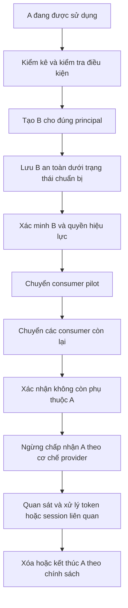

# Rotation cloud key

Rotation cloud key là quá trình thay vật liệu xác thực dùng để truy cập dịch vụ cloud, chuyển các bên sử dụng sang credential mới và ngừng chấp nhận credential cũ theo cơ chế của nhà cung cấp. Trong Privileged Access Management (PAM), quy trình này giúp quản lý quyền truy cập của tài khoản quản trị, dịch vụ, pipeline và công cụ vận hành hạ tầng.

Thay key không chỉ là tạo một chuỗi mới rồi cập nhật vault. Cần biết key thuộc principal nào, quyền hiệu lực là gì, workload nào đang dùng, chúng lấy lại credential khi nào và những token hoặc session nào có thể tiếp tục tồn tại sau khi key cũ bị thu hồi.

Bài học dùng khái niệm cloud key theo nghĩa credential xác thực truy cập cloud. Nó không đồng nhất với khóa mã hóa dữ liệu trong KMS hoặc HSM, SSH host key hay chứng chỉ máy chủ. Các loại khóa đó có mục tiêu và vòng đời riêng.

## 1. Mục tiêu và phạm vi

Sau bài học, người học có thể:

- Phân loại cloud credential và xác định khi nào cần rotation key dài hạn.
- Kiểm kê owner, principal, quyền và các consumer của key.
- Thiết kế chuyển đổi A sang B khi provider hỗ trợ nhiều credential cùng hoạt động.
- Xử lý trường hợp chỉ có một credential, mất phản hồi khi tạo key hoặc key mới chưa tới mọi consumer.
- Phân biệt thu hồi key nguồn với thu hồi token, session và quyền đã phát sinh.
- Xây dựng bằng chứng cho việc tạo, cấp phát, chuyển đổi và ngừng sử dụng key cũ.

Rotation giảm thời gian một key cũ có thể tiếp tục được sử dụng, nhưng không tự giảm quyền của principal và không xóa dữ liệu đã bị truy cập. Least privilege, phân tách môi trường, JIT và kiểm soát workload vẫn cần được thực thi riêng.

## 2. Cloud key có thể là gì?

| Dạng credential | Thành phần thường gặp | Điểm cần chú ý |
| --- | --- | --- |
| Access key dùng để ký API request | Key ID và secret tương ứng | Key ID có thể là định danh; secret không được đưa vào log hoặc tài liệu |
| Private key của danh tính dịch vụ | Private key, public key hoặc chứng chỉ và key ID | Provider phải chấp nhận public material tương ứng; private key cần được giữ kín |
| Client secret của ứng dụng cloud | Client ID, secret, tenant hoặc ngữ cảnh liên quan | Secret thường dùng xin token, khác với token được cấp sau đó |
| Credential bundle | Tệp chứa metadata và một hoặc nhiều trường bí mật | Phải bảo vệ toàn bộ bundle; không coi mọi trường trong đó đều là thông tin công khai |
| Credential hoặc token tạm thời | Token, tham số phiên, thời hạn và phạm vi | Có thể được cấp từ key dài hạn hoặc workload identity; cần quản lý nguồn cấp và hiệu lực |
| Khóa dữ liệu trong KMS | Khóa bảo vệ dữ liệu hoặc khóa bọc DEK | Không phải đối tượng rotation truy cập cloud được tập trung trong bài này |

Không áp dụng nguyên một playbook cho mọi loại credential. Vô hiệu hóa private key đã đăng ký, đổi client secret và thu hồi access key có thể là các thao tác khác nhau, với giới hạn khác nhau về số key, thời gian hiệu lực và khả năng khôi phục.

Khi triển khai, cần xác minh các thao tác được provider hỗ trợ cho đúng loại principal và credential. Bài học không giả định một giới hạn số key hoặc một API thu hồi chung cho mọi cloud.

### Danh tính và quyền không tự thay đổi khi thay key

Nếu A và B cùng thuộc một principal, B thường vẫn hoạt động trong mô hình quyền của principal đó, có thể kèm điều kiện riêng của key hoặc phương thức xác thực. Tạo B không tự biến một principal quản trị rộng thành quyền hẹp.

Kiểm tra vai trò trực tiếp, quyền kế thừa, điều kiện, quan hệ tin cậy và khả năng cấp thêm quyền. Nếu mục tiêu là giảm phạm vi, có thể cần tách principal hoặc thay policy bên cạnh rotation.

## 3. Đánh giá khả năng giảm key dài hạn

Trước khi duy trì một chu kỳ thay key tĩnh, đánh giá workload identity, federation hoặc cơ chế danh tính được nền tảng quản lý nếu phù hợp. Những mô hình này có thể tránh việc phân phối một secret dài hạn cho từng ứng dụng.

Việc chuyển sang credential ngắn hạn vẫn cần cấu hình đúng issuer, subject, audience, tenant và quyền đích theo cơ chế được hỗ trợ. Quan hệ tin cậy quá rộng có thể cho workload ngoài dự kiến nhận cùng quyền.

| Tình huống | Cách tiếp cận cần đánh giá |
| --- | --- |
| Workload chạy trong cloud và có danh tính nền tảng phù hợp | Cấp quyền ngắn hạn theo danh tính workload |
| Pipeline ngoài cloud có bằng chứng danh tính được provider tin cậy | Federation hoặc trao đổi danh tính theo cấu hình được kiểm soát |
| Ứng dụng cũ chỉ hỗ trợ key tĩnh | Lưu trong vault, cấp phát hẹp và rotation có điều phối |
| Công cụ vận hành của con người | Danh tính cá nhân, quyền có thời hạn và luồng PAM thích hợp |
| Danh tính khẩn cấp hoặc quản trị đặc biệt | Runbook riêng và điều kiện sử dụng được kiểm soát |

Không giữ key tĩnh trong hệ thống mới chỉ vì nó dễ sao chép. Ngược lại, không tuyên bố đã loại bỏ secret dài hạn nếu vẫn còn một bootstrap key quyền rộng dùng chung để xin token.

## 4. Kiểm kê trước rotation

### 4.1. Hồ sơ key và principal

| Nhóm | Thông tin cần có |
| --- | --- |
| Định danh | Provider, tenant hoặc tài khoản nền tảng, principal ID, key ID khi có |
| Owner | Nhóm sở hữu dịch vụ, đầu mối vận hành và người chấp nhận thay đổi |
| Môi trường | Production, staging, development và ranh giới tài nguyên |
| Quyền | Vai trò, policy, điều kiện, quan hệ tin cậy và quyền cấp tiếp |
| Loại credential | Access key, private key, client secret hoặc bundle |
| Vòng đời | Ngày tạo, thời hạn, số credential cùng hoạt động được hỗ trợ, trạng thái hiện tại |
| Nguồn chính thức | Tham chiếu vault, phiên bản, policy cấp phát |
| Consumer | Ứng dụng, pipeline, agent, tác vụ, máy vận hành và môi trường chạy |
| Phụ thuộc | Cache, reload, restart, lịch chạy, token hoặc session được tạo từ key |
| Thu hồi | Cách vô hiệu hóa, xóa, kiểm tra và các giới hạn đã biết |

Không đưa giá trị secret hoặc private key vào bảng kiểm kê. Dùng ID, tham chiếu phiên bản và metadata phù hợp.

Các chức năng hiển thị lần dùng cuối có thể hỗ trợ kiểm kê nhưng không chứng minh tuyệt đối không còn consumer. Dữ liệu có thể trễ, không bao phủ mọi đường sử dụng hoặc bỏ sót tác vụ chạy thưa.

### 4.2. Tìm đủ nơi tiêu thụ

Key có thể đang nằm trong secret store của CI/CD, biến môi trường, file cấu hình, credential profile, container, công cụ sao lưu và máy của người vận hành. Xác định nơi nào là nguồn chính thức, nơi nào cần chuyển đổi và nơi nào cần loại bỏ.

Kiểm tra credential chain của SDK hoặc công cụ: giá trị ưu tiên có thể đến từ một nguồn khác với dự kiến. Cập nhật vault không có tác dụng nếu tiến trình vẫn đọc một biến môi trường cũ có độ ưu tiên cao hơn.

Phân biệt lấy credential lúc khởi động với lấy động, cache key với cache token và tiến trình ngắn hạn với worker chạy lâu. Các khác biệt này quyết định cách xác minh consumer đã chuyển.

### 4.3. Xác định đơn vị quản lý

Một principal có thể xuất hiện trong nhiều cấu hình hoặc nhiều tài khoản đích thông qua quan hệ tin cậy. Không tạo nhiều quy trình rotation độc lập cùng tác động lên một tập key mà không có điều phối.

Ngược lại, không gom các principal khác nhau chỉ vì tên hiển thị giống nhau. Cần ràng buộc tenant hoặc tài khoản nền tảng, principal ID và môi trường để tránh tạo hoặc xóa key nhầm nơi.

## 5. Phân quyền cho dịch vụ rotation

Dịch vụ rotation có thể cần quyền liệt kê metadata key, tạo credential, thay trạng thái hoặc thu hồi key trong một phạm vi. Đây là quyền mạnh: nếu được dùng sai, nó có thể tạo đường truy cập mới cho kẻ tấn công.

Giới hạn theo principal, tài khoản nền tảng, môi trường và điều kiện mà provider thực sự hỗ trợ. Không mặc định mọi API quản lý credential có cùng khả năng giới hạn tài nguyên.

Tách quyền cấp phát cho consumer với quyền quản trị key khi phù hợp. Workload chỉ cần dùng key không nên có thể tạo thêm key hoặc tự gỡ mọi ràng buộc của principal.

Xem xét cả quyền hiệu lực của người quản trị: một người không có quyền đọc secret nhưng có thể sửa policy vault để tự cấp quyền vẫn có thể tiếp cận secret. Tương tự, quyền sửa policy cloud có thể làm thay đổi phạm vi mà B nhận sau khi tạo.

Danh tính dùng để rotation cũng cần vòng đời và phương án phục hồi. Tránh phụ thuộc vòng trong đó công việc phải dùng đúng key đang bị thu hồi để hoàn tất mọi bước quản lý của chính nó.

## 6. Mô hình chuyển đổi hai credential

Nếu provider hỗ trợ A và B cùng hoạt động, có thể thực hiện theo giai đoạn:



Sơ đồ là luồng tham chiếu. Không phải provider nào cũng có trạng thái vô hiệu hóa có thể đảo ngược trước khi xóa; nếu không có, cần thiết kế bước thu hồi phù hợp.

### 6.1. Tạo B và tiếp nhận secret

Ràng buộc tác vụ với principal, tenant hoặc tài khoản nền tảng và operation ID trước khi tạo. Kiểm tra trạng thái hiện tại và giới hạn provider để tránh tạo thêm key ngoài dự kiến.

Một số hệ thống chỉ hiển thị secret hoặc private material một lần. Chuẩn bị kênh tiếp nhận được bảo vệ và lưu ngay vào vault theo quy trình, không chuyển tay qua chat, ticket hoặc file tạm không được quản lý.

Tạo key ở provider và lưu secret vào vault thường không phải một giao dịch nguyên tử. Nếu provider đã tạo B nhưng tiến trình mất secret trước khi lưu thành công, có thể không lấy lại được giá trị đó.

Trong trường hợp này, cần xác định key mới bằng bằng chứng và metadata đáng tin cậy, xử lý key mồ côi theo quy trình rồi mới tạo lại khi phù hợp. Không xóa tùy ý một key chỉ vì nó có thời gian tạo gần với lần lỗi.

### 6.2. Xác minh B trước cấp phát rộng

Kiểm tra B xác thực đúng principal và đúng môi trường, có thể thực hiện hành động cần thiết và không vượt ranh giới được thiết kế. Dùng kiểm thử có tác động tối thiểu trong phạm vi đã được chấp thuận.

Không chỉ kiểm tra một lệnh thành công nếu SDK có thể đang lấy credential khác hoặc dùng token cache. Bài kiểm tra cần bảo đảm đường xác thực thật sự dùng B hoặc một token mới được cấp từ B theo mô hình đang triển khai.

Nếu có độ trễ lan truyền cấu hình, kiểm tra theo các endpoint và vùng liên quan trong thời hạn được thiết kế. Không giả định một xác nhận tạo key đồng nghĩa mọi đường sử dụng đã sẵn sàng ngay.

### 6.3. Pilot và cập nhật consumer

Chọn consumer đại diện cho kiểu sử dụng thực tế. Xác minh lấy đúng phiên bản, thực hiện được tác vụ và ghi được bằng chứng không chứa secret.

Sau pilot, chuyển theo nhóm nhỏ. Ghi nhận consumer nào đã cập nhật, cần reload hoặc restart, đang cache token cũ và chưa có lần chạy xác nhận.

Không đánh dấu tất cả đã chuyển chỉ vì con trỏ `current` trong vault trỏ tới B. Một tiến trình vẫn giữ A trong bộ nhớ hoặc một pipeline dùng bản sao khác có thể chưa bị tác động.

### 6.4. Thu hồi A

Chỉ chuyển sang bước này khi đáp ứng tiêu chí cho các consumer bắt buộc và đã xem xét chu kỳ chạy thưa, đường dự phòng, môi trường DR cùng các tác vụ quản trị liên quan.

Thu hồi phải thực hiện ở nơi chấp nhận key, không chỉ xóa A khỏi vault. Nếu provider hỗ trợ vô hiệu hóa rồi quan sát trước khi xóa, có thể dùng giai đoạn đó theo chính sách.

Giữ metadata và audit cần thiết sau khi không còn lưu hoặc cấp phát secret. Không đưa A trở lại hoạt động tự động nếu xuất hiện lỗi chưa xác định; phải xét khả năng key đã bị lộ và nguyên nhân thực tế.

## 7. Khi không thể dùng hai key song song

Nếu provider chỉ cho một credential hợp lệ hoặc thao tác thay đổi làm key cũ mất hiệu lực ngay, không thể mặc định dùng trình tự A và B chồng lấn. Có thể cần cửa sổ bảo trì, cập nhật consumer được điều phối hoặc mô hình xác thực khác.

Các lựa chọn cần đánh giá gồm:

- Tạm dừng tác vụ phụ thuộc, thay credential rồi cập nhật consumer theo thứ tự đã được kiểm tra.
- Chuyển sang một principal mới được cấp quyền tương đương có kiểm soát, nếu kiến trúc và chính sách cho phép.
- Dùng broker hoặc cơ chế danh tính khác để giảm số nơi phải cập nhật.
- Giữ giới hạn kiến trúc hiện tại nhưng công bố rõ khoảng gián đoạn và phương án phục hồi.

Tạo principal mới không chỉ là thay key. Cần đối chiếu quyền, owner, quan hệ tin cậy, policy tài nguyên và bằng chứng quy trách nhiệm. Không cấp quyền quản trị rộng tạm thời chỉ để làm cho luồng mới chạy được.

Nếu không có đường chuyển đổi không gián đoạn, ghi nhận điều đó. Một lời hứa vận hành không có cơ chế thực thi sẽ làm kế hoạch cutover khó kiểm soát.

## 8. Key cũ và token đã cấp là hai vòng đời khác nhau

### 8.1. Thu hồi key nguồn không tự thu hồi mọi quyền phát sinh

Key dài hạn có thể được dùng để xin token tạm thời, mở session hoặc chuyển sang một vai trò khác. Sau đó, token hoặc session có thể được kiểm tra theo cơ chế riêng.

Vì vậy, khi vô hiệu hóa A, cần phân biệt:

| Đối tượng | Câu hỏi cần xác minh |
| --- | --- |
| Key A | Provider còn chấp nhận xác thực hoặc ký yêu cầu mới bằng A không? |
| Token được cấp từ A | Có tiếp tục hiệu lực đến hạn không; provider có hỗ trợ thu hồi hoặc ràng buộc liên quan không? |
| Session hoặc vai trò được nhận | Có thể kết thúc, hạn chế hoặc chờ hết hạn theo cơ chế nào? |
| Quyền ở principal | Có thay đổi độc lập với key và ảnh hưởng đến token đang tồn tại như thế nào? |
| Tác vụ đã được khởi chạy | Có tiếp tục chạy sau khi key không còn được chấp nhận không? |

Cách xử lý phụ thuộc loại credential, API đích và provider. Không giả định đổi client secret hoặc xóa access key sẽ lập tức chấm dứt mọi session. Cũng không suy luận mọi provider đều giữ token tới hết hạn trong mọi trường hợp.

### 8.2. Chứng minh chuyển nguồn cấp token

Ứng dụng có thể hoạt động bằng token đã cache dù chưa cập nhật được key. Để xác minh rotation, cần quan sát hoặc thử đường cấp token mới với B theo phương pháp phù hợp.

Không buộc mọi consumer production xóa cache đồng loạt chỉ để kiểm thử nếu điều đó gây gián đoạn. Có thể dùng consumer pilot, phạm vi kiểm tra đại diện và kế hoạch làm mới được chấp thuận.

Giữ rõ giới hạn bằng chứng: API nghiệp vụ có thể chỉ thấy principal hoặc vai trò của token, không thấy trực tiếp key nguồn. Khi cần, nối bằng chứng từ lần cấp token, workload và request theo khả năng thực tế của provider.

### 8.3. Rotation không hoàn tác hành động đã xảy ra

Nếu A từng bị dùng để tạo principal khác, thêm policy, đọc dữ liệu hoặc tạo tài nguyên, thu hồi A không tự đảo ngược các hành động đó. Ứng phó sự cố phải kiểm tra thay đổi và đường truy cập còn lại.

Với PAM, việc chặn cấp phát secret mới cần đi cùng quản lý quyền cloud và theo dõi hành động đặc quyền, không chỉ thay vật liệu xác thực.

## 9. Điều phối và xử lý lỗi

### 9.1. Một tác vụ cho một phạm vi key

Scheduler, thao tác thủ công và quy trình sự cố cần được điều phối để không tạo hoặc xóa key cạnh tranh. Dùng operation ID, trạng thái bền vững và kiểm tra phiên bản phù hợp.

Nếu cùng một principal có nhiều key cho các consumer khác nhau, phải biết key nào thuộc luồng nào. Không xóa một key đang được quy trình khác quản lý vì nó không xuất hiện trong cấu hình cục bộ.

### 9.2. Retry không phải tạo key mới mỗi lần

Mất phản hồi khi tạo B có thể có hai kết quả: provider chưa tạo hoặc đã tạo nhưng client chưa nhận được đầy đủ. Trước khi tạo tiếp, đối soát metadata và bằng chứng theo cơ chế provider hỗ trợ.

Key ID được tìm thấy không đồng nghĩa lấy lại được secret. Nếu secret chỉ xuất hiện một lần và chưa được lưu an toàn, quy trình cần xử lý credential mồ côi thay vì đánh dấu B sẵn sàng.

Retry có giới hạn và phân loại lỗi: mạng, quyền, giới hạn số key, policy tổ chức, định dạng hoặc trạng thái tài nguyên. Không retry vô hạn một lỗi quyền hoặc tự nâng quyền để tiếp tục.

### 9.3. Bảng trạng thái theo điểm lỗi

| Tình huống | Trạng thái cần phản ánh | Hướng xử lý |
| --- | --- | --- |
| Tạo B thất bại rõ ràng | Chưa có credential mới được xác nhận | Sửa điều kiện hoặc dừng theo runbook |
| Tạo B mất phản hồi | Chưa rõ B có tồn tại và secret có được tiếp nhận không | Đối soát trước khi tạo tiếp |
| B tạo xong nhưng chưa lưu được secret | Key có thể mồ côi | Hạn chế sử dụng, xác minh định danh và xử lý tại provider |
| B lưu xong nhưng không xác thực được | Chưa đủ điều kiện cấp phát | Kiểm tra đích, principal, cấu hình và độ trễ liên quan |
| Một phần consumer đã chuyển | Hoàn tất một phần | Tiếp tục chuyển hoặc phục hồi theo phạm vi; chưa thu hồi A tùy tiện |
| A đã vô hiệu hóa nhưng một consumer lỗi | Có thể còn phụ thuộc A hoặc lỗi khác | Chẩn đoán, không tự bật lại A bất kể rủi ro |
| Thu hồi A mất phản hồi | Chưa rõ trạng thái chấp nhận A | Đối soát provider; không coi lệnh đã gửi là thành công |
| Xóa A nhưng token còn hiệu lực | Key nguồn kết thúc, quyền phát sinh cần quản lý tiếp | Theo dõi và xử lý token hoặc session theo khả năng provider |

Trạng thái `failed` chung không đủ nếu hệ thống đã thực hiện một phần thay đổi. Cần giữ tiến độ, consumer còn thiếu, trạng thái key ở provider và đường xử lý tiếp.

### 9.4. Quay lui có điều kiện

Nếu A vẫn an toàn và còn hợp lệ, một số trường hợp có thể chuyển consumer về A trong giới hạn chính sách. Cần xác minh trạng thái thực tế; không chỉ đổi một tham chiếu trong vault rồi coi mọi workload đã quay lại.

Nếu A đã bị xóa, không thể mặc định phục hồi cùng giá trị. Nếu A bị nghi lộ, không sử dụng nó làm phương án quay lui. Có thể cần key mới hoặc danh tính khác với quy trình thay đổi được kiểm soát.

Không xóa B chỉ vì cutover chưa hoàn tất khi một phần workload đang sử dụng B. Quyết định phải xét các bên đã chuyển và nguồn cấp token hiện tại.

## 10. Rotation do lịch và rotation do sự cố

Với rotation theo lịch, có thể ưu tiên chuyển đổi từng nhóm và xác nhận đầy đủ trước khi thu hồi A. Với sự cố nghi lộ, rủi ro tiếp tục để A hoạt động có thể đòi hỏi hành động sớm hơn và chấp nhận gián đoạn theo quyết định có thẩm quyền.

Quy trình sự cố cần xác định ai điều phối, phạm vi hạn chế, cách phục hồi dịch vụ và bằng chứng phải giữ. Không chờ một tác vụ thưa kỳ tự chạy nếu key bị lộ đang tạo rủi ro không chấp nhận được.

Đồng thời, tránh thu hồi hàng loạt không phân biệt khi key phục vụ nhiều hệ thống quan trọng mà chưa có đánh giá tác động. Cần dựa trên phạm vi sử dụng và mô hình quyền thực tế.

Sau sự cố, kiểm tra việc tạo key mới, thay policy, thêm quan hệ tin cậy và các hành động đặc quyền ngoài dự kiến. Đổi key mà bỏ qua những đường truy cập mới có thể để lại khả năng truy cập của kẻ tấn công.

## 11. Policy và audit minh họa

### 11.1. Một hồ sơ rotation không chứa secret

Ví dụ dưới đây là mô hình dữ liệu học tập, không phải cấu hình import của một sản phẩm:

```yaml
cloud_key_rotation:
  operation_id: rot-cloud-orders-007
  owner_group: platform-orders
  environment: production
  identity:
    provider_profile_ref: approved-cloud-provider-profile
    tenant_or_account_ref: production-platform-account
    principal_ref: orders-deployment-service
  credential:
    kind: access_key
    current_key_ref: provider-key-reference-a
    staged_secret_ref: vault-version-reference-b
  transition:
    model: overlapping_credentials_if_supported
    pilot_consumer_ref: ci-orders-production
    required_consumers_ref: orders-cloud-credential-consumers
    verification_profile_ref: fresh-authentication-and-scope-check
  retirement:
    provider_action_profile_ref: approved-key-revocation
    issued_session_review_ref: temporary-access-review
  evidence:
    change_ref: CHG-CLOUD-007
    audit_profile_ref: privileged-cloud-credential-lifecycle
```

Trạng thái sẵn sàng phải dựa trên thao tác thực tế và bằng chứng. Một `staged_secret_ref` không chứng minh B đã được provider chấp nhận, còn một `provider_action_profile_ref` không chứng minh A đã bị thu hồi.

### 11.2. Sự kiện cần nối

| Giai đoạn | Bằng chứng hữu ích |
| --- | --- |
| Khởi tạo | Owner, principal, tenant hoặc tài khoản, lý do, policy và operation ID |
| Tạo B | Danh tính thực hiện, key ID không bí mật khi có, thời điểm, kết quả provider |
| Lưu và cấp phát | Tham chiếu phiên bản vault, workload nhận, policy và kết quả |
| Xác minh | Phương thức kiểm tra, principal hiệu lực, phạm vi và kết quả |
| Chuyển consumer | Consumer ID, phiên bản hoặc profile, thời điểm và trạng thái xác nhận |
| Thu hồi A | Key ID, hành động, kết quả quan sát, lỗi hoặc trạng thái chưa rõ |
| Token và session | Phạm vi đánh giá, thời hạn, hành động xử lý và giới hạn còn lại |
| Kết thúc | Tiêu chí đạt, ngoại lệ, người chấp nhận và tham chiếu bằng chứng |

Không ghi secret access key, private key, client secret, bearer token hoặc toàn bộ response chứa credential. Key ID không phải secret trong nhiều mô hình nhưng vẫn có thể là metadata nhạy cảm cần hạn chế truy cập.

Provider request ID và audit ID có thể hỗ trợ đối chiếu. Không giả định một correlation header do client tự gửi sẽ được lưu xuyên suốt mọi dịch vụ.

Nếu consumer dùng vai trò hoặc token được trao đổi qua nhiều bước, ghi nhận các định danh liên quan theo khả năng thực tế. Đừng gán danh tính người sở hữu ứng dụng thành người trực tiếp thực hiện mọi lệnh của workload.

## 12. Tình huống: thay key của pipeline Orders

Principal triển khai Orders có key A được hai pipeline và một tác vụ sao lưu dùng chung. Key đang nằm trong vault nhưng một pipeline vẫn giữ bản sao tại secret store riêng. Provider trong tình huống này hỗ trợ tạo B cùng hoạt động với A.

### Bước 1: Chốt phạm vi

Owner xác nhận tenant hoặc tài khoản nền tảng, principal và quyền. Tác vụ sao lưu cũng được đưa vào kế hoạch thay vì chỉ xem hai pipeline triển khai.

Nhóm ghi rõ việc dùng chung principal làm giảm khả năng quy trách nhiệm và đánh giá phương án tách sau đó. Rotation hiện tại không tự giải quyết điểm này.

### Bước 2: Tạo và kiểm tra B

B được tạo bằng danh tính quản lý có quyền phù hợp và lưu vào vault qua kênh được bảo vệ. Nhóm kiểm tra đúng principal và thực hiện một hành động có tác động tối thiểu trong phạm vi được chấp thuận.

Lần thử đầu vẫn thành công dù cấu hình B chưa được nạp đúng vì công cụ dùng một token cache. Nhóm điều chỉnh phép thử để xác minh một lần xác thực mới từ B, thay vì coi kết quả cũ là bằng chứng.

### Bước 3: Chuyển consumer

Pipeline thứ nhất dùng luồng mới, pipeline thứ hai được cập nhật nguồn secret ưu tiên, tác vụ sao lưu được kiểm tra theo cách phù hợp với lịch chạy. Nhóm xác nhận các tiến trình đã nhận cấu hình và phân biệt token cũ với lần cấp mới.

Chỉ đổi con trỏ vault không được dùng làm tiêu chí duy nhất. Bản sao A trong secret store riêng được xử lý theo kế hoạch để tránh consumer quay lại đường cũ.

### Bước 4: Ngừng A và đánh giá session

Sau khi đạt tiêu chí, nhóm vô hiệu hóa A bằng cơ chế provider của tình huống này rồi quan sát theo kế hoạch. Một token được cấp trước đó vẫn còn hiệu lực theo cơ chế đang áp dụng, nên hồ sơ giữ rõ phần này thay vì kết luận mọi quyền từ A đã biến mất.

Nhóm dùng cách xử lý token được hỗ trợ hoặc theo dõi đến thời hạn đã xác định, đồng thời kiểm tra các hoạt động liên quan. Không tạo giả một cam kết thu hồi tức thời mà nền tảng không cung cấp.

### Bước 5: Kết thúc và bàn giao

A được xóa hoặc kết thúc theo chính sách sau khi các điều kiện áp dụng đạt. Metadata và audit được giữ, các bản sao tạm được xử lý và owner nhận thông tin về giới hạn còn lại.

Hồ sơ chỉ chứa tham chiếu và kết quả, không chứa A hoặc B. Phương án chuyển sang danh tính workload và tách principal được quản lý như thay đổi riêng có phạm vi rõ.

## 13. Ma trận kiểm thử chấp nhận

Thực hiện các phép thử trong phạm vi được chấp thuận. Không dùng một hành động phá hủy để chứng minh key có quyền hoặc đã bị thu hồi.

| Nhóm kiểm thử | Điều kiện đạt |
| --- | --- |
| Định danh | B thuộc đúng provider, tenant hoặc tài khoản, principal và môi trường |
| Lưu secret | Secret được tiếp nhận nguyên vẹn và chỉ cấp phát cho đúng consumer |
| Xác thực mới | Phép thử thực sự dùng B hoặc quyền mới cấp từ B, không bị che bởi cache hay nguồn khác |
| Quyền | Thao tác cần thiết được phép; phạm vi ngoài thiết kế bị chặn |
| Consumer | Từng nhóm bắt buộc đã chuyển, gồm tác vụ thưa kỳ và đường dự phòng liên quan |
| Lỗi tạo key | Mất phản hồi không dẫn đến tạo hoặc xóa key hàng loạt thiếu đối soát |
| Hạn chế provider | Vượt giới hạn hoặc thiếu khả năng chồng lấn được xử lý đúng kế hoạch |
| Chạy đồng thời | Tác vụ thủ công, theo lịch và sự cố không xung đột ngoài kiểm soát |
| Thu hồi A | Có kết quả tại provider và xác nhận an toàn theo cơ chế hỗ trợ |
| Token và session | Biết phạm vi còn hiệu lực, khả năng thu hồi và giới hạn chưa xử lý |
| Quay lui | Không bật lại key nghi lộ hoặc xóa key mới khi còn consumer phụ thuộc |
| Audit và log | Nối được các bước mà không chứa secret hoặc private material |

Xóa A khỏi vault là một bước quản lý cấp phát, không thay thế xác nhận thu hồi ở cloud. Ngược lại, xóa A ở provider không tự chứng minh các token đã cấp đều ngừng hoạt động.

## 14. Chỉ số và lỗi thường gặp

Theo dõi key thiếu owner, sắp hết hạn, quá tuổi theo chính sách, key chuẩn bị chưa được xác minh, consumer chưa chuyển, key cũ chưa thu hồi và operation đang cần đối soát.

Đo tỷ lệ hoàn tất với tiêu chí rõ. Tạo B thành công nhưng A còn hoạt động vô thời hạn không nên được tính là một vòng rotation hoàn tất.

| Lỗi | Hệ quả | Cách xử lý |
| --- | --- | --- |
| Nhầm cloud access key với khóa KMS | Áp dụng sai mục tiêu và quy trình | Phân loại credential trước khi thiết kế |
| Tạo B rồi giữ A mãi | Tăng số đường truy cập thay vì kết thúc key cũ | Có tiêu chí và owner cho bước thu hồi |
| Chỉ nhìn lần dùng cuối | Có thể bỏ sót consumer ít chạy | Kết hợp kiểm kê, lịch và xác nhận có kiểm soát |
| Thử B bằng công cụ đang cache token cũ | Kết quả thành công không chứng minh B hoạt động | Xác minh nguồn credential và lần xác thực mới |
| Mỗi retry tạo thêm key | Key mồ côi, chạm giới hạn và khó điều tra | Đối soát cùng operation trước khi tạo tiếp |
| Xóa key nguồn rồi coi mọi session đã hết | Bỏ sót quyền phát sinh | Xử lý vòng đời token và session riêng |
| B dùng cùng principal quyền quá rộng | Rotation không giảm phạm vi ảnh hưởng | Rà soát policy, tách danh tính và giới hạn tài nguyên |
| Quay lui sang key bị nghi lộ | Khôi phục cả đường truy cập của kẻ tấn công | Dùng phương án mới có kiểm soát |

## 15. Bài thực hành thiết kế

Chọn một workload cũ dùng key dài hạn và một pipeline có khả năng federation:

1. Lập hồ sơ principal, owner, quyền, key và mọi consumer đã biết.
2. Xác định workload nào có thể giảm hoặc loại bỏ key dài hạn.
3. Vẽ quy trình tạo B, lưu, xác minh, pilot, chuyển consumer và thu hồi A.
4. Mô tả cách chứng minh phép thử không dùng credential khác hoặc token cache.
5. Xử lý trường hợp provider đã tạo key nhưng secret chưa được lưu và phản hồi bị mất.
6. Lập kế hoạch khi chỉ có một credential hoạt động, nêu rõ điều kiện gián đoạn.
7. Phân biệt thu hồi key, token, session và xử lý hành động đã xảy ra.
8. Xác định bằng chứng hoàn tất cùng các chỉ số key cũ còn tồn tại.

Bản thiết kế đạt yêu cầu khi chứng minh được consumer đã chuyển sang đường xác thực mới, key cũ được kết thúc tại provider và quyền còn tồn tại đã được nhận diện. Trong PAM, rotation cloud key phải quản lý cả vật liệu xác thực, danh tính và vòng đời quyền truy cập.
