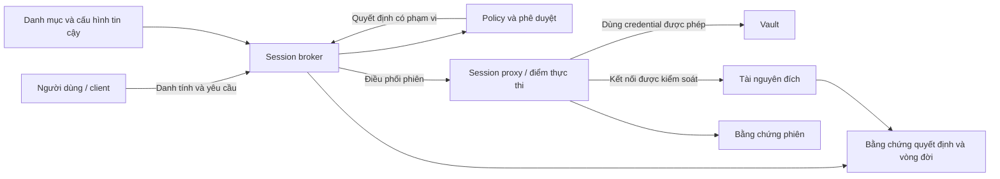

# Privileged session broker

## 1. Session broker giải quyết vấn đề gì?

Trong quản lý truy cập đặc quyền (Privileged Access Management — PAM), một người có thể cần quyền quản trị máy chủ hoặc cơ sở dữ liệu trong thời gian ngắn để xử lý công việc cụ thể. Nếu chỉ đưa password cho họ, hệ thống khó bảo đảm credential được sử dụng đúng tài nguyên, đúng mục đích và qua đường có giám sát.

**Privileged session broker** là thành phần tiếp nhận một yêu cầu truy cập đã được xác thực, phối hợp quyết định cấp quyền và điều phối việc thiết lập phiên đặc quyền trên tài nguyên đích. Tùy kiến trúc, broker có thể trực tiếp tham gia đường truyền phiên hoặc phối hợp một proxy, gateway hay agent thực hiện việc đó.

Một ví dụ là kỹ sư cần khởi động lại dịch vụ trên máy chủ production. Broker không chỉ đưa ra một địa chỉ SSH. Nó phải gắn yêu cầu với danh tính cá nhân, tài nguyên, tài khoản đích, profile quyền, thời hạn và các điều kiện như phê duyệt, MFA hoặc ghi phiên; sau đó chỉ mở phiên qua thành phần có thể thực thi những điều kiện đó.

Trong phạm vi PAM cho tài khoản quản trị, tài khoản dịch vụ và hạ tầng nhạy cảm, session broker giúp:

- Tách danh tính người yêu cầu khỏi tài khoản đặc quyền dùng tại đích.
- Điều phối kết nối mà không cần tiết lộ credential đích cho người dùng khi mô hình hỗ trợ.
- Áp dụng least privilege, quyền tạm JIT và profile tác vụ JEA phù hợp.
- Liên kết phê duyệt, quyết định, hoạt động phiên và kết quả thu hồi.
- Giảm những đường truy cập trực tiếp không được quản lý.

Broker không tự tạo ra những bảo đảm này chỉ bằng việc tồn tại trên sơ đồ. Phải chỉ ra điểm nào xác minh và thực thi từng ràng buộc, cùng cách xử lý nếu điểm đó không sẵn sàng.

## 2. Phân biệt broker, proxy, gateway và vault

Tên thành phần có thể khác nhau giữa sản phẩm. Cách phân biệt hữu ích là theo hành vi, không theo tên thương mại.

| Vai trò | Trách nhiệm chính | Giới hạn cần hiểu |
|---|---|---|
| Policy engine | Quyết định có cho phép hay không, với phạm vi và điều kiện nào | Không tự đóng phiên hoặc giới hạn lệnh nếu không có điểm thực thi |
| Session broker | Điều phối yêu cầu, chọn đường kết nối, liên kết grant và vòng đời phiên | Có thể không nằm trên đường chuyển tiếp mọi byte |
| Session proxy | Trung gian xử lý/chuyển tiếp phiên và áp dụng kiểm soát theo giao thức | Khả năng quan sát, lọc và ghi nhận phụ thuộc mô hình giao thức |
| Gateway | Cung cấp điểm truy cập hoặc đường kết nối đến vùng tài nguyên | Không mặc nhiên có chức năng dùng credential thay hoặc ghi mọi thao tác |
| Vault / credential service | Bảo vệ và quản lý việc sử dụng/cấp credential | Không tự biết toàn bộ hoạt động của phiên sau khi credential đã được dùng |
| Agent / endpoint control | Thực thi quyền hoặc profile tại hệ thống đích | Chỉ hiệu quả trong phạm vi được triển khai và bảo vệ |

Một dịch vụ có thể gộp nhiều vai trò. Ví dụ, broker cùng tiến trình với proxy có thể vừa điều phối vừa chuyển tiếp SSH. Ngược lại, một broker chỉ phát hành dữ liệu bắt đầu kết nối cần phối hợp điểm thực thi khác để đóng phiên hoặc ghi nhận hoạt động.

### Ba mô hình triển khai thường gặp về mặt logic

| Mô hình | Broker làm gì? | Nơi cưỡng chế trong phiên |
|---|---|---|
| Điều phối kết nối | Chọn đích và cấp khả năng bắt đầu phiên | Proxy, agent hoặc chính hệ thống đích; broker không tự quan sát được mọi nội dung |
| Broker kết hợp proxy | Xác minh quyền, thiết lập và chuyển tiếp phiên | Thành phần trung gian, kết hợp quyền tại đích |
| Điều phối với agent | Cấp quyền/lease rồi yêu cầu agent mở hoặc kiểm soát hoạt động | Agent/endpoint cùng cơ chế của hệ thống đích |

Nếu lưu lượng được chuyển tiếp nguyên vẹn và nội dung mã hóa không được thành phần trung gian xử lý, không thể mặc định thành phần đó đọc, lọc hoặc ghi nội dung phiên. Kiến trúc phải xác định nó quan sát được metadata hay cả nội dung, và điều đó đáp ứng yêu cầu nào.

## 3. Kiến trúc tham chiếu và ranh giới tin cậy



Đây là sơ đồ logic. Client có thể kết nối trực tiếp tới proxy sau khi được broker cấp quyền bắt đầu phiên; broker không nhất thiết chuyển tiếp nội dung client trong mô hình đó.

Những ranh giới cần bảo vệ gồm:

- **Client → broker:** xác thực danh tính, kiểm tra quyền đề nghị và không tin tài nguyên/tài khoản tự khai ngoài danh mục.
- **Broker → policy:** truyền yêu cầu có nguồn tin cậy, nhận quyết định đúng phiên bản và phạm vi.
- **Broker → proxy/agent:** xác thực dịch vụ, bảo vệ tính toàn vẹn và ràng buộc grant với đúng điểm thực thi.
- **Proxy/broker → vault:** chỉ được sử dụng credential của tài khoản được cấp, không có quyền đọc toàn kho vì tiện tích hợp.
- **Điểm thực thi → đích:** chọn đúng đích và xác minh danh tính đích theo giao thức trước khi dùng credential.
- **Các thành phần → bằng chứng:** bảo vệ nội dung, tính toàn vẹn, quyền đọc và trạng thái lưu bền vững.

Broker là thành phần nhạy cảm vì nó có thể dẫn tới hoạt động đặc quyền. Cần bảo vệ cả danh tính dịch vụ, cấu hình, plugin, pipeline triển khai và runtime; một API không cho đọc secret chưa đủ nếu người khác có thể thay code của thành phần xử lý secret.

## 4. Hai danh tính trong một phiên

Một phiên thường có ít nhất hai danh tính cần liên kết:

1. **Danh tính khởi tạo:** người dùng hoặc workload đã được xác thực và được phép đề nghị phiên.
2. **Danh tính tại đích:** tài khoản, role hoặc credential được sử dụng để thực hiện công việc trên tài nguyên.

Ví dụ, `user:linh` yêu cầu sử dụng `account:payments-operator` trên `server:payments-prod-02`. Broker phải lưu được mối liên kết này cùng quyết định, phê duyệt và phiên thực tế.

Nếu nhiều người dùng cùng một tài khoản đích, log ở đích có thể chỉ thấy tài khoản chung. Chuỗi bằng chứng PAM giúp ánh xạ người khởi tạo với phiên, nhưng không nên khẳng định hệ thống đích tự biết danh tính cá nhân nếu giao thức không truyền hoặc ánh xạ được thông tin đó.

Người dùng không mặc nhiên cần xem password hoặc private key của tài khoản đích. Broker/proxy có thể dùng credential thay họ theo mô hình được hỗ trợ. Tuy nhiên, nếu credential được chuyển đến launcher hoặc client cục bộ, phải đánh giá đúng rủi ro endpoint; tự điền password không đồng nghĩa secret chưa từng đến máy người dùng.

### Không biến broker thành đường truy cập tùy ý

Broker không nên nhận một hostname, URL, account và secret ID bất kỳ do client gửi rồi kết nối thay. Các giá trị đó phải được ánh xạ từ danh mục được quản trị và kiểm tra với quyền được cấp.

Một kết nối được mã hóa đến sai máy chủ vẫn là sai đích. Kiểm tra chứng thư, host identity hoặc cơ chế tương ứng phải phù hợp với giao thức và cấu hình tin cậy; không bỏ qua chỉ vì tài nguyên nằm trong mạng nội bộ.

## 5. Yêu cầu phiên và quyết định cấp quyền

Một yêu cầu nên diễn đạt rõ chủ thể, tài nguyên, hành động, profile và khoảng thời gian. Những trường như lý do hoặc ticket không tự tạo quyền; chúng là đầu vào cần được xác minh.

Ví dụ yêu cầu minh họa:

```json
{
  "request_id": "req-406",
  "resource_id": "server:payments-prod-02",
  "account_id": "account:payments-operator",
  "protocol": "ssh",
  "action": "session.start",
  "profile_id": "service-restart",
  "requested_duration_seconds": 900,
  "change_reference": "change:406",
  "purpose": "Khoi dong lai dich vu theo thay doi da duyet"
}
```

Danh tính khởi tạo phải được broker xác định từ ngữ cảnh xác thực đáng tin cậy, không chỉ từ một trường username trong body. Tài nguyên, tài khoản và profile cũng cần được giải quyết theo định danh có thẩm quyền.

Policy có thể đánh giá nhóm/vai trò, trạng thái danh tính, MFA, thiết bị, rủi ro, ticket, người phê duyệt, cửa sổ thay đổi và khả năng thực thi. Thuộc tính thiếu hoặc quá cũ phải có hành vi rõ; không coi rủi ro chưa biết là thấp hoặc ticket không kiểm tra được là đã được duyệt.

Kết quả có thể là từ chối, chờ hoàn tất điều kiện hoặc cho phép trong phạm vi xác định. Trạng thái chờ phê duyệt chưa được dùng credential, tạo quyền đặc biệt cho người dùng sử dụng hoặc mở phiên.

Khi điều kiện như MFA/phê duyệt hoàn tất, yêu cầu cần được đánh giá lại trước kích hoạt. Trong thời gian chờ, tài khoản, ticket, thiết bị hoặc tài nguyên có thể đã thay đổi.

## 6. Grant, lease và dữ liệu bắt đầu phiên

Broker cần một hợp đồng rõ với điểm thực thi. Một cờ `ALLOW` đứng riêng không đủ để xác định ai được kết nối tới đâu và giới hạn nào phải áp dụng.

| Thuộc tính hợp đồng | Mục đích |
|---|---|
| Request/grant ID | Liên kết quyết định và tác vụ, hỗ trợ phát hiện xử lý trùng |
| Chủ thể | Ràng buộc quyền với danh tính/phiên xác thực được phép |
| Tài nguyên, tài khoản, giao thức, hành động | Giới hạn đích và cách sử dụng |
| Profile quyền | Liên kết với cơ chế JEA hoặc role thực tế |
| Audience / điểm thực thi | Hạn chế nơi được phép nhận và sử dụng quyết định |
| Hạn kích hoạt | Mốc cuối để dùng quyết định bắt đầu phiên |
| Hạn truy cập | Mốc cuối quyền sử dụng trong phạm vi đã cấp |
| Ràng buộc bắt buộc | Ghi phiên, giới hạn chức năng, điều kiện kết thúc hoặc đánh giá lại |
| Phiên bản policy | Giải thích và truy vết quyết định |

Một phản hồi minh họa cho điểm thực thi:

```json
{
  "grant_id": "grant-406",
  "request_id": "req-406",
  "subject_id": "user:linh",
  "resource_id": "server:payments-prod-02",
  "account_id": "account:payments-operator",
  "profile_id": "service-restart",
  "audience": "proxy:prod-a",
  "activate_before": "2026-11-26T04:01:00Z",
  "access_expires_at": "2026-11-26T04:15:00Z",
  "policy_version": "pam-sessions-v9",
  "obligations": {
    "record_session": true,
    "credential_export": false,
    "file_transfer": false
  }
}
```

Đây là dữ liệu khái niệm, không phải schema sản phẩm hoặc bằng chứng xác thực tự thân. Quyết định cần được bảo vệ bằng giao thức có xác thực/tính toàn vẹn, và điểm thực thi phải kiểm tra nguồn, phạm vi, thời hạn, trạng thái thu hồi cùng cơ chế chống phát lại.

Grant ID không tự ngăn sử dụng lại. Nếu grant chỉ cho một lần mở phiên, cần trạng thái kích hoạt hoặc cơ chế tương đương để hai yêu cầu đồng thời không cùng tạo phiên ngoài policy. Retry của cùng tác vụ phải có ngữ nghĩa rõ, không trở thành cách mở thêm phiên.

Dữ liệu client nhận để bắt đầu phiên có thể chứa token hoặc một khả năng truy cập ngắn hạn. Dù không phải credential đích, nó vẫn nhạy cảm và cần tránh lộ qua URL, log, lịch sử, file cấu hình hoặc phản hồi lỗi.

Hạn kích hoạt khác hạn truy cập. Kích hoạt gần cuối khoảng được duyệt không tự làm thời hạn truy cập kéo dài thêm toàn bộ thời lượng. Thời hạn thực tế phải nằm trong mọi giới hạn áp dụng của policy, phê duyệt và danh tính/credential.

## 7. Thiết lập phiên với các cổng thực thi

Một luồng thiết lập có thể gồm:

1. Broker nhận yêu cầu từ danh tính đã xác thực và chuẩn hóa đối tượng.
2. Policy kiểm tra điều kiện, hoàn tất phê duyệt/MFA nếu cần rồi đánh giá lại.
3. Broker chọn proxy/agent đúng vùng, giao thức và khả năng bắt buộc.
4. Điểm thực thi xác minh grant, chủ thể, audience, trạng thái sử dụng và thời hạn.
5. Nếu cần JIT, bộ điều phối chuẩn bị quyền tạm và xác minh có thể thu hồi; profile JEA được áp dụng tại nơi cưỡng chế thật.
6. Recorder hoặc cơ chế bằng chứng được chuẩn bị theo yêu cầu trước hoạt động phải ghi nhận.
7. Điểm thực thi xác minh đích, dùng credential được phép và mở kết nối.
8. Hệ thống gắn session ID với grant, chủ thể, tài nguyên, tài khoản và bằng chứng; chỉ báo phiên hoạt động khi các cổng cần thiết đã đạt.

Nếu một ràng buộc bắt buộc không được hỗ trợ, phải chặn luồng tương ứng hoặc chọn điểm thực thi khác đủ khả năng. Không bỏ qua ghi phiên hoặc profile chỉ vì proxy đã nhận một quyết định cho phép.

Thất bại sau bước chuẩn bị có thể để lại quyền JIT, kết nối một phần hoặc chỗ giữ tài khoản. Cần dọn dẹp và đối soát; nếu chưa biết kết quả, giữ trạng thái chưa xác minh thay vì báo hoàn tác thành công.

## 8. Vòng đời phiên và chính sách thời gian

Broker cần quản lý vòng đời phiên rõ hơn hai giá trị “đang chạy” và “đã đóng”. Tên trạng thái có thể khác giữa nền tảng; mô hình dưới đây dùng để phân tích trách nhiệm.

| Trạng thái logic | Ý nghĩa |
|---|---|
| Chờ điều kiện | Yêu cầu chưa đủ phê duyệt/xác thực; chưa được sử dụng đặc quyền |
| Được cấp, chưa kích hoạt | Có grant hợp lệ nhưng chưa mở phiên, bị giới hạn bởi hạn kích hoạt |
| Đang chuẩn bị | Tạo quyền tạm, chọn điểm thực thi, chuẩn bị ghi và kết nối |
| Hoạt động | Phiên đã mở và những kiểm soát bắt buộc được áp dụng |
| Mất kết nối / chờ tái kết nối | Client hoặc đường truyền gián đoạn; trạng thái tại đích có thể vẫn tồn tại |
| Đang kết thúc | Đã yêu cầu đóng và dọn quyền, còn chờ kết quả |
| Kết thúc được xác nhận | Những điều kiện kết thúc trong phạm vi đã được kiểm chứng |
| Chưa xác minh | Có lỗi/timeout khiến chưa đủ bằng chứng về trạng thái phiên hoặc quyền |

### Các đồng hồ cần phân biệt

- **Hạn chờ phê duyệt:** quá hạn thì yêu cầu không tiếp tục dùng một phê duyệt ngoài hiệu lực.
- **Hạn kích hoạt grant:** ngăn dùng quyết định cũ để bắt đầu phiên muộn.
- **Thời hạn tuyệt đối:** giới hạn quyền dù người dùng vẫn hoạt động liên tục.
- **Idle timeout:** giới hạn không hoạt động theo định nghĩa của giao thức và sản phẩm.
- **Khoảng tái đánh giá/lease:** giới hạn việc tiếp tục sử dụng quyết định khi cần xác nhận điều kiện.

Ví dụ một tình huống học tập có thể cho phiên tối đa 15 phút và giới hạn không hoạt động riêng. Các con số chỉ là minh họa; cần chọn theo công việc, mức nhạy cảm và khả năng thực thi, không coi là chuẩn chung.

Keepalive hoặc lưu lượng nền không nhất thiết là hoạt động của người dùng. Một lệnh dài đang chạy cũng có thể không tạo tương tác phím trong một khoảng thời gian. Cần định nghĩa idle phù hợp để tránh vừa cho phiên sống vô hạn vừa ngắt sai tác vụ hợp lệ.

Yêu cầu gia hạn là một quyết định quyền mới hoặc một bước đánh giá lại theo policy, không chỉ sửa đồng hồ trên giao diện. Phải kiểm tra điều kiện hiện tại, phạm vi và thẩm quyền phê duyệt; xác thực lại không tự kéo dài cửa sổ truy cập đã duyệt.

### Tái kết nối

Mất tab trình duyệt hoặc ngắt mạng không đồng nghĩa phiên tại đích đã đăng xuất. Broker cần quy định có cho reconnect không, trong bao lâu, bằng danh tính nào và phải đánh giá lại điều kiện gì.

Tái kết nối phải gắn đúng người với đúng phiên và thời hạn còn lại, không tạo một phiên đặc quyền mới ngoài policy. Session ID hay một đường dẫn được biết không được đủ để người khác chiếm phiên.

## 9. Least privilege, JIT/JEA và kiểm soát chức năng

Broker phải điều phối đúng quyền mà công việc cần, thay vì mặc định mở shell root hoặc desktop quản trị toàn quyền. Profile được ghi trong request chỉ có giá trị khi có cơ chế cưỡng chế tại proxy, endpoint hoặc tài nguyên đích.

| Nhu cầu | Hướng giới hạn quyền | Điểm cần kiểm tra |
|---|---|---|
| Xem trạng thái dịch vụ | Profile chỉ đọc | Không có lệnh hoặc công cụ cho phép đổi cấu hình/thoát ra shell mạnh hơn |
| Khởi động lại dịch vụ cụ thể | JEA hoặc quyền đích chỉ cho tác vụ được giao | Không mở quyền quản trị toàn hệ thống chỉ để thực hiện một tác vụ |
| Bảo trì cần quyền nâng cao tạm | JIT với phạm vi, thời hạn và phê duyệt phù hợp | Quyền hết hạn và phiên/token cũ được xử lý theo thiết kế |
| Truy cập dữ liệu qua công cụ quản trị | Role dữ liệu và chức năng cần thiết | Proxy không thay thế quyền ở database hoặc ứng dụng |

Một bộ lọc chuỗi lệnh có thể không đủ nếu công cụ được phép thực thi code, mở shell, đọc tệp nhạy cảm hoặc thay cấu hình xác thực. Cần đánh giá khả năng của toàn bộ tập tác vụ, không chỉ tên lệnh.

Những chức năng như chuyển tệp, clipboard, port forwarding, tunnel hoặc mount có thể tạo đường truyền dữ liệu hoặc truy cập khác. Broker cần phối hợp policy và điểm thực thi tương ứng; không giả định tắt một nút giao diện đã chặn mọi kênh của giao thức.

Nếu tài khoản đích được phép tạo user, thêm key hoặc thay policy, người dùng có thể tạo một đường truy cập không còn phụ thuộc phiên ban đầu. Giữ credential gốc ngoài tầm nhìn không tự ngăn được điều này. Cần quyền tối thiểu, kiểm soát thay đổi và đối soát theo mức nhạy cảm.

### Người dùng và workload

Session broker thường phục vụ truy cập quản trị tương tác, nhưng có thể có tích hợp tự động hóa theo khả năng nền tảng. Với workload, cần danh tính máy được kiểm chứng và quyền theo tác vụ; không áp luồng MFA tương tác cho mỗi lần chạy chỉ vì người dùng tương tác cần MFA.

Cũng không cần ép mọi tác vụ nền thành một phiên RDP/SSH có ghi màn hình. Có thể cần một cơ chế broker API, credential ngắn hạn hoặc quyền đích phù hợp, với bằng chứng nhận diện workload và hành động tương ứng.

## 10. Giám sát và bằng chứng phiên

Cần phân biệt **ghi nhận**, **quan sát** và **can thiệp**. Một bản ghi được lưu để xem lại không có nghĩa hệ thống chặn được hành vi trong thời gian thực. Một người xem phiên cũng không mặc nhiên có quyền nhập liệu hoặc kết thúc phiên.

| Khả năng | Câu hỏi cần xác minh |
|---|---|
| Metadata phiên | Có biết người khởi tạo, tài khoản đích, tài nguyên, thời hạn và trạng thái không? |
| Ghi nội dung | Ghi những gì: video, terminal, thao tác giao thức hay sự kiện? Có khoảng trống không? |
| Quan sát trực tiếp | Ai được xem, có audit việc xem và có giới hạn nội dung không? |
| Can thiệp | Ai được khóa nhập liệu, yêu cầu xác thực lại hoặc kết thúc? Điểm nào thực sự thực hiện? |
| Tra cứu | Có nối bản ghi với request, grant, phê duyệt và policy không? |

Không nên gọi mọi bản ghi terminal là danh sách lệnh hoàn chỉnh hoặc mọi video là audit ngữ nghĩa của hành động. Khả năng phân tích phụ thuộc công cụ, giao thức, ứng dụng và những kênh khác trong phiên.

Bản ghi có thể chứa dữ liệu nhạy cảm mà người dùng nhìn thấy trên tài nguyên. Password đăng nhập không hiển thị không làm toàn bộ nội dung phiên hết nhạy cảm. Cần kiểm soát người xem, bảo vệ tính toàn vẹn, quyền tải xuống và thời hạn lưu phù hợp.

Không đưa password, private key hoặc token đầy đủ vào log quyết định, chẩn đoán hay dữ liệu bắt đầu phiên. Nếu bước xác thực được tự động hóa, cần kiểm tra không vô tình ghi credential vào video, terminal hoặc support bundle.

### Liên kết bằng chứng

Một hồ sơ phiên nên nối những định danh phù hợp: chủ thể, request ID, approval ID, grant/lease ID, session ID, điểm thực thi, tài nguyên/tài khoản đích, phiên bản policy và tham chiếu bản ghi. Cần phân biệt thời điểm sự kiện phát sinh với thời điểm kho tập trung nhận sự kiện.

Bằng chứng control plane cho biết quyết định gì đã được đưa ra; bằng chứng điểm thực thi và đích giúp xác định điều gì đã xảy ra. Tính toàn vẹn của log đã lưu không tự chứng minh một thành phần bị xâm nhập đã phát đầy đủ sự kiện, nên có thể cần đối chiếu nhiều nguồn.

## 11. Kết thúc phiên, thu hồi và tác động tại đích

Kết thúc phiên là một chuỗi hành động cần xác minh. Có thể được kích hoạt bởi người dùng check-in, hết hạn, idle timeout, rủi ro cao, ticket bị hủy hoặc người có thẩm quyền yêu cầu.

Một luồng mẫu:

```text
Nhận sự kiện kết thúc hoặc thu hồi
    -> Chặn mở/reconnect ngoài phạm vi được phép
    -> Ra lệnh tới proxy/agent/đích phù hợp
    -> Đóng đường truy cập và xử lý phiên đích theo policy
    -> Gỡ quyền JIT, vô hiệu token hoặc xử lý credential nếu cần
    -> Chốt bằng chứng, đối soát trạng thái
    -> Xác nhận kết thúc hoặc ghi phần chưa xác minh để khắc phục
```

Phải ghi rõ đang xác nhận điều gì:

| Hành động hoặc sự kiện | Điều chưa thể tự suy ra |
|---|---|
| Người dùng đóng tab | Phiên đích, quyền và tiến trình đã kết thúc |
| TCP tới proxy bị đóng | Mọi session hoặc tác vụ tại đích đều dừng |
| RDP bị disconnect | Người dùng đã logoff và mọi tiến trình đã kết thúc |
| SSH bị ngắt | Những tiến trình chạy tách rời hoặc tác vụ đã khởi động đều bị dừng |
| Role/nhóm JIT bị gỡ | Token/phiên đã nhận quyền trước đó lập tức mất mọi quyền |
| Password được rotation | Mọi kết nối và token cũ đều bị vô hiệu |

Kết thúc kết nối không hoàn tác tác động nghiệp vụ. Một lệnh đã sửa dữ liệu hoặc một job đã được gửi có thể tiếp tục hoặc đã hoàn thành. Nếu cần hủy/khôi phục tác vụ, đó là thao tác ở ứng dụng hoặc hệ thống đích, cần quyền và quy trình phù hợp.

Rotation sau phiên phải theo policy của tài khoản và dependency. Một tài khoản dịch vụ còn consumer khác không thể được đổi password tùy tiện sau mỗi phiên mà không xét cách cập nhật consumer.

Nếu điểm thực thi không phản hồi, phải giữ trạng thái như đang thu hồi/chưa xác minh theo mô hình hệ thống. Message đã gửi không phải bằng chứng quyền đã bị dừng. Cần đối soát và cảnh báo với phần quyền còn tồn tại.

## 12. Lỗi phụ thuộc và tính sẵn sàng

Broker nằm trên đường cấp quyền, còn proxy có thể nằm trên đường truy cập. Hành vi lỗi của hai lớp cần được mô tả riêng cho yêu cầu mới và phiên đang chạy.

| Tình huống | Hành vi cần xác định |
|---|---|
| Policy không đánh giá được | Không tự chuyển lỗi thành quyền mở phiên |
| Vault không sẵn sàng | Không mở kết nối cần credential chưa lấy được; chỉ dùng cache nếu được cho phép và còn hiệu lực |
| Recorder lỗi trước mở phiên | Chặn nếu ghi phiên là ràng buộc bắt buộc |
| Recorder mất trong lúc hoạt động | Chặn, tạm dừng hoặc kết thúc theo policy/khả năng; không âm thầm bỏ yêu cầu ghi |
| Không chuyển bằng chứng về trung tâm | Giới hạn và bảo vệ phần đệm bền vững nếu được cho phép; xử lý khi đầy/hết hạn |
| Mất control plane trong phiên | Áp dụng lease/hạn tiếp tục đã định; không tự kéo dài vô hạn |
| Proxy lỗi hoặc khởi động lại | Ghi gián đoạn, xác định trạng thái ở đích và dọn quyền còn tồn tại |
| Lệnh kết thúc timeout | Giữ kết quả chưa xác minh, thử lại/đối soát theo ngữ nghĩa an toàn |

“Fail closed” cần được diễn giải theo giai đoạn: chặn cấp quyền mới không tự quyết định phải đóng mọi phiên hiện hữu ngay lập tức. Thiết kế cần quy tắc đã được chấp thuận cho phiên đang chạy, dựa vào mức nhạy cảm và tác động vận hành.

Khi data plane không kết nối control plane, nó có thể xác minh thời hạn hoặc dữ liệu cục bộ nhưng không tự biết mọi sự kiện đình chỉ/thu hồi mới. Lease ngắn và cơ chế sự kiện/đối soát có thể giới hạn độ trễ; không nên tuyên bố thu hồi tức thời khi đường truyền thông tin không còn hoạt động.

### HA không đồng nghĩa di chuyển phiên không gián đoạn

Nhiều broker có thể giúp tiếp nhận yêu cầu mới khi một node lỗi. Tuy nhiên, phiên SSH/RDP hoặc trạng thái tại proxy có thể không chuyển sang node khác được nếu nền tảng không hỗ trợ. Cần phân biệt bảo đảm cho yêu cầu mới, quyền đang giữ, phiên đang chạy và dữ liệu ghi chưa chuyển xong.

Khi nâng cấp hoặc phân phối policy, điểm thực thi cũ có thể không hiểu ràng buộc mới. Cần hợp đồng phiên bản/khả năng và chặn ràng buộc bắt buộc không được hỗ trợ; không bỏ qua để tiếp tục kết nối.

Đường truy cập khẩn cấp cần được thiết kế trước với phạm vi, danh tính, bằng chứng và đối soát. Lỗi broker không phải lý do mở một đường trực tiếp toàn quyền cho mọi người có quyền gửi yêu cầu.

## 13. Tình huống minh họa

Kỹ sư Linh cần khởi động lại dịch vụ thanh toán production. Họ có quyền đề nghị profile `service-restart`, ticket đúng phạm vi đã được phê duyệt độc lập và thiết bị đạt điều kiện. Trong ví dụ học tập, quyền truy cập tối đa 15 phút và phiên bắt buộc được ghi.

### Thiết lập

Broker xác định Linh từ phiên xác thực cá nhân, giải quyết tài nguyên và tài khoản đích theo danh mục, rồi gọi policy. Sau khi đủ điều kiện, broker chọn proxy production có khả năng ghi phiên và áp dụng profile. Proxy xác minh grant, chuẩn bị bằng chứng, xác minh đích và dùng credential từ vault mà không trả secret đích cho Linh.

Một yêu cầu thay resource ID sang máy chủ khác bị từ chối. Một lời gọi đọc password bằng danh tính của Linh cũng không được cho phép chỉ vì họ có quyền mở phiên. Profile được cưỡng chế tại điểm phù hợp, thay vì mở shell quản trị rộng rồi chỉ ghi lý do trong metadata.

### Gián đoạn

Kết nối trình duyệt của Linh mất trong vài phút. Broker không báo phiên đã kết thúc chỉ từ việc client biến mất. Điểm thực thi xác định trạng thái tại đích và áp dụng quy tắc reconnect theo policy.

Nếu Linh quay lại trong khoảng được phép, hệ thống xác thực và kiểm tra quyền tiếp tục theo thiết kế, gắn đúng phiên và chỉ cho thời hạn còn lại. Nếu grant/lease đã hết hoặc có thu hồi, không được mở lại chỉ vì còn biết session ID.

### Kết thúc

Đến hạn, proxy đóng đường truy cập; bộ điều phối gỡ quyền tạm và kiểm tra kết quả. Nếu dịch vụ đã nhận lệnh restart, đóng phiên không hoàn tác việc restart. Bản ghi cuối cùng nối được người phê duyệt, policy, grant, session ID, tài nguyên và kết quả thu hồi.

Nếu endpoint chưa xác nhận gỡ quyền, broker giữ hạng mục đó chưa hoàn tất và cảnh báo người xử lý. Báo “kết nối proxy đã đóng, thu hồi quyền đích chưa xác minh” phản ánh thực tế rõ hơn một nhãn “session ended” dùng cho mọi thứ.

## 14. Kiểm tra thiết kế và những lỗi thường gặp

Các tình huống dưới đây dùng để lập kế hoạch kiểm chứng trong phạm vi được cho phép; không cần mở phiên quản trị production để thử mọi nhánh.

| Tình huống | Kết quả mong đợi |
|---|---|
| Yêu cầu hợp lệ, đủ điều kiện | Mở đúng phiên, đúng đích và áp dụng mọi ràng buộc bắt buộc |
| Yêu cầu còn chờ phê duyệt | Không mở phiên hoặc cho sử dụng quyền đặc biệt trước |
| Sửa account/resource/profile trong request | Không dùng được grant cho phạm vi khác |
| Người khác dùng session ID/token bắt đầu | Không chiếm được quyền ngoài ràng buộc danh tính và giao thức |
| Dùng lại grant một lần hoặc kích hoạt đồng thời | Không tạo thêm phiên trái policy |
| Đích không đúng danh tính tin cậy | Không dùng credential với đích đó |
| Proxy không hỗ trợ ghi/profile bắt buộc | Không âm thầm bỏ ràng buộc |
| Client mất kết nối rồi quay lại | Áp dụng đúng quy tắc reconnect và thời hạn còn lại |
| Thu hồi giữa phiên | Điểm thực thi xử lý, kết quả được xác nhận hoặc báo chưa xác minh |
| Proxy khởi động lại hoặc recorder lỗi | Có hành vi suy giảm rõ và đối soát phần trạng thái còn tồn tại |
| Quyền JIT hết hạn | Phiên/token/quyền thực tế được xử lý theo policy, không chỉ đổi trạng thái portal |

Những lỗi thường gặp:

| Lỗi | Hệ quả | Hướng khắc phục |
|---|---|---|
| Coi broker nào cũng là proxy quan sát toàn bộ nội dung | Kỳ vọng sai về ghi nhận và chặn hành vi | Xác định rõ broker nằm ở đâu và điểm thực thi quan sát được gì |
| Chỉ ẩn password trên giao diện | Credential có thể vẫn đến client | Kiểm tra luồng dữ liệu, API, launcher và log |
| Cấp shell rộng cho tác vụ hẹp | Người dùng có thể vượt mục đích hoặc tạo đường truy cập mới | JEA/role đích được cưỡng chế và rà soát khả năng công cụ |
| Tin tài nguyên/tài khoản tự khai | Broker trở thành đường truy cập ngoài phạm vi | Danh mục có thẩm quyền và grant ràng buộc rõ |
| Đóng tab được coi là kết thúc phiên | Phiên/quyền ở đích còn sống | Theo dõi trạng thái các lớp, xác nhận kết thúc theo phạm vi |
| Chỉ lưu video nhưng không nối grant/danh tính | Khó quy trách nhiệm và giải thích cấp quyền | Liên kết ID và bằng chứng quyết định–thực thi |
| Lệnh thu hồi đã gửi được coi là thành công | Bỏ sót quyền tồn dư | Xác nhận điểm thực thi, đối soát và cảnh báo chưa hoàn tất |
| Thêm node được coi là HA cho mọi phiên | Phiên đang chạy vẫn gián đoạn hoặc mất bằng chứng | Nêu đúng bảo đảm về yêu cầu mới, trạng thái phiên và phần đệm |

Để tự kiểm tra thiết kế, hãy trả lời:

1. Broker điều phối những bước nào, và điểm nào thực sự thực thi từng ràng buộc?
2. Credential đích có đi qua client hoặc launcher do người dùng kiểm soát không?
3. Điều gì ngăn grant bị dùng sai người, sai tài nguyên, sai thời hạn hoặc quá số lần cho phép?
4. Nếu proxy không đọc được nội dung mã hóa, hệ thống còn ghi/kiểm soát được những gì?
5. Khi client disconnect, phiên đích, tiến trình và quyền JIT còn tồn tại thế nào?
6. Khi có rủi ro cao, bao lâu sau điểm thực thi xác nhận quyền thực sự đã bị chặn?
7. Từ một phiên trên tài nguyên, có truy ngược được đến người khởi tạo, phê duyệt và policy không?
8. Nếu broker, recorder hoặc control plane lỗi, hành vi với yêu cầu mới và phiên hiện hữu là gì?

Privileged session broker có giá trị khi nối quyết định quyền với một đường thực thi cụ thể và vòng đời phiên có thể kiểm chứng. Danh tính rõ, phạm vi hẹp, credential được bảo vệ, giới hạn phiên được cưỡng chế và bằng chứng về kết quả kết thúc là nền tảng để quản lý truy cập đặc quyền trong vận hành và ứng phó sự cố.
