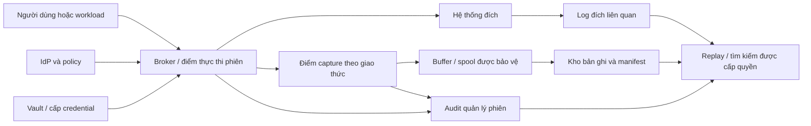

# Session recording

## 1. Mục tiêu của ghi lại phiên đặc quyền

Session recording là ghi lại dữ liệu hoặc sự kiện của một phiên truy cập để có thể xem lại và điều tra. Trong quản lý truy cập đặc quyền (Privileged Access Management, PAM), đối tượng thường là phiên quản trị máy chủ, thiết bị mạng, ứng dụng hoặc cơ sở dữ liệu nhạy cảm.

Một bản ghi hữu ích giúp trả lời: danh tính nào được cho phép truy cập, vào tài nguyên nào, qua tài khoản đích nào, trong khoảng thời gian nào và hệ thống đã quan sát được những hoạt động gì. Nó hỗ trợ kiểm toán, ứng phó sự cố, rà soát thao tác và đối soát thay đổi.

Ví dụ, kỹ sư trực được mở phiên chẩn đoán production trong 15 phút qua broker, sử dụng một tài khoản đích do vault quản lý. Khi xuất hiện thay đổi bất thường, nhóm điều tra cần nối yêu cầu đã duyệt với phiên, transcript hoặc màn hình được ghi, rồi đối chiếu log trên hệ thống đích. Chỉ thấy tên tài khoản dùng chung trong log đích thường chưa đủ để phân biệt người sử dụng.

Ghi phiên không thay thế kiểm soát quyền. Một tài khoản có quyền quá rộng vẫn có thể gây thiệt hại dù mọi khung hình đều được lưu. Least privilege, JIT/JEA, giới hạn giao thức, thời hạn phiên và quản lý credential phải được thực thi cùng cơ chế ghi nhận.

Bài học thuộc chương Session management, tập trung vào tài khoản quản trị, danh tính dịch vụ và hạ tầng nhạy cảm. Các sơ đồ, trạng thái và metadata là mô hình thiết kế tham khảo; khả năng ghi cụ thể cần được xác nhận theo giao thức, broker, agent và nền tảng thực tế.

## 2. Bản ghi phiên có thể chứa gì?

### 2.1. Phân biệt các loại dữ liệu

| Loại dữ liệu | Nội dung thường ghi nhận | Giới hạn cần hiểu |
|---|---|---|
| Metadata phiên | Danh tính, tài nguyên, tài khoản đích, thời gian, lý do kết thúc | Không mô tả đầy đủ nội dung thao tác |
| Transcript terminal | Dữ liệu đầu vào, đầu ra và sự kiện terminal theo khả năng tích hợp | Không tự là danh sách lệnh đã thực thi thành công |
| Video hoặc sự kiện màn hình | Hình ảnh, cập nhật đồ họa hoặc tương tác được hỗ trợ | Có thể không ghi nội dung file, kênh phụ hoặc kết quả giao dịch |
| Nhật ký lệnh hoặc truy vấn | Lệnh hoặc yêu cầu mà điểm quan sát nhận diện được | Có thể thiếu logic bên trong script, chương trình hoặc stored procedure |
| Log hệ thống đích | Đăng nhập, tiến trình, thay đổi, kết quả do đích ghi | Cần liên kết đúng phiên và bảo vệ độ tin cậy nguồn |
| Sự kiện giám sát trực tiếp | Cảnh báo, người xem trực tiếp, quyết định kết thúc phiên | Khác với nội dung bản ghi có thể phát lại |

Audit log ghi sự kiện quản lý và quyết định quyền; session recording lưu nội dung hoặc tương tác trong phạm vi được thiết kế. Hai nguồn bổ sung cho nhau. Việc có một sự kiện “session started” không chứng minh nội dung sau đó đã được ghi đầy đủ.

### 2.2. Phạm vi theo giao thức

Với SSH, có thể tồn tại shell tương tác, lệnh không tương tác, subsystem truyền file, chuyển tiếp cổng hoặc chuyển tiếp agent. Ghi terminal của một shell không tự ghi đầy đủ các kênh khác. Cần xác định kênh nào được phép, kênh nào được ghi và kênh nào bị chặn.

Dữ liệu phím nhập không đồng nghĩa câu lệnh thực thi: người dùng có thể sửa dòng, dùng editor, mở chương trình toàn màn hình hoặc chạy script. Một dòng xuất hiện trên màn hình cũng không chứng minh thay đổi đã được ghi bền ở đích. Khi điều tra, cần kết hợp bằng chứng tiến trình, ứng dụng hoặc giao dịch nếu có.

Với giao diện đồ họa như RDP, màn hình có thể cho thấy thao tác nhưng không tự bao quát clipboard, truyền file, thiết bị chuyển hướng hoặc các kênh khác. Chất lượng hình ảnh, tốc độ cập nhật và cách ghi ảnh hưởng khả năng đọc văn bản, không chỉ kích thước file.

Với truy cập cơ sở dữ liệu, proxy hoặc cơ chế audit phù hợp có thể ghi truy vấn và sự kiện theo khả năng hỗ trợ. Không suy ra nội dung giao dịch chỉ từ một video terminal, cũng không coi việc thấy câu truy vấn là bằng chứng nó đã commit thành công.

### 2.3. Phạm vi quan sát phải được công bố

Đối với mỗi profile, cần có bảng phạm vi: dữ liệu nào được ghi, dữ liệu nào không được ghi và các tính năng nào bị cấm để đáp ứng yêu cầu kiểm soát. Không dùng từ “ghi toàn bộ” khi chỉ có transcript một kênh.

Một hệ thống chỉ quan sát lưu lượng mã hóa trên mạng không mặc nhiên đọc được nội dung phiên. Ghi nội dung cần điểm quan sát được ủy quyền, chẳng hạn broker xử lý giao thức hoặc agent tại đích. Các điểm đó thuộc ranh giới tin cậy và cần được bảo vệ tương ứng.

## 3. Kiến trúc tham khảo



Broker có thể kiểm soát hai chặng kết nối với client và đích, hoặc triển khai dùng một agent có quyền phù hợp. Mỗi mô hình có giới hạn và tác động vận hành khác nhau. Không đặt một điểm ghi bên ngoài đường xử lý rồi giả định nó nhìn thấy mọi dữ liệu.

Cần xác minh danh tính đích qua cơ chế trust phù hợp, bảo vệ kênh truyền và danh tính dịch vụ. Việc proxy kết thúc một kết nối bảo mật không phải lý do bỏ kiểm tra máy chủ ở chặng tiếp theo.

Các đường truy cập trực tiếp phải được kiểm kê và kiểm soát. Nếu người dùng có credential quản trị thường trực cùng đường mạng đi vòng broker, yêu cầu ghi qua broker có thể bị bỏ qua. Ngoại lệ như break-glass cần cơ chế quản lý và bằng chứng riêng, không được mặc định coi là đã ghi theo cùng profile.

## 4. Gắn phiên với danh tính và quyết định quyền

Mỗi phiên nên nối được tối thiểu các tham chiếu sau:

```text
Danh tính đã xác thực
    -> yêu cầu và quyết định cho phép
    -> tenant, tài nguyên và tài khoản đích
    -> lần kích hoạt / session ID
    -> connection ID, channel hoặc stream
    -> recording ID và bằng chứng liên quan
```

Người dùng đăng nhập bằng danh tính riêng rồi dùng tài khoản đích chung qua broker giúp truy vết rõ hơn việc mọi người cùng biết một mật khẩu. Tuy nhiên, kết luận về người thực hiện vẫn dựa trên độ tin cậy của xác thực, token và điểm ghi; một bản ghi không tự chứng minh tuyệt đối danh tính con người ngoài các giả định đó.

Trước mở phiên, kiểm tra tenant, tài nguyên, tác vụ, grant, thời hạn và chính sách recording. Quyền mở phiên khác với quyền xem hoặc export bản ghi. Người quản trị tài khoản cũng không nhất thiết được xóa nội dung ghi lại thao tác của mình.

Nếu phiên cần recording bắt buộc, bước sẵn sàng ghi phải có điều kiện kỹ thuật cụ thể trước khi cho phép hoạt động nhạy cảm. Một chấm đỏ trên giao diện không thay cho việc capture đã được gắn vào đường dữ liệu và cơ chế lưu theo chính sách đã sẵn sàng.

## 5. Vòng đời ghi phiên

### 5.1. Trước và trong phiên

Một luồng điển hình gồm:

1. **Admission:** kiểm tra quyền mở phiên, tài nguyên, tài khoản, thời hạn và profile ghi được áp dụng.
2. **Khởi tạo:** tạo session ID, recording ID, liên kết danh tính và quyết định quyền; kiểm tra capture, spool, khóa và dung lượng cần thiết.
3. **Bắt đầu capture:** gắn điểm ghi vào các kênh thuộc phạm vi trước khi cấp khả năng thực hiện thao tác nhạy cảm cho chủ thể.
4. **Ghi liên tục:** phân đoạn dữ liệu, gắn stream và thứ tự, xử lý vùng nhạy cảm theo thiết kế, ghi metadata và chuyển tới kho lưu.
5. **Theo dõi sức khỏe:** kiểm tra lỗi capture, backlog, độ trễ, dung lượng và việc các kênh mới có còn nằm trong policy.
6. **Kết thúc:** ghi lý do, đóng hoặc xác nhận trạng thái kết nối theo giao thức, đẩy phần dữ liệu còn lại và tạo manifest.
7. **Đối soát:** kiểm tra segment, thứ tự, toàn vẹn, khoảng trống và quyền truy cập trước khi cho phát lại theo policy.

Xác thực credential với đích và capture nội dung cần phối hợp để không ghi thừa bí mật, nhưng cũng không bỏ trống khoảng hoạt động mà người dùng đã được thực hiện. Điều kiện bắt đầu phải phù hợp giao thức và được kiểm tra trong triển khai.

### 5.2. Tách trạng thái phiên khỏi trạng thái bản ghi

Phiên có thể đã đóng trong khi bản ghi vẫn đang tải lên. Ngược lại, kết nối client mất không chứng minh phiên đích hoặc tác vụ phía sau đã kết thúc. Cần quản lý các trạng thái liên quan một cách riêng biệt.

| Trường trạng thái minh họa | Ý nghĩa |
|---|---|
| `session_state` | Phiên đang mở, đang đóng hoặc đã xác nhận kết thúc theo phạm vi quản lý |
| `recording_state` | Capture, chờ đẩy dữ liệu, đang hoàn tất hoặc đã đóng gói manifest |
| `capture_health` | Điểm ghi hoạt động bình thường hay đang suy giảm |
| `completeness` | Đủ trong phạm vi đã định nghĩa, thiếu dữ liệu hoặc chưa thể kết luận |
| `integrity_state` | Kết quả kiểm tra toàn vẹn, độc lập với việc có thiếu khoảng capture hay không |

Trong mô hình này, một bản ghi đã `FINALIZED` chỉ có nghĩa quá trình đóng gói đã kết thúc. Nó vẫn có thể mang `completeness: INCOMPLETE`. Không biến việc có manifest hoặc file video mở được thành kết luận nội dung đầy đủ.

Kết thúc phiên do hết grant, logout, người giám sát hoặc sự cố phải có reason code phù hợp. Chấm dứt kênh broker không tự bảo đảm mọi tiến trình nền, tác vụ đã lên lịch hoặc tunnel ngoài phạm vi đó đều biến mất. Cần cơ chế kiểm soát và đối soát riêng theo tác vụ, tránh tác động tới công việc không liên quan.

## 6. Thu thập, toàn vẹn và lưu trữ

### 6.1. Thứ tự dữ liệu và mốc thời gian

Mỗi segment hoặc sự kiện cần gắn tenant, recording ID, connection hoặc stream ID và sequence phù hợp. Với nhiều stream, cần mô tả cách sắp xếp; không mặc định thời điểm của hai máy khác nhau là một thứ tự tuyệt đối chính xác.

Thời gian phía máy chủ hỗ trợ đối chiếu, còn nguồn thời gian đơn điệu giúp đo khoảng cách và phát hiện bất thường trong một phạm vi xử lý. Cần lưu thông tin cần thiết về nguồn và độ tin cậy thời gian, xử lý lệch đồng hồ và không sửa lịch sử để che khoảng không chắc chắn.

Nếu gửi lại cùng segment sau mất phản hồi, kho nhận cần xử lý trùng theo phạm vi recording, stream và sequence. Cùng định danh nhưng nội dung khác phải được nhận diện như xung đột cần xử lý, không âm thầm ghi đè. Retry không được trộn segment của tenant hoặc phiên khác.

### 6.2. Checksum, chuỗi hash và manifest

Checksum hoặc digest có thể phát hiện thay đổi khi có giá trị đối chiếu đáng tin. Một chuỗi hash có thể ràng buộc segment với thứ tự và phần trước đó. Nhưng nếu kẻ tấn công có thể sửa cả dữ liệu lẫn mọi giá trị kiểm tra, chỉ thêm checksum chưa tạo bằng chứng chống sửa.

Thiết kế có thể kết hợp manifest, chữ ký hoặc checkpoint được bảo vệ, lưu trữ có kiểm soát sửa xóa và tách quyền quản trị. Manifest thường cần thông tin các stream, số segment hoặc phạm vi sequence, digest, thời gian, format và các gap đã biết. Một điểm chốt cuối đáng tin giúp nhận diện việc mất phần đuôi, điều mà chỉ kiểm tra các segment còn lại có thể không phát hiện.

Quyền ký, quản trị khóa và thay chính sách kho lưu cần được kiểm soát. Nếu một chủ thể có thể thay mã recorder, giả mạo chữ ký và xóa audit, mức bảo đảm còn phụ thuộc ranh giới dùng chung đó. Bảo vệ dữ liệu sau capture cũng không chứng minh recorder chưa bỏ sót hành động trước khi capture; cần đối chiếu các nguồn khác khi điều tra.

### 6.3. Mã hóa và khả năng phát lại lâu dài

Bản ghi có thể chứa dữ liệu production và nội dung đặc quyền nên cần bảo vệ khi truyền, lưu và xử lý tạm. Xác định danh tính dịch vụ được ghi, đọc, giải mã, export và xóa; quyền vận hành hạ tầng không nên mặc định là quyền xem mọi bản ghi.

Có thể ràng buộc ngữ cảnh mã hóa với tenant, recording và segment theo cơ chế được hỗ trợ. Việc đó giúp bảo vệ tính toàn vẹn ngữ cảnh nhưng không thay kiểm tra quyền người xem. Khóa và khả năng khôi phục khóa phải theo cùng yêu cầu lưu dữ liệu.

Lưu format, phiên bản codec hoặc thông tin cần để phát lại; kiểm tra khả năng đọc sau thay đổi phần mềm. Nén và chất lượng ảnh cần đáp ứng nhu cầu đọc được nội dung trong phạm vi đã chọn, không chỉ tối ưu dung lượng. Kết quả OCR hoặc tìm kiếm suy ra từ hình ảnh phải được coi là dữ liệu dẫn xuất có sai số, không thay nguồn gốc.

### 6.4. Xác định đúng điểm bền vững

Dữ liệu nằm trong bộ nhớ broker, spool cục bộ và kho tập trung có các mức rủi ro khác nhau. Cần định nghĩa khi nào hệ thống coi segment đã được ghi bền và rủi ro mất dữ liệu nếu host, đĩa hoặc kho lưu gặp sự cố.

Một HTTP response hoặc xác nhận đã xếp hàng chưa chắc là bằng chứng dữ liệu đã ở lớp lưu bền cần thiết. Cần hợp đồng xác nhận rõ ràng. Chỉ dọn spool khi đã đạt điều kiện lưu và đối soát theo thiết kế; không xóa ngay sau khi bắt đầu upload.

## 7. Khi recording gặp sự cố

### 7.1. Không im lặng chuyển thành phiên không được ghi

Hành vi khi recorder hoặc kho lưu lỗi phải được định nghĩa theo mức rủi ro trước khi vận hành.

| Tình huống | Hướng hành vi cần thiết kế |
|---|---|
| Không khởi tạo được recording bắt buộc | Chưa mở phiên mới trong đường thông thường |
| Kho tập trung tạm mất nhưng spool đạt điều kiện | Có thể tiếp tục trong giới hạn đã được cho phép, theo dõi backlog và khả năng phục hồi |
| Spool gần đầy hoặc vượt hạn | Cảnh báo, hạn chế hoạt động hoặc kết thúc theo khả năng giao thức và policy trước khi mất kiểm soát |
| Capture lỗi trong phiên | Ghi trạng thái suy giảm, phản ứng theo policy và đánh dấu khoảng thiếu |
| Broker hoặc agent crash | Khôi phục phần có thể lấy lại, không tự kết luận mọi dữ liệu đã đủ |
| Digest, chữ ký hoặc ngữ cảnh không khớp | Giữ bằng chứng, chặn xử lý như bản ghi bình thường và chuyển điều tra theo quyền |

Nếu có ngoại lệ tiếp tục phiên khi không ghi được, đó phải là một đường được quản trị rõ với phạm vi, thời gian và bằng chứng riêng. Không dùng fallback vô điều kiện để làm mất yêu cầu recording. Sự kiện mất khả năng ghi cần được bảo vệ và chuyển tới kênh giám sát phù hợp; nếu chưa gửi được ngay, phải có cách giữ và báo độ trễ theo thiết kế.

### 7.2. Buffer có giới hạn

Spool cần mã hóa, quyền truy cập hẹp, hạn dung lượng và thời gian. Backpressure hoặc tạm dừng luồng chỉ có thể áp dụng theo khả năng giao thức và tác động chấp nhận được. Nếu không thể tiếp tục đáp ứng policy, phải có hành vi kết thúc hoặc xử lý ngoại lệ đã định nghĩa, không bỏ dữ liệu cũ để giả vờ ghi liên tục.

Sau khi kho hoạt động lại, upload có kiểm soát, đối soát segment và gap rồi mới hoàn tất trạng thái. Mất capture trong một khoảng không thể được bù lại chỉ bằng việc upload thành công các phần còn có. Cần giữ `INCOMPLETE` hoặc `UNKNOWN` khi đó là điều bằng chứng cho phép kết luận.

### 7.3. Reconnect và failover

Reconnect cần kiểm tra quyền còn hiệu lực và liên kết với đúng danh tính, session hoặc connection mới theo mô hình. Không cho người khác tiếp quản phiên chỉ vì biết recording ID hoặc tài khoản đích.

Nếu broker failover, có thể phát sinh segment từ các epoch hoặc điểm capture khác nhau. Giữ định danh nguồn, thứ tự và khoảng trống, không nối các file bằng thời gian ước đoán rồi báo đầy đủ. Khả năng duy trì phiên liền mạch phụ thuộc giao thức và triển khai, cần được kiểm tra chứ không tự suy ra từ việc có cụm HA.

## 8. Bảo vệ dữ liệu nhạy cảm trong bản ghi

### 8.1. Giảm thu thập không cần thiết

Phạm vi recording nên gắn với mục đích và rủi ro của phiên, không tự mở rộng thành ghi mọi hoạt động trên máy cá nhân. Xác định dữ liệu nào thực sự cần, người được xem, thời gian lưu và cách thông báo việc ghi theo chính sách áp dụng.

Bản ghi có thể chứa dữ liệu khách hàng, cấu hình hạ tầng, nội dung ứng dụng và secret được hiển thị trong phiên. Vì vậy, cần bảo vệ bản ghi như dữ liệu nhạy cảm, không chỉ như một video vận hành thông thường.

Khi người dùng không cần biết mật khẩu đích, broker có thể sử dụng credential từ vault qua cơ chế được hỗ trợ mà không gửi giá trị cho client. Tuy nhiên, broker và đích vẫn nằm trong ranh giới tin cậy; trace hoặc bản ghi ở sai điểm có thể làm lộ dữ liệu xác thực.

### 8.2. Redaction phải đúng điểm thu thập

Một ô nhập không echo chỉ giảm hiển thị trên màn hình. Điểm ghi keystroke có thể nhận dữ liệu trước khi màn hình che nó. Tương tự, làm mờ vùng ở trình xem không chứng minh video hoặc stream gốc đã được loại bỏ secret.

Cần xác định nơi nhận diện trường nhạy cảm và nơi loại bỏ hoặc thay thế nội dung trước các điểm lưu cần bảo vệ. Với dữ liệu đã redact, giữ metadata về phạm vi và lý do để người điều tra hiểu giới hạn bằng chứng. Không hứa phát hiện mọi mật khẩu tùy ý xuất hiện trong terminal hoặc ứng dụng tự vẽ.

Nếu cần lưu một bản gốc chưa redact vì mục đích đặc biệt đã được cho phép, phải có phạm vi, quyền và chính sách bảo vệ riêng. Một bản xuất đã che không làm bản gốc hoặc index chứa plaintext trở nên an toàn. Đây không nên là cách mặc định để tránh thiết kế redaction từ nguồn.

Truyền file, clipboard và các kênh phụ cần policy riêng. Nếu không ghi được theo mức yêu cầu, có thể phải chặn chúng hoặc dùng một đường đã được quản lý khác. Chặn SSH port forwarding không tự chặn mọi kết nối mạng mà chương trình trên đích có thể tạo; vẫn cần quyền đích và kiểm soát mạng phù hợp.

### 8.3. Lưu giữ và dữ liệu dẫn xuất

Thời gian lưu phải dựa trên mục đích, độ nhạy cảm và yêu cầu vận hành của tổ chức. Không có một số ngày chung phù hợp cho mọi bản ghi. Retention cần bao quát segment, manifest, spool, index, OCR, ảnh xem trước, export và backup liên quan.

Khi sửa redaction hoặc thu hồi quyền xem, cần xét dữ liệu dẫn xuất và cache. Index tìm kiếm có thể vẫn chứa văn bản đã bị che trong bản phát lại. Xóa một object chính không chứng minh mọi bản xuất hoặc bản sao đã biến mất.

Nếu cần giữ bằng chứng cho sự cố, áp dụng phạm vi và quyền phù hợp, đồng thời bảo vệ khỏi sửa xóa trái phép. Hủy khóa giải mã như một biện pháp vòng đời phải xét các bản sao khóa và phạm vi dữ liệu dùng chung; không làm mất bản ghi tenant khác do quản lý khóa sai.

## 9. Xem lại, tìm kiếm, giám sát trực tiếp và export

### 9.1. Các quyền khác nhau

| Năng lực | Phạm vi cần xác định |
|---|---|
| Xem metadata | Danh sách phiên, tài nguyên, actor và trạng thái được phép |
| Replay | Nội dung bản ghi nào, tenant nào, khoảng thời gian hoặc vụ việc nào |
| Tìm kiếm | Index và dữ liệu dẫn xuất nằm trong cùng phạm vi quyền |
| Xem trực tiếp | Phiên đang chạy nào, với mục đích và thời hạn nào |
| Tham gia điều khiển | Quyền gửi đầu vào, khác với quyền quan sát |
| Export | Dữ liệu, định dạng, nơi nhận, quyền truy cập và thời gian giữ bản xuất |
| Xóa hoặc thay retention | Điều kiện vòng đời và phân tách trách nhiệm |

Không dùng quyền mở phiên như quyền mặc định xem mọi bản ghi. Người dùng đoán được recording ID không được vượt qua kiểm tra tenant, tài nguyên và mục đích. Danh tính dịch vụ index hoặc hỗ trợ cũng cần phạm vi rõ, tránh trở thành đường đọc toàn bộ nội dung.

Nếu có người giám sát được phép gửi đầu vào, phải nhận diện riêng actor đó trong bằng chứng. Không gộp mọi thao tác điều khiển vào danh tính người khởi tạo phiên rồi kết luận người này đã thực hiện tất cả.

### 9.2. Trình xem xử lý nội dung như dữ liệu không tin cậy

Transcript và đầu ra ứng dụng có thể chứa ký tự điều khiển, escape sequence hoặc nội dung giống HTML. Trình xem phải render an toàn, không thực thi script, câu lệnh hoặc kết nối tới hệ thống thật chỉ vì dữ liệu ghi lại yêu cầu như vậy.

Replay là phát lại bằng chứng, không phải chạy lại lệnh trên một phiên sống. Cần tách quyền và đường kết nối tương ứng. Liên kết tải hoặc phát lại phải theo cơ chế xác thực, phạm vi và thời hạn đã thiết kế, không coi URL khó đoán là kiểm soát duy nhất.

Annotation, OCR, bản dịch hoặc đánh dấu nghi vấn cần là dữ liệu dẫn xuất có nguồn gốc và phiên bản, không sửa nội dung nguồn để làm như các nhận định đã có trong phiên ban đầu. Khi điều tra, phân biệt điều quan sát được với suy luận từ công cụ tìm kiếm.

### 9.3. Export và truy vết người xem

Bản xuất cần có phạm vi, quyền và bảo vệ tương ứng với bản gốc. Nếu dùng gói bằng chứng, giữ thông tin nguồn, manifest và cơ chế xác minh phù hợp mà không đưa khóa bí mật vào gói. Bản xuất đã redact cần chỉ rõ đó là bản dẫn xuất và giới hạn của nó.

Watermark hoặc nhãn người xem có thể hỗ trợ truy trách nhiệm, nhưng không ngăn tuyệt đối chụp màn hình hoặc ghi lại nội dung được phép xem. Giới hạn quyền xem và export vẫn là kiểm soát chính.

Audit các lần tìm kiếm nhạy cảm, replay, xem trực tiếp, tham gia điều khiển, export và xóa theo chính sách. Sự kiện nên có actor, tenant, recording reference, mục đích hoặc vụ việc liên quan, thời điểm và kết quả. Không đưa nội dung bản ghi vào audit chỉ để chứng minh đã xem.

Một sự kiện truy cập cho biết hệ thống đã phục vụ hành động đó, không chứng minh người dùng đã đọc mọi khung hình hay chưa sao chép nội dung bằng cách khác. Khi có nghi vấn, kết hợp nguồn bằng chứng phù hợp thay vì suy ra từ một lượt mở trang.

## 10. Ví dụ: ghi phiên SSH chẩn đoán production

Giả sử kỹ sư trực có một grant 15 phút tới tài khoản chẩn đoán được giới hạn trên máy production. Profile cho phép kênh terminal và lệnh không tương tác có recording phù hợp; truyền file, port forwarding và agent forwarding bị chặn theo policy triển khai. Quyền trên đích giới hạn đúng công việc chẩn đoán, không cấp shell quản trị rộng chỉ vì đã bật recording.

Luồng xử lý gồm:

1. Broker xác thực kỹ sư, kiểm tra tenant, tài nguyên, grant, thời hạn và profile recording.
2. Tạo session và recording reference, xác nhận capture cùng cơ chế lưu theo policy sẵn sàng trước khi cấp khả năng thao tác.
3. Lấy hoặc sử dụng credential từ vault theo phạm vi đã cấp mà không gửi secret cho trình duyệt.
4. Ghi dữ liệu kênh được phép, stream và thứ tự; giữ audit quyết định mở kênh và các kênh bị từ chối.
5. Theo dõi sức khỏe capture và backlog trong khi phiên hoạt động.
6. Khi grant kết thúc, thực thi đóng quyền hoặc phiên theo thiết kế, ghi lý do và đối soát trạng thái đích.
7. Đẩy dữ liệu còn lại, kiểm tra segment, tạo manifest và xác định completeness trước khi bàn giao bản ghi.

Nếu kho tập trung tạm mất nhưng spool còn đáp ứng giới hạn đã được cho phép, phiên có thể tiếp tục trong phạm vi policy đó. Khi kho phục hồi, dữ liệu được tải lên và đối soát. Nếu không có gap và các điều kiện khác đạt, bản ghi có thể được xác nhận đầy đủ trong phạm vi profile.

Metadata sau là ví dụ cho một phiên đã kết thúc và được đối soát; nó không chứa nội dung phiên hoặc secret:

```json
{
  "tenant_ref": "tenant-payments",
  "actor_ref": "user-oncall-17",
  "resource_ref": "linux-payments-prod-01",
  "target_account_ref": "ops-diagnostic",
  "session_ref": "session-diag-241",
  "recording_ref": "recording-diag-241",
  "policy_ref": "diagnostic-ssh-v3",
  "session_state": "CLOSED",
  "recording_state": "FINALIZED",
  "captured_channels": ["ssh-pty"],
  "denied_channel_types": ["sftp", "port-forwarding", "agent-forwarding"],
  "completeness": "COMPLETE",
  "integrity_state": "VERIFIED",
  "end_reason": "GRANT_EXPIRED",
  "known_gaps": []
}
```

Các trường này là mô hình minh họa, không phải API của một sản phẩm. `COMPLETE` ở đây áp dụng cho phạm vi capture đã định nghĩa, không phải mọi hoạt động có thể xảy ra trên toàn máy chủ. `VERIFIED` nói tới các kiểm tra toàn vẹn đã thiết kế, không tự chứng minh từng lệnh đã thực thi thành công.

Nếu recorder bị lỗi trong một khoảng và không còn dữ liệu để phục hồi, bản ghi phải giữ trạng thái thiếu hoặc chưa xác định tương ứng. Không đổi sang đầy đủ chỉ vì các segment còn lại tải lên được. Nhóm điều tra cần thấy khoảng đó và có thể đối chiếu log đích, audit hoặc nguồn khác trong phạm vi được cấp.

Nếu kết nối đích không đóng được khi grant hết hạn, trạng thái phiên cũng phải phản ánh điều chưa xác nhận. Không dùng việc trình duyệt đã đóng để khẳng định mọi quyền và tác vụ trên đích đã chấm dứt.

## 11. Ma trận kiểm tra session recording

Thực hiện trong môi trường và phạm vi được phép, bằng dữ liệu thử. Cần kiểm tra đường dữ liệu thực tế và hiện vật lưu trữ, không chỉ dựa vào giao diện báo đang ghi.

| Tình huống | Hành vi cần đạt | Bằng chứng cần xem |
|---|---|---|
| Mở phiên yêu cầu recording bắt buộc khi recorder chưa sẵn sàng | Chưa cấp hoạt động nhạy cảm trong đường thông thường | Quyết định admission và trạng thái capture |
| Phiên shell tương tác | Ghi đúng các stream thuộc profile, liên kết actor và tài nguyên | Segment, metadata và replay có kiểm tra |
| Mở kênh exec, truyền file hoặc forwarding | Ghi hoặc chặn đúng policy từng loại, không giả định terminal bao quát | Quyết định kênh và dữ liệu thực sự thu được |
| Ứng dụng toàn màn hình hoặc thao tác sửa dòng | Replay phản ánh đúng dữ liệu quan sát; không gọi keystroke là lệnh đã chạy | Nội dung phát lại và log đích liên quan |
| Trường nhập secret không echo | Đã kiểm tra dữ liệu đầu vào và đầu ra, không chỉ màn hình | Capture, stream gốc, bản lưu và export theo policy |
| Kho tập trung gián đoạn | Spool, hạn mức và hành vi tiếp tục hoặc dừng đúng thiết kế | Backlog, ack, trạng thái phiên và gap |
| Spool gần đầy hoặc vượt hạn | Không âm thầm bỏ dữ liệu để báo ghi thành công | Cảnh báo, quyết định hạn chế hoặc kết thúc |
| Broker crash trước upload | Phục hồi phần có thể, đánh dấu độ đầy đủ đúng bằng chứng | Spool, sequence, trạng thái phục hồi và manifest |
| Gửi lại một segment | Không nhân đôi ngoài ý muốn; cùng ID khác nội dung bị nhận diện | Kho segment và sự kiện xung đột |
| Thiếu, đảo hoặc sửa segment | Kiểm tra phát hiện theo thiết kế; không cho xem như bản đầy đủ bình thường | Manifest, digest, checkpoint hoặc chữ ký liên quan |
| Đồng hồ hoặc broker nguồn thay đổi | Giữ nguồn, thứ tự và giới hạn thời gian có thể giải thích | UTC, mốc tương đối, epoch và stream |
| Reconnect hoặc failover | Kiểm tra quyền còn hiệu lực và không trộn actor hoặc phiên | Connection reference, grant và các đoạn ghi |
| Client đóng nhưng đích còn hoạt động | Không khẳng định đích đã kết thúc chỉ từ client | Trạng thái kết nối đích và đối soát |
| Người tenant A đoán recording ID của B | Không replay, tìm kiếm hoặc export dữ liệu B | Quyết định quyền phía máy chủ và phản hồi |
| Người được xem trực tiếp thử gửi đầu vào | Chỉ thực hiện nếu có quyền điều khiển riêng | Quyết định và actor của đầu vào nếu được phép |
| Transcript chứa HTML hoặc escape sequence bất thường | Trình xem không thực thi nội dung hoặc gửi lệnh tới hệ thống sống | Hành vi renderer và ranh giới kết nối |
| Redaction hoặc quyền xem thay đổi | Dữ liệu dẫn xuất, cache và export được xử lý theo phạm vi chính sách | Nguồn, index, ảnh xem trước và bản xuất liên quan |
| Khôi phục bản ghi từ backup | Giữ đúng tenant, khóa, tính toàn vẹn và quyền truy cập | Kết quả đối soát cùng khả năng phát lại được phép |

Với mất capture, kiểm tra riêng trường hợp có thể phục hồi từ spool và trường hợp dữ liệu chưa từng được lưu. Trường hợp thứ hai phải để lại bằng chứng thiếu, ngay cả khi phiên và quá trình upload sau đó đều kết thúc bình thường.

Với video, thử khả năng đọc nội dung cần thiết ở chất lượng và điều kiện tải thực tế trong lab. Với terminal, kiểm tra ứng dụng tương tác, ký tự điều khiển và nhiều stream. Kết quả cần nói rõ phạm vi đã chứng minh, tránh suy ra cùng một mức bao phủ cho mọi giao thức.

## 12. Tiêu chí nghiệm thu

Có thể dùng checklist sau khi thiết kế hoặc triển khai recording:

- [ ] Xác định mục đích, giao thức, kênh được phép, dữ liệu được ghi và phần không được bao phủ.
- [ ] Có liên kết danh tính đã xác thực, tenant, yêu cầu, grant, tài khoản đích, session, connection và recording.
- [ ] Quyền mở phiên, xem metadata, replay, tìm kiếm, xem trực tiếp, điều khiển, export và xóa có phạm vi rõ.
- [ ] Đường truy cập đi vòng được quản lý; ngoại lệ và break-glass không bị mô tả như phiên đã ghi bình thường.
- [ ] Capture được gắn và cơ chế lưu sẵn sàng ở thời điểm policy yêu cầu, không chỉ có chỉ báo trên client.
- [ ] Segment có định danh, thứ tự, thời gian và cơ chế xử lý trùng hoặc xung đột phù hợp.
- [ ] Toàn vẹn có nguồn đối chiếu đáng tin và giới hạn được công bố; không chỉ dựa vào checksum có thể bị sửa cùng dữ liệu.
- [ ] Mã hóa, quyền khóa, spool, lưu trữ và khả năng phục hồi được bảo vệ; format còn có thể phát lại theo yêu cầu lưu dữ liệu.
- [ ] Có định nghĩa điểm lưu bền, điều kiện dọn spool và cách xác định gap; trạng thái đóng gói khác với completeness.
- [ ] Lỗi capture, đầy spool, mất kho, crash và failover có hành vi kiểm soát, không âm thầm chuyển thành phiên không ghi.
- [ ] Secret và dữ liệu nhạy cảm được giảm thu thập hoặc redact đúng điểm; các bản gốc và dữ liệu dẫn xuất có quyền tương ứng.
- [ ] Replay coi nội dung là dữ liệu không tin cậy và không thực thi lại lệnh trên đích.
- [ ] Hết hạn hoặc thu hồi được thực thi ở điểm quản lý phiên, với giới hạn về tác vụ nền và quyền ngoài phiên được nêu rõ.
- [ ] Retention, export, backup, xóa và giữ bằng chứng bao quát các bản sao trong phạm vi quản lý.
- [ ] Audit đủ để biết ai truy cập hoặc thay chính sách bản ghi mà không đưa nội dung secret vào sự kiện.

Mỗi bảo đảm cần đi cùng thành phần thực thi và bằng chứng. Ví dụ, broker quyết định mở kênh, recorder thu dữ liệu, kho lưu xác nhận durability, dịch vụ phát lại kiểm tra quyền và hệ thống đích cung cấp kết quả tác vụ liên quan. Không dùng một trạng thái “recorded” thay cho mọi điều kiện đó.

Nếu chưa thể chứng minh đầy đủ, bàn giao giới hạn cụ thể cùng người chịu trách nhiệm. “Đã có transcript nhưng không ghi được một kênh truyền file được phép” là thông tin cần xử lý tiếp, không phải lý do gộp phiên thành hoàn tất không có ngoại lệ.

## 13. Bài thực hành thiết kế

Thiết kế recording cho một phiên SSH chẩn đoán production có grant 15 phút, dùng tài khoản đích do vault quản lý. Chỉ dùng dữ liệu giả và hệ thống lab được phép.

1. Lập bảng kênh shell, exec, truyền file và forwarding: được phép hay bị chặn, được ghi bằng cơ chế nào, và giới hạn quan sát là gì.
2. Vẽ liên kết giữa người dùng, quyết định cấp quyền, tài nguyên, tài khoản, session, stream và recording reference.
3. Mô tả điều kiện sẵn sàng ghi trước thao tác nhạy cảm, điểm xác nhận lưu bền và điều kiện dọn spool.
4. Thiết kế manifest và cách phát hiện segment trùng, bị sửa hoặc thiếu; giải thích điều gì checksum đơn lẻ chưa chứng minh.
5. Mô phỏng bằng sơ đồ hai tình huống: kho mất kết nối nhưng spool còn đủ, và recorder mất capture không có dữ liệu để phục hồi. Nêu trạng thái cuối khác nhau.
6. Lập quyền cho người dùng phiên, người giám sát, nhóm điều tra và người vận hành kho; phân biệt quan sát với điều khiển.
7. Chỉ ra nơi secret có thể vào bản ghi, cách giảm thu thập, redaction và các dữ liệu dẫn xuất cần bảo vệ.
8. Xác định bằng chứng khi grant hết hạn: phiên nào đã đóng, bản ghi nào đã hoàn tất và tác vụ nào trên đích vẫn cần đối soát.

Hồ sơ cần cho phép người điều tra biết hệ thống đã quan sát được gì, dữ liệu có đáng tin trong phạm vi nào và khoảng nào còn thiếu. Đó là cơ sở để sử dụng session recording như bằng chứng trong quản lý truy cập đặc quyền.

