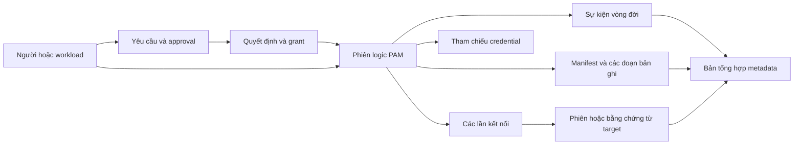

# Session metadata trong PAM

Session metadata là tập dữ liệu mô tả một phiên truy cập được PAM quản lý: ai khởi tạo, đến tài nguyên nào, bằng danh tính hiệu lực nào, dựa trên quyết định gì, qua thành phần nào, vào thời điểm nào và kết quả quan sát được ra sao.

Metadata không phải toàn bộ nội dung phiên. Một bản ghi metadata có thể cho biết kỹ sư An mở kết nối SSH tới máy chủ production bằng tài khoản bảo trì nhưng không tự cho biết mọi câu lệnh và tác động bên trong máy chủ. Muốn kiểm tra sâu hơn, cần nối tới sự kiện thao tác, bản ghi phiên hoặc nhật ký hệ thống đích theo khả năng quan sát thực tế.

Trong Privileged Access Management (PAM), metadata giúp giữ trách nhiệm theo danh tính cá nhân khi truy cập qua tài khoản quản trị hoặc tài khoản dùng chung. Nó cũng là lớp liên kết giữa approval, JIT/JEA, credential trong vault, gateway, bằng chứng phiên và quá trình thu hồi quyền.

## 1. Mục tiêu học tập

Sau bài học, người học có thể:

- Phân biệt metadata, sự kiện, bản ghi nội dung và các loại định danh phiên.
- Thiết kế những nhóm trường cần thiết để truy vết truy cập đặc quyền.
- Giữ được danh tính gốc, danh tính hiệu lực và nguồn xác minh của mỗi thuộc tính.
- Biểu diễn mở phiên, ngắt kết nối, kết nối lại, kết thúc và tình trạng bằng chứng mà không đánh đồng các trạng thái.
- Xử lý sự kiện trùng, đến muộn, thiếu thời gian hoặc xung đột nguồn dữ liệu.
- Xây dựng truy vấn kiểm toán và điều tra có tính đến giới hạn của metadata.

## 2. Metadata khác gì với các dữ liệu liên quan?

| Loại dữ liệu | Ví dụ | Nó giúp trả lời điều gì? |
| --- | --- | --- |
| Session metadata | Session ID, người khởi tạo, target, giao thức, thời gian, trạng thái | Phiên nào, ai tham gia, ở đâu và trong bối cảnh nào? |
| Session event | Bắt đầu kết nối, xác thực đích thành công, ngắt kết nối, yêu cầu chấm dứt | Những thay đổi hoặc mốc quan sát nào đã xảy ra? |
| Session recording | Luồng terminal, video hoặc nội dung giao thức được thu thập | Trong phần quan sát được, phiên đã diễn ra như thế nào? |
| Nhật ký đích | Sự kiện đăng nhập, thay đổi vai trò hoặc thao tác do hệ thống đích ghi | Đích đã nhìn thấy và thực thi điều gì? |
| Telemetry vận hành | Heartbeat, độ trễ, lỗi tải bản ghi | Hệ thống quản lý và ghi nhận phiên có khỏe không? |

Một giao diện danh sách phiên thường là bản tổng hợp từ các sự kiện. Trạng thái trên giao diện có thể chậm hơn gateway hoặc target. Cần biết nguồn dữ liệu và thời điểm cập nhật trước khi dùng nó để kết luận.

Metadata nên giữ tham chiếu tới các bằng chứng liên quan. Không nhét toàn bộ video hoặc output terminal vào cùng một bản ghi tổng hợp chỉ vì chúng thuộc một phiên.

## 3. Xác định “một phiên” trước khi thiết kế schema

### 3.1. Nhiều lớp phiên có thể cùng tồn tại

| Lớp | Định danh minh họa | Phạm vi |
| --- | --- | --- |
| Phiên xác thực với IdP hoặc cổng PAM | `authn_context_ref` | Người dùng đã xác thực với hệ thống cấp quyền |
| Phiên truy cập logic trong PAM | `session_id` | Đơn vị quản lý truy cập theo thiết kế PAM |
| Kết nối qua gateway | `connection_id` | Một lần thiết lập kết nối hoặc một nhánh truyền cụ thể |
| Phiên hoặc kết nối tại đích | `target_session_ref` | Đối tượng mà hệ điều hành, cơ sở dữ liệu hoặc ứng dụng đích nhận diện |
| Bản ghi nội dung | `recording_id` | Tập bằng chứng thu được, có thể gồm nhiều đoạn |

Các quan hệ không bắt buộc là một-một. Một phiên PAM có thể có nhiều lần kết nối lại; một giao thức có thể mở nhiều kênh; một session recording có thể bị chia thành nhiều đoạn.

Với một số môi trường đồ họa, ngắt kết nối client không nhất thiết đăng xuất phiên tại đích. Với terminal, tiến trình hoặc tác vụ được khởi chạy cũng có thể tiếp tục sau khi kênh truy cập đóng. Mô hình metadata phải giữ được những khác biệt mà kiến trúc có khả năng quan sát.

### 3.2. Quy tắc định danh

Dùng định danh ổn định, có phạm vi rõ và tránh trùng giữa tenant, môi trường hoặc nguồn phát. Không dùng duy nhất username, IP hoặc cặp thời gian bắt đầu và kết thúc để xác định phiên.

Định nghĩa rõ khi nào reconnect giữ `session_id`, khi nào tạo phiên logic mới và cách biểu diễn quan hệ cha-con. Nếu một phiên chuyển qua gateway khác, cần ghi nhận lịch sử hoặc kết nối mới thay vì âm thầm thay mọi nguồn cũ.

Phân biệt mã dùng để đối chiếu với token dùng để tiếp tục hoặc chiếm quyền phiên. Một `session_id` chỉ nên được dùng như định danh khi thiết kế coi nó là định danh. Resume token, cookie hoặc bearer capability phải được bảo vệ như thông tin xác thực, không đưa vào audit chỉ vì cũng có chữ “session”.

### 3.3. Nhiều người tham gia

Nếu có giám sát trực tiếp, hỗ trợ hoặc tiếp quản phiên, cần giữ danh tính từng người cùng vai trò và khoảng thời gian tham gia. Không biến người quan sát thành người thực hiện mọi thao tác.

Khi quyền điều khiển được chuyển, ghi sự kiện chuyển quyền và đối tượng điều khiển mới theo khả năng sản phẩm. Một trường `owner` duy nhất bị ghi đè có thể làm mất trách nhiệm của người trước đó.

## 4. Các nhóm trường cốt lõi

### 4.1. Danh tính gốc và danh tính hiệu lực

| Nhóm | Trường minh họa | Cách hiểu |
| --- | --- | --- |
| Chủ thể khởi tạo | `actor.subject_id`, `identity_source`, `actor.type` | Người hoặc workload khởi tạo yêu cầu |
| Xác thực | `authn_context_ref`, `authenticated_at` | Tham chiếu tới bằng chứng xác thực và thời điểm liên quan |
| Thành phần thực hiện | `gateway_id`, `broker_id`, `agent_id` | Dịch vụ thực hiện một phần luồng thay người dùng |
| Danh tính được yêu cầu | `requested_principal_ref` | Tài khoản hoặc vai trò mà người dùng muốn sử dụng |
| Danh tính hiệu lực quan sát được | `effective_principal_ref` | Danh tính mà nguồn có thẩm quyền báo đang được dùng tại đích |
| Người tham gia khác | `participant_ref`, `participant_role` | Người giám sát, hỗ trợ hoặc điều khiển khi có |

Giả sử An xác thực bằng tài khoản cá nhân nhưng gateway đăng nhập target dưới tài khoản dùng chung `ops-maint`. Nếu chỉ ghi `ops-maint`, điều tra viên không biết người nào khởi tạo. Nếu chỉ ghi An, lại không biết quyền nào đã được dùng tại target.

Giữ cả hai và ghi nguồn xác minh. Tên tài khoản người dùng nhập vào không tương đương danh tính đích đã được xác thực. Có thể cần tách `requested_principal` khỏi `observed_principal` nếu hai bước chưa hoàn tất.

Khi có nâng quyền hoặc chuyển vai trò, không ghi đè lịch sử thành một danh tính duy nhất. Ghi sự kiện thay đổi, thời gian và nguồn quan sát. Khả năng thấy việc nâng quyền phụ thuộc gateway, agent và nhật ký đích; không giả định mọi lệnh chuyển vai trò đều được phân tích chính xác.

### 4.2. Target và đường truy cập

| Trường minh họa | Mục đích |
| --- | --- |
| `target_id` | Liên kết tới tài sản ổn định trong kiểm kê |
| `tenant_ref`, `environment` | Phân biệt tổ chức, tài khoản hoặc môi trường |
| `endpoint_observed`, `protocol`, `port` | Ghi đường kết nối thực tế phù hợp với mức nhạy cảm |
| `gateway_id`, `connection_id` | Xác định thành phần và lần kết nối |
| `source_address`, `device_ref` | Cung cấp ngữ cảnh nguồn, không thay thế danh tính |
| `target_trust_ref` | Tham chiếu tới kiểm tra danh tính đích nếu kiến trúc cung cấp |

IP có thể được dùng chung qua NAT, thay đổi theo thời gian hoặc đại diện cho proxy. Nó là dữ liệu hỗ trợ, không tự chứng minh một cá nhân đã thao tác.

Nếu có reverse proxy, chỉ tin thông tin địa chỉ chuyển tiếp từ các thành phần đã được cấu hình tin cậy. Không để header tự khai của client trở thành “IP gốc đã xác minh”.

Target ID cần đi cùng ngữ cảnh kiểm kê và thời gian. Một IP cũ có thể được tái sử dụng cho máy khác; một tên DNS có thể trỏ tới nút khác sau chuyển vai trò.

### 4.3. Thẩm quyền và phạm vi được cấp

Các tham chiếu hữu ích gồm `request_id`, `approval_ref`, `decision_id`, `policy_id`, `policy_version`, `grant_id` và `credential_version_ref` khi phù hợp.

Mục tiêu là dựng lại cơ sở truy cập tại thời điểm mở phiên, không chỉ đọc policy hiện tại. Nếu phiên bản policy không còn lưu hoặc không thể tra cứu, một chuỗi version ID có thể chưa đủ giải thích quyết định; cần thiết kế lưu bằng chứng tương ứng.

Giữ phạm vi được chấp thuận riêng với hành động đã quan sát. Metadata có nhãn JEA hoặc “chỉ bảo trì” không chứng minh cơ chế đích thực sự ngăn tác vụ ngoài phạm vi.

Không lưu giá trị password, private key, token hoặc credential bundle trong trường metadata. Dùng tham chiếu phiên bản để nối tới vòng đời credential mà không tiết lộ bí mật.

## 5. Thời gian và trạng thái vòng đời

### 5.1. Các mốc thời gian

| Mốc | Ý nghĩa có thể dùng |
| --- | --- |
| `requested_at` | Yêu cầu được tạo |
| `authorized_at` | Quyết định cho phép được ghi nhận |
| `connection_started_at` | Gateway bắt đầu thiết lập kết nối |
| `target_authenticated_at` | Có bằng chứng xác thực đích thành công |
| `last_observed_at` | Lần gần nhất một nguồn quan sát được trạng thái |
| `disconnected_at` | Một kết nối đã ngắt theo nguồn quan sát |
| `ended_at` | Phiên logic kết thúc theo định nghĩa đã chọn |
| `recording_finalized_at` | Tập bản ghi được hoàn tất theo tiêu chí riêng |
| `received_at` | Sự kiện hoặc cập nhật được hệ thống tiếp nhận |

Không dùng các mốc này thay thế lẫn nhau. Thời gian gateway nhận yêu cầu khác với thời gian target chấp nhận xác thực; bản ghi có thể hoàn tất sau khi kết nối đã kết thúc.

Dùng định dạng có múi giờ rõ và chuẩn hóa phục vụ đối chiếu. Giữ cả thời điểm xảy ra và tiếp nhận khi cần xử lý dữ liệu đến muộn.

Đồng bộ thời gian giúp điều tra nhưng không tạo thứ tự tuyệt đối giữa các máy. Khi nguồn lệch giờ hoặc không có thời gian đáng tin, cần ghi chất lượng hoặc độ không chắc chắn phù hợp.

### 5.2. Trạng thái phải có nguồn và ý nghĩa

Một mô hình có thể dùng `requested`, `connecting`, `active`, `disconnected`, `reconnecting`, `terminated`, `ended`, `failed` và `unknown`. Tên trạng thái phụ thuộc sản phẩm, nhưng điều kiện chuyển cần rõ.

Không gán `active` chỉ vì policy đã cho phép. Cũng không gán `ended` tại target chỉ vì gateway không còn heartbeat. Trường hợp không còn quan sát được cần có trạng thái chưa rõ hoặc độ tin cậy tương ứng.

Nếu yêu cầu bị từ chối trước khi có kết nối, nó vẫn cần bằng chứng truy cập bị từ chối, nhưng không nên bị đếm như một phiên target đã hoạt động.

### 5.3. Những kết quả cần theo dõi riêng

| Chiều trạng thái | Ví dụ |
| --- | --- |
| Truy cập | Được phép, bị từ chối, chưa đánh giá xong |
| Kết nối | Đang kết nối, đang hoạt động, đã ngắt, chưa rõ |
| Phiên logic | Đang mở, được kết thúc, bị chấm dứt theo chính sách |
| Bằng chứng | Đang thu thập, chờ tải lên, đầy đủ, thiếu đoạn, lỗi |
| Quyền đích | Còn hiệu lực, thu hồi thành công, thu hồi thất bại, chưa xác minh |
| Credential | Chưa cần xử lý, chờ luân chuyển, đã luân chuyển, lỗi |

Giữ các chiều này riêng giúp tránh một nhãn xanh “completed” che khuất việc quyền JIT chưa thu hồi hoặc bản ghi thiếu đoạn.

## 6. Mô hình liên kết dữ liệu



Phiên logic là điểm nối, không phải nơi chứa mọi payload. Một bản tổng hợp phục vụ tìm kiếm có thể được xây từ sự kiện và tham chiếu; bằng chứng gốc cần được giữ theo thiết kế lưu trữ.

Không dùng chỉ mục tìm kiếm làm nguồn duy nhất nếu không có khả năng bảo vệ hoặc xây dựng lại phù hợp. Khi chỉ mục chậm hoặc lỗi, cần phân biệt dữ liệu chưa tìm được với dữ liệu không tồn tại.

## 7. Schema metadata minh họa

Ví dụ sau là bản tổng hợp đang hoạt động, không phải chuẩn hoặc định dạng API bắt buộc:

```json
{
  "schema_version": "1.0",
  "session_id": "sess-orders-003",
  "metadata_revision": 4,
  "tenant_ref": "tenant-production",
  "actor": {
    "subject_id": "idp:user:an-1042",
    "identity_source": "corporate-idp",
    "type": "human",
    "authn_context_ref": "authn-318"
  },
  "authorization": {
    "request_id": "req-205",
    "approval_ref": "approval-571",
    "decision_id": "decision-675",
    "policy_id": "orders-maintenance",
    "policy_version": "17",
    "grant_id": "grant-804",
    "approved_scope_ref": "scope-orders-maintenance-205",
    "access_until": "2026-11-26T02:30:00Z"
  },
  "target": {
    "target_id": "asset:orders-prod-02",
    "environment": "production",
    "requested_principal_ref": "account:orders-prod-02:ops-maint",
    "effective_principal_ref": "account:orders-prod-02:ops-maint"
  },
  "connection": {
    "connection_id": "conn-003-a",
    "gateway_id": "gateway-prod-01",
    "protocol": "ssh",
    "source_address": "192.0.2.44",
    "target_endpoint": "orders-prod-02.corp.example",
    "target_port": 22
  },
  "times": {
    "connection_started_at": "2026-11-26T02:00:03Z",
    "target_authenticated_at": "2026-11-26T02:00:05Z",
    "last_observed_at": "2026-11-26T02:04:00Z",
    "ended_at": null,
    "projection_updated_at": "2026-11-26T02:04:02Z"
  },
  "states": {
    "logical_session": "active",
    "connection": "active",
    "recording": "collecting",
    "privilege_revocation": "not_due"
  },
  "evidence": {
    "recording_manifest_ref": "recording-manifest-003",
    "credential_version_ref": "credential-version-119"
  },
  "quality": {
    "connection_state_source": "gateway-prod-01",
    "target_session_ref": null,
    "target_session_ref_missing_reason": "not_collected_by_this_integration"
  }
}
```

Địa chỉ và tên đích trong ví dụ là dữ liệu minh họa. Không có password, token, cookie hay vật liệu khóa trong bản ghi.

Trường `ended_at=null` ở đây nghĩa là chưa có mốc kết thúc trong bản tổng hợp, không phải bảo đảm phiên vẫn tồn tại mãi. Cần xem `last_observed_at`, nguồn và chất lượng cập nhật trước khi kết luận hiện trạng.

`recording=collecting` chưa chứng minh tập bằng chứng cuối sẽ đầy đủ. `access_until` là giới hạn được cấp; nó chưa chứng minh quyền tại target thực sự được thu hồi đúng mốc đó.

`target_session_ref` không có vì tích hợp minh họa chưa thu thập được, không phải vì target chắc chắn không có phiên. Giữ lý do thiếu giúp người điều tra tránh suy luận sai.

## 8. Nguồn dữ liệu và chất lượng từng thuộc tính

### 8.1. Phân biệt khai báo, quan sát và xác minh

Một giá trị có thể do người dùng nhập, do gateway quan sát hoặc do hệ thống có thẩm quyền xác nhận. Các mức này cần được phân biệt khi chúng ảnh hưởng kết luận.

| Thuộc tính | Nguồn có thể có | Giới hạn cần nêu |
| --- | --- | --- |
| Mục đích truy cập | Người yêu cầu khai báo | Không tự chứng minh mọi thao tác phù hợp mục đích |
| Danh tính người dùng | IdP và bước ánh xạ danh tính | Cần đúng nguồn, subject và ngữ cảnh xác thực |
| Source IP | Gateway hoặc proxy được tin cậy | Có thể đại diện NAT hoặc trung gian |
| Tài khoản hiệu lực | Gateway, agent hoặc log target | Phải biết nguồn đang báo tài khoản yêu cầu hay tài khoản đã xác thực |
| Kết thúc phiên target | Agent hoặc nhật ký đích nếu có | Đóng kênh gateway không luôn tương đương kết thúc phiên đích |
| Bản ghi đầy đủ | Manifest, bộ thu thập và kiểm tra tải lên | Cần tiêu chí về các đoạn, khoảng trống và toàn vẹn |

Không cần gắn một cờ tin cậy chung cho cả bản ghi nếu các trường đến từ nguồn khác nhau. Có thể lưu provenance ở mức nhóm hoặc thuộc tính, tùy nhu cầu và khả năng hệ thống.

### 8.2. Missing, unknown và not applicable

Thiếu dữ liệu, chưa biết và không áp dụng là các trạng thái khác nhau. Ví dụ, một workload không có người phê duyệt thủ công có thể là luồng hợp lệ theo policy; một phiên bắt buộc approval nhưng không nối được approval lại cần điều tra.

Không thay timestamp thiếu bằng thời điểm hiện tại chỉ để dữ liệu hợp lệ. Không dùng chuỗi rỗng cho mọi trường hợp nếu điều đó làm mất lý do và ý nghĩa.

Nếu dữ liệu được suy ra, ghi rõ đó là suy luận, cách suy ra và nguồn liên quan khi cần. Không biểu diễn kết thúc ước lượng như một sự kiện đích đã xác nhận.

### 8.3. Xử lý thay đổi và sửa dữ liệu

Thông tin kiểm kê có thể thay đổi sau phiên. Giữ đủ định danh và ngữ cảnh tại thời điểm truy cập để không gán một phiên cũ cho owner hoặc tài sản mới chỉ vì tên hiện tại đã đổi.

Khi sửa metadata sai, cần có dấu vết ai sửa, lý do, giá trị hoặc tham chiếu trước đó và nguồn xác nhận. Không âm thầm sửa bằng chứng gốc để báo cáo trông nhất quán.

## 9. Sự kiện trùng, đến muộn và xung đột

### 9.1. Phân biệt sự kiện với bản tổng hợp

Mỗi sự kiện nên có định danh, loại, nguồn, thời điểm và dữ liệu liên quan theo schema. Bản tổng hợp metadata có thể có revision để consumer biết nó đang đọc phiên bản nào.

Không bắt buộc mọi kiến trúc dùng event sourcing. Tuy nhiên, cần có phương pháp bảo toàn các mốc quan trọng và cập nhật bản tổng hợp mà không làm mất lịch sử cần kiểm toán.

### 9.2. Sự kiện trùng

Nguồn gửi lại sau khi mất xác nhận có thể tạo duplicate. Dùng định danh sự kiện ổn định và xử lý idempotent trong phạm vi được định nghĩa.

Nếu cùng một event ID xuất hiện với nội dung khác, không mặc định bản đến sau được ghi đè. Cần phát hiện xung đột, giữ bằng chứng phù hợp và điều tra nguồn.

### 9.3. Sự kiện đến muộn

Giả sử gateway đã báo kết thúc kết nối, sau đó heartbeat `active` cũ mới tới kho tập trung. Nếu chỉ lấy bản nhận sau cùng, phiên có thể bị mở lại sai trên giao diện.

Cần dùng quy tắc chuyển trạng thái, định danh kết nối, thời điểm phát sinh và thông tin thứ tự trong phạm vi nguồn. Reconnect thật phải có ngữ cảnh tương ứng, không được suy ra chỉ từ một heartbeat trễ.

Số thứ tự nguồn cần có phạm vi và hành vi sau khởi động lại, chẳng hạn gắn với producer epoch khi cần. Không giả định số thứ tự của hai gateway khác nhau tạo thành một trật tự toàn cục.

### 9.4. Nguồn mâu thuẫn hoặc ngừng gửi

Gateway có thể thấy kênh đã đóng trong khi target báo phiên còn tồn tại. Đây có thể là khác biệt lớp quan sát, không nhất thiết một bên sai. Giữ cả hai và diễn giải đúng loại phiên.

Nếu nguồn ngừng heartbeat, chuyển chất lượng quan sát hoặc trạng thái phù hợp. Không tự kết luận phiên đã an toàn kết thúc chỉ vì không còn dữ liệu mới.

Đối soát cần có giới hạn thời gian, owner và trạng thái xử lý. Sau khi khôi phục nguồn, dữ liệu gửi bù phải được nhận diện để báo cáo lịch sử và hiện trạng không bị trộn.

## 10. Metadata phục vụ các quyết định kiểm soát

### 10.1. Least privilege, JIT và JEA

Metadata có thể liên kết phiên với vai trò, grant và phạm vi đã cấp. Nhờ đó, đội vận hành tìm được phiên mở sau hạn hoặc quyền chưa có bằng chứng thu hồi.

Tuy nhiên, một trường `access_until` không tự chấm dứt phiên. Hành động chặn mở mới, kết thúc kết nối và thu hồi quyền cần được thực thi ở thành phần có khả năng tương ứng.

Với JEA, giữ tham chiếu tập tác vụ được phép và nguồn thực thi ràng buộc. Nếu chỉ có metadata mục đích mà không có cơ chế giới hạn, không được kết luận phiên đã bị giới hạn đúng tác vụ.

### 10.2. Chấm dứt phiên có chủ thể chịu trách nhiệm

Nếu người giám sát yêu cầu terminate, ghi người yêu cầu, lý do, thời điểm, thành phần nhận lệnh và kết quả quan sát. Lệnh đã gửi khác với kênh đã đóng hoặc target session đã kết thúc.

Tránh dùng một trường `terminated=true` để thể hiện cả yêu cầu và kết quả. Khi chưa có xác nhận, cần trạng thái chờ hoặc chưa rõ để tiếp tục xử lý.

### 10.3. Credential và bằng chứng sau phiên

Metadata có thể nối tới kết quả check-in, luân chuyển credential và xử lý quyền. Các trạng thái này nên có nguồn riêng thay vì được suy ra từ việc người dùng đóng cửa sổ.

Tương tự, recording ID tồn tại không có nghĩa video hoặc luồng terminal đã đầy đủ. Liên kết manifest, tình trạng tải lên và thông tin toàn vẹn khi cần.

## 11. Truy vấn kiểm toán và điều tra

### 11.1. Những câu hỏi metadata có thể hỗ trợ

- Người hoặc workload nào đã truy cập target production trong một khoảng thời gian?
- Phiên nào dùng một tài khoản đặc quyền chung và danh tính gốc tương ứng là ai?
- Phiên nào thiếu liên kết approval trong khi policy áp dụng yêu cầu approval?
- Kết nối nào được báo ngắt nhưng target vẫn có bằng chứng phiên tồn tại?
- Phiên nào đã kết thúc nhưng recording còn thiếu đoạn hoặc quyền JIT chưa được xác nhận thu hồi?
- Ai đã giám sát, tiếp quản, yêu cầu chấm dứt hoặc xem bằng chứng của một phiên?

Kết quả cần có provenance và chất lượng dữ liệu để người đọc hiểu điều gì đã được chứng minh.

### 11.2. Truy vấn theo khoảng thời gian

Tìm phiên “bắt đầu trong khoảng” khác với tìm phiên “hoạt động trong khoảng”. Một phiên mở trước 09:00 và tiếp tục tới 10:00 vẫn liên quan tới điều tra lúc 09:30.

Mã giả dưới đây mô tả ý định truy vấn:

```text
find sessions for target_id
whose observed active intervals overlap investigation_window
include connection history, unresolved states and evidence references
report source freshness and missing fields
```

Phiên không có `ended_at` có thể đang hoạt động hoặc đang thiếu dữ liệu kết thúc. Không tự thay mọi giá trị thiếu bằng vô hạn hoặc coi tất cả đã kết thúc tại lần thấy cuối mà không ghi giả định.

Nếu tính thời lượng, định nghĩa rõ là thời gian từ mở đến đóng, tổng thời gian kết nối hay thời gian hoạt động được quan sát. Cộng các kết nối chồng lấn có thể tính trùng; khoảng mất quan sát không nên được mô tả như thời lượng xác minh chắc chắn.

### 11.3. Không kết luận vượt quá dữ liệu

Source IP không tự chứng minh một người; `effective_principal=root` không tự chứng minh một hành động cụ thể; `recording_complete` không tự chứng minh không có đường truy cập ngoài PAM.

Không tìm thấy phiên có thể do sai phạm vi, chậm chỉ mục, nguồn không gửi hoặc đường truy cập không được tích hợp. Kết quả rỗng cần được đọc trong bối cảnh độ bao phủ.

Metadata cung cấp điểm bắt đầu để nối bằng chứng. Muốn kết luận về tác động bên trong target, cần thêm dữ liệu phù hợp như log hệ điều hành, ứng dụng, cơ sở dữ liệu hoặc tài nguyên cloud.

## 12. Bảo vệ metadata và vòng đời lưu trữ

Metadata có thể tiết lộ tên người dùng, lịch làm việc, địa chỉ nguồn, cấu trúc hạ tầng và các tài nguyên nhạy cảm. Không coi nó là dữ liệu công khai chỉ vì không chứa password.

Áp dụng phân quyền theo tenant, môi trường, phạm vi tài sản và vai trò công việc khi phù hợp. Người được xem danh sách phiên không mặc nhiên được xem toàn bộ bản ghi nội dung hoặc xuất dữ liệu hàng loạt.

Ghi nhận các lần xem, xuất, chỉnh sửa và thay đổi policy lưu giữ theo yêu cầu quản trị. Bảo vệ đường ingest để một nguồn không được phép không thể tự ghi metadata thay cho gateway khác.

Kiểm tra schema, độ dài, định dạng và dữ liệu do client khai báo để tránh làm hỏng log hoặc giao diện. Việc hiển thị nhãn target, lý do và tên hiển thị cần xử lý như dữ liệu đầu vào, không tin nó là mã hoặc nội dung an toàn sẵn có.

Lưu giữ phải xét quan hệ giữa metadata, recording, audit và trạng thái thu hồi. Một tham chiếu được giữ lâu không bảo đảm đối tượng liên quan còn tồn tại.

Nếu recording đã hết thời hạn lưu, biểu diễn tình trạng đó rõ ràng thay vì để lỗi truy xuất trông giống bằng chứng bị mất không rõ nguyên nhân. Nếu có khóa bảo toàn cho hồ sơ điều tra, áp dụng theo phạm vi và quy trình tổ chức.

## 13. Tình huống: điều tra phiên bảo trì Orders

An được duyệt một phiên tới `asset:orders-prod-02` bằng tài khoản bảo trì dùng chung. PAM tạo `sess-orders-003`; gateway mở kết nối đầu tiên và ghi nhận xác thực đích thành công.

### Bước 1: Giữ hai danh tính

Metadata giữ subject của An từ nguồn định danh, tài khoản hiệu lực `ops-maint`, request, approval và quyết định quyền. Tài khoản dùng chung không làm mất người khởi tạo.

Trong phiên có yêu cầu nâng quyền. Nếu tích hợp quan sát được kết quả, nó ghi sự kiện chuyển danh tính hiệu lực kèm nguồn; nếu không, hồ sơ không tự khẳng định quyền hiệu lực đã đổi chỉ từ một nhãn tác vụ.

### Bước 2: Ngắt rồi kết nối lại

Kết nối đầu ngắt do lỗi mạng. Theo quy tắc của kiến trúc minh họa, reconnect tạo `connection_id` mới dưới cùng phiên logic sau khi kiểm tra điều kiện cần thiết.

Metadata giữ cả hai kết nối. Không ghi đè thời điểm bắt đầu của phiên bằng thời điểm reconnect, cũng không đếm thành hai phiên logic khi báo cáo số yêu cầu đã được chấp thuận.

### Bước 3: Sự kiện tới sai thứ tự

Gateway đã gửi kết thúc kết nối thứ nhất, nhưng heartbeat cũ đến kho tập trung sau đó. Bộ tổng hợp dùng ngữ cảnh và thứ tự nguồn để không mở lại kết nối đã đóng.

Nếu nguồn target cho thấy một tác vụ còn chạy, thông tin đó được giữ riêng. Kết thúc kênh không bị mô tả như bằng chứng mọi tiến trình đã dừng.

### Bước 4: Kết thúc với bằng chứng chưa hoàn chỉnh

Phiên logic kết thúc, nhưng một đoạn recording còn chờ tải và thu hồi grant JIT gặp lỗi. Metadata thể hiện phiên đã kết thúc, recording chưa đầy đủ và quyền chưa được xác nhận thu hồi.

Đội vận hành xử lý hai phần còn lại rồi ghi kết quả tương ứng. Không thay một trạng thái duy nhất thành “thành công” để che các bước đang chờ.

### Bước 5: Điều tra

Điều tra viên tìm theo target và khoảng hoạt động, nối actor, tài khoản hiệu lực, lịch sử kết nối, approval và bằng chứng đích. Kết luận nêu rõ phần quan sát được và phần cần thêm log, thay vì suy từ metadata sang mọi hành động trong máy chủ.

## 14. Kiểm thử chấp nhận và lỗi thường gặp

| Trường hợp kiểm tra | Điều kiện đạt |
| --- | --- |
| Người dùng qua tài khoản chung | Giữ được danh tính gốc và tài khoản hiệu lực riêng |
| Reconnect hoặc nhiều kênh | Quan hệ phiên-kết nối đúng định nghĩa, không mất lịch sử |
| Người giám sát hoặc tiếp quản | Có vai trò, thời điểm và trách nhiệm phù hợp |
| Sự kiện trùng | Không nhân đôi trạng thái hoặc số phiên |
| Heartbeat cũ đến sau kết thúc | Không mở lại phiên sai từ dữ liệu cũ |
| Nguồn mất heartbeat | Trạng thái quan sát chưa rõ, không tự coi an toàn kết thúc |
| Thời gian lệch hoặc thiếu | Có nguồn, chất lượng và giả định rõ |
| Phiên kết thúc nhưng recording thiếu | Hai trạng thái được biểu diễn riêng |
| Grant chưa thu hồi | Không bị suy thành đã thu hồi từ trạng thái phiên |
| Metadata sai hoặc bị chỉnh sửa | Có kiểm soát và dấu vết hiệu chỉnh |
| Truy vấn qua tenant hoặc môi trường khác | Bị giới hạn theo quyền đọc |
| Log và export | Không chứa token tiếp tục phiên, cookie hoặc credential |

Các lỗi thường gặp là chỉ ghi username dùng chung, coi IP là danh tính, dùng thời điểm nhận thay thời điểm xảy ra, ghi đè danh tính sau nâng quyền và gộp trạng thái kết nối với trạng thái quyền đích.

Một lỗi khác là chỉ kiểm tra giao diện hiện tại mà không thử dữ liệu đến muộn hoặc mất nguồn. Bản tổng hợp hoạt động tốt ở luồng bình thường vẫn có thể gây kết luận sai khi sự cố xảy ra.

## 15. Bài thực hành thiết kế

Thiết kế metadata cho một phiên SSH qua gateway và một phiên đồ họa có thể ngắt kết nối rồi tiếp tục:

1. Định nghĩa phiên logic, kết nối và phiên đích; xác định các quan hệ một-nhiều.
2. Chọn nhóm trường cho danh tính gốc, danh tính hiệu lực, target và thẩm quyền.
3. Ghi nguồn của từng thuộc tính quan trọng, phân biệt giá trị khai báo và đã quan sát.
4. Viết các trạng thái riêng cho kết nối, recording, quyền JIT và xử lý credential.
5. Mô phỏng sự kiện trùng, heartbeat tới muộn và gateway mất quan sát.
6. Tạo truy vấn tìm phiên hoạt động trong một khoảng, gồm cả phiên bắt đầu trước khoảng đó.
7. Chỉ ra dữ liệu không được đưa vào metadata và cách phân quyền xem hoặc xuất.
8. Mô tả bằng chứng cần bổ sung trước khi kết luận về một hành động tại target.

Bản thiết kế đạt yêu cầu khi một điều tra viên có thể nối đúng chủ thể, quyền, tài nguyên và bằng chứng mà vẫn thấy rõ giới hạn quan sát. Trong PAM, session metadata có giá trị khi nó mô tả trung thực điều đã biết, điều chưa biết và nguồn của từng kết luận.
