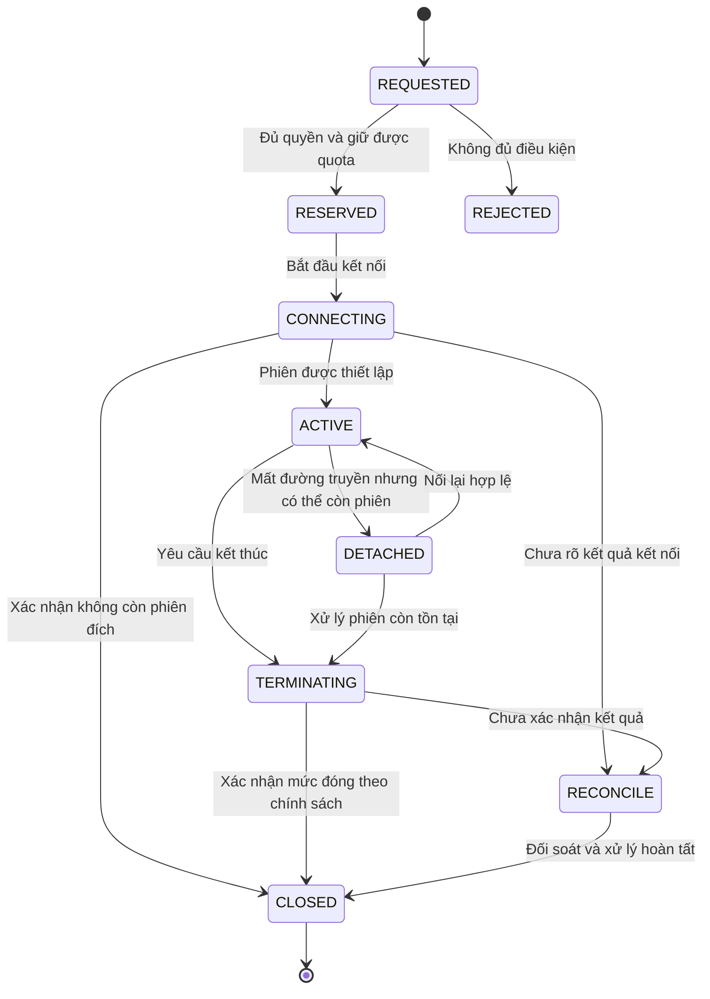

# Concurrent session control

**Concurrent session control** là cơ chế giới hạn và điều phối số phiên truy cập tồn tại đồng thời trong một phạm vi đã xác định. Trong Privileged Access Management (PAM), phạm vi đó có thể là một người dùng, tài khoản đích, tài nguyên, nhóm vận hành hoặc một miền quản lý.

Bài học thuộc chương **Session management**, trong phạm vi bảo vệ tài khoản quản trị, tài khoản dịch vụ và hạ tầng nhạy cảm. Kiểm soát phiên đồng thời cần phối hợp với kiểm kê quyền, least privilege, JIT/JEA, vault, luân chuyển credential, giám sát phiên và lưu bằng chứng phục vụ kiểm toán, ứng phó sự cố.

Mục tiêu không chỉ là tránh quá tải. Một giới hạn đúng có thể giảm việc nhiều người cùng thao tác bằng một tài khoản đặc quyền, giúp phân biệt trách nhiệm và hạn chế phạm vi sử dụng một quyền đã cấp. Tuy nhiên, giới hạn chỉ có ý nghĩa khi hệ thống xác định đúng đối tượng đang đếm và thực thi trên mọi đường truy cập thuộc phạm vi thiết kế.

Sau bài học, bạn có thể:

- Xác định phiên logic, phạm vi quota và những trạng thái còn phải giữ chỗ.
- Phân biệt giới hạn đồng thời với rate limit, checkout credential và khóa nghiệp vụ.
- Mô tả quy trình tiếp nhận phiên có giữ chỗ nguyên tử.
- Xử lý reconnect, mất heartbeat, phiên mồ côi và lỗi phân tán.
- Thiết kế bằng chứng, chỉ số và các tình huống kiểm chứng giới hạn.

## 1. Trước hết phải định nghĩa một phiên

Một tab trình duyệt, kết nối TCP, kênh SSH và phiên đăng nhập ở máy đích không nhất thiết là cùng một đối tượng.

| Đối tượng | Đặc điểm | Hệ quả khi đếm |
|---|---|---|
| Phiên web của PAM | Người dùng đã đăng nhập cổng quản trị | Có thể tồn tại dù chưa mở phiên đặc quyền |
| Phiên truy cập logic | Một lần sử dụng quyền với danh tính, tài nguyên và tài khoản xác định | Thường là đơn vị quản lý chính của PAM |
| Kết nối truyền tải | TCP hoặc kết nối giao thức giữa các thành phần | Có thể thay đổi khi reconnect hoặc mang nhiều kênh |
| Kênh SSH | Shell, thực thi lệnh, forwarding hoặc kênh khác | Nhiều kênh có thể nằm trong cùng kết nối |
| Phiên tại hệ điều hành | Trạng thái đăng nhập ở tài nguyên đích | Có thể còn tồn tại sau khi đường truyền bị ngắt |
| Tác vụ đã phát động | Tiến trình nền, job hoặc thay đổi đang thực hiện | Có thể tiếp tục sau khi phiên truy cập kết thúc |

Một thiết kế cần công bố rõ đơn vị đếm. Ví dụ: “mỗi người dùng được tối đa hai phiên truy cập logic đang giữ quyền, tính cả phiên đang kết nối và phiên đích chưa được xác nhận đóng”.

Đếm số tab không đủ: người dùng có thể mở client khác hoặc tab đóng trong khi phiên backend còn chạy. Đếm số kết nối cũng có thể sai khi một kết nối mở nhiều kênh hoặc một lần reconnect tạo kết nối mới cho cùng phiên logic.

### SSH và RDP cần ngữ nghĩa riêng

Với SSH, cần xác định các kênh nào thuộc một phiên và liệu một kênh forwarding có giữ khả năng truy cập sau khi shell kết thúc hay không. Nếu mục tiêu là giới hạn khả năng truy cập tới tài nguyên, không nên bỏ qua một kênh vẫn hoạt động chỉ vì terminal đã đóng.

Với RDP, mất kết nối có thể để lại phiên Windows ở trạng thái disconnected. Khi người dùng kết nối lại vào phiên đó, hệ thống có thể nối lại một phiên logic hoặc tạo một phiên mới tùy triển khai. Cần liên kết chính xác và kiểm tra quyền, không tự coi mọi kết nối lại là người dùng mới hoặc một slot miễn phí.

## 2. Phân biệt với những kiểm soát gần nhau

| Kiểm soát | Câu hỏi được giải quyết | Giới hạn |
|---|---|---|
| Concurrent session limit | Có bao nhiêu phiên cùng giữ khả năng truy cập? | Không tự hạn chế số hành động trong mỗi phiên |
| Rate limit | Có bao nhiêu yêu cầu được gửi trong một khoảng thời gian? | Ít yêu cầu vẫn có thể tạo nhiều phiên dài hạn |
| Timeout không hoạt động | Phiên im lặng bao lâu thì được xử lý? | Không giới hạn số phiên đang hoạt động |
| Thời lượng phiên tối đa | Một phiên được tồn tại tổng cộng bao lâu? | Nhiều phiên vẫn có thể chồng thời gian |
| Exclusive credential checkout | Ai đang được giữ quyền lấy hoặc sử dụng credential? | Trả credential không chứng minh các phiên ở đích đã đóng |
| Khóa nghiệp vụ | Công việc hoặc tài nguyên nào không được sửa đồng thời? | Một người có thể chạy nhiều tác vụ trong một phiên |
| Giới hạn kỹ thuật của đích | Đích có thể nhận bao nhiêu kết nối theo cấu hình hoặc năng lực? | Không thay thế chính sách quyền và trách nhiệm PAM |

Giới hạn một phiên không tạo ra khóa giao dịch cho ứng dụng. Một phiên có thể chạy nhiều tiến trình hoặc khởi động tác vụ nền. Nếu yêu cầu là không cho hai thay đổi cấu hình xung đột, cần cơ chế phối hợp công việc hoặc khóa tài nguyên phù hợp.

## 3. Chọn phạm vi quota theo mục tiêu

### 3.1 Các phạm vi thường dùng

- **Theo danh tính cá nhân:** giới hạn tổng phiên mà một người đang sử dụng.
- **Theo danh tính và tài nguyên:** tránh một người mở nhiều phiên không cần thiết tới cùng máy.
- **Theo tài khoản đích:** hạn chế nhiều người cùng dùng một tài khoản đặc quyền.
- **Theo tài nguyên:** giới hạn tác động hoặc năng lực trên một máy hay dịch vụ.
- **Theo nhóm hoặc miền quản lý:** phân chia năng lực giữa các nhóm và tránh một nhóm chiếm toàn bộ dịch vụ.
- **Theo hạ tầng xử lý:** giới hạn phiên tại proxy hoặc bộ ghi để bảo đảm khả năng vận hành.

Một phiên có thể đồng thời chiếm quota ở nhiều phạm vi. Quyết định tiếp nhận cần thỏa tất cả giới hạn liên quan, không chỉ giới hạn đầu tiên còn chỗ.

### 3.2 Ví dụ nhiều lớp

Giả sử một chính sách minh họa quy định:

| Phạm vi | Giới hạn |
|---|---:|
| Mỗi người dùng | 2 phiên logic |
| Mỗi người dùng trên một tài nguyên | 1 phiên logic |
| Mỗi tài khoản quản trị dùng chung tại đích | 1 phiên logic |
| Mỗi tài nguyên | 3 phiên logic |

Lan đã có một phiên vào máy A bằng tài khoản bảo trì dùng chung. Minh không thể mở phiên thứ hai bằng cùng tài khoản đó dù quota cá nhân của Minh còn trống. Lan có thể mở phiên vào máy B nếu các giới hạn còn lại đều đáp ứng, nhưng không được vượt tổng hai phiên của mình.

Một tài khoản khác trên máy A chỉ được sử dụng nếu người yêu cầu thực sự có quyền với tài khoản đó. Đổi sang tài khoản khác không nên trở thành cách tự vượt mục đích kiểm soát.

Các con số trên chỉ minh họa. Giới hạn thực tế cần dựa vào công việc, rủi ro, khả năng quan sát và năng lực của hệ thống.

### 3.3 Tài khoản dịch vụ cần cách thiết kế phù hợp

Một service account có thể được nhiều instance ứng dụng sử dụng hợp lệ. Áp dụng máy móc giới hạn một phiên của người quản trị cho mọi kết nối dịch vụ có thể làm hỏng ứng dụng.

Cần phân biệt truy cập quản trị tương tác với kết nối workload, đồng thời kiểm kê các bên dùng chung tài khoản. Nếu cần trách nhiệm rõ ràng hơn, đánh giá tách danh tính hoặc credential theo workload thay vì chỉ tăng quota cho một tài khoản dùng chung.

## 4. Định nghĩa trạng thái còn chiếm quota

Một phiên thường cần giữ chỗ trước khi kết nối tới đích. Nếu chỉ đếm phiên đã hiển thị là active, nhiều request có thể cùng vượt qua kiểm tra trong lúc các kết nối đang được thiết lập.



Sơ đồ là mô hình tham chiếu, không phải trạng thái bắt buộc của mọi sản phẩm.

### Những trạng thái cần xem xét giữ slot

- Đã giữ chỗ và còn quyền thiết lập phiên.
- Đang kết nối hoặc xác thực.
- Đang hoạt động.
- Mất kết nối phía client nhưng backend có thể còn truy cập được.
- Đang kết thúc nhưng chưa xác nhận đạt điều kiện đóng.
- Chưa rõ kết quả và đang đối soát khi phiên có thể vẫn tồn tại.

Phiên đã đóng theo định nghĩa chính sách mới được giải phóng slot tương ứng. Nếu chỉ có một reservation chưa tạo phiên, có thể giải phóng sau khi nó hết hiệu lực và đã bảo đảm không còn request muộn nào được phép tạo phiên từ reservation đó.

Đóng tab hoặc nhận thông báo lỗi từ client không tự chứng minh không còn session tại proxy hoặc máy đích.

## 5. Tiếp nhận phiên và giữ chỗ nguyên tử

### 5.1 Lỗi kiểm tra rồi mới cộng

Giả sử giới hạn một phiên và hiện bộ đếm là không:

```text
Request A đọc số phiên = 0 → thấy còn chỗ
Request B đọc số phiên = 0 → thấy còn chỗ
Request A tạo phiên
Request B tạo phiên
Kết quả: 2 phiên cùng tồn tại, dù giới hạn là 1
```

Đây là khoảng trống giữa kiểm tra và sử dụng. Một bộ đếm được đồng bộ trễ hoặc một kiểm tra chỉ ở giao diện không ngăn được tình huống này.

### 5.2 Luồng tham chiếu

1. Xác thực danh tính và chuẩn hóa tài nguyên, tài khoản cùng phạm vi quota.
2. Đánh giá quyền, điều kiện và thời hạn yêu cầu.
3. Giữ chỗ theo cơ chế nguyên tử hoặc cơ chế tương đương bảo đảm các giới hạn liên quan.
4. Cấp quyền thiết lập phiên ràng buộc với reservation, người dùng, đích và thời hạn.
5. Kết nối qua proxy hoặc thành phần thực thi được chỉ định.
6. Xác nhận phiên được thiết lập và liên kết với reservation.
7. Theo dõi vòng đời, đóng phiên và giải phóng slot có kiểm chứng.

Nếu chính sách hoặc quyền bị thu hồi trong lúc chờ kết nối, cần có bước kiểm tra phù hợp trước khi phiên thực sự sử dụng được. Không coi quyền đã kiểm tra rất lâu trước đó là luôn còn hiệu lực.

### 5.3 Giữ chỗ trên nhiều phạm vi

Với mỗi phạm vi, số slot đang giữ cộng nhu cầu mới không được vượt giới hạn. Khi có nhiều phạm vi, một giải pháp có thể dùng giao dịch, điều phối tập trung hoặc giao thức đặt chỗ được thiết kế rõ.

Nếu phải giữ nhiều chỗ theo từng bước, cần tránh deadlock, xử lý phần đã giữ khi bước sau thất bại và không mở phiên sử dụng được trước khi đáp ứng đầy đủ điều kiện. Đơn giản cộng nhiều bộ đếm độc lập không tự tạo bảo đảm toàn cục.

### 5.4 Yêu cầu lặp và phát lại

Client có thể gửi lại sau timeout. Một định danh yêu cầu và cơ chế idempotency phù hợp giúp tránh tạo nhiều reservation cho cùng một yêu cầu logic.

Quyền mở phiên cần được ràng buộc phạm vi và chống phát lại ngoài thiết kế. Một token cũ không nên được dùng để tạo phiên sau khi slot đã giải phóng và một phiên khác đã được tiếp nhận.

## 6. Lease, heartbeat và phiên mồ côi

### 6.1 Heartbeat là tín hiệu, không phải bằng chứng đóng

Mất heartbeat có thể do client tắt, mạng phân hoạch, proxy lỗi hoặc dịch vụ điều khiển không nhận được sự kiện. Những nguyên nhân đó có ý nghĩa khác nhau đối với khả năng phiên còn hoạt động.

Nếu heartbeat chỉ đến từ trình duyệt, mất heartbeat chưa chứng minh kết nối từ proxy tới máy đích đã dừng. Cần chọn nguồn quan sát theo chính khả năng mà quota đang bảo vệ.

### 6.2 Hết lease không mặc nhiên kết thúc phiên đích

Lease có thể quản lý quyền giữ chỗ hoặc quyền xử lý, nhưng việc hết thời hạn trong cơ sở dữ liệu không tự ngắt kết nối đang tồn tại ở một thành phần khác.

Nếu giải phóng slot ngay khi lease hết hạn nhưng proxy cũ vẫn phục vụ phiên, hệ thống có thể nhận thêm phiên và vượt giới hạn. Muốn dùng lease để bảo đảm giới hạn chặt, cần cơ chế thực thi khi hết hạn, fencing hoặc xác nhận đóng theo kiến trúc thực tế.

Một hệ điều hành đích có thể không hiểu token điều phối của PAM. Khi đó, phải xét cách proxy, agent hoặc điều khiển mạng thực thi việc chấm dứt khả năng truy cập, thay vì giả định token tự có tác dụng ở mọi nơi.

### 6.3 Đối soát phiên mồ côi

Quy trình có thể gồm:

- Đối chiếu phiên logic với kết nối tại proxy và trạng thái tại đích khi được hỗ trợ.
- Xác định danh tính, tài khoản, thời hạn và công việc có thể còn chạy.
- Đóng hoặc xử lý phiên theo chính sách và quyền được cấp.
- Ghi kết quả cùng các giới hạn quan sát.
- Giải phóng slot khi đạt điều kiện đã định nghĩa.

Nếu chưa đủ bằng chứng, giữ trạng thái cần xử lý và giới hạn tiếp nhận mới phù hợp với rủi ro. Không xóa bản ghi session chỉ để làm bộ đếm giảm.

## 7. Reconnect và nhiều kênh truy cập

### 7.1 Nối lại cùng phiên

Có thể nối lại một phiên logic nếu hệ thống xác nhận đúng danh tính, quyền còn hiệu lực và trạng thái phiên tương ứng. Nối lại không nên tự đặt lại thời lượng tối đa hoặc mở rộng cửa sổ phê duyệt.

Nếu cơ chế thực tế tạo session mới tại đích, phải xử lý theo định nghĩa quota đã công bố. Không chỉ giữ nguyên session ID ở giao diện để che một phiên mới.

### 7.2 Hai client cùng nối vào một phiên

Một số công cụ hỗ trợ chia sẻ hoặc tiếp quản phiên. Đây là một khả năng khác cần chính sách: ai được xem, ai được điều khiển và hành động được quy cho ai.

Giới hạn một phiên logic không tự ngăn hai người cùng tác động nếu chia sẻ phiên được bật. Cần quản lý quyền tham gia và ghi bằng chứng về từng người, thay vì chỉ đếm một kết nối đích.

### 7.3 Kênh phụ

Nếu SSH forwarding, truyền tệp hoặc một kết nối phụ vẫn còn hoạt động, việc shell kết thúc có thể chưa đạt mục tiêu chấm dứt truy cập. Policy cần xác định các kênh được phép và thời điểm giải phóng quota.

Với RDP, clipboard, ổ đĩa chuyển hướng và các kênh khác cần chính sách riêng. Quota phiên không tự hạn chế dữ liệu đi qua các kênh đó.

### 7.4 Đường đi bỏ qua PAM

Một người còn mật khẩu hoặc key có thể kết nối trực tiếp nếu đích cho phép. Giới hạn tại proxy chỉ kiểm soát phần lưu lượng đi qua proxy.

Cần kiểm kê tài khoản, kiểm soát đường mạng và xác thực, xử lý credential đã cấp ngoài luồng, cùng cơ chế giám sát tương ứng. Đường khẩn cấp độc lập nếu cần phải được quản lý rõ, không bị nhầm là đã nằm trong bộ đếm thông thường.

## 8. Kiểm soát phân tán và tính sẵn sàng

### 8.1 Không chỉ đếm cục bộ trên mỗi proxy

Nếu hai proxy cùng cho phép một phiên cho một tài khoản, tổng có thể thành hai. Với quota toàn cục, cần một nguồn điều phối hoặc thiết kế phân bổ bảo đảm tổng giới hạn.

Phân chia quota trước cho các vùng có thể là một lựa chọn nếu hệ thống hỗ trợ. Tuy nhiên, phải bảo đảm phần phân bổ không bị cấp trùng và được thu hồi hoặc chuyển giao an toàn. Tự cho mọi node một quota đầy đủ không phải phân chia.

### 8.2 Mất điều phối hoặc quorum

Nếu không thể xác định còn chỗ hoặc bên nào có thẩm quyền cấp chỗ, cần hành vi được thiết kế cho yêu cầu mới. Với giới hạn chặt, việc tiếp nhận mới khi không có căn cứ có thể phá vỡ chính bảo đảm đồng thời.

Phiên đã chạy có thể được xử lý theo thời hạn và điều kiện riêng. Không cần giả định lỗi điều khiển luôn buộc dừng tức thời mọi phiên, nhưng cũng không được tự gia hạn vô hạn hoặc phát thêm slot bằng trạng thái cũ.

### 8.3 Failover không tự di chuyển phiên

Một proxy dự phòng có thể nhận yêu cầu mới nhưng không mặc nhiên tiếp quản được phiên SSH/RDP của node bị lỗi. Hệ thống phải biết phiên cũ bị đóng, còn tồn tại hay chưa rõ trước khi áp dụng quy tắc mở lại.

Khi worker hoặc controller cũ trở lại, các sự kiện muộn cần được kiểm tra theo đúng session và lần thực thi. Không để một sự kiện đóng cũ giải phóng nhầm slot của phiên mới đã dùng lại một định danh không phù hợp.

## 9. Hành vi khi quota đầy

### 9.1 Từ chối có thông tin phù hợp

Có thể trả lý do rằng phạm vi được cấp đã đạt giới hạn, cùng cách xem phiên của chính người dùng hoặc yêu cầu xử lý. Không cần tiết lộ danh tính hay hoạt động của người khác cho mọi người gửi request.

Mã lý do và phạm vi quota cần đủ để người vận hành phân biệt lỗi quyền, hết chỗ và lỗi dịch vụ điều phối.

### 9.2 Hàng đợi

Nếu hỗ trợ chờ, cần giới hạn độ dài, thời gian, số yêu cầu của mỗi chủ thể và quy tắc công bằng hoặc ưu tiên. Một hàng đợi không giới hạn có thể trở thành nguồn quá tải.

Khi lấy yêu cầu ra khỏi hàng đợi, kiểm tra lại quyền, điều kiện và thời hạn. Thời gian chờ không nên tự kéo dài phê duyệt hoặc cho phép một yêu cầu đã bị thu hồi tiếp tục mở phiên.

### 9.3 Thay thế hoặc ngắt phiên cũ

Tự ngắt phiên cũ để mở phiên mới có thể làm gián đoạn thay đổi đang thực hiện. Nếu có cơ chế này, cần xác định người được phép, tiêu chí lựa chọn, cảnh báo, bằng chứng và hành vi tại đích.

Không chỉ giảm bộ đếm rồi coi phiên cũ đã kết thúc. Phải thực thi việc chấm dứt theo mức bảo đảm mà chính sách yêu cầu trước khi tái cấp slot tương ứng.

### 9.4 Ngoại lệ khẩn cấp

Một ngoại lệ có thể cấp thêm dung lượng hoặc dùng quota dự phòng có giới hạn, theo danh tính, lý do và thời hạn được kiểm soát. Cần ghi rõ ngoại lệ có làm thay đổi giới hạn đang áp dụng không.

Không tự bỏ mọi giới hạn, phê duyệt hoặc audit vì một request gắn nhãn khẩn cấp. Khi ngoại lệ kết thúc, xử lý phiên còn tồn tại theo chính sách và không tự coi toàn bộ trạng thái đã quay về bình thường.

## 10. Mô hình cấu hình tham chiếu

Ví dụ dưới đây mô tả ý định, không phải cú pháp triển khai trực tiếp của một sản phẩm PAM:

```yaml
concurrent_session_policy_model:
  policy_reference: production-maintenance-concurrency
  counting_unit: logical_privileged_session
  limits:
    per_requester: 2
    per_requester_and_asset: 1
    per_managed_shared_account: 1
    per_asset: 3
  capacity_holding_states:
    - reserved
    - connecting
    - active
    - detached_with_possible_target_session
    - terminating_not_confirmed
    - reconciliation_required
  admission:
    all_applicable_limits_required: true
    atomic_or_equivalent_reservation_required: true
    duplicate_request_protection_required: true
    validate_authorization_before_session_use: true
  lifecycle:
    reconnect_preserves_original_time_limit: true
    release_requires_defined_closure_evidence: true
    lease_expiry_alone_does_not_prove_target_closed: true
  exhaustion:
    default_action: reject
    privileged_override_requires_controlled_exception: true
```

Các trường này cần được ánh xạ tới chức năng thật của hệ thống. Đặc biệt, danh sách trạng thái cần khớp ngữ nghĩa kết nối và khả năng quan sát của từng giao thức.

Nếu policy mới giảm giới hạn xuống dưới số phiên đang tồn tại, phải chọn cách xử lý: ngừng nhận thêm và chờ giảm, kết thúc có điều kiện hoặc một kế hoạch khác được cho phép. Không âm thầm đổi bộ đếm để làm hiện trạng có vẻ đáp ứng giới hạn mới.

## 11. Phối hợp với vault, JIT, JEA và rotation

### 11.1 Exclusive checkout và exclusive session

Một checkout độc quyền có thể ngăn người khác nhận credential từ vault trong cùng thời gian. Nhưng người đã nhận credential trước đó vẫn có thể giữ bản sao hoặc có phiên đang chạy.

Ngược lại, trả checkout không chứng minh phiên tại đích đã đóng. Nếu mục tiêu là chỉ một người sử dụng tài khoản tại một thời điểm, cần phối hợp quyền lấy credential, đường sử dụng, vòng đời phiên và các truy cập trực tiếp.

### 11.2 Rotation sau phiên

Với tài khoản được quản lý, rotation sau sử dụng có thể làm giảm giá trị của bản sao password cũ. Cần xác định khi nào không còn phiên hoặc consumer nào cần credential và cơ chế đổi có ảnh hưởng gì.

Không để mỗi sự kiện đóng của nhiều phiên cùng kích hoạt nhiều worker thay cùng một mật khẩu. Cần điều phối ở mức tài khoản, giữ trạng thái và xử lý lỗi đồng bộ với đích.

Rotation không tự đóng những phiên đã xác thực. Nếu còn phiên mồ côi, chỉ thay password rồi giải phóng quota có thể chưa đáp ứng mục tiêu độc quyền truy cập.

### 11.3 JIT và JEA

Một người còn slot không có nghĩa còn quyền mở phiên. JIT, phê duyệt và thời hạn phải được kiểm tra độc lập. Reconnect cũng không nên trở thành cách duy trì quyền sau khi cửa sổ truy cập đã hết.

JEA hoặc quyền tối thiểu ở đích giới hạn hành động. Hai phiên có quyền hẹp có thể có rủi ro khác một phiên quản trị toàn hệ thống; quota không thay thế đánh giá quyền thực tế.

## 12. Giám sát, bằng chứng và xử lý sự cố

### 12.1 Sự kiện cần liên kết

Nên có mã yêu cầu, reservation, session, danh tính cá nhân, tài khoản đích, tài nguyên, policy áp dụng và những phạm vi quota liên quan. Ghi các chuyển trạng thái, quyết định tiếp nhận/từ chối, reconnect, ngắt phiên, đối soát và giải phóng chỗ.

Với một quyết định từ chối, bằng chứng cần đủ để xác định giới hạn nào đã chặn. Với một lần giải phóng, cần biết điều kiện đóng nào đã đạt và thành phần nào xác nhận.

Không ghi password, token truy cập hoặc private key vào metadata. Quyền xem danh sách phiên người khác và quyền xem bản ghi nội dung cũng cần được phân biệt.

### 12.2 Chỉ số hữu ích

- Số slot đang giữ theo từng phạm vi và trạng thái.
- Số request bị chặn do quyền, quota hoặc mất điều phối.
- Tuổi reservation, thời gian kết nối và độ trễ giải phóng.
- Số phiên detached, chưa rõ kết quả hoặc cần đối soát.
- Thời gian chờ và mức phân phối dung lượng giữa các nhóm.
- Số ngoại lệ, thời hạn ngoại lệ và phiên còn tồn tại khi ngoại lệ hết hạn.
- Sai lệch giữa kho điều khiển, proxy và quan sát tại đích.

Số đăng nhập mỗi phút không thay thế số phiên đang giữ khả năng truy cập. Một hệ thống có ít request vẫn có thể đầy quota vì nhiều phiên kéo dài hoặc không được dọn.

### 12.3 Khi phát hiện vượt giới hạn

Xác định có thật nhiều phiên tồn tại hay chỉ bản ghi trùng. Kiểm tra phạm vi policy, đường truy cập, reservation và các sự kiện muộn. Hạn chế tiếp nhận mới khi cần, rồi xử lý phiên theo rủi ro và thẩm quyền.

Không xóa bản ghi để giảm số hiển thị trước khi biết trạng thái thật. Nếu phải ngắt phiên nghi ngờ, cần kiểm tra cả kết nối ở đích, quyền mở lại và tác vụ đã phát động.

## 13. Ví dụ và thực hành kiểm chứng

Một nhóm vận hành dùng tài khoản bảo trì chung trên máy production. Policy giới hạn một phiên cho tài khoản đó và hai phiên tổng cho mỗi người.

Lan và Minh đồng thời gửi yêu cầu tới hai proxy khác nhau. Cơ chế tiếp nhận giữ chỗ theo cùng phạm vi tài khoản; chỉ một request được nhận. Request còn lại bị từ chối hoặc chờ theo chính sách, dù cả hai người đều đã được phê duyệt công việc.

Sau đó trình duyệt của người đã được nhận mất kết nối. Phiên backend chưa được xác nhận đóng nên slot vẫn được xử lý theo trạng thái detached hoặc cần đối soát. Nếu người đó nối lại hợp lệ cùng phiên, thời lượng ban đầu vẫn được giữ. Nếu phải mở phiên mới, hệ thống xử lý phiên cũ và quota theo thiết kế trước khi nhận thêm.

### Các tình huống lab

Trong môi trường được phép, dùng tài khoản và dữ liệu thử nghiệm. Đây là gợi ý học tập, không phải kết quả kiểm thử thực tế của một sản phẩm cụ thể.

| Tình huống | Điều cần xác nhận |
|---|---|
| Hai request đồng thời khi còn một slot | Chỉ số phiên được phép được tiếp nhận, kể cả qua proxy khác nhau |
| Client gửi lại cùng request sau timeout | Không tạo nhiều reservation hoặc phiên ngoài ý định |
| Một phiên chạm nhiều phạm vi quota | Tất cả giới hạn đều được thực thi, không chỉ giới hạn cá nhân |
| Đóng tab trong khi backend còn phiên | Slot không bị giải phóng theo giả định sai |
| Kết nối thất bại nhưng chưa rõ đích đã tạo phiên | Có đối soát trước khi trả chỗ như thể không còn tác động |
| Reconnect hợp lệ | Liên kết đúng phiên và không tự kéo dài thời hạn |
| Kênh SSH phụ tiếp tục hoạt động | Vòng đời quota đáp ứng mục tiêu truy cập đã định nghĩa |
| Mất heartbeat hoặc phân hoạch mạng | Không tự cấp trùng slot khi phiên cũ có thể còn chạy |
| Controller cũ gửi sự kiện muộn | Không giải phóng hoặc ghi đè trạng thái của phiên mới |
| Giảm quota khi đang có nhiều phiên | Hành vi xử lý phù hợp policy thay đổi |
| Hàng đợi giữ request quá thời hạn | Không mở phiên bằng quyền đã hết hoặc bị thu hồi |
| Dùng ngoại lệ khẩn cấp | Phạm vi, thời hạn, bằng chứng và cleanup được giữ rõ |

Một cơ chế concurrent session control sẵn sàng vận hành cần có đơn vị đếm, phạm vi, quy tắc tiếp nhận và điều kiện giải phóng có thể giải thích. Khả năng đó phải tiếp tục đúng khi có nhiều client, nhiều proxy, lỗi kết nối và thay đổi quyền, đồng thời phối hợp với giới hạn hành động cùng bằng chứng tại hệ thống đích.
