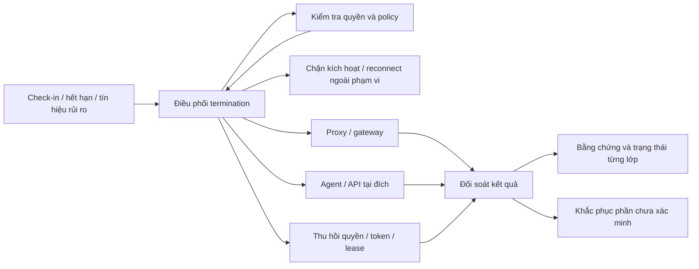

# Session termination trong PAM

## 1. Kết thúc phiên đặc quyền là một quy trình

Trong quản lý truy cập đặc quyền (Privileged Access Management — PAM), session termination là quá trình chấm dứt quyền sử dụng một phiên theo phạm vi và điều kiện đã xác định. Nó có thể bắt đầu khi người dùng hoàn thành công việc, thời hạn hết, chính sách không còn được đáp ứng hoặc xuất hiện sự kiện rủi ro.

Với tài khoản quản trị, tài khoản dịch vụ và hạ tầng nhạy cảm, kết thúc phiên không nên chỉ là đổi trạng thái trên portal. Cần biết kết nối nào đã đóng, phiên nào còn ở hệ thống đích, quyền tạm nào cần gỡ và tác vụ nào vẫn đang chạy.

Một kết quả có thể kiểm chứng là:

> Người dùng không thể tiếp tục sử dụng hoặc tái kết nối ngoài phạm vi đã được cho phép; những phiên, quyền và token thuộc phạm vi thu hồi đã được xử lý ở điểm thực thi; bằng chứng chỉ ra kết quả nào đã xác nhận và phần nào còn chưa xác minh.

Session termination gắn với least privilege, JIT/JEA, vault, quản lý credential và giám sát phiên. Mỗi cơ chế xử lý một phần khác nhau: gỡ quyền JIT không tự đóng mọi phiên, đóng proxy không tự hủy mọi tác vụ và rotation password không tự vô hiệu mọi token đã phát hành.

### Các hành động dễ bị nhầm

| Hành động | Điều có thể đã xảy ra | Điều chưa được chứng minh |
|---|---|---|
| Đóng tab hoặc ứng dụng client | Client không còn hiển thị phiên | Phiên ở proxy/đích đã kết thúc |
| Disconnect | Một đường kết nối đã ngắt | Người dùng đã logoff hoặc tiến trình đã dừng |
| Logoff / đóng phiên đích | Phiên được xử lý theo cơ chế của đích | Mọi tác vụ tách rời, token hoặc quyền tạm đã bị thu hồi |
| Thu hồi grant/lease | Quyền cấp mới hoặc tiếp tục theo cơ chế đó bị giới hạn | Mọi điểm thực thi đã nhận và thực hiện thu hồi |
| Rotation credential | Credential có thể đã thay đổi tại đích | Mọi phiên đã xác thực bằng credential cũ đã đóng |
| Hủy tác vụ hoặc rollback | Một công việc được xử lý ở mức ứng dụng | Tác động trước đó luôn được hoàn tác toàn bộ |

Thiết kế phải nêu rõ nó bảo đảm điều gì ở từng lớp, thay vì dùng một nhãn “ended” cho mọi trường hợp.

## 2. Xác định đúng phạm vi cần kết thúc

Một phiên PAM có thể bao gồm nhiều đối tượng có vòng đời khác nhau:

- Phiên client tới gateway hoặc proxy.
- Kết nối từ proxy tới tài nguyên đích.
- Phiên đăng nhập hoặc phiên giao thức trên tài nguyên.
- Một hoặc nhiều process, query, job hoặc tác vụ khởi phát từ phiên.
- Grant/lease, quyền JIT, token hoặc credential phục vụ kết nối.
- Bản ghi phiên và những dữ liệu bằng chứng chưa chuyển xong.

Một yêu cầu termination nên chỉ ra phạm vi: kết thúc đúng một phiên, mọi phiên của một chủ thể trên một tài nguyên, hay thu hồi rộng hơn do sự cố. Không nên suy ra “đóng một phiên” thành vô hiệu toàn bộ tài khoản dịch vụ nếu tài khoản còn phục vụ nhiều workload.

| Phạm vi | Ví dụ | Rủi ro nếu chọn quá rộng |
|---|---|---|
| Một session ID | Kỹ sư hoàn thành tác vụ đã duyệt | Nếu chỉ lọc theo account name, có thể đóng nhầm phiên của người khác |
| Các phiên của một chủ thể | Thiết bị của một người bị đánh dấu xâm nhập | Cần xử lý đúng mối liên hệ giữa danh tính cá nhân và tài khoản dùng chung |
| Một tài nguyên hoặc nhóm tài nguyên | Cô lập đường quản trị trong sự cố cụ thể | Có thể cắt cả phiên xử lý sự cố hợp lệ nếu không xác định ngoại lệ |
| Một tài khoản/credential | Nghi ngờ credential bị lộ | Có thể ảnh hưởng ứng dụng, batch và các phiên không thuộc yêu cầu ban đầu |

Nếu nhiều người dùng chung một tài khoản đích, cần liên kết người khởi tạo, grant, proxy session và target session. Tên tài khoản ở đích thường chưa đủ để chọn đúng phiên cần kết thúc.

## 3. Những tín hiệu khởi phát termination

### Kết thúc theo vòng đời bình thường

Người dùng check-in hoặc logoff, công việc hoàn tất, cửa sổ thay đổi kết thúc, thời hạn tuyệt đối hết hoặc idle timeout đạt ngưỡng có thể khởi phát quy trình. Cần phân biệt thao tác người dùng đề nghị kết thúc với kết quả kết thúc đã được xác nhận.

Idle timeout phụ thuộc cách định nghĩa hoạt động. Keepalive hoặc lưu lượng nền không nhất thiết là tương tác của người dùng; một lệnh dài không phát sinh phím cũng chưa chắc là phiên bỏ quên. Chính sách phải phù hợp giao thức và loại công việc.

### Kết thúc vì điều kiện không còn đúng

Ticket bị hủy, phê duyệt bị thu hồi, quyền JIT hết hạn hoặc một điều kiện bắt buộc không còn đáp ứng có thể yêu cầu đánh giá lại và kết thúc. Đổi policy không tự bảo đảm các phiên cũ sẽ được áp dụng ngay nếu không có cơ chế truyền và thực thi thay đổi.

### Kết thúc vì rủi ro hoặc sự cố

Tài khoản bị đình chỉ, thiết bị có dấu hiệu xâm nhập, sử dụng sai tài nguyên hoặc một quyết định ứng phó sự cố có thể yêu cầu kết thúc sớm. Cần xác thực nguồn tín hiệu và xác định phạm vi hành động để tránh một cảnh báo sai làm gián đoạn rộng ngoài dự kiến.

| Loại tín hiệu | Kiểm tra trước hành động |
|---|---|
| Người dùng yêu cầu đóng | Người đó có quyền với đúng phiên không? |
| Người giám sát yêu cầu kết thúc | Role có quyền can thiệp hay chỉ có quyền xem bằng chứng? |
| Hết thời hạn | Mốc thời gian có nguồn tin cậy và còn đúng với phiên/grant hiện tại không? |
| Tín hiệu rủi ro | Nguồn, thời điểm, chủ thể và phiên liên quan có được xác minh không? |
| Lỗi kiểm soát bắt buộc | Policy quy định tiếp tục, tạm dừng hay kết thúc trong giai đoạn này? |

Không coi mọi lỗi mạng hoặc recorder là cùng một mức sự cố. Hành vi cần được quyết định trước theo mức nhạy cảm, khả năng thực thi và tác động vận hành.

## 4. Kiến trúc quyết định và thực thi



Control plane có thể quyết định và phát yêu cầu; data plane hoặc hệ thống đích mới có khả năng chặn kết nối và xử lý phiên thật. Một sự kiện “terminate requested” không đồng nghĩa “target session closed”.

Quyền gọi termination cần được giới hạn theo vai trò và tài nguyên. Người có quyền xem video hoặc hỗ trợ người dùng không mặc nhiên được đóng mọi phiên production. Ngược lại, automation có quyền kết thúc phiên cần được bảo vệ tương xứng với tác động của nó.

Phải bảo vệ cả request giữa dịch vụ: nguồn phát hành, chủ thể thực hiện, phạm vi, thời hạn và tính toàn vẹn. Client không được tự cung cấp tùy ý một PID hoặc session ID của hệ thống đích rồi buộc connector kết thúc đối tượng đó.

## 5. Hợp đồng yêu cầu termination

Một yêu cầu nên dùng ID bất biến hoặc liên kết có thể xác minh, kèm nguyên nhân và phạm vi. Ví dụ dữ liệu khái niệm:

```json
{
  "termination_id": "term-862",
  "pam_session_id": "session-862",
  "grant_id": "grant-862",
  "subject_id": "user:linh",
  "resource_id": "server:payments-prod-02",
  "enforcement_point_id": "proxy:prod-a",
  "session_generation": "generation-3",
  "scope": "single_session",
  "reason_code": "ACCESS_WINDOW_EXPIRED",
  "requested_actions": [
    "block_reconnect",
    "close_transport",
    "close_target_session",
    "remove_temporary_entitlement"
  ],
  "policy_version": "pam-termination-v6"
}
```

Đây không phải schema của một sản phẩm và không tự là bằng chứng xác thực. Dịch vụ tiếp nhận cần kiểm tra quyền, nguồn, ánh xạ phiên và việc những hành động yêu cầu có phù hợp policy không.

`termination_id` giúp liên kết và xử lý lặp. `session_generation` minh họa một cách phân biệt lần khởi tạo/tái kết nối khi nền tảng hỗ trợ; nó không tự bảo đảm an toàn nếu điểm thực thi không xác minh giá trị đó.

Định danh session hoặc process tại đích có thể được tái sử dụng theo hệ điều hành/giao thức. Trước khi hành động, connector cần xác minh đối tượng hiện tại vẫn thuộc đúng phiên được quản lý, tránh dùng một ID cũ để đóng nhầm phiên mới.

Thông tin trả về nên diễn đạt theo từng lớp: đã chấp nhận yêu cầu, đã đóng đường truyền, đã xác nhận phiên đích, quyền tạm đã gỡ, bằng chứng đã lưu và phần nào còn chờ. Không chỉ trả một boolean thành công cho cả chuỗi.

## 6. Phân biệt termination theo giao thức

| Loại phiên | Phân biệt cần giữ | Kiểm chứng tại đích phù hợp |
|---|---|---|
| SSH | Đóng kênh/transport không chắc dừng process đã tách rời hoặc tác vụ đã được lên lịch | Trạng thái kết nối, phiên và tác vụ trong phạm vi qua cơ chế được phép |
| RDP | Disconnect khác logoff; phiên ngắt kết nối có thể còn tiến trình | Trạng thái phiên đăng nhập và kết quả logoff theo API/quyền hỗ trợ |
| Database | Hủy query, đóng connection và xử lý transaction là những việc khác nhau | Trạng thái connection/query/transaction và kết quả theo cơ chế database |
| Web console | Đóng trang hoặc xóa cookie client không chắc vô hiệu session phía máy chủ | Cơ chế logout/invalidation và kiểm tra phiên/token theo ứng dụng |
| API/CLI có token | Ngắt client không tự thu hồi token còn hiệu lực | Thời hạn, cơ chế thu hồi/introspection hoặc kiểm soát quyền tại nơi dùng token |
| Phiên exec hoặc tác vụ tự động hóa | Kết nối tương tác kết thúc không chắc job/workload nền đã dừng | Quan hệ giữa phiên, job và cơ chế hủy ở nền tảng |

Không nên hứa “kill session sẽ rollback mọi thay đổi”. Một transaction có thể đã commit; một job có thể đã gửi tác vụ sang hệ thống khác. Ngay cả khi database thực hiện rollback cho một trường hợp cụ thể, thời gian hoàn tất và tác động tài nguyên còn phụ thuộc nền tảng và trạng thái công việc.

Nếu cần dừng tác vụ nền, phải có phạm vi và thẩm quyền riêng tương ứng. Không tự kết thúc mọi process dưới cùng một tài khoản dùng chung chỉ vì một người dùng đã logoff.

Với token tự chứa hoặc hệ thống không có khả năng thu hồi tức thời, phải mô tả giới hạn thật: chặn cấp mới, giảm quyền ở nơi thực thi khi có hỗ trợ, thời hạn còn lại và biện pháp cô lập phù hợp. Không coi việc xóa token khỏi client là đã vô hiệu mọi bản sao.

## 7. Luồng termination bình thường

Một luồng có thể được thiết kế như sau:

1. Nhận sự kiện, định danh phiên và xác thực người/hệ thống khởi phát.
2. Kiểm tra policy, lý do, phạm vi và những điều kiện cần cho loại hành động.
3. Ghi termination ID, trạng thái phiên hiện tại, grant và những đối tượng cần xử lý.
4. Ngăn kích hoạt/reconnect mới ngoài phạm vi được phép để không đóng xong rồi mở lại bằng cùng quyền.
5. Thông báo hoặc cho khoảng kết thúc có kiểm soát nếu policy và tình huống cho phép; sự cố khẩn cấp có thể cần hành vi khác.
6. Gửi hành động tới proxy/agent/đích để đóng đúng đường truy cập và phiên tương ứng.
7. Gỡ quyền JIT, thu hồi lease/token hoặc xử lý credential theo policy và khả năng hệ thống.
8. Đối soát kết quả ở những lớp liên quan, chốt bằng chứng và giữ rõ phần chưa xác minh.

Thứ tự cụ thể phụ thuộc tác vụ. Ví dụ, một số kịch bản cần chặn thao tác tiếp diễn ngay ở điểm thực thi trước khi làm các bước hoàn tất còn lại. Không nên trì hoãn biện pháp chặn đã được quyết định chỉ để chờ một quy trình ghi nhận không cần thiết; cách lưu bằng chứng và xử lý lỗi phải được thiết kế sẵn.

Với termination bình thường, có thể cho người dùng thời gian lưu công việc nếu được cho phép. Nhưng khoảng chờ không được tự kéo dài quyền ra ngoài cửa sổ đã duyệt hoặc áp dụng như một ngoại lệ chung khi đang có rủi ro cao.

## 8. Trạng thái kết quả và xử lý lặp

Termination là một workflow phân tán. Dịch vụ điều phối có thể đã gửi lệnh nhưng proxy chưa nhận, hoặc đích đã xử lý nhưng phản hồi bị mất. Vì vậy, trạng thái phải biểu diễn điều đã biết, không chỉ điều hệ thống muốn xảy ra.

| Mốc logic | Ý nghĩa |
|---|---|
| Đã yêu cầu | Có sự kiện termination hợp lệ và được ghi nhận |
| Đã chấp nhận | Điểm thực thi nhận và chấp nhận hành động theo hợp đồng |
| Đã chặn truy cập qua đường quản lý | Điểm kiểm soát xác nhận không cho tiếp tục/reconnect trong phạm vi |
| Phiên đích đã đóng | Có bằng chứng phù hợp từ cơ chế tại đích |
| Quyền/token đã xử lý | Những đối tượng trong phạm vi được thu hồi hoặc xác minh hết hiệu lực |
| Bằng chứng đã hoàn tất | Dữ liệu cần giữ đã được chốt/lưu theo tiêu chí |
| Chưa xác minh một phần | Có đối tượng chưa đủ kết quả, cần theo dõi và khắc phục |

Các mốc có thể tiến triển độc lập. Ví dụ, phiên đích đã đóng nhưng bản ghi còn đang chuyển; hoặc proxy đã chặn truy cập nhưng agent chưa xác nhận gỡ quyền. Một cờ duy nhất dễ che khuất khác biệt này.

### Tính lặp an toàn

Hệ thống thường cần gửi lại vì timeout hoặc message bị giao lặp. Điểm thực thi phải nhận diện termination ID và đối tượng đúng, trả kết quả phù hợp thay vì áp dụng hành động tùy ý lần nữa.

Nếu phiên cũ đã kết thúc và ID nội bộ được tái sử dụng cho phiên mới, retry không được đóng phiên mới đó. Cần đối chiếu ánh xạ, generation, chủ thể, thời điểm hoặc những thuộc tính đáng tin cậy mà nền tảng hỗ trợ.

“Không tìm thấy phiên” có thể là bằng chứng phiên không còn ở một điểm quan sát, nhưng phải diễn giải đúng phạm vi. Nó không luôn chứng minh quyền JIT đã gỡ, một job tách rời đã dừng hoặc đối tượng nằm trên node khác không còn tồn tại.

Không thử lại vô hạn. Cần giới hạn, thời gian chờ, cảnh báo và quy trình đối soát cho những tác vụ chưa xác minh; vẫn bảo vệ trạng thái chặn quyền mới nếu policy yêu cầu.

## 9. Race condition: mở phiên, reconnect và thu hồi cùng lúc

Một tình huống nguy hiểm là broker vừa quyết định kết thúc thì một yêu cầu reconnect hoặc tác vụ mở phiên cũ hoàn tất. Nếu hệ thống chỉ đóng một kết nối đang thấy mà không xử lý grant và trạng thái liên quan, quyền có thể xuất hiện lại.

Những điểm cần phối hợp:

- Trạng thái grant/lease có cho phép kích hoạt hoặc tiếp tục không.
- Tác vụ thiết lập nào còn đang chờ lấy credential hoặc tạo quyền JIT.
- Proxy/agent đang giữ phiên ở generation nào.
- Yêu cầu gia hạn hoặc reconnect có dựa vào dữ kiện cũ không.
- Thông điệp kết thúc đến chậm có trỏ đúng phiên hiện tại không.

Một thiết kế có thể đánh dấu phạm vi bị thu hồi, ngăn kích hoạt mới, rồi yêu cầu các điểm thực thi xử lý phiên hiện hữu. Tác vụ mở phiên phải kiểm tra hiệu lực sát thời điểm thực thi và đối soát nếu bị thu hồi trong lúc chuẩn bị.

Chỉ thêm một khóa trong bộ điều phối chưa tự ngăn runner cũ tiếp tục thao tác ở tài nguyên. Nếu nền tảng hỗ trợ kiểm tra thế hệ hoặc fencing, có thể dùng để chặn hành động cũ; nếu không, phải mô tả giới hạn và thiết kế kiểm tra/dọn dẹp tương ứng.

Gia hạn cũng cần kiểm tra trạng thái thu hồi. Một phê duyệt gia hạn cũ không được làm sống lại phiên đã bị chấm dứt do rủi ro. Quy trình cấp quyền mới, nếu được cho phép, phải có quyết định và danh tính liên quan rõ ràng.

### Đồng hồ và thời hạn

Thời hạn phải dựa trên dữ liệu thời gian được hệ thống tin cậy; timestamp do client tự khai không đủ để kéo dài quyền. Cần theo dõi sai lệch thời gian giữa broker, proxy và đích, và phân biệt mốc hết hạn với khoảng timeout nội bộ.

Quy tắc xử lý khi không thể tiếp tục xác nhận lease phải được định trước. Nếu điểm thực thi cho phép hoạt động offline trong một khoảng, đó là một giới hạn độ trễ thu hồi cần được ghi nhận, không phải khả năng thu hồi tức thời.

## 10. Termination do sự cố và giới hạn tác động

Khi có rủi ro cao, cần chọn biện pháp đủ ngăn hành động trái phép nhưng vẫn đúng thẩm quyền và phạm vi. Có thể cần chặn đầu vào, đóng phiên, ngăn cấp quyền mới hoặc cô lập thêm đường truy cập; mỗi biện pháp có bảo đảm khác nhau.

Ví dụ, khóa nhập liệu ở client không bảo đảm một lệnh đã gửi hoặc tác vụ nền đã dừng. Ngừng hiển thị video cho người dùng cũng không tương đương thu hồi quyền tại hệ thống đích.

Một quy trình ứng phó nên xác định:

1. Nguồn tín hiệu và những danh tính/phiên/tài nguyên liên quan.
2. Phạm vi can thiệp được người hoặc automation có thẩm quyền quyết định.
3. Điểm thực thi có thể chặn ngay và những bước cần thêm tại đích.
4. Bằng chứng cần giữ, cách ghi nhận hành động và những hạn chế quan sát.
5. Ảnh hưởng đối với các phiên khác, workload và tác vụ nghiệp vụ.
6. Điều kiện khôi phục truy cập nếu cần, theo một quyết định quyền mới phù hợp.

Nếu tài khoản dùng chung bị nghi lộ, chỉ đóng một phiên quan sát được có thể chưa đủ. Cần đánh giá credential, phiên trực tiếp ngoài PAM và những quyền/khóa khác đã tạo. Ngược lại, vô hiệu toàn bộ tài khoản ngay trong mọi yêu cầu đóng phiên có thể làm gián đoạn dịch vụ không liên quan.

Cần bảo toàn bằng chứng theo khả năng và quy trình đã thiết kế, đồng thời không biến việc chờ hoàn tất mọi log thành lý do trì hoãn vô hạn biện pháp ngăn chặn đã được xác định là cần thiết.

### Tác vụ chưa hoàn tất không tự được rollback

Trước hoặc sau termination có thể cần kiểm tra tình trạng thay đổi cấu hình, transaction hoặc job đang chạy. Nếu phải hủy hay khôi phục, cần một tác vụ riêng ở ứng dụng/đích, có người chịu trách nhiệm và kết quả xác minh. Không ghi “đã rollback” chỉ vì kết nối quản trị đã bị ngắt.

## 11. Điểm thực thi lỗi hoặc không kết nối được

Thiết kế phải xử lý tình huống control plane biết cần kết thúc nhưng không thể liên lạc với proxy hoặc đích. Chỉ thay trạng thái cơ sở dữ liệu của broker không làm quyền biến mất.

| Tình huống | Điều có thể làm và cách báo cáo |
|---|---|
| Control plane không tới được proxy | Chặn quyền mới ở nơi còn kiểm soát; ghi proxy chưa xác nhận, áp dụng lease cục bộ nếu được thiết kế |
| Proxy đóng đường client nhưng đích không phản hồi | Xác nhận đúng phần transport đã đóng, giữ trạng thái phiên/quyền đích chưa xác minh |
| Agent offline | Không giả định lệnh xếp hàng đã thực thi; dùng đối soát và biện pháp thay thế trong thẩm quyền |
| Proxy khởi động lại | Khôi phục/đối soát mapping; kiểm tra phiên đích và quyền còn tồn tại |
| Token không có cơ chế thu hồi trực tuyến | Nêu thời hạn và hạn chế, chặn cấp mới hoặc áp dụng kiểm soát tài nguyên theo khả năng |
| Không chuyển được bản ghi về kho | Bảo vệ và theo dõi đệm bền vững nếu có; phân biệt đóng phiên với hoàn tất lưu bằng chứng |
| Không gỡ được quyền JIT tại đích | Giữ hạng mục quyền chưa hoàn tất, cảnh báo và xử lý theo runbook |

Phải có giới hạn thời gian để hạng mục chưa xác minh được chuyển thành việc cần xử lý, nhưng không nên đổi nó thành thành công chỉ vì hết thời gian chờ.

Khi điểm thực thi nhận lại kết nối, cần kiểm tra trạng thái mới nhất trước khi thực hiện message cũ. Một lệnh hết phạm vi hoặc trỏ generation trước không được áp dụng bừa cho phiên hiện tại.

### Tính sẵn sàng của đường can thiệp

Cần xem xét danh tính và đường điều khiển dùng để kết thúc phiên. Nếu quyền can thiệp phụ thuộc hoàn toàn vào cùng thành phần đang lỗi, có thể cần một đường xử lý khẩn cấp được bảo vệ và phê duyệt trước.

Không nên mở một API kết thúc phiên không xác thực hoặc chia sẻ credential quản trị toàn quyền để “dễ xử lý sự cố”. Đường khẩn cấp cũng cần phạm vi, người được ủy quyền, bằng chứng và đối soát sau sử dụng.

## 12. Credential, quyền tạm và bằng chứng hoàn tất

Termination cần phối hợp vòng đời đặc quyền nhưng không gộp mọi thao tác thành một nút. Từng tài khoản có thể có policy khác về rotation sau sử dụng, thu hồi JIT hoặc bảo toàn credential phục vụ consumer khác.

| Đối tượng | Câu hỏi cần trả lời |
|---|---|
| Grant/lease | Có ngăn kích hoạt lại và đã thông báo điểm thực thi cần thiết chưa? |
| Quyền JIT | Đã yêu cầu gỡ hay đã xác nhận gỡ tại đích? Phiên/token cũ còn quyền không? |
| Credential | Có yêu cầu rotation/vô hiệu không, consumer nào chịu ảnh hưởng? |
| Token | Cơ chế thu hồi thực tế là gì, có khoảng hiệu lực còn lại nào không? |
| Phiên/tác vụ đích | Đã dừng đúng đối tượng nào, phần nào vẫn tiếp tục hợp lệ hoặc chưa xác minh? |
| Bằng chứng | Bản ghi đã chốt và lưu ở mức nào, còn phần đệm hoặc khoảng trống không? |

Ví dụ, đổi password một tài khoản dịch vụ sau termination có thể khiến replica khác không tạo được kết nối mới. Phải kiểm kê dependency và cập nhật theo kế hoạch, không tự áp dụng rotation sau mọi phiên.

Ngược lại, nếu credential đã bị lộ, chỉ chặn session ID trong broker có thể không ngăn dùng secret ở đường khác. Cần xử lý tại đích và những đường sử dụng liên quan theo phạm vi sự cố.

### Hồ sơ termination

Bằng chứng nên liên kết chủ thể khởi tạo phiên, tài khoản đích, người/hệ thống yêu cầu termination, reason code, policy, termination ID, session/grant ID, điểm thực thi và kết quả từng hành động.

Những mốc thời gian hữu ích gồm lúc nhận yêu cầu, lúc chặn truy cập, lúc đích xác nhận đóng phiên, lúc quyền được gỡ và lúc bằng chứng được lưu. Cần phân biệt thời điểm phát sinh sự kiện với thời điểm kho trung tâm nhận được nó.

Không ghi secret, token đầy đủ hoặc credential can thiệp vào log. Bản ghi phiên cũng có thể chứa dữ liệu nhạy cảm; quyền xem và quyền xóa/thay chính sách lưu cần được kiểm soát.

### Chỉ số phản ánh kết quả thật

Có thể theo dõi thời gian từ quyết định đến chặn truy cập, đến xác nhận phiên đích và đến hoàn tất quyền trong phạm vi. Cũng cần số tác vụ chưa xác minh, số phiên mồ côi, lỗi mapping và reconnect bị từ chối sau thu hồi.

Không dùng “số message terminate đã gửi” làm đại diện duy nhất cho số phiên đã kết thúc. Không tính một tác vụ timeout là hoàn tất để làm chỉ số đẹp hơn; trạng thái chưa biết phải được giữ trong báo cáo.

## 13. Tình huống minh họa

Hai kỹ sư có phiên RDP riêng tới một máy chủ production thông qua PAM. Hệ thống đích dùng một tài khoản được quản lý chung, nhưng PAM đã liên kết mỗi người với session ID và target session tương ứng. Một dịch vụ nền dùng danh tính khác và không thuộc phạm vi phiên tương tác.

### Tín hiệu rủi ro

Thiết bị của kỹ sư Linh bị đánh dấu rủi ro cao. Policy yêu cầu chặn phiên của Linh và ngăn reconnect theo phạm vi liên quan. Người có quyền giám sát chỉ được xem bằng chứng; automation can thiệp có quyền kết thúc đúng nhóm phiên được giao.

Cách xử lý phù hợp:

1. Xác minh nguồn tín hiệu và ánh xạ đến phiên của Linh, không chỉ tìm theo tên tài khoản chung.
2. Đánh dấu quyền tiếp tục/reconnect trong phạm vi bị thu hồi và chặn yêu cầu mới tương ứng.
3. Yêu cầu proxy đóng đường truy cập của đúng phiên, đồng thời yêu cầu xử lý phiên đích theo policy.
4. Gỡ những quyền JIT thuộc phiên đó và kiểm tra token/phiên liên quan theo cơ chế hỗ trợ.
5. Giữ phiên của kỹ sư còn lại và dịch vụ nền ngoài phạm vi, trừ khi đánh giá sự cố xác định cần hành động rộng hơn.
6. Lưu kết quả từng lớp và đối soát những tác vụ hoặc quyền còn tồn tại.

### Lỗi giữa quy trình

Proxy xác nhận đã ngắt đường client, nhưng API quản trị đích timeout trước khi xác nhận logoff. Portal không được báo rằng mọi tiến trình của Linh đã dừng. Hệ thống ghi transport đã đóng, trạng thái phiên đích chưa xác minh và chuyển hạng mục tới runbook khắc phục.

Đội xử lý dùng đường được ủy quyền để kiểm tra đúng target session, xác minh nó vẫn thuộc phiên của Linh trước khi hành động tiếp. Nếu có tác vụ Linh đã gửi sang ứng dụng khác, cần đánh giá phạm vi hủy riêng; không suy ra tác vụ đó bị dừng theo RDP.

Nếu rủi ro còn tồn tại trong khi đích chưa thể kiểm chứng, người có thẩm quyền đánh giá biện pháp ngăn chặn bổ sung đã được thiết kế. Việc chưa xác minh không được coi là hết rủi ro, cũng không tự cho automation quyền vô hiệu toàn bộ tài khoản ngoài policy.

### Báo cáo kết quả

Một báo cáo chính xác nêu đường client đã bị chặn lúc nào, logoff tại đích được xác nhận lúc nào, quyền JIT đã gỡ hay chưa và những tác vụ ngoài phạm vi còn gì. Tham chiếu bằng chứng không chứa credential của tài khoản dùng chung.

## 14. Kiểm tra thiết kế và câu hỏi tự đánh giá

Các tình huống sau dùng để thiết kế kiểm chứng trong môi trường được phép. Chúng cần thể hiện giới hạn thật của từng giao thức và cơ chế, thay vì chỉ kiểm tra một nút trên giao diện.

| Tình huống | Kết quả mong đợi |
|---|---|
| Người dùng kết thúc phiên của mình | Chọn đúng phiên, thực thi đúng phạm vi và ghi kết quả từng lớp |
| Người chỉ có quyền xem yêu cầu đóng phiên người khác | Bị từ chối nếu không có quyền can thiệp phù hợp |
| Hết hạn khi client vẫn hoạt động | Không tự kéo dài quyền; termination áp dụng theo policy |
| Client disconnect nhưng phiên đích còn sống | Phân biệt được trạng thái, xử lý reconnect và logoff đúng thiết kế |
| Reconnect đến đồng thời với thu hồi | Không làm sống lại quyền đã bị thu hồi trái policy |
| Retry message sau khi phiên cũ đã kết thúc | Không đóng nhầm phiên mới hoặc đối tượng có ID tái sử dụng |
| Proxy xác nhận đóng, agent không phản hồi | Báo phần đã xác nhận và phần chưa xác minh |
| Gỡ nhóm JIT nhưng token cũ còn quyền | Nhận diện giới hạn và thực hiện biện pháp theo cơ chế hỗ trợ |
| Hai người dùng cùng account đích | Không gộp nhầm session hoặc đóng mọi phiên chỉ theo account name |
| Tác vụ nền được tạo từ phiên | Có phạm vi xử lý riêng, không giả định disconnect là hủy tác vụ |
| Bản ghi chưa chuyển xong | Không nhầm việc đóng phiên với hoàn tất lưu bằng chứng |
| Đường can thiệp chính lỗi | Có runbook và quyền khẩn cấp được bảo vệ phù hợp |

Những lỗi cần tránh là coi message đã gửi là thành công, gộp disconnect với logoff, retry không kiểm tra đối tượng, dùng rotation thay cho thu hồi phiên hoặc tự mở rộng phạm vi sang mọi consumer của tài khoản. Mỗi lỗi đều có thể làm báo cáo sai hoặc gây gián đoạn ngoài mục đích.

Hãy trả lời những câu hỏi sau trước khi nghiệm thu:

1. Với từng giao thức, hệ thống thực sự kết thúc transport, session, process hay quyền nào?
2. Ai có quyền yêu cầu termination và phạm vi tối đa của từng danh tính can thiệp?
3. Điều gì ngăn reconnect hoặc tác vụ mở phiên đang chờ hoàn tất sau khi thu hồi?
4. Làm sao phát hiện session ID/PID cũ đã được tái sử dụng cho đối tượng khác?
5. Khi điểm thực thi không phản hồi, trạng thái nào được giữ và ai khắc phục?
6. Password, token, quyền JIT và những phiên đã xác thực có vòng đời khác nhau thế nào?
7. Tác vụ nghiệp vụ nào có thể tiếp tục hoặc đã có tác động sau khi đường truy cập đóng?
8. Bằng chứng nào chứng minh đã chặn truy cập, đã đóng phiên đích và đã xử lý quyền trong phạm vi?

Session termination có giá trị khi quyết định chấm dứt quyền được nối tới những hành động thực thi cụ thể và kết quả có thể đối soát. Báo cáo đúng phần đã xác nhận, giữ rõ phần chưa xác minh và xử lý quyền tồn dư giúp PAM hỗ trợ cả vận hành thường ngày lẫn ứng phó sự cố.
