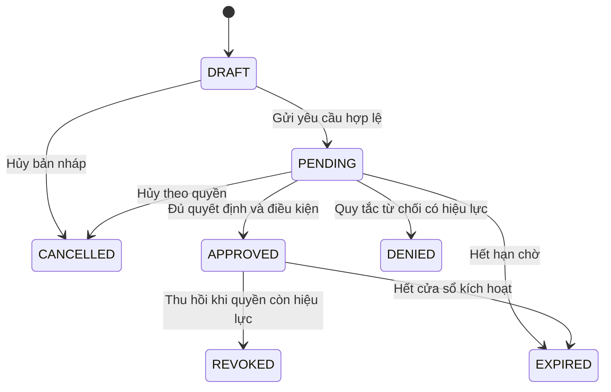

# Session approval state

## 1. Trạng thái phê duyệt phiên có nghĩa là gì?

Session approval state mô tả tình trạng của một yêu cầu xin sử dụng phiên đặc quyền trong hệ thống quản lý truy cập đặc quyền (Privileged Access Management, PAM). Trạng thái cho biết yêu cầu đang chờ quyết định, đã đáp ứng điều kiện phê duyệt, bị từ chối, bị hủy, hết hiệu lực hay bị thu hồi theo mô hình đã định nghĩa.

Một nhãn “Approved” chưa đủ để cho phép mở phiên ngay trong mọi hoàn cảnh. Người hưởng quyền có thể đã bị vô hiệu hóa, cửa sổ kích hoạt đã hết, grant đã được dùng hoặc yêu cầu recording chưa đáp ứng. Các điều kiện hiện hành vẫn phải được kiểm tra tại điểm thực thi.

Ví dụ, kỹ sư được duyệt một phiên chẩn đoán cơ sở dữ liệu production trong 20 phút. Quyết định đó không cho phép đổi sang một tài khoản có quyền ghi, mở nhiều phiên ngoài số lần cho phép hoặc tiếp tục thao tác sau thời hạn quyền thực tế. Trạng thái phải gắn với một nội dung yêu cầu cụ thể và các giới hạn có thể thực thi.

Bài học thuộc chương Session management, tập trung vào tài khoản quản trị, danh tính dịch vụ và hạ tầng nhạy cảm. Mục tiêu là quản lý trạng thái phê duyệt để hỗ trợ least privilege, JIT/JEA, sử dụng credential qua vault, giám sát phiên và bằng chứng phục vụ kiểm toán, ứng phó sự cố.

Các tên trạng thái, sơ đồ và payload trong bài là mô hình tham khảo, không phải API hoặc quy tắc mặc định của một sản phẩm PAM cụ thể.

## 2. Tách ba vòng đời liên quan

Không nên dùng một cột trạng thái duy nhất để biểu diễn cả phê duyệt lẫn hoạt động của phiên.

| Vòng đời | Câu hỏi chính | Trạng thái minh họa |
|---|---|---|
| Yêu cầu phê duyệt | Nội dung này đã được quyết định thế nào? | `PENDING`, `APPROVED`, `DENIED`, `CANCELLED`, `EXPIRED`, `REVOKED` |
| Grant hoặc quyền kích hoạt | Còn được bắt đầu phiên theo phạm vi nào? | `AVAILABLE`, `RESERVED`, `CONSUMED`, `EXPIRED`, `REVOKED` |
| Phiên thực tế | Đường truy cập đã mở và đã dừng thật chưa? | `STARTING`, `ACTIVE`, `START_FAILED`, `STOP_REQUESTED`, `CLOSED`, `UNKNOWN` |

Một yêu cầu có thể đã được duyệt nhưng chưa có phiên. Một grant có thể đã được giữ chỗ trong lúc broker kết nối tới đích. Một phiên có thể đang chờ xác nhận kết thúc dù quyết định thu hồi đã được lưu.

Lịch sử quyết định cũng khác trạng thái hiện hành. “Đã được hai người phê duyệt lúc 09:03” vẫn là sự kiện đúng sau khi quyền bị thu hồi lúc 09:09. Không xóa hoặc sửa các phiếu cũ để làm như chưa có phê duyệt; thêm sự kiện thu hồi và cập nhật phần trạng thái chịu ảnh hưởng.

Trong bài, `EXPIRED` của yêu cầu đã được duyệt có thể biểu thị hết cửa sổ bắt đầu phiên mới. Hạn kết thúc một phiên đã mở được quản lý riêng trong lease hoặc quyền thực thi. Vì vậy, cần định nghĩa ngữ nghĩa từng loại hết hạn, tránh dùng một nhãn chung gây hiểu nhầm.

## 3. Mô hình trạng thái của yêu cầu

### 3.1. Các trạng thái cơ bản

| Trạng thái | Ý nghĩa trong mô hình tham khảo | Có thể tự dùng để mở phiên không? |
|---|---|---|
| `DRAFT` | Nội dung chưa được gửi vào luồng quyết định | Không |
| `PENDING` | Đang chờ đủ quyết định và điều kiện chính sách | Không |
| `APPROVED` | Đủ điều kiện phê duyệt cho đúng phiên bản nội dung | Vẫn phải kiểm tra grant, thời gian và ngữ cảnh |
| `DENIED` | Quy tắc từ chối đã có hiệu lực | Không |
| `CANCELLED` | Yêu cầu bị hủy theo quyền được phép | Không |
| `EXPIRED` | Hết hạn chờ hoặc hết hiệu lực kích hoạt theo loại hạn đã định nghĩa | Không mở mới dựa trên yêu cầu đã hết hiệu lực |
| `REVOKED` | Quyền phê duyệt còn hiệu lực đã bị thu hồi theo quy trình | Không; phiên liên quan cần xử lý riêng |



Sơ đồ mô tả vòng đời một phiên bản yêu cầu. Nó không đưa `ACTIVE` vào cùng luồng vì `ACTIVE` thuộc phiên thực tế. Sản phẩm có thể dùng tên khác, nhưng phải giữ rõ các ý nghĩa và điều kiện chuyển.

### 3.2. Chuyển trạng thái phải có quyền và điều kiện

| Chuyển trạng thái | Bên có thể thực hiện theo policy | Điều kiện quan trọng |
|---|---|---|
| `DRAFT -> PENDING` | Người yêu cầu hoặc tác nhân được giao | Nội dung hợp lệ, có quyền gửi, phạm vi được chuẩn hóa |
| `PENDING -> APPROVED` | Dịch vụ tổng hợp quyết định | Đủ phiếu hợp lệ, đúng quy tắc, chưa hết hạn |
| `PENDING -> DENIED` | Dịch vụ theo quyết định từ chối hợp lệ | Đúng thẩm quyền và ngữ nghĩa từ chối của policy |
| `PENDING -> CANCELLED` | Người yêu cầu hoặc vai trò được phép | Chưa chốt trạng thái khác, có điều kiện chống xung đột |
| `PENDING -> EXPIRED` | Cơ chế thời gian của hệ thống | Hết hạn phía máy chủ, không dựa vào giờ client |
| `APPROVED -> REVOKED` | Chủ thể có quyền thu hồi | Đúng yêu cầu, lý do và phạm vi tác động |
| `APPROVED -> EXPIRED` | Cơ chế thời gian hoặc kiểm tra hiệu lực | Hết cửa sổ bắt đầu mới đã định nghĩa |

Các trạng thái kết thúc của một phiên bản không tự quay về `PENDING` hoặc `APPROVED` khi có thông báo cũ đến. Nếu cần xin lại, tạo yêu cầu hoặc phiên bản mới và đánh giá quyền hiện hành.

Nếu cửa sổ kích hoạt đã hết nhưng còn phiên đang chạy hợp lệ, một lệnh thu hồi vẫn cần tác động tới grant hoặc lease của phiên đó. Không cần làm sống lại trạng thái yêu cầu đã hết hạn để thực thi thu hồi, và không được bỏ qua phiên chỉ vì đơn gốc không còn mở mới được.

## 4. Nội dung được phê duyệt phải được ràng buộc

Trạng thái phê duyệt chỉ có ý nghĩa khi biết chính xác nội dung đã được duyệt.

| Nhóm thuộc tính | Nội dung cần ràng buộc |
|---|---|
| Danh tính | Người khởi tạo, người hưởng quyền, loại chủ thể và tenant |
| Đích | ID tài nguyên, môi trường, tài khoản hoặc mẫu vai trò đích |
| Tác vụ | Giao thức, giới hạn quyền, lệnh hoặc nhóm thao tác được phép |
| Thời gian | Hạn chờ, cửa sổ kích hoạt, thời lượng và hạn kết thúc tuyệt đối nếu có |
| Số lần dùng | Số lần kích hoạt và phạm vi phiên được tạo |
| Bằng chứng | Yêu cầu recording, policy reference và các điều kiện bắt buộc |
| Nghiệp vụ | Lý do, incident hoặc change reference đã được kiểm tra theo policy |

Sau khi gửi duyệt, phần xác định quyền nên bất biến theo phiên bản. Đổi tài nguyên, người hưởng quyền, vai trò, khoảng thời gian hoặc phạm vi tác vụ cần đánh giá lại bằng một phiên bản hoặc yêu cầu mới. Phiếu của nội dung cũ không tự chuyển sang nội dung rộng hơn.

ID tài nguyên, quan hệ chủ sở hữu và thuộc tính bảo mật phải được xác minh phía máy chủ. Không để người gọi tự đổi nhãn production thành test rồi được áp dụng quy tắc nhẹ hơn. Digest của nội dung chuẩn hóa có thể hỗ trợ ràng buộc, nhưng không thay thế nguồn dữ liệu có thẩm quyền và kiểm tra quyền.

## 5. Phiếu phê duyệt và quy tắc chốt trạng thái

### 5.1. Đếm đúng người và đúng nhóm

Một yêu cầu có thể cần chủ tài nguyên và người trực an ninh cùng chấp thuận, hoặc cần một số phiếu trong các nhóm được xác định. Policy phải nêu rõ số lượng, vai trò, điều kiện độc lập và tác động của một phiếu từ chối.

Không đếm số lần bấm nút như số người duyệt. Một người có hai tài khoản hoặc cùng thuộc hai nhóm không đương nhiên đáp ứng yêu cầu hai người độc lập. Cần ánh xạ danh tính phù hợp và kiểm tra xung đột với cả người khởi tạo lẫn người hưởng quyền.

Mỗi quyết định gắn với actor, tenant, request reference, phiên bản nội dung, thời điểm và căn cứ thẩm quyền. Nếu có ủy quyền, ghi cả người thực hiện và phạm vi ủy quyền. Không chỉ kiểm tra một nhãn `approver` chung mà bỏ qua tài nguyên, môi trường và loại tác vụ.

### 5.2. Các quy tắc cần định nghĩa trước

| Quy tắc | Câu hỏi cần trả lời |
|---|---|
| Quorum | Cần bao nhiêu danh tính hợp lệ và những nhóm nào? |
| Tự duyệt | Ai bị loại do là người yêu cầu, người hưởng quyền hoặc có quan hệ xung đột? |
| Từ chối | Một phiếu có quyền phủ quyết hay cần một điều kiện tổng hợp khác? |
| Chốt quyết định | Chốt ngay khi đủ quorum hay chờ một cửa sổ hoặc nhóm bắt buộc? |
| Đổi hoặc rút phiếu | Có được làm khi còn `PENDING` không, và được ghi thành sự kiện nào? |
| Thay đổi thẩm quyền | Phiếu cũ còn được tính thế nào nếu người duyệt đổi vai trò hoặc policy đổi? |
| Tự động theo policy | Những tác vụ nào không cần phiếu con người và phải ghi căn cứ gì? |

Nếu cho phép đổi phiếu khi còn chờ, giữ lịch sử bằng sự kiện mới và tính lại tập phiếu có hiệu lực; không xóa dấu vết. Sau khi yêu cầu đã chốt, tác động an toàn thường cần một lệnh thu hồi có quyền riêng, thay vì sửa một phiếu cũ để ngầm đảo kết quả.

Quyết định tự động phải được ghi đúng là do policy cùng phiên bản và ngữ cảnh đánh giá. Không tạo actor giả như thể một người đã phê duyệt. Với yêu cầu vẫn cần người duyệt, timeout hoặc không có người phản hồi không tự trở thành chấp thuận.

## 6. Từ `APPROVED` đến quyền mở phiên

### 6.1. Kiểm tra ở thời điểm kích hoạt

Khi người hưởng quyền bắt đầu phiên, broker hoặc điểm thực thi cần kiểm tra:

1. Danh tính bên gọi, người hưởng quyền và tenant đã được xác thực, đúng quan hệ với grant.
2. Request version, phạm vi tài nguyên, tài khoản hoặc vai trò và tác vụ khớp nội dung đã duyệt.
3. Trạng thái hiệu lực còn cho phép, chưa thu hồi và chưa vượt cửa sổ kích hoạt.
4. Số lần kích hoạt, điều kiện thiết bị, mức xác thực và policy hiện hành đáp ứng yêu cầu.
5. Các điều kiện bắt buộc như recording, connector và giới hạn phiên có thể được thực thi.

Một phê duyệt thường ràng buộc tài khoản hoặc vai trò và phạm vi quyền, không phải lời hứa dùng một bản sao mật khẩu cũ. Nếu credential đã rotate nhưng tài khoản và phạm vi không đổi, broker cần dùng phiên bản đang được phép theo mô hình vault và ghi lại phiên bản thực dùng. Nếu thiết kế có pin credential version, vẫn phải kiểm tra quyền và hiệu lực đích của nó.

Một token grant có chữ ký bảo vệ nội dung theo mô hình khóa, nhưng không tự giải quyết thu hồi ngay hoặc giới hạn số lần dùng. Cần kiểm tra trạng thái hoặc cơ chế thực thi tương đương; thông điệp đã ký từ lúc trước không bảo đảm quyền vẫn còn hiện hành.

### 6.2. Phân biệt các hạn thời gian

| Hạn | Áp dụng cho việc gì? |
|---|---|
| Hạn chờ quyết định | Đến lúc nào yêu cầu còn được chốt phê duyệt? |
| Thời điểm sớm nhất được kích hoạt | Phiên có thể bắt đầu từ lúc nào? |
| Hạn kích hoạt | Sau lúc nào không được bắt đầu phiên mới? |
| Thời lượng phiên tối đa | Mỗi lần kích hoạt được sử dụng bao lâu theo mốc bắt đầu đã định nghĩa? |
| Hạn quyền tuyệt đối | Sau lúc nào quyền đang dùng cũng phải kết thúc? |

Cần định nghĩa mốc bắt đầu thời lượng ở phía máy chủ. Ví dụ, nếu chọn thời điểm chấp nhận kích hoạt làm mốc, thời gian thiết lập kết nối cũng nằm trong ngân sách đó. Không để reconnect hoặc heartbeat tự đặt lại đồng hồ.

Một công thức minh họa là:

```text
session_deadline = min(
    activation_accepted_at + session_max_duration,
    absolute_access_deadline,
    các hạn quyền thực thi khác có áp dụng
)
```

Hạn kích hoạt không tự nằm trong công thức này nếu nó chỉ giới hạn thời điểm bắt đầu. Nếu tổ chức muốn mọi hoạt động cũng dừng tại mốc đó, phải ràng buộc nó thành hạn quyền thực tế, không chỉ ghi một nhãn trong request.

Thời gian phải được đánh giá bằng nguồn phía máy chủ có độ tin cậy phù hợp. Worker định kỳ chưa cập nhật nhãn `EXPIRED` không cho phép bỏ qua kiểm tra hạn ở API quyết định hoặc mở phiên.

### 6.3. Grant một lần và retry

Với grant chỉ cho một lần kích hoạt, có thể dùng luồng:

```text
AVAILABLE -> RESERVED -> CONSUMED
    |           |
    +-> EXPIRED +-> xử lý kết quả kích hoạt có điều phối
```

Giữ chỗ grant và ghi activation ID phải là thao tác nguyên tử. Nếu hai tab hoặc hai broker mở đồng thời, chỉ một lần kích hoạt mới được nhận quyền sử dụng. Lần thử lại hợp lệ theo cùng khóa phải nối với operation đó, không tạo thêm phiên.

Nếu không biết đích đã tạo phiên hay chưa, giữ trạng thái chưa biết và đối soát theo activation hoặc session reference. Không tự đưa grant về `AVAILABLE` chỉ vì client mất phản hồi. Khi đích không hỗ trợ tạo và đối soát theo cách idempotent, phải ghi nhận giới hạn và có quy trình xử lý trước khi tuyên bố không thể tạo phiên trùng.

Nếu một lần mở thất bại rõ ràng, chính sách phải định nghĩa số lần dùng đã bị tiêu thụ hay còn được thử trong cùng activation. Một lần kích hoạt mới cần quyền hiện hành, không được tự cấp lại vì còn thấy request `APPROVED`.

## 7. Chuyển trạng thái nguyên tử và xử lý cạnh tranh

### 7.1. Điều kiện tại điểm chốt

Việc nhận quyết định, tính quorum và cập nhật trạng thái phải được điều phối để không có hai kết quả mâu thuẫn cùng được coi là hiện hành. Có thể dùng khóa hàng hoặc cập nhật có điều kiện theo revision, với ràng buộc phù hợp ở kho dữ liệu.

Mã giả sau minh họa cách kiểm soát một lệnh mới:

```text
apply_decision(principal, request_ref, version, command, expected_revision):
    verify_caller_and_tenant(principal)

    transaction:
        request = lock_authorized_request(request_ref, version)
        require request.revision == expected_revision
        require command_is_allowed_in_current_state(request, command)
        require server_time_is_within_decision_window(request)
        require approver_authority_and_separation_rules_hold(principal, request)
        append_validated_decision_event(command)
        next_state = reduce_using_current_policy_and_effective_decisions(request)
        persist_state_and_advance_revision(next_state)
        append_audit_and_outbox_without_secret()
    commit
```

Hạn thời gian và điều kiện trạng thái cần đúng tại điểm chốt theo ngữ nghĩa hệ thống. Một quyết định được client gửi trước hạn nhưng đến lúc xử lý đã quá hạn không tự được tính hợp lệ chỉ dựa vào giờ trên client.

Retry cần khóa chống trùng gắn actor, tenant, request version và nội dung lệnh. Cùng khóa và cùng lệnh có thể trả lại kết quả đã lưu theo quyền đọc phù hợp; không tạo thêm phiếu. Cùng khóa với nội dung khác phải bị xử lý như xung đột, không đổi ý nghĩa một quyết định đã ghi.

### 7.2. Những cuộc đua cần xử lý rõ

| Cạnh tranh | Quy tắc cần có |
|---|---|
| Hai người duyệt cùng lúc | Tính lại từ phiếu hợp lệ đã lưu, không chỉ cộng bộ đếm client |
| Duyệt và hết hạn | Kiểm tra thời gian tại điểm chốt; không để tác vụ đến muộn mở lại đơn |
| Hủy và duyệt | Chỉ một chuyển hợp lệ từ trạng thái hiện hành, bên còn lại nhận kết quả rõ |
| Đủ quorum và một từ chối đồng thời | Áp dụng quy tắc chốt, quyền phủ quyết và thứ tự được định nghĩa |
| Thu hồi và mở phiên | Kiểm soát grant nguyên tử, xử lý phiên đã hoặc đang được tạo |
| Policy đổi trong khi yêu cầu đang chờ | Xác định điều kiện cần đánh giá lại; không âm thầm áp dụng phạm vi cũ rộng hơn |

Nếu thiết kế chốt ngay khi đủ quorum, một lệnh từ chối đến sau khi đã chốt không thể tự được coi là phiếu trong `PENDING`. Cần phản hồi trạng thái hiện hành và, nếu người đó có thẩm quyền, dùng lệnh thu hồi riêng. Nếu tổ chức cần mọi quyền phủ quyết trong một cửa sổ vẫn có tác động, phải thiết kế giai đoạn chốt hoặc cơ chế thu hồi tương ứng, không giả định thứ tự mạng sẽ giải quyết ý định đó.

### 7.3. Sự kiện cũ không được làm sống lại quyền

Hàng đợi và thông báo có thể lặp hoặc sai thứ tự. Gắn event ID, request version và state revision có thể giúp nhận diện dữ liệu cũ. Bên nhận vẫn cần kiểm tra nguồn và trạng thái có thẩm quyền khi thực thi.

Một sự kiện `APPROVED` cũ đến sau `REVOKED` không được tạo grant mới hoặc mở phiên. Không dùng việc nhận email, webhook hay một phiên bản số do bên gọi tự khai báo như quyền vượt kiểm tra hiện hành.

## 8. Thu hồi, phiên đang chạy và gia hạn

### 8.1. Thu hồi là quyết định, đóng phiên là kết quả thực thi

Khi có lệnh thu hồi hợp lệ, hệ thống cần ngăn kích hoạt mới và xác định grant, activation, lease hoặc phiên liên quan. Phạm vi phải theo các tham chiếu có thẩm quyền, không chỉ theo một tên tài khoản đích có thể đang được nhiều người dùng chung.

Nếu thu hồi được lưu trước khi grant được nhận quyền sử dụng, thao tác kích hoạt phải bị từ chối. Nếu activation đã được chấp nhận trước đó, có thể có kết nối đang được tạo hoặc phiên đã active; phải xử lý nhánh này bằng kiểm tra trạng thái và lệnh kết thúc phù hợp.

```text
Quyết định thu hồi được ghi
    -> chặn lần kích hoạt mới
    -> đánh dấu grant hoặc lease chịu ảnh hưởng
    -> gửi và kiểm tra yêu cầu dừng tại điểm thực thi
    -> xác nhận kết quả từng phiên
    -> đối soát quyền và credential liên quan theo chính sách
```

Không có bảo đảm thu hồi tức thì chỉ nhờ một sự kiện bất đồng bộ. Thiết kế cần nêu độ trễ phát hiện, cách kiểm tra trạng thái hoặc lease, hành vi khi mất kết nối và nơi thực thi kết thúc. Broker không được xem grant cũ là hợp lệ vô hạn khi không kiểm tra được điều kiện bắt buộc.

Khi đã yêu cầu dừng nhưng chưa xác nhận, trạng thái như `STOP_REQUESTED` hoặc `UNKNOWN` là cần thiết. Không ghi `CLOSED` chỉ vì API trả đã nhận lệnh hoặc trình duyệt của người dùng biến mất.

### 8.2. Quyền thực tế có thể nằm ngoài một kết nối

Đóng transport không tự chấm dứt mọi tiến trình nền, tác vụ đã lên lịch hoặc token được tạo trước đó. Cần mô hình thực thi phù hợp loại phiên và tác vụ, với phạm vi dọn quyền hoặc kết thúc được phép. Không dùng tên tài khoản chung để dừng hàng loạt công việc không liên quan.

Tương tự, thu hồi grant PAM không làm mật khẩu đã được người dùng lấy ra mất hiệu lực. Nếu có nguy cơ credential đã lộ hoặc policy yêu cầu, cần rotation, thu hồi trên đích và kiểm soát đường đi vòng. Không suy ra việc xóa grant đồng nghĩa đã xóa mọi bản sao secret.

Least privilege và JEA giúp giảm quyền có thể phát sinh trong một phiên. Recording và audit hỗ trợ truy vết, nhưng không thay việc thực thi giới hạn tác vụ và thời gian ở broker, agent hoặc hệ thống đích.

### 8.3. Gia hạn không tự kế thừa phê duyệt vô hạn

Một phiên đang chạy cần được gia hạn qua một quyết định có phạm vi và thời hạn rõ. Có thể dùng yêu cầu gia hạn liên kết với phiên hoặc một yêu cầu mới theo thiết kế, nhưng phải giữ nguyên lịch sử quyền cũ.

Khi gia hạn còn chờ, quyền hiện tại chỉ kéo dài tới hạn đã có. Không đổi phiên `ACTIVE` thành `PENDING` rồi để nó tiếp tục không có hạn, cũng không tự kéo deadline mỗi khi có heartbeat hoặc reconnect.

Nếu yêu cầu gia hạn bị từ chối, quyền cũ có thể tiếp tục tới deadline cũ nếu policy không có quyết định thu hồi riêng. Từ chối quyền trong tương lai và thu hồi quyền đang có là hai tác động khác nhau, cần biểu diễn rõ.

Thay tài nguyên, người hưởng quyền, tài khoản hoặc phạm vi quyền không nên bị che dưới tên “gia hạn thời gian”. Phải đánh giá lại nội dung; nếu điểm thực thi không thể áp dụng an toàn trong cùng phiên, cần một phiên mới được cho phép. Không tự chuyển sang quyền rộng hơn chỉ vì phiên ban đầu từng được duyệt.

## 9. Lỗi hạ tầng và cách hiển thị trạng thái

### 9.1. Không gán nhầm lỗi vận hành thành quyết định từ chối

| Sự cố hoặc điều kiện | Trạng thái cần phản ánh |
|---|---|
| Không gửi được thông báo | Yêu cầu vẫn ở trạng thái quyết định thật; thông báo lỗi là thông tin riêng |
| Người dùng mất phản hồi sau bấm duyệt | Đọc lại kết quả có thẩm quyền theo request và khóa chống trùng |
| Đã duyệt nhưng recording bắt buộc chưa sẵn sàng | Phê duyệt vẫn có lịch sử; kích hoạt bị chặn hoặc chờ theo policy |
| Vault không cấp được credential | Lỗi hoặc chờ ở activation, không tự biến phiếu thành `DENIED` |
| Không biết đích đã tạo phiên chưa | Activation cần đối soát, không tự cấp lại grant một lần |
| Projection hoặc giao diện còn dữ liệu cũ | Hiển thị độ mới, lấy lại trạng thái; API hành động vẫn kiểm tra trạng thái thật |
| Worker hết hạn chưa chạy | Quyền vẫn hết theo thời gian thực tại điểm thực thi |
| Policy không xác minh được | Chưa thực hiện hành động cần điều kiện đó theo chính sách, không tự duyệt |

`DENIED` nên biểu thị một kết quả từ chối nghiệp vụ hoặc chính sách theo mô hình, không là nhãn chung cho mọi lỗi mạng. Phân biệt này giúp người trực biết cần xin lại quyền, sửa hạ tầng hay đối soát một phiên có thể đã được tạo.

Nếu có break-glass, cần một đường quyền riêng với danh tính, lý do, thời hạn, phạm vi và bằng chứng. Không sửa một yêu cầu bị từ chối hoặc hết hạn thành `APPROVED` để che việc sử dụng ngoại lệ. Timeout không tự tạo quyền khẩn cấp.

### 9.2. Giao diện phải thể hiện điều người dùng có thể làm

Một màn hình có thể trình bày đồng thời:

- Quyết định của yêu cầu: đang chờ nhóm nào, đã duyệt hay vì sao kết thúc theo phạm vi được phép xem.
- Hiệu lực kích hoạt: cửa sổ bắt đầu, số lần còn lại và điều kiện có thể kiểm tra được.
- Trạng thái phiên: chưa mở, đang mở, active, đang dừng hoặc đã xác nhận đóng.
- Hạn quyền thực tế và trạng thái yêu cầu gia hạn nếu có.

Ví dụ, “Đã thu hồi quyền, đang chờ xác nhận đóng phiên” truyền đạt chính xác hơn một huy hiệu xanh `APPROVED` bên cạnh phiên đang chạy. Cũng không nên hiển thị chỉ “Expired” mà khiến người dùng hiểu phiên hợp lệ đã mở chắc chắn bị đóng, trong khi hạn đó chỉ áp dụng cho bắt đầu mới.

Các nút duyệt, hủy, bắt đầu, thu hồi và gia hạn chỉ xuất hiện theo khả năng giao diện biết, nhưng máy chủ phải kiểm tra lại. Link thông báo không được thực hiện quyết định chỉ bằng việc được mở hoặc tải trước; người dùng cần được xác thực và thao tác theo luồng được bảo vệ.

Lý do, danh tính người duyệt và metadata có thể nhạy cảm. Quyền đọc trạng thái của một tenant không cho phép dò request ID của tenant khác hoặc xem dữ liệu quyết định ngoài phạm vi.

## 10. Ví dụ: hai người duyệt một phiên chẩn đoán

Giả sử kỹ sư xin một phiên chẩn đoán production. Policy yêu cầu chủ dịch vụ và người trực an ninh là hai danh tính độc lập, không phải người khởi tạo hoặc người hưởng quyền. Yêu cầu chỉ cho một lần kích hoạt, vai trò chẩn đoán và recording bắt buộc.

Các mốc được định nghĩa:

| Mốc | Giá trị minh họa |
|---|---|
| Gửi yêu cầu | 09:00 |
| Chủ dịch vụ duyệt | 09:02 |
| Người trực an ninh duyệt | 09:03 |
| Cửa sổ kích hoạt | Từ 09:03, trước 09:10 |
| Thời lượng tối đa | 20 phút từ thời điểm chấp nhận kích hoạt |
| Hạn quyền tuyệt đối | 09:25 |

Sau phiếu lúc 09:02, trạng thái vẫn là `PENDING` vì thiếu nhóm bắt buộc. Sau phiếu lúc 09:03, dịch vụ chốt `APPROVED` và tạo khả năng kích hoạt theo policy. Việc gửi lại cùng lệnh duyệt không thêm một phiếu thứ ba hoặc tăng số lần mở phiên.

### 10.1. Nhánh không có thu hồi

Kỹ sư kích hoạt lúc 09:08. Nếu mọi kiểm tra đạt, deadline là thời điểm sớm hơn giữa 09:28 và 09:25, tức 09:25. Lúc 09:10, yêu cầu không còn cho phép bắt đầu mới, nhưng phiên đã được chấp nhận vẫn có lease theo deadline 09:25 trong mô hình này.

Một lần bắt đầu mới lúc 09:10 hoặc muộn hơn phải bị từ chối theo quy tắc “trước 09:10”. Không dựa vào việc UI chưa cập nhật `EXPIRED`. Reconnect không tạo thêm 20 phút hoặc mở một activation độc lập ngoài giới hạn một lần.

### 10.2. Nhánh thu hồi lúc 09:09

Trong một nhánh khác, người có thẩm quyền thu hồi lúc 09:09. Dịch vụ lưu quyết định và chặn mở mới, đánh dấu grant hoặc lease, yêu cầu broker kết thúc phiên. Trạng thái minh họa trong lúc chờ có thể là:

```json
{
  "tenant_ref": "tenant-payments",
  "request_ref": "request-diag-241",
  "request_version": 1,
  "request_state": "REVOKED",
  "state_revision": 8,
  "grant_ref": "grant-diag-241",
  "grant_state": "REVOKED",
  "activation_ref": "activation-diag-241",
  "session_ref": "session-diag-241",
  "session_state": "STOP_REQUESTED",
  "lease_revoked": true,
  "last_transition_reason": "AUTHORIZED_REVOCATION"
}
```

Đây là metadata giả, không phải API của một sản phẩm và không chứa token grant sử dụng được hay credential. Nó diễn tả việc quyền đã bị thu hồi nhưng kết quả đóng chưa được xác nhận. Khi có bằng chứng kết thúc theo phạm vi thực thi, mới chuyển phiên sang `CLOSED`.

Hai phiếu chấp thuận trước đó vẫn được giữ trong lịch sử. Thu hồi không biến chúng thành phiếu từ chối, không xóa người đã duyệt và không bảo đảm mọi tác vụ bên ngoài phạm vi kết nối đã tự dừng.

### 10.3. Thay đổi phạm vi trong lúc chờ

Nếu trước khi chốt, kỹ sư đổi vai trò từ chẩn đoán sang quản trị có quyền ghi, nội dung mới cần được đánh giá và duyệt lại. Phiếu cho phiên bản cũ không được tự ghép vào phiên bản mới để đạt quorum. Nếu thay đổi sau khi đã có grant, grant cũ không được dùng để mở phạm vi mới.

## 11. Bằng chứng và quan sát trạng thái

Một hồ sơ truy vết cần nối được request reference, phiên bản nội dung, policy, từng phiếu, trạng thái trước và sau, grant, activation cùng phiên thực tế. Không chỉ lưu một trường `approved_by` cuối cùng rồi mất các quyết định và thay đổi trước đó.

Các trường hữu ích gồm:

- Event ID, tenant, request reference, request version và state revision do hệ thống quản lý.
- Actor thực hiện, loại danh tính, căn cứ thẩm quyền hoặc ủy quyền, thời điểm phía máy chủ.
- Lệnh hoặc quyết định, trạng thái trước và sau, mã lý do và kết quả chấp nhận hoặc từ chối lệnh.
- Phiên bản policy, nội dung được ràng buộc và các điều kiện thời gian liên quan.
- Grant, activation, session và recording reference khi sự kiện có liên quan.
- Kết quả thực thi thu hồi, yêu cầu đóng, xác nhận đóng hoặc trạng thái chưa biết.

Bảo vệ lịch sử khỏi sửa xóa trái phép theo mô hình lưu trữ và quyền quản trị đã chọn. Projection phục vụ giao diện cần có cách đối soát với nguồn trạng thái hoặc lịch sử có thẩm quyền. Một bản ghi audit do người có quyền rộng có thể sửa không tự trở thành bằng chứng bất biến chỉ vì được gọi là audit.

Không ghi credential, secret từ vault, token grant có thể sử dụng hoặc dữ liệu xác thực bổ sung vào log. Lý do yêu cầu và nội dung phiên cũng có thể nhạy cảm; quyền xem trạng thái, quyết định và recording cần theo phạm vi cụ thể.

Theo dõi thời gian chờ theo nhóm, yêu cầu sắp hết hạn, lệnh bị từ chối do xung đột, activation thất bại, sự kiện chậm và phiên đang chờ đóng sau thu hồi. Tách tỷ lệ bị từ chối phê duyệt khỏi tỷ lệ mở phiên thất bại để biết vấn đề thuộc quyết định quyền hay vận hành.

Mốc “thu hồi đã được ghi” khác “phiên đã xác nhận đóng”. Nếu báo thời gian xử lý, cần nêu đang đo tới mốc nào. Một số liệu chỉ tới bước gửi lệnh không thể chứng minh độ trễ chấm dứt quyền thực tế.

## 12. Ma trận kiểm tra trạng thái

Thực hiện bằng danh tính, tài nguyên và credential lab trong phạm vi được phép. Kiểm tra cả trạng thái lưu và kết quả ở điểm thực thi, không chỉ nhãn trên giao diện.

| Tình huống | Hành vi cần đạt | Bằng chứng cần xem |
|---|---|---|
| Có một phiếu nhưng thiếu nhóm bắt buộc | Giữ `PENDING`, chưa cấp quyền kích hoạt | Tập phiếu hợp lệ và rule đánh giá |
| Một người dùng hai tài khoản hoặc hai vai trò | Không tự đáp ứng yêu cầu hai người độc lập | Ánh xạ danh tính và kiểm tra xung đột |
| Người yêu cầu hoặc người hưởng quyền tự duyệt | Bị xử lý theo quy tắc phân tách trách nhiệm | Quyết định phía máy chủ và actor thực |
| Client gửi lại cùng lệnh duyệt | Không thêm phiếu hoặc đổi nội dung đã ghi | Khóa chống trùng và event đã lưu |
| Cùng khóa nhưng nội dung lệnh khác | Nhận xung đột, không viết lại ý nghĩa quyết định | Payload được ràng buộc và kết quả |
| Hai người duyệt đồng thời | Một trạng thái tổng hợp nhất quán | Revision, phiếu và rule tại điểm chốt |
| Duyệt và từ chối cạnh tranh | Áp dụng quy tắc chốt hoặc phủ quyết đã định nghĩa | Thứ tự hợp lệ, kết quả lệnh và lịch sử |
| Quyết định được xử lý sau deadline | Không duyệt chỉ vì giờ gửi ở client còn trước hạn | Thời gian máy chủ và điều kiện giao dịch |
| Hủy hoặc từ chối đã chốt, sự kiện approve cũ đến | Không mở lại trạng thái kết thúc | State revision và kiểm tra hiệu lực |
| Thay nội dung sau khi có phiếu | Không tái dùng phiếu cũ cho phạm vi mới | Request version và binding của quyết định |
| Hai tab đổi một grant một lần | Không tạo hai activation mới ngoài giới hạn | Bản ghi giữ chỗ, khóa chống trùng và phiên đích |
| Mất phản hồi khi tạo phiên | Không tự trả grant về khả dụng | Operation đang chờ, kết quả đối soát đích |
| Recording bắt buộc chưa sẵn sàng | Chặn kích hoạt theo policy, không giả quyết định nghiệp vụ mới | Approval và activation có trạng thái riêng |
| Vault hoặc mạng đích lỗi sau khi được duyệt | Giữ đúng lịch sử quyết định, ghi lỗi vận hành ở activation | Request, grant và kết quả mở phiên |
| Thu hồi trước khi nhận quyền dùng grant | Không mở phiên mới | Thứ tự ở nguồn có thẩm quyền và quyết định broker |
| Thu hồi sau khi activation đã được nhận | Chặn mở mới, xử lý phiên đang tạo hoặc đang chạy | Lease, yêu cầu dừng và kết quả thực thi |
| Lệnh đóng chưa được đích xác nhận | Không báo chắc chắn `CLOSED` | Trạng thái chờ hoặc chưa biết và bằng chứng đích |
| Hết cửa sổ bắt đầu, phiên cũ còn lease hợp lệ | Không mở mới; xử lý phiên cũ theo hạn thực tế | Hai loại deadline và trạng thái phiên |
| Gia hạn còn chờ khi hạn cũ tới | Không tự kéo dài vì heartbeat hoặc request đang chờ | Deadline cũ, quyết định mới và enforcement |
| Người tenant A dùng request hoặc grant B | Không đọc hoặc thực thi ngoài quyền | Kiểm tra tenant, object và phản hồi không tiết lộ thừa |

Với race giữa thu hồi và kích hoạt, kiểm tra cả hai thứ tự chốt, cùng tình huống đích đã tạo phiên nhưng broker chưa nhận phản hồi. Với thời gian, dùng nguồn thời gian có thể mô phỏng trong lab để kiểm tra đúng biên; không thay giờ production để thử.

Một phép thử đạt ở API chưa chứng minh phiên đích đã dừng hoặc credential không thể dùng trực tiếp. Cần kiểm tra điểm thực thi, đường đi vòng và quyền ngoài phiên theo phạm vi thiết kế. Những phần chưa quan sát được phải được ghi nhận như giới hạn, không chuyển thành trạng thái thành công suy đoán.

## 13. Tiêu chí nghiệm thu

Có thể dùng checklist sau cho thiết kế session approval state:

- [ ] Mỗi trạng thái có ý nghĩa, chủ thể được thực hiện, điều kiện chuyển và trạng thái kết thúc rõ ràng.
- [ ] Yêu cầu, grant, activation và phiên thực tế được phân biệt; lịch sử quyết định không bị sửa để che thu hồi hoặc lỗi vận hành.
- [ ] Nội dung xác định quyền được ràng buộc theo phiên bản; thay đổi phạm vi cần đánh giá lại.
- [ ] Quorum, phân tách trách nhiệm, ủy quyền, quyền phủ quyết và thời điểm chốt được định nghĩa.
- [ ] Phiếu hợp lệ được kiểm tra theo danh tính và thẩm quyền, không đếm số lần bấm hay tài khoản như số người độc lập.
- [ ] Cập nhật cạnh tranh và idempotency ngăn quyết định trùng, ghi đè âm thầm hoặc mở lại trạng thái đã kết thúc.
- [ ] Hạn chờ, cửa sổ kích hoạt, thời lượng phiên và hạn quyền tuyệt đối có ngữ nghĩa riêng, được kiểm tra phía máy chủ.
- [ ] Điểm kích hoạt kiểm tra lại phạm vi, grant, số lần dùng, policy và các điều kiện bắt buộc.
- [ ] Activation có cách xử lý kết quả chưa biết và đối soát; không giả định đúng một lần trên nhiều hệ thống chỉ nhờ giao dịch cục bộ.
- [ ] Thu hồi có đường thực thi và xác nhận; độ trễ, mất kết nối và tác vụ ngoài phiên được nêu rõ.
- [ ] Gia hạn không tự kéo dài quyền hiện tại, không che thay đổi vai trò hoặc tài nguyên dưới một yêu cầu thời gian.
- [ ] Sự kiện, projection, giao diện và thông báo không được dùng để bỏ qua nguồn trạng thái có thẩm quyền.
- [ ] Audit, recording reference và các kết quả thực thi được liên kết mà không chứa secret hoặc grant token sử dụng được.
- [ ] Break-glass và mọi ngoại lệ có bản ghi cùng phạm vi riêng, không sửa lịch sử thành phê duyệt bình thường.

Nếu chỉ xác nhận được quyết định mà chưa xác nhận kết thúc phiên, báo đúng hai mốc. “Grant đã thu hồi, phiên đang chờ xác nhận đóng” là kết quả cần được tiếp tục đối soát, không phải hoàn tất quyền thực tế.

## 14. Bài thực hành thiết kế

Thiết kế một yêu cầu chẩn đoán production với hai nhóm duyệt độc lập, một lần kích hoạt và recording bắt buộc. Dùng dữ liệu giả, không sử dụng credential thật.

1. Vẽ state machine của phiên bản yêu cầu, sau đó vẽ riêng vòng đời grant và phiên. Chỉ ra actor cùng điều kiện cho từng chuyển quan trọng.
2. Lập bảng nội dung bất biến: người hưởng quyền, tenant, tài nguyên, vai trò, giao thức, thời gian và yêu cầu bằng chứng.
3. Định nghĩa quorum, quyền từ chối và hành vi khi quyết định từ chối đến sau khi đã chốt. Nêu lệnh nào cần quyền thu hồi riêng.
4. Tính deadline cho activation lúc 09:08, thời lượng tối đa 20 phút và hạn quyền 09:25; giải thích vì sao cửa sổ bắt đầu hết lúc 09:10 không tự có cùng ý nghĩa.
5. Mô tả hai broker cùng đổi grant một lần, gồm khóa chống trùng và tình huống mất phản hồi sau khi đích đã tạo phiên.
6. Mô tả thu hồi trước và sau activation; nêu bằng chứng cần trước khi kết luận phiên đã đóng.
7. Thiết kế gia hạn còn chờ khi deadline cũ tới, cùng hành vi nếu yêu cầu mới đổi từ chẩn đoán sang quyền ghi.
8. Lập bộ sự kiện audit đủ tái hiện quyết định, hiệu lực grant và kết quả thực thi mà không ghi secret.

Đầu ra cần cho biết tại mỗi thời điểm ai còn được làm gì, dựa trên nội dung và quyết định nào, và thành phần nào thực thi giới hạn đó. Khi các câu hỏi này có câu trả lời rõ, trạng thái phê duyệt mới có thể hỗ trợ quản lý phiên đặc quyền một cách nhất quán.

