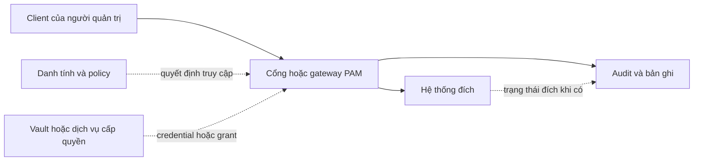
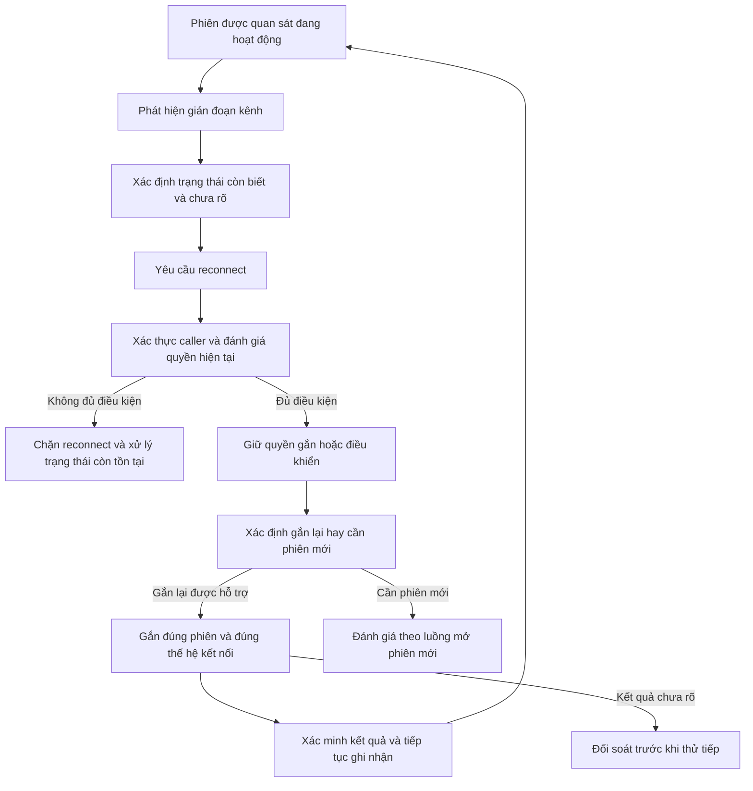

# Session reconnect trong PAM

Session reconnect là việc thiết lập lại khả năng tương tác sau khi một đường kết nối của phiên truy cập bị gián đoạn. Trong Privileged Access Management (PAM), reconnect phải giữ đúng danh tính, phạm vi quyền, thời hạn và chuỗi bằng chứng của phiên, đồng thời xử lý được trạng thái thực tế tại hệ thống đích.

Mất kết nối không đồng nghĩa phiên đích đã kết thúc. Ngược lại, mở lại được giao diện PAM không chứng minh shell, phiên đồ họa hoặc kết nối ứng dụng trước đó vẫn còn. Do đó, reconnect là một quyết định truy cập mới trong ngữ cảnh một phiên đã có, không chỉ là thao tác tự thử lại đường truyền.

Bài học tập trung vào phiên quản trị qua gateway hoặc broker. Hành vi cụ thể phụ thuộc giao thức, hệ điều hành, ứng dụng và khả năng của sản phẩm PAM; không có một cơ chế resume chung cho mọi loại phiên.

## 1. Mục tiêu và thuật ngữ

Sau bài học, người học có thể:

- Phân biệt reconnect kênh truyền, gắn lại phiên đích và mở một phiên mới.
- Xác định trạng thái nào còn tồn tại khi client, gateway hoặc target mất kết nối.
- Thiết kế kiểm tra danh tính, quyền và thời hạn trước khi cho nối lại.
- Ngăn chiếm phiên, nối nhầm phiên và tạo nhiều bên điều khiển ngoài chính sách.
- Duy trì metadata, bản ghi và dấu vết khi có nhiều lần kết nối.
- Xử lý thao tác đang dở mà không tự phát lại tác vụ có thể đã thực thi.

| Thuật ngữ | Ý nghĩa trong bài |
| --- | --- |
| Phiên logic PAM | Đơn vị quản lý truy cập gắn với người hoặc workload, target, policy và phạm vi thời gian |
| Kết nối | Một kênh client–gateway hoặc gateway–target theo kiến trúc |
| Phiên đích | Shell, phiên đồ họa, phiên ứng dụng hoặc đối tượng tương ứng tại target |
| Reconnect | Thiết lập lại một hoặc nhiều kênh sau gián đoạn |
| Reattach hoặc resume | Gắn trở lại một trạng thái phiên còn tồn tại khi có cơ chế hỗ trợ |
| New session | Tạo trạng thái truy cập mới; có thể cần quyết định, credential hoặc approval mới |
| Grace period | Khoảng được xem xét reconnect theo chính sách, không phải quyền kéo dài tùy ý |

## 2. Xác định lớp nào bị ngắt



Trong sơ đồ tham chiếu này, ít nhất ba tình huống cần được phân biệt:

| Điểm gián đoạn | Điều có thể còn tồn tại | Điều không được tự giả định |
| --- | --- | --- |
| Client tới gateway | Gateway có thể còn giữ kênh tới target | Người dùng hiện tại vẫn được quyền gắn lại hoặc output vẫn được ghi đầy đủ |
| Gateway tới target | Phiên hoặc tiến trình ở target có thể còn hoặc đã kết thúc | Kết nối mới sẽ tiếp tục đúng shell hoặc trạng thái cũ |
| Gateway bị lỗi hoàn toàn | Target có thể còn một phiên không được quan sát | Gateway khác tự có đủ trạng thái để tiếp quản |
| Chỉ mất kênh điều khiển hoặc quan sát | Kênh dữ liệu có thể vẫn hoạt động | Không còn heartbeat nghĩa là không còn thao tác đặc quyền |

Giữ trạng thái theo từng lớp giúp tránh gán một nhãn `disconnected` cho mọi thành phần. Nếu không còn quan sát được target, trạng thái phù hợp có thể là chưa rõ thay vì đã kết thúc.

## 3. Reconnect có ý nghĩa khác nhau theo giao thức

### 3.1. Terminal và SSH

Kết nối SSH mới không tự khôi phục một shell đã mất theo cách chung cho mọi triển khai. Nếu chỉ kênh client–gateway bị gián đoạn trong khi gateway giữ kết nối đích, sản phẩm có thể có khả năng cho client gắn lại kênh đó.

Nếu kênh gateway–target đã mất, việc mở SSH mới thường là một lần thiết lập kết nối mới. Khả năng tiếp tục công việc cũ phụ thuộc cơ chế được triển khai tại gateway hoặc target, chẳng hạn môi trường làm việc có hỗ trợ gắn lại trạng thái.

Không giả định mọi tiến trình kết thúc khi SSH ngắt. Một số công việc có thể tiếp tục theo cách chúng được khởi chạy và cấu hình đích. Cần kiểm tra trạng thái thay vì mở lại và tự chạy lại lệnh cuối.

Nếu dùng cơ chế giữ phiên tại target, nó cũng nằm trong phạm vi quản lý quyền và audit. Không để nó trở thành đường tiếp tục dùng quyền ngoài thời hạn PAM chỉ vì kênh mới đã được nối lại.

### 3.2. Phiên đồ họa từ xa

Một số môi trường đồ họa phân biệt ngắt kết nối với đăng xuất. Phiên tại target có thể còn ứng dụng và dữ liệu trong khi client không còn kết nối.

Reconnect cần xác định đúng phiên đích, người được quyền điều khiển và thời hạn. Đăng nhập bằng cùng một tài khoản dùng chung không tự chứng minh đó là phiên thuộc người yêu cầu hiện tại.

Nếu connector hoặc target không thể phân biệt an toàn các phiên của nhiều người qua một tài khoản chung, cần điều chỉnh mô hình danh tính, giới hạn đồng thời hoặc từ chối reattach trong tình huống đó. Không chọn tùy tiện “phiên gần nhất” để gắn cho người dùng.

### 3.3. Cơ sở dữ liệu và ứng dụng

Kết nối mới có thể không mang theo transaction, biến phiên, khóa hoặc trạng thái ứng dụng trước đó. Hành vi khi mất kết nối phải được xác định theo hệ thống cụ thể.

Nếu client mất phản hồi sau một yêu cầu ghi, không biết chắc yêu cầu chưa thực thi. Gửi lại tự động có thể tạo tác động lặp. Reconnect của PAM không thay thế cơ chế idempotency hoặc đối soát nghiệp vụ của ứng dụng.

### 3.4. Console và phiên web

Cookie, token và trạng thái xác thực với nhà cung cấp có vòng đời riêng. Khôi phục kênh proxy không nhất thiết khôi phục hoặc gia hạn được phiên tại ứng dụng.

Không đưa cookie hoặc resume token vào metadata công khai để tiện reconnect. Chúng có thể là bearer credential cho phép chiếm phiên nếu bị lộ.

## 4. Chính sách reconnect phải ràng buộc gì?

| Thuộc tính | Câu hỏi cần có câu trả lời |
| --- | --- |
| Chủ thể | Ai được nối lại: người khởi tạo, người tiếp quản được duyệt hay workload nào? |
| Phiên logic | Đang nối lại phiên nào và mối quan hệ với kết nối trước là gì? |
| Target | Có đúng target, môi trường và phiên đích đã ràng buộc không? |
| Danh tính hiệu lực | Tài khoản hoặc vai trò tại đích còn phù hợp phạm vi đã cho phép không? |
| Approval và policy | Reconnect có nằm trong phạm vi được duyệt và policy hiện tại không? |
| Thời gian | Còn trong grace period, thời hạn tuyệt đối và thời hạn grant không? |
| Mức xác thực | Có cần xác thực lại hoặc xác thực bổ sung do độ mới hay rủi ro không? |
| Số lần và đồng thời | Có giới hạn số lần nối lại hoặc số bên điều khiển không? |
| Bằng chứng | Gateway có thể duy trì audit và recording theo cam kết không? |
| Trạng thái đích | Đã biết phiên còn tồn tại, đã kết thúc hay chưa rõ? |

Approval cho một phiên chỉ bao gồm reconnect nếu chính sách đã định nghĩa điều đó. Không dùng reconnect làm cách mở vô hạn các phiên đích mới dưới approval một lần.

Nếu thao tác thực tế sẽ tạo một phiên mới hoặc tăng quyền ngoài phạm vi, cần đánh giá theo luồng mới tương ứng. Giao diện có nút “reconnect” không quyết định bản chất của hành động ở target.

## 5. Kiểm tra danh tính và quyền tại thời điểm nối lại

### 5.1. Xác thực caller hiện tại

Xác thực người hoặc workload đang gửi yêu cầu. Session ID, đường link hoặc việc biết tên target không đủ để được tiếp tục phiên đặc quyền.

Ràng buộc caller với người được phép tham gia phiên, tenant và môi trường. Nếu có tiếp quản hoặc hỗ trợ, đó phải là vai trò và hành động được cho phép, có audit riêng.

Xác định khi nào cần xác thực lại. Ví dụ, policy có thể yêu cầu xác thực bổ sung khi gián đoạn lâu, thay đổi ngữ cảnh thiết bị hoặc có tín hiệu rủi ro. Không mặc định cookie cổng PAM còn hạn là đủ cho mọi reconnect.

### 5.2. Đánh giá trạng thái quyền hiện tại

Kiểm tra tài khoản người dùng còn hoạt động, approval chưa bị thu hồi theo quy tắc áp dụng, grant còn hiệu lực và target chưa bị cách ly. Policy tại thời điểm mở phiên không phải quyền bỏ qua các hạn chế mới.

Nếu vai trò hiệu lực tại target đã thay đổi trong phiên, cần biết reconnect có gắn trở lại trạng thái quyền đó không. Không chỉ kiểm tra tài khoản ban đầu rồi bỏ qua một phiên đích đang giữ mức quyền cao hơn.

Nếu không quan sát được trạng thái đích đủ để bảo đảm ràng buộc bắt buộc, áp dụng chế độ hạn chế hoặc đối soát theo thiết kế. Không tự coi trạng thái thiếu là hợp lệ.

### 5.3. Kiểm tra trước bước gắn thực tế

Có thể xảy ra thay đổi giữa lần đánh giá policy và lúc gateway gắn vào phiên. Quy trình cần hạn chế khoảng trống đó và kiểm tra các ràng buộc quan trọng tại điểm thực thi.

Nếu approval bị thu hồi hoặc có yêu cầu terminate trong lúc reconnect đang chờ, không để một kết quả xác thực cũ làm sống lại phiên. Cần điều phối trạng thái và thế hệ kết nối phù hợp.

## 6. Resume token và quyền điều khiển

### 6.1. Phân biệt identifier với capability

`session_id` là mã đối chiếu nếu thiết kế định nghĩa như vậy. Resume token hoặc artifact được dùng để gắn vào phiên có thể mang quyền truy cập và phải được bảo vệ như credential.

Nếu sử dụng token reconnect, cần thiết kế các thuộc tính như:

- Gắn với phiên, chủ thể hoặc bên nhận được phép, tenant và gateway hay dịch vụ nhận phù hợp.
- Có thời hạn ngắn theo mục đích và không vượt các hạn truy cập áp dụng.
- Có khả năng kiểm tra trạng thái sử dụng hoặc thu hồi theo yêu cầu hệ thống.
- Được truyền qua kênh bảo vệ; không nằm trong URL, log, trace hoặc thông báo không được kiểm soát.
- Có quy tắc phát lại, thay thế và xử lý khi bị nghi lộ.

Chữ ký hợp lệ không tự chứng minh token chưa bị dùng lại hoặc phiên chưa bị thu hồi. Cách kiểm tra phải phù hợp mô hình tin cậy và trạng thái của hệ thống.

### 6.2. Một người điều khiển hay nhiều người?

Nếu chỉ cho một bên điều khiển, thao tác chiếm quyền điều khiển cần được điều phối nguyên tử hoặc bằng cơ chế tương đương. Hai tab cùng reconnect không được tạo hai chủ điều khiển ngoài dự kiến.

Nếu cho phép đồng điều khiển, phải là chế độ rõ ràng với danh tính, vai trò và bằng chứng phù hợp. Người chỉ được xem không nên có khả năng gửi input chỉ vì đã gắn vào cùng một phiên.

Khi thay token hoặc chuyển quyền điều khiển, cần xét client cũ vẫn còn chạy. Không dựa vào việc đóng cửa sổ mới để bảo đảm client cũ đã hết quyền.

## 7. Thời hạn không được kéo dài do reconnect

### 7.1. Các loại timeout

| Giới hạn | Ý nghĩa |
| --- | --- |
| Thời hạn truy cập tuyệt đối | Mốc kết thúc được phép theo policy hoặc approval |
| Thời hạn grant hoặc credential | Hiệu lực thực tế của quyền hay vật liệu xác thực |
| Idle timeout | Giới hạn không hoạt động theo định nghĩa đã chọn |
| Disconnected timeout | Khoảng cho phép trạng thái ngắt tồn tại trước hành động xử lý |
| Reconnect grace period | Khoảng được xem xét nối lại sau gián đoạn |

Các bộ đếm không nên được reset tùy tiện về toàn bộ thời lượng ban đầu. Đặc biệt, reconnect không làm mới thời hạn tuyệt đối của approval hoặc grant.

Idle cần có định nghĩa: không có input người dùng, không có hoạt động giao thức hay một dấu hiệu khác. Keepalive không nhất thiết chứng minh người dùng đang làm việc.

### 7.2. Ví dụ giới hạn thời gian

Một phiên có quyền truy cập đến 02:30 UTC, grant đích đến 02:25, và grace period reconnect là 5 phút. Nếu ngắt lúc 02:10, hạn xem xét reconnect không nên vượt 02:15 theo grace period trong ví dụ này, đồng thời truy cập sau nối lại vẫn phải kết thúc theo các giới hạn áp dụng.

Nếu ngắt lúc 02:24, không thể cấp lại thêm 5 phút hoạt động bất chấp grant hết hạn lúc 02:25. Phải áp dụng hạn còn lại và cơ chế đích, hoặc từ chối nếu không đáp ứng được chính sách.

Các con số trên chỉ minh họa cách ràng buộc, không phải mặc định cho mọi môi trường. Cũng cần xác định rõ biên thời gian và hành vi khi yêu cầu đến sát hạn.

Với password tĩnh, metadata `access_until` không tự làm password hết hiệu lực. Reconnect an toàn cần nối với kiểm soát phiên, quyền đích và vòng đời credential thực tế.

## 8. Luồng reconnect tham chiếu



Đây là luồng logic. Chặn reconnect không đồng nghĩa đã chấm dứt phiên tại target; việc dọn quyền, phiên hoặc tác vụ còn tồn tại là một bước cần theo dõi riêng.

Mã giả sau minh họa các ràng buộc, không phải API của một sản phẩm:

```text
caller = authenticate_current_caller(request)
session = load_bound_session(request.session_id)
verify_caller_can_resume(caller, session)
decision = evaluate_current_reconnect_policy(caller, session, context)
deny_unless_permitted(decision)
verify_remaining_time_and_target_binding(session)
attempt = reserve_reconnect_attempt(session, caller, request.idempotency_key)
mode = classify_supported_resume_mode(session, observed_target_state)
if mode_requires_new_session(mode):
    continue_via_new_session_authorization(attempt)
else:
    verify_attempt_is_current(attempt)
    attach_to_bound_session_once(attempt)
record_observed_outcome_without_secret(attempt)
```

Các kiểm tra phải có hiệu lực tại backend và điểm thực thi. Một giao diện khóa nút reconnect không đủ để ngăn request đồng thời hoặc caller sửa tham số.

## 9. Chạy đồng thời, retry và kết quả chưa rõ

### 9.1. Hai client cùng nối lại

Ràng buộc mỗi lần thử với session, caller, target, chế độ và thế hệ kết nối. Dùng cơ chế điều phối để chỉ các bên được phép nắm quyền điều khiển.

Idempotency key có thể giúp nhận diện gửi lại cùng thao tác. Nó phải có phạm vi; dùng lại key với session, chủ thể hoặc đích khác cần bị từ chối hoặc báo xung đột.

Không coi key do client tự chọn là bằng chứng được phép nhận kết quả của một thao tác cũ. Xác thực và kiểm tra quyền vẫn cần được thực hiện.

### 9.2. Callback hoặc heartbeat cũ

Một lần thử cũ có thể phản hồi sau khi người dùng đã nối lại bằng một lần mới hoặc phiên đã bị terminate. Nếu chỉ lấy thông báo đến sau cùng, hệ thống có thể ghi đè trạng thái mới bằng dữ liệu cũ.

Giữ định danh lần thử, connection ID, thứ tự trong phạm vi nguồn hoặc generation phù hợp. Chỉ cho kết quả còn hợp lệ cập nhật quyền điều khiển và trạng thái hiện tại.

Đây không phải lý do bỏ bằng chứng cũ. Sự kiện đến muộn vẫn có giá trị lịch sử nhưng không được tự mở lại một phiên đã bị kết thúc.

### 9.3. Timeout sau khi gắn

Gateway có thể đã gắn vào phiên đích nhưng client không nhận được xác nhận. Retry mù có thể mở thêm kênh, thêm phiên hoặc thêm bên điều khiển.

Giữ trạng thái `reattach_uncertain` hoặc tương đương và đối soát trước khi tạo hành động mới. Nếu có một token dùng một lần đã được tiêu thụ, không tự coi nó chưa dùng chỉ vì response thất bại.

Có thể cấp artifact thay thế sau khi kiểm tra trạng thái và quyền hiện tại nếu thiết kế cho phép. Không trả lại lượt sử dụng hoặc khôi phục token cũ một cách tự động.

### 9.4. Giới hạn retry

Đặt giới hạn số lần, khoảng chờ và thời gian tổng. Dừng khi hết quyền, hết grace period, bị thu hồi, phát hiện sai target hoặc có nguy cơ gây khóa tài khoản.

Phân biệt lỗi mạng với lỗi xác thực, thiếu quyền và trạng thái phiên không tồn tại. Không liên tục thử credential cũ chỉ vì lần đầu không nối lại được.

## 10. Gateway lỗi và khả năng tiếp quản

### 10.1. Không đồng nhất HA với resume phiên

Một cụm gateway có thể tiếp tục nhận kết nối mới khi một nút lỗi nhưng chưa chắc tiếp quản được kênh đang tồn tại. Trạng thái giao thức, bộ nhớ, credential tạm thời hoặc vật liệu bảo vệ kênh có thể không được chia sẻ theo cách cho phép resume.

Cần xác định rõ sản phẩm hỗ trợ điều gì: nối lại client tới cùng gateway, tái thiết kết nối target, gắn vào phiên đích được giữ lại hay chỉ mở phiên mới.

Không quảng bá chuyển gateway như tiếp tục phiên liền mạch nếu thực tế shell hoặc trạng thái ứng dụng đã thay đổi. Metadata và thông báo cho người vận hành cần phản ánh đúng hành vi.

### 10.2. Ngăn hai gateway cùng điều khiển

Nếu gateway cũ chưa chắc đã dừng, một gateway mới không nên tự chiếm cùng phiên mà không có cơ chế điều phối phù hợp. Cần xét cả kênh cũ, quyền điều khiển và khả năng còn gửi input tới target.

Khóa hoặc lease ở lớp quản lý chỉ có ý nghĩa đầy đủ nếu đường thực thi ngăn được tác vụ cũ tiếp tục ngoài quyền. Khi không bảo đảm được, có thể cần hạn chế, chấm dứt đường cũ theo cơ chế hỗ trợ hoặc chuyển sang quy trình phục hồi có người xử lý.

### 10.3. Khi không biết target còn phiên hay không

Đối soát bằng nguồn có thẩm quyền phù hợp: gateway, agent hoặc API target nếu có. Dùng target session reference và ràng buộc danh tính, không chọn tùy ý một phiên cùng username.

Nếu không thể xác minh an toàn, không âm thầm tạo phiên mới rồi vẫn gọi là tiếp tục phiên cũ. Có thể chặn reattach và đánh giá một phiên mới riêng, đồng thời theo dõi phiên cũ chưa rõ.

## 11. Không tự phát lại thao tác đang dở

Mất kết nối sau khi gửi một lệnh không cho biết lệnh đã nhận, đang chạy, đã hoàn tất hay chưa từng tới đích. Reconnect không giải quyết được sự không chắc chắn đó bằng cách gửi lại mọi input.

Ví dụ, người quản trị gửi yêu cầu thay đổi cấu hình rồi mất phản hồi. Gửi lại có thể tạo tác động lặp hoặc ghi đè trạng thái mới. Cần kiểm tra kết quả ở ứng dụng hay target trước.

Các nguyên tắc thực hành gồm:

- Không tự gửi lại lệnh, thao tác clipboard hoặc yêu cầu nghiệp vụ chỉ vì giao diện vừa kết nối lại.
- Nếu tầng giao thức hỗ trợ resume dữ liệu, dùng đúng cơ chế của nó; không tự suy ra rằng replay cả lệnh là an toàn.
- Đánh dấu trạng thái thao tác chưa rõ và hướng người vận hành tới phương pháp đối soát phù hợp.
- Phân biệt khôi phục hiển thị output với thực thi lại input.
- Với tác vụ không tương tác, dùng cơ chế theo dõi job hoặc idempotency của ứng dụng khi có, thay vì dựa vào vòng đời terminal.

Output được lưu đệm cũng có thể chứa dữ liệu nhạy cảm. Chỉ cấp lại cho chủ thể hiện tại còn được phép xem; không coi buffer là dữ liệu công khai vì nó đã xuất hiện trong phiên trước.

## 12. Audit, metadata và tính liên tục của bản ghi

### 12.1. Một phiên logic, nhiều lần kết nối

Giữ session ID ổn định khi định nghĩa policy coi đây là cùng một phiên; tạo connection ID và reconnect attempt ID cho các lần tương ứng. Nếu thực tế là phiên mới, dùng định danh mới và liên kết về phiên trước khi cần.

Các sự kiện hữu ích gồm:

| Sự kiện minh họa | Thông tin cần giữ |
| --- | --- |
| `connection.lost` | Lớp bị gián đoạn, nguồn quan sát, thời điểm và trạng thái chưa rõ |
| `reconnect.requested` | Caller, session, thiết bị hoặc nguồn nếu phù hợp, lần thử |
| `reconnect.authorized` hoặc `reconnect.denied` | Decision reference, policy, lý do, giới hạn còn lại |
| `reconnect.reserved` | Chủ thể hoặc gateway được giữ quyền gắn, generation nếu dùng |
| `session.reattached` | Kết nối mới, target session reference và kết quả quan sát |
| `reconnect.uncertain` | Điểm lỗi, điều chưa biết, owner xử lý |
| `controller.changed` | Người hoặc client cũ, bên mới, lý do và quyền điều khiển |
| `session.terminated` | Kết quả chấm dứt ở lớp tương ứng, không chỉ lệnh đã gửi |

Không ghi resume token, cookie, password, private key hoặc response chứa credential vào audit. Dùng tham chiếu cần thiết và phân quyền cả metadata.

### 12.2. Khoảng trống bằng chứng

Nếu client mất kết nối nhưng gateway vẫn thu thập từ target, bản ghi có thể còn tiếp tục. Nếu gateway mất khả năng thu thập, có thể xuất hiện khoảng trống. Cần nêu rõ nguồn và khoảng thời gian được quan sát.

Liên kết các đoạn recording bằng manifest hoặc cơ chế tương đương. Giữ thứ tự, thời gian, nguồn và tình trạng đầy đủ theo khả năng hệ thống.

Không nối các đoạn thành một video trông liên tục rồi che giấu khoảng không có dữ liệu. Nếu chỉ biết khoảng gián đoạn ước lượng, ghi rõ độ không chắc chắn thay vì bịa thời gian chính xác.

Kiểm tra recording ở cả trước và sau reconnect. Một nhãn “recording enabled” chưa chứng minh các đoạn mới đã tải lên hoặc được bảo vệ đầy đủ.

### 12.3. Thời lượng và báo cáo

Thời gian phiên logic, tổng thời gian các kênh hoạt động và khoảng ngắt là các đại lượng khác nhau. Định nghĩa rõ trước khi báo cáo hoặc dùng cho policy.

Không loại mọi khoảng disconnected khỏi thời hạn tuyệt đối chỉ để người dùng luôn nhận đủ một lượng thời gian active. Nếu chính sách có ngân sách thời gian hoạt động riêng, nó vẫn phải nằm trong các hạn tổng thể đã chấp thuận.

## 13. Policy reconnect minh họa

Cấu hình dưới đây mô tả ý định, không phải schema của một sản phẩm:

```yaml
reconnect_policy:
  policy_id: privileged-maintenance-reconnect
  scope_ref: approved-production-session-group
  identity:
    require_current_caller_authentication: true
    allowed_participant_profile_ref: original-controller-and-approved-handover
    assurance_profile_ref: privileged-session-reauthentication
  binding:
    require_same_target_scope: true
    target_session_verification_ref: supported-target-session-check
    controller_mode: single-controller
  time:
    grace_profile_ref: approved-disconnection-grace
    preserve_absolute_access_deadline: true
    honor_target_grant_deadline: true
  execution:
    retry_profile_ref: bounded-reconnect-attempts
    uncertain_outcome_action: reconcile_before_new_attach
    unsupported_resume_action: evaluate_new_session_separately
  evidence:
    recording_profile_ref: privileged-session-continuity
    require_gap_visibility: true
```

Mỗi tham chiếu cần được ánh xạ tới hành vi thực tế: mức xác thực, hạn, số lần, cách xác minh đích và tiêu chí bằng chứng. Các cờ cấu hình không tự chứng minh backend đã thực thi.

Nếu một điều kiện không thể đáp ứng ở giao thức hoặc target đang dùng, cần điều chỉnh luồng và tiêu chí chấp nhận. Không gắn nhãn an toàn cho một hành vi chưa được hỗ trợ.

## 14. Tình huống: kỹ sư mất mạng khi bảo trì Orders

An đang thao tác qua gateway vào máy chủ production. Phiên logic được phép đến 02:30 UTC, grant tại đích đến 02:25 và policy minh họa cho phép xem xét reconnect trong 5 phút sau ngắt.

### Bước 1: Phát hiện gián đoạn

Lúc 02:10, client mất mạng. Gateway vẫn quan sát kênh đích hoạt động và tiếp tục thu thập theo cấu hình. Metadata ghi client disconnected, không ghi target session ended.

Một lệnh bảo trì vừa được gửi có kết quả chưa rõ với người dùng. Luồng reconnect không tự đưa lệnh đó vào hàng đợi gửi lại.

### Bước 2: Xác thực và ràng buộc

Lúc 02:12, An gửi reconnect. PAM xác thực caller hiện tại, kiểm tra policy, approval, grant và target. Một yêu cầu từ người khác biết session ID bị từ chối.

Gateway đối chiếu đúng phiên đích và quyền điều khiển. Hai tab của An cùng gửi request được điều phối thành một lần gắn hoặc trả trạng thái đã tồn tại theo thiết kế.

### Bước 3: Nối lại đúng trạng thái

Kênh mới được gắn vào phiên còn tồn tại mà sản phẩm hỗ trợ. Connection ID mới được nối với session ID cũ, output được cấp theo quyền hiện tại và các đoạn bản ghi giữ được quan hệ.

An kiểm tra trạng thái lệnh bảo trì bằng nguồn phù hợp trước khi quyết định thực hiện hành động tiếp theo. Không suy rằng mất màn hình nghĩa là lệnh chưa chạy.

### Bước 4: Áp dụng hạn còn lại

Reconnect lúc 02:12 không tạo thêm toàn bộ thời lượng ban đầu. Grant vẫn kết thúc theo mốc 02:25 nếu không có một quyết định mới hợp lệ và cơ chế tương ứng.

Nếu An yêu cầu lại sau khi quyền đã hết hoặc phiên đã bị terminate, PAM từ chối hồi sinh phiên. Nhu cầu tiếp tục phải đi qua luồng truy cập mới phù hợp.

### Biến thể: gateway đã hỏng

Nếu gateway cũ không còn hoạt động và kiến trúc không hỗ trợ chuyển trạng thái, gateway mới không tự tuyên bố đã resume cùng shell. Hệ thống đối soát phiên cũ và đánh giá mở phiên mới riêng nếu cần.

Trường hợp target còn một phiên đặc quyền không được kiểm soát đầy đủ phải tiếp tục được theo dõi. Một client mới kết nối thành công không giải quyết phần tồn đọng đó.

## 15. Ma trận kiểm thử chấp nhận

Thực hiện các phép thử trong môi trường và phạm vi được chấp thuận; không gây mất kết nối production chỉ để kiểm tra một nhãn tính năng.

| Trường hợp | Điều kiện đạt |
| --- | --- |
| Mất kênh client nhưng đích còn hoạt động | Phân biệt đúng lớp, kiểm tra lại quyền và gắn đúng phiên khi được hỗ trợ |
| Kênh target đã mất | Không giả định trạng thái cũ tự tiếp tục; chọn đúng luồng resume hoặc phiên mới |
| Người khác dùng session ID | Bị từ chối dù biết định danh |
| Artifact reconnect bị phát lại | Áp dụng đúng ràng buộc sử dụng, thời hạn và caller |
| Hai client nối đồng thời | Không có hai bên điều khiển ngoài policy |
| Approval hoặc grant bị thu hồi khi đang chờ | Không dùng quyết định cũ để mở lại quyền trái phép |
| Reconnect sát hạn | Không vượt hạn tuyệt đối hoặc hạn grant thực tế |
| Gateway chuyển nút | Hành vi đúng khả năng sản phẩm, không mất kiểm soát gateway cũ |
| Mất xác nhận sau attach | Đối soát trước lần gắn mới, không tự reset lượt dùng |
| Callback hoặc heartbeat cũ đến muộn | Không ghi đè trạng thái mới hoặc hồi sinh phiên đã kết thúc |
| Lệnh trước ngắt có kết quả chưa rõ | Không tự phát lại thao tác nghiệp vụ |
| Recording có khoảng trống | Hiển thị và giữ bằng chứng về phần thiếu |
| Target dùng tài khoản chung | Không gắn nhầm phiên của người khác chỉ từ username |
| Log, trace và export | Không lộ token nối lại, cookie hoặc credential |

Các chỉ số hữu ích gồm tỷ lệ reconnect thành công theo giao thức, thời gian gián đoạn, số lần bị từ chối theo lý do, phiên đích chưa rõ sau lỗi gateway, sự kiện điều khiển xung đột và khoảng trống recording chưa được xử lý.

Tỷ lệ reconnect cao không phải mục tiêu duy nhất. Một hệ thống từ chối đúng yêu cầu hết hạn tốt hơn hệ thống nối lại mọi phiên bằng cách bỏ qua kiểm soát.

## 16. Bài thực hành thiết kế

Thiết kế reconnect cho một phiên terminal và một phiên đồ họa:

1. Vẽ các lớp client, gateway và target; xác định trạng thái nào còn tồn tại khi từng kênh ngắt.
2. Định nghĩa khi nào giữ session ID, khi nào tạo connection ID mới và khi nào phải mở phiên logic mới.
3. Liệt kê kiểm tra caller, target, danh tính hiệu lực, approval và quyền hiện tại.
4. Tính giới hạn reconnect khi grace period, hạn phiên và hạn grant khác nhau.
5. Mô tả chống phát lại token và điều phối hai client cùng nối lại.
6. Xử lý timeout sau attach và gateway cũ chưa chắc đã ngừng gửi input.
7. Thiết kế bằng chứng cho khoảng trống recording và lệnh có kết quả chưa rõ.
8. Viết tiêu chí kết thúc khi không thể resume an toàn nhưng target có thể còn phiên đặc quyền.

Bản thiết kế đạt yêu cầu khi reconnect khôi phục đúng khả năng tương tác đã được cho phép, giữ nguyên các giới hạn và không che trạng thái chưa rõ. Trong PAM, tiếp tục một phiên phải luôn đi cùng tiếp tục kiểm soát danh tính, quyền và bằng chứng.
