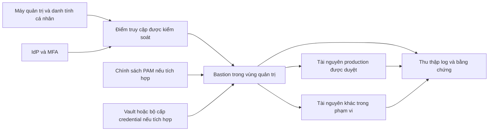

# Bastion host

**Bastion host** là máy hoặc thành phần được gia cố để làm điểm vào có kiểm soát tới một vùng tài nguyên nhạy cảm. Trong truy cập quản trị từ xa, bastion thường giúp tập trung đường kết nối SSH, RDP hoặc các giao thức quản lý, thay vì để máy người dùng kết nối trực tiếp tới mọi tài nguyên.

Bài học thuộc chương **Remote access** của Privileged Access Management (PAM), trong phạm vi bảo vệ tài khoản quản trị, tài khoản dịch vụ và hạ tầng nhạy cảm. Nội dung kết hợp kiểm kê quyền, least privilege, JIT/JEA, vault, luân chuyển credential, giám sát phiên và lưu bằng chứng phục vụ kiểm toán, ứng phó sự cố.

Một bastion tạo ra điểm kiểm soát đường đi. Khả năng xác thực cá nhân, giới hạn quyền, quản lý credential và ghi nội dung phiên còn phụ thuộc vào cách triển khai và các thành phần tích hợp. Cần mô tả những kiểm soát thực sự có thay vì coi mọi máy trung gian đều đã cung cấp đầy đủ chức năng PAM.

Sau bài học, bạn có thể:

- Giải thích vai trò của bastion và phân biệt với VPN, jump host và session proxy.
- Thiết kế luồng truy cập cùng ranh giới mạng và danh tính.
- Phân biệt chuyển tiếp SSH với kết thúc giao thức để quan sát phiên.
- Xác định cách bảo vệ credential, hardening, audit và khả năng phục hồi.
- Đề xuất tình huống kiểm chứng đường truy cập quản trị.

## 1. Bastion giải quyết vấn đề gì?

Giả sử một hệ thống có nhiều máy production trong vùng mạng riêng. Nếu mỗi quản trị viên được kết nối trực tiếp tới mọi máy, số đường vào và cấu hình cần bảo vệ tăng lên. Việc thay đổi quyền, điều tra một kết nối hoặc chặn đường quản trị ngoài thiết kế cũng khó đồng bộ.

Một mô hình có bastion có thể là:

```text
Máy quản trị → Điểm vào được phép → Bastion → Tài nguyên được duyệt
```

Những mục tiêu có thể đạt khi cấu hình phù hợp:

- Thu hẹp nguồn được phép kết nối tới cổng quản trị của tài nguyên đích.
- Tập trung xác thực, ghi nhận và điều phối một phần luồng truy cập.
- Phân tách máy người dùng khỏi vùng quản trị production.
- Áp dụng chính sách theo danh tính, tài nguyên và thời hạn.
- Giảm việc phân phối credential nếu tích hợp với broker hoặc vault.

Bastion đồng thời là một tài sản có ảnh hưởng lớn. Nếu nó có đường tới nhiều hệ thống và bị chiếm quyền, kẻ tấn công có thể tận dụng vị trí mạng hoặc danh tính trên đó. Thiết kế cần giới hạn cả đường vào, đường ra và quyền của chính bastion.

## 2. Phân biệt các thành phần liên quan

| Thành phần | Vai trò chính | Điều cần hiểu khi kết hợp với PAM |
|---|---|---|
| VPN | Cung cấp kết nối mạng theo chính sách | Vào được mạng chưa đồng nghĩa được quản trị mọi tài nguyên |
| Jump host | Máy trung gian để đi tiếp tới máy khác | Có thể chỉ là một máy có shell, chưa có quản lý credential hoặc ghi phiên đầy đủ |
| Bastion host | Điểm vào được gia cố và giới hạn để bảo vệ vùng nhạy cảm | Cần xác định các kiểm soát được triển khai cụ thể |
| Session proxy | Trung gian giao thức cho phiên truy cập | Có thể thực thi chính sách và ghi nội dung tùy mô hình kết thúc giao thức |
| Vault | Bảo vệ và quản lý vòng đời secret | Không tự chuyển mọi kết nối qua bastion |
| IdP và MFA | Xác thực danh tính người dùng | Không tự xác định quyền ở tài nguyên đích |
| Cơ chế truy cập theo danh tính tới từng tài nguyên | Cho phép kết nối theo chính sách có phạm vi | Có thể thực hiện vai trò điểm vào mà không cần máy jump truyền thống |

Các tên gọi có thể chồng lấn giữa sản phẩm. Một dịch vụ bastion có thể tích hợp session proxy và vault; một máy được gọi là bastion có thể chỉ nhận SSH rồi cho người dùng tiếp tục kết nối tùy ý.

Khi đánh giá kiến trúc, hãy xác định nơi xác thực, nơi quyết định quyền, nơi xử lý credential và nơi tạo bằng chứng.

## 3. Kiến trúc và các ranh giới tin cậy



Sơ đồ thể hiện vai trò logic, không bắt buộc mỗi hộp là một máy riêng. Những mũi tên từ PAM hoặc vault chỉ có ý nghĩa khi tồn tại tích hợp thực tế.

### 3.1 Bastion không nhất thiết phải có cổng công khai

Người dùng có thể đi qua VPN, gateway hoặc cơ chế truy cập theo danh tính trước khi tới bastion. Một bastion cũng có thể chỉ có địa chỉ riêng và được tiếp cận từ một vùng quản trị đã kiểm soát.

Nếu có điểm truy cập từ Internet, chỉ công bố những chức năng cần thiết, với xác thực và giới hạn phù hợp. Không suy từ việc cần remote access ra yêu cầu mở cổng quản trị của mọi máy ra mạng công cộng.

### 3.2 Tách vùng theo phạm vi rủi ro

Một bastion có đường tới cả thử nghiệm và production có thể tạo cầu nối ngoài dự kiến. Có thể cần nhóm bastion hoặc connector riêng theo môi trường, đơn vị hoặc vùng tin cậy.

Tách máy chưa đủ nếu vẫn dùng cùng danh tính quyền rộng, cùng secret hoặc cùng quyền quản trị cấu hình. Cần xét cả mạng, danh tính, nơi giữ credential và người vận hành.

### 3.3 Bastion không phải nơi chạy tác vụ nghiệp vụ chung

Hạn chế dùng bastion làm máy phát triển, nơi duyệt web hoặc lưu công cụ không cần thiết. Mỗi phần mềm, file và dịch vụ bổ sung đều làm tăng bề mặt quản lý.

Ứng dụng và pipeline nên có danh tính cùng cơ chế truy cập phù hợp với workload. Không mặc định đưa mọi luồng dịch vụ qua shell của bastion dùng cho con người.

## 4. Ba mô hình truy cập có ngữ nghĩa khác nhau

### 4.1 Đăng nhập vào bastion rồi đi tiếp

Người quản trị có shell hoặc desktop trên bastion, sau đó chạy client tới đích. Mô hình này thuận tiện nhưng cần kiểm soát những gì họ có thể chạy, kết nối và lưu trên máy trung gian.

Nếu người dùng sao chép private key hoặc mật khẩu lên bastion, bastion trở thành nơi chứa thêm secret. Một tài khoản dùng chung trên bastion cũng làm giảm khả năng quy trách nhiệm cho cá nhân.

Cần hạn chế đường ra và công cụ theo nhu cầu, bảo vệ credential, quản lý phiên ở cả hai chặng và tránh cho người dùng quyền quản trị bastion chỉ để sử dụng nó.

### 4.2 Chuyển tiếp kết nối SSH

Một SSH jump có thể chỉ chuyển tiếp kết nối tới đích. Client của người dùng thực hiện xác thực với bastion và thiết lập phiên SSH riêng tới máy đích qua đường trung gian.

Khi phiên SSH tới đích vẫn được mã hóa giữa client và đích, bastion thường không nhìn thấy nội dung terminal từ chính luồng đó. Nó có thể thấy metadata phù hợp với cơ chế chuyển tiếp, nhưng không tự ghi được toàn bộ lệnh hoặc đầu ra tại đích.

Muốn có bằng chứng nội dung, cần một cơ chế được thiết kế riêng: ghi ở client/đích, agent hoặc proxy kết thúc giao thức theo khả năng giải pháp. Phạm vi tin cậy và quyền truy cập dữ liệu cũng thay đổi theo lựa chọn.

### 4.3 Proxy kết thúc giao thức

Trong một mô hình PAM, thành phần trung gian có thể kết thúc kết nối từ người dùng rồi tạo kết nối riêng tới tài nguyên. Khi đó, nó có thể quan sát và ghi dữ liệu theo giao thức được hỗ trợ.

Credential đích có thể được giữ ở phía broker thay vì đưa tới client, nếu tích hợp cho phép. Đổi lại, proxy trở thành thành phần xử lý dữ liệu nhạy cảm và phải được bảo vệ tương ứng.

Không đồng thời giả định bastion chỉ chuyển tiếp một luồng mã hóa mà không thấy nội dung, nhưng vẫn ghi được toàn bộ thao tác từ chính luồng đó.

## 5. Thiết kế đường mạng và chặn đường vòng

Một chính sách mạng cần xác định nguồn, đích, giao thức và mục đích cho từng luồng.

| Luồng | Mục đích | Ranh giới tham chiếu |
|---|---|---|
| Máy quản trị tới điểm vào | Xác thực và bắt đầu truy cập | Chỉ qua nguồn hoặc cơ chế truy cập được phép |
| Điểm vào tới bastion | Đưa phiên quản trị vào vùng trung gian | Đúng danh tính, giao thức và thời hạn theo thiết kế |
| Bastion tới tài nguyên | Quản trị tài nguyên được duyệt | Giới hạn đích và cổng cần thiết |
| Bastion tới IdP, vault hoặc dịch vụ khóa | Hỗ trợ xác thực và cấp credential | Chỉ các dịch vụ và chức năng cần dùng |
| Bastion và tài nguyên tới nơi thu log | Lưu bằng chứng | Bảo vệ kênh, định danh nguồn và tính toàn vẹn |
| Bastion tới Internet hoặc vùng khác | Cập nhật hoặc phụ trợ khi cần | Không mở rộng tùy ý cho mọi hoạt động |

### Kiểm soát ở cả nguồn và đích

Tài nguyên có thể chỉ nhận cổng quản trị từ nhóm bastion được chỉ định hoặc một đường khẩn cấp có kiểm soát. Bastion cũng nên chỉ được kết nối tới tập tài nguyên phù hợp với vai trò của nó.

Chỉ giới hạn nguồn ở firewall chưa thay thế việc xác thực tại đích. Máy đích vẫn phải kiểm tra danh tính và quyền thực tế của tài khoản.

### Kiểm kê những đường khác

Các đường như VPN cũ, console cloud, hypervisor, remote support, tài khoản cục bộ hoặc connector khác có thể không đi qua bastion. Mỗi đường cần chủ sở hữu, mục đích, điều kiện sử dụng và bằng chứng phù hợp.

Không phải tất cả phải bị ép vào cùng một bastion. Tuy nhiên, không nên tuyên bố “mọi truy cập đều được kiểm soát” khi vẫn còn một đường quản trị trực tiếp chưa được kiểm kê.

## 6. Danh tính, quyền và credential

### 6.1 Danh tính cá nhân ở điểm vào

Người dùng nên được nhận diện bằng danh tính cá nhân với điều kiện xác thực phù hợp. MFA hoặc ngữ cảnh thiết bị chỉ có giá trị khi thực sự được hệ thống kiểm chứng và thực thi.

Không dùng địa chỉ IP hoặc việc “đã vào mạng nội bộ” như bằng chứng đầy đủ về người truy cập. Nhiều chủ thể có thể cùng đi qua một NAT hoặc một vùng mạng.

### 6.2 Quyền trên bastion và quyền tại đích

Quyền được sử dụng bastion không cần đồng nghĩa có shell toàn quyền hoặc được quản trị hệ điều hành của bastion. Tách vai trò vận hành nền tảng với người dùng truy cập tài nguyên.

Tại đích, cấp tài khoản hoặc role theo công việc. JEA, endpoint giới hạn, quyền hệ điều hành hoặc chính sách ứng dụng cần được thiết kế riêng. Chặn vài chuỗi lệnh tại một shell có quyền rộng không tự tạo ranh giới hành động đáng tin cậy.

### 6.3 Giảm nơi lưu secret

Các lựa chọn có thể gồm vault, credential injection, chứng thư ngắn hạn, federation hoặc cơ chế ký được kiểm soát. Phải xác định credential hoặc khả năng xác thực xuất hiện ở đâu và ai có thể sử dụng.

Không đặt private key dùng chung vào image bastion hay thư mục mà mọi người dùng đọc được. Nếu phải giữ secret trên máy, giới hạn quyền, vòng đời, bản sao, backup và dữ liệu chẩn đoán.

### 6.4 Agent forwarding

Agent forwarding có thể cho máy từ xa sử dụng khả năng xác thực của agent trong những điều kiện nhất định. Nó làm tăng phạm vi mà khả năng xác thực có thể bị lạm dụng nếu máy trung gian bị xâm nhập.

Không bật theo thói quen. Một luồng jump SSH có thể được thiết kế để client xác thực tới đích mà không chuyển agent sang bastion. Cần kiểm chứng client, server và các kênh được phép theo cách triển khai cụ thể.

Ngay cả khi khóa riêng không bị sao chép, quyền yêu cầu agent hoặc dịch vụ ký thực hiện xác thực vẫn là một quyền nhạy cảm.

## 7. Ví dụ đường kết nối SSH qua bastion

Ví dụ sau minh họa cấu hình client OpenSSH cho một luồng jump. Các tên máy và khóa chỉ là dữ liệu giả; đoạn này không cấu hình PAM, vault hay ghi nội dung phiên.

```sshconfig
Host bastion-prod-example
    HostName bastion.example.invalid
    User personal-operator
    IdentityFile ~/.ssh/id_example_bastion
    IdentitiesOnly yes
    ForwardAgent no
    StrictHostKeyChecking yes

Host application-prod-example
    HostName app-prod-01.internal.example.invalid
    User maintenance-operator
    IdentityFile ~/.ssh/id_example_target
    IdentitiesOnly yes
    ProxyJump bastion-prod-example
    ForwardAgent no
    StrictHostKeyChecking yes
```

Client có thể bắt đầu bằng:

```text
ssh application-prod-example
```

Đây là ví dụ học tập, không phải một lệnh đã được chạy hoặc một cấu hình sẵn sàng đưa vào production.

### Những điều ví dụ thể hiện

- Danh tính xác thực tới bastion và đích có thể khác nhau.
- Client dùng bastion làm đường đi tới máy đích.
- Không yêu cầu chuyển agent sang bastion trong mô hình minh họa.
- Cả hai chặng đều có yêu cầu xác minh danh tính máy chủ theo cấu hình.

Với kiểm tra host key nghiêm ngặt, dữ liệu tin cậy cần được chuẩn bị hoặc xác minh qua một quy trình đáng tin cậy. Không tự động chấp nhận mọi khóa mới hoặc xóa cảnh báo đổi khóa để làm kết nối thành công.

### Những điều ví dụ chưa cung cấp

Cấu hình client không tự thực thi chính sách phía server: người có quyền sửa client có thể thay nhiều tùy chọn. Cần kiểm soát phía bastion và đích cho forwarding, nguồn, tài nguyên và danh tính được phép.

Một jump SSH sử dụng khả năng chuyển tiếp kết nối. Nếu tắt mọi forwarding ở bastion, chính luồng jump có thể không hoạt động. Thiết kế cần cho phép đúng kiểu chuyển tiếp và đúng đích/cổng được duyệt, đồng thời chặn những kiểu đường hầm ngoài nhu cầu.

Ví dụ vẫn dùng khóa ở client và không chứng minh người dùng không giữ credential đích. Muốn mô hình broker giữ credential hoặc cấp credential ngắn hạn cần thêm tích hợp phù hợp. Nó cũng không tự tạo bản ghi terminal tại bastion vì phiên tới đích có ngữ nghĩa mã hóa riêng.

## 8. Luồng truy cập quản trị có tích hợp PAM

Một workflow tham chiếu có thể gồm:

1. Người dùng chọn tài nguyên và công việc từ danh mục đã kiểm kê.
2. PAM xác thực danh tính, kiểm tra MFA hoặc điều kiện áp dụng.
3. Chính sách đánh giá vai trò, phạm vi tài nguyên, lý do và cửa sổ thời gian; yêu cầu phê duyệt nếu cần.
4. Hệ thống cấp khả năng mở phiên có thời hạn, ràng buộc với người dùng và tài nguyên.
5. Bastion hoặc proxy thực thi mô hình kết nối đã chọn, xác minh đích và sử dụng credential phù hợp.
6. Theo dõi phiên và thu thập những bằng chứng mà kiến trúc thực sự cung cấp.
7. Kết thúc phiên, thu hồi quyền tạm và xử lý credential theo cơ chế áp dụng.
8. Đối soát những việc chưa hoàn tất, như phiên đích còn tồn tại hoặc rotation thất bại.

### Phối hợp các thời hạn

Quyền mở phiên, thời lượng phiên, credential và binding ở đích có thể có thời hạn khác nhau. Hết hạn chứng thư hoặc token không mặc nhiên đóng một kết nối đã xác thực.

Nếu quyền được duyệt trong 30 phút, hệ thống cần xác định một phiên mở ở phút cuối có thể tồn tại đến khi nào. Nối lại cũng không nên tự tạo thêm một cửa sổ thời gian ngoài quyết định chính sách.

### Sử dụng tài khoản dùng chung

Nếu buộc dùng tài khoản đích chung, cần ánh xạ danh tính cá nhân, yêu cầu, phiên và tài khoản tại đích. Đồng thời hạn chế truy cập trực tiếp có thể phá vỡ việc quy trách nhiệm.

Luân chuyển sau sử dụng có thể giảm giá trị của password đã bị sao chép nhưng cần phối hợp phiên và consumer khác. Nó không tự kết thúc những phiên cũ hoặc thu hồi quyền được cấp mới qua PAM.

## 9. Hardening và quản trị chính bastion

Một bastion cần được quản lý như hạ tầng đặc quyền:

- Chỉ cài dịch vụ và công cụ cần cho mô hình truy cập đã chọn.
- Cập nhật, rà soát cấu hình và giám sát thay đổi theo quy trình.
- Tách tài khoản vận hành bastion với tài khoản người sử dụng.
- Giới hạn quyền quản trị, quyền lấy secret và đường mạng của danh tính dịch vụ.
- Bảo vệ cấu hình xác thực, trust store, host key và tích hợp audit.
- Kiểm soát file tải lên, phần mềm bổ sung và nơi lưu dữ liệu tạm.
- Hạn chế quyền chẩn đoán, dump và truy cập backup có thể chứa dữ liệu nhạy cảm.
- Giám sát việc tạo tài khoản, sửa quyền, sửa kênh chuyển tiếp và tắt log.

### Không đặt mọi lớp dưới cùng một quyền không kiểm soát

Một người có thể sửa policy, lấy secret, thay trust và xóa log có ảnh hưởng rất lớn, dù giao diện không cho họ bấm xem mật khẩu. Phân tách nhiệm vụ phải xét các quyền gián tiếp đó.

Không nhất thiết mọi triển khai đều tách hoàn toàn quản trị viên nền tảng khỏi dữ liệu. Điều quan trọng là hiểu quyền thực tế, bảo vệ các vai trò có ảnh hưởng cao và có bằng chứng độc lập phù hợp.

### Bảo vệ máy người dùng

Bastion không làm máy người dùng mất vai trò trong mô hình tin cậy. Máy bị kiểm soát có thể gửi lệnh hoặc yêu cầu truy cập trong ngữ cảnh người dùng đang đăng nhập.

Xác thực mạnh, quyền hẹp, thiết bị phù hợp chính sách và giám sát phải phối hợp. Không coi một lần MFA là bảo đảm mọi hành động tiếp theo đều đúng mục đích.

## 10. Log, ghi phiên và giới hạn bằng chứng

### 10.1 Các nguồn bằng chứng

| Nguồn | Có thể cung cấp | Giới hạn cần xác minh |
|---|---|---|
| Điểm vào hoặc IdP | Danh tính, kết quả xác thực và điều kiện liên quan | Chưa mô tả mọi hành động ở đích |
| Bastion | Đăng nhập, chuyển tiếp, tiến trình hoặc sự kiện theo cấu hình | Chuyển tiếp mã hóa không tự lộ nội dung phiên đích |
| PAM control plane | Yêu cầu, phê duyệt, policy, thời hạn và mã phiên | Quyết định cho phép chưa chứng minh hành động đã thành công |
| Session proxy hoặc bộ ghi | Nội dung theo giao thức và phạm vi được hỗ trợ | Không mặc nhiên bao phủ mọi kênh hoặc tác vụ nền |
| Tài nguyên đích | Xác thực, nâng quyền và audit hệ điều hành/ứng dụng | Tài khoản chung có thể cần ánh xạ bổ sung |
| Thiết bị mạng | Metadata và quyết định luồng | Không thay thế bằng chứng danh tính, quyền và nội dung |

Cần giữ mã liên kết, định danh tài sản và thời gian nhất quán. Một log ghi nguồn là địa chỉ bastion không tự chỉ ra người dùng cá nhân phía sau.

### 10.2 Bảo vệ dữ liệu bằng chứng

Không ghi password, token hoặc private key vào metadata hay đầu ra chẩn đoán. Bản ghi terminal hoặc màn hình có thể chứa secret mà người dùng hoặc ứng dụng hiển thị; cần kiểm soát phạm vi ghi, quyền xem và thời hạn lưu.

Dữ liệu audit nên được chuyển tới nơi được bảo vệ khỏi sửa/xóa trái phép theo yêu cầu. Giám sát sức khỏe đường log để biết khi nào thiếu bằng chứng, thay vì chỉ nhìn lần gửi thành công gần nhất.

### 10.3 Giám sát sai lệch

Các tín hiệu hữu ích gồm kết nối ngoài tài nguyên được duyệt, thay host key bất thường, mở thêm forwarding, người dùng không còn hợp lệ, tạo credential mới, sửa policy và cố tắt audit.

Thông báo đổi khóa có thể do bảo trì hợp lệ hoặc sự cố. Cần xác minh theo hồ sơ và chủ sở hữu, không tự tin mọi thay đổi hoặc mặc định bỏ qua để tránh gián đoạn.

## 11. Tính sẵn sàng và truy cập khẩn cấp

### 11.1 Bastion là phụ thuộc vận hành

Một máy duy nhất có thể trở thành điểm gián đoạn. Có thể cần nhiều node, đường vào dự phòng, năng lực khi mất một node và kế hoạch bảo trì.

Các phụ thuộc như IdP, DNS, vault, hệ thống khóa, thời gian và kho bằng chứng cũng phải được xét. Hai bastion cùng phụ thuộc vào một dịch vụ không có phương án phục hồi vẫn có thể cùng không sử dụng được.

### 11.2 Phiên đang chạy và phiên mới

Node dự phòng không mặc nhiên di chuyển được kết nối đang hoạt động. Người dùng có thể phải kết nối lại và quyền cần được kiểm tra theo chính sách.

Khi bảo trì có kế hoạch, ngừng nhận phiên mới, xử lý phiên hiện có và dữ liệu ghi còn đệm rồi mới dừng node. Khi node lỗi đột ngột, kiểm tra phiên hoặc tác vụ còn ở đích và tránh chạy lặp công việc chưa rõ kết quả.

### 11.3 Hành vi khi lỗi

Nếu không có căn cứ xác thực hoặc quyền hợp lệ cho yêu cầu mới, không tự chuyển sang một đường mở rộng không kiểm soát. Phiên đã chạy, quyền tạm và nguồn ghi phiên cần hành vi riêng theo mức rủi ro.

Nếu ghi phiên là điều kiện bắt buộc, phải xác định việc từ chối, bộ đệm có giới hạn hoặc ngắt khi không còn khả năng bảo toàn bằng chứng. Không âm thầm coi phiên thiếu dữ liệu là đã ghi đầy đủ.

### 11.4 Break-glass

Đường khẩn cấp cần hoạt động trong những sự cố đã thiết kế, tránh phụ thuộc vòng như cần bastion đã hỏng để sửa chính bastion. Phạm vi quyền, người sử dụng, điều kiện kích hoạt và bằng chứng phải rõ ràng.

Sau sử dụng, thu hồi quyền tạm, đối soát hành động và xử lý credential theo chính sách. Đường khẩn cấp không nên trở thành đường quản trị thường ngày chưa được giám sát.

## 12. Ví dụ thiết kế cho vùng production

Một nhóm vận hành có máy Linux và Windows trong vùng riêng. Mục tiêu là chỉ mở đường quản trị qua nhóm điểm vào được quản lý, giữ danh tính cá nhân và giảm quyền thường trực.

### Thiết kế tham chiếu

- Người dùng xác thực qua điểm vào có điều kiện phù hợp và nhận quyền theo tài nguyên.
- Nhóm bastion hoặc proxy production tách khỏi môi trường thử nghiệm theo ranh giới đã chọn.
- Tài nguyên đích chỉ nhận các đường quản trị từ nguồn được chỉ định cùng đường khẩn cấp được kiểm soát.
- Với SSH jump thuần, kiểm soát forwarding theo đúng đích/cổng; audit tại đích bổ sung phần nội dung mà bastion không thấy.
- Với proxy có injection và recording, bảo vệ danh tính dịch vụ, vault và kho bằng chứng.
- Tài khoản ở đích có quyền tối thiểu; quyền mở phiên và quyền ở đích có thời hạn khi nền tảng hỗ trợ.
- Chính sách kết thúc phiên, rotation và xử lý lỗi có chủ sở hữu.

### Một lỗi cần phát hiện

Người dùng chỉ cần quyền vận hành một dịch vụ nhưng được cấp shell trên bastion có đường tới toàn bộ mạng và giữ một key quản trị dùng chung. Dù mọi người đều đi qua một máy trung gian, phạm vi tác động vẫn rất rộng.

Cần thu hẹp đích và đường ra, tách danh tính, giảm nơi giữ key và dùng role phù hợp ở đích. Nếu cần bằng chứng nội dung, chọn cơ chế ghi có khả năng thực sự, không dựa vào việc đã có một log đăng nhập bastion.

### Khi nghi ngờ bastion bị xâm nhập

Xác định phiên, tài khoản, credential và tài nguyên có thể bị ảnh hưởng. Hạn chế đường truy cập theo quyết định ứng phó, bảo toàn bằng chứng, kiểm tra các phiên và tác vụ ở đích, xử lý credential hoặc trust liên quan khi cần.

Phục hồi bastion từ một cấu hình đáng tin cậy và xác minh các tích hợp trước khi cấp truy cập lại. Chỉ đổi một mật khẩu không chứng minh mọi khả năng duy trì truy cập đã bị loại bỏ.

## 13. Thực hành kiểm chứng và bàn giao

Trong môi trường lab được phép, dùng tài khoản và dữ liệu thử nghiệm. Các tình huống dưới đây là gợi ý học tập, không phải báo cáo kiểm thử một hệ thống cụ thể.

| Tình huống | Điều cần xác nhận |
|---|---|
| Người dùng hợp lệ truy cập đúng tài nguyên | Đúng danh tính, role, đường đi và thời hạn |
| Máy người dùng kết nối trực tiếp tới cổng quản trị đích | Bị chặn hoặc xử lý theo ngoại lệ đã được kiểm soát |
| Bastion kết nối tới đích ngoài phạm vi | Không mở rộng đường ra chỉ vì người dùng đã đăng nhập |
| Thử kênh forwarding không được phép | Chính sách được thực thi ở lớp phù hợp |
| Host key hoặc danh tính dịch vụ đích không khớp | Dừng và xác minh, không bỏ kiểm tra trust |
| Mở phiên bằng tài khoản hoặc credential khác | Không vượt phạm vi bằng tham số client hoặc đường API phụ |
| Tìm lại hoạt động của một người | Liên kết được danh tính, yêu cầu, kết nối và bằng chứng ở đích |
| Kiểm tra bản ghi trên mô hình SSH jump | Hiểu rõ phần metadata có và nội dung không có |
| Hết thời hạn truy cập | Yêu cầu mới, phiên và quyền ở đích được xử lý đúng từng lớp |
| Mất một bastion hoặc phụ thuộc | Biết hành vi phiên hiện có, mở lại và đường phục hồi |
| Dùng break-glass | Có quyền giới hạn, bằng chứng và bước dọn sau sử dụng |
| Rà soát log, file tạm và image | Không giữ secret ngoài thiết kế hoặc cấp quyền đọc quá rộng |

Trước bàn giao, cần có danh mục tài nguyên, người sở hữu, mô hình kết nối, policy danh tính, phạm vi mạng, cách bảo vệ credential và phạm vi bằng chứng. Runbook phải nêu cách xử lý trust sai, mất kết nối, phiên chưa rõ trạng thái, lỗi vault và đường khẩn cấp.

Một bastion có giá trị khi điểm vào được gia cố đi cùng quyền hẹp, đường đi có giới hạn và bằng chứng đúng với mô hình giao thức. Những kiểm soát này cần tiếp tục được rà soát khi tài nguyên, danh tính và cách vận hành thay đổi.
