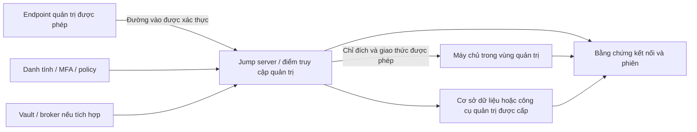

# Jump server trong truy cập quản trị từ xa

## 1. Jump server là gì?

Jump server là một máy hoặc điểm trung chuyển được chỉ định để người quản trị đi qua trước khi truy cập tài nguyên nằm trong vùng mạng được bảo vệ. Thay vì cho endpoint người dùng kết nối trực tiếp tới mọi máy chủ, kiến trúc tập trung một phần đường quản trị qua điểm có thể kiểm soát.

Trong quản lý truy cập đặc quyền (Privileged Access Management — PAM), jump server có thể tham gia đường mở phiên SSH, RDP hoặc chạy công cụ quản trị. Mục tiêu là thu hẹp đường truy cập, quản lý danh tính, hạn chế credential, giám sát hoạt động và liên kết việc sử dụng quyền với yêu cầu được phê duyệt.

Tuy nhiên, một máy chủ được đặt giữa hai mạng chưa tự trở thành giải pháp PAM đầy đủ. Nó có thể chỉ cung cấp đường kết nối, chưa có policy cấp quyền theo từng tài nguyên, chưa giữ credential trong vault và chưa ghi nội dung phiên.

Một thiết kế cần trả lời:

- Ai được vào jump server và ai được truy cập từng tài nguyên phía sau?
- Có thể đi vòng qua jump server bằng một đường khác không?
- Credential nằm ở client, trên jump server hay được broker sử dụng thay?
- Jump server có quan sát được nội dung phiên hay chỉ biết kết nối đi đâu?
- Quyền được giới hạn và kết thúc ở lớp nào?
- Nếu jump server bị xâm nhập, phạm vi tài nguyên và credential bị ảnh hưởng là gì?

Jump server là một ranh giới quản trị nhạy cảm. Cần bảo vệ nó tương xứng với những tài nguyên nó có thể tiếp cận, thay vì xem nó là máy dùng chung tiện lợi.

## 2. Phân biệt các thuật ngữ liên quan

| Thuật ngữ | Vai trò thường gặp | Điều không nên tự suy ra |
|---|---|---|
| Jump server / jump host | Trung chuyển hoặc nơi mở bước kết nối tiếp theo | Luôn giữ được secret ngoài endpoint hoặc ghi mọi thao tác |
| Bastion host | Hệ thống được gia cố ở một ranh giới truy cập | Luôn là một sản phẩm proxy/PAM hay luôn phải đặt trực tiếp trên Internet |
| VPN hoặc đường truy cập mạng | Tạo kết nối tới một vùng mạng theo chính sách | Người đã vào mạng được quyền quản trị mọi tài nguyên |
| Gateway / proxy | Chuyển tiếp hoặc xử lý kết nối theo khả năng giao thức | Luôn thấy nội dung hoặc luôn có chức năng phê duyệt/rotation |
| Session broker | Điều phối yêu cầu, quyết định và đường mở phiên | Nhất thiết chuyển tiếp toàn bộ dữ liệu phiên |
| Vault | Bảo vệ và quản lý credential | Tự kiểm soát được mọi phiên sau khi credential đã được cấp |

Trong thực tế, tên gọi jump host và bastion có thể được dùng thay nhau; một sản phẩm có thể gộp broker, proxy và gateway. Khi thiết kế, nên mô tả hành vi thật, đường dữ liệu và điểm thực thi thay vì dựa vào nhãn.

Quyền kết nối mạng và quyền tại tài nguyên là hai lớp khác nhau. Một firewall cho phép jump server tới database không có nghĩa mọi người đăng nhập jump server đều nên được dùng tài khoản quản trị database.

## 3. Những mô hình jump server khác nhau

### Đăng nhập vào jump rồi mở kết nối tiếp

Người dùng mở shell hoặc desktop trên jump server, sau đó dùng client tại đó để kết nối tới tài nguyên đích. Đây là mô hình dễ hiểu, nhưng làm jump server trở thành endpoint quản trị thật: nó có thể xử lý credential, lưu cấu hình, giữ session và chạy công cụ.

Người dùng có thể cần quyền tương tác rộng trên jump server; điều này đòi hỏi kiểm soát công cụ, tệp, kết nối và các quyền tại máy trung chuyển. Không nên cho rằng một máy nhiều người cùng mở desktop sẽ tự tách biệt đầy đủ mọi thông tin nhạy cảm.

### Trung chuyển kết nối mà không mở shell tương tác

Một cơ chế có thể chỉ cho phép chuyển kết nối tới những tài nguyên được phép. Credential và nội dung của phiên đích có thể vẫn nằm ở client và tài nguyên, tùy giao thức. Cách này giảm nhu cầu mở một môi trường làm việc đầy đủ trên jump nhưng không tự tạo ghi nhận nội dung.

### Jump server tích hợp PAM broker/proxy

Người dùng xác thực bằng danh tính cá nhân và nhận quyền kết nối có thời hạn. Broker/proxy dùng credential được quản lý để mở phiên, áp dụng giới hạn và ghi nhận theo khả năng nền tảng.

| Mô hình | Nơi có thể xử lý credential đích | Khả năng ghi nội dung |
|---|---|---|
| Shell/desktop trên jump | Client chạy trên jump, có thể có bộ nhớ hoặc cấu hình liên quan | Phụ thuộc công cụ và điểm ghi; không tự có audit đầy đủ |
| SSH trung chuyển đến đích | Client người dùng giữ vật liệu xác thực của phiên đích theo cách triển khai | Jump không mặc nhiên thấy nội dung SSH đích |
| Broker/proxy xử lý phiên | Thành phần phía máy chủ dùng credential thay theo thiết kế | Có thể hỗ trợ ghi/kiểm soát nhưng phải xác minh giao thức và cấu hình |

Lựa chọn mô hình phải phù hợp yêu cầu. Nếu yêu cầu là password đích không tới client, không thể chỉ thêm một bước trung chuyển rồi mặc định đã đáp ứng.

## 4. Kiến trúc mạng tham chiếu



Sơ đồ chỉ biểu diễn những đường được phép về mặt logic. Cần kiểm tra các đường còn lại bằng cấu hình và quyền thực tế: endpoint tới thẳng máy đích, VPN cấp mạng quá rộng, interface quản trị khác, tài khoản cục bộ, khóa cũ hoặc đường khẩn cấp không được quản lý.

### Giới hạn cả đường vào lẫn đường ra

| Hướng | Phạm vi cần kiểm soát |
|---|---|
| Endpoint → jump | Ai, từ đâu, bằng danh tính/thiết bị nào và qua giao thức nào |
| Jump → tài nguyên | Đúng đích, cổng/giao thức và mục đích; không có quyền chuyển tiếp tùy ý tới toàn mạng |
| Jump → dịch vụ hỗ trợ | Chỉ những phụ thuộc cần thiết như danh tính, thời gian, log, vault hoặc cập nhật được quản trị |
| Tài nguyên → dịch vụ khác | Quyền và kết nối tại đích vẫn cần kiểm soát, tránh biến phiên quản trị thành đường đi tiếp ngoài phạm vi |

Đặt jump server trong một vùng mạng không thay thế ACL, xác thực và quyền ứng dụng. Mặt khác, ACL chỉ cho phép IP jump tới tài nguyên cũng chưa quy trách nhiệm được từng người; cần danh tính và bằng chứng ở các lớp phù hợp.

Jump server không nhất thiết phải có dịch vụ SSH/RDP mở trực tiếp cho toàn Internet. Đường vào cần theo thiết kế truy cập từ xa đã được quản trị. Một endpoint không tin cậy vẫn có thể quan sát hoặc điều khiển phiên dù credential đích không được hiển thị, nên điều kiện endpoint cũng thuộc mô hình rủi ro.

## 5. Tách miền tin cậy và môi trường

Nếu một jump server dùng chung cho development và production, người có quyền quản trị máy đó có thể ảnh hưởng tới các phiên hoặc credential production mà nó xử lý. Thư mục hoặc biểu tượng khác nhau không tạo ra ranh giới đầy đủ.

Cần đánh giá khả năng tách theo môi trường, mức đặc quyền, nhóm tài nguyên hoặc miền tin cậy. Những thành phần dùng chung như nguồn danh tính, pipeline triển khai và quyền hạ tầng cũng phải được đưa vào phân tích.

| Phạm vi | Ví dụ cách giới hạn |
|---|---|
| Development | Chỉ danh tính, credential và tài nguyên dev được giao |
| Production | Đường quản trị, người được cấp, profile và credential prod theo policy |
| Hạ tầng danh tính hoặc tài nguyên đặc biệt nhạy cảm | Kiểm soát phù hợp với mức tác động của quyền có thể sử dụng |
| Nhà cung cấp bên ngoài | Danh tính riêng, tài nguyên/công việc cụ thể, thời hạn và giám sát phù hợp |

Không dùng một tài khoản quản trị mạnh để đăng nhập mọi jump và mọi tài nguyên ở các mức tin cậy khác nhau. Credential hoặc phiên ở máy có mức bảo vệ yếu hơn có thể làm tăng rủi ro cho vùng nhạy cảm hơn.

Tách nhiều jump server không tự loại bỏ quyền quản trị toàn cục. Nếu một người có thể thay code hoặc policy của mọi jump, họ vẫn có phạm vi tác động rộng. Cần phân quyền quản trị và kiểm soát thay đổi tương ứng.

## 6. Danh tính, phê duyệt và quyền tối thiểu

Mỗi người nên truy cập qua danh tính có thể quy trách nhiệm. Một tài khoản jump dùng chung cho cả đội làm khó việc xác định ai mở kết nối, ai đã được phê duyệt và ai cần bị thu hồi.

Policy cần phân biệt:

- Quyền đăng nhập hoặc sử dụng chức năng của jump server.
- Quyền đề nghị kết nối đến một tài nguyên.
- Quyền dùng một tài khoản/role đặc quyền tại đích.
- Quyền xem credential, sửa policy hoặc quản trị jump server.
- Quyền giám sát, xem bản ghi và can thiệp phiên.

MFA tại đường vào giúp tăng bảo đảm xác thực nhưng không tự cấp quyền quản trị ở đích. Khi cần quyền nhạy cảm hơn, có thể có bước xác thực bổ sung hoặc phê duyệt đúng phạm vi; tài nguyên và hành động vẫn phải được kiểm tra.

### JIT và JEA trong đường đi qua jump

JIT giới hạn khi nào quyền được kích hoạt và khi nào phải thu hồi. JEA hoặc role hẹp tại đích giới hạn người dùng được làm gì. Chỉ rút ngắn thời gian của một shell toàn quyền không tự thay thế giới hạn tác vụ.

Ví dụ, kỹ sư chỉ cần kiểm tra trạng thái dịch vụ được cấp profile chỉ đọc; không nên mặc định có shell root hoặc desktop quản trị toàn hệ thống. Profile phải được cưỡng chế tại endpoint/proxy/đích đủ khả năng, không chỉ là một nhãn trong ticket.

Công cụ được phép có thể mở shell, thực thi code hoặc truy cập tệp ngoài mục đích. Do đó, đánh giá JEA cần xét khả năng thật của công cụ và quyền phía đích, không chỉ danh sách tên lệnh.

Với workload tự động, cần danh tính máy và quyền theo tác vụ. Không nên cho batch dùng chung tài khoản cá nhân của kỹ sư trên jump hoặc buộc mọi ứng dụng nền đi qua desktop tương tác.

## 7. Credential trên đường trung chuyển

Jump server có thể nhìn thấy hoặc sử dụng secret tùy mô hình. Cần vẽ đường đi của password, private key, token, chứng thư và dữ liệu bắt đầu phiên để biết nơi nào thực sự nhận chúng.

Những nguyên tắc cần xem xét:

- Dùng vault/broker để quản lý vòng đời và quyền sử dụng credential khi tích hợp hỗ trợ.
- Tách quyền mở phiên khỏi quyền reveal/export secret.
- Không lưu password hoặc private key trong thư mục người dùng chung, script, lịch sử hoặc tệp cấu hình không được bảo vệ.
- Hạn chế việc đưa credential production vào launcher/endpoint nếu yêu cầu là giữ secret ở phía máy chủ.
- Xem xét quyền quản trị jump, bộ nhớ, crash dump, plugin và công cụ chẩn đoán như những đường có thể tiếp cận secret.

Mã hóa khi lưu không ngăn một thành phần được cấp quyền sai lấy secret lúc chạy. Một trường password được che cũng không chứng minh giá trị chưa từng được gửi qua API hoặc đến client.

### Agent forwarding và khả năng sử dụng khóa

Với SSH agent forwarding, private key không nhất thiết được sao chép sang jump theo giao thức, nhưng máy trung chuyển có thể được cấp khả năng yêu cầu agent thực hiện thao tác xác thực. Nếu jump bị xâm nhập, khả năng đó có thể bị lạm dụng trong phạm vi agent cho phép.

Vì vậy, không coi “khóa vẫn ở client” là kết luận đủ về an toàn. Cần đánh giá có thật sự cần forwarding không, phạm vi được cấp, vòng đời và những đường thay thế phù hợp. Tránh bật rộng chỉ vì thuận tiện qua nhiều hop.

Với mô hình RDP/desktop trung chuyển, cơ chế xử lý hoặc ủy quyền credential phụ thuộc chế độ xác thực và nền tảng. Không nên khẳng định một jump desktop bất kỳ giữ được mọi credential ngoài bộ nhớ hoặc ngoài tầm quản trị viên máy đó.

## 8. Ví dụ SSH qua jump và giới hạn quan sát

Với OpenSSH có hỗ trợ tùy chọn tương ứng, một kết nối minh họa có thể viết:

```sh
ssh -J operator@jump.prod.example admin@server-01.prod.example
```

Các hostname và tài khoản trong ví dụ chỉ là tên minh họa. Lệnh diễn tả dùng một jump host để đi tới đích; nó không phải cấu hình PAM hoàn chỉnh và không nên được hiểu là đã có phê duyệt, JIT, vault hoặc ghi phiên.

Trong mô hình ProxyJump, jump hỗ trợ đường chuyển tiếp để client thiết lập kết nối SSH tới đích. Phiên SSH đích vẫn có cơ chế xác thực và mã hóa riêng giữa client và tài nguyên. Do đó:

- Client cần được phép sử dụng jump và được phép xác thực tới đích theo chính sách riêng.
- Cần quản lý trust/host identity của cả jump và đích.
- Jump có thể quan sát thông tin kết nối phù hợp nhưng không mặc nhiên đọc được nội dung terminal của phiên SSH đích.
- Credential/key dùng tại client vẫn cần bảo vệ; thêm `-J` không tự thay đổi vòng đời hoặc nơi giữ credential.

Nếu yêu cầu phải ghi nội dung lệnh/terminal hoặc dùng credential thay người dùng, cần một cơ chế khác hoặc bổ sung đáp ứng yêu cầu, như proxy xử lý giao thức hoặc kiểm soát tại endpoint/đích. Phải xác minh khả năng thật của triển khai.

Không nên tắt kiểm tra host identity để vượt qua cảnh báo kết nối. Cảnh báo có thể do thay đổi hợp lệ hoặc do sai/giả mạo đích; cần xác minh theo quy trình quản lý trust trước khi dùng credential.

Phạm vi chuyển tiếp cũng phải được giới hạn. Nếu tài khoản jump được phép mở đường đến mọi địa chỉ/cổng trong mạng, nó có thể trở thành một cổng kết nối rộng hơn nhu cầu. Quyền truy cập tới một jump không nên mặc nhiên là quyền chuyển tiếp tùy ý.

## 9. Gia cố jump server như endpoint quản trị nhạy cảm

Jump server cần được vận hành với bộ công cụ và dịch vụ phục vụ quản trị đã xác định. Cài thêm công cụ, plugin hoặc cho người dùng thay code có thể làm tăng bề mặt tấn công và khả năng quan sát credential/phiên.

| Miền kiểm soát | Nội dung cần thiết kế |
|---|---|
| Hệ điều hành và dịch vụ | Cấu hình được quản lý, cập nhật theo quy trình, giảm dịch vụ không cần thiết |
| Công cụ quản trị | Nguồn cài đặt, phiên bản được chấp thuận, quyền thay đổi và kiểm soát plugin |
| Tài khoản tại jump | Danh tính cá nhân, quyền tối thiểu và quyền quản trị máy được tách |
| Kết nối | Đường vào, đường ra và danh mục đích/giao thức được giới hạn |
| Dữ liệu cục bộ | Tệp tạm, cấu hình, clipboard, cache và dump được bảo vệ theo nhu cầu |
| Quản lý thay đổi | Ai sửa policy, công cụ, mạng, image hoặc pipeline triển khai |
| Quan sát | Sức khỏe, dấu hiệu xâm nhập, thay đổi cấu hình và tình trạng bằng chứng |

Công việc thông thường như đọc email hoặc truy cập web không liên quan đến quản trị làm tăng nội dung không tin cậy được xử lý trên endpoint nhạy cảm. Nên xác định rõ mục đích sử dụng jump và tách những công việc đó theo mô hình vận hành.

Nếu người dùng có thể chạy code tùy ý với quyền mạnh trên jump, phải đánh giá khả năng họ đọc dữ liệu phiên khác, thay công cụ hoặc truy cập credential trong bộ nhớ. Chỉ phân thư mục theo username chưa đủ để bảo đảm cách ly.

Quyền quản trị hạ tầng chứa jump cũng quan trọng: snapshot, console, image, runtime và pipeline có thể tạo quyền gián tiếp dù tài khoản đó không có quyền đọc secret trong vault.

### Kiểm soát truyền dữ liệu

Clipboard, file transfer, drive mapping, tunnel và những tính năng tương tự có thể phục vụ công việc hợp lệ nhưng cũng mở kênh đưa dữ liệu hoặc công cụ qua ranh giới. Cần quyết định chức năng nào được phép, ai được phép và bằng chứng nào được giữ.

Tắt một chức năng trong client không chứng minh mọi đường truyền cùng mục đích đã bị chặn. Cần xem giao thức, quyền trên jump và quyền tại tài nguyên. Người có shell hoặc công cụ thực thi rộng có thể tạo những đường khác ngoài giao diện dự kiến.

## 10. Vòng đời phiên và kết thúc quyền

Một phiên qua jump thường có nhiều lớp: client tới jump, jump tới tài nguyên, phiên tại đích và những tác vụ được khởi phát. Thiết kế phải quản lý các lớp này thay vì chỉ theo dõi người dùng đã đóng cửa sổ hay chưa.

| Mốc | Câu hỏi cần trả lời |
|---|---|
| Trước mở phiên | Chủ thể, tài nguyên, account, profile và thời hạn nào đã được cho phép? |
| Kích hoạt | Grant còn hiệu lực, đúng người/đích và chưa bị sử dụng trái policy không? |
| Đang hoạt động | Có giám sát, kiểm tra điều kiện và giới hạn chức năng bắt buộc không? |
| Mất kết nối | Phiên jump hoặc đích còn sống không, có cho reconnect không? |
| Hết hạn/thu hồi | Điểm nào chặn quyền mới, đóng kết nối và xử lý quyền tại đích? |
| Kết thúc | Những phần nào đã xác nhận, phần nào cần đối soát? |

Một RDP disconnect không tự là logoff. Một kết nối SSH đóng không chắc dừng mọi process tách rời hoặc job đã được lên lịch. Ngắt đường vào jump cũng chưa chắc đóng những kết nối từ jump tới tài nguyên nếu mô hình cho phép chúng tồn tại độc lập.

JIT hết hạn cần được thực thi ở lớp phù hợp. Gỡ role/nhóm không tự loại bỏ mọi quyền đã nằm trong token hoặc phiên đang chạy. Hệ thống phải xác định khi nào đóng phiên, vô hiệu token, gỡ quyền hoặc dùng biện pháp khác theo khả năng nền tảng.

### Rotation sau sử dụng

Có thể có policy rotation credential sau một lần sử dụng nhạy cảm hoặc khi nghi lộ lọt. Nhưng đổi password không tự kết thúc mọi phiên đã xác thực, và một tài khoản dịch vụ có thể còn consumer khác cần cập nhật.

Cần phối hợp trạng thái phiên, vault, tài nguyên và consumer. Không nên đổi credential sau mọi lần disconnect mà không biết tài khoản dùng chung cho những gì.

## 11. Giám sát, ghi nhận và bằng chứng

Jump server có thể tạo nhiều lớp bằng chứng, nhưng cần hiểu mỗi lớp chứng minh điều gì.

| Nguồn | Có thể hỗ trợ chứng minh | Giới hạn cần lưu ý |
|---|---|---|
| Log truy cập jump | Ai đăng nhập, thời điểm, nguồn và kết quả theo dữ liệu thu được | Không tự cho biết mọi hành động trên đích |
| Metadata chuyển tiếp | Kết nối đến tài nguyên nào và trong khoảng nào | Không tự là nội dung phiên mã hóa |
| Proxy/agent ghi phiên | Nội dung hoặc sự kiện trong phạm vi giao thức/công cụ hỗ trợ | Có thể có khoảng trống, kênh khác hoặc nội dung không quan sát được |
| Log tài nguyên | Tài khoản đích, hành động/sự kiện mà đích ghi nhận | Có thể chỉ thấy tài khoản chung, cần ánh xạ về người khởi tạo |
| Policy/PAM | Lý do, phê duyệt, profile, grant và thời hạn | Quyết định cho phép chưa là bằng chứng mọi ràng buộc đã thực thi |

Shell history không phải một bản kiểm toán đầy đủ, đáng tin cậy cho mọi tác vụ. Nó có thể không ghi những hoạt động qua giao thức khác, công cụ hoặc ngữ cảnh khác, và có thể bị ảnh hưởng bởi cấu hình/quyền người dùng.

Bằng chứng nên nối danh tính cá nhân, request/grant ID, session ID, jump/proxy xử lý, tài nguyên/tài khoản đích, policy và kết quả kết thúc. Khi dùng tài khoản đích chung, mối liên kết này đặc biệt quan trọng.

Không ghi password, private key hoặc token đầy đủ vào log. Bản ghi terminal/video có thể chứa dữ liệu nhạy cảm trên tài nguyên nên quyền xem, tải, lưu giữ và bảo vệ tính toàn vẹn cần được quản trị.

Người vận hành jump không nên mặc nhiên có thể xóa mọi dấu vết của chính mình. Cần xem quyền cấu hình đích log, tài khoản hạ tầng lưu bằng chứng và khả năng đối chiếu với nguồn khác. Tính toàn vẹn của bản ghi đã nhận không tự chứng minh nguồn bị xâm nhập đã phát đầy đủ sự kiện.

## 12. Tính sẵn sàng, lỗi và đường khẩn cấp

Tập trung đường quản trị qua jump làm tăng nhu cầu vận hành và khôi phục điểm đó. Nếu jump lỗi, tổ chức cần biết phiên nào bị ảnh hưởng, quyền nào còn ở đích và cách tiếp tục xử lý sự cố theo thẩm quyền.

| Tình huống | Hành vi cần quy định |
|---|---|
| Không xác thực được vào jump | Không mở đường thay thế không kiểm soát; có thông báo và runbook phù hợp |
| Vault/broker lỗi | Không tự trả password hoặc dùng tài khoản toàn quyền dự phòng cho mọi người |
| Không thể ghi phiên bắt buộc | Chặn mở mới hoặc xử lý phiên hiện hữu theo policy đã định |
| Mất kết nối client | Kiểm tra trạng thái tại jump/đích, reconnect đúng người và thời hạn |
| Jump khởi động lại | Đối soát phiên, quyền tạm, bản ghi chưa chuyển và tác vụ còn tồn tại |
| Không tới được một đích | Không suy ra credential sai và tự reset tài khoản |
| Lệnh thu hồi không được xác nhận | Giữ phần chưa xác minh, cảnh báo và xử lý theo runbook |

Nhiều jump server có thể cải thiện tiếp nhận kết nối mới, nhưng không bảo đảm một desktop hoặc phiên SSH đang chạy được chuyển sang node khác không gián đoạn. Cần nêu riêng bảo đảm cho yêu cầu mới, phiên hiện hữu và dữ liệu bằng chứng.

Nếu mất control plane mà phiên vẫn có thể hoạt động, cần giới hạn tiếp tục theo lease hoặc policy cục bộ đã được chấp thuận. Điểm thực thi không thể tự biết mọi quyết định thu hồi mới khi kênh thông tin không còn hoạt động.

### Break-glass

Đường khẩn cấp cần được thiết kế trước: người được dùng, cách lấy quyền khi thành phần trung tâm lỗi, phạm vi, thời hạn, lưu bằng chứng và đối soát sau sử dụng. Một đường trực tiếp có credential được chia sẻ vô thời hạn không phải cơ chế khẩn cấp được kiểm soát.

Nếu mục tiêu là xử lý lỗi jump hoặc nguồn danh tính, các phụ thuộc lấy quyền khẩn cấp phải phù hợp kịch bản. Không đặt toàn bộ credential cứu hộ ở nơi chỉ truy cập được sau khi đi qua chính thành phần đang hỏng.

## 13. Tình huống minh họa

Một nhóm vận hành cần quản trị hai máy chủ thanh toán production. Ban đầu, mỗi kỹ sư có thể đi từ VPN tới nhiều máy chủ bằng khóa hoặc password lưu riêng. Tổ chức muốn thu hẹp đường truy cập, hạn chế secret phân phối và có bằng chứng gắn với công việc.

### Thiết kế phạm vi

Nhóm quyết định dùng một đường jump tích hợp proxy PAM cho production. Người dùng có danh tính cá nhân, điều kiện MFA và thiết bị theo policy; quyền đề nghị và quyền tại từng máy chủ được phân biệt. Proxy dùng credential được quản lý, profile quyền được cưỡng chế tại nơi phù hợp và phiên bắt buộc được ghi.

Firewall và quyền tài nguyên được điều chỉnh theo kế hoạch để những đường truy cập trực tiếp không được phép không còn hoạt động. Các khóa, tài khoản cục bộ và đường khẩn cấp được kiểm kê riêng; chỉ dựng jump mà giữ nguyên mọi đường cũ chưa đáp ứng mục tiêu.

### Một yêu cầu truy cập

Kỹ sư Linh cần kiểm tra trạng thái dịch vụ. Yêu cầu được đánh giá trên đúng hai tài nguyên được giao, không tự có shell quản trị toàn quyền. Khi cần tác vụ restart, Linh phải có quyền/profile tương ứng và những điều kiện phê duyệt áp dụng.

Trong ví dụ học tập, một quyền tạm có thể giới hạn 15 phút; thời hạn thật phải theo policy và công việc. Grant không được dùng cho tài nguyên khác hoặc kéo dài chỉ bằng việc mở lại cửa sổ.

### Mất kết nối và kết thúc

Client mất mạng khi phiên đã hoạt động. Hệ thống không coi đó là đã logoff tại đích. Proxy/broker xác định trạng thái, áp dụng reconnect trong thời hạn và ngăn sử dụng lại khi quyền đã bị thu hồi.

Khi hết hạn, đường truy cập bị đóng, quyền tạm được xử lý và kết quả đối soát được ghi. Nếu endpoint chưa xác nhận gỡ quyền, báo cáo giữ hạng mục chưa xác minh thay vì đánh dấu toàn bộ hoàn tất.

Nếu nhóm chỉ dùng ProxyJump thông thường, cần mô tả kết quả khác: nó có thể đáp ứng đường kết nối được giới hạn nhưng không tự cung cấp việc dùng credential thay hoặc ghi terminal nội dung. Khi yêu cầu kiểm soát thay đổi, phải bổ sung đúng cơ chế thay vì gán thêm bảo đảm cho tên gọi jump.

## 14. Kiểm tra thiết kế và lỗi thường gặp

Các tình huống sau dùng để lập kế hoạch kiểm chứng trong phạm vi được phép. Cần kiểm tra ở API, mạng, jump và đích phù hợp, không chỉ quan sát giao diện.

| Tình huống | Kết quả mong đợi |
|---|---|
| Người hợp lệ vào jump và tới tài nguyên được giao | Thành công theo quyền, có liên kết danh tính và bằng chứng |
| Người chỉ được vào jump thử dùng tài nguyên khác | Bị chặn ở những lớp có thẩm quyền tương ứng |
| Endpoint thử đường trực tiếp ngoài thiết kế | Không vượt được ranh giới quản trị theo policy |
| Danh tính dev dùng đường prod | Bị từ chối nếu không có ủy quyền prod riêng |
| Sửa hostname/account/secret ID trong yêu cầu | Không kết nối ngoài danh mục và grant đã cấp |
| Host identity của jump hoặc đích không đúng | Không bỏ qua để dùng credential với đích chưa được xác minh |
| Người có quyền mở phiên gọi reveal/export | Không được xem secret nếu thiếu quyền riêng |
| Kết nối SSH trung chuyển có nội dung mã hóa riêng | Báo đúng giới hạn quan sát; không khẳng định đã ghi terminal tại jump |
| Client disconnect hoặc grant hết hạn | Phiên/quyền ở đích được xử lý và báo theo phạm vi đã xác nhận |
| Recorder hoặc jump lỗi | Có hành vi suy giảm và đối soát được quy định trước |
| Credential cũ/khóa cũ còn đường sử dụng | Được phát hiện và xử lý theo kế hoạch, không bị bỏ qua vì jump đã hoạt động |

Những lỗi thường gặp:

| Lỗi | Hệ quả | Cách xử lý |
|---|---|---|
| Coi jump là PAM đầy đủ | Thiếu policy, vault, giới hạn và bằng chứng | Mô tả rõ chức năng và bổ sung điểm kiểm soát cần thiết |
| Jump có quyền ra toàn mạng | Một phiên bị chiếm có đường tiếp cận rộng | Giới hạn đích/giao thức và quyền tại tài nguyên |
| Dùng tài khoản jump chung | Khó quy trách nhiệm và thu hồi theo người | Danh tính riêng, liên kết phiên và kiểm soát tài khoản đích chung khi cần |
| Sao chép private key/password lên jump cho tiện | Tăng số bản sao và phạm vi lộ lọt | Thiết kế đường credential, vault/broker và quyền sử dụng theo nhu cầu |
| Bật forwarding rộng mà không đánh giá | Máy trung chuyển có thể lạm dụng khả năng xác thực/chuyển tiếp | Chỉ cho chức năng thật sự cần, theo phạm vi và thời hạn |
| Giả định mọi hop đều ghi được nội dung | Có khoảng trống kiểm toán | Xác minh nơi kết thúc/quan sát giao thức và nguồn bằng chứng |
| Dùng chung jump cho nhiều miền tin cậy không được xem xét | Xâm nhập một vùng có thể ảnh hưởng vùng khác | Tách phạm vi, danh tính, credential và quyền quản trị phù hợp |
| Đóng cửa sổ được coi là đã thu hồi | Phiên/quyền/tác vụ ở đích vẫn tồn tại | Quản lý vòng đời và xác nhận ở điểm thực thi |

Để tự kiểm tra thiết kế, hãy trả lời:

1. Jump cung cấp shell/desktop, chuyển tiếp kết nối hay xử lý giao thức như một proxy?
2. Người được vào jump có thể kết nối tới những tài nguyên nào và lớp nào cưỡng chế giới hạn đó?
3. Credential đích nằm ở đâu trong lúc sử dụng, và ai có thể điều khiển thành phần đó?
4. Nếu dùng SSH ProxyJump, nội dung phiên đích được quan sát hoặc ghi ở đâu?
5. Có đường trực tiếp, khóa cũ, tài khoản cục bộ hoặc đường khẩn cấp nào vượt ranh giới không?
6. Khi mất mạng hoặc hết hạn JIT, phiên, token, quyền và tác vụ tại đích được xử lý thế nào?
7. Nếu jump bị xâm nhập, những môi trường và credential nào có thể bị ảnh hưởng?
8. Khi jump hoặc broker lỗi, đường khôi phục có còn truy cập được đúng kịch bản và thẩm quyền không?

Jump server có giá trị khi trở thành một phần của đường quản trị được thiết kế rõ: danh tính có thể quy trách nhiệm, kết nối được thu hẹp, credential được bảo vệ, quyền tại đích phù hợp và vòng đời phiên được kiểm chứng. Những bảo đảm này cần được xác nhận theo mô hình triển khai thật, không suy ra chỉ từ việc đã có một máy trung chuyển.
