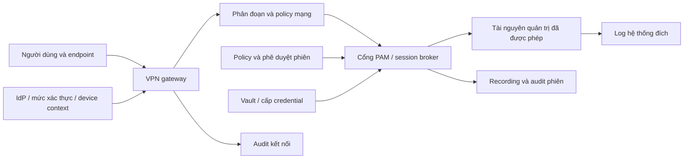

# VPN privileged access

## 1. VPN nằm ở đâu trong truy cập đặc quyền?

VPN tạo một đường kết nối được bảo vệ giữa các điểm theo mô hình triển khai, thường để người dùng hoặc một mạng từ xa tiếp cận tài nguyên nội bộ. Trong quản lý truy cập đặc quyền (Privileged Access Management, PAM), VPN có thể là lớp kết nối ban đầu để kỹ sư vận hành, nhà cung cấp hoặc workload đi tới đường quản trị được kiểm soát.

Kết nối VPN thành công không tự cho phép quản trị mọi hệ thống bên trong. Quyền vào mạng, quyền mở phiên PAM, quyền sử dụng credential và quyền thực hiện tác vụ trên đích là những lớp khác nhau. Nếu VPN cấp route và firewall rule quá rộng, một endpoint bị xâm nhập có thể tiếp cận nhiều bề mặt hơn nhu cầu công việc, dù tunnel đã được mã hóa.

Ví dụ, kỹ sư nhà cung cấp cần chẩn đoán một máy production trong 20 phút. Người đó có thể được phép kết nối VPN tới cổng PAM, nhưng chỉ được mở đúng phiên đã duyệt, dùng tài khoản chẩn đoán, không nhận mật khẩu quản trị và không đi trực tiếp tới các máy khác. Thời hạn VPN dài hơn không kéo dài quyền trên máy đích.

Bài học thuộc chương Remote access, tập trung vào tài khoản quản trị, danh tính dịch vụ và hạ tầng nhạy cảm. Mục tiêu là kết hợp VPN với kiểm kê quyền, least privilege, JIT/JEA, vault, rotation, giám sát phiên và bằng chứng kiểm toán, ứng phó sự cố.

Các sơ đồ và cấu hình dữ liệu trong bài là mô hình tham khảo. Chúng không phải hướng dẫn cấu hình một sản phẩm VPN cụ thể và không giả định mọi gateway có cùng chức năng phân quyền, kiểm tra thiết bị hay điều khiển phiên.

## 2. Phân biệt các lớp tin cậy

| Lớp | Câu hỏi cần trả lời | Kiểm soát minh họa |
|---|---|---|
| Danh tính từ xa | Ai đang kết nối và bằng mức bảo đảm nào? | Danh tính riêng, MFA hoặc cơ chế workload phù hợp |
| Thiết bị | Endpoint có thuộc phạm vi được phép và còn đáp ứng điều kiện không? | Device identity, chứng thư và posture có nguồn tin cậy |
| Kết nối VPN | Tunnel nào được mở, có hạn và được route tới đâu? | Chính sách gateway, địa chỉ cấp phát, giới hạn thời gian |
| Quyền mạng | Từ tunnel đó được kết nối tới đích và cổng nào? | Phân đoạn, firewall, giới hạn chiều và phạm vi |
| Quyền PAM | Có được mở phiên cụ thể trong ngữ cảnh này không? | Phê duyệt, grant, thời hạn, recording bắt buộc |
| Credential và tài khoản đích | Dùng danh tính nào với quyền thực tế nào? | Vault, credential ngắn hạn, vai trò hẹp và JEA |
| Phiên và bằng chứng | Hoạt động có được giám sát và kết thúc đúng không? | Broker, log đích, recording và thu hồi |

Mã hóa tunnel bảo vệ lưu lượng theo phạm vi của tunnel. Sau gateway, dữ liệu đi qua đường nào và còn được bảo vệ ra sao phụ thuộc kiến trúc. Vẫn cần bảo vệ giao thức quản trị tới đích và xác minh danh tính máy chủ phù hợp; không bỏ kiểm tra SSH host key hoặc chứng thư chỉ vì đang ở trong VPN.

Địa chỉ IP được cấp không phải danh tính bền vững. Nó có thể được tái sử dụng, đi qua NAT hoặc đại diện cho nhiều chủ thể. Quyết định quyền phải gắn với thông tin có thẩm quyền, còn IP và thời điểm là dữ liệu hỗ trợ liên kết luồng mạng.

## 3. Các mô hình truy cập thường gặp

### 3.1. VPN đi trực tiếp tới hệ thống đích

Gateway và firewall cho phép client từ xa kết nối tới một tập tài nguyên. Mô hình này cần quyền mạng hẹp cùng xác thực, phân quyền và bằng chứng ở từng hệ thống đích. Nếu credential được đưa cho người dùng, phải quản lý rủi ro sao chép và sử dụng ngoài đường dự kiến.

PAM không tự ghi được nội dung chỉ vì người dùng đi qua VPN. Muốn recording cần broker hoặc điểm quan sát được ủy quyền trên đường phù hợp, hoặc agent ở đích theo thiết kế. Log gateway thường mô tả kết nối và lưu lượng theo khả năng sản phẩm, không mặc định là transcript lệnh.

### 3.2. VPN đi tới cổng PAM hoặc broker



Ở mô hình này, VPN có thể chỉ cho client tới cổng PAM, còn broker đi tới tài nguyên quản trị. Người dùng không đương nhiên có route hoặc rule đi trực tiếp vào mạng quản trị. Credential có thể được broker sử dụng mà không xuất cho người dùng khi tích hợp hỗ trợ.

Bastion hoặc gateway không mặc định có recording, che credential hay giới hạn lệnh. Các khả năng đó phải được triển khai và kiểm tra. Đồng thời cần kiểm soát đường đi vòng, tài khoản đặc quyền thường trực và quyền trên đích để mô hình có hiệu lực thực tế.

### 3.3. VPN kết nối mạng với mạng

Một tunnel site-to-site có thể bảo vệ đường giữa hai mạng, nhưng danh tính của một máy hoặc người dùng phía sau không tự được chứng minh chỉ bằng việc gói tin đi qua tunnel đó. Không coi toàn bộ chi nhánh hoặc mạng đối tác là nhóm quản trị đáng tin cậy.

Vẫn cần danh tính riêng ở PAM hoặc ứng dụng đích, phân đoạn và quyền mạng theo phạm vi công việc. Nếu gateway chỉ nhìn thấy một nguồn tổng hợp, bằng chứng phải có cách liên kết thêm ở các điểm khác, thay vì gán mọi hành động cho một tài khoản site dùng chung.

## 4. Kiểm kê trước khi cấp quyền

Một yêu cầu privileged access cần cụ thể hơn “cho vào VPN production”.

| Nhóm dữ liệu | Nội dung cần xác định |
|---|---|
| Chủ thể | Người dùng hoặc workload, tổ chức, tenant và người chịu trách nhiệm |
| Thiết bị | Device reference, tình trạng quản lý và điều kiện được phép |
| Mục đích | Tác vụ, incident hoặc change reference, phạm vi hỗ trợ |
| Đường vào | Gateway, profile, phương thức xác thực và nhóm chính sách |
| Quyền mạng | Đích, cổng, giao thức, chiều lưu lượng và thời gian |
| Quyền trên đích | Tài khoản hoặc mẫu vai trò, phạm vi lệnh và dữ liệu |
| Phiên | Phê duyệt, cửa sổ bắt đầu, thời lượng, yêu cầu recording |
| Vòng đời | Người duyệt, cách thu hồi, consumer và bằng chứng cần giữ |

Tài nguyên phải gắn với nguồn kiểm kê có thẩm quyền. Không chỉ dựa vào một IP hoặc nhãn do người yêu cầu tự nhập. Khi địa chỉ thay đổi hoặc được dùng lại, rule và binding phải được đối soát để không mở nhầm tài nguyên khác.

Với bên thứ ba, cần chủ sở hữu nội bộ, thời hạn hợp tác, danh tính cá nhân và phạm vi hỗ trợ. Không dùng một tài khoản VPN chung cho cả nhóm nhà cung cấp rồi cố suy ra người thực hiện từ tên hiển thị trong phiên.

## 5. Danh tính, MFA và trạng thái thiết bị

### 5.1. Danh tính riêng và quyền hiện hành

Mỗi người quản trị cần một danh tính có thể truy vết. Workload cần danh tính dịch vụ phù hợp thay vì dùng tài khoản VPN của một nhân viên. Gateway và PAM phải xác minh nguồn danh tính, mức xác thực và membership theo mô hình tin cậy đã cấu hình.

MFA giúp tăng mức bảo đảm xác thực, nhưng không tự giới hạn subnet, tài khoản đích hoặc lệnh. Một người đã qua MFA vẫn chỉ được thực hiện tác vụ đã cấp. Khi cần xác thực tăng cường cho thao tác nhạy cảm, phải định nghĩa độ mới và điều kiện yêu cầu, không mặc định lần đăng nhập từ lâu vẫn đáp ứng mọi công việc.

Profile hoặc bí mật dùng chung của tunnel không nên trở thành bằng chứng duy nhất để quy một thao tác cho một cá nhân. Nếu dùng shared secret trong một quan hệ kết nối, cần quản lý nó theo vòng đời riêng, đồng thời giữ danh tính người dùng hoặc workload ở lớp phù hợp.

Token, chứng thư và private key phía client cần được bảo vệ. Không đưa credential quản trị đích vào file profile VPN hoặc phát một gói cấu hình chứa secret chung cho mọi người. Khi một thiết bị hoặc thành viên rời phạm vi được phép, phải có cách thu hồi quyền tương ứng mà không chỉ xóa tên khỏi một danh sách giao diện.

### 5.2. Posture phải có nguồn và độ mới

Điều kiện thiết bị có thể gồm trạng thái quản lý, chứng thư, mức đáp ứng cấu hình bảo vệ hoặc các tín hiệu được tổ chức quy định. Giá trị `compliant: true` do client tự khai không đủ làm căn cứ. Cần nguồn có thẩm quyền, ràng buộc với device identity và độ mới chấp nhận được.

Một thiết bị đáp ứng posture không được coi là chắc chắn không bị xâm nhập. Nó vẫn cần quyền hẹp và bảo vệ dữ liệu nhận trong phiên. Với thiết bị ngoài quản lý, tổ chức cần định nghĩa có được truy cập không, được dùng kênh nào và được nhận dữ liệu gì; không tự cấp quyền mạng quản trị rộng vì người dùng đã xác thực.

Khi posture hoặc membership thay đổi trong lúc tunnel đang mở, cần hành vi rõ: chặn quyền mới, yêu cầu xác thực lại, hạn chế truy cập hoặc kết thúc theo policy. Không giả định việc kiểm tra ở lúc kết nối đã bao phủ toàn bộ thời gian sau đó.

### 5.3. Quản trị chính gateway

Giao diện quản trị VPN, API cấu hình và danh tính điều khiển gateway thuộc một phạm vi đặc quyền riêng. Người dùng tunnel không đương nhiên được tiếp cận chúng. Cần kiểm soát đường quản trị, quyền sửa policy, credential quản trị và bằng chứng thay đổi.

Gateway bị quản trị sai có thể mở rộng quyền mạng cho nhiều người. Vì vậy, bảo vệ lớp này và quản lý thay đổi là một phần của PAM, không chỉ bảo vệ credential trên các máy đích.

## 6. Phân đoạn mạng và chính sách tunnel

### 6.1. Route không phải là toàn bộ kiểm soát quyền

Route cho biết nơi gửi gói tin, còn policy tại gateway, firewall và đích quyết định lưu lượng được chấp nhận. Không chỉ phân phối một danh sách route hẹp rồi tin rằng client không thể thay đổi đường đi. Cần thực thi ở các điểm mà bên gọi không tự sửa được.

Thiết kế thường cần giới hạn nguồn, đích, cổng, giao thức, chiều lưu lượng, tenant hoặc nhóm được xác thực và thời hạn. Áp dụng mặc định từ chối theo phạm vi đã chọn, mở phần cần thiết thay vì cho toàn bộ mạng nội bộ.

Quyền mạng chỉ cho phép tới cổng quản trị vẫn chưa giới hạn quyền ứng dụng. Cho phép tới SSH của một máy không có nghĩa tài khoản root trở thành chỉ đọc. Tài khoản, vai trò, lệnh và khả năng nâng quyền cần kiểm soát riêng.

### 6.2. Split tunnel và full tunnel

| Mô hình | Ý nghĩa đường đi theo cấu hình | Điều cần đánh giá |
|---|---|---|
| Split tunnel | Một phần lưu lượng đi qua VPN, phần khác đi đường khác | Phạm vi route, DNS, kết nối đồng thời và đường tiếp xúc của endpoint |
| Full tunnel | Định tuyến lưu lượng theo phạm vi profile qua gateway | Dung lượng, độ trễ, egress, ngoại lệ và khả năng thực thi thực tế |

Tên profile không chứng minh mọi gói tin đi đúng đường. Cần kiểm tra IPv4, IPv6, route tới mạng cục bộ, DNS và các ngoại lệ theo triển khai. Không mặc định full tunnel tự tạo least privilege hoặc split tunnel luôn bỏ mọi kiểm soát.

Nếu endpoint đồng thời nối tới mạng khác, phải đánh giá khả năng trở thành đường chuyển tiếp không mong muốn. Kiểm soát client, phân đoạn và policy phía gateway cần phối hợp; không đặt toàn bộ ranh giới bảo mật vào một thiết lập mà người dùng có thể tự thay.

### 6.3. Lateral movement và phạm vi quản trị

Theo nhu cầu, cần giới hạn client-to-client, truy cập tới hạ tầng lõi, dịch vụ định danh và các mặt phẳng quản trị không thuộc công việc. Một pool VPN không nên trở thành một vùng được tin cậy rộng chỉ vì người dùng cùng vào một gateway.

Với mô hình qua PAM, có thể chỉ cho client tới cổng PAM, còn đường broker tới đích được kiểm soát độc lập. Cần kiểm tra không có rule khác, profile cũ hoặc IPv6 cho phép đi trực tiếp ngoài đường dự kiến.

DNS và inventory cần được quản lý để rule bám đúng tài nguyên. Không nhận một địa chỉ hoặc hostname tùy ý từ request rồi cho thành phần có quyền cao kết nối tới đó. Khi tài nguyên thay đổi địa chỉ hoặc ID mạng được dùng lại, đối soát binding và trust của đích.

### 6.4. Địa chỉ cấp phát và NAT

Lưu quan hệ giữa danh tính, device, tunnel ID, địa chỉ cấp phát và thời gian. Nếu gateway hoặc broker thực hiện NAT, cần biết địa chỉ mà từng điểm thực sự nhìn thấy. Một IP egress chung không đủ phân biệt các kỹ sư phía sau.

Rule tạm dựa trên địa chỉ cần quản lý cùng vòng đời lease. Khi địa chỉ được cấp lại, không để rule cũ hoặc trạng thái luồng cho chủ thể trước tiếp tục mang quyền sang người mới. Cần dọn hoặc đối soát theo thiết kế trước khi tái sử dụng trong trường hợp có nguy cơ kế thừa quyền.

## 7. Luồng cấp quyền đầu cuối

Một luồng truy cập qua VPN và PAM có thể gồm:

1. Xác thực danh tính và thiết bị, kiểm tra nguồn tin cậy, mức bảo đảm và điều kiện hiện hành.
2. Chọn tenant, profile và phạm vi mạng theo quyền được xác minh, không theo giá trị client tự gán.
3. Mở tunnel, ghi tunnel reference và quan hệ địa chỉ cấp phát; áp dụng policy mạng tại điểm thực thi.
4. Cho người dùng tới cổng PAM hoặc đúng tài nguyên mạng đã cấp, không mở rộng sang toàn bộ hạ tầng.
5. PAM kiểm tra yêu cầu, phê duyệt, grant, tác vụ và các điều kiện như recording trước khi mở phiên.
6. Broker sử dụng credential từ vault hoặc cấp quyền ngắn hạn theo mô hình được hỗ trợ, xác minh đúng đích.
7. Đích thực thi quyền tài khoản và giới hạn tác vụ; các nguồn giám sát ghi bằng chứng trong phạm vi đã định nghĩa.
8. Khi hết hạn hoặc thu hồi, xử lý tunnel, rule, phiên, credential và quyền trên đích theo các lớp chịu ảnh hưởng.

Mỗi bước cần kết quả xác định hoặc trạng thái chưa biết có thể đối soát. Một sự kiện “VPN connected” không phải quyết định mở phiên quản trị. Một thông báo “approved” cũng không tự cấp route hoặc credential nếu điều kiện thực thi không đạt.

## 8. Thời hạn và credential trên các lớp

### 8.1. Không dùng một TTL cho mọi quyền

| Loại hạn | Thành phần cần có trách nhiệm thực thi |
|---|---|
| Hiệu lực xác thực hoặc chứng thư | Thành phần xác minh theo chính sách và ngữ nghĩa phiên |
| Thời lượng hoặc idle timeout của tunnel | Gateway và cơ chế quản lý tunnel |
| Hạn rule hoặc grant mạng tạm | Controller, firewall hoặc điểm thực thi tương ứng |
| Cửa sổ kích hoạt và hạn phiên PAM | Dịch vụ grant, broker hoặc agent phù hợp |
| Hạn credential hoặc lease trên đích | Cơ chế cấp phát, hệ thống đích và quy trình thu hồi |

Hết hạn một token không tự chứng minh tunnel đang có đã bị đóng; điều đó phụ thuộc cơ chế xác thực và policy phiên. Credential hết hạn cũng không tự kết thúc mọi kết nối đã xác thực trước đó. Cần định nghĩa hành vi cho từng lớp.

Idle timeout đo hoạt động gì cần được làm rõ. Gói keepalive hoặc lưu lượng nền có thể không phản ánh thao tác công việc của người dùng. Nếu yêu cầu có hạn tuyệt đối, không để heartbeat hoặc reconnect tự kéo dài nó.

### 8.2. Dùng secret mà không phát tán thêm

Người cần mở phiên qua broker không nhất thiết được đọc mật khẩu hoặc tải private key. Danh tính broker hoặc workload phải có quyền vault hẹp, đúng tenant và đúng đối tượng. Quyền trên đích vẫn phải đáp ứng least privilege và JEA bằng cơ chế thực tế.

Nếu nghiệp vụ phải cấp secret cho client, cần quản lý quyền đọc, cache, bản sao và cách thay hoặc thu hồi trên đích. Ngắt tunnel không làm mật khẩu đã sao chép mất hiệu lực. Quy trình rotation còn phải xét các consumer khác dùng cùng credential.

VPN gateway có thể quan sát lưu lượng theo khả năng của nó, nhưng việc giải tunnel không tự giải mã tiếp một phiên SSH hoặc TLS độc lập bên trong. Muốn ghi nội dung quản trị cần điểm ghi được ủy quyền và profile bao phủ đúng giao thức. Log luồng VPN không thay recording hoặc log tác vụ trên đích.

## 9. Thu hồi quyền, lỗi dịch vụ và failover

### 9.1. Thu hồi theo phạm vi tác động

Lý do kết thúc có thể là hoàn thành công việc, hết hạn grant, thiết bị không còn đáp ứng yêu cầu, thành viên rời tổ chức hoặc nghi vấn xâm nhập. Cần xác định phạm vi nào phải bị chặn, không luôn dùng một hành động duy nhất cho mọi trường hợp.

Một luồng thu hồi có thể gồm:

1. Ghi quyết định cùng chủ thể, tenant, thiết bị, request và phạm vi liên quan.
2. Ngăn cấp tunnel, grant mạng hoặc phiên PAM mới ngoài quyền còn hiệu lực.
3. Thu hồi hoặc làm hết hiệu lực rule và lease mạng chịu ảnh hưởng.
4. Ngắt tunnel khi policy yêu cầu, đồng thời yêu cầu kết thúc các phiên PAM liên quan.
5. Xử lý credential, token, quyền tạm hoặc tài khoản trên đích theo rủi ro và loại tích hợp.
6. Đối soát kết quả từng lớp, dọn trạng thái và địa chỉ cấp phát theo thiết kế.
7. Giữ bằng chứng và cảnh báo cho phần chưa xác nhận, không chỉ ghi trạng thái ý định.

Nếu chỉ một phiên chẩn đoán hết hạn, tunnel vẫn có thể được phép tới cổng PAM cho những mục đích khác trong quyền còn lại. Nếu danh tính hoặc thiết bị bị thu hồi toàn bộ, phạm vi tác động có thể rộng hơn. Quyết định phải theo các quan hệ đã được xác minh, tránh đóng phiên của người khác chỉ vì cùng IP NAT hoặc tài khoản đích chung.

### 9.2. Phân biệt chặn luồng mới và đóng luồng hiện hữu

Firewall và gateway có ngữ nghĩa xử lý trạng thái khác nhau. Xóa một rule có thể chưa chấm dứt ngay kết nối đã được cho phép trước đó theo cơ chế triển khai. Cần kiểm tra hành vi, điều kiện dọn flow state và điểm thực thi phù hợp nếu yêu cầu là kết thúc quyền ngay trong giới hạn đã cam kết.

Ngắt tunnel cũng không tự xóa task nền hoặc quyền đã tạo trên hệ thống đích. Broker đóng kênh không tự thu hồi mọi API key hoặc mật khẩu mà người dùng từng lấy. Cần theo dõi riêng kết quả network, session và credential theo phạm vi thực tế.

Các trạng thái như “thu hồi đã ghi”, “đã gửi lệnh ngắt” và “đã xác nhận kết thúc” không được gộp thành một mốc. Nếu gateway hoặc đích chưa phản hồi, giữ trạng thái chờ hay chưa biết và tiếp tục đối soát.

### 9.3. Quyền cũ không được sống lại do sự kiện muộn

Controller có thể nhận sự kiện lặp hoặc sai thứ tự. Trước khi áp rule hoặc cấp lại đường mạng, kiểm tra trạng thái, revision và thời hạn có thẩm quyền. Một thông báo chấp thuận cũ không được cài lại rule đã bị thu hồi.

Khóa chống trùng và binding cần chứa tenant, chủ thể, request hoặc grant, tunnel hay lease phù hợp. Reconnect không tự tạo một cửa sổ quyền mới nếu grant cũ đã hết. Địa chỉ cấp lại phải được đối soát với rule và trạng thái còn sót của chủ thể trước.

### 9.4. Lỗi và HA phải có hành vi định nghĩa trước

| Tình huống | Hành vi cần thiết kế |
|---|---|
| Không xác minh được danh tính hoặc policy bắt buộc | Chưa cấp quyền mới trong đường thông thường |
| Nguồn posture không đủ mới | Xử lý theo ngưỡng và policy, không tự tin giá trị client khai báo |
| Controller policy mất kết nối | Xác định quyền đang có, hạn lease, cache cho phép và điều kiện dừng |
| Gateway failover | Giữ hoặc kiểm tra lại identity, hạn và trạng thái thu hồi; không kéo dài grant |
| VPN rớt nhưng broker còn phiên đích | Áp dụng quy tắc reconnect hoặc kết thúc, giữ deadline gốc |
| Recorder bắt buộc không sẵn sàng | Chặn hoặc xử lý phiên theo policy PAM, không tự đổi sang truy cập trực tiếp |
| Không xác nhận được thu hồi | Cảnh báo và đối soát, không báo đã kết thúc chắc chắn |

Đồng bộ cấu hình HA chưa chắc đồng bộ mọi trạng thái xác thực, lease hoặc thu hồi. Cần kiểm tra khả năng thực tế, độ cũ chấp nhận được và hành vi node tiếp quản. Không coi việc có hai gateway là bằng chứng mọi phiên giữ nguyên mức bảo đảm sau failover.

Nếu có break-glass, cần một đường đã được chuẩn bị với danh tính, phạm vi, thời hạn, bằng chứng và hậu kiểm riêng. Không phát profile có quyền vào toàn mạng hoặc dùng một credential quản trị chung như nhánh fallback tự động khi IdP, policy hay recording lỗi.

## 10. Ví dụ: nhà cung cấp vào phiên chẩn đoán qua VPN

Giả sử kỹ sư nhà cung cấp dùng một endpoint được cho phép để chẩn đoán máy Payments production. Danh tính cá nhân, device context và yêu cầu hỗ trợ đã được xác minh. Thiết kế chọn mô hình VPN chỉ tới cổng PAM, không mở đường SSH trực tiếp từ pool VPN tới máy đích.

Các mốc cùng ngày và múi giờ máy chủ được định nghĩa:

| Quyền | Phạm vi minh họa |
|---|---|
| VPN | Kết nối từ 09:00, hạn tunnel tối đa tới 10:00 theo policy |
| Mạng từ client | Chỉ tới cổng PAM qua đường được phép |
| PAM | Một phiên chẩn đoán đúng máy, được kích hoạt trước 09:10 |
| Phiên đích | Bắt đầu được chấp nhận lúc 09:05, tối đa 20 phút, hạn tuyệt đối 09:25 |
| Dữ liệu và kênh | Recording bắt buộc, không có quyền truyền file theo profile này |

Một mô tả quyền minh họa có thể là:

```yaml
access_ref: remote-diagnostic-241
tenant_ref: tenant-payments
principal_ref: vendor-engineer-17
device_ref: approved-device-17
vpn_scope:
  gateway_ref: vpn-entry-01
  maximum_session_until: "2026-11-26T10:00:00+07:00"
  network_profile_ref: pam-portal-only
network_scope:
  allowed_destinations:
    - resource_ref: pam-portal-prod
      transport: tcp
      port: 443
  direct_management_access: denied
pam_scope:
  resource_ref: linux-payments-prod-01
  account_profile_ref: diagnostic-readonly
  activate_before: "2026-11-26T09:10:00+07:00"
  session_max_seconds: 1200
  absolute_access_until: "2026-11-26T09:25:00+07:00"
  recording_required: true
  file_transfer: denied
```

Đây là dữ liệu giả mô tả ý định, không phải cấu hình gateway hay PAM có thể áp dụng trực tiếp. Mọi thuộc tính tham gia quyết định quyền phải được máy chủ đối chiếu nguồn có thẩm quyền; không chấp nhận payload do client tự khai như bằng chứng đã được cấp.

Sau khi VPN kết nối, kỹ sư vẫn phải đi qua quyết định PAM. Broker lấy hoặc sử dụng credential đúng phạm vi mà không đưa mật khẩu cho trình duyệt. Tài khoản đích chỉ thực hiện tác vụ chẩn đoán được hỗ trợ bởi cơ chế quyền và JEA phù hợp.

Lúc 09:25, phiên quản trị phải kết thúc theo hạn thực tế và được đối soát. Tunnel có thể vẫn còn tới 10:00 cho phạm vi được phép, nhưng không được dùng nó để kéo dài phiên cũ hoặc tạo một phiên đích mới khi grant đã hết.

Nếu kỹ sư thử đi trực tiếp tới SSH của máy đích trong phép thử lab được phép, policy mạng phải chặn theo thiết kế. Nếu broker hoặc recording lỗi, hệ thống không tự mở đường trực tiếp để bù lại.

### 10.1. Nhánh thu hồi sớm

Nếu danh tính hoặc thiết bị bị thu hồi lúc 09:12, controller và các điểm thực thi phải xử lý những quyền chịu ảnh hưởng. Chỉ chặn đăng nhập VPN mới chưa đủ khi tunnel và phiên PAM đang hoạt động.

Cần xác nhận độc lập các kết quả: tunnel bị ngắt theo policy, rule hoặc lease không còn cấp quyền, broker đã xử lý phiên và quyền tạm trên đích đã được dọn theo mô hình. Nếu mới gửi lệnh, giao diện và audit phải phản ánh trạng thái đang chờ.

### 10.2. Nhánh mất kết nối tạm thời

Nếu đường mạng client mất, chính sách có thể quy định thời gian reconnect hẹp hoặc kết thúc ngay theo rủi ro và khả năng giao thức. Dù chọn cách nào, không đặt lại deadline 09:25 hoặc bỏ kiểm tra danh tính khi nối lại.

Nếu đích còn một công việc đã khởi chạy, cần xác định nó thuộc phạm vi nào và cách xử lý được phép. Không suy ra VPN disconnected có nghĩa mọi hoạt động phía đích đã dừng, cũng không dừng hàng loạt công việc không liên quan bằng tên tài khoản dùng chung.

## 11. Bằng chứng và giám sát truy cập

Chuỗi liên kết cần đi từ danh tính và thiết bị tới tunnel, quyền mạng, yêu cầu PAM, phiên và kết quả trên đích:

```text
Principal + device context
    -> VPN session / tunnel reference
    -> lease địa chỉ và thay đổi policy mạng
    -> request, grant và activation PAM
    -> session, tài khoản đích và recording
    -> hành động quan sát được và kết quả thu hồi
```

Log VPN nên có dữ liệu đủ để xác định gateway, actor, device theo khả năng xác minh, thời điểm, nguồn, địa chỉ cấp phát, tunnel reference, profile hoặc policy reference và kết quả. Với NAT hoặc nhiều điểm trung gian, lưu quan hệ cần thiết để đối soát tại đúng thời điểm.

Log PAM và đích cần session reference, tài nguyên, tài khoản thực dùng và các sự kiện liên quan. Gắn theo tham chiếu đáng tin, không chỉ ghép tất cả sự kiện có cùng IP. Khi IP được tái sử dụng, khoảng thời gian và lease identity là yếu tố quan trọng.

Không ghi mật khẩu, private key, token có thể sử dụng hoặc toàn bộ profile chứa secret vào log. Capture lưu lượng, recording và metadata thiết bị cũng có thể chứa dữ liệu nhạy cảm, cần giới hạn người xem, phạm vi thu thập, export và lưu giữ theo mục đích.

Theo dõi các dấu hiệu như yêu cầu tới tài nguyên ngoài scope, thay đổi profile, nhiều tunnel bất thường, thiết bị không còn đáp ứng điều kiện, lỗi policy, thu hồi chậm và rule tạm quá hạn. Lưu lượng lớn hoặc một lỗi truy cập không tự chứng minh xâm nhập; cần đối chiếu ngữ cảnh và bằng chứng khác.

Quyền sửa gateway policy, membership, scope PAM và xóa bằng chứng cần được quản trị. Một admin tenant không nên dùng đường hỗ trợ hoặc API cấu hình để mở quyền cho tenant khác. Các thao tác đặc quyền trên chính nền tảng VPN/PAM cần có actor, lý do và dấu vết tương ứng.

