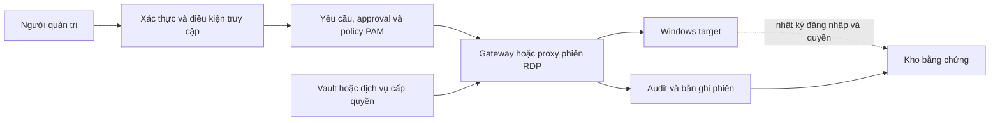

# RDP control trong PAM

RDP control là tập kiểm soát áp dụng cho truy cập desktop từ xa bằng Remote Desktop Protocol trong một kiến trúc Privileged Access Management (PAM). Mục tiêu là xác định ai được kết nối tới máy Windows nào, bằng tài khoản và quyền gì, trong bao lâu, qua đường nào và với khả năng trao đổi dữ liệu nào.

Một phiên RDP không chỉ truyền hình ảnh, bàn phím và chuột. Tùy cấu hình, nó có thể cung cấp clipboard, truy cập ổ đĩa chuyển hướng, in ấn và các kênh thiết bị khác. Người có quyền tại máy đích cũng có thể chạy công cụ, mở mạng hoặc thay đổi hệ thống trong phạm vi được cho phép.

Vì vậy, kiểm soát RDP cần kết hợp policy PAM, gateway, cấu hình Windows và kiểm soát mạng. Ghi hình phiên hỗ trợ phát hiện và điều tra nhưng không tự giới hạn mọi hành động hoặc ngăn mọi đường lấy dữ liệu.

## 1. Mục tiêu học tập

Sau bài học, người học có thể:

- Phân tách các lớp kiểm soát từ người dùng tới gateway và hệ thống đích.
- Giữ danh tính cá nhân khi phiên dùng một tài khoản Windows được PAM quản lý.
- Giới hạn quyền đăng nhập, quyền thực thi và các kênh chuyển hướng dữ liệu.
- Thiết kế JIT, thời hạn phiên, giám sát và xử lý ngắt kết nối.
- Xác định bằng chứng cần có và giới hạn quan sát của phiên đồ họa.
- Xây dựng kiểm thử chấp nhận trước khi mở truy cập RDP đặc quyền.

Bài học trình bày thiết kế độc lập với một sản phẩm PAM cụ thể. Tên cấu hình, khả năng proxy, phương thức xác thực và tập tính năng chuyển hướng cần được xác minh theo sản phẩm, hệ điều hành và đường kết nối thực tế.

## 2. Tách các lớp truy cập



Sơ đồ là quan hệ logic, không bắt buộc mọi thành phần phải nằm trên các máy riêng. Cần kiểm soát từng ranh giới:

| Lớp | Câu hỏi kiểm soát |
| --- | --- |
| Danh tính | Người khởi tạo đã được xác thực phù hợp chưa? |
| Policy PAM | Người đó được truy cập target, tài khoản, tác vụ và khoảng thời gian nào? |
| Gateway | Có kết nối đúng đích, giới hạn tính năng và giữ được bằng chứng không? |
| Mạng | Có đường đi trực tiếp hoặc đường trung gian khác bỏ qua PAM không? |
| Windows target | Tài khoản có quyền đăng nhập và quyền thực tế nào sau đăng nhập? |
| Dữ liệu và thiết bị | Những kênh trao đổi nào được phép, theo chiều nào? |
| Vòng đời | Ngắt kết nối, đăng xuất, hết hạn và thu hồi được xử lý ở đâu? |

MFA tại cổng PAM không tự làm mọi đường RDP khác có MFA. Nếu người dùng còn có thể kết nối trực tiếp tới target bằng credential đã biết, cần kiểm soát đường đó theo kiến trúc được chọn.

## 3. Kiểm soát đường mạng và danh tính máy chủ

### 3.1. Giới hạn nguồn được tới RDP

Một thiết kế tham chiếu chỉ cho các gateway được phân công hoặc nguồn quản trị được chấp thuận tới dịch vụ RDP của target. Địa chỉ, cổng và giao thức cần theo cấu hình thực tế, không suy ra chỉ từ một số cổng mặc định.

Kiểm tra firewall ở các lớp liên quan, định tuyến, DNS và các đường thay thế. Chặn đường trực tiếp từ một máy thử chưa chứng minh mọi vùng mạng hoặc mọi gateway đều bị ràng buộc đúng.

VPN có thể cung cấp đường truyền và điều kiện mạng, nhưng quyền vào mạng không đồng nghĩa quyền dùng mọi tài khoản quản trị. Cần policy theo target và danh tính ở các lớp thích hợp.

Đường khẩn cấp nếu có phải có owner, phạm vi, điều kiện và bằng chứng riêng. Không để một rule mạng rộng tồn tại vô thời hạn dưới tên “tạm thời để xử lý sự cố”.

### 3.2. Xác minh đúng target

Gateway phải nối tới target đã được ràng buộc bởi quyết định truy cập. Không nhận một địa chỉ tùy ý từ client rồi dùng credential quản trị để kết nối.

Kiểm tra danh tính máy chủ và bảo vệ kênh theo mô hình TLS, chứng chỉ và tin cậy được triển khai. Cần xác định rõ đoạn nào kết thúc ở gateway, đoạn nào tới target và nơi nào có thể xử lý dữ liệu rõ.

Mã hóa đoạn client–gateway không tự chứng minh gateway–target được cấu hình đúng. Một chứng chỉ hoặc endpoint thay đổi ngoài dự kiến cần được xác minh, không tắt kiểm tra để tiếp tục đăng nhập.

### 3.3. Network Level Authentication

Network Level Authentication (NLA) cho phép thực hiện bước xác thực trước khi thiết lập đầy đủ phiên desktop theo cơ chế được hỗ trợ. Đây là một lớp kiểm soát liên quan tới việc chấp nhận kết nối, không thay thế MFA, policy PAM hoặc quyền Windows.

Khi dùng NLA, cần kiểm tra tương thích giữa client, gateway, target và phương thức xử lý credential. Không dùng việc tắt NLA hoặc bỏ kiểm tra danh tính máy chủ làm bước chuẩn để giải quyết lỗi tích hợp.

Nếu có giới hạn tương thích, cần xác định phương án được hỗ trợ và đánh giá phạm vi thay đổi. Một nhãn cấu hình trên gateway chưa chứng minh target đang thực thi cơ chế như mong muốn.

## 4. Giữ đúng danh tính và quyền hiệu lực

### 4.1. Ba danh tính có thể khác nhau

| Danh tính | Ví dụ | Vai trò |
| --- | --- | --- |
| Người khởi tạo | An với tài khoản cá nhân tại IdP | Chủ thể chịu trách nhiệm yêu cầu và sử dụng truy cập |
| Dịch vụ trung gian | Gateway hoặc broker PAM | Thành phần mở kết nối hoặc sử dụng credential thay người dùng |
| Tài khoản hiệu lực tại Windows | Tài khoản bảo trì được quản lý | Danh tính nhận quyền và tạo phiên tại target |

Giữ liên kết giữa ba lớp bằng request ID, decision ID, session ID và target session reference khi có. Chỉ ghi một tài khoản dùng chung tại target sẽ làm mất trách nhiệm theo người.

Ưu tiên mô hình danh tính đáp ứng được nhu cầu quy trách nhiệm và giới hạn quyền. Nếu vẫn dùng tài khoản chung, cần kiểm soát số phiên, ai được gắn lại, checkout nếu áp dụng và việc tiếp cận credential.

### 4.2. Quyền đăng nhập khác quyền quản trị

Cho phép RDP vào Windows không mặc nhiên phải cấp toàn quyền quản trị. Cần phân biệt quyền đăng nhập từ xa với quyền thay cấu hình hệ thống, quản lý dịch vụ, đọc dữ liệu và thực thi công cụ.

Đánh giá nhóm, vai trò, quyền cục bộ hoặc miền và các điều kiện từ chối có hiệu lực. Không chỉ nhìn tên một nhóm mà kết luận tài khoản có đúng phạm vi.

UAC và các cơ chế của hệ điều hành có vai trò riêng, nhưng không dùng một hộp thoại nâng quyền làm bằng chứng rằng một desktop có quyền mạnh đã được giới hạn đầy đủ theo nhiệm vụ.

### 4.3. JIT và giới hạn tác vụ

Với JIT, xác định quyền nào được cấp tạm, nơi cấp, thời hạn và cách xác nhận đã thu hồi. Policy PAM có thời gian hết hạn nhưng quyền ở Windows còn tồn tại thì chưa đạt mục tiêu.

Với yêu cầu tác vụ hẹp, cần cơ chế thực thi ở target hoặc một luồng tác vụ phù hợp. Ghi “chỉ khởi động lại dịch vụ” trong approval không tự ngăn người dùng mở một công cụ khác trên desktop.

Hiển thị một ứng dụng từ xa hoặc ẩn một số nút giao diện không tự tạo ranh giới quyền hoàn chỉnh. Cần kiểm tra khả năng mở file, chạy công cụ khác và quyền thực tế bằng các cơ chế hệ điều hành hoặc ứng dụng được thiết kế phù hợp.

Không gắn nhãn JEA cho một desktop toàn quyền chỉ vì phiên được ghi hình. Phạm vi tác vụ phải có điểm thực thi có thể kiểm chứng.

## 5. Credential cho phiên RDP

### 5.1. Sử dụng qua trung gian và hiển thị secret

Gateway có thể dùng credential từ vault để xác thực target mà không hiển thị password cho người dùng, nếu sản phẩm hỗ trợ. Điều này giảm một đường tiết lộ nhưng không có nghĩa credential không bao giờ xuất hiện trong bộ nhớ hoặc không thể bị lạm dụng tại target.

Phân biệt quyền mở phiên với quyền xem password. Approval cho RDP qua gateway không tự cho phép tải credential về máy cá nhân.

Phương thức xác thực, ủy nhiệm và bảo vệ credential phải phù hợp kiến trúc. Các chế độ bảo vệ danh tính có điều kiện tương thích riêng; không mặc định một cơ chế có tên bảo vệ credential sẽ hoạt động qua mọi proxy.

### 5.2. Credential không quyết định toàn bộ vòng đời phiên

Password đã được rotation không nhất thiết làm một phiên Windows đang đăng nhập kết thúc. Thu hồi quyền đăng nhập mới cũng không tự chứng minh mọi phiên cũ đã được đăng xuất.

Do đó, cần theo dõi riêng vòng đời credential, quyền tại target và phiên hiện hữu. Khi có sự cố, có thể phải xử lý cả ba theo cơ chế được hỗ trợ.

Với tài khoản có phụ thuộc dịch vụ, không tự đổi password sau một phiên RDP mà chưa có kế hoạch cập nhật các bên sử dụng. Một chính sách rotation an toàn cần xét phạm vi tài khoản thực tế.

## 6. Kiểm soát các kênh chuyển hướng

Các kênh có thể khác nhau theo client, gateway, Windows target và cấu hình. Bảng dưới là danh mục đánh giá, không phải cam kết mọi sản phẩm đều cung cấp toàn bộ tùy chọn.

| Kênh | Nhu cầu hợp lệ | Rủi ro cần xét | Câu hỏi chính sách |
| --- | --- | --- | --- |
| Clipboard văn bản | Dán một tham số hoặc sao chép thông tin vận hành | Chuyển dữ liệu hoặc secret giữa hai môi trường | Có cho phép không, theo chiều nào, loại dữ liệu nào? |
| Clipboard file hoặc dữ liệu khác | Chuyển artifact công việc nếu được hỗ trợ | Đưa file vào hoặc lấy dữ liệu ra | Có cần kênh chuyển file được kiểm soát riêng không? |
| Ổ đĩa chuyển hướng | Đọc hoặc ghi file qua tài nguyên từ client | Trao đổi file ngoài quy trình và đưa nội dung không mong muốn vào đích | Có giới hạn theo target, người dùng và tác vụ không? |
| Máy in | In nội dung nghiệp vụ theo nhu cầu cụ thể | Tạo bản sao dữ liệu ở nơi khác | Có thực sự cần cho phiên quản trị không? |
| Thiết bị và cổng chuyển hướng | Dùng một thiết bị được quy trình yêu cầu | Mở thêm đường tương tác hoặc dữ liệu | Tính năng nào được hỗ trợ và được phép? |
| Âm thanh hoặc microphone | Hỗ trợ ứng dụng có nhu cầu | Thu hoặc phát nội dung ngoài dự kiến | Có cần bật và có bằng chứng tương ứng không? |
| Smart card hoặc cơ chế xác thực liên quan | Xác thực theo thiết kế doanh nghiệp | Rủi ro ủy nhiệm hoặc sử dụng sai ngữ cảnh | Có tương thích và ràng buộc đúng phương thức không? |

### 6.1. Áp dụng ở điểm có hiệu lực

Nếu chỉ tắt một tùy chọn trong client do người dùng quản lý, người đó có thể dùng client hoặc cấu hình khác. Cần xác định điểm thực thi tại gateway, target hoặc policy hệ điều hành và kiểm tra giá trị hiệu lực.

Kiểm soát từng chiều hoặc kiểu dữ liệu chỉ khả thi nếu công nghệ đang dùng hỗ trợ. Không mô tả cấu hình như có khả năng lọc theo nội dung khi thực tế chỉ bật hoặc tắt toàn kênh.

Các policy ở nhiều lớp có thể tương tác. Kiểm thử đường thực tế để biết cái gì được phép, bị chặn và có thể thay đổi bởi ai; không chỉ chụp màn hình một bảng cấu hình.

### 6.2. Chặn chuyển hướng không chặn mọi sao chép

Chặn clipboard và drive redirection giúp hạn chế một số đường dữ liệu. Người có thể xem thông tin vẫn có thể ghi lại bằng phương tiện khác; người có quyền ở target còn có thể dùng các đường mạng hoặc ứng dụng khác trong phạm vi được cấp.

Nếu mục tiêu là hạn chế dữ liệu ra ngoài, cần kết hợp quyền dữ liệu, kiểm soát mạng, ứng dụng và quy trình phù hợp. Không cam kết “không thể lấy dữ liệu” chỉ từ một policy RDP.

### 6.3. Luồng chuyển file có kiểm soát

Nếu cần trao đổi file, có thể thiết kế kênh riêng với định danh người gửi, đích, mục đích, kiểm tra nội dung phù hợp và audit. Quy trình cụ thể phụ thuộc mức rủi ro và khả năng môi trường.

Không mở toàn bộ ổ đĩa client chỉ để chuyển một artifact nhỏ nếu nhu cầu có thể đáp ứng bằng phạm vi hẹp hơn. Đồng thời, không gắn nhãn kiểm tra an toàn cho một file chỉ vì nó đã đi qua gateway.

## 7. Thời hạn phiên, ngắt kết nối và reconnect

### 7.1. Phân biệt disconnect, lock và logoff

| Hành động hoặc trạng thái | Ý nghĩa cần xác minh |
| --- | --- |
| Đóng cửa sổ client hoặc disconnect | Kênh có thể đã ngắt nhưng phiên đích có thể vẫn còn |
| Khóa desktop | Ngăn tương tác tại giao diện theo cơ chế Windows, không tự kết thúc mọi tiến trình |
| Logoff hoặc kết thúc phiên đích | Có thể chấm dứt trạng thái đăng nhập theo cơ chế target, cần có kết quả quan sát |
| Chặn mở phiên mới | Hạn chế truy cập tương lai, không tự chứng minh phiên cũ đã đóng |
| Thu hồi grant | Kết thúc quyền theo cơ chế cấp; tác động tới phiên hiện hữu phải được kiểm tra |

Policy cần xác định idle timeout, disconnected timeout, thời hạn tuyệt đối và hành vi sau mỗi mốc. Không dùng các khái niệm này thay thế nhau.

Định nghĩa idle phải phù hợp khả năng quan sát: không có input người dùng khác với không có gói mạng. Keepalive hoặc hoạt động nền không nhất thiết chứng minh người dùng đang làm việc.

### 7.2. Giới hạn theo thời gian

Nếu approval cho phép truy cập đến 10:00, reconnect lúc 09:55 không được tự cấp thêm toàn bộ thời lượng ban đầu. Grant và điều kiện target phải đáp ứng hạn còn lại.

Chỉ đặt giờ hết hạn trong metadata PAM không bảo đảm Windows đăng xuất đúng lúc. Cần chỉ ra thành phần thực thi, cách xử lý lỗi và cách xác nhận.

Kết thúc phiên cưỡng bức có thể làm mất công việc chưa lưu hoặc ảnh hưởng thao tác đang dở. Hành vi này cần nằm trong policy và runbook theo mức rủi ro, thay vì được quyết định tùy hứng trong sự cố.

### 7.3. Reconnect đúng chủ thể và phiên đích

Xác thực caller hiện tại và kiểm tra lại approval, quyền, thời hạn, target cùng trạng thái phiên. Dùng session ID của PAM, connection ID và target session reference khi có để gắn đúng đối tượng.

Đặc biệt cẩn trọng khi tài khoản Windows dùng chung. Cùng username không đủ để kết luận người đang reconnect được phép điều khiển mọi desktop của tài khoản đó.

Nếu không xác định được phiên đích an toàn, áp dụng chế độ hạn chế hoặc quy trình mở phiên mới được đánh giá riêng. Không tự tiếp quản một phiên còn tồn tại chỉ vì nó dễ nối nhất.

## 8. Giám sát và can thiệp phiên

### 8.1. Xác định quyền của người giám sát

Tách quyền xem trực tiếp, xem lại bản ghi, điều khiển chung, tiếp quản và chấm dứt. Người có quyền quan sát không mặc nhiên được gửi bàn phím hoặc chuột.

Nếu chuyển người điều khiển, cần có định danh, lý do, thời gian và cơ chế ngăn hai bên điều khiển ngoài policy. Giữ danh tính người khởi tạo và lịch sử người tham gia thay vì ghi đè một trường owner.

Việc xem màn hình có thể tiếp cận dữ liệu nhạy cảm nên cũng cần phân quyền và audit. Không mở quyền xem mọi phiên production chỉ vì vai trò có tên hỗ trợ.

### 8.2. Chấm dứt là một luồng có kết quả

Khi người giám sát yêu cầu terminate, cần ghi ai yêu cầu, vì sao, thành phần nào nhận và kết quả đã quan sát.

Lệnh đã được gửi không đồng nghĩa target đã logoff. Gateway có thể đóng một kênh trong khi phiên đích vẫn tồn tại. Phải biểu diễn các lớp trạng thái và tiếp tục xử lý phần chưa xác nhận.

Trong sự cố, có thể cần chặn mở mới, đóng kết nối, xử lý phiên đích, thu hồi quyền và đổi credential đã tiết lộ. Không gộp tất cả thành một nút mà không biết phạm vi nó thực hiện.

### 8.3. Không giả định thao tác được hoàn tác

Đóng RDP không hoàn tác thay đổi cấu hình, file đã sao chép hoặc tác vụ đã khởi chạy. Cần kiểm tra trạng thái ứng dụng và hệ thống đích khi đánh giá ảnh hưởng.

Nếu mất kết nối sau khi người dùng bấm một nút có tác động, không tự phát lại hành động đó khi reconnect. Kết quả có thể đã xảy ra dù client chưa thấy phản hồi.

## 9. Bản ghi đồ họa và giới hạn bằng chứng

### 9.1. Những gì recording có thể và không thể chứng minh

Bản ghi màn hình hoặc luồng đồ họa có thể hỗ trợ xem lại thao tác trong phạm vi được thu thập. Nó không tự cung cấp danh sách đầy đủ mọi tiến trình, lệnh nền hoặc thay đổi trong hệ thống.

Khả năng thu được màn hình đặc biệt, hộp thoại nâng quyền, các kênh phụ và nội dung được bảo vệ phụ thuộc sản phẩm cùng cấu hình. Cần kiểm tra và mô tả giới hạn thực tế.

Không khẳng định có thể tìm chính xác mọi câu lệnh từ video. OCR, phân tích hình ảnh hoặc sự kiện input nếu có đều có giới hạn; kết luận về hành động cần đối chiếu bằng chứng phù hợp.

### 9.2. Chuỗi định danh

Giữ liên kết giữa:

- Người khởi tạo và nguồn định danh.
- Request, approval, policy hoặc decision và grant.
- Target ID, tài khoản Windows hiệu lực và gateway.
- Session ID logic, các connection ID và target session reference nếu thu được.
- Recording ID, manifest, các đoạn và tình trạng đầy đủ.
- Lệnh can thiệp, kết quả kết thúc, thu hồi và xử lý credential.

Tên hiển thị hoặc source IP riêng lẻ không đủ để thay cho chuỗi này. IP có thể qua NAT hoặc proxy; tài khoản hiệu lực có thể là tài khoản chung.

### 9.3. Bảo vệ nội dung ghi lại

Recording có thể chứa dữ liệu nghiệp vụ, thông tin cá nhân hoặc secret xuất hiện trên desktop. Cần hạn chế thu thập không cần thiết, giới hạn quyền xem và xuất, bảo vệ lưu trữ cùng audit truy xuất.

Không mặc định trường password được che trên màn hình đồng nghĩa secret không thể xuất hiện ở nơi khác trong phiên. Cũng không coi chức năng che dữ liệu là hoàn hảo nếu chưa kiểm chứng.

Nếu bản ghi thiếu đoạn sau reconnect hoặc upload lỗi, biểu diễn tình trạng đó rõ. Không ghép các đoạn theo cách làm người xem tưởng toàn bộ thời gian đã được quan sát liên tục.

### 9.4. Đối chiếu log Windows và ứng dụng

Nhật ký đăng nhập, thay đổi quyền và hoạt động tại target có thể bổ sung cho recording. Cần nguồn thời gian, định danh và cách liên kết phù hợp.

Tài khoản quản trị mạnh có thể tác động tới một số nguồn log ở target. Vì vậy, thiết kế thu thập và lưu giữ cần xét ranh giới quyền, không chỉ bật log tại cùng máy rồi coi bằng chứng đã độc lập.

## 10. Policy RDP minh họa

Cấu hình dưới đây mô tả các ý định kiểm soát, không phải schema hay tên policy bắt buộc của Windows hoặc một sản phẩm PAM:

```yaml
rdp_access_policy:
  policy_id: orders-production-maintenance
  owner_group: platform-orders
  target_scope_ref: approved-orders-windows-targets
  requester_group_ref: production-maintenance-engineers
  authentication_profile_ref: privileged-access-assurance
  approval_profile_ref: production-maintenance-approval
  network:
    gateway_pool_ref: production-rdp-gateways
    direct_access_profile_ref: gateway-only-with-reviewed-emergency-path
    target_trust_profile_ref: verified-windows-targets
  identity:
    effective_principal_profile_ref: temporary-maintenance-role
    credential_delivery: gateway_use
    secret_reveal_profile_ref: separate-explicit-authorization
  capabilities:
    redirection_profile_ref: approved-maintenance-channel-restrictions
    application_control_profile_ref: target-maintenance-task-boundaries
  lifecycle:
    duration_profile_ref: approved-maintenance-time-limits
    reconnect_profile_ref: verified-owner-and-target-session
    termination_profile_ref: controlled-target-session-cleanup
  evidence:
    recording_profile_ref: privileged-desktop-session-evidence
    target_audit_profile_ref: windows-and-application-events
```

Mỗi tham chiếu cần được cụ thể hóa: nguồn nào được tới target, principal nào có quyền, kênh nào bị chặn, thời hạn được thực thi ở đâu và người nào nhận xử lý khi lỗi.

Không tạo cảm giác đã kiểm soát tác vụ chỉ bằng cách đặt một tên profile có chữ maintenance. Tiêu chí chấp nhận phải kiểm tra quyền và hành vi thực tế.

## 11. Xử lý lỗi và đường khẩn cấp

| Tình huống | Cách xử lý cần được thiết kế |
| --- | --- |
| Gateway không tới được target | Kiểm tra mạng, DNS, đích và trạng thái dịch vụ; không tự mở đường trực tiếp rộng để bỏ qua policy |
| Xác thực target thất bại | Phân loại credential, quyền đăng nhập, tài khoản khóa và điều kiện tích hợp; retry có giới hạn |
| Kiểm tra chứng chỉ hoặc danh tính đích thất bại | Dừng đường không được xác minh, xử lý theo quy trình tin cậy |
| Client hoặc target không đáp ứng profile bắt buộc | Dùng cấu hình được hỗ trợ hoặc từ chối; không âm thầm hạ mức kiểm soát |
| Recording lỗi | Áp dụng chế độ vận hành đã phê duyệt, ghi rõ phạm vi mất bằng chứng |
| Gateway lỗi nhưng phiên đích có thể còn | Đối soát và xử lý phiên chưa rõ; không coi failover là đã resume an toàn |
| Thu hồi JIT thất bại | Cảnh báo, tiếp tục xử lý và hạn chế theo policy; không đóng hồ sơ chỉ vì client đã thoát |
| Rotation sau dùng thất bại | Giữ trạng thái credential cần xử lý và xét các phụ thuộc liên quan |

Break-glass cần một đường quản trị riêng đã được xác định, có người chịu trách nhiệm, phạm vi, thời hạn và đối soát sau dùng. Nó không phải nhánh tự cho phép mọi request khi PAM gián đoạn.

Nếu đường khẩn cấp có thể hoạt động ngoài PAM, cần xác định bằng chứng thay thế, giới hạn mạng, credential và cách xử lý sau đó. Không mô tả nó như được ghi phiên đầy đủ nếu thực tế không có khả năng đó.

## 12. Tình huống: bảo trì Windows production qua RDP

Bình cần kiểm tra và khởi động lại một dịch vụ Orders trên máy Windows production. Người này được phép dùng một vai trò bảo trì có giới hạn theo thiết kế, trong một cửa sổ đã được phê duyệt.

### Bước 1: Chốt danh tính và đường truy cập

Bình xác thực bằng tài khoản cá nhân tại cổng PAM. Policy ràng buộc đúng target, vai trò, phương thức RDP qua gateway và thời hạn.

Gateway được phép tới dịch vụ RDP của máy đích; nguồn client của Bình không được mở đường trực tiếp ngoài ngoại lệ đã duyệt. Cơ chế xác thực và tin cậy máy chủ được kiểm tra trên đường thực tế.

### Bước 2: Cấp quyền và mở phiên

Nếu dùng JIT, quyền được cấp ở thành phần đích theo cơ chế được triển khai và có bằng chứng. Gateway dùng credential được phép mà không mặc nhiên hiển thị password cho Bình.

Metadata giữ Bình là người khởi tạo, tài khoản Windows là danh tính hiệu lực và liên kết approval cùng session. Quyền Windows được kiểm tra để đáp ứng tác vụ thay vì cấp toàn quyền cho tiện.

### Bước 3: Thực thi giới hạn dữ liệu và tác vụ

Profile phiên không cho các kênh chuyển hướng ngoài nhu cầu. Nếu cần đưa một artifact vào, Bình dùng đường chuyển file đã được chấp thuận thay vì mở toàn bộ ổ đĩa client.

Cơ chế hạn chế tác vụ được thực thi tại target hoặc luồng thích hợp. Bản ghi màn hình chỉ bổ sung bằng chứng, không được dùng thay cho giới hạn quyền.

### Bước 4: Ngắt và nối lại

Client của Bình mất mạng nhưng target có thể còn phiên. PAM ghi đúng trạng thái, xác thực lại theo điều kiện áp dụng và kiểm tra đúng target session trước reattach.

Người khác biết tên tài khoản chung không được tự gắn vào desktop đó. Reconnect không làm mới thời hạn ban đầu.

### Bước 5: Kết thúc và kiểm tra

Phiên kết thúc theo chính sách; nhóm xác nhận trạng thái đích, thu hồi quyền tạm và kiểm tra recording. Nếu còn lỗi thu hồi hoặc đoạn bản ghi chưa tải, các mục đó tiếp tục được theo dõi riêng.

Nếu Bình đã khởi động một tác vụ chạy nền, logoff không được coi là bằng chứng tác vụ đã hoàn tất hoặc bị hủy. Cần kiểm tra kết quả ở ứng dụng hoặc hệ thống đích.

## 13. Ma trận kiểm thử chấp nhận

Các phép thử cần đúng phạm vi và môi trường được chấp thuận. Khi kiểm tra kênh dữ liệu, dùng dữ liệu thử phù hợp thay vì secret hoặc dữ liệu production nhạy cảm.

| Nhóm kiểm thử | Điều kiện đạt |
| --- | --- |
| Người được phép | Mở đúng target, principal và thời hạn theo policy |
| Người ngoài phạm vi | Bị từ chối dù biết endpoint hoặc account name |
| Đường trực tiếp | Bị hạn chế theo kiến trúc; ngoại lệ có phạm vi và bằng chứng |
| Trust target | Endpoint và danh tính máy chủ khớp, không bỏ kiểm tra khi lỗi |
| Xác thực và NLA | Cơ chế bắt buộc hoạt động với client, gateway và target đã chọn |
| Quyền đăng nhập | Đúng nhóm và quyền hiệu lực; không cấp quản trị rộng ngoài nhu cầu |
| Phạm vi tác vụ | Hành động ngoài quyền bị chặn ở điểm thực thi phù hợp |
| Clipboard | Từng chiều và kiểu dữ liệu được kiểm tra theo khả năng profile |
| File, drive và printer redirection | Hành vi thực tế khớp chính sách, không chỉ cấu hình UI |
| Kênh thiết bị khác | Chỉ tính năng được chấp thuận có hiệu lực trên đường thực tế |
| Client khác | Không vượt kiểm soát chỉ bằng thay client hoặc tham số |
| Reconnect | Chỉ chủ thể được phép gắn đúng phiên, không kéo dài thời hạn |
| Ngắt so với logoff | Có thể phân biệt trạng thái kênh và phiên đích |
| Giám sát và can thiệp | Quyền xem, điều khiển và chấm dứt được tách, có audit |
| Recording | Mở lại được bằng chứng trước và sau reconnect, khoảng thiếu được nêu rõ |
| Thu hồi và credential | Quyền tạm và các bước sau dùng có kết quả thực tế, không suy từ việc đóng client |

Kiểm tra cả trường hợp được phép và bị chặn. Một phiên hợp lệ mở thành công chưa chứng minh clipboard bị chặn, tài khoản có quyền tối thiểu hoặc đường đi vòng đã đóng.

Khi thay client, gateway, Windows policy hoặc target, cần xem xét lại các kiểm thử bị ảnh hưởng. Một kết quả cũ không bảo đảm mọi phiên bản và tuyến kết nối sau đó có cùng hành vi.

## 14. Chỉ số vận hành và lỗi thường gặp

Các chỉ số hữu ích gồm phiên mở ngoài cửa sổ, target còn đường trực tiếp không được chấp thuận, phiên disconnected tồn tại quá hạn, lỗi thu hồi JIT, recording thiếu và thay đổi profile chuyển hướng.

Theo dõi các lần yêu cầu kết nối bị từ chối, lỗi xác thực tăng bất thường và danh tính hiệu lực không khớp quyết định. Cần nguồn và chất lượng dữ liệu để tránh coi mọi lỗi là hành vi tấn công.

| Lỗi thiết kế | Hệ quả | Cách xử lý |
| --- | --- | --- |
| Chỉ có MFA tại portal | Đường trực tiếp có thể bỏ qua điều kiện đó | Kiểm soát mạng và toàn bộ luồng truy cập |
| Mọi phiên dùng tài khoản quản trị chung | Khó quy trách nhiệm và tăng phạm vi ảnh hưởng | Giữ danh tính gốc, giới hạn quyền và đánh giá tách tài khoản |
| Tắt clipboard nhưng gọi là chặn mọi lấy dữ liệu | Bỏ sót màn hình, mạng và ứng dụng khác | Nêu đúng giới hạn, kết hợp kiểm soát dữ liệu và quyền |
| Chỉ cấu hình client | Người dùng có thể đổi client hoặc tham số | Thực thi tại điểm do tổ chức kiểm soát và kiểm tra hiệu lực |
| Ghi hình được coi là JEA | Có bằng chứng nhưng không chặn hành động | Dùng cơ chế giới hạn tác vụ thực tế |
| Đóng client được coi là đã logoff | Phiên hoặc tác vụ đặc quyền có thể còn | Đối soát target và áp dụng vòng đời riêng |
| Rotation password được coi là chấm dứt mọi phiên | Bỏ sót trạng thái đã xác thực | Quản lý credential, quyền và session tách biệt |
| Reattach theo username chung | Có thể nối nhầm desktop của người khác | Ràng buộc caller với phiên đích và quyền hiện tại |

## 15. Bài thực hành thiết kế

Thiết kế RDP control cho một nhóm kỹ sư nội bộ và một nhóm nhà cung cấp hỗ trợ có phạm vi hẹp:

1. Vẽ đường client, gateway, vault và Windows target, gồm cả đường khẩn cấp nếu có.
2. Xác định người khởi tạo, tài khoản hiệu lực, quyền đăng nhập và quyền tác vụ.
3. Liệt kê các kênh chuyển hướng cần đánh giá, nơi thực thi và cách kiểm tra từng kênh.
4. Phân biệt giới hạn dữ liệu qua RDP với quyền dữ liệu và mạng tại target.
5. Đặt quy tắc idle, disconnect, reconnect, thời hạn tuyệt đối và logoff.
6. Mô tả ai được xem, tiếp quản hoặc chấm dứt phiên và bằng chứng cho mỗi hành động.
7. Thiết kế kiểm thử người ngoài phạm vi, client thay thế, nối nhầm tài khoản chung và recording lỗi.
8. Xác định tiêu chí kết thúc gồm trạng thái target, thu hồi quyền, recording và credential sau sử dụng.

Bản thiết kế đạt yêu cầu khi quyền truy cập RDP được giới hạn tại các lớp có hiệu lực và bằng chứng mô tả đúng kết quả. Trong PAM, kiểm soát desktop từ xa phải nối được danh tính, quyền Windows, luồng dữ liệu và vòng đời phiên.
