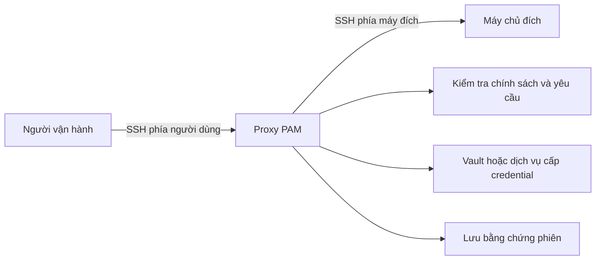

# SSH proxy

## 1. Mục tiêu và phạm vi

SSH proxy là thành phần trung gian trên đường truy cập SSH từ người vận hành đến hệ thống đích. Trong quản lý truy cập đặc quyền (Privileged Access Management, PAM), proxy giúp tập trung đường quản trị, áp dụng chính sách truy cập và liên kết hoạt động kỹ thuật với danh tính người yêu cầu.

Sau bài học này, người học có thể:

- Phân biệt jump host chuyển tiếp kết nối với proxy kết thúc và thiết lập lại phiên SSH.
- Xác định nơi diễn ra xác thực, cấp quyền, giữ credential và thu thập bằng chứng.
- Thiết kế đường truy cập theo least privilege và Just-in-Time (JIT).
- Sử dụng `ProxyJump` trong phòng lab và nhận biết giới hạn bảo mật của mô hình này.
- Kiểm thử việc chặn đường đi vòng, giới hạn forwarding và thu hồi quyền.

Phạm vi là truy cập quản trị đến máy chủ được tổ chức cho phép. Các địa chỉ, tài khoản và tên file bên dưới chỉ là ví dụ phòng lab; những lệnh cấu hình không được thực thi tự động trong bài học.

## 2. Tình huống xuất phát

Đội vận hành cần xử lý sự cố trên `app-01` trong vùng ứng dụng. Máy cá nhân không được mở kết nối trực tiếp đến cổng SSH của máy chủ. Người trực ca phải yêu cầu quyền với mã thay đổi, xác thực mạnh và chỉ được truy cập trong 30 phút.

Nếu giải pháp chỉ là thêm một máy Linux có thể SSH đến mọi máy chủ, tổ chức mới có một điểm trung chuyển. Mục tiêu PAM còn đòi hỏi trả lời được những câu hỏi sau:

1. Ai là người khởi tạo truy cập và yêu cầu công việc nào cho phép truy cập đó?
2. Người này được đến máy nào, dùng tài khoản nào và thực hiện quyền gì?
3. Credential tồn tại ở đâu, ai được sử dụng và khi nào hết hiệu lực?
4. Có thể quan sát loại hoạt động nào và phần nào nằm ngoài khả năng quan sát?
5. Khi yêu cầu hết hạn hoặc bị thu hồi, kết nối mới và phiên đang mở được xử lý ra sao?

Các câu trả lời phải đến từ cấu hình và bằng chứng kiểm thử. Tên gọi “SSH proxy” trên sơ đồ không tự tạo ra các kiểm soát này.

## 3. Hai mô hình cần phân biệt

### 3.1. Jump host chuyển tiếp kết nối

Với mô hình này, SSH client xác thực với jump host và yêu cầu chuyển tiếp TCP đến máy đích. SSH client tiếp tục thiết lập một kết nối SSH đến máy đích qua đường chuyển tiếp đó. Người dùng phải có quyền tại cả hai điểm.

```text
Máy người dùng
  ├─ SSH đến jump host: xác thực người dùng tại gateway
  └─ SSH đến máy đích, vận chuyển qua gateway
       └─ xác thực người dùng và host key của máy đích
```

OpenSSH hỗ trợ cách truy cập này bằng `ProxyJump` hoặc tùy chọn `-J`. Cấu hình riêng của jump host cần được khai báo cho chính host đó; không giả định các tùy chọn của máy đích cũng áp dụng cho jump host. [Tài liệu OpenSSH về ProxyJump](https://man.openbsd.org/ssh_config#ProxyJump).

Khi client xác minh đúng danh tính máy đích, jump host chỉ chuyển tiếp luồng SSH bên trong và không mặc nhiên đọc được lệnh hoặc màn hình của luồng đó. Ghi packet tại gateway vì vậy không tương đương bản ghi nội dung phiên quản trị.

### 3.2. Proxy kết thúc phiên SSH

Một số hệ thống PAM nhận kết nối SSH từ người dùng rồi tạo một kết nối SSH khác đến máy đích. Đây là hai quan hệ tin cậy tách biệt:



Proxy có khả năng quan sát nội dung được xử lý tại điểm kết thúc phiên của nó, tùy chức năng và cấu hình triển khai. Với mô hình credential injection, người dùng có thể không nhận trực tiếp bí mật dùng ở máy đích. Đổi lại, proxy trở thành nơi có quyền lực lớn: nó có thể tiếp cận credential, nội dung phiên và nhiều hệ thống nhạy cảm.

Không phải mọi sản phẩm mang tên SSH gateway đều hỗ trợ kết thúc phiên, ghi hình, kiểm soát lệnh hoặc thu hồi phiên. Phải xác nhận chức năng bằng tài liệu của triển khai và phép thử thực tế.

### 3.3. So sánh phục vụ quyết định kiến trúc

| Khía cạnh | Jump host chuyển tiếp | Proxy kết thúc phiên |
|---|---|---|
| Đường SSH đến đích | Client thiết lập qua đường trung chuyển | Proxy thiết lập kết nối phía đích |
| Credential phía đích | Client hoặc cơ chế xác thực phía client sử dụng | Có thể do proxy lấy hoặc được cấp |
| Nội dung terminal tại gateway | Không tự đọc được luồng SSH bên trong | Có thể quan sát nếu chức năng được bật |
| Điểm xác minh danh tính máy đích | SSH client | Thành phần SSH phía đích của proxy |
| Bằng chứng cần bổ sung | Audit trên máy đích và liên kết danh tính | Audit trên máy đích để đối chiếu tác động |
| Khi gateway bị chiếm quyền | Rủi ro trung chuyển và tiếp cận vùng đích | Thêm rủi ro credential và nội dung phiên |

Lựa chọn mô hình theo yêu cầu quan sát, bảo vệ credential và vận hành. Một jump host đơn giản có thể phù hợp nếu đã có audit đáng tin trên đích; yêu cầu ghi nội dung tập trung thường cần một thiết kế khác.

## 4. Ba lớp quyền độc lập

Một quyền truy cập nên được mô tả bằng bộ thông tin có thể kiểm tra:

```text
Chủ thể:             an / nhân viên trực ca
Yêu cầu:             CHG-LAB-014
Tài nguyên:          app-01 / 10.40.1.21
Tài khoản ở đích:     an
Khoảng thời gian:    cửa sổ JIT 30 phút
Mục đích:            kiểm tra dịch vụ ứng dụng
Quyền trên hệ điều hành: đọc trạng thái; nâng quyền theo rule riêng
```

Có ba lớp cần đánh giá riêng:

- **Được đến gateway:** danh tính hợp lệ, thiết bị đủ điều kiện và phương thức xác thực phù hợp.
- **Được đến tài nguyên:** yêu cầu còn hiệu lực, đích và cổng nằm trong phạm vi được duyệt.
- **Được hành động trên đích:** tài khoản, nhóm và chính sách nâng quyền cho phép thao tác cụ thể.

Quyền đi qua gateway không nên được hiểu là quyền quản trị mọi máy phía sau. Tương tự, quyền SSH vào tài khoản thường không tự đồng nghĩa quyền `root`. Just Enough Administration (JEA), ở nghĩa giới hạn tác vụ quản trị cần thiết, phải được thực thi tại lớp hỗ trợ tác vụ hoặc trên máy đích.

## 5. Thiết kế đường mạng buộc đi qua proxy

Một kiến trúc chỉ có giá trị kiểm soát khi người dùng không còn đường tương đương để đi vòng. Với ví dụ trong bài, có thể thiết kế các luồng sau:

| Nguồn | Đích | Ý định chính sách |
|---|---|---|
| Thiết bị quản trị được quản lý | Gateway được chỉ định | Cho phép truy cập đã xác thực |
| Gateway | `10.40.1.21:22` | Chỉ mở đúng đích cần quản trị |
| Máy người dùng | SSH của máy đích | Chặn đường trực tiếp |
| Gateway | Máy chủ ngoài phạm vi | Chặn và ghi nhận thử truy cập |
| Gateway | Vault, dịch vụ chính sách, kho log | Chỉ mở kết nối phục vụ chức năng |

Cần kiểm tra cả tuyến nội bộ, đường VPN, địa chỉ IPv6, giao diện quản trị phụ và quy tắc do hệ thống khác tự tạo. Mở một đường dự phòng không kiểm soát có thể làm mất hiệu lực toàn bộ việc bắt buộc qua proxy.

Việc kiểm thử chặn phải thực hiện từ đúng thiết bị và vùng mạng đại diện cho người dùng. Kết quả từ một máy kiểm thử nằm trong vùng khác không chứng minh được đường truy cập thực tế đã bị chặn.

Ngoài mạng, chính sách ở máy đích cũng phải phù hợp. Nếu máy chủ vẫn chấp nhận một khóa chia sẻ lâu dài từ đường quản trị phụ, yêu cầu JIT tại gateway chưa bao phủ hết khả năng đăng nhập.

## 6. Phòng lab: truy cập qua OpenSSH ProxyJump

### 6.1. Giả định

Phòng lab sử dụng ba thành phần:

- Máy người dùng có OpenSSH client.
- Gateway `ssh-gw.lab.example`, có tài khoản định danh cá nhân `an`.
- Máy đích `10.40.1.21`, cũng có tài khoản `an` nhưng được cấp quyền độc lập.

Hai khóa minh họa là `id_lab_gateway` và `id_lab_target`. Khóa riêng nằm trên thiết bị người dùng trong lab; không sao chép khóa phía đích lên gateway. Trước khi kết nối, thông tin host key của cả gateway và máy đích phải được phân phối qua kênh tin cậy.

### 6.2. Cấu hình client minh họa

Nội dung sau là ví dụ cho file cấu hình OpenSSH client trên máy người dùng:

```sshconfig
Host pam-gw-lab
    HostName ssh-gw.lab.example
    User an
    IdentityFile ~/.ssh/id_lab_gateway
    IdentitiesOnly yes
    ForwardAgent no
    StrictHostKeyChecking yes

Host app-01-via-pam
    HostName 10.40.1.21
    User an
    IdentityFile ~/.ssh/id_lab_target
    IdentitiesOnly yes
    ProxyJump pam-gw-lab
    ForwardAgent no
    StrictHostKeyChecking yes
```

Kết nối bằng alias:

```bash
ssh app-01-via-pam
```

Cấu hình client hỗ trợ cách dùng đúng nhưng không phải ranh giới cấp quyền của tổ chức: người có quyền điều khiển client có thể thay đổi nó. Những giới hạn bắt buộc phải tồn tại ở gateway, máy đích, mạng hoặc dịch vụ kiểm tra chính sách.

Với `StrictHostKeyChecking yes`, cần chuẩn bị thông tin host key hợp lệ trước. Khi gặp host key lạ hoặc thay đổi ngoài dự kiến, dừng lại để xác minh quá trình cấp phát hay thay khóa; không tắt kiểm tra chỉ để hoàn thành kết nối. Cách tổ chức niềm tin có thể là phân phối `known_hosts` được quản lý hoặc sử dụng cơ chế chứng thư host phù hợp. [Tài liệu OpenSSH về kiểm tra host key](https://man.openbsd.org/ssh_config#StrictHostKeyChecking).

### 6.3. Xác định đúng nơi lỗi

Hai lần xác thực phục vụ hai quyền khác nhau. Người dùng có thể vào gateway thành công nhưng không được máy đích chấp nhận; hoặc có khóa hợp lệ tại máy đích nhưng không được gateway chuyển tiếp.

Khi điều tra, ghi rõ thất bại nằm ở lớp nào: phân giải tên và đường mạng đến gateway, xác thực tại gateway, quyền chuyển tiếp, kết nối từ gateway đến đích, xác minh host key đích hay xác thực tài khoản đích. Điều này tránh việc mở rộng quyền không cần thiết để chữa một lỗi định tuyến.

## 7. Phòng lab: giới hạn tài khoản chỉ dùng làm gateway

Ví dụ dưới đây minh họa một nhóm chỉ được chuyển tiếp đến đúng máy đích, không dùng gateway như máy làm việc. Đây là một đoạn chính sách cần ghép vào cấu hình SSH daemon theo quy trình của hệ điều hành đang sử dụng, không phải cấu hình hoàn chỉnh để thay thế file hiện có.

```sshconfig
Match Group pam-jump-only
    AllowTcpForwarding local
    PermitOpen 10.40.1.21:22
    MaxSessions 0
    PermitTTY no
    AllowAgentForwarding no
    AllowStreamLocalForwarding no
    X11Forwarding no
    PermitTunnel no
    PermitUserRC no
```

`AllowTcpForwarding local` đáp ứng kiểu forwarding dùng trong ví dụ. `PermitOpen` giới hạn đích; tên hoặc địa chỉ trong yêu cầu phải phù hợp với giá trị được cho phép. `MaxSessions 0` chặn shell, lệnh từ xa và subsystem nhưng vẫn cho phép forwarding. Chỉ tắt PTY bằng `PermitTTY no` chưa đủ để chặn chạy lệnh. [Tài liệu cấu hình SSH daemon](https://man.openbsd.org/sshd_config).

Nhóm `pam-jump-only` phải được quản lý bởi phía quản trị. Người dùng không được tự thêm mình vào nhóm hoặc sửa chính sách. Phương thức xác thực của nhóm, MFA và quy trình JIT phải được cấu hình riêng theo hệ thống danh tính; đoạn trên không cung cấp những chức năng đó.

Với alias ở phần trước, client yêu cầu chuyển tiếp đến địa chỉ `10.40.1.21` và cổng `22`, nhất quán với allowlist. Nếu tổ chức muốn dùng tên DNS, cần thiết kế và kiểm thử chính sách tương ứng thay vì giả định mọi alias hoặc địa chỉ phân giải ra cùng máy đều được xử lý như nhau.

Trước khi áp dụng, quản trị viên kiểm tra cú pháp và cấu hình hiệu lực cho đúng người dùng trên bản OpenSSH của lab, duy trì một phiên quản trị được cho phép và có đường khôi phục. Sau đó kiểm thử nhóm thật. Không áp dụng các hạn chế này cho tài khoản quản trị gateway nếu chưa có phương án vận hành phù hợp.

`DisableForwarding yes` sẽ vô hiệu hóa các chức năng forwarding và không phù hợp với luồng chuyển tiếp đang minh họa. Cũng không dựa vào `ForceCommand` đơn lẻ để kiểm soát forwarding. [Quan hệ giữa các tùy chọn forwarding](https://man.openbsd.org/sshd_config#DisableForwarding).

## 8. Vì sao không cần agent forwarding cho ví dụ này?

Với `ProxyJump`, SSH client tại máy người dùng thực hiện xác thực đến máy đích qua đường chuyển tiếp. Vì vậy, ví dụ không cần đưa agent socket sang gateway để chạy một SSH client thứ hai tại đó.

Agent forwarding không gửi nguyên khóa riêng sang máy trung gian, nhưng một chủ thể chiếm quyền đủ cao trên máy đó có thể lợi dụng agent được chuyển tiếp để thực hiện thao tác xác thực. Đây là rủi ro khác với việc sao chép file khóa và vẫn cần kiểm soát. [Cảnh báo của OpenSSH về agent forwarding](https://man.openbsd.org/ssh#A).

Trong thiết kế PAM, cần phân biệt ba tình huống:

- Client giữ khóa và tự xác thực đến đích qua jump host.
- Proxy được cấp credential phía đích trong thời gian cần thiết.
- Người dùng nhận trực tiếp credential từ vault để đăng nhập.

Mỗi tình huống có cách thu hồi và điều tra khác nhau. Việc đặt tên thành phần là “vault” không chứng minh rằng người dùng chưa từng nhận bản sao của credential.

## 9. Credential, vault và chứng thư ngắn hạn

Một triển khai có thể dùng khóa định danh cá nhân, chứng thư SSH ngắn hạn hoặc credential được quản lý trong vault. Chọn cơ chế theo vòng đời thực tế của tài khoản và khả năng máy đích hỗ trợ, thay vì chỉ theo độ thuận tiện khi đăng nhập lần đầu.

Với proxy kết thúc phiên, quy trình mong muốn có thể gồm: kiểm tra quyền, lấy credential đúng tài nguyên, mở kết nối, lưu bằng chứng sử dụng và xử lý credential sau phiên. Cần giới hạn quyền của chính proxy trong vault: quyền lấy credential của một nhóm máy không nên bao phủ toàn bộ hạ tầng.

Với chứng thư ngắn hạn, mô hình cần quản lý thành phần cấp, chủ thể được cấp, phạm vi sử dụng, thời gian hiệu lực và điểm tin cậy tại đích. Thời hạn ngắn giảm cửa sổ dùng lại credential nhưng không thay thế kiểm soát quyền trên hệ điều hành hoặc quản lý phiên đang mở.

Đối với khóa tĩnh hoặc mật khẩu thuộc tài khoản dùng chung, cần có cơ chế đối chiếu người dùng thật với lần sử dụng. Luân chuyển credential phải đi cùng kiểm tra những nơi còn lưu bản sao và các phụ thuộc dịch vụ, tránh thay bí mật gây gián đoạn rồi để lại một đường khôi phục không được quản lý.

## 10. Thiết kế JIT và thu hồi quyền

Một cửa sổ JIT có thể được mô tả bằng vòng đời sau:

```text
Yêu cầu → kiểm tra/phê duyệt → cấp quyền có hạn → mở phiên
        → theo dõi → hết hạn hoặc thu hồi → đối chiếu bằng chứng
```

Tại bước cấp quyền, lưu người yêu cầu, người phê duyệt hoặc rule tự động, tài nguyên, tài khoản, khoảng thời gian và mã công việc. Tại bước mở phiên, liên kết quyết định cấp quyền với một định danh phiên.

Khi thu hồi, phải phân biệt ba đối tượng:

1. **Lần xác thực mới:** credential và quyền hiện tại còn được chấp nhận hay không.
2. **Kết nối SSH đã xác thực:** kết nối đang mở có còn nhận thêm hoạt động hoặc kênh mới hay không.
3. **Tác vụ đã khởi chạy:** tiến trình trên máy đích có tiếp tục sau khi kết nối đóng hay không.

Hết hạn credential không tự bảo đảm rằng phiên đang chạy kết thúc đúng thời điểm. Nếu yêu cầu là giới hạn cứng 30 phút, thiết kế phải có cơ chế cưỡng chế tại thành phần quản lý phiên và phép thử chứng minh hành vi đó. Nếu muốn dừng cả tác vụ nền, cần một chính sách riêng tại máy đích; việc đóng terminal không đủ để đưa ra cam kết này.

Khi dùng connection multiplexing, kiểm thử cả khả năng mở hoạt động mới trên kết nối đã được xác thực trước thời điểm hết hạn. Đừng chỉ kiểm thử một lệnh SSH tạo kết nối hoàn toàn mới.

## 11. Ghi nhận phiên và giới hạn của bằng chứng

Bằng chứng nên liên kết được yêu cầu truy cập, gateway và máy đích. Một bản ghi thiết kế có thể chứa:

```json
{
  "session_id": "lab-ssh-014",
  "request_id": "CHG-LAB-014",
  "actor": "an",
  "gateway": "ssh-gw.lab.example",
  "target_asset": "app-01",
  "target_account": "an",
  "decision": "allow",
  "requested_scope": "application-status-check",
  "evidence_type": "gateway-metadata-and-target-audit"
}
```

Đây là schema minh họa để suy nghĩ về việc đối chiếu, không phải khẳng định một sản phẩm tự xuất những field trên. Hệ thống thật còn cần mốc thời gian, kết quả kết nối, lý do kết thúc, nguồn log và chính sách lưu trữ phù hợp.

Đối với jump host, ghi nhận kết nối và chuyển tiếp không cung cấp nội dung terminal trong luồng SSH đến đích. Nếu yêu cầu truy vết lệnh, cần thêm audit ở đích hoặc chọn một kiến trúc có thể ghi nhận nội dung tại điểm thích hợp.

Ngay cả với proxy kết thúc phiên, bản ghi terminal cũng có giới hạn: tác vụ không tương tác, truyền file, subsystem và các đường hầm có thể cần cách thu thập riêng. Một chuỗi ký tự hiển thị trong terminal không chứng minh đầy đủ thay đổi trạng thái cuối cùng của hệ thống. Vì vậy, nên đối chiếu với audit tại đích và sự kiện của ứng dụng.

Nội dung phiên có thể chứa dữ liệu nhạy cảm. Quyền đọc hoặc xuất bản ghi phải tách khỏi quyền mở phiên quản trị; truy cập bản ghi cũng cần được ghi nhận. Thiết kế lưu trữ phải xử lý cả bảo vệ tính toàn vẹn, thời hạn giữ dữ liệu và trường hợp pipeline ghi nhận bị gián đoạn.

## 12. Tách SSH shell, truyền file và đường hầm

Một kết nối SSH có thể phục vụ nhiều loại hoạt động. Tổ chức cần quyết định riêng quyền mở shell, chạy lệnh, dùng SFTP, chuyển tiếp cổng và các chức năng phụ trợ.

Với mô hình jump host ở phần lab, giới hạn forwarding đến `10.40.1.21:22` chỉ giới hạn nơi gateway chuyển tiếp TCP. Nó không nhìn thấy và không tự giới hạn những chức năng SSH được thương lượng bên trong với máy đích.

Ví dụ, nếu người dùng SSH đến máy đích thành công và tài khoản tại đích được phép mở forwarding tiếp, máy đích có thể trở thành điểm trung chuyển khác. Quyền trên SSH daemon của máy đích, quyền hệ điều hành và chính sách mạng phía đích cần được thiết kế để phù hợp với phạm vi công việc.

Chỉ dựa vào việc chặn một tùy chọn client như `-D` cũng không phải ranh giới bắt buộc, vì người dùng điều khiển client. Hãy thử cả những cách sử dụng khác nhau của cùng quyền chuyển tiếp và kiểm tra kết quả ở phía server.

## 13. Bộ kiểm thử chấp nhận trong lab

Trước khi chạy, chuẩn bị một đích được phép và một đích thử bị cấm do tổ chức sở hữu. Không thử dò tài nguyên ngoài phạm vi lab.

| Phép thử | Kết quả mong đợi | Bằng chứng cần lưu |
|---|---|---|
| Người đúng quyền truy cập đúng đích trong cửa sổ JIT | Kết nối thành công với đúng tài khoản | Yêu cầu, quyết định và log ở hai đầu |
| Thiết bị người dùng kết nối trực tiếp đến đích | Bị chặn theo thiết kế mạng | Kết quả từ đúng vùng mạng |
| Chuyển tiếp đến đích ngoài allowlist | Bị từ chối | Sự kiện từ chối và đích được yêu cầu |
| Mở shell trực tiếp trên gateway bằng tài khoản jump-only | Bị từ chối | Kết quả và cấu hình hiệu lực |
| Chạy lệnh không cần PTY trên gateway | Bị từ chối | Thử lệnh và sự kiện tương ứng |
| Dùng credential không hợp lệ tại máy đích | Xác thực đích thất bại | Phân biệt rõ gateway thành công, đích thất bại |
| Host key đích thay đổi chưa được phê duyệt | Client từ chối hoặc cảnh báo theo policy nghiêm ngặt | Log client và kết quả xác minh |
| Thu hồi quyền khi chưa có phiên | Không mở được phiên mới | Thời điểm thu hồi và lần thử mới |
| Thu hồi khi đã có phiên | Đúng hành vi cưỡng chế đã cam kết | Thời điểm và trạng thái phiên đang mở |
| Thiếu bằng chứng hoặc kho ghi nhận không sẵn sàng | Hành vi đúng chính sách đã định | Sự kiện lỗi và quyết định cho phép/từ chối |

Lệnh dùng để quan sát cấu hình client trước khi kết nối:

```bash
ssh -G app-01-via-pam
```

Trong phiên thử được cho phép, có thể tăng mức thông tin chẩn đoán:

```bash
ssh -vv app-01-via-pam
```

`-G` in cấu hình client sau khi xử lý các điều kiện; nó không kiểm tra quyền phía server hoặc chứng minh kết nối thành công. Output chẩn đoán có thể chứa tên tài khoản, địa chỉ nội bộ và thông tin nhận dạng khóa, vì vậy chỉ chia sẻ phần cần thiết trong kênh xử lý được phép. [Các tùy chọn của OpenSSH client](https://man.openbsd.org/ssh).

## 14. Xử lý sự cố theo ranh giới

| Triệu chứng | Cần kiểm tra | Tránh kết luận vội |
|---|---|---|
| Không đến được gateway | DNS, tuyến mạng, firewall, dịch vụ gateway | “Khóa đích bị lỗi” |
| Xác thực gateway thất bại | Tài khoản gateway, phương thức xác thực, quyền JIT | “Phải mở SSH trực tiếp đến production” |
| Gateway báo từ chối chuyển tiếp | Nhóm tài khoản, allowlist, đích/cổng thực tế | “Cần cho phép mọi đích” |
| Chuyển tiếp được nhưng xác thực đích thất bại | Tài khoản đích, credential, quyền tại đích | “Gateway phải giữ private key của người dùng” |
| Đăng nhập được nhưng không thấy bản ghi lệnh | Loại proxy, điểm giải mã và nguồn audit | “Mọi proxy đều ghi terminal” |
| Hết hạn mà tác vụ vẫn chạy | Cơ chế quản lý phiên và vòng đời tiến trình | “TTL credential tự dừng mọi hoạt động” |

Trong quy trình điều tra, chọn một phiên thử có định danh rõ ràng, ghi thời điểm và đối chiếu từng ranh giới. Mọi thay đổi tạm để chẩn đoán phải có phạm vi và thời hạn; không biến một ngoại lệ xử lý lỗi thành quyền truy cập lâu dài.

## 15. Tính sẵn sàng và ứng phó sự cố

Proxy là thành phần trên đường quản trị, nên sự cố của nó có thể cản trở xử lý sự cố ở hệ thống khác. Cần lập kế hoạch năng lực, cập nhật, khôi phục và giám sát phù hợp với phạm vi phục vụ.

Nếu dùng nhiều gateway, chúng cần chính sách nhất quán, cách xác minh danh tính host rõ ràng và khả năng đối chiếu phiên xuyên nút. Thêm một gateway phụ nhưng bỏ qua kiểm soát ở nút phụ sẽ tạo đường đi vòng mới.

Đường break-glass cần được thiết kế trước: chủ thể được sử dụng, điều kiện kích hoạt, tài nguyên được phép, cách bảo quản credential và đối chiếu sau sự kiện. Đây là quy trình khẩn cấp có trách nhiệm rõ ràng; không phải cho phép mặc định mọi quản trị viên truy cập thẳng khi gateway lỗi.

Khi nghi ngờ gateway bị xâm nhập, tổ chức cần xác định mô hình triển khai để đánh giá phạm vi ảnh hưởng. Với gateway chỉ chuyển tiếp, xem lại các đích có thể tiếp cận và bằng chứng xác thực liên quan. Với proxy kết thúc phiên, mở rộng điều tra sang credential phía đích, dữ liệu phiên và quyền truy cập vault. Sau đó thực hiện cô lập, thu hồi hoặc luân chuyển theo phạm vi thực tế và bảo toàn bằng chứng cần thiết.

## 16. Kết quả thực hành cần bàn giao

Một thiết kế SSH proxy có thể xem xét được cần có sơ đồ đúng loại proxy, danh sách luồng mạng, ma trận chủ thể–đích–tài khoản–thời gian và nơi giữ credential. Kèm theo đó là kết quả thử cho cả đường hợp lệ và đường bị cấm, cùng mô tả rõ khả năng ghi nhận và giới hạn của bằng chứng.

Đối với lab trong bài, kết quả đạt yêu cầu là: người được cấp quyền đến đúng máy qua gateway; tài khoản jump-only không dùng gateway làm shell; đường trực tiếp bị chặn; hành vi hết hạn và thu hồi đã được kiểm chứng; log đủ để nối người yêu cầu với phiên và máy đích. Nếu chỉ có một lệnh SSH kết nối thành công, phần kiểm soát PAM vẫn chưa được chứng minh.
