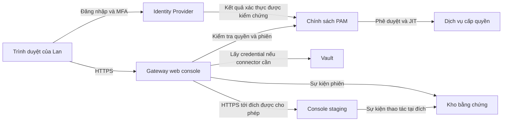

# Web console proxy

## Mục tiêu bài học

Trong chương Remote access của module Privileged Access Management (PAM), web console proxy là một điểm trung gian có kiểm soát để người dùng truy cập giao diện quản trị trên trình duyệt. Ví dụ, kỹ sư vận hành có thể mở console của một hệ thống nội bộ từ cổng PAM sau khi xác thực và được cấp quyền theo thời hạn, thay vì được mở kết nối mạng tùy ý tới mọi trang quản trị.

Sau bài học này, bạn có thể:

- Phân biệt web console proxy với reverse proxy thông thường và cổng hiển thị phiên từ xa.
- Mô tả luồng xác thực người dùng, cấp quyền, tạo phiên đích và ghi bằng chứng.
- Thiết kế cách ly cookie, credential, origin và tuyến kết nối giữa các phiên.
- Xác định các trường hợp proxy không đủ để bảo đảm least privilege hoặc thu hồi quyền.
- Xây dựng bài kiểm tra cho truy cập JIT, kết nối WebSocket và sự cố trong phiên.

## 1. Web console proxy giải quyết vấn đề gì?

Nhiều tài sản nhạy cảm chỉ có giao diện web để quản trị: thiết bị mạng, công cụ triển khai, hệ thống lưu trữ, bảng điều khiển ứng dụng và console của nền tảng hạ tầng. Cấp VPN diện rộng để sử dụng một console có thể mở thêm đường tới những tài sản không liên quan. Phát mật khẩu quản trị dùng chung lại làm giảm khả năng truy nguyên và khiến việc thu hồi quyền khó khăn.

Một web console proxy tích hợp PAM có thể tạo đường truy cập hẹp hơn:

1. Người dùng chọn tài sản đã được định danh trong danh mục.
2. PAM kiểm tra danh tính, điều kiện truy cập và quyền của người dùng.
3. Nếu cần, hệ thống yêu cầu phê duyệt và cấp quyền just-in-time (JIT).
4. Proxy mở kết nối tới console đích theo một tuyến đã cho phép.
5. Phiên được theo dõi, giới hạn thời gian và kết thúc theo chính sách.

Mục tiêu là kiểm soát **ai được vào tài sản nào, trong vai trò nào, trong bao lâu và với bằng chứng gì**. Chỉ đưa một reverse proxy trước trang đăng nhập chưa tạo thành đầy đủ các khả năng đó.

### Ví dụ xuyên suốt

Lan cần kiểm tra và khởi động lại một dịch vụ ở môi trường staging trong một cửa sổ bảo trì 15 phút. Tài sản `console-stg-01` có vai trò `staging-operator`; vai trò này không được sửa người dùng, thay cấu hình xác thực hoặc truy cập production.

Luồng mong muốn là Lan dùng danh tính cá nhân để đăng nhập PAM, chọn đúng tài sản, cung cấp mã yêu cầu bảo trì và nhận quyền có thời hạn. Console đích vẫn phải thực thi vai trò `staging-operator`. Việc Lan đã qua PAM không có nghĩa mọi thao tác trên console đều được phép.

## 2. Phân biệt các mô hình truy cập qua trình duyệt

Tên gọi sản phẩm có thể khác nhau, vì vậy cần xác định ranh giới kỹ thuật thực tế.

| Mô hình | Trình duyệt nhận gì? | Điểm cần hiểu |
|---|---|---|
| Reverse proxy HTTP tích hợp PAM | HTML, JavaScript, CSS và dữ liệu ứng dụng được chuyển tiếp từ đích | Mã phía trình duyệt của console thường vẫn chạy trên máy người dùng; cần kiểm soát origin, cookie và tuyến API |
| Trình duyệt chạy trong môi trường cách ly | Hình ảnh hoặc giao diện tương tác do một trình duyệt từ xa cung cấp | Phiên HTTP với console nằm trong môi trường từ xa; khả năng tải file, clipboard và truyền dữ liệu phụ thuộc triển khai |
| Cổng HTML5 cho desktop hoặc terminal từ xa | Luồng hiển thị và sự kiện bàn phím/chuột của phiên desktop hoặc terminal | Đây là môi giới phiên RDP, SSH hoặc giao thức tương tự; không tự động có cùng cơ chế với proxy HTTP |
| Cổng ứng dụng chỉ chuyển hướng sau khi đăng nhập | URL hoặc liên kết tới console | Nếu trình duyệt kết nối trực tiếp với đích, cổng không nằm trên toàn bộ đường dữ liệu để chặn hay ghi nhận phiên |

Trong bài này, mô hình chính là **proxy HTTP cho web console**. Các kết luận về việc giữ secret ở máy chủ chỉ đúng khi giải pháp thực sự giữ chúng tại đó. Cần kiểm chứng thiết kế cụ thể, không suy từ việc người dùng chỉ nhìn thấy một cửa sổ trình duyệt.

Một console SaaS hoặc cloud có thể hỗ trợ federation trực tiếp tốt hơn việc bị đặt sau proxy tùy ý. Không phải console nào cũng tương thích với cookie, URL tuyệt đối, WebSocket, chữ ký yêu cầu, cơ chế chống nhúng hoặc luồng đăng nhập bên ngoài. Chỉ dùng connector và phương thức tích hợp được hệ thống đích hỗ trợ; giữ nguyên kiểm tra MFA và chứng thư thay vì giảm bảo vệ để ép luồng chạy được.

## 3. Kiến trúc và ranh giới tin cậy



Sơ đồ mô tả các chức năng logic; chúng có thể nằm trong nhiều dịch vụ. Luồng đăng nhập thực tế có thể dùng chuyển hướng qua trình duyệt. Gateway chỉ tin kết quả xác thực sau khi kiểm tra đầy đủ theo giao thức đã triển khai, không tin một tên người dùng do trình duyệt gửi lên.

Có bốn quyết định tách biệt:

1. **Xác thực danh tính:** người đang yêu cầu có thực sự là Lan không?
2. **Cho phép mở phiên:** Lan có được truy cập `console-stg-01` tại thời điểm này không?
3. **Danh tính và quyền tại đích:** console nhìn thấy Lan, một tài khoản kỹ thuật riêng hay một tài khoản dùng chung? Vai trò nào thực sự được áp dụng?
4. **Cho phép thao tác:** Lan có được khởi động lại dịch vụ cụ thể không? Đích phải kiểm tra quyền cho yêu cầu đó.

Gateway thường có quyền mạng tới các tài sản quản trị và có thể tiếp cận vault. Vì vậy nó là thành phần đặc quyền cần được quản lý như một tài sản nhạy cảm: quyền chạy tối thiểu, cấu hình được kiểm soát, cập nhật có kiểm thử và hạn chế kết nối ra ngoài.

### Hai chặng TLS độc lập

Với proxy chấm dứt TLS, kết nối trình duyệt → gateway và gateway → console là hai chặng riêng. Cả hai cần bảo vệ đường truyền và xác thực đúng máy chủ. Việc trình duyệt thấy biểu tượng HTTPS ở gateway không chứng minh gateway đã kiểm tra chứng thư console đích.

Ở chặng sau, dùng tên máy chủ và chuỗi tin cậy phù hợp với hạ tầng; không bật tùy chọn bỏ qua kiểm tra TLS để xử lý nhanh sự cố. Nếu đích dùng CA nội bộ, cấu hình trust store và quy trình gia hạn chứng thư đúng cách. Tùy thiết kế, có thể thêm mTLS, nhưng nó không thay cho quyền của người dùng tại console.

## 4. Vòng đời một phiên được kiểm soát

### Bước 1 — Chọn tài sản từ danh mục

Người dùng chọn định danh tài sản, không cung cấp một URL tùy ý để gateway mở giúp. Bản ghi tài sản xác định scheme, hostname, cổng, connector, môi trường và vai trò có thể yêu cầu.

Chính sách cần kiểm tra cả kết nối ban đầu lẫn các redirect hoặc endpoint phụ cần thiết. Nếu console chuyển hướng tới một host khác, proxy không được mặc nhiên biến redirect đó thành quyền truy cập mọi host. Đồng thời cần kiểm soát DNS và egress để một tên đã được cho phép không trở thành đường tới tài sản ngoài phạm vi.

### Bước 2 — Kiểm tra điều kiện và cấp quyền JIT

PAM kết hợp danh tính, nhóm, tài sản, môi trường, lý do công việc và các điều kiện được tổ chức triển khai, chẳng hạn mức xác thực hoặc trạng thái thiết bị. Quyết định phải diễn ra phía máy chủ.

Trong ví dụ, quyền được ràng buộc với:

- Người dùng Lan và tài sản `console-stg-01`.
- Vai trò `staging-operator`.
- Mã yêu cầu bảo trì đã hợp lệ và người phê duyệt nếu chính sách yêu cầu.
- Thời điểm bắt đầu và hết hạn theo đồng hồ máy chủ.

JIT tại cổng PAM chưa chắc đã là JIT tại đích. Nếu tài khoản đích vốn có quyền quản trị thường trực, proxy chỉ giới hạn đường truy cập của phiên đó. Thiết kế phải nói rõ quyền được tạo hoặc kích hoạt ở đâu và ai chịu trách nhiệm thu hồi.

### Bước 3 — Tạo ngữ cảnh phiên riêng

Gateway cấp một định danh phiên khó đoán, ràng buộc với người dùng, tài sản và quyết định quyền. Trình duyệt không được đổi tài sản hoặc vai trò bằng cách sửa tham số URL hay gửi một trường `role` khác.

Mỗi phiên có ngữ cảnh backend riêng, gồm kết nối, cookie jar, token đích và các dữ liệu connector cần giữ. Không dùng chung cookie jar của tài khoản quản trị giữa hai người. Không coi việc hai tab có URL khác nhau là đã cách ly: cookie, storage và service worker thường có phạm vi theo origin và có thể làm các tab liên quan tới nhau.

### Bước 4 — Mở phiên tại console đích

Có thể dùng danh tính liên kết, credential động hoặc cơ chế đăng nhập được connector hỗ trợ. Ưu tiên khả năng gắn thao tác tại đích với danh tính cá nhân và quyền hạn hẹp.

Nếu phải lấy credential từ vault, gateway chỉ được lấy secret cần cho tài sản và vai trò đó. Secret không được đưa vào URL, log, mã HTML, local storage hoặc trả về trình duyệt bằng một API tiện dụng. Credential injection chỉ có ý nghĩa khi connector giữ được ranh giới này; một cơ chế điền mật khẩu vào form ngay trên trình duyệt người dùng có thể làm mất bảo đảm giữ secret ở máy chủ.

Với tài khoản đích dùng chung, PAM cần ghi ánh xạ từ phiên cá nhân tới tài khoản đích. Ánh xạ đó giúp điều tra nhưng không tạo ra danh tính cá nhân thật trong mọi log của đích, nhất là khi có truy cập ngoài gateway hoặc nhiều phiên đồng thời.

### Bước 5 — Duy trì quyền trong suốt phiên

Kiểm tra quyền ở màn hình mở phiên là chưa đủ. Thiết kế phải xác định cách áp dụng hết hạn và thu hồi cho yêu cầu HTTP tiếp theo, kết nối đang mở và các kênh WebSocket hoặc streaming.

Phân biệt ba mốc:

| Mốc | Ý nghĩa | Ví dụ minh họa |
|---|---|---|
| Hết hạn quyền JIT | Quyền truy cập được cấp cho công việc không còn hiệu lực | Sau 15 phút |
| Hết hạn tuyệt đối của phiên | Phiên không được kéo dài quá giới hạn, kể cả có hoạt động liên tục | Không muộn hơn lúc quyền JIT hết hạn |
| Hết hạn do không hoạt động | Phiên bị đóng khi không có hoạt động hợp lệ trong một khoảng thời gian | Sau 5 phút không hoạt động |

Các con số chỉ phục vụ bài tập. Cần định nghĩa rõ heartbeat tự động, polling nền hoặc gói WebSocket có được tính là hoạt động người dùng hay không; nếu mọi lưu lượng nền đều gia hạn idle timeout, một tab bỏ quên có thể sống rất lâu.

Kết nối lại sau khi mất mạng phải được kiểm tra lại quyền và vẫn chịu hạn tuyệt đối cũ. Không tạo thêm 15 phút quyền chỉ vì người dùng refresh trang.

### Bước 6 — Kết thúc và dọn dẹp

Khi người dùng đăng xuất, hết hạn hoặc bị thu hồi, gateway phải ngăn yêu cầu mới và xử lý các kết nối đang mở theo chính sách. Sau đó thu hồi phiên hoặc token tại đích nếu đích hỗ trợ, gỡ quyền JIT, hủy ngữ cảnh backend và ghi kết quả dọn dẹp.

Đóng tab hoặc đóng kết nối proxy không chứng minh rằng token tại đích đã vô hiệu. Một job dài đã được console khởi chạy cũng có thể tiếp tục chạy. Cần tách rõ **chấm dứt truy cập**, **thu hồi phiên đích**, **thu hồi quyền** và **trạng thái công việc đã khởi chạy**.

Nếu dọn dẹp thất bại, ghi nhận việc chưa thu hồi được, thử lại theo quy trình và cảnh báo người chịu trách nhiệm. Không ghi sự kiện “đã thu hồi hoàn toàn” chỉ vì giao diện người dùng đã đóng.

## 5. Cách ly origin, cookie và dữ liệu trình duyệt

### Cookie và storage có thể làm rò ngữ cảnh phiên

Một thiết kế phục vụ mọi console trên cùng origin rồi phân biệt bằng đường dẫn phải xem xét nguy cơ mã của một ứng dụng tiếp cận dữ liệu thuộc ứng dụng khác. Đường dẫn URL không phải ranh giới bảo mật tương đương với origin riêng.

Tùy khả năng sản phẩm, có thể dùng origin riêng cho tài sản hoặc phiên, hay môi trường trình duyệt từ xa riêng. Dù chọn cách nào, phải kiểm chứng rằng cookie, local storage, IndexedDB, cache và service worker không làm phiên này đọc hoặc tác động tới phiên khác. Subdomain riêng cũng cần cấu hình cookie và chính sách origin cẩn thận; cookie có Domain quá rộng có thể phá cách ly dự kiến.

Cookie phiên của gateway nên có thuộc tính bảo vệ phù hợp như `Secure`, `HttpOnly` và cấu hình `SameSite` phù hợp luồng đăng nhập. `HttpOnly` hạn chế JavaScript đọc cookie, nhưng không ngăn mã độc đang chạy trong origin thực hiện yêu cầu bằng phiên của nạn nhân. Không xem một thuộc tính cookie là biện pháp thay thế cho bảo vệ XSS và CSRF.

### Phiên backend cũng cần cách ly

Proxy có thể giữ cookie đích ở máy chủ và chỉ cấp cookie phiên của gateway cho trình duyệt. Khi đó, mọi yêu cầu phải được ánh xạ bằng trạng thái đã kiểm chứng phía máy chủ tới đúng cookie jar, đích và quyền.

Không tin một header do trình duyệt gửi để chọn ngữ cảnh quản trị. Nếu gateway thêm header xác định người dùng cho backend, phải loại bỏ hoặc xử lý rõ header trùng do phía ngoài gửi và chỉ để đích tin header từ đường proxy được xác thực. Header danh tính không tự tạo ra cơ chế phân quyền tại đích.

### Nội dung nhạy cảm vẫn có thể tới máy người dùng

Giữ mật khẩu trong vault không đồng nghĩa giữ mọi dữ liệu ở phía máy chủ. HTML, phản hồi API, file tải về hoặc nội dung hiển thị có thể chứa dữ liệu nhạy cảm. Người dùng được xem màn hình có thể sao chép thủ công hoặc chụp ảnh bằng thiết bị khác.

Kiểm soát upload, download, clipboard hoặc in ấn chỉ hiệu quả trong phạm vi mà giải pháp thực sự thực thi được. Với dữ liệu nhạy cảm, kết hợp quyền đọc tối thiểu, thiết bị được quản lý, hạn chế xuất dữ liệu tại ứng dụng và chính sách lưu trữ. Không cam kết “không thể lấy dữ liệu ra” chỉ vì đã tắt một nút tải xuống.

## 6. Các rủi ro cần thiết kế ngay từ đầu

| Rủi ro | Tình huống trong web console proxy | Cách kiểm soát chính |
|---|---|---|
| Vượt phạm vi tài sản | Tham số URL hoặc redirect làm gateway gọi một máy chủ không được phép | Ánh xạ tài sản phía máy chủ, allowlist đích, kiểm tra redirect và hạn chế egress |
| Trộn phiên | Hai người dùng vô tình dùng cùng cookie quản trị ở backend | Ngữ cảnh riêng theo phiên, kiểm thử đồng thời và dọn dẹp sau phiên |
| Lạm dụng quyền đích | Người dùng sửa yêu cầu API dù giao diện đã ẩn nút | RBAC/ABAC tại đích, quyền tài khoản hẹp, kiểm tra mọi thao tác nhạy cảm |
| CSRF hoặc XSS | Yêu cầu ngoài ý muốn được thực hiện trong phiên đã đăng nhập | Giữ bảo vệ ứng dụng, kiểm tra nguồn theo thiết kế, cookie phù hợp và cách ly origin |
| Kênh sống quá hạn | WebSocket còn mở sau khi quyền JIT hết hạn | Cơ chế theo dõi và chấm dứt kênh dài, kiểm tra reconnect và thu hồi tại đích |
| Rò secret | Token nằm trong log, URL hoặc bản ghi phiên | Loại bỏ secret khỏi sự kiện, lọc dữ liệu nhạy cảm và kiểm soát kho bằng chứng |
| Đường truy cập thay thế | Người dùng gọi API đích bằng credential còn hiệu lực ngoài proxy | Giới hạn mạng nếu khả thi, IAM đích, credential có thời hạn và kiểm kê đường truy cập |

### Không dùng proxy như bộ phân quyền theo nút bấm

Chặn một đường dẫn như `/admin` hoặc ẩn nút “Delete” có thể không bao phủ endpoint API khác, WebSocket hay một phiên bản giao diện mới. Proxy có thể thêm lớp kiểm soát nhưng không nên được coi là bộ hiểu đầy đủ ngữ nghĩa của mọi console.

Với ví dụ của Lan, kiểm chứng rằng tài khoản đích bị từ chối tạo quản trị viên mới ngay cả khi gửi yêu cầu API tương ứng. Kết quả này mạnh hơn việc chỉ xác nhận nút tạo quản trị viên không xuất hiện.

### Tránh biến connector thành một máy gọi URL tùy ý

Gateway có thể truy cập mạng quản trị mà trình duyệt người dùng không tới được. Nếu nhận URL tự do, nó có thể bị dùng như đường gọi tới dịch vụ nội bộ ngoài phạm vi hoặc endpoint hạ tầng nhạy cảm. Áp dụng kiểm soát đích sau khi phân tích và chuẩn hóa URL, xác định chính sách cho redirect, DNS và các kết nối do connector tạo. Bộ lọc chuỗi ký tự đơn giản ở giao diện là không đủ.

## 7. Ghi bằng chứng và giới hạn quan sát

Mục tiêu audit là trả lời được ai yêu cầu, được phép làm gì, kết nối tới đâu, dùng danh tính nào ở đích và phiên kết thúc ra sao.

Một sự kiện mở phiên có thể gồm:

```json
{
  "event_type": "pam.web_console.session_opened",
  "session_id": "sess-example-7f21",
  "actor_id": "user-lan",
  "asset_id": "console-stg-01",
  "target_principal_ref": "principal-staging-operator",
  "role": "staging-operator",
  "request_ref": "maintenance-example-104",
  "policy_version": "example-policy-v3",
  "grant_expires_at": "2026-01-01T08:15:00Z",
  "result": "allowed"
}
```

Đây là dữ liệu minh họa, không phải schema bắt buộc của một sản phẩm. Thời gian cần dùng định dạng thống nhất và các thành phần cần đồng bộ đồng hồ. Không ghi mật khẩu, cookie, access token hoặc toàn bộ request/response mặc định để “đủ log”. URL query và nội dung form cũng có thể mang secret hoặc dữ liệu cá nhân.

Các nguồn bằng chứng có giá trị khác nhau:

- **Sự kiện PAM:** giải thích quyết định cấp quyền, mốc phiên và lý do kết thúc.
- **Metadata HTTP:** cho biết endpoint và kết quả ở mức giao thức, nhưng không luôn chứng minh thao tác nghiệp vụ đã thành công.
- **Audit tại đích:** xác nhận đối tượng và thay đổi được đích ghi nhận; cần ánh xạ được về phiên và danh tính.
- **Video hoặc ảnh phiên, nếu có:** giúp xem lại tương tác, nhưng không tự động thể hiện mọi lời gọi API, tác vụ nền hoặc thay đổi ngoài phiên.

Khả năng ghi hình và che dữ liệu nhạy cảm phụ thuộc cơ chế triển khai. Không hứa ghi lại đầy đủ chỉ từ một reverse proxy HTTP. Kho bằng chứng cần phân quyền xem, bảo vệ tính toàn vẹn, thời hạn lưu và kiểm soát truy cập; người vận hành gateway không nên mặc nhiên có quyền xóa dấu vết về chính mình.

Với console dùng tài khoản chung, bổ sung các khóa tương quan mà đích hỗ trợ và ghi rõ giới hạn quy kết. Việc một log ở đích ghi `admin` tại cùng thời điểm chưa đủ để kết luận chắc chắn ai đã thực hiện nếu nhiều đường truy cập vẫn tồn tại.

## 8. Chính sách minh họa cho console staging

Khối dưới là **mô tả chính sách**, không phải cấu hình có thể nạp trực tiếp vào sản phẩm.

```yaml
asset_id: console-stg-01
target:
  scheme: https
  host: console-stg-01.internal.example
  port: 443
  tls_verification: required
access:
  eligible_group: staging-operators
  requested_role: staging-operator
  maintenance_request: required
  strong_authentication: required
  grant_duration_minutes: 15
session:
  absolute_expiry: no_later_than_grant_expiry
  idle_timeout_minutes: 5
  background_polling_counts_as_user_activity: false
  backend_context: isolated_per_session
  reconnect: reevaluate_with_existing_absolute_expiry
revocation:
  reject_new_requests: true
  close_existing_channels: true
  invalidate_target_session: when_supported
  remove_jit_grant: required
  cleanup_failure: alert_and_retry
audit:
  decision_and_lifecycle_events: required
  target_audit_correlation: required
  secrets_in_logs: forbidden
```

Để hiện thực hóa mô tả này, phải xác định thành phần chịu trách nhiệm từng dòng và bằng chứng kiểm thử. Chẳng hạn `close_existing_channels: true` cần một cơ chế thực sự đóng WebSocket; nó không được thực hiện chỉ bằng việc kiểm tra cookie ở lần tải trang đầu.

Nếu đích không hỗ trợ vô hiệu phiên chủ động, cần nêu rõ thời gian tồn tại còn lại và biện pháp hạn chế như thời hạn phiên đích ngắn hoặc chặn đường truy cập trực tiếp. Việc đổi mật khẩu cũng không bảo đảm mọi cookie hoặc token đã phát hành bị vô hiệu; phải kiểm chứng theo cơ chế của đích.

## 9. Xử lý sự cố mà vẫn kiểm soát quyền

### IdP hoặc dịch vụ chính sách không sẵn sàng

Không mở quyền mới chỉ vì thành phần xác thực hoặc phân quyền không phản hồi. Với phiên đang tồn tại, định nghĩa trước điều kiện tiếp tục, thời hạn tối đa và cách xử lý khi không thể kiểm chứng thu hồi. Không có một lựa chọn duy nhất cho mọi hệ thống, nhưng không được kéo dài vô hạn hoặc tự bỏ qua kiểm tra.

Nếu cần đường break-glass cho sự cố nghiêm trọng, đó phải là quy trình độc lập đã được thiết kế và kiểm soát, có thời hạn, trách nhiệm và bằng chứng; không phải một cờ tắt PAM trong lúc đang khắc phục.

### Vault không cấp được credential

Từ chối mở phiên mới và ghi lỗi đã được lọc secret. Không trả mật khẩu cho người dùng như một phương án chuyển tiếp tạm thời. Phiên đang hoạt động cần tuân theo thời hạn và chính sách riêng, thay vì tự gia hạn vì vault đang lỗi.

### Console đổi hostname hoặc chứng thư

Kiểm tra việc thay đổi có được phê duyệt và cập nhật danh mục/trust store qua quy trình cấu hình. Không cho phép người dùng nhập host thay thế tùy ý và không bỏ kiểm tra chứng thư.

### Hệ thống ghi bằng chứng gặp lỗi

Định nghĩa trước có chặn phiên mới hay cho phép tiếp tục trong một khoảng hữu hạn với bộ đệm bền vững. Cần tính dung lượng, mã hóa, quyền truy cập, phát hiện thiếu sự kiện và cảnh báo. Khi điều kiện ghi bằng chứng bắt buộc không được đáp ứng, không lặng lẽ chuyển sang phiên không được theo dõi.

### Người dùng mất kết nối khi một thao tác đang chạy

Không tự động gửi lại một yêu cầu thay đổi trạng thái chỉ vì không nhận được phản hồi. Thao tác có thể đã được đích thực hiện. Kiểm tra trạng thái tại đích hoặc dùng cơ chế idempotency nếu ứng dụng hỗ trợ trước khi thử lại. Ghi phân biệt lỗi đường truyền với kết quả nghiệp vụ chưa biết.

## 10. Bài thực hành có kiểm chứng

Thực hiện trong môi trường lab được phép, dùng console thử nghiệm và dữ liệu giả. Không dùng credential production để thử mô hình proxy.

### Chuẩn bị

Tạo hai danh tính cá nhân A và B, một tài sản staging, một vai trò chỉ đọc và một vai trò vận hành giới hạn. Chuẩn bị endpoint HTTP và WebSocket của console nếu ứng dụng có dùng cả hai. Xác định cách thu log PAM, audit đích và kết quả thu hồi mà không thu secret.

### Các ca kiểm tra

| Ca | Thao tác | Kết quả mong đợi |
|---|---|---|
| Mở phiên hợp lệ | A có quyền JIT mở console staging | Có phiên và sự kiện cấp quyền; đích áp đúng vai trò |
| Thiếu quyền | B chưa được cấp quyền thử mở cùng tài sản | Bị từ chối phía máy chủ trước khi nhận phiên đích |
| Sửa định danh | A sửa asset ID hoặc tham số vai trò | Không nhận thêm quyền hoặc đổi sang tài sản khác |
| Quyền đích hẹp | A ở vai trò chỉ đọc thử một thao tác ghi trong lab | Đích từ chối, kể cả khi gửi yêu cầu ngoài nút giao diện |
| Cách ly đồng thời | A và B mở phiên bằng hai ngữ cảnh được cấp riêng | Cookie jar, vai trò và dữ liệu phiên không bị trộn |
| Hết hạn tuyệt đối | A giữ trang hoạt động qua hạn quyền | Yêu cầu mới bị từ chối; kênh dài được kết thúc theo chính sách |
| Thu hồi chủ động | Thu hồi grant khi WebSocket đang mở | Không còn thao tác được qua kênh cũ; reconnect bị kiểm tra lại |
| Mất mạng và reconnect | Ngắt rồi nối lại khi quyền sắp hết hạn | Không đặt lại hạn tuyệt đối hoặc tạo quyền mới ngầm |
| Redirect ngoài phạm vi | Console lab trả redirect tới host chưa được cho phép | Không tạo đường truy cập được proxy tới host đó |
| Dọn dẹp thất bại | Mô phỏng lỗi API thu hồi phiên đích | Có trạng thái chưa thu hồi, cảnh báo và cơ chế thử lại |
| Bằng chứng thiếu | Mô phỏng kho audit không sẵn sàng | Hành vi đúng chính sách đã công bố, có cảnh báo, không mất dấu âm thầm |

Kiểm chứng việc thu hồi bằng thử một yêu cầu được bảo vệ và kiểm tra trạng thái tại đích, không chỉ quan sát trang báo “session expired”. Với dữ liệu đã hiển thị trên trình duyệt, không thể lấy lại kiến thức người dùng đã nhìn thấy; tiêu chí thu hồi phải tập trung vào quyền truy cập tiếp theo và token còn hiệu lực.

### Sản phẩm của bài thực hành

Ghi lại sơ đồ hai chặng kết nối, nơi lưu cookie/token, nơi thực thi vai trò đích, các mốc hết hạn và trách nhiệm dọn dẹp. Báo cáo mỗi ca theo điều kiện, kết quả mong đợi, kết quả thực tế và khóa tương quan sự kiện. Khi kiểm tra chưa bao phủ một kênh, ghi rõ khoảng trống thay vì kết luận toàn bộ phiên đã được kiểm soát.

## 11. Sai lầm thường gặp

**“Đã đăng nhập PAM thì console không cần phân quyền.”** PAM quyết định quyền vào phiên; console vẫn phải kiểm tra từng thao tác bằng quyền của danh tính đích.

**“Không thấy mật khẩu nghĩa là không có credential ở trình duyệt.”** Cookie phiên và token cũng là credential. Cần kiểm tra luồng dữ liệu thực tế và nơi lưu, không chỉ giao diện nhập mật khẩu.

**“Đóng gateway là thu hồi mọi thứ.”** Phiên đích, token, quyền JIT và job đang chạy có vòng đời riêng. Cần kiểm tra từng phần và xử lý dọn dẹp thất bại.

**“Tất cả console chạy được qua cùng một bộ rewrite.”** Console có thể phụ thuộc origin, URL tuyệt đối, WebSocket hoặc luồng xác thực bên ngoài. Mỗi tích hợp cần được hỗ trợ và kiểm thử khi nâng cấp.

**“Ghi toàn bộ lưu lượng sẽ có audit tốt nhất.”** Ghi quá mức có thể tạo thêm kho secret và dữ liệu nhạy cảm. Bằng chứng cần đủ để truy nguyên, có tương quan với đích và được bảo vệ theo mục đích.

## 12. Câu hỏi tự kiểm tra

1. Nếu gateway chỉ kiểm tra quyền ở lần tải HTML đầu tiên, điều gì có thể xảy ra với WebSocket sau khi grant hết hạn?
2. Hai tab trên cùng origin có những tài nguyên trình duyệt nào có thể dùng chung? Vì sao tách đường dẫn chưa đủ?
3. Vì sao giữ mật khẩu tại vault vẫn chưa bảo đảm phiên không làm lộ dữ liệu trên máy người dùng?
4. Khi tài khoản đích dùng chung, cần thêm bằng chứng gì để truy nguyên, và giới hạn nào vẫn còn?
5. Sau khi gateway đóng kết nối, bạn kiểm chứng việc thu hồi phiên và quyền ở đích bằng cách nào?

### Gợi ý đối chiếu

1. Kênh đã mở có thể tiếp tục truyền thao tác nếu không có cơ chế hết hạn và chấm dứt riêng; reconnect cũng phải được kiểm tra.
2. Cookie, storage, cache và service worker có phạm vi liên quan tới origin; tách URL không tự tạo cách ly giữa các ứng dụng và phiên.
3. Trình duyệt vẫn có thể nhận token, dữ liệu API, nội dung hiển thị hoặc file; phải kiểm soát cả credential phiên và dữ liệu.
4. Cần ánh xạ người dùng–phiên–tài khoản đích, mốc thời gian, audit đích và kiểm kê đường truy cập khác; tài khoản chung vẫn làm giảm chất lượng quy kết ở đích.
5. Kiểm tra trạng thái token/phiên và quyền, thử truy cập được bảo vệ trong lab, xác nhận việc gỡ grant, đồng thời xem kết quả dọn dẹp và cảnh báo.

Một thiết kế web console proxy đạt mục tiêu PAM khi đường truy cập được giới hạn theo tài sản và thời gian, quyền thực sự được thực thi tại đích, các phiên được cách ly và vòng đời thu hồi có thể kiểm chứng. Đó là các thuộc tính cần chứng minh bằng kiểm thử và bằng chứng vận hành, không chỉ bằng việc mở được console qua trình duyệt.
