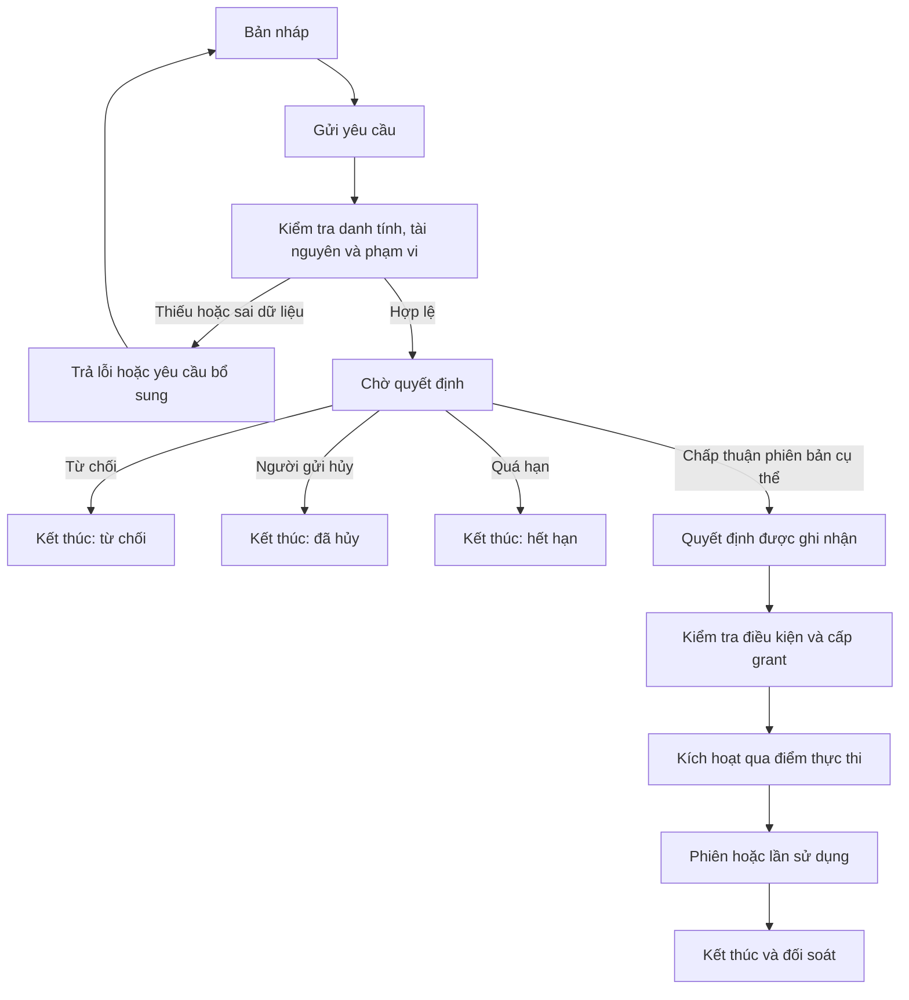

# Yêu cầu truy cập đặc quyền

## 1. Yêu cầu truy cập là điểm bắt đầu của một quyền có kiểm soát

Trong quản lý truy cập đặc quyền (Privileged Access Management — PAM), yêu cầu truy cập là đề nghị sử dụng một quyền nhạy cảm để hoàn thành một công việc cụ thể. Yêu cầu cần làm rõ ai sẽ thao tác, trên tài nguyên nào, bằng quyền gì, trong khoảng thời gian nào và vì lý do gì.

Ví dụ, “cần quyền admin production” chưa đủ để ra quyết định. Một yêu cầu có thể kiểm tra được sẽ mô tả: kỹ sư trực vận hành cần đọc trạng thái dịch vụ thanh toán trên hai máy production đã đăng ký, trong cửa sổ xử lý sự cố, qua session broker và bằng vai trò chẩn đoán không cho sửa cấu hình.

Trong chương Approval workflow, yêu cầu là đầu vào cho quy trình xem xét, không phải quyền được thực thi. Nó kết nối nhu cầu nghiệp vụ với kiểm kê tài sản, least privilege, cấp quyền vừa đúng lúc (JIT), giới hạn khả năng thao tác (JEA), vault, quản lý credential và giám sát phiên.

Cần phân biệt bốn đối tượng:

| Đối tượng | Ý nghĩa | Điều chưa được suy ra |
|---|---|---|
| Yêu cầu — request | Chủ thể đề nghị một phạm vi truy cập | Đã được phép truy cập |
| Quyết định — decision | Người hoặc chính sách có thẩm quyền chấp thuận hay từ chối một phiên bản yêu cầu | Credential đã được cấp hoặc phiên đã mở |
| Quyền được cấp — grant | Hệ thống ghi nhận quyền cụ thể cùng điều kiện và thời hạn thực thi | Mọi phiên có thể tiếp tục vô hạn |
| Phiên hoặc lần sử dụng — session/use | Một lần thực sự dùng quyền tại điểm thực thi | Toàn bộ hoạt động ngoài phiên đều đã được kiểm soát |

Một quy trình tốt không chỉ thu thập lời giải thích. Nó chuyển một nhu cầu thành phạm vi có thể đánh giá, thực thi, thu hồi và đối soát bằng chứng.

## 2. Ai yêu cầu, ai sử dụng và ai chịu trách nhiệm?

Ba vai trò này có thể khác nhau:

- **Người gửi yêu cầu:** người hoặc dịch vụ tạo request.
- **Chủ thể sử dụng quyền:** danh tính sẽ được phép kích hoạt và thực hiện công việc.
- **Người chịu trách nhiệm nghiệp vụ hoặc tài nguyên:** bên xác nhận mục đích và phạm vi thuộc trách nhiệm của mình.

Khi một quản lý gửi yêu cầu cho kỹ sư nhà cung cấp, việc quản lý đăng nhập không chứng minh kỹ sư được phép dùng quyền. Hệ thống cần nhận diện riêng người gửi, kỹ sư thụ hưởng, tổ chức liên quan và căn cứ ủy quyền để gửi thay. Nếu có chuỗi người gọi và dịch vụ trung gian, audit cần giữ quan hệ giữa các bên thay vì gộp tất cả thành một tài khoản kỹ thuật.

Người dùng thông thường không được tự chọn danh tính của người khác để nhận quyền. Chức năng yêu cầu thay mặt phải có quyền riêng, giới hạn đối tượng và dấu vết tương ứng.

Với tài khoản dịch vụ và workload, chủ thể sử dụng có thể là một job bảo trì, pipeline hoặc dịch vụ tự động. Người tạo request vẫn có thể là con người, nhưng grant phải ràng buộc với danh tính workload và phạm vi chạy phù hợp. Không đưa credential của một quản trị viên vào pipeline chỉ để mô phỏng danh tính workload.

Danh tính được chấp nhận phải đến từ nguồn xác thực có thẩm quyền. Trường tên hiển thị, email hoặc nhãn do client nhập chỉ là dữ liệu mô tả cho tới khi được xác minh. Mã request ngẫu nhiên cũng không thay thế kiểm tra quyền xem và thao tác trên request.

## 3. Mô tả nhu cầu trước khi chọn quyền

### 3.1. Viết công việc theo động từ và tài nguyên

Một mô tả hữu ích có ba phần:

> Thực hiện **tác vụ cụ thể** trên **tập tài nguyên xác định** để đạt **kết quả nghiệp vụ có thể kiểm tra**.

Ví dụ:

> Đọc trạng thái tiến trình và log đã được giới hạn trên hai máy ứng dụng thanh toán để xác định nguyên nhân hàng đợi tăng trong sự cố INC-241.

Câu này giúp xem xét liệu cần quyền đọc log, quyền khởi động lại dịch vụ hay quyền sửa cấu hình. Nó cũng giúp tách dữ liệu nhạy cảm ra khỏi phạm vi nếu công việc chỉ cần số liệu vận hành.

Lý do truy cập không nên chỉ là “support”, “troubleshooting” hoặc một liên kết ticket. Ticket là dữ liệu tham chiếu; hệ thống vẫn cần kiểm tra người gửi có quyền liên hệ ticket với tài nguyên và công việc đó hay không. Một incident đang mở không tự tạo quyền quản trị cho mọi thành viên.

### 3.2. Chọn vai trò từ danh mục quyền có quản lý

Nên đề xuất các mẫu quyền đã được định nghĩa: chẩn đoán chỉ đọc, khởi động lại một dịch vụ, quản lý một nhóm cấu hình hoặc thực hiện một tác vụ bảo trì. Mẫu quyền cần chỉ rõ khả năng thực tế, điều kiện áp dụng, người sở hữu và phiên bản.

Không đánh giá quyền chỉ bằng tên. Một vai trò mang nhãn “read-only” có thể cho đọc secret, dữ liệu khách hàng hoặc thông tin đủ để mở rộng quyền. Một lệnh tưởng là chẩn đoán có thể có chức năng chạy lệnh con hoặc sửa file theo cách sử dụng. Việc giới hạn phải dựa trên khả năng được thực thi trên đích, không chỉ nhãn trên form.

Nếu công việc không khớp mẫu sẵn có, có thể cần quy trình xem xét phạm vi riêng. Không tự chuyển yêu cầu đó sang quyền toàn quyền chỉ vì danh mục còn thiếu.

### 3.3. Xét các đường quyền gián tiếp

Phạm vi quyền cần tính đến tác động thực tế:

| Quyền được đề nghị | Câu hỏi cần làm rõ |
|---|---|
| Đọc một secret từ vault | Secret cho truy cập hệ thống nào, có thể sao chép và dùng ngoài phiên không? |
| Sửa cấu hình triển khai | Thay đổi có làm workload chạy bằng danh tính mạnh hơn không? |
| Quản lý nhóm quyền | Có thể tự thêm mình hoặc người khác vào nhóm đặc quyền không? |
| Thao tác dịch vụ | Có thể thay executable, tham số khởi chạy hoặc danh tính chạy dịch vụ không? |
| Truy cập console | Có thể tiếp cận ổ đĩa, credential hoặc đường quản trị khác không? |

Yêu cầu phải cho người quyết định thấy khả năng đáng kể, thay vì chỉ mô tả giao diện mà người dùng sẽ mở.

## 4. Bộ dữ liệu tối thiểu của một yêu cầu

Các trường cụ thể tùy hệ thống, nhưng một request có thể đánh giá được thường cần các nhóm sau:

| Nhóm | Dữ liệu cần có | Cách dùng |
|---|---|---|
| Danh tính | Người gửi, chủ thể sử dụng, tổ chức hoặc tenant liên quan | Kiểm tra quyền gửi, nhận và kích hoạt |
| Công việc | Mục đích, tác vụ, incident/change reference nếu áp dụng | Xác định nhu cầu và căn cứ |
| Tài nguyên | Resource reference, môi trường, chủ sở hữu | Ràng buộc đúng đích và định tuyến xem xét |
| Quyền | Mẫu vai trò, hành động, account profile nếu cần | Giới hạn quyền có thể cấp |
| Thời gian | Cửa sổ kích hoạt, hạn tuyệt đối, thời lượng phiên | Ngăn quyền sống lâu hơn nhu cầu |
| Cách truy cập | Broker hoặc kênh được phép, thiết bị theo điều kiện áp dụng | Gắn quyết định với đường thực thi |
| Bằng chứng | Recording, audit tác vụ, dữ liệu cần liên kết | Xác định khả năng kiểm tra sau đó |
| Vòng đời | Điều kiện hủy, thu hồi, hết hạn và kết thúc công việc | Đảm bảo quyền có điểm kết thúc |

### 4.1. Phân biệt dữ liệu đề nghị và dữ liệu đã xác minh

Người yêu cầu có thể đề xuất tài nguyên, vai trò và thời gian. Máy chủ phải đối chiếu chúng với nguồn kiểm kê và chính sách hiện hành trước khi dùng làm căn cứ.

Ví dụ, client gửi `resource_ref=payments-app-01` không có nghĩa tài nguyên đó thuộc tenant của người dùng. Phía máy chủ phải phân giải tài nguyên, kiểm tra quan hệ tenant, môi trường, owner và quyền yêu cầu truy cập.

Không tin các trường do client tự gửi như `approved=true`, `risk=low`, `owner_confirmed=true` hoặc `recording_optional=true`. Kết quả xác minh, phân loại rủi ro và quyết định thuộc phía có thẩm quyền.

### 4.2. Tài nguyên phải đủ chính xác và có ý nghĩa ổn định

Tên hiển thị và địa chỉ IP có thể thay đổi hoặc được tái sử dụng. Request nên tham chiếu tới danh tính tài nguyên trong hệ thống kiểm kê, cùng những thuộc tính quan trọng đối với quyết định.

Với nhóm tài nguyên động, cần định nghĩa rõ ý nghĩa của việc chọn nhóm. Một quyết định cho tập thành viên tại lúc duyệt khác với quyết định cho mọi tài nguyên hiện tại và tương lai có nhãn đó. Không để việc thêm thành viên vào nhóm âm thầm mở rộng một quyền đã duyệt.

Cách xử lý có thể là cố định tập đích đã giải quyết, hoặc dùng một chính sách nhóm động đã được chấp thuận và kiểm soát việc thay đổi. Dù chọn cách nào, người quyết định và điểm thực thi phải cùng hiểu một phạm vi.

### 4.3. Không đưa bí mật vào request

Form yêu cầu không phải nơi để gửi mật khẩu, private key, access token hoặc bản sao secret từ vault. Khi cần sử dụng credential, request chỉ nên tham chiếu account profile, secret reference hoặc cơ chế cấp credential được phép.

Lý do và tệp đính kèm cũng cần tránh dữ liệu nhạy cảm không phục vụ quyết định. Ví dụ, mô tả lỗi bằng mã sự cố và số liệu vận hành phù hợp thường hữu ích hơn dán toàn bộ log có thông tin khách hàng.

Việc che trường trên giao diện không đủ nếu nội dung vẫn xuất hiện trong notification, export hoặc audit. Phải xác định ai được xem từng phần dữ liệu và hạn chế kênh sao chép không cần thiết.

## 5. Thiết kế thời hạn rõ ràng

JIT chỉ có ý nghĩa khi các mốc thời gian được định nghĩa và thực thi. “Cấp 30 phút” chưa nói rõ 30 phút bắt đầu lúc gửi, lúc duyệt hay lúc mở phiên.

Một mô hình có thể phân biệt:

| Mốc hoặc giới hạn | Ý nghĩa |
|---|---|
| Thời điểm gửi | Khi máy chủ tiếp nhận request hợp lệ |
| Hạn nhận quyết định | Sau mốc này không tiếp tục duyệt request cũ |
| Bắt đầu cửa sổ kích hoạt | Thời điểm sớm nhất được bắt đầu sử dụng grant |
| Kết thúc cửa sổ kích hoạt | Sau mốc này không được mở lần sử dụng mới |
| Hạn truy cập tuyệt đối | Mọi quyền thuộc phạm vi đó phải kết thúc theo chính sách thực thi |
| Thời lượng tối đa mỗi phiên | Giới hạn tính từ lúc phiên thực sự được chấp nhận |
| Số lần hoặc số phiên | Có thể giới hạn một lần, nhiều lần hoặc mức đồng thời |

Các mốc cần có múi giờ rõ ràng và được máy chủ đánh giá bằng nguồn thời gian tin cậy. Một ví dụ về deadline phiên:

```text
effective_session_deadline =
    min(session_started_at + session_max_duration,
        grant_absolute_deadline,
        các giới hạn bắt buộc khác đang áp dụng)
```

Đây là công thức minh họa, không phải quy tắc của mọi sản phẩm. Nếu thiết kế cho phép phiên tiếp tục sau cửa sổ mở phiên, điều đó phải được biểu đạt rõ và vẫn chịu hạn truy cập tuyệt đối.

Nếu người duyệt chấp thuận quá muộn, hệ thống không tự dịch toàn bộ cửa sổ truy cập về sau. Người dùng có thể cần sửa hoặc tạo lại request theo quy trình, vì thời điểm mới có thể thuộc ca trực, lịch thay đổi hoặc điều kiện rủi ro khác.

Đối với công việc lặp lại, không dùng một yêu cầu mở vô thời hạn để thay cho quản lý quyền thường trực. Nếu cần cơ chế định kỳ hoặc tự động, phải định nghĩa phạm vi, lịch, danh tính, thời hạn chính sách và điều kiện cấp cho mỗi lần chạy.

## 6. Vòng đời yêu cầu và các điểm kiểm tra

Một luồng minh họa:



Tên trạng thái phụ thuộc hệ thống. Điều quan trọng là giữ được ý nghĩa nghiệp vụ và không nhầm trạng thái request với trạng thái quyền hoặc phiên.

### 6.1. Khi gửi yêu cầu

Máy chủ cần kiểm tra tối thiểu:

1. Người gọi đã được xác thực và có quyền tạo loại request này.
2. Chủ thể sử dụng hợp lệ; quan hệ gửi thay đã được kiểm tra nếu có.
3. Tài nguyên và mẫu quyền tồn tại, thuộc phạm vi cho phép.
4. Mục đích và trường bắt buộc đủ để đánh giá.
5. Các mốc thời gian hợp lệ, không vượt giới hạn áp dụng.
6. Không có trường client tự khai làm thay quyết định có thẩm quyền.
7. Request có revision để những hành động sau gắn với đúng nội dung.

Kết quả hợp lệ nghĩa là đủ điều kiện đi vào quy trình quyết định, không có nghĩa đã được chấp thuận.

### 6.2. Khi chờ quyết định

Người dùng cần thấy request đang chờ ai hoặc loại quyết định nào, thời hạn còn lại và việc họ có thể bổ sung dữ liệu bằng cách nào. Không nên buộc họ gửi nhiều request trùng nhau chỉ vì không nhìn thấy tiến độ.

Notification chỉ là lời nhắc. Một đường dẫn hoặc nút trong email không tự chứng minh người bấm có quyền duyệt. Máy chủ vẫn phải xác thực actor, kiểm tra thẩm quyền và trạng thái hiện tại trước khi ghi quyết định.

Khi danh tính bị vô hiệu hóa, tài nguyên bị loại khỏi phạm vi hoặc policy bắt buộc thay đổi, request đang chờ cần được xử lý theo quy tắc rõ ràng. Không để một request cũ trở thành cách vượt qua điều kiện hiện hành.

### 6.3. Sau quyết định

Grant được cấp cần ràng buộc với request và revision đã được quyết định, chủ thể sử dụng, tập tài nguyên, quyền, thời hạn và điều kiện liên quan.

Điểm thực thi phải kiểm tra grant khi kích hoạt. Người được duyệt không được dùng lại quyết định đó cho tài nguyên khác, tài khoản khác hoặc một đường truy cập làm mất kiểm soát bắt buộc.

Được duyệt để vào session broker không đồng nghĩa được đọc mật khẩu quản trị. Nếu tác vụ chỉ cần phiên được broker điều phối, vault có thể cung cấp credential cho broker theo tích hợp thay vì xuất secret cho người dùng.

## 7. Sửa đổi yêu cầu và giữ nguyên ý nghĩa quyết định

Quyết định cần gắn với nội dung mà người có thẩm quyền đã xem. Nếu request bị thay đổi sau đó, chữ “đã duyệt” không thể tiếp tục đại diện cho mọi phiên bản.

Các thay đổi đáng kể thường gồm:

- Đổi chủ thể nhận quyền hoặc quan hệ gửi thay.
- Thêm tài nguyên, đổi môi trường hay mở rộng nhóm đích.
- Đổi account profile, hành động hoặc mức đặc quyền.
- Kéo dài thời hạn, tăng số phiên hoặc đổi cửa sổ sử dụng.
- Chuyển sang kênh có kiểm soát yếu hơn.
- Bỏ recording hoặc thay điều kiện thiết bị bắt buộc.

Một thiết kế có thể đóng revision cũ và đưa revision mới vào quyết định lại. Một thiết kế khác tạo request mới có tham chiếu request trước. Cả hai cần đảm bảo quyết định cũ không bị áp dụng cho phạm vi chưa được xem xét.

Ngay cả việc thu hẹp quyền cũng cần quy tắc có chủ ý. Hệ thống có thể cho phép cấp tập con nếu chính sách quy định và audit thể hiện rõ, nhưng không được tự cho rằng mọi chỉnh sửa đều giữ nguyên giá trị quyết định.

Nếu người duyệt mở revision 3 nhưng trong lúc đó request đã lên revision 4, thao tác duyệt revision 3 phải bị phát hiện là cũ. Không âm thầm ghi thành quyết định cho revision 4.

### Ví dụ về một lần sửa sai phạm vi

Ban đầu, request đề nghị đọc log trên một máy staging trong 15 phút. Sau khi được duyệt, người gửi đổi đích sang production và thêm quyền restart.

Đây là thay đổi môi trường, tài nguyên và hành động. Grant không được tiếp tục mang trạng thái được duyệt theo nội dung cũ. Hệ thống cần từ chối dùng quyết định cũ và đưa phạm vi mới qua quy trình phù hợp.

## 8. Xử lý gửi trùng, cạnh tranh và thay đổi trạng thái

### 8.1. Gửi lại không tạo quyền mới ngoài ý định

Client có thể gửi lại do timeout hoặc người dùng bấm nhiều lần. Cơ chế chống trùng cần phân biệt gửi lại cùng một thao tác với một yêu cầu công việc mới.

Một khóa idempotency có thể gắn với người gọi, tenant và thao tác gửi theo chính sách hệ thống. Nếu cùng khóa được gửi với nội dung khác, máy chủ cần phát hiện xung đột thay vì âm thầm thay phạm vi request cũ.

Chống trùng request không đủ để chống cấp trùng quyền. Tạo grant, kích hoạt phiên và xử lý sự kiện cũng cần kiểm tra danh tính đối tượng, trạng thái và giới hạn sử dụng tương ứng.

### 8.2. Hủy và duyệt có thể xảy ra đồng thời

Giả sử người dùng hủy request trong lúc một người duyệt đang mở trang quyết định. Máy chủ phải có quy tắc chuyển trạng thái rõ ràng và kiểm tra revision hoặc điều kiện tương đương khi ghi.

Nếu hủy đã có hiệu lực, một thao tác duyệt muộn không được hồi sinh request. Nếu grant đã được cấp trước khi hủy, việc xử lý phải chuyển sang thu hồi grant theo phạm vi, không chỉ đổi nhãn request sang “đã hủy”.

### 8.3. Sự kiện muộn không thay thế trạng thái có thẩm quyền

Một thông báo “approved” có thể đến sau thông báo hủy hoặc thu hồi. Consumer không được cấp lại quyền chỉ vì vừa nhận thông báo đó.

Trước khi tạo grant hoặc cài quyền tại đích, cần kiểm tra revision, trạng thái hiện tại, hạn và phạm vi có thẩm quyền. Khi không xác nhận được kết quả cấp hoặc thu hồi, phải giữ trạng thái chưa xác nhận và đối soát; không báo thành công chỉ vì đã gửi một lệnh.

## 9. Ví dụ hoàn chỉnh: yêu cầu chẩn đoán hệ thống thanh toán

### 9.1. Bối cảnh và phạm vi

Kỹ sư trực ca cần đọc trạng thái dịch vụ và log vận hành đã được giới hạn trên hai máy ứng dụng thuộc hệ thống thanh toán. Công việc không cần sửa cấu hình, restart, đọc secret hay mở shell quản trị toàn quyền.

Tổ chức đã có mẫu quyền chẩn đoán phù hợp và session broker có khả năng áp dụng những điều kiện cần thiết. Nếu tích hợp thực tế không thực thi được phạm vi đó, hệ thống phải xử lý như một điều kiện chưa đáp ứng, không chỉ ghi giới hạn trên form.

Cửa sổ minh họa là ngày 26-11-2026, múi giờ UTC+07:00:

| Nội dung | Giá trị đề nghị |
|---|---|
| Chủ thể | Kỹ sư trực ca có danh tính riêng |
| Đích | Hai resource reference được chọn từ kiểm kê production |
| Hành động | Đọc trạng thái dịch vụ và log được phép |
| Kích hoạt | Từ 14:00 đến trước 14:15 |
| Thời lượng mỗi phiên | Tối đa 20 phút |
| Hạn truy cập tuyệt đối | 14:30 |
| Số phiên | Một phiên broker với tập đích được kiểm soát trong phiên |
| Điều kiện | Xác thực đủ mức yêu cầu, thiết bị hợp lệ, recording bắt buộc |
| Căn cứ | INC-241 và mô tả tác vụ |

Nếu phiên bắt đầu lúc 14:05, deadline theo thời lượng là 14:25. Nếu bắt đầu lúc 14:14, deadline bị giới hạn ở 14:30. Sau khi kết thúc cửa sổ kích hoạt, việc một request từng được duyệt không cho phép mở phiên mới.

### 9.2. Payload đề nghị minh họa

```json
{
  "request_type": "privileged_diagnostic_session",
  "beneficiary_ref": "principal-oncall-17",
  "resource_refs": [
    "asset-payments-app-01",
    "asset-payments-app-02"
  ],
  "permission_profile_ref": "payments-diagnostics-v3",
  "purpose": "Doc trang thai dich vu va log van hanh de dieu tra hang doi tang",
  "work_reference": "INC-241",
  "requested_window": {
    "not_before": "2026-11-26T14:00:00+07:00",
    "activate_before": "2026-11-26T14:15:00+07:00",
    "absolute_access_until": "2026-11-26T14:30:00+07:00",
    "session_max_seconds": 1200,
    "session_limit": 1
  },
  "requested_channel_ref": "payments-session-broker"
}
```

Đây là dữ liệu giả để giải thích mô hình, không phải API của một sản phẩm. Các giá trị reference và trường thời gian không có hiệu lực cấp quyền chỉ vì xuất hiện trong JSON.

Người gửi được lấy từ ngữ cảnh xác thực đã xác minh. Máy chủ cũng phải kiểm tra chủ thể thụ hưởng, tài nguyên, quyền, kênh và incident. Người dùng không được tự gửi một danh sách người duyệt để bỏ qua chính sách định tuyến.

### 9.3. Dữ liệu máy chủ bổ sung

Sau kiểm tra, hệ thống có thể ghi thêm:

- Request ID, revision và thời điểm tiếp nhận do máy chủ tạo.
- Danh tính người gửi đã xác thực và quan hệ gửi thay nếu có.
- Tập tài nguyên đã phân giải, owner và phiên bản profile.
- Điều kiện bắt buộc và căn cứ chính sách đã áp dụng.
- Trạng thái chờ quyết định, hạn quyết định và các bên có thẩm quyền.
- Tham chiếu audit để theo dõi các thay đổi và kết quả.

Những dữ liệu này không phải bằng chứng rằng phiên đã chạy. Khi grant và phiên xuất hiện, chúng có reference và sự kiện vòng đời riêng để liên kết.

### 9.4. Quyết định và thực thi

Người có thẩm quyền xem revision đã cố định, mục đích, đích production và khả năng thực tế của profile. Nếu chỉ chấp thuận một máy, quy trình cần thể hiện chính xác tập con đã được quyết định và cách người yêu cầu chấp nhận hoặc điều chỉnh phạm vi.

Khi kích hoạt, broker xác minh chủ thể và grant còn hiệu lực. Credential được lấy hoặc cấp theo tích hợp vault, không xuất hiện trong payload request. Quyền trên đích và điều khiển phiên phải thực thi giới hạn đã chấp thuận.

Nếu kỹ sư cần restart sau khi xem log, họ phải đề nghị phạm vi mới theo quy trình. Một ghi chú “cần restart thêm” không tự nâng quyền phiên đang chạy.

## 10. Yêu cầu khẩn cấp và truy cập của bên thứ ba

### 10.1. Khẩn cấp là một loại yêu cầu có quy tắc riêng

Sự cố nghiêm trọng có thể cần đường xử lý nhanh hoặc break-glass được chuẩn bị trước. Request cần nêu lý do khẩn cấp, tác động, phạm vi, danh tính và thời hạn.

Tổ chức phải quy định ai được khởi tạo, điều kiện nào kích hoạt, kiểm soát nào vẫn bắt buộc, ai được thông báo và hậu kiểm diễn ra thế nào. Việc người dùng chọn “khẩn cấp” không tự miễn xác thực, mở rộng phạm vi hay bỏ audit.

Nếu đường khẩn cấp cho phép cấp trước rồi hậu kiểm, quyết định đó phải thuộc chính sách được ủy quyền và phản ánh trung thực trong bằng chứng. Không gọi nó là đã được duyệt trước bởi một người chưa hề xem request.

### 10.2. Nhà cung cấp cần chủ thể và trách nhiệm riêng

Request của bên thứ ba nên xác định kỹ sư thực hiện, tổ chức cung cấp, sponsor nội bộ, tài nguyên hỗ trợ và thời hạn hợp đồng hoặc nhiệm vụ có liên quan.

Không cấp quyền cho một danh tính dùng chung rồi ghi tên người thực hiện trong ô lý do để thay thế truy vết cá nhân. Nếu đổi kỹ sư, phải xem đó là thay đổi chủ thể sử dụng và xử lý theo quy tắc tương ứng.

Đường kết nối từ xa, quyền PAM và quyền trên đích cần được xét riêng. Việc tài khoản VPN còn hoạt động không kéo dài grant quản trị đã hết hạn.

## 11. Hủy, hết hạn, thu hồi và hoàn tất

Bốn kết quả này có thể liên quan nhưng khác nhau:

| Kết quả | Khi nào xảy ra | Việc cần làm rõ |
|---|---|---|
| Hủy request | Không còn cần đề nghị trước hoặc trong quá trình xử lý | Có grant hoặc phiên nào đã phát sinh không? |
| Hết hạn request/grant | Đã qua hạn tương ứng | Điểm thực thi có ngăn kích hoạt hoặc tiếp tục quyền đúng hạn không? |
| Thu hồi | Quyền cần bị chấm dứt do quyết định mới hoặc sự kiện rủi ro | Đã chặn lần sử dụng mới và xử lý phiên hiện hữu chưa? |
| Hoàn tất công việc | Tác vụ đã đạt kết quả hoặc được đóng | Quyền, phiên và credential liên quan đã được xử lý chưa? |

Đóng ticket không tự bảo đảm quyền trên đích đã được dọn. Tương tự, đóng phiên broker không tự thu hồi credential mà người dùng đã đọc hoặc token đã cấp qua một đường khác.

Nếu mô hình có credential được tiết lộ, cần xét rotation, expiry, consumer phụ thuộc và tác động vận hành theo loại credential. Không mặc định xoay mọi secret sau mọi request hoặc cho rằng đổi status request sẽ tự đổi mật khẩu trên đích.

Hệ thống nên ghi riêng ý định thu hồi, việc gửi yêu cầu tới điểm thực thi và kết quả được xác nhận. Khi một tích hợp chưa phản hồi, người vận hành cần thấy phần chưa xác nhận để đối soát.

## 12. Bằng chứng cần liên kết được từ nhu cầu tới hành động

Chuỗi bằng chứng nên trả lời được:

```text
Ai gửi và gửi cho ai?
    -> Đề nghị tác vụ, tài nguyên, quyền và thời gian nào?
    -> Phiên bản nào được kiểm tra và quyết định?
    -> Quyết định nào tạo grant nào?
    -> Grant được kích hoạt bởi chủ thể nào tại điểm nào?
    -> Phiên hoặc lần sử dụng nào thực sự xảy ra?
    -> Quyền và phiên kết thúc ra sao?
```

Các sự kiện quan trọng có thể gồm tạo bản nháp, gửi, trả về bổ sung, thay revision, quyết định, hủy, hết hạn, tạo grant, kích hoạt, từ chối kích hoạt và thu hồi. Mỗi sự kiện cần đủ actor, thời điểm máy chủ, object reference, revision và kết quả để nối chuỗi đúng.

Không chỉ ghép sự kiện theo tên người hoặc IP. Một người có nhiều request đồng thời; IP có thể dùng chung hoặc đổi theo thời gian. Request ID, grant ID và session ID giúp phân biệt, nhưng việc đọc chúng vẫn phải chịu kiểm tra quyền truy cập.

Bằng chứng cũng cần ghi giới hạn quan sát. Log request cho biết phạm vi được đề nghị, không chứng minh người dùng thực hiện đúng phạm vi. Recording cho biết hoạt động trong phần đường truy cập được ghi, không tự bao phủ mọi hoạt động ngoài đường đó.

Người có quyền gửi hoặc duyệt request không đương nhiên được sửa, xóa bằng chứng. Truy cập log, recording và export cần được quản trị theo trách nhiệm và nhu cầu, tránh biến hệ thống audit thành nơi lộ secret hoặc dữ liệu nhạy cảm.

## 13. Các lỗi thiết kế thường gặp

| Lỗi | Hệ quả | Cách điều chỉnh |
|---|---|---|
| Chỉ có ô “lý do” và nút xin admin | Không xác định được phạm vi quyền thực tế | Bổ sung tài nguyên, profile, hành động và thời gian |
| Dùng ticket thay cho mọi kiểm tra | Ticket bị dùng làm bằng chứng quyền không đúng | Xác minh quan hệ với công việc và tài nguyên |
| Tin owner hoặc mức rủi ro do client khai | Định tuyến và quyết định dựa trên dữ liệu giả | Phân giải từ nguồn có thẩm quyền |
| Gửi thay nhưng không lưu người thụ hưởng | Không biết ai được kích hoạt | Tách người gửi, chủ thể sử dụng và căn cứ ủy quyền |
| Giữ quyết định khi tăng phạm vi | Quyền được cấp vượt nội dung đã xem | Ràng buộc quyết định với revision và quy tắc sửa đổi |
| Chỉ ghi “30 phút” | Không xác định lúc bắt đầu và lúc kết thúc | Định nghĩa cửa sổ kích hoạt và hạn tuyệt đối |
| Đóng request thay cho thu hồi | Grant hoặc phiên vẫn còn hoạt động | Theo dõi vòng đời và kết quả ở từng lớp |
| Cho nhập mật khẩu vào mô tả | Bí mật lan sang notification, audit và export | Dùng reference và tích hợp vault phù hợp |
| Tự mở đường trực tiếp khi broker lỗi | Mất điều kiện đã dùng để quyết định | Xử lý điều kiện chưa đáp ứng theo chính sách |
| Gửi lại tạo thêm grant | Có nhiều quyền hơn số lần được cho phép | Kiểm soát trùng lặp và giới hạn tại thao tác cấp, dùng |

## 14. Thực hành mô hình hóa một yêu cầu

Có thể thực hành trên một hệ thống lab hoặc bằng một bản mô tả request, không cần credential production.

1. Chọn một tác vụ cụ thể, chẳng hạn đọc trạng thái một dịch vụ thử nghiệm.
2. Xác định người gửi, chủ thể sử dụng và người chịu trách nhiệm tài nguyên.
3. Chọn resource reference và profile đủ cho tác vụ, nêu rõ khả năng bị loại khỏi phạm vi.
4. Định nghĩa cửa sổ kích hoạt, thời lượng phiên, hạn tuyệt đối và số lần dùng.
5. Chọn đường truy cập, cách dùng credential và bằng chứng cần thu thập.
6. Ghi một revision hoàn chỉnh cùng những dữ liệu máy chủ phải xác minh.
7. Mô tả điều gì xảy ra khi request bị trả về, bị sửa, bị hủy hoặc quá hạn.
8. Mô tả cách request, quyết định, grant và phiên được liên kết khi thực sự cấp quyền.
9. Mô tả cách xác nhận kết thúc quyền, bao gồm phần chưa xác nhận nếu một tích hợp lỗi.

Đầu ra hữu ích là một yêu cầu mà người có thẩm quyền hiểu được tác vụ và tác động, điểm thực thi có thể chuyển thành quyền cụ thể, và người kiểm tra sau đó có thể nối quyết định với lần sử dụng thực tế. Một request được điền đầy đủ nhưng không thực thi được phạm vi vẫn chưa đủ để trở thành một grant có kiểm soát.
