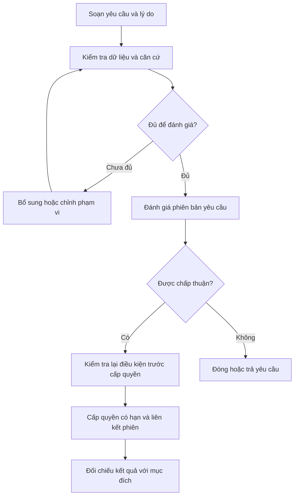

# Business justification

## 1. Business justification trong yêu cầu truy cập đặc quyền

Business justification là phần giải thích vì sao một công việc cần đến quyền truy cập đặc quyền, kết quả nào cần đạt và giới hạn nào khiến việc cấp quyền phù hợp với nhu cầu đó. Trong quản lý truy cập đặc quyền (Privileged Access Management, PAM), đây là đầu vào để người có trách nhiệm đánh giá tính cần thiết của quyền được yêu cầu.

Một lý do tốt giúp nối ba yếu tố: **công việc được giao → thao tác cần thực hiện → quyền tối thiểu cần cấp**. Nếu thiếu mối nối này, người duyệt chỉ thấy một tên role và một câu đề nghị, khó đánh giá liệu quyền đó có hợp lý hay không.

Sau bài học, người học có thể:

- Viết lý do truy cập đủ cụ thể để người khác kiểm chứng.
- Phân biệt lý do, bằng chứng công việc, quyết định phê duyệt và cơ chế cấp quyền.
- Đánh giá sự phù hợp giữa mục đích, tài nguyên, tài khoản, tác vụ và thời hạn.
- Thiết kế trường thông tin và quy tắc kiểm tra cho yêu cầu PAM.
- Liên kết lý do được duyệt với phiên sử dụng quyền và kết quả công việc.

Các biểu mẫu, thời lượng, mã ticket và quy tắc trong bài là ví dụ thiết kế. Chúng không phải yêu cầu mặc định cho mọi tổ chức hay mọi sản phẩm PAM.

## 2. Tình huống: một câu “xử lý sự cố” chưa đủ

Nhân viên trực ca An yêu cầu quyền quản trị toàn bộ cụm ứng dụng production trong tám giờ. Trường lý do ghi:

> Xử lý sự cố gấp, cần quyền admin.

Người duyệt chưa biết dịch vụ nào gặp sự cố, An có được phân công hay không, cần đọc log hay thay cấu hình, tại sao cần toàn bộ cụm và tại sao cần tám giờ. Từ “gấp” mô tả mức độ ưu tiên, nhưng không xác định phạm vi quyền.

Sau khi làm rõ, nhu cầu thực tế là đọc log của hai instance thuộc dịch vụ thanh toán trong 20 phút để xác định nguyên nhân lỗi. Nếu tổ chức đã có quyền đọc log được giới hạn theo dịch vụ, việc cấp quyền admin toàn cụm sẽ vượt nhu cầu.

Business justification có giá trị khi nó giúp thay đổi quyết định như vậy: thu hẹp quyền, làm rõ thời gian hoặc chuyển yêu cầu sang một cách thực hiện phù hợp hơn. Một ô bắt buộc nhập văn bản chỉ bảo đảm rằng có ký tự được gửi lên; nó không tự bảo đảm chất lượng của lý do.

## 3. Bốn khái niệm không được đánh đồng

| Thành phần | Câu hỏi trả lời | Ví dụ |
|---|---|---|
| Lý do công việc | Tại sao cần làm và tại sao cần quyền này? | Chẩn đoán lỗi thanh toán bằng cách đọc log hai instance |
| Bằng chứng tham chiếu | Có căn cứ nào kiểm chứng công việc? | Incident còn hiệu lực, người được phân công, runbook liên quan |
| Quyết định phê duyệt | Ai hoặc chính sách nào cho phép phạm vi nào? | Chủ dịch vụ duyệt quyền đọc log trong 20 phút |
| Cơ chế thực thi | Hệ thống cấp và giới hạn quyền ra sao? | PAM cấp quyền JIT và thu hồi theo cấu hình |

Một ticket tồn tại không chứng minh rằng mọi quyền ghi trong yêu cầu đều đã được duyệt. Ngược lại, một lý do được viết mạch lạc không chứng minh người yêu cầu có nhiệm vụ hợp lệ. Cần đánh giá cả nội dung giải thích lẫn căn cứ độc lập.

Sự tách biệt này cũng xuất hiện trong sản phẩm thực tế. Microsoft Entra PIM có các thiết lập riêng cho yêu cầu nhập business justification, thông tin ticket và phê duyệt khi kích hoạt. Tài liệu cũng nêu trường ticket là thông tin tham chiếu, không tự cưỡng chế việc đối chiếu với hệ thống ticket. Vì vậy, không nên suy ra rằng đã bật trường ticket thì ticket đã được xác minh. [Tài liệu Microsoft về cấu hình role trong PIM](https://learn.microsoft.com/en-us/entra/id-governance/privileged-identity-management/pim-how-to-change-default-settings#require-justification-on-activation).

## 4. Cấu trúc của một lý do có thể đánh giá

Một yêu cầu không nhất thiết phải dài. Nó cần đủ thông tin để người duyệt kiểm tra quan hệ giữa nhu cầu và quyền. Có thể dùng cấu trúc sau:

| Nội dung | Điều cần làm rõ | Dấu hiệu chưa đủ |
|---|---|---|
| Mục tiêu và kết quả | Công việc nào cần hoàn thành, dấu hiệu hoàn thành là gì? | “Hỗ trợ hệ thống” |
| Căn cứ công việc | Ticket, lịch bảo trì, yêu cầu dịch vụ hoặc phân công liên quan | Chỉ ghi mã mà không có quan hệ với yêu cầu |
| Chủ thể thực hiện | Người hoặc workload nào làm, thuộc trách nhiệm của ai? | “Đội vận hành” nhưng không xác định người sử dụng |
| Tài nguyên và môi trường | Máy, dịch vụ, tenant, database hoặc tài khoản nào? | “Production” nói chung |
| Thao tác và quyền | Đọc, thay đổi, khởi động lại hay lấy credential nào? | “Cần admin để tiện làm” |
| Thời gian | Khi nào bắt đầu, cần bao lâu, vì sao đủ? | Xin thời gian tối đa theo thói quen |
| Rủi ro và điều kiện | Ảnh hưởng dự kiến, điều kiện dừng, cách khôi phục nếu cần | Không nêu tác động của thao tác ghi |
| Cách xác minh | Bằng chứng nào cho thấy đã hoàn thành trong phạm vi? | Chỉ ghi “xong việc sẽ báo” |

Mức chi tiết cần tương xứng với rủi ro. Một lần đọc trạng thái trên máy lab không cần cùng hồ sơ với thay đổi cấu hình production có thể ảnh hưởng nhiều dịch vụ. Tuy nhiên, ngay cả yêu cầu ít rủi ro vẫn cần xác định rõ phạm vi và thời hạn.

Không cần biến business justification thành bản sao của toàn bộ runbook. Có thể dẫn đến phiên bản runbook và chỉ giải thích phần quyền cần thiết, các bước khác thường và điều kiện có liên quan đến quyết định cấp quyền.

## 5. Mẫu viết ngắn gọn nhưng đủ nghĩa

Một mẫu câu có thể dùng trong biểu mẫu:

```text
Tôi được phân công thực hiện [công việc] theo [tham chiếu].
Cần [thao tác] trên [tài nguyên/môi trường] để đạt [kết quả].
Yêu cầu [quyền hoặc tác vụ được giới hạn] trong [cửa sổ/thời lượng].
Quyền hiện có không đủ vì [khoảng thiếu cụ thể].
Điều kiện thực hiện và xác minh: [điều kiện, bằng chứng, cách kết thúc].
```

Không phải mọi dòng đều cần người dùng gõ lại. Nếu hệ thống đã biết danh tính và tài nguyên từ các trường có cấu trúc, phần văn bản nên tập trung giải thích quan hệ nhân quả và những điều chưa thể suy ra từ dữ liệu đó.

### Ví dụ: đọc log để chẩn đoán sự cố

> Tôi được phân công chẩn đoán lỗi giao dịch của dịch vụ payment theo incident INC-LAB-214. Cần đọc log ứng dụng của app-pay-01 và app-pay-02 trong production để đối chiếu lỗi theo khoảng thời gian của incident. Yêu cầu quyền đọc log theo dịch vụ trong 20 phút; quyền quan sát hiện tại chỉ có số liệu tổng hợp, không có chi tiết lỗi. Không yêu cầu sửa file, khởi động lại dịch vụ hoặc đọc credential. Kết quả là bản tổng hợp nguyên nhân khả dĩ và tham chiếu đến bằng chứng đã được xử lý theo quy định dữ liệu của tổ chức.

Ví dụ này chỉ hợp lý nếu có cơ chế thực thi quyền đọc log đủ hẹp và incident thực sự phù hợp. Nếu role được chọn vẫn có quyền sửa cấu hình toàn hệ thống, nội dung lý do không tự loại bỏ các quyền thừa của role đó.

### Ví dụ: khởi động lại một dịch vụ sau thay đổi

> Thực hiện bước xác nhận sau triển khai theo CHG-LAB-082 và runbook RB-PAY-07 phiên bản được phê duyệt. Cần khởi động lại riêng dịch vụ payment-worker trên app-pay-01 trong cửa sổ bảo trì 14:00–14:30, múi giờ Asia/Ho_Chi_Minh. Yêu cầu tác vụ khởi động lại được giới hạn trong 10 phút và quyền đọc trạng thái để kiểm tra hàng đợi hoạt động trở lại. Nếu kiểm tra sức khỏe thất bại, dừng việc và áp dụng phương án rollback trong change; không tự mở rộng sang các instance khác.

Biểu mẫu thật cần ngày cụ thể, không chỉ giờ trong ngày. Nếu chưa biết chính xác tác vụ cần thực hiện, nên chia chẩn đoán và thay đổi thành các bước xin quyền riêng thay vì xin trước mọi quyền có thể dùng đến.

## 6. Từ nhu cầu công việc đến least privilege, JIT và JEA

Business justification giúp người duyệt đặt câu hỏi về quyền được chọn, nhưng giới hạn cuối cùng phải được chuyển thành điều kiện có thể thực thi.

Ví dụ, câu “chỉ cần xem cấu hình” có thể dẫn đến quyền đọc cấu hình cụ thể, không phải một phiên `root` với cam kết không sửa gì. Câu “chỉ cần restart một dịch vụ” có thể phù hợp với tác vụ quản trị được giới hạn, thay vì shell quản trị tổng quát.

Ba chiều thu hẹp thường dùng là:

- **Least privilege:** giảm tài nguyên, hành động và dữ liệu trong phạm vi quyền.
- **Just-in-Time (JIT):** cấp quyền trong thời gian cần thiết thay cho quyền thường trực.
- **Just Enough Administration (JEA):** cung cấp tác vụ hoặc khả năng quản trị vừa đủ, nếu nền tảng hỗ trợ.

Cần phân biệt phạm vi mô tả và phạm vi thực tế. Nếu lý do nói một máy nhưng role có hiệu lực trên cả nhóm máy, người duyệt phải nhận biết chênh lệch đó. Các lựa chọn có thể là dùng role khác, tách tài nguyên, bổ sung cơ chế giới hạn hoặc xử lý một ngoại lệ được đánh giá rõ ràng. Không coi câu văn trong yêu cầu là bộ lọc quyền kỹ thuật.

Nếu không có phương án hẹp hơn trong thời điểm sự cố, lý do cần nêu quyền thừa, nguyên nhân và các điều kiện bù đắp đã được chấp nhận. Đây là dữ liệu để đánh giá ngoại lệ và cải tiến role, không phải cách làm cho quyền rộng trở thành quyền tối thiểu.

## 7. Dữ liệu có cấu trúc và phần giải thích tự do

Một thiết kế biểu mẫu nên tách thông tin máy có thể kiểm tra khỏi phần diễn giải. Ví dụ bên dưới là mô hình dữ liệu minh họa, không phải payload của một sản phẩm cụ thể:

```json
{
  "request_id": "PAM-LAB-214",
  "revision": 1,
  "requester_subject": "user-an",
  "request_type": "incident-diagnosis",
  "ticket": {
    "system": "internal-itsm",
    "id": "INC-LAB-214"
  },
  "resources": ["asset-app-pay-01", "asset-app-pay-02"],
  "environment": "production",
  "requested_capability": "payment-log-read",
  "requested_duration_minutes": 20,
  "business_justification": "Đối chiếu lỗi giao dịch theo incident được phân công; số liệu tổng hợp hiện có chưa đủ để xác định nguyên nhân.",
  "expected_result": "Tổng hợp nguyên nhân khả dĩ và tham chiếu bằng chứng",
  "runbook_reference": "RB-PAY-DIAG-03",
  "constraints": ["no-configuration-change", "no-service-restart"]
}
```

Danh tính người gửi phải lấy từ ngữ cảnh đã xác thực ở server. Không tin trường `requester_subject` do client gửi như một bằng chứng về người yêu cầu. Tương tự, tài nguyên và capability cần được đối chiếu với danh mục và chính sách, không chỉ là chuỗi tùy ý.

Các kết quả như “ticket đã được xác minh”, “người dùng đủ điều kiện”, người duyệt và phiên bản chính sách là dữ liệu do các thành phần có trách nhiệm tạo ra. Không nhận một cờ `approved: true` hoặc `ticket_verified: true` từ biểu mẫu người dùng rồi xem đó là kết quả kiểm tra.

Với yêu cầu lấy credential từ vault, nên tham chiếu định danh tài khoản hoặc đối tượng credential được quản lý. Không đưa mật khẩu, private key hay giá trị bí mật vào lý do để chứng minh rằng người yêu cầu biết mình cần gì.

## 8. Kiểm tra lý do theo nhiều lớp

### 8.1. Kiểm tra tính đầy đủ

Hệ thống có thể kiểm tra các trường bắt buộc, định dạng, danh mục mục đích, phạm vi tài nguyên và thời lượng. Có thể nhắc người dùng bổ sung khi lý do chỉ có “công việc”, “test” hoặc “theo yêu cầu”.

Độ dài tối thiểu chỉ là một tín hiệu sơ bộ. Một đoạn dài lặp lại câu chung chung vẫn không giải thích nhu cầu; một câu ngắn kèm tham chiếu đầy đủ có thể đủ cho tác vụ chuẩn hóa. Không thiết kế tiêu chí chất lượng chỉ bằng số ký tự.

### 8.2. Kiểm tra bằng chứng công việc

Nếu có tích hợp hệ thống ticket, kiểm tra theo quy tắc đã định: ticket có tồn tại không, thuộc hệ thống nào, còn phù hợp trạng thái không, tài nguyên có liên quan không và người yêu cầu có được phân công hoặc cho phép thực hiện không.

Việc ticket tồn tại và việc ticket phê duyệt một thay đổi là hai điều khác nhau. Incident có thể cho phép chẩn đoán nhưng chưa cho phép thao tác phá hủy dữ liệu. Một change được duyệt cũng không mặc nhiên cho phép mọi nhân viên dùng mọi tài khoản đặc quyền.

Khi không thể xác minh nguồn tham chiếu, hệ thống phải thể hiện rõ “chưa xác minh” và xử lý theo chính sách. Lỗi kết nối đến ITSM không được âm thầm đổi thành “ticket hợp lệ”. Trong trường hợp khẩn cấp, chỉ đi theo quy trình ngoại lệ đã được thiết kế cho tình huống đó.

### 8.3. Kiểm tra sự phù hợp của quyền

Người duyệt hoặc thành phần chính sách đối chiếu mục tiêu với quyền được chọn. Các điểm cần xem gồm: chỉ cần đọc hay cần ghi, tài nguyên nào thực sự liên quan, có cần tài khoản dùng chung không, thời lượng có hợp lý không và có tác vụ chuẩn hóa hẹp hơn không.

Không dùng từ khóa “sự cố”, “khẩn cấp” hoặc “khách hàng” làm điều kiện đủ để tự duyệt. Nếu có tự động hóa, quyết định phải dựa trên điều kiện đáng tin như danh tính, phân công, trạng thái công việc, capability chuẩn hóa, phạm vi và chính sách đã được phê duyệt.

Công cụ phân tích ngôn ngữ có thể hỗ trợ tìm phần còn thiếu hoặc tóm tắt lý do. Văn bản do người yêu cầu nhập vẫn là dữ liệu không đáng tin, không được biến thành chỉ thị cho công cụ bỏ kiểm tra hay tự cấp quyền.

## 9. Người duyệt cần đánh giá điều gì?

Người duyệt cần đủ thông tin và trách nhiệm đối với phạm vi mình chấp thuận. Quy trình nên giúp họ nhìn thấy đồng thời lý do, phạm vi quyền thực tế và căn cứ công việc; chỉ hiển thị một nút “Approve” cùng tên người gửi sẽ làm giảm chất lượng quyết định.

Có thể tổ chức việc đánh giá thành bốn câu hỏi:

1. **Cần thiết:** công việc có hợp lệ và cần đến quyền đặc biệt không?
2. **Phù hợp:** quyền, tài nguyên và thời lượng có khớp với thao tác được giải thích không?
3. **Đủ điều kiện:** người thực hiện, người duyệt và các điều kiện thực hiện có đáp ứng chính sách không?
4. **Có thể đối chiếu:** sau phiên có thể biết công việc đã được thực hiện trong phạm vi nào không?

Kết quả xử lý không chỉ có duyệt hoặc từ chối. Có thể trả yêu cầu để bổ sung thông tin, yêu cầu phạm vi hẹp hơn hoặc chuyển đến người có thẩm quyền phù hợp. Nếu phạm vi được thay đổi, phần người dùng chấp nhận và phần người duyệt chấp thuận phải nhất quán với quyền thực tế sẽ cấp.

Phản hồi nên chỉ ra thiếu sót cụ thể. Ví dụ: “Nêu hai tài nguyên cần đọc log và thời lượng dự kiến; role admin-cluster đang rộng hơn thao tác chẩn đoán” hữu ích hơn “Lý do chưa đạt”. Ngược lại, không hướng dẫn người dùng chỉ thêm từ khóa để qua bộ lọc.

## 10. Gắn phê duyệt với đúng phiên bản yêu cầu

Một lý do được duyệt có thể mất ý nghĩa nếu nội dung hoặc phạm vi bị thay sau đó. Quy trình nên ràng buộc quyết định với một phiên bản yêu cầu cụ thể, gồm phần giải thích và các field có ảnh hưởng đến quyền.



Các thay đổi như thêm tài nguyên, tăng thời lượng, chuyển từ đọc sang ghi hoặc đổi tài khoản có thể làm thay đổi rủi ro. Với những thay đổi đó, không tái sử dụng quyết định cũ một cách im lặng; cần đánh giá lại theo chính sách.

Sửa lỗi chính tả có thể được xử lý khác với mở rộng quyền, nhưng vẫn cần lưu lịch sử phù hợp. Người kiểm tra sau này phải biết người duyệt đã nhìn thấy nội dung nào tại thời điểm quyết định, không chỉ thấy bản mới nhất.

Giữa lúc duyệt và lúc cấp quyền, ticket có thể bị hủy, phân công thay đổi hoặc người dùng mất điều kiện truy cập. Cần xác định điều kiện nào phải kiểm tra lại khi kích hoạt. Việc duyệt hôm trước không phải cam kết rằng mọi điều kiện vẫn đúng vào hôm sau.

## 11. Những lý do thường gặp và cách làm rõ

| Lý do ban đầu | Điều chưa rõ | Cách bổ sung hữu ích |
|---|---|---|
| “Bảo trì định kỳ” | Bảo trì gì, ở đâu, lúc nào? | Tham chiếu lịch, tài nguyên, runbook và tác vụ cần quyền |
| “Cần root để debug” | Debug bằng thao tác nào, tại sao quyền hiện có chưa đủ? | Nêu dữ liệu cần đọc, thao tác cần chạy và phương án hẹp hơn |
| “Sếp yêu cầu” | Ai giao việc, mục đích và phạm vi nào? | Dẫn căn cứ được kiểm chứng; vẫn đánh giá quyền theo chính sách |
| “INC-LAB-214” | Ticket liên quan thế nào đến role? | Giải thích phần việc và quyền cần cho phần việc đó |
| “Cấp cả ngày để đỡ xin lại” | Thời gian có dựa trên nhu cầu thực tế không? | Chia cửa sổ theo công việc và mô tả nhu cầu gia hạn nếu phát sinh |
| “Giống lần trước” | Công việc, phạm vi và điều kiện có còn giống không? | Dùng mẫu tham khảo nhưng cập nhật căn cứ và phạm vi hiện tại |

Người dùng nên được hỗ trợ bằng gợi ý đúng ngữ cảnh. Chọn mục đích “khởi động lại dịch vụ” có thể làm biểu mẫu hỏi tên dịch vụ và điều kiện kiểm tra sức khỏe; chọn “đọc log” có thể hỏi phạm vi dữ liệu và đầu ra dự kiến. Tránh bắt mọi loại yêu cầu điền một biểu mẫu dài giống nhau.

## 12. Yêu cầu khẩn cấp, công việc lặp lại và workload

### 12.1. Tình huống khẩn cấp

Trong sự cố nghiêm trọng, yêu cầu có thể cần nội dung ngắn hơn để không cản trở phản ứng. Một thiết kế tối thiểu có thể yêu cầu định danh incident, dịch vụ bị ảnh hưởng, tác vụ dự kiến, phạm vi quyền và người chịu trách nhiệm điều phối.

Nếu sử dụng break-glass, phải ghi đúng đây là truy cập khẩn cấp theo quy trình tương ứng. Bổ sung hồ sơ sau sự kiện giúp giải trình và điều tra, nhưng không biến việc cấp quyền trước đó thành một lần phê duyệt trước theo quy trình thông thường.

Sau sự kiện, bổ sung diễn biến và giải thích những thao tác vượt dự kiến. Giữ cả nội dung ban đầu lẫn phần bổ sung để người xem hiểu điều gì đã biết khi quyết định được đưa ra. Không viết lại lý do ban đầu để làm nó trùng hoàn hảo với mọi hành động đã xảy ra.

### 12.2. Công việc lặp lại

Với công việc chuẩn hóa, có thể dùng mục đích và capability được định nghĩa sẵn, gắn với runbook, chủ sở hữu và điều kiện sử dụng. Người dùng chỉ bổ sung phần biến đổi như mã công việc, tài nguyên và cửa sổ cụ thể.

Điều này giúp giảm sao chép văn bản và tăng tính nhất quán. Tuy nhiên, một mục đích chuẩn không nên trở thành quyền mở tùy ý. Cần xem lại khi runbook, phạm vi dịch vụ hoặc nội dung capability thay đổi.

### 12.3. Tài khoản dịch vụ và tự động hóa

Workload không có lý do theo cách một người gõ vào biểu mẫu. Căn cứ công việc có thể là deployment đã được duyệt, định danh pipeline, phiên bản artifact và chủ sở hữu dịch vụ. Quyền nên được cấp cho đúng danh tính workload với phạm vi và thời hạn phù hợp.

Không dùng một câu cố định như “automation” để thay thế việc ràng buộc lần chạy với công việc hợp lệ. Tương tự, không giả danh người duyệt bằng cách ghi tên họ vào phần văn bản của yêu cầu do máy gửi.

## 13. Bảo vệ nội dung lý do và bằng chứng

Business justification có thể chứa tên hệ thống nội bộ, mô tả lỗ hổng hoặc dữ liệu sự cố. Chỉ thu thập thông tin cần cho quyết định và truy vết; dẫn đến bằng chứng được quản lý thay vì sao chép toàn bộ dữ liệu nhạy cảm vào ô lý do.

Không đưa mật khẩu, token, private key, thông tin cá nhân không cần thiết hoặc log thô chứa dữ liệu khách hàng vào biểu mẫu. Nếu cần mẫu bằng chứng, dùng bản đã xử lý theo quy định nội bộ và giữ tham chiếu đến nguồn có kiểm soát truy cập.

Về xử lý kỹ thuật, coi lý do là đầu vào không đáng tin. Hiển thị an toàn, không thực thi nội dung, không ghép trực tiếp vào câu lệnh và không tự truy cập mọi URL do người dùng cung cấp. Khi tích hợp ticket, dùng hệ thống và định danh đã được cấu hình, kiểm tra quyền đọc của tài khoản tích hợp và xử lý lỗi rõ ràng.

Thông báo gửi người duyệt cũng cần giới hạn dữ liệu. Một thông báo có thể chứa mã yêu cầu và đường dẫn đến hồ sơ có kiểm soát thay vì phát tán toàn bộ mô tả sự cố. Quyền xem lý do, quyền sửa yêu cầu và quyền phê duyệt cần được thiết kế riêng theo trách nhiệm.

## 14. Liên kết lý do với việc sử dụng quyền

Lý do chỉ trở thành bằng chứng hữu ích khi có thể nối đến quyền thực tế và hoạt động sau khi cấp. Một chuỗi đối chiếu cần xác định được:

```text
Công việc tham chiếu
  → yêu cầu và phiên bản lý do
  → quyết định cùng phiên bản chính sách
  → quyền hoặc credential lease đã cấp
  → phiên truy cập / lần chạy tác vụ
  → kết quả và sự kiện thu hồi
```

Nếu dùng tài khoản đặc quyền dùng chung, cần giữ mối liên hệ đến danh tính người thực hiện. Chỉ có username của tài khoản dùng chung trong log không đủ để giải thích ai đã sử dụng quyền theo yêu cầu nào.

Sau phiên, có thể đối chiếu tài nguyên thực tế, loại thao tác, thời lượng và kết quả với mục đích được duyệt. Đừng kết luận hành vi phù hợp chỉ từ câu lý do ban đầu; ngược lại, một khác biệt quan sát được cần được xem xét theo ngữ cảnh, không tự đồng nghĩa hành vi sai phạm.

Khi công việc phát sinh nhu cầu mới, người vận hành cần xin mở rộng hoặc tạo yêu cầu mới theo chính sách, thay vì coi lý do “xử lý sự cố” là giấy phép cho mọi hành động liên quan. Với credential được lấy từ vault, kết thúc yêu cầu còn cần liên kết đến việc xử lý lease, luân chuyển hoặc thu hồi theo cơ chế đang dùng.

Hồ sơ lưu trữ nên cho biết ai đã sửa, sửa lúc nào và thay đổi những gì. Cách bảo vệ tính toàn vẹn, thời hạn giữ và quyền đọc bằng chứng phải theo thiết kế của tổ chức; không đặt một con số chung cho mọi loại dữ liệu.

## 15. Đánh giá chất lượng mà không tạo hành vi đối phó

Một quy trình có thể theo dõi các chỉ số như tỷ lệ yêu cầu cần bổ sung lý do, tỷ lệ quyền bị thu hẹp sau đánh giá, tỷ lệ tham chiếu không xác minh được và tỷ lệ phiên thiếu liên kết đến yêu cầu. Nên xem theo loại công việc và nhóm tài nguyên để tìm vấn đề thiết kế.

Ví dụ, nhiều yêu cầu ghi “cần admin” có thể phản ánh người dùng chưa biết capability hẹp hơn, danh mục role khó hiểu hoặc hệ thống chưa cung cấp tác vụ phù hợp. Cải tiến biểu mẫu hoặc role có thể hiệu quả hơn việc tăng độ dài tối thiểu của ô văn bản.

Không dùng tỷ lệ phê duyệt cao hay thời gian duyệt ngắn làm bằng chứng duy nhất cho chất lượng. Những con số đó có thể tăng khi người duyệt bỏ qua kiểm tra. Ngược lại, lý do dài hơn không tự làm quyết định tốt hơn.

Cần xem xét mẫu hồ sơ và đối chiếu với quyền thực tế, phản hồi của người dùng và kết quả sau phiên. Mục tiêu là quyết định đúng với ít ma sát cần thiết, không tạo văn bản đẹp nhưng không ai kiểm chứng.

## 16. Thực hành: hoàn thiện một yêu cầu

Đầu vào giả định:

```text
Người yêu cầu: An, trực ca dịch vụ payment
Tham chiếu: INC-LAB-214
Lý do hiện tại: Cần admin để xử lý sự cố
Phạm vi chọn: toàn cụm production
Thời lượng chọn: 8 giờ
Nhu cầu đã xác định: đọc log hai instance trong 20 phút
```

Hoàn thiện hồ sơ bằng cách xác định đúng tài nguyên, capability đọc log, khoảng thời gian cụ thể, căn cứ phân công và đầu ra dự kiến. Ghi vì sao công cụ quan sát hiện tại chưa đáp ứng. Nếu chưa có quyền đọc log được giới hạn, mô tả rõ khoảng thiếu này để người có trách nhiệm đánh giá thay vì giả định role admin đã được chấp thuận.

Sau đó kiểm tra các tình huống sau:

| Tình huống | Hành vi cần thiết trong thiết kế |
|---|---|
| Ticket có tồn tại nhưng thuộc dịch vụ khác | Không xem đây là căn cứ phù hợp nếu chưa làm rõ |
| Lý do nói đọc log nhưng role cho phép sửa cả cụm | Làm rõ và xử lý phần quyền vượt nhu cầu |
| Người yêu cầu thêm máy sau khi được duyệt | Đánh giá lại phiên bản thay đổi theo chính sách |
| ITSM không phản hồi | Thể hiện chưa xác minh và xử lý đúng nhánh lỗi |
| Ticket bị hủy trước khi kích hoạt | Kiểm tra lại điều kiện còn hiệu lực |
| Người dùng dán token vào lý do | Xử lý bí mật bị lộ theo quy trình, không phát tán tiếp qua thông báo |
| Phiên truy cập không có mã yêu cầu liên kết | Ghi nhận khoảng thiếu bằng chứng và khắc phục cơ chế liên kết |

Đầu ra thực hành cần có một lý do ngắn nhưng kiểm chứng được, các field phạm vi nhất quán với lý do, căn cứ được đánh giá đúng mức và cách liên kết đến phiên sử dụng. Hồ sơ đạt yêu cầu khi người duyệt hiểu vì sao cần quyền, hệ thống biết chính xác quyền nào được cấp và người kiểm tra sau này biết quyết định dựa trên thông tin nào.
