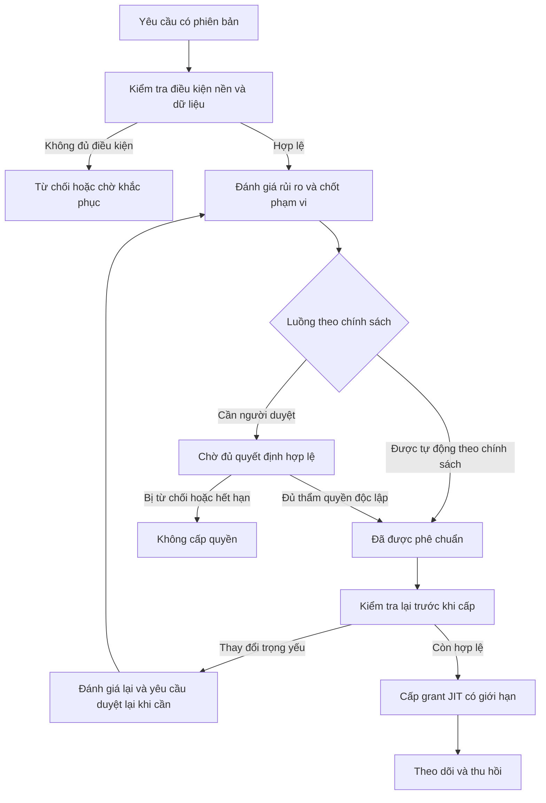

# Risk-based approval

## Mục tiêu bài học

Trong chương Approval workflow của module Privileged Access Management (PAM), **risk-based approval** là cách lựa chọn luồng phê duyệt dựa trên rủi ro của một yêu cầu truy cập đặc quyền cụ thể. Hệ thống không chỉ hỏi “ai đã bấm Approve?” mà còn phải xác định “người này đang xin quyền gì, trên tài sản nào, trong điều kiện nào và cần mức kiểm soát nào?”.

Sau bài học, bạn có thể:

- Phân biệt điều kiện đủ để xin quyền, đánh giá rủi ro, phê duyệt và thực thi quyền.
- Xây dựng phân tầng rủi ro có quy tắc bắt buộc, thay vì chỉ dựa vào một điểm số.
- Ràng buộc quyết định phê duyệt với đúng tài sản, vai trò, thời hạn và phiên bản yêu cầu.
- Xử lý thay đổi ngữ cảnh, thiếu tín hiệu và hết hạn mà không biến luồng lỗi thành đường cấp quyền.
- Thiết kế bằng chứng kiểm toán và các ca kiểm thử cho luồng phê duyệt trong PAM.

## 1. Vì sao không dùng cùng một quy trình cho mọi yêu cầu?

Ba yêu cầu sau đều liên quan đến quyền vận hành, nhưng hậu quả khi bị lạm dụng khác nhau:

1. Xem log đã được lọc dữ liệu nhạy cảm trên một máy lab trong 10 phút.
2. Khởi động lại một dịch vụ staging trong cửa sổ bảo trì.
3. Thay đổi cấu hình xác thực trên cụm production dùng chung cho nhiều ứng dụng.

Nếu mọi yêu cầu đều cần hai người duyệt, hàng đợi có thể quá tải và người duyệt dễ làm theo thói quen. Nếu mọi yêu cầu đều được cấp tự động vì người xin thuộc nhóm vận hành, một danh tính bị chiếm quyền có thể nhận đặc quyền có tác động rất lớn.

Risk-based approval nhằm phân bổ sự kiểm tra của con người theo mức rủi ro, đồng thời giữ các điều kiện nền bắt buộc. Quyền ít rủi ro có thể được cấp tự động theo một chính sách đã được phê chuẩn; quyền nhạy cảm cần người duyệt phù hợp hoặc nhiều bên độc lập; một số yêu cầu phải bị từ chối dù có người muốn phê duyệt.

Mục tiêu không phải giảm số lần bấm Approve bằng mọi giá. Mục tiêu là cấp đúng quyền cần thiết, trong đúng thời hạn, với mức kiểm soát đủ để tổ chức chấp nhận rủi ro còn lại.

### Ví dụ xuyên suốt

Lan thuộc nhóm vận hành ứng dụng và cần khởi động lại dịch vụ `billing-stg` trong staging để áp dụng thay đổi đã được lên lịch. Yêu cầu đề xuất:

- Tài sản: một dịch vụ staging đã đăng ký.
- Vai trò: `service-restart-operator`, chỉ có khả năng kiểm tra trạng thái và restart dịch vụ được chỉ định.
- Thời hạn: 15 phút trong cửa sổ bảo trì.
- Căn cứ công việc: mã thay đổi hợp lệ.
- Danh tính: tài khoản cá nhân của Lan, đã xác thực theo yêu cầu.

Một yêu cầu khác của Lan xin vai trò quản trị toàn cụm production trong 8 giờ phải được đánh giá riêng. Việc cùng người xin và cùng mã thay đổi không làm hai phạm vi đó tương đương.

## 2. Bốn quyết định không được nhập làm một

| Quyết định | Câu hỏi cần trả lời | Kết quả điển hình |
|---|---|---|
| Điều kiện xin quyền | Người dùng có được yêu cầu loại quyền này không? | Đủ điều kiện hoặc từ chối |
| Đánh giá rủi ro | Phạm vi và ngữ cảnh tạo ra mức rủi ro nào? | Mức rủi ro, lý do và yêu cầu kiểm soát |
| Phê duyệt | Những bên có thẩm quyền đã chấp nhận đúng yêu cầu chưa? | Tự động theo chính sách, chờ duyệt, được duyệt hoặc bị từ chối |
| Cấp và thực thi quyền | Có được kích hoạt quyền ở thời điểm này, và đích có áp đúng quyền không? | Grant có thời hạn, phiên hạn chế hoặc lỗi cấp quyền |

**Phê duyệt không thay thế xác thực.** MFA giúp tăng độ tin cậy vào danh tính nhưng không chứng minh công việc là cần thiết hoặc quyền xin là phù hợp.

**Phê duyệt không tự tạo least privilege.** Nếu PAM duyệt vai trò chỉ đọc nhưng tài khoản tại đích có quyền ghi, luồng duyệt không sửa được sai lệch đó. IAM đích, tài khoản, credential và cơ chế môi giới phiên phải thực thi đúng phạm vi.

**Điểm rủi ro không thay thế điều kiện bắt buộc.** Một yêu cầu tự phê duyệt trái chính sách không thể trở thành hợp lệ chỉ vì thiết bị đang được quản lý tốt.

## 3. Rủi ro của yêu cầu được tạo bởi những yếu tố nào?

Đánh giá cần nhìn cả hậu quả tiềm tàng lẫn mức độ đáng tin của bối cảnh hiện tại.

### 3.1. Tài sản và phạm vi tác động

Các thuộc tính thường hữu ích gồm:

- Môi trường lab, staging hay production.
- Mức nhạy cảm của dữ liệu có thể đọc hoặc xuất ra.
- Mức quan trọng của dịch vụ đối với hoạt động kinh doanh.
- Số tài sản, tenant hoặc người dùng chịu tác động.
- Khả năng thay đổi IAM, cấu hình bảo mật, audit hoặc khóa mã hóa.
- Mức độ dễ kiểm chứng và khôi phục thay đổi.

Một quyền đọc có thể có rủi ro cao nếu cho phép lấy dữ liệu nhạy cảm trên diện rộng. Không mặc định “read-only” luôn là rủi ro thấp.

Một yêu cầu nhắm vào nhóm tài sản động cũng cần được xử lý cẩn thận. Nếu nhóm có thể tự thêm production sau khi duyệt, người duyệt chưa thực sự phê chuẩn tập đích cuối cùng. Có thể chốt danh sách tài sản cho một phiên bản yêu cầu hoặc dùng chính sách kiểm soát thành viên nhóm cùng kiểm tra tại thời điểm cấp quyền.

### 3.2. Quyền và thời gian được xin

Phân biệt quyền thao tác hẹp với quyền quản trị tổng quát. Khả năng chạy một thao tác đã định nghĩa, theo mô hình just-enough administration (JEA), thường dễ giới hạn phạm vi hơn quyền chạy lệnh tùy ý.

Thời gian dài làm tăng cửa sổ lạm dụng, nhưng thời gian ngắn không làm mất hậu quả của thao tác nguy hiểm. Xóa một tài nguyên quan trọng có thể chỉ mất vài giây.

Cần đánh giá cả khả năng tạo quyền bền vững. Một grant chỉ tồn tại 10 phút nhưng cho phép tạo tài khoản quản trị mới hoặc phát hành token dài hạn có thể để lại quyền sau khi grant kết thúc.

### 3.3. Danh tính, thiết bị và phiên

Có thể sử dụng mức xác thực, trạng thái quản lý thiết bị, tình trạng tài khoản và các tín hiệu bất thường đã được kiểm chứng. Tín hiệu phải đến từ nguồn mà hệ thống tin cậy, không phải trường tự khai từ trình duyệt.

Cần phân biệt:

- Người dùng khai lý do công việc: dữ liệu cần được xác minh theo quy trình.
- Dịch vụ quản lý thiết bị xác nhận trạng thái: một tín hiệu kỹ thuật có thời gian hiệu lực.
- Người dùng tick “thiết bị an toàn”: không tương đương chứng nhận của dịch vụ quản lý.

Một hành vi khác thường có thể cần điều tra hoặc tăng kiểm soát; nó không tự chứng minh người dùng có ác ý. Ngược lại, một lịch sử làm việc tốt không phải lý do bỏ qua cảnh báo tài khoản đang bị đình chỉ.

### 3.4. Căn cứ nghiệp vụ

Mã change hoặc incident chỉ có giá trị khi hệ thống kiểm tra được những thuộc tính liên quan: tồn tại, trạng thái phù hợp, tài sản, người chịu trách nhiệm và cửa sổ thời gian.

Một chuỗi ký tự trông giống mã ticket không chứng minh đã có phê chuẩn nghiệp vụ. Mức độ khẩn cấp do người xin khai cũng không tự động hạ mức kiểm soát.

### 3.5. Chất lượng của dữ liệu đánh giá

Mỗi tín hiệu nên có nguồn, thời điểm quan sát, giới hạn độ cũ và trạng thái lấy dữ liệu. Giá trị “không có cảnh báo” khác với “dịch vụ cảnh báo không phản hồi”.

| Tín hiệu | Cách dùng sai | Cách xử lý có căn cứ |
|---|---|---|
| Trạng thái thiết bị | Không lấy được dữ liệu thì coi là compliant | Đánh dấu unknown; áp dụng quy tắc cho dữ liệu thiếu |
| Cửa sổ bảo trì | Tin thời gian do trình duyệt gửi | Kiểm tra với nguồn nghiệp vụ và đồng hồ máy chủ |
| Độ nhạy tài sản | Tài sản chưa phân loại được coi là thấp | Áp dụng mức bảo thủ hoặc yêu cầu bổ sung phân loại |
| Xác thực mạnh | Có một cờ `mfa=true` trong request | Kiểm chứng ngữ cảnh xác thực từ nguồn danh tính hợp lệ |
| Quyền của approver | Người đó từng là quản lý tháng trước | Kiểm tra thẩm quyền tại lúc ra quyết định và lúc cần thực thi |

## 4. Bắt đầu từ điều kiện bắt buộc, sau đó mới phân tầng

Một thiết kế dễ giải thích thường tách thành ba lớp.

### Lớp 1 — Điều kiện loại trừ hoặc bắt buộc

Ví dụ trong một chính sách minh họa:

- Danh tính không hoạt động: từ chối.
- Người xin không thuộc đối tượng được yêu cầu vai trò: từ chối.
- Thiết bị không đáp ứng điều kiện bắt buộc cho production: từ chối hoặc yêu cầu khắc phục trước.
- Thiếu phân loại tài sản bắt buộc: giữ yêu cầu để bổ sung dữ liệu, chưa cấp quyền.
- Xung đột nhiệm vụ bị cấm: từ chối; không cho một điểm rủi ro thấp bù lại.

Không nên tạo trạng thái “được duyệt có điều kiện” rồi cấp quyền trước khi các điều kiện đó được chứng minh.

### Lớp 2 — Quy tắc đặt mức sàn

Một số khả năng đặt mức rủi ro tối thiểu bất kể điểm tổng:

- Thay đổi IAM production không được xếp thấp.
- Tắt hoặc thay đổi audit cần kiểm soát riêng theo chính sách.
- Quyền xuất dữ liệu nhạy cảm diện rộng không được hạ về thấp chỉ vì thời hạn ngắn.
- Yêu cầu nhiều tài sản phải xét phạm vi tổng và tài sản nhạy cảm nhất, không lấy trung bình để làm nhẹ phần nguy hiểm.

Mức sàn không đồng nghĩa tự động phê duyệt ở mức đó. Nó chỉ nói luồng kiểm soát tối thiểu phải mạnh đến đâu.

### Lớp 3 — Định tuyến kiểm soát theo mức rủi ro

Bảng sau là ví dụ thiết kế, không phải quy chuẩn chung:

| Mức | Ví dụ đã đáp ứng điều kiện nền | Luồng phê duyệt minh họa | Giới hạn đi kèm |
|---|---|---|---|
| Thấp | Xem log đã lọc trên một tài sản lab | Cấp tự động theo chính sách đã được phê chuẩn | Vai trò hẹp, thời hạn ngắn, có audit |
| Trung bình | Restart một dịch vụ staging trong cửa sổ thay đổi | Một chủ dịch vụ hoặc người được ủy quyền hợp lệ | Chốt tài sản và thao tác, JIT theo thời hạn |
| Cao | Thay đổi cấu hình nhạy cảm trên production | Hai người độc lập thuộc các nhóm thẩm quyền được chỉ định | Xác thực phù hợp, quyền hẹp, theo dõi phiên và thu hồi |
| Không chấp nhận | Vi phạm điều kiện cấm hoặc không thể xác minh điều kiện bắt buộc | Từ chối hoặc chờ khắc phục theo nguyên nhân | Không có grant đang hoạt động |

“Tự động” nghĩa là máy thực thi một chính sách đã được tổ chức thông qua, có kiểm soát phiên bản và khả năng truy nguyên. Nó không có nghĩa không tồn tại trách nhiệm phê chuẩn chính sách.

## 5. Dùng điểm số thế nào để không tạo cảm giác chính xác giả?

Có thể dùng điểm số để hỗ trợ phân tầng, nhưng không bắt buộc mọi tổ chức phải có một công thức duy nhất. Quy tắc rõ ràng theo khả năng và phạm vi đôi khi dễ vận hành hơn một mô hình khó giải thích.

Một công thức minh họa có thể là:

```text
điểm = điểm tài sản
      + điểm quyền được xin
      + điểm phạm vi và thời hạn
      + điểm bất thường đã xác minh

mức cuối = mức nghiêm ngặt hơn giữa:
          - mức suy ra từ điểm
          - mức sàn do quy tắc bắt buộc
```

Giả sử trong một bài tập, tài sản staging có 10 điểm, quyền restart giới hạn có 10 điểm, thời hạn phù hợp có 0 điểm và không phát hiện bất thường có 0 điểm. Tổng là 20. Các giá trị này chỉ minh họa cách kết hợp; chúng không có ý nghĩa xác suất và không chứng minh yêu cầu an toàn đến một tỷ lệ phần trăm nào.

Một mô hình điểm cần trả lời được:

- Vì sao chọn trọng số và ngưỡng này?
- Các tín hiệu có trùng nhau và bị tính hai lần không?
- Dữ liệu thiếu được xử lý thế nào?
- Thuộc tính nào tuyệt đối không được bù trừ?
- Người xin có thể chia nhỏ yêu cầu hoặc điều chỉnh thời lượng để đi dưới ngưỡng không?
- Có giải thích được quyết định bằng các lý do cụ thể không?

Không dùng điểm âm vô hạn để một thiết bị tin cậy xóa rủi ro của quyền quản trị toàn hệ thống. Nếu có yếu tố giảm rủi ro, cần giới hạn tác dụng và giữ các mức sàn.

Cũng không nên biến một điểm số thành một hộp đen người duyệt phải tin tuyệt đối. Màn hình duyệt cần nêu những yếu tố quyết định như “production”, “quyền sửa IAM”, “ngoài cửa sổ thay đổi”, kèm dữ liệu đã kiểm chứng liên quan.

## 6. Phê duyệt phải gắn với một phiên bản yêu cầu cụ thể

Một quyết định Approve cần có đối tượng rõ ràng. Các thuộc tính quan trọng có thể bao gồm:

```yaml
# Mô hình dữ liệu minh họa, không phải cấu hình sản phẩm.
request_id: req-example-204
request_version: 3
requester_id: user-lan
asset_ids:
  - billing-stg
target_role: service-restart-operator
allowed_actions:
  - service.status
  - service.restart
requested_window:
  start: "2026-01-01T08:00:00Z"
  end: "2026-01-01T08:15:00Z"
maximum_grant_minutes: 15
business_reference: change-example-104
risk_assessment_ref: risk-example-83
policy_version: pam-approval-example-v5
```

Người duyệt phê chuẩn phiên bản 3 của đúng phạm vi này. Không được lấy quyết định đó để cấp quyền cho:

- Tài sản production thay vì staging.
- Vai trò quản trị thay vì vai trò restart.
- Một người xin khác.
- Khoảng thời gian dài hơn hoặc một cửa sổ khác.
- Một nhóm tài sản đã được mở rộng sau khi duyệt.

Có thể dùng bản chụp bất biến của yêu cầu hoặc một fingerprint được tính từ biểu diễn chuẩn hóa để liên kết quyết định với nội dung. Hash chỉ giúp liên kết và phát hiện thay đổi khi được bảo vệ đúng; tự nó không chứng minh ai có thẩm quyền đã duyệt. Bản ghi quyết định, tính toàn vẹn dữ liệu và kiểm tra quyền vẫn cần tồn tại.

### Khi yêu cầu thay đổi

Thay đổi có ý nghĩa về phạm vi phải tạo phiên bản mới và áp dụng lại quy tắc phê duyệt. Không giữ một cờ `approved=true` ở cấp request rồi cho người xin sửa mọi trường bên dưới.

Một sửa lỗi diễn đạt không nhất thiết cần toàn bộ luồng mới, nhưng hệ thống phải định nghĩa rõ trường nào là mô tả và trường nào tác động đến quyền. Không dựa vào việc người dùng tự gọi thay đổi của mình là “nhỏ”.

Yêu cầu gộp nhiều tài sản cũng cần quy định tính nguyên khối. Nếu cấp từng phần, phải ghi rõ phần nào được phê chuẩn và phần nào đã thực thi; không biến phê chuẩn cho một tài sản thành phê chuẩn cho cả lô.

## 7. Chọn người duyệt theo thẩm quyền và tính độc lập

Người quản lý trực tiếp có thể xác nhận nhu cầu công việc, trong khi chủ tài sản hiểu tác động trên hệ thống. Hai vai trò này không luôn thay thế được nhau.

Một luồng cần xác định:

- Ai được duyệt tài sản và loại quyền cụ thể.
- Có cần nhiều loại thẩm quyền khác nhau không.
- Những danh tính nào không được đồng thời xin và duyệt.
- Có cho ủy quyền không, trong phạm vi nào và tới khi nào.
- Quyết định cần một người, hai người riêng biệt hay các bên theo thứ tự.

### Hai lượt bấm không đồng nghĩa hai người độc lập

Nếu yêu cầu cần hai người độc lập, cùng một người có hai nhóm quyền không được tính thành hai approver. Cần dựa trên định danh chủ thể chuẩn, không chỉ hai địa chỉ email hoặc hai vai trò hiển thị.

Các tài khoản dịch vụ và alias cũng cần được quản trị để không làm mất quy tắc này. Quy tắc độc lập có thể còn xét quan hệ với người xin và người thực hiện, theo chính sách tổ chức.

### Ủy quyền có giới hạn

Một người được ủy quyền chỉ được duyệt trong thời hạn và phạm vi được giao. Nếu người được ủy quyền chính là người xin hoặc tạo ra xung đột nhiệm vụ, hệ thống phải xử lý xung đột theo chính sách.

Khi không có approver phù hợp, có thể chuyển tới một người khác có thẩm quyền tương đương theo quy trình đã định nghĩa. Không tự giảm từ hai người xuống một người vì hàng đợi lâu.

### Nội dung người duyệt cần thấy

Màn hình duyệt nên trình bày ngắn gọn nhưng đủ căn cứ: người xin, tài sản, môi trường, quyền thực tế, thời hạn, mã công việc đã xác minh, lý do phân tầng và các cảnh báo. Những khác biệt so với phiên bản trước phải dễ nhận ra.

Phê duyệt qua thông báo chỉ có giá trị khi người duyệt được xác thực phù hợp và quyết định được kiểm tra tại máy chủ. Không coi một liên kết nhận được qua email là giấy phép tự mang đủ quyền cấp truy cập; liên kết có thể bị chuyển tiếp hoặc dùng sau khi điều kiện đã thay đổi.

## 8. Vòng đời từ yêu cầu đến quyền có hiệu lực



### Trạng thái phải mô tả đúng thực tế

`APPROVED` không đồng nghĩa `ACTIVE`. Có thể yêu cầu đã được duyệt nhưng chưa tới giờ, credential broker không sẵn sàng hoặc IAM đích không cấp được đúng vai trò.

Một mô hình đơn giản có thể dùng các trạng thái:

```text
SUBMITTED -> PENDING_APPROVAL -> APPROVED -> PROVISIONING -> ACTIVE
                 |                 |              |
              REJECTED          EXPIRED       PROVISION_FAILED

ACTIVE -> REVOKING -> CLOSED
                  -> CLEANUP_PENDING
```

Đây là mô hình minh họa. Điều quan trọng là lưu sự kiện, điều kiện chuyển trạng thái và kết quả thực tế. `CLEANUP_PENDING` cho biết còn việc thu hồi chưa hoàn tất; không được hiển thị như đã sạch quyền.

Với yêu cầu được cấp tự động, vẫn cần bản ghi quyết định chính sách trước khi cấp quyền. Không bỏ qua toàn bộ lịch sử chỉ vì không có người duyệt thủ công.

### Xử lý đồng thời và retry

Hai người duyệt có thể ra quyết định gần cùng lúc, người xin có thể sửa yêu cầu trong lúc một approver đang mở màn hình, và broker có thể nhận lại cùng một lệnh do retry.

Cần kiểm soát phiên bản và cập nhật có điều kiện để quyết định cho phiên bản cũ không áp dụng lên phiên bản mới. Tính số approver hợp lệ phải loại trùng danh tính và kiểm tra điều kiện độc lập.

Lệnh cấp quyền cần cơ chế chống cấp trùng và đối soát kết quả. Khi request tới đích bị timeout, không được mặc nhiên kết luận chưa cấp rồi tạo thêm quyền mới. Cần xác minh trạng thái ở đích hoặc dùng cơ chế idempotency phù hợp.

## 9. Kiểm tra lại tại thời điểm thực thi

Có khoảng thời gian giữa đánh giá, phê duyệt và cấp quyền. Trong khoảng đó, tài khoản có thể bị đình chỉ, tài sản chuyển sang production, thiết bị mất trạng thái tin cậy hoặc approver mất thẩm quyền.

Trước khi cấp grant, hệ thống cần xác nhận ít nhất:

1. Đúng phiên bản yêu cầu và phạm vi đã được duyệt.
2. Người xin còn đủ điều kiện và xác thực còn đáp ứng chính sách.
3. Quyết định phê duyệt chưa hết hạn, bị rút hoặc mất hiệu lực.
4. Người duyệt và tập quyết định vẫn đáp ứng quy tắc thẩm quyền cần áp dụng.
5. Cửa sổ truy cập còn hợp lệ.
6. Rủi ro và chính sách hiện tại không đòi hỏi kiểm soát mạnh hơn.
7. Có thể cấp và ghi bằng chứng cho đúng quyền tại đích.

Nếu một tín hiệu thay đổi nhưng vẫn nằm trong những điều kiện mà chính sách đã cho phép, hệ thống có thể tiếp tục theo quy tắc rõ ràng. Nếu rủi ro tăng làm thay đổi luồng duyệt, phải giữ lại để đánh giá hoặc duyệt lại trước khi cấp quyền. Không tự mở rộng thẩm quyền của người đã duyệt trước đó.

### Pseudocode minh họa

```text
function activate(request_id, expected_version):
    request = load_authoritative_request(request_id)

    require request.version == expected_version
    require request.status == APPROVED

    context = collect_server_verified_context()
    require mandatory_conditions_pass(request, context)

    assessment = evaluate_current_policy(request, context)
    require approval_set_satisfies(
        request.approval_binding,
        assessment.required_controls,
        current_approver_authority
    )

    expiry = earliest_of(
        request.approved_window_end,
        approval_execution_deadline,
        now + policy_max_grant_duration,
        now + approved_max_grant_duration
    )
    require now_is_inside_approved_window
    require expiry > now

    return provision_once_and_record(
        request.version,
        request.approved_scope,
        expiry,
        assessment.reference
    )
```

Đây là logic khái niệm; một triển khai thực tế còn cần kiểm soát giao dịch, lỗi và thu hồi. Hàm nhận ID để tải dữ liệu có thẩm quyền, không tin một đối tượng đã được trình duyệt sửa thành `APPROVED`.

### Trong khi quyền đang có hiệu lực

Tổ chức cần xác định thay đổi nào đòi hỏi kết thúc phiên hoặc thu hồi grant, chẳng hạn tài khoản bị đình chỉ hoặc phát hiện dấu hiệu chiếm quyền. Khả năng phản ứng phụ thuộc độ trễ tín hiệu, tích hợp phiên và cơ chế thu hồi tại đích.

Không cam kết “liên tục” nếu hệ thống chỉ kiểm tra ở đầu phiên. Công bố rõ mốc kiểm tra và thời gian phản ứng; không để việc đánh giá lại tự kéo dài thời hạn đã phê chuẩn.

## 10. Phân biệt các loại thời hạn

| Thời hạn | Điều nó giới hạn | Sai lầm thường gặp |
|---|---|---|
| Hạn chờ quyết định | Yêu cầu được nằm trong hàng đợi bao lâu | Đợi đủ lâu thì tự chuyển thành được duyệt |
| Hạn hiệu lực của phê duyệt để thực thi | Được phép dùng quyết định này để bắt đầu cấp quyền tới lúc nào | Dùng lại quyết định cũ cho lần truy cập bất kỳ |
| Cửa sổ được duyệt | Khoảng thời gian công việc được phép diễn ra | Bắt đầu sát cuối cửa sổ rồi cộng thêm toàn bộ thời lượng |
| TTL của grant JIT | Quyền đã cấp tồn tại tối đa bao lâu | Cho grant tồn tại vượt cửa sổ được duyệt |
| Thời hạn phiên | Phiên người dùng tồn tại bao lâu | Đóng phiên nhưng bỏ quyền hoặc token tại đích |

Ví dụ, yêu cầu được phép hoạt động từ 10:00 đến 10:15, tối đa 15 phút. Nếu bắt đầu lúc 10:12, grant không được tự sống tới 10:27. Theo mô hình này, hạn cuối vẫn là 10:15.

Gia hạn cũng là một thay đổi về quyền và thời gian. Phải áp dụng chính sách gia hạn có căn cứ; không coi thao tác refresh hoặc reconnect là một phê duyệt mới.

## 11. Ví dụ quyết định và các biến thể

### Trường hợp A — Nhu cầu đã được giới hạn

Lan xin restart `billing-stg` trong 15 phút. Tài sản đã phân loại, vai trò hẹp, mã thay đổi phù hợp và thiết bị đáp ứng điều kiện. Chính sách xếp trung bình và yêu cầu một chủ dịch vụ phê duyệt.

Chủ dịch vụ duyệt đúng phiên bản. Khi kích hoạt, PAM kiểm tra lại cửa sổ và điều kiện, cấp role giới hạn rồi thu hồi sau thời hạn. Audit đích xác nhận thao tác restart; PAM lưu liên kết giữa người dùng, request và grant.

### Trường hợp B — Đổi sang production sau khi duyệt

Lan sửa tài sản thành `billing-prod`. Hệ thống tạo phiên bản mới, vô hiệu khả năng dùng quyết định cũ cho phạm vi mới và tính lại yêu cầu phê duyệt.

Không cho rằng người duyệt staging cũng có thẩm quyền production. Không cấp quyền trong lúc chờ đủ quyết định mới.

### Trường hợp C — Rủi ro tăng trước giờ thực thi

Yêu cầu chưa đổi nhưng dịch vụ danh tính báo tài khoản bị đình chỉ. Đây là điều kiện nền thất bại, không phải chỉ cộng vài điểm rồi gửi thêm người duyệt.

PAM từ chối cấp quyền. Nếu đã có grant đang hoạt động, quy trình thu hồi phải được kích hoạt theo chính sách và kiểm chứng kết quả ở đích.

### Trường hợp D — Thiếu người duyệt trong sự cố

Sự cố production cần xử lý gấp nhưng một approver không có mặt. Luồng thông thường không tự hạ số người duyệt. Có thể định tuyến tới người dự phòng hợp lệ hoặc sử dụng quy trình break-glass đã được phê chuẩn nếu đáp ứng điều kiện.

Break-glass là một luồng riêng với quyền, thời hạn, cảnh báo và hậu kiểm đã định nghĩa, không phải “rủi ro cao nhưng bấm khẩn cấp để thành thấp”.

### Trường hợp E — Đọc dữ liệu diện rộng

Một yêu cầu chỉ đọc cho phép xuất toàn bộ dữ liệu khách hàng. Rủi ro bảo mật dữ liệu có thể cao dù không sửa cấu hình. Cần xem xét tập dữ liệu, mục đích, phạm vi xuất và quyền tại đích, thay vì chỉ gắn nhãn vai trò là read-only.

## 12. Bằng chứng kiểm toán cần đủ để tái dựng quyết định

Một bản ghi quyết định hữu ích nên liên kết được:

- Người xin và phiên bản yêu cầu.
- Phạm vi tài sản, vai trò và thời hạn đã phê chuẩn.
- Phiên bản chính sách và đánh giá rủi ro.
- Lý do phân tầng và nguồn tín hiệu quan trọng, kèm thời điểm quan sát.
- Danh tính người duyệt, thẩm quyền và thời điểm quyết định.
- Các lần thay đổi, hết hạn, rút quyết định hoặc đánh giá lại.
- Grant, phiên, danh tính tại đích và kết quả thu hồi.
- Lỗi cấp quyền hoặc dọn dẹp còn tồn đọng.

```json
{
  "event_type": "pam.approval.decision_recorded",
  "request_id": "req-example-204",
  "request_version": 3,
  "assessment_ref": "risk-example-83",
  "policy_version": "pam-approval-example-v5",
  "risk_tier": "medium",
  "reason_codes": [
    "STAGING_ASSET",
    "SCOPED_RESTART_ROLE",
    "VALID_CHANGE_WINDOW"
  ],
  "approver_id": "user-owner-17",
  "authority_ref": "authority-example-service-owner",
  "decision": "approve",
  "scope_binding_ref": "scope-example-204-v3"
}
```

Đây là dữ liệu minh họa. Không ghi mật khẩu, token hoặc nội dung nhạy cảm của ticket vào log chỉ để tăng độ đầy đủ. Có thể lưu tham chiếu tới nguồn bằng chứng có kiểm soát truy cập thay vì nhân bản toàn bộ dữ liệu cá nhân và thông tin thiết bị.

Bảo vệ tính toàn vẹn và quyền truy cập kho audit. Người có quyền sửa chính sách phê duyệt không nên mặc nhiên có quyền xóa bằng chứng về thay đổi của chính mình.

Một báo cáo cần phân biệt “đã duyệt”, “đã cấp”, “đã sử dụng” và “đã thu hồi”. Có quyết định Approve mà không có grant không chứng minh người dùng đã từng truy cập. Có sự kiện kết thúc phiên cũng chưa chứng minh quyền ở đích đã được gỡ thành công.

## 13. Vận hành chính sách và xử lý lỗi

### Khi nguồn rủi ro không phản hồi

Không đổi unknown thành low. Với dữ liệu bắt buộc, giữ hoặc từ chối cấp quyền theo chính sách đã định nghĩa. Nếu cho dùng dữ liệu cache trong một số trường hợp, phải có giới hạn độ cũ, nguồn xác thực và phạm vi áp dụng rõ ràng.

Việc thêm một người duyệt không nhất thiết bù được mọi dữ liệu thiếu. Chẳng hạn approver không thể xác nhận một tài khoản chưa bị đình chỉ khi nguồn trạng thái tài khoản không kiểm tra được và chính sách bắt buộc phải kiểm tra.

### Khi thay đổi chính sách

Phiên bản hóa chính sách, kiểm thử các tình huống đại diện và xác định cách xử lý yêu cầu đang chờ hoặc đã được duyệt. Không mặc định mọi approval cũ còn đủ khi quy tắc mới yêu cầu hai bên độc lập.

Có thể chạy đánh giá quan sát trước khi áp dụng một thay đổi để xem tác động đến phân tầng và hàng đợi. Kết quả quan sát không tự cấp quyền và không thay thế quyết định đưa chính sách vào hiệu lực.

### Theo dõi chất lượng luồng duyệt

Các chỉ số hữu ích gồm:

- Thời gian chờ theo mức rủi ro và nhóm tài sản.
- Tỷ lệ yêu cầu phải giảm phạm vi trước khi duyệt.
- Tỷ lệ phê duyệt tự động, từ chối, hết hạn và duyệt lại.
- Số lần phạm vi thay đổi sau khi có quyết định.
- Độ trễ từ thu hồi yêu cầu đến thu hồi quyền tại đích.
- Các trường hợp xung đột nhiệm vụ, dữ liệu thiếu hoặc cấp quyền sai phạm vi.
- Dấu hiệu duyệt quá nhanh hàng loạt hoặc cùng một bên nhận mọi yêu cầu.

Không tối ưu riêng tỷ lệ tự động hoặc tốc độ duyệt. Một luồng nhanh nhưng cấp quyền sai tài sản không đạt mục tiêu PAM.

## 14. Bài thực hành và tiêu chí kiểm chứng

Dùng môi trường lab, tài khoản thử nghiệm và dữ liệu giả. Tạo người xin A, chủ tài sản B và người duyệt độc lập C. Xây dựng ba phạm vi: đọc lab, restart staging và thay đổi IAM production giả lập.

### Thiết kế chính sách

Viết rõ điều kiện nền, mức sàn, tiêu chí định tuyến, thẩm quyền người duyệt và các loại thời hạn. Chỉ rõ nguồn của từng tín hiệu và cách xử lý khi tín hiệu thiếu hoặc quá cũ.

Không cần dựng một hệ thống chấm điểm phức tạp. Một tập quy tắc có thể giải thích và kiểm thử là đủ cho bài tập.

### Các ca bắt buộc

| Ca | Thử nghiệm | Kết quả mong đợi |
|---|---|---|
| Quyền thấp hợp lệ | A xin đọc tài sản lab đủ điều kiện | Có quyết định chính sách và grant đúng phạm vi |
| Tự duyệt | A đồng thời có vai trò approver và duyệt yêu cầu của mình | Không được tính là quyết định hợp lệ khi chính sách cấm |
| Hai vai trò cùng người | B nằm trong hai nhóm approver cho yêu cầu cần hai người | Chỉ tính một danh tính độc lập |
| Sửa sau duyệt | Đổi staging thành production ở phiên bản mới | Quyết định cho bản cũ không cấp được quyền mới |
| Màn hình duyệt cũ | B duyệt bản cũ sau khi A đã sửa request | Bị từ chối do phiên bản không còn phù hợp |
| Tín hiệu thiếu | Dịch vụ trạng thái thiết bị không phản hồi | Unknown được xử lý theo quy tắc; không tự trở thành thấp |
| Hết hạn trước cấp | Chờ quá hạn dùng approval | Không cấp quyền bằng quyết định đã hết hạn |
| Kích hoạt sát cuối cửa sổ | Bắt đầu lúc 10:12 trong cửa sổ kết thúc 10:15 | Grant không vượt quá 10:15 |
| Rủi ro tăng | Đổi trạng thái tài khoản hoặc mức nhạy cảm trước cấp | Kiểm tra lại giữ hoặc từ chối theo nguyên nhân |
| Retry cấp quyền | Gửi lại cùng lệnh sau timeout | Không tạo thêm grant ngoài phạm vi; có đối soát |
| Thu hồi lỗi | Đích không phản hồi lệnh gỡ quyền | Ghi trạng thái còn tồn đọng, cảnh báo và thử lại theo quy trình |
| API gọi trực tiếp | Bỏ qua màn hình để gọi endpoint kích hoạt | Máy chủ vẫn kiểm tra đầy đủ phiên bản, quyền và approval |

Với mỗi ca, lưu điều kiện đầu vào, phiên bản chính sách, kết quả mong đợi, kết quả thực tế và tham chiếu bằng chứng. Kiểm tra quyền ở đích, không chỉ màu trạng thái trên giao diện PAM.

## 15. Câu hỏi tự kiểm tra

1. Vì sao MFA mạnh không đủ để tự động phê duyệt quyền quản trị production?
2. Vì sao không nên lấy điểm trung bình rủi ro của một lô tài sản để quyết định luồng duyệt?
3. Những trường nào thay đổi phải làm mất khả năng dùng quyết định phê duyệt cũ?
4. Một quyết định được duyệt lúc 09:00 có đủ để cấp quyền lúc 14:00 không?
5. Khi nguồn tín hiệu bị lỗi, việc thêm người duyệt có luôn giải quyết được vấn đề không?

### Gợi ý đối chiếu

1. MFA hỗ trợ xác thực; mức quyền, mục đích, phạm vi và xung đột nhiệm vụ vẫn cần được kiểm tra.
2. Một tài sản rất nhạy cảm có thể bị che bởi nhiều tài sản ít rủi ro; phải xét mức sàn và phạm vi tổng.
3. Người xin, tài sản, vai trò, thao tác, thời hạn và những điều kiện có ý nghĩa với quyết định phải được ràng buộc theo phiên bản.
4. Phải kiểm tra hạn dùng quyết định, cửa sổ công việc, trạng thái hiện tại và đủ thẩm quyền theo chính sách.
5. Không. Một số dữ liệu là điều kiện kỹ thuật bắt buộc; người duyệt không thể thay thế bằng một xác nhận không có căn cứ.

Risk-based approval có giá trị khi một quyết định có thể được giải thích, chỉ áp dụng cho phạm vi đã được chấp nhận và còn hợp lệ lúc cấp quyền. Việc hoàn tất luồng duyệt chỉ là một phần của PAM; quyền JIT/JEA, credential, phiên và thu hồi tại đích phải giữ đúng những giới hạn đã được phê chuẩn.
