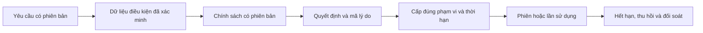

# Auto-approval có điều kiện

## 1. Auto-approval giải quyết vấn đề gì trong PAM?

Auto-approval có điều kiện là việc hệ thống tự chấp thuận một yêu cầu truy cập đặc quyền khi yêu cầu đó thỏa mãn một chính sách đã được người có trách nhiệm cho phép từ trước. Hệ thống đánh giá từng lần yêu cầu dựa trên danh tính, tài nguyên, quyền, mục đích, thời gian và các điều kiện liên quan.

Trong quản lý truy cập đặc quyền (Privileged Access Management, PAM), cơ chế này phù hợp với công việc lặp lại, có phạm vi rõ và có thể kiểm chứng bằng dữ liệu đáng tin. Nó giảm thời gian chờ người duyệt cho những yêu cầu chuẩn hóa, đồng thời dành sự chú ý của người duyệt cho yêu cầu có rủi ro hoặc ngoại lệ.

Sau bài học, người học có thể:

- Chọn trường hợp phù hợp để tự duyệt và xác định trường hợp cần đánh giá thêm.
- Viết điều kiện dựa trên dữ liệu có nguồn gốc, thời hạn và trách nhiệm rõ ràng.
- Phân biệt quyết định chấp thuận với việc cấp quyền và sử dụng quyền.
- Thiết kế cách xử lý điều kiện thiếu, lỗi tích hợp, xung đột chính sách và thay đổi sau quyết định.
- Kiểm thử phạm vi, thời hạn, thu hồi và bằng chứng của luồng tự duyệt.

Các ví dụ bên dưới là thiết kế minh họa, không phải cấu hình có thể nạp trực tiếp vào một sản phẩm PAM. Các con số như 15 phút hay hai tài nguyên cần được điều chỉnh theo công việc và rủi ro của tổ chức.

## 2. Tình huống: công việc chuẩn hóa đang chờ người duyệt

Đội vận hành thường xuyên cần đọc dữ liệu chẩn đoán đã được lọc của hai instance trong môi trường staging. Người trực ca đã được phân công qua hệ thống công việc, sử dụng thiết bị được quản lý và chỉ cần quyền đọc trong khoảng 15 phút.

Nếu mỗi lần đều chờ một người duyệt xem cùng một tập điều kiện, quy trình có thể tạo hàng đợi mà không bổ sung nhiều giá trị. Có thể tự duyệt trường hợp này nếu các điều kiện được kiểm chứng và quyền thực tế đủ hẹp.

Tuy nhiên, yêu cầu đọc toàn bộ log production, mở shell quản trị hoặc lấy credential dùng chung là những phạm vi khác. Không suy ra chúng cũng được tự duyệt chỉ vì người yêu cầu thuộc cùng đội hoặc cùng ghi lý do “chẩn đoán”.

Điểm cốt lõi là: **chính sách tự duyệt phải mô tả một công việc và phạm vi có thể kiểm soát, không chỉ mô tả một nhóm người được tin tưởng**.

## 3. Phân biệt bốn thời điểm của quyền truy cập

| Thời điểm | Điều cần quyết định | Ví dụ |
|---|---|---|
| Xác định đủ điều kiện | Chủ thể có được yêu cầu loại quyền này không? | An thuộc danh sách trực ca đã xác minh |
| Đánh giá yêu cầu | Lần yêu cầu cụ thể có thỏa điều kiện tự duyệt không? | Đúng ticket, hai instance staging, 15 phút |
| Cấp hoặc kích hoạt quyền | Hiện tại có thể cấp đúng phạm vi đã chấp thuận không? | Tạo lease cho capability đọc chẩn đoán |
| Sử dụng và kết thúc | Quyền đang được dùng có còn phù hợp và hết hạn đúng cách không? | Kiểm tra phiên, thu hồi lease, lưu bằng chứng |

Một kết quả `AUTO_APPROVED` thuộc bước đánh giá yêu cầu. Nó không tự chứng minh rằng quyền đã được cấp, quyền đúng phạm vi hoặc phiên đã kết thúc đúng hạn.

Trong sản phẩm cụ thể, yêu cầu phê duyệt, xác thực và thời lượng có thể là các thiết lập riêng. Ví dụ, Microsoft Entra PIM có cấu hình yêu cầu approval khi kích hoạt, yêu cầu MFA hoặc authentication context và giới hạn thời lượng. Khi thiết kế, cần kiểm tra chính xác những điều kiện nào nền tảng hỗ trợ và điểm nào cần tích hợp thêm; bỏ bước duyệt thủ công không có nghĩa các điều kiện còn lại đã tự được thực thi. [Tài liệu Microsoft về role settings trong PIM](https://learn.microsoft.com/en-us/entra/id-governance/privileged-identity-management/pim-how-to-change-default-settings).

## 4. Chọn phạm vi tự duyệt trước khi viết rule

Không bắt đầu bằng câu hỏi “làm sao tự duyệt nhiều hơn”. Hãy xác định một nhóm công việc có quyền hạn và kết quả rõ ràng, sau đó xem các điều kiện có thể kiểm tra tự động hay không.

| Trường hợp minh họa | Hướng xử lý có thể phù hợp | Điều phải chứng minh |
|---|---|---|
| Đọc dữ liệu chẩn đoán staging đã lọc | Ứng viên cho tự duyệt | Quyền đọc hẹp, phân loại dữ liệu rõ, tài nguyên được quản lý |
| Khởi động lại một dịch vụ theo runbook | Đánh giá theo mức ảnh hưởng | Tác vụ bị giới hạn, điều kiện thực hiện và kiểm tra kết quả |
| Quyền ghi rộng trên production | Chuyển đánh giá theo chính sách rủi ro | Phạm vi, tác động và thẩm quyền phê duyệt tương ứng |
| Lấy mật khẩu tài khoản dùng chung | Cần đánh giá vòng đời credential | Phạm vi sử dụng, khả năng sao chép, luân chuyển và truy vết |
| Thay đổi chính sách PAM hoặc quản trị kho bí mật | Thường cần cơ chế kiểm soát riêng | Ngăn chủ thể tự mở rộng điều kiện cấp quyền cho chính mình |
| Truy cập khẩn cấp khi tích hợp đang lỗi | Đi theo quy trình khẩn cấp đã thiết kế | Không biến lỗi xác minh thành tự duyệt mặc định |

Không có nhãn “read-only” nào đủ để xác nhận rủi ro thấp. Đọc credential, dữ liệu khách hàng hoặc log có bí mật vẫn có thể gây ảnh hưởng nghiêm trọng. Phân loại cần dựa trên quyền thực tế và dữ liệu có thể tiếp cận.

Nếu chưa biết capability bao gồm những hành động nào, chưa quản lý được tài nguyên thành viên hoặc chưa chứng minh được thời hạn, cần hoàn thiện các yếu tố đó trước khi mở tự duyệt.

## 5. Những nhóm điều kiện cần xem xét

### 5.1. Danh tính và nhiệm vụ

Chủ thể phải được xác thực và đủ điều kiện sử dụng capability. Ngoài tư cách thành viên nhóm, có thể cần kiểm tra người đó đang được phân công cho dịch vụ, ticket hoặc ca trực liên quan.

Dữ liệu nhóm phải có nguồn quản lý và thời hạn cập nhật. Nếu chính người yêu cầu có thể tự thêm mình vào nhóm dùng làm điều kiện tự duyệt, rule đang dựa trên một thuộc tính không đủ tin cậy cho mục đích đó.

Với workload, điều kiện tương ứng có thể là danh tính pipeline, repository, môi trường chạy, phiên bản artifact và công việc được phép. Không áp dụng nguyên xi rule của tài khoản người dùng cho tài khoản dịch vụ.

### 5.2. Tài nguyên và capability

Dùng định danh tài nguyên đã chuẩn hóa, môi trường và capability được quản lý. Giới hạn phải xét toàn bộ tập tài nguyên được yêu cầu, không chỉ kiểm tra rằng có ít nhất một tài nguyên hợp lệ.

Capability cần có nội dung quyền rõ và được quản lý phiên bản. Một role giữ nguyên tên nhưng vừa được thêm quyền ghi không nên tiếp tục hưởng quyết định tự duyệt dành cho quyền đọc mà không có đánh giá phù hợp.

### 5.3. Căn cứ công việc và business justification

Ticket hoặc yêu cầu công việc cần liên quan đến người thực hiện, tài nguyên và mục đích. Văn bản lý do giúp giải thích nhu cầu; từ khóa trong văn bản không thay thế căn cứ đã xác minh.

Không tự duyệt chỉ vì lý do chứa “incident”, “khẩn cấp” hay tên người quản lý. Những chuỗi đó do người yêu cầu nhập và không phải bằng chứng độc lập về việc được giao nhiệm vụ.

### 5.4. Thời gian và tổng phạm vi sử dụng

Giới hạn thời lượng từng lần, thời điểm được phép kích hoạt và số quyền đang hoạt động. Nếu chỉ giới hạn từng yêu cầu riêng lẻ, người dùng có thể vô tình hoặc cố ý tạo nhiều yêu cầu nhỏ để đạt một phạm vi lớn hơn.

Có thể cần kiểm tra số phiên đồng thời, số tài nguyên hoặc tổng thời gian trong một cửa sổ. Điều kiện cụ thể phải phục vụ rủi ro đã xác định, không thêm giới hạn tùy ý chỉ để làm rule phức tạp.

### 5.5. Ngữ cảnh bảo mật và khả năng thực thi

Thiết bị, mức xác thực, trạng thái bảo mật và bằng chứng sử dụng phải đáp ứng điều kiện của công việc. Không coi “không có cảnh báo được trả về” là “đã xác nhận an toàn” nếu nguồn dữ liệu đang lỗi hoặc chưa cập nhật.

Nếu chính sách yêu cầu chỉ dùng quyền từ thiết bị đủ điều kiện, phải xác định điểm thực thi khi sử dụng quyền. Kiểm tra thiết bị lúc gửi yêu cầu nhưng cho phép dùng credential ở bất kỳ đâu là một chênh lệch cần xử lý.

## 6. Độ tin cậy và độ mới của dữ liệu điều kiện

Mỗi thuộc tính ảnh hưởng đến quyết định cần có nguồn, ý nghĩa và thời hạn sử dụng rõ ràng.

| Thuộc tính | Nguồn phù hợp trong thiết kế | Điều không nên tin trực tiếp |
|---|---|---|
| Danh tính người gửi | Ngữ cảnh xác thực được server kiểm tra | Username do client tự khai |
| Phân công trực ca | Dịch vụ lịch trực hoặc quản lý công việc | Cờ `on_call: true` trong biểu mẫu |
| Môi trường tài nguyên | Danh mục tài sản hoặc nhãn được quản trị | Nhãn `staging` người yêu cầu tự thêm |
| Trạng thái ticket | Hệ thống công việc được tích hợp | Chỉ kiểm tra mã ticket đúng định dạng |
| Trạng thái thiết bị | Nguồn quản lý thiết bị đáng tin | Chuỗi “compliant” gửi từ trình duyệt |
| Quyền trong capability | Danh mục quyền đã được kiểm soát | Tên role có chữ `read` |
| Số lease đang hoạt động | Dữ liệu cấp quyền có kiểm soát đồng thời | Bộ đếm cục bộ của một node không đồng bộ |

Thiết kế nên lưu thời điểm nguồn quan sát dữ liệu, thời điểm đánh giá và phiên bản hoặc định danh của bản ghi liên quan. Mốc thời gian dùng để quyết định phải được kiểm soát phía hệ thống, không lấy giờ trên thiết bị người dùng làm căn cứ duy nhất.

Dữ liệu có ba trạng thái cần phân biệt: điều kiện đúng, điều kiện sai và chưa xác định được. Khi điều kiện bắt buộc chưa xác định, không chuyển nó thành đúng bằng giá trị mặc định, cache không giới hạn hoặc nhánh xử lý lỗi dễ dãi.

Cache có thể cần cho hiệu năng và tính sẵn sàng, nhưng phải có thời hạn và quy tắc khi quá hạn. Chẳng hạn, bản ghi phân công hết thời hạn xác minh không tiếp tục chứng minh người đó còn trực ca chỉ vì chưa có bản ghi mới.

## 7. Ví dụ hợp đồng chính sách tự duyệt

Giả sử tổ chức cho phép tự duyệt quyền đọc dữ liệu chẩn đoán đã lọc của dịch vụ payment trong staging. Một mô tả chính sách có thể như sau:

```json
{
  "policy_id": "auto-payment-staging-diagnostics",
  "policy_version": 3,
  "request_type": "diagnostics-read",
  "subject_requirement": "verified-payment-on-call",
  "capability_id": "payment-diagnostics-read",
  "capability_version": 4,
  "resource_environment": "staging",
  "maximum_resource_count": 2,
  "maximum_duration_minutes": 15,
  "maximum_active_leases_per_subject": 1,
  "ticket_requirement": "active-and-assigned-and-resource-related",
  "authentication_requirement": "organization-approved-strong-auth",
  "device_requirement": "managed-and-compliant",
  "evidence_requirement": "durable-audit-before-grant",
  "unknown_required_fact": "pending-verification",
  "unmatched_request": "manual-review-if-eligible"
}
```

Đây là hợp đồng minh họa để trao đổi về chính sách, không phải cú pháp của một policy engine. Những giá trị như `verified-payment-on-call` phải được định nghĩa thành phép kiểm tra cụ thể có nguồn dữ liệu; đặt tên như vậy trong JSON chưa thực hiện phép kiểm tra nào.

Tập tài nguyên còn phải thuộc phạm vi dịch vụ payment được phép. Điều kiện “không quá hai tài nguyên staging” chưa đủ nếu tổ chức có hàng nghìn máy staging của các dịch vụ khác nhau.

Chính sách này cũng không được tự làm giảm thời lượng người dùng đã yêu cầu rồi giả định họ đã chấp nhận. Nếu tổ chức cho phép đề xuất phạm vi hẹp hơn, cần thể hiện phạm vi được chấp thuận và bảo đảm người dùng biết quyền nào sẽ được kích hoạt.

## 8. Thiết kế đầu ra quyết định rõ nghĩa

Một mô hình có thể dùng các kết quả sau:

| Kết quả | Ý nghĩa | Có được cấp quyền ngay không? |
|---|---|---|
| `DENY` | Có điều kiện cấm hoặc yêu cầu không hợp lệ | Không |
| `PENDING_VERIFICATION` | Chưa xác minh được dữ liệu bắt buộc | Không |
| `REQUIRE_STEP_UP` | Cần hoàn thành yêu cầu xác thực bổ sung | Không; phải đánh giá lại sau khi hoàn thành |
| `REQUIRE_REVIEW` | Đủ điều kiện để chuyển người có thẩm quyền đánh giá | Không |
| `AUTO_APPROVED` | Khớp toàn bộ điều kiện của một chính sách có hiệu lực | Chỉ được chuyển sang bước cấp quyền có kiểm tra |

Các tên trên là quy ước thiết kế. Điều quan trọng là không dùng một trạng thái “không tự duyệt” để biểu diễn cả việc bị cấm, thiếu dữ liệu và cần người duyệt; chúng có cách xử lý khác nhau.

Không khớp rule tự duyệt không đồng nghĩa phải từ chối mọi trường hợp. Có thể chuyển review nếu chính sách cho phép. Ngược lại, một điều kiện cấm bắt buộc không nên bị biến thành yêu cầu thông thường để người duyệt bỏ qua mà không có thẩm quyền ngoại lệ.

Thứ tự ưu tiên giữa các chính sách phải được định nghĩa. Với mô hình trong bài, điều kiện cấm bắt buộc có ưu tiên cao hơn rule tự duyệt. Đây là lựa chọn của thiết kế, cần kiểm thử trong engine thực tế. Một ví dụ về ngữ nghĩa ưu tiên được tài liệu hóa là AWS IAM: explicit deny thắng allow trong các trường hợp đánh giá được mô tả; không nên suy ra mọi hệ thống PAM có cùng ngữ nghĩa. [Tài liệu AWS về policy evaluation logic](https://docs.aws.amazon.com/IAM/latest/UserGuide/reference_policies_evaluation-logic.html).

## 9. Mã giả đánh giá điều kiện

Ví dụ dưới đây mô tả luồng quyết định, không phải chương trình hoàn chỉnh và không gọi API cấp quyền:

```text
function evaluate(request, verifiedContext, policy):
    require request.revision == currentStoredRevision(request.id)
    require request.state == SUBMITTED

    if malformedOrUnauthorizedRequest(request, verifiedContext):
        return DENY("invalid-request")

    if matchesMandatoryProhibition(request, verifiedContext):
        return DENY("prohibited-scope")

    if requiredFactsMissingStaleOrUnavailable(verifiedContext, policy):
        return PENDING_VERIFICATION("required-fact-unverified")

    if authenticationRequiresStepUp(verifiedContext, policy):
        return REQUIRE_STEP_UP("authentication-requirement")

    if not eligibleForRequestedCapability(request, verifiedContext):
        return DENY("not-eligible")

    if not everyRequestedResourceIsAllowed(request, verifiedContext, policy):
        return REQUIRE_REVIEW("outside-auto-approval-scope")

    if not capabilityAndDurationMatch(request, policy):
        return REQUIRE_REVIEW("capability-or-duration-needs-review")

    if not verifiedWorkAssignmentMatches(request, verifiedContext):
        return REQUIRE_REVIEW("work-assignment-mismatch")

    if cannotEnforceRequiredControls(request, verifiedContext, policy):
        return PENDING_VERIFICATION("enforcement-unavailable")

    return AUTO_APPROVED(
        requestRevision = request.revision,
        exactScope = resolvedScope(request),
        policyVersion = policy.version,
        validUntil = shortDecisionExpiry()
    )
```

`verifiedContext` là dữ liệu do các thành phần được tin cậy xây dựng, không phải object từ client được đổi tên. Hàm `everyRequestedResourceIsAllowed` kiểm tra toàn bộ tập tài nguyên đã chuẩn hóa, bao gồm tenant, môi trường và quan hệ với dịch vụ.

Mã giả chưa giải quyết tính đồng thời của giới hạn lease. Điều kiện này phải được kiểm tra và giữ chỗ một cách nhất quán ở bước cấp quyền. Hai yêu cầu cùng nhìn thấy bộ đếm bằng không không được cùng tạo hai lease nếu chính sách chỉ cho phép một.

Các nhánh review trong ví dụ chỉ hợp lệ khi yêu cầu được phép đi theo luồng review. Triển khai cần có quy tắc định tuyến riêng cho trường hợp không đủ điều kiện ở bất kỳ luồng nào.

## 10. Từ quyết định đến cấp quyền: tránh thay đổi phạm vi giữa chừng

Giữa lúc tự duyệt và lúc cấp quyền, người yêu cầu có thể sửa tài nguyên, role có thể thay đổi hoặc ticket có thể bị đóng. Cần ràng buộc quyết định với đúng dữ liệu đã đánh giá.

Một bản ghi quyết định có thể chứa:

```text
decision_id
request_id + request_revision
subject_id
resolved_resource_ids
capability_id + capability_version
approved_actions_or_scope_reference
policy_id + policy_version
fact_snapshot_references
approved_duration
activation_deadline
reason_codes
```

Khi cấp quyền, đối chiếu revision, phạm vi, phiên bản quyền và hiệu lực quyết định. Không cho phép một quyết định dành cho hai máy được dùng để cấp quyền cho cả nhóm máy chỉ vì API đích nhận một tên group rộng hơn.

Cần phân biệt hai thời hạn: thời hạn để kích hoạt quyết định và thời hạn của quyền sau khi kích hoạt. Một thiết kế có thể yêu cầu kích hoạt trong một khoảng ngắn, sau đó cho phép sử dụng trong tối đa 15 phút. Cách tính phải được thể hiện rõ, không để quyết định tồn tại vô hạn và được dùng vào thời điểm khác với ngữ cảnh ban đầu.

Nếu yêu cầu được sửa theo cách ảnh hưởng quyền, đánh giá lại phiên bản mới. Với điều kiện dễ thay đổi như tình trạng tài khoản hoặc trạng thái bảo mật, xác định rõ những điều phải kiểm tra lại ngay trước cấp quyền.

Không cần tạo cảm giác rằng một snapshot đóng băng được thực tế. Snapshot phục vụ giải thích quyết định; sự kiện thu hồi và kiểm tra khi sử dụng vẫn có thể cần thiết sau đó.

## 11. Tính đồng thời, retry và cấp quyền đúng một lần về mặt nghiệp vụ

Luồng tự động thường nhận retry từ client, hàng đợi hoặc kết nối API bị gián đoạn. Thiết kế phải tránh cấp thêm quyền chỉ vì cùng một sự kiện được xử lý lại.

Có thể dùng định danh quyết định và khóa idempotency gắn với yêu cầu, revision và loại cấp quyền. Lưu trạng thái đủ để khi retry, hệ thống đối chiếu kết quả đã có thay vì tạo lease mới không kiểm soát.

Giới hạn đồng thời cần được thực thi bằng cơ chế nhất quán phù hợp, chẳng hạn giao dịch hoặc thao tác giữ chỗ nguyên tử. Nếu việc cấp quyền ở hệ thống ngoài thất bại, xử lý giữ chỗ và trạng thái lỗi theo quy trình khôi phục rõ ràng.

Nếu API đích trả timeout, không mặc định rằng quyền chưa được cấp. Cần có cách đối soát bằng định danh tương quan hoặc đọc lại trạng thái ở đích trước khi thử cấp tiếp. Nếu không, hệ thống có thể tạo nhiều credential hoặc nhiều quyền mà chỉ theo dõi một bản ghi.

Những chi tiết này ảnh hưởng trực tiếp đến ý nghĩa “một yêu cầu, một phạm vi quyền”. Rule điều kiện đúng nhưng luồng cấp quyền không nhất quán vẫn có thể làm vượt giới hạn đã duyệt.

## 12. Thực thi least privilege, JIT và vòng đời credential

Quyền được cấp phải giữ đúng phạm vi mà chính sách đã chấp thuận. Với JIT, xác định thời điểm bắt đầu, hết hạn, cơ chế thu hồi và cách kiểm chứng kết quả thu hồi. Với JEA, bảo đảm chỉ có tác vụ cần thiết được cung cấp nếu nền tảng hỗ trợ.

Nếu dùng proxy PAM, cần kiểm tra loại phiên, tài khoản đích, đường truy cập và khả năng cưỡng chế thời hạn. Nếu dùng vault, quyết định tự duyệt chỉ cho phép lấy đúng đối tượng credential hoặc lease thuộc phạm vi; không cấp quyền duyệt toàn bộ kho vì một yêu cầu truy cập đơn lẻ.

Credential được người dùng nhận trực tiếp có thể bị sao chép. Việc đánh dấu yêu cầu “đã hết hạn” trong PAM không tự làm bản sao đó mất hiệu lực. Thiết kế phải dựa trên khả năng thực tế của credential: thời hạn, thu hồi, vô hiệu hóa hoặc luân chuyển phù hợp.

Tương tự, hết hạn quyền để mở phiên mới không tự bảo đảm phiên đã xác thực hoặc tác vụ nền dừng ngay. Nếu chính sách cam kết giới hạn thời gian sử dụng, phải kiểm thử trên từng đường truy cập hỗ trợ. Không tự duyệt theo một điều kiện mà lớp thực thi không thể đáp ứng.

## 13. Lỗi tích hợp và chế độ suy giảm

Khi một nguồn bắt buộc không khả dụng, mục tiêu đầu tiên là không cấp quyền dựa trên một kết luận chưa được xác minh. Điều đó không có nghĩa mọi lỗi đều phải được xử lý bằng cùng một trạng thái hoặc chờ vô hạn.

Có thể định nghĩa thời gian retry, thông báo cho người yêu cầu, chuyển review khi người duyệt có cách xác minh hợp lệ, hoặc dẫn đến quy trình khẩn cấp. Mỗi nhánh cần có điều kiện rõ và không được bỏ qua các ràng buộc bắt buộc một cách âm thầm.

Đối với bằng chứng, yêu cầu có thể là lưu bền vững trước khi cấp quyền. Kho log trung tâm gián đoạn không nhất thiết đồng nghĩa không thể đáp ứng nếu kiến trúc đã có nhật ký cục bộ hoặc hàng đợi bền vững được bảo vệ và chính sách cho phép. Nhưng không được coi việc gửi log thất bại rồi bỏ qua là đã lưu bằng chứng.

Thông báo đến người dùng nên giúp họ biết bước tiếp theo, chẳng hạn cần xác thực bổ sung hay chờ xác minh ticket. Thông tin chi tiết về rule nhạy cảm và nguồn phát hiện rủi ro nên được giới hạn cho người có trách nhiệm vận hành.

## 14. Bằng chứng và khả năng giải thích quyết định

Mỗi lần đánh giá cần có định danh để nối yêu cầu, dữ liệu điều kiện, quyết định, lần cấp quyền, phiên sử dụng và kết quả thu hồi.



Bằng chứng nên cho biết rule nào khớp, điều kiện nào không khớp hoặc chưa xác minh được và hệ thống nào đã cấp quyền. Không chỉ ghi một dòng `approved=true` mà không có phạm vi hoặc căn cứ.

Lưu tham chiếu hoặc dữ liệu tối thiểu cần thiết cho việc giải thích, thay vì sao chép mọi chi tiết nhạy cảm vào log. Không ghi password, token, private key hoặc giá trị credential do vault trả về. Với tài khoản dùng chung, cần giữ mối liên hệ đến người hoặc workload đã yêu cầu.

Cũng cần ghi nhận các lần từ chối và chờ xác minh để phát hiện rule lỗi, nguồn dữ liệu chậm hoặc hành vi thử nhiều phạm vi. Khả năng truy vết phải tồn tại cho cả nhánh thành công và nhánh thất bại.

## 15. Quản trị thay đổi chính sách tự duyệt

Người sửa rule có thể làm thay đổi khả năng nhận quyền của nhiều chủ thể, nên quyền sửa rule và quyền sửa thuộc tính đầu vào cần được coi là nhạy cảm. Không để một người tự mở rộng danh sách tài nguyên của chính mình rồi nhận auto-approval mà không qua kiểm soát thay đổi tương ứng.

Mỗi chính sách nên có chủ sở hữu, mục đích, phạm vi, phiên bản, ngày xem lại và cách vô hiệu hóa. Thay đổi capability, dữ liệu đầu vào hoặc cách ánh xạ tài nguyên có thể làm thay đổi hiệu lực chính sách ngay cả khi file rule không đổi.

Có thể triển khai theo các giai đoạn:

1. **Mô phỏng:** đánh giá bộ tình huống đã chuẩn bị, chưa cấp quyền.
2. **Shadow:** ghi kết quả dự kiến bên cạnh luồng duyệt đang dùng, chưa để nó kích hoạt quyền.
3. **Thí điểm:** bật cho tập tài nguyên và capability nhỏ, theo dõi cả cấp và thu hồi.
4. **Mở rộng có đánh giá:** tăng phạm vi khi bằng chứng cho thấy điều kiện và thực thi đáp ứng yêu cầu.

Shadow chỉ giúp so sánh quyết định; nó không chứng minh rằng việc cấp và thu hồi ở môi trường thật sẽ hoạt động đúng. Cần kiểm thử các bước đó trong phạm vi được cho phép.

Khi tắt một policy, xác định rõ tác động đến quyết định chưa kích hoạt, lease đang hoạt động và phiên đang mở. Nút tắt tự duyệt thường chỉ chặn quyết định mới nếu không có cơ chế thu hồi bổ sung.

## 16. Bộ kiểm thử chấp nhận

| Tình huống | Kết quả mong đợi trong mô hình của bài |
|---|---|
| Đúng người trực ca, đúng ticket, hai tài nguyên staging, 15 phút | Tự duyệt, sau đó cấp đúng capability có hạn |
| Một trong hai tài nguyên thuộc dịch vụ khác | Không tự duyệt toàn bộ yêu cầu |
| Tên role giữ nguyên nhưng quyền trong role đã mở rộng | Phát hiện phiên bản hoặc phạm vi thay đổi trước khi cấp |
| Client tự gửi cờ thiết bị hợp lệ | Không dùng cờ đó làm dữ liệu đã xác minh |
| Ticket trả timeout hoặc dữ liệu quá hạn | Chờ xác minh hoặc đi theo nhánh đã định; chưa cấp quyền |
| Lý do có từ “khẩn cấp” nhưng không có căn cứ phù hợp | Không tự duyệt chỉ dựa trên văn bản |
| Người dùng sửa danh sách máy sau khi được duyệt | Quyết định cũ không cấp cho revision mới |
| Hai yêu cầu đồng thời khi giới hạn một lease | Chỉ một yêu cầu có thể giữ chỗ và nhận lease theo giới hạn |
| Retry cùng quyết định sau timeout cấp quyền | Đối soát trạng thái, không tạo quyền bổ sung ngoài ý định |
| Ticket bị hủy trước khi kích hoạt | Kiểm tra lại điều kiện và xử lý theo policy |
| Kho log trung tâm lỗi | Chỉ tiếp tục nếu vẫn đáp ứng yêu cầu lưu bằng chứng đã định |
| Thời hạn hết nhưng phiên vẫn đang mở | Đúng hành vi cưỡng chế đã cam kết, có bằng chứng kiểm thử |
| Rule cho phép và điều kiện cấm cùng áp dụng | Điều kiện cấm thắng theo ngữ nghĩa được chọn trong bài |
| Policy bị tắt khi còn lease | Xử lý riêng quyết định mới và quyền đang hoạt động |

Ngoài kiểm thử từng điều kiện, cần thử tổ hợp và ranh giới: thời lượng ngay dưới, bằng và trên giới hạn; tập tài nguyên rỗng hoặc chứa phần tử trùng; ID không tồn tại; dữ liệu nguồn thay đổi trong lúc xử lý; và nhiều node cùng cấp quyền.

Không chỉ xem kết quả đánh giá. Đọc lại trạng thái quyền ở đích, kiểm tra thời hạn và đối chiếu log với quyết định. Kết quả đạt yêu cầu khi người dùng chỉ nhận đúng khả năng đã duyệt, trong đúng khoảng thời gian, và có bằng chứng đủ để giải thích việc đó.

## 17. Bài thực hành thiết kế một luồng tự duyệt

Chọn một tác vụ được tổ chức cho phép trong lab, chẳng hạn đọc bộ dữ liệu chẩn đoán đã lọc của dịch vụ staging. Xác định capability thực tế, tập tài nguyên, chủ thể đủ điều kiện và công việc tham chiếu.

Viết rule tự duyệt có nguồn dữ liệu cho từng điều kiện, thời hạn dữ liệu và hành vi khi không xác minh được. Mô tả riêng đường cấp quyền, giới hạn đồng thời, thời hạn quyết định, thời hạn sử dụng và cách thu hồi.

Sau đó chuẩn bị ít nhất một yêu cầu thỏa điều kiện, một yêu cầu vượt phạm vi, một trường hợp nguồn dữ liệu lỗi và một cặp yêu cầu đồng thời. Với mỗi trường hợp, nêu quyết định, quyền thực tế dự kiến và bằng chứng cần thu thập.

Bản thiết kế hoàn chỉnh phải cho thấy vì sao hệ thống có thể thay bước duyệt từng lần bằng rule đã được quản trị, đồng thời giữ được phạm vi quyền, trách nhiệm và khả năng thu hồi. Một rule trả về “allow” cho ví dụ thuận lợi mới chỉ là một phần của luồng auto-approval trong PAM.
