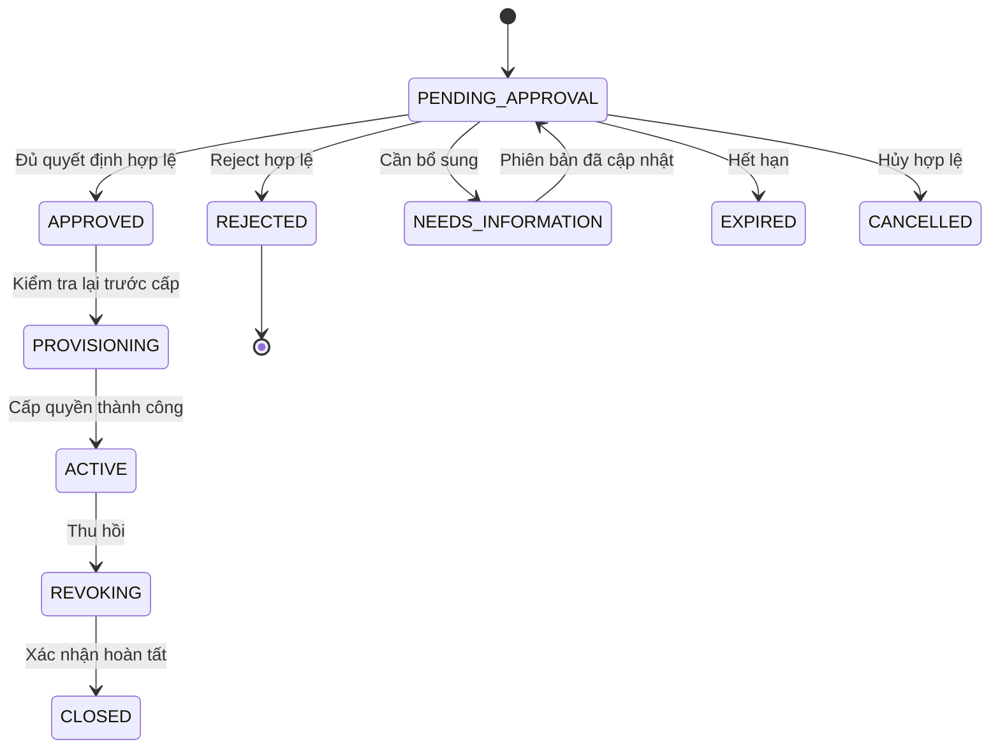

# Reject và lý do

## Mục tiêu bài học

Trong một approval workflow của Privileged Access Management (PAM), **Reject** là quyết định không chấp nhận một yêu cầu truy cập đặc quyền cụ thể. Quyết định này cần ngăn yêu cầu đó tiếp tục tạo quyền, đồng thời giải thích đủ để người xin hiểu việc cần làm tiếp theo và để tổ chức kiểm tra lại căn cứ.

Một nút Reject không có lý do dễ biến thành điểm nghẽn khó xử lý. Một lý do quá chi tiết lại có thể làm lộ thông tin nhạy cảm hoặc tạo thêm nơi chứa secret. Thiết kế tốt phải kiểm soát cả tác động của quyết định và cách lưu, hiển thị, sử dụng lý do.

Sau bài học này, bạn có thể:

- Phân biệt từ chối với yêu cầu bổ sung thông tin, hết hạn, hủy yêu cầu và lỗi kỹ thuật.
- Thiết kế reason code cùng lời giải thích có ích, có giới hạn dữ liệu.
- Xác định ai được từ chối và quyết định áp dụng cho phiên bản yêu cầu nào.
- Xử lý cạnh tranh giữa Reject, Approve, sửa yêu cầu và cấp quyền.
- Tạo bằng chứng kiểm toán và quy trình gửi lại yêu cầu mà không tái sử dụng approval cũ.

## 1. Từ chối điều gì trong PAM?

Một yêu cầu PAM thường xác định người xin, tài sản, vai trò, thao tác, thời hạn và căn cứ nghiệp vụ. Reject phải gắn với đúng phạm vi đó, không chỉ với tên người dùng hoặc một mã ticket chung.

Ví dụ, Lan xin quyền quản trị toàn bộ cụm staging trong hai giờ để khởi động lại một dịch vụ. Chủ tài sản từ chối vì phạm vi vượt nhu cầu. Quyết định hợp lý có thể là:

> Yêu cầu này xin quyền quản trị toàn cụm, trong khi công việc mô tả chỉ cần kiểm tra và khởi động lại một dịch vụ. Hãy tạo yêu cầu mới với vai trò vận hành giới hạn trên dịch vụ được chỉ định và thời hạn phù hợp cửa sổ thay đổi.

Người duyệt đang từ chối **yêu cầu hiện tại**. Họ không khẳng định Lan không bao giờ được truy cập staging, cũng không tự cấp một vai trò thay thế bằng lời nhận xét.

Một quyết định từ chối có ba đầu ra cần nhất quán:

1. **Trạng thái xử lý:** yêu cầu không còn đủ điều kiện đi tiếp tới cấp quyền theo luồng đó.
2. **Giải thích:** có mã lý do và thông tin phù hợp với đối tượng đọc.
3. **Bằng chứng:** biết ai quyết định, theo thẩm quyền nào, với phiên bản yêu cầu và chính sách nào.

## 2. Reject không đồng nghĩa với mọi trường hợp không cấp quyền

| Kết quả | Bản chất | Hành động tiếp theo thường gặp |
|---|---|---|
| REJECTED | Một người có thẩm quyền ra quyết định không chấp thuận | Xem lý do; khắc phục và gửi yêu cầu mới nếu phù hợp |
| POLICY_DENIED | Hệ thống xác định điều kiện hoặc chính sách không cho phép | Xử lý điều kiện nền hoặc đi theo quy trình ngoại lệ được phép |
| NEEDS_INFORMATION | Chưa đủ dữ liệu để quyết định; chưa có quyền được cấp | Bổ sung thông tin theo quy tắc phiên bản |
| EXPIRED | Yêu cầu hoặc thời hạn chờ đã hết | Gửi yêu cầu cho cửa sổ mới và đánh giá lại |
| CANCELLED | Người có quyền hủy yêu cầu không muốn tiếp tục | Kết thúc yêu cầu; không coi là một lần bị từ chối |
| TECHNICAL_FAILURE | Có lỗi khi đánh giá, lưu quyết định hoặc tích hợp hệ thống | Sửa lỗi, kiểm tra trạng thái thực tế và thử lại có kiểm soát |

Tên trạng thái tùy sản phẩm; sự phân biệt về ý nghĩa mới là điều cần giữ.

Một API kiểm tra ticket bị timeout không chứng minh ticket không hợp lệ. Không ghi “bị từ chối do ticket sai” khi hệ thống chỉ biết “chưa xác minh được ticket”.

Nếu chính sách yêu cầu không được cấp quyền khi thiếu bằng chứng bắt buộc, hệ thống vẫn có thể giữ hoặc chặn yêu cầu. Lý do phải mô tả đúng dữ kiện: không thể xác minh điều kiện, thay vì bịa ra kết luận về người xin.

### Khi nên yêu cầu bổ sung thay vì từ chối

Nếu thông tin mô tả thiếu một dữ kiện có thể bổ sung mà không đổi bản chất phạm vi, trạng thái cần bổ sung có thể phù hợp hơn Reject. Tuy nhiên:

- Không cấp quyền trong lúc chờ bổ sung.
- Định nghĩa rõ trường nào có thể bổ sung và trường nào làm thay đổi phạm vi quyền.
- Không để người dùng sửa tài sản, vai trò hoặc thời hạn mà vẫn giữ approval cho phiên bản cũ.
- Có hạn chờ để yêu cầu không nằm vô thời hạn.

Nếu hệ thống không hỗ trợ trạng thái bổ sung, có thể từ chối yêu cầu hiện tại và hướng dẫn gửi lại. Phải nói rõ cách làm này để người dùng không hiểu nhầm là bị cấm truy cập vĩnh viễn.

## 3. Các nhóm lý do từ chối hữu ích

Một taxonomy lý do nên đủ ổn định để báo cáo, nhưng không quá chi tiết đến mức người duyệt chọn ngẫu nhiên. Tách **reason code** dùng cho máy và **lời giải thích** dùng cho người.

| Reason code minh họa | Tình huống | Hướng xử lý có thể cung cấp |
|---|---|---|
| SCOPE_EXCEEDS_TASK | Vai trò hoặc số tài sản vượt nhu cầu công việc | Thu hẹp vai trò, hành động và tập đích |
| BUSINESS_CONTEXT_INSUFFICIENT | Chưa có căn cứ nghiệp vụ đủ để chấp thuận | Bổ sung thông tin công việc qua quy trình phù hợp |
| CHANGE_WINDOW_MISMATCH | Thời gian xin không phù hợp cửa sổ thay đổi đã xác minh | Chọn đúng cửa sổ hoặc cập nhật phê chuẩn nghiệp vụ |
| REQUESTER_NOT_ELIGIBLE | Người xin không thuộc đối tượng được phép yêu cầu quyền này | Liên hệ đầu mối quản lý quyền, không tự thêm nhóm |
| SEGREGATION_OF_DUTIES_CONFLICT | Có xung đột nhiệm vụ theo chính sách | Chọn người thực hiện hoặc luồng được phép khác |
| DUPLICATE_REQUEST | Đã có yêu cầu tương đương đang được xử lý | Theo dõi yêu cầu hiện hữu nếu được quyền xem |
| SECURITY_REVIEW_REQUIRED | Cần chuyển sang quy trình xem xét bảo mật | Dùng kênh hỗ trợ được chỉ định |
| OTHER | Trường hợp chưa có mã phù hợp | Bắt buộc mô tả đủ căn cứ, có kiểm soát dữ liệu |

Các mã trên là ví dụ thiết kế, không phải danh sách bắt buộc của một nền tảng.

### Giữ ý nghĩa mã lý do

Không dùng một mã như `SECURITY_REVIEW_REQUIRED` chỉ vì người duyệt không muốn dành thời gian đọc. Mã lý do phải phản ánh căn cứ thực tế.

Không chọn `DUPLICATE_REQUEST` nếu hai yêu cầu khác tài sản hoặc thời hạn. Người xin cũng không nên được tự xem mọi yêu cầu của người khác chỉ để kiểm tra trùng.

Mã `OTHER` cần được theo dõi. Nếu một loại lý do lặp lại nhiều, có thể bổ sung taxonomy qua quản trị chính sách thay vì để dữ liệu phân tích phụ thuộc hoàn toàn vào văn bản tự do.

### Một yêu cầu có nhiều vấn đề

Có thể lưu một mã chính và các mã phụ, hoặc một tập lý do theo schema của hệ thống. Cần phân biệt:

- Vấn đề đã được xác minh.
- Điểm chưa có đủ dữ liệu.
- Gợi ý khắc phục không phải điều kiện chắc chắn để lần sau được duyệt.

Không hứa “sửa đúng một trường này sẽ được cấp quyền” khi những điều kiện khác vẫn phải được đánh giá lại.

## 4. Viết lý do rõ ràng, có thể xử lý

Một lời giải thích tốt thường có ba phần:

1. **Quan sát:** thuộc tính nào của yêu cầu không phù hợp.
2. **Căn cứ:** yêu cầu hoặc chính sách nào liên quan, ở mức được phép công bố.
3. **Bước tiếp theo:** người xin cần làm gì hoặc liên hệ đâu.

### Ví dụ so sánh

| Lời giải thích yếu | Lời giải thích có ích hơn |
|---|---|
| “Không được.” | “Vai trò được xin cho phép quản trị cả cụm, vượt phạm vi restart một dịch vụ được mô tả. Hãy gửi yêu cầu với vai trò vận hành giới hạn.” |
| “Sai giờ.” | “Khoảng truy cập được xin không nằm trong cửa sổ thay đổi đã được xác minh. Hãy chọn cửa sổ phù hợp hoặc cập nhật phê chuẩn công việc trước khi gửi lại.” |
| “Thiếu ticket.” | “Chưa có tham chiếu công việc có thể xác minh cho yêu cầu này. Hãy bổ sung qua biểu mẫu được chỉ định; không dán dữ liệu nhạy cảm vào phần lý do.” |
| “Bạn không đáng tin.” | “Danh tính hiện chưa đáp ứng điều kiện yêu cầu loại quyền này. Liên hệ đầu mối quản lý quyền để kiểm tra điều kiện.” |

Ngôn ngữ nên tập trung vào yêu cầu và điều kiện kiểm soát. Không suy đoán động cơ, nhận xét cá nhân hoặc ghi kết luận điều tra chưa được xác minh.

### Đủ cụ thể nhưng không làm lộ điều nhạy cảm

Một lời giải thích công khai không nên tiết lộ:

- Credential, token, cookie hoặc đường dẫn chứa secret.
- Danh sách tài sản mà người xin không được biết.
- Thông tin cá nhân không cần thiết của người khác.
- Chi tiết phát hiện gian lận, chỉ dấu điều tra hoặc ngưỡng bảo mật có thể hỗ trợ né tránh.
- Toàn bộ nội dung incident hoặc ticket có dữ liệu nhạy cảm.

Với tình huống cần điều tra, người xin có thể nhận thông báo “Yêu cầu cần được xem xét qua kênh hỗ trợ bảo mật”, còn căn cứ chi tiết chỉ nằm trong hồ sơ nội bộ được phân quyền.

Thông báo thiếu chi tiết vì lý do bảo mật vẫn cần một kênh xử lý rõ ràng. Không để người dùng đoán phải gửi lại bao nhiêu lần hoặc liên hệ ngẫu nhiên với nhiều approver.

## 5. Tách thông báo cho người xin và ghi chú hạn chế

Một mô hình có thể lưu các trường sau:

```yaml
# Mô hình dữ liệu minh họa.
decision: REJECT
reason_code: SCOPE_EXCEEDS_TASK
requester_message: >
  Vai trò được xin vượt phạm vi công việc mô tả.
  Hãy gửi yêu cầu mới với vai trò vận hành giới hạn.
restricted_note_ref: review-note-example-21
policy_reference: pam-scope-example-v4
```

`requester_message` chỉ chứa nội dung được phép hiển thị cho người xin. `restricted_note_ref` trỏ tới ghi chú nội bộ nếu thật sự cần; không phải mọi lần từ chối đều phải có ghi chú bí mật.

Việc tách hai trường chỉ có ý nghĩa nếu API, giao diện, chức năng export, email và hệ thống tìm kiếm cùng thực thi phân quyền. Ẩn một ô trên màn hình nhưng trả nguyên ghi chú nội bộ trong JSON vẫn là lộ dữ liệu.

Người có quyền xem quyết định cũng không mặc nhiên có quyền xem mọi hồ sơ điều tra liên quan. Cần kiểm tra quyền trên từng tài nguyên được tham chiếu.

### Văn bản lý do là dữ liệu không đáng tin

Người duyệt hợp lệ vẫn có thể nhập nhầm nội dung nguy hiểm hoặc tài khoản của họ có thể bị lạm dụng. Với văn bản tự do, cần:

- Giới hạn độ dài và kiểm tra định dạng.
- Hiển thị như văn bản được escape; chỉ hỗ trợ markup nếu có xử lý an toàn.
- Không cho nội dung tạo thêm dòng log hoặc giả cấu trúc sự kiện.
- Không chạy lệnh, gọi URL hoặc thực thi template dựa trên lý do.
- Tránh tự động mở rộng link preview khiến dịch vụ truy cập URL tùy ý.
- Có cách xử lý dữ liệu nhạy cảm bị dán nhầm theo quy trình quản trị dữ liệu.

Không cần cho phép tải file chứa bằng chứng ở mọi màn hình Reject. Nếu có tài liệu đính kèm, dùng kho có kiểm soát truy cập, quét theo khả năng của hệ thống và quản lý vòng đời thay vì nhét vào log.

## 6. Ai được Reject, và được Reject lúc nào?

Thẩm quyền từ chối phải được kiểm tra phía máy chủ cho **yêu cầu cụ thể**. Việc một người là approver cho staging không cho họ quyền sửa trạng thái mọi yêu cầu production.

Các kiểm tra thường gồm:

- Danh tính người ra quyết định còn hoạt động.
- Có thẩm quyền với tài sản, loại quyền và bước duyệt hiện tại.
- Không vi phạm quy tắc độc lập hoặc xung đột nhiệm vụ cần áp dụng.
- Ủy quyền còn hiệu lực và đúng phạm vi, nếu sử dụng.
- Yêu cầu còn ở trạng thái nhận quyết định.
- Phiên bản đang được duyệt trùng với phiên bản hiện hành.

Nếu người dùng không có thẩm quyền, hệ thống từ chối thao tác ghi quyết định. Không tạo một quyết định Reject có hiệu lực rồi mới kiểm tra quyền sau.

### Phân biệt từ chối yêu cầu và từ chối thao tác API

Một HTTP 403 khi người không có quyền bấm Reject là kết quả kiểm soát quyền của API. Nó không có nghĩa yêu cầu PAM của người xin đã bị Reject.

Tương tự, HTTP 409 do phiên bản cũ nghĩa là quyết định chưa được chấp nhận trên phiên bản hiện tại. Giao diện cần nói rõ kết quả thay vì hiển thị thành công vì người dùng đã bấm nút.

### Tác động trong luồng nhiều người duyệt

Chính sách phải xác định rõ một Reject có kết thúc toàn bộ yêu cầu không. Ví dụ, một luồng có thể yêu cầu đồng thuận của hai bên và chỉ cần một quyết định từ chối hợp lệ để kết thúc.

Không mặc định hai Approve sẽ “thắng” một Reject bằng cách đếm đa số. Nếu tổ chức có cơ chế xem xét lại hoặc chuyển cấp, cơ chế đó phải được mô hình hóa riêng với thẩm quyền và bằng chứng tương ứng.

Màn hình cần cho biết người duyệt đang kết thúc yêu cầu hay chỉ từ chối phần trách nhiệm của mình. Trạng thái mơ hồ dễ khiến các bên hiểu khác nhau về khả năng cấp quyền.

## 7. Ràng buộc quyết định với đúng phiên bản

Giả sử yêu cầu `req-example-307` ở phiên bản 2 xin vai trò quản trị toàn cụm. Lan sửa thành phiên bản 3, chỉ xin vai trò restart dịch vụ. Một approver vẫn mở màn hình phiên bản 2 rồi bấm Reject.

Máy chủ không nên áp quyết định đó lên phiên bản 3 mà không kiểm tra. Người duyệt phải được xem lại phạm vi đang thực sự được quyết định.

Dữ liệu gửi lên có thể gồm:

```json
{
  "request_id": "req-example-307",
  "expected_request_version": 2,
  "decision": "REJECT",
  "reason_code": "SCOPE_EXCEEDS_TASK",
  "requester_message": "Vai trò xin vượt phạm vi công việc được mô tả.",
  "idempotency_key": "decision-example-f80c"
}
```

Đây là payload minh họa. Danh tính approver, thẩm quyền, thời gian quyết định và trạng thái yêu cầu phải được máy chủ xác định; không tin các giá trị tương đương do trình duyệt tự khai.

Nếu phiên bản không còn khớp, API trả kết quả xung đột và yêu cầu tải lại. Không được âm thầm đổi `expected_request_version` để làm quyết định cũ thành hợp lệ.

### Không xóa lịch sử khi người dùng gửi lại

Một yêu cầu mới có thể tham chiếu yêu cầu bị từ chối để người duyệt hiểu phần đã khắc phục. Tuy nhiên:

- Quyết định cũ vẫn gắn với phạm vi cũ.
- Yêu cầu mới phải được đánh giá điều kiện và phê duyệt lại.
- Approval đã có trước Reject không được sao chép sang phạm vi mới như một quyền còn hiệu lực.
- Tham chiếu không được làm lộ yêu cầu cũ cho người không có quyền xem.

Nếu nền tảng hỗ trợ mở lại cùng một request, cần tạo một phiên bản hoặc vòng xét duyệt mới với lịch sử rõ ràng. Không ghi đè `REJECTED` thành `APPROVED` rồi xóa dấu vết về lý do cũ.

## 8. Trạng thái và cạnh tranh giữa các quyết định

Một mô hình minh họa cho quyết định thủ công có thể là:



Trong mô hình này, `REJECTED` là trạng thái kết thúc của vòng xét duyệt hiện tại. Nếu công việc tiếp tục, người xin tạo yêu cầu hoặc vòng xét duyệt mới theo quy trình.

### Approve và Reject đến gần như đồng thời

Không dùng thời gian do trình duyệt gửi để quyết định ai “bấm trước”. Cần một cơ chế xử lý nhất quán phía máy chủ, chẳng hạn giao dịch với kiểm tra trạng thái và phiên bản.

Nếu Reject hợp lệ đã được ghi nhận và yêu cầu chuyển sang `REJECTED`, một Approve đến sau không được làm yêu cầu sống lại. Ngược lại, nếu yêu cầu đã chuyển sang trạng thái không còn nhận quyết định, endpoint Reject phải báo xung đột hoặc trạng thái hiện tại; không báo đã từ chối thành công khi tác động đó không xảy ra.

Nếu cần cho phép rút phê duyệt sau khi `APPROVED`, hãy thiết kế hành động **withdraw/revoke approval** riêng. Với quyền đã cấp, cần luồng thu hồi; không cố biểu diễn mọi việc bằng một nút Reject.

### Ghi quyết định và trạng thái phải nhất quán

Một lỗi nguy hiểm là lưu dòng “Rejected by B” nhưng vẫn để yêu cầu đủ điều kiện cấp quyền. Cần bảo đảm việc ghi quyết định và chuyển trạng thái liên quan có tính nhất quán trong kho dữ liệu có thẩm quyền.

Nếu phát sự kiện hoặc thông báo qua hệ thống khác, có thể dùng cơ chế gửi tin bền vững cùng thay đổi trạng thái. Không dựa vào một email đã gửi để chứng minh trạng thái dữ liệu đã được cập nhật.

### Retry không được tạo quyết định khác

Khóa idempotency có thể giúp xử lý người dùng bấm lại sau khi mất mạng. Cùng khóa và cùng nội dung phải trả về kết quả đã ghi; cùng khóa nhưng nội dung khác cần bị phát hiện là xung đột.

Idempotency không thay thế kiểm tra quyền hoặc phiên bản. Một khóa mới cũng không cho phép ghi quyết định trên yêu cầu đã kết thúc.

## 9. Reject có ngăn quyền thật sự được cấp không?

Một hệ thống an toàn phải kiểm tra trạng thái có thẩm quyền ở đường cấp quyền. Chỉ vô hiệu nút trên giao diện hoặc xóa mục khỏi hàng đợi không đủ.

### Trước khi cấp

Credential broker hoặc bộ cấp IAM cần xác nhận yêu cầu còn hợp lệ, đủ phê chuẩn, đúng phiên bản, trong thời hạn và chưa bị hủy hoặc thu hồi phê chuẩn theo mô hình. Sau Reject, không phát credential hoặc tạo grant dựa trên bản cache approval đã cũ.

Khoảng cách giữa kiểm tra và thao tác với hệ thống đích cũng phải được xử lý. Không có một giao dịch cơ sở dữ liệu cục bộ nào tự động bao trùm mọi thay đổi IAM trên một hệ thống độc lập.

Thiết kế thực tế cần phối hợp trạng thái, kiểm tra trước khi thực thi, tương quan tác vụ cấp quyền và đối soát. Nếu có quyền đã được tạo trong một cuộc đua hoặc lỗi tích hợp, phải phát hiện và thu hồi, thay vì chỉ sửa trạng thái giao diện.

### Khi quyền đã tồn tại

Reject thường dành cho một yêu cầu chưa được cấp quyền. Nếu phát hiện vấn đề sau khi quyền đã có hiệu lực, cần hành động thu hồi phù hợp:

1. Ngừng khả năng mở phiên hoặc nhận credential mới từ grant liên quan.
2. Đóng hoặc vô hiệu các phiên theo chính sách và khả năng tích hợp.
3. Gỡ quyền JIT và vô hiệu token hoặc phiên đích nếu hỗ trợ.
4. Kiểm chứng kết quả tại đích.
5. Ghi phần còn tồn đọng và cảnh báo nếu chưa hoàn tất.

Đổi mật khẩu không luôn làm mọi token hoặc cookie đã phát hành mất hiệu lực. Đóng phiên PAM cũng không chứng minh quyền ở đích đã được gỡ.

### Không thu hồi nhầm quyền độc lập

Lan có thể có một grant chỉ đọc hợp lệ từ yêu cầu khác, trong khi yêu cầu mới xin quản trị bị từ chối. Từ chối yêu cầu mới không mặc nhiên là lý do thu hồi mọi quyền của Lan.

Nếu có căn cứ tài khoản bị chiếm quyền, quy trình ứng phó sự cố có thể yêu cầu phạm vi thu hồi lớn hơn. Hành động đó cần căn cứ và liên kết sự cố riêng, không suy ra chỉ từ một Reject vì sai cửa sổ bảo trì.

## 10. Thông báo, gửi lại và xem xét lại

### Thông báo tối thiểu cần gì?

Người xin nên biết mã yêu cầu, kết quả, thời điểm, lý do được phép hiển thị và bước tiếp theo. Không gửi secret, ghi chú nội bộ hoặc hồ sơ điều tra vào email hoặc thông báo chat.

Liên kết thông báo phải dẫn về hệ thống có xác thực và kiểm tra quyền. Không để một URL có thể chuyển tiếp trở thành cách đọc toàn bộ lý do nội bộ.

Nếu việc gửi thông báo lỗi, quyết định vẫn phải có trạng thái đúng trong hệ thống chính. Có thể retry thông báo và ghi lỗi, nhưng không hoàn nguyên từ chối chỉ vì email chưa gửi được.

### Gửi lại không phải đi tìm người dễ duyệt

Cho phép người xin sửa căn cứ hoặc phạm vi và gửi lại qua luồng chính thức. Theo dõi các lần gửi lại liên quan để phát hiện vấn đề hướng dẫn hoặc hành vi cố né kiểm soát.

Không tự suy rằng mọi lần gửi lại đều ác ý. Người dùng có thể chưa hiểu vai trò nào phù hợp hoặc danh mục quyền mô tả chưa tốt.

Tránh cơ chế cho người xin tạo nhiều bản cùng lúc rồi giữ bản được duyệt trước. Có thể cần kiểm tra yêu cầu trùng, giới hạn tần suất hợp lý và liên kết lịch sử theo phạm vi.

### Xem xét lại và giải quyết bất đồng

Một tổ chức có thể có quy trình xem xét lại với chủ tài sản hoặc bên độc lập. Quy trình nên xác định:

- Ai có thẩm quyền xem xét.
- Cần bằng chứng mới hoặc thay đổi nào.
- Có tạo yêu cầu mới hay vòng xét duyệt mới.
- Quyết định mới áp dụng cho phạm vi và thời gian nào.

Không có quyền truy cập trong lúc chờ chỉ vì người xin đã khiếu nại. Không dùng áp lực vận hành hoặc tin nhắn cá nhân để biến Reject thành Approve ngoài hệ thống.

Nếu tình huống thật sự khẩn cấp, áp dụng luồng emergency hoặc break-glass đã được thiết kế với điều kiện, thời hạn và bằng chứng riêng. Nhãn “khẩn cấp” không tự bỏ qua quyết định từ chối.

## 11. Dữ liệu audit cho quyết định Reject

Một sự kiện có thể có cấu trúc:

```json
{
  "event_type": "pam.approval.request_rejected",
  "decision_id": "decision-example-55",
  "request_id": "req-example-307",
  "request_version": 2,
  "scope_reference": "scope-example-307-v2",
  "actor_id": "user-service-owner",
  "authority_reference": "authority-example-staging-owner",
  "reason_code": "SCOPE_EXCEEDS_TASK",
  "requester_message_reference": "message-example-55",
  "policy_version": "pam-approval-example-v4",
  "previous_state": "PENDING_APPROVAL",
  "new_state": "REJECTED",
  "recorded_at": "2026-01-01T08:05:00Z",
  "correlation_id": "corr-example-307"
}
```

Đây là schema minh họa. Thời gian cần do hệ thống đáng tin ghi và sử dụng quy ước thống nhất; không coi timestamp phía người dùng là bằng chứng thứ tự giao dịch.

Cần giữ được lịch sử quyết định và thay đổi có thẩm quyền. Nếu sửa lỗi văn bản hoặc thực hiện xử lý dữ liệu nhạy cảm bị ghi nhầm, phải theo quy trình với dấu vết phù hợp; không cho approver âm thầm viết lại lý do sau khi có tranh chấp.

Bảo vệ kho audit khỏi sửa hoặc xóa trái phép, kiểm soát quyền export và có chính sách lưu trữ phù hợp. Thời hạn lưu phụ thuộc nhu cầu và quy định áp dụng của tổ chức, không có một con số chung cho mọi triển khai.

### Truy nguyên tới credential và phiên

Khi điều tra, cần nối được:

```text
request + version
    -> quyết định và trạng thái cuối của vòng duyệt
    -> tác vụ cấp quyền nếu có
    -> grant / credential lease / session liên quan
    -> quyền thực tế và kết quả thu hồi tại đích
```

Với yêu cầu bị từ chối trước khi cấp, kỳ vọng không có tác vụ cấp quyền hợp lệ phát sinh sau đó. Nếu có, đây là tín hiệu cần kiểm tra lỗi thực thi hoặc đường truy cập vượt workflow.

Chỉ thấy một sự kiện Reject chưa đủ để kết luận toàn bộ hệ thống đích không còn quyền của người dùng. Cần phân biệt quyền liên quan đến yêu cầu với các quyền thường trực hoặc grant độc lập khác.

## 12. Theo dõi chất lượng lý do và luồng từ chối

Các chỉ số có thể giúp cải thiện quy trình:

- Tỷ lệ từ chối theo reason code và loại quyền.
- Tỷ lệ dùng `OTHER` hoặc lời giải thích quá ngắn.
- Số lần gửi lại vì cùng một vấn đề chưa được giải thích rõ.
- Thời gian từ gửi yêu cầu đến nhận quyết định.
- Tỷ lệ yêu cầu chuyển sang vai trò hẹp hơn sau khi bị từ chối.
- Số quyết định bị lỗi do màn hình hoặc phiên bản cũ.
- Số lần từ chối không có hiệu lực tại đường cấp quyền.
- Số thông báo hoặc export làm lộ thông tin không đúng quyền.
- Số lần ghi lý do bị chỉnh sửa hoặc có dữ liệu nhạy cảm.

Không đặt chỉ tiêu “phải từ chối một tỷ lệ nhất định”. Tỷ lệ cao có thể do mô tả vai trò kém, người xin chưa được hướng dẫn hoặc chính sách sai; tỷ lệ thấp cũng không tự chứng minh người duyệt làm tốt.

Nếu một approver từ chối hàng loạt không căn cứ, cần kiểm tra thẩm quyền, tải công việc và lịch sử hành vi theo quy trình quản trị. Reject là một hành động có thể làm gián đoạn công việc nên cũng cần được giám sát.

## 13. Bài thực hành có kiểm chứng

Thực hiện trong lab được phép, dùng tài sản giả lập và tài khoản thử nghiệm. Không cần credential production để kiểm tra approval workflow.

### Chuẩn bị

Tạo người xin A, approver B có thẩm quyền staging và C không có thẩm quyền trên tài sản đó. Chuẩn bị một vai trò chỉ đọc, một vai trò restart và một vai trò quản trị rộng. Thiết lập luồng yêu cầu cùng audit có thể quan sát.

Định nghĩa ít nhất ba reason code và mẫu giải thích. Ghi rõ khi nào dùng Reject, khi nào cần bổ sung và khi nào là lỗi kỹ thuật.

### Ca kiểm thử

| Ca | Thao tác | Kết quả mong đợi |
|---|---|---|
| Từ chối hợp lệ | B từ chối yêu cầu rộng với lý do đúng | Yêu cầu kết thúc theo chính sách, có audit và không cấp quyền |
| Người không có quyền | C gọi API Reject trực tiếp | Bị từ chối thao tác; request của A không bị đổi trạng thái |
| Thiếu reason bắt buộc | B gửi quyết định thiếu mã hoặc lời giải thích cần thiết | Không ghi thành công một quyết định thiếu dữ liệu |
| Phiên bản cũ | B duyệt màn hình cũ sau khi A sửa phạm vi | Báo xung đột, yêu cầu xem lại bản hiện hành |
| Approve sau Reject | Gửi Approve sau khi Reject đã có hiệu lực | Không khôi phục yêu cầu hoặc tạo grant |
| Reject sau khi đã Active | Thử dùng endpoint từ chối trên quyền đã cấp | Không giả báo đã thu hồi; hướng tới luồng thu hồi có thẩm quyền |
| Retry quyết định | Gửi lại cùng idempotency key và nội dung | Không sinh hai quyết định khác nhau |
| Cùng khóa khác nội dung | Dùng lại khóa nhưng đổi lý do hoặc đối tượng | Phát hiện xung đột, không ghi đè quyết định cũ |
| Rò ghi chú nội bộ | A xem API, email và bản export dành cho mình | Không nhận ghi chú hạn chế |
| Nội dung có markup | Nhập chuỗi giống HTML hoặc ký tự tạo dòng log | Hiển thị an toàn, không thực thi hoặc giả sự kiện |
| Thông báo lỗi | Mô phỏng dịch vụ gửi thông báo không phản hồi | Request vẫn bị từ chối; lỗi gửi được theo dõi |
| Gửi lại | A tạo bản mới đã thu hẹp vai trò | Có đánh giá mới, không kế thừa approval cũ như quyền còn hiệu lực |
| Đối soát quyền | Kiểm tra grant và phiên sau Reject | Không có quyền phát sinh từ yêu cầu bị chặn; quyền độc lập được phân biệt |

Với ca cạnh tranh, gửi Approve và Reject gần đồng thời nhiều lần trong lab và đối chiếu trạng thái có thẩm quyền. Kết quả phải phù hợp mô hình chuyển trạng thái đã công bố, không phụ thuộc việc màn hình nào cập nhật trước.

### Bằng chứng cần nộp

Ghi phiên bản request, danh tính tác nhân, lý do, phản hồi API, trạng thái cuối, sự kiện audit và kiểm tra quyền ở đích hoặc bộ cấp quyền giả lập. Che dữ liệu nhạy cảm trước khi chia sẻ báo cáo.

Nếu kết quả là lỗi cấp quyền hoặc dọn dẹp, ghi đúng giới hạn kiểm chứng. Không suy ra “không có quyền” chỉ từ một trạng thái màu đỏ trên giao diện.

## 14. Sai lầm thường gặp

**Chỉ yêu cầu một ô lý do tự do.** Dữ liệu khó phân tích, khó bảo đảm đủ căn cứ và dễ chứa secret. Kết hợp mã lý do ổn định với lời giải thích phù hợp.

**Tự động từ chối mọi lỗi tích hợp.** Người xin nhận thông tin sai về căn cứ nghiệp vụ và có thể gửi lại vô ích. Phân biệt lỗi xác minh với một điều kiện đã được xác định là không đạt.

**Cho phép sửa request sau Reject rồi dùng approval trước đó.** Quyết định cũ không chấp nhận phạm vi mới. Cần vòng đánh giá và liên kết phiên bản rõ ràng.

**Ghi chú nội bộ chỉ bị ẩn ở giao diện.** API hoặc export vẫn có thể làm lộ dữ liệu. Quyền đọc phải được thực thi tại máy chủ và trên mọi kênh.

**Cho rằng Reject tương đương thu hồi.** Quyết định từ chối không tự đóng phiên, gỡ IAM hoặc vô hiệu token đã tồn tại. Cần luồng thu hồi riêng và kiểm chứng.

**Đánh giá approver chỉ bằng tốc độ.** Quyết định nhanh nhưng không có căn cứ tạo rủi ro và gây gửi lại nhiều lần. Chất lượng lý do cùng hiệu lực kiểm soát quan trọng hơn số lần bấm nút.

## 15. Câu hỏi tự kiểm tra

1. Vì sao lỗi timeout khi kiểm tra ticket không nên được ghi thành “ticket không hợp lệ”?
2. Một Reject gắn với phiên bản 2 có được áp dụng tự động cho phiên bản 3 đã đổi phạm vi không?
3. Tại sao đóng yêu cầu trên giao diện chưa đủ để bảo đảm không cấp credential?
4. Người xin cần được xem những gì, và những gì nên giới hạn trong hồ sơ nội bộ?
5. Nếu quyền đã Active, vì sao cần thao tác thu hồi thay vì chỉ đổi trạng thái thành Rejected?

### Gợi ý đối chiếu

1. Timeout chỉ cho biết chưa xác minh được, không chứng minh dữ liệu sai; trạng thái và lý do phải phản ánh điều đã biết.
2. Không. Quyết định phải ràng buộc với phạm vi được xem xét; bản mới cần kiểm tra phiên bản và xử lý theo luồng mới.
3. Bộ cấp quyền phải kiểm tra trạng thái có thẩm quyền, tránh cache cũ và đối soát tác vụ đã chạy.
4. Người xin cần kết quả, lý do có thể xử lý và bước tiếp theo; secret, dữ liệu cá nhân không cần thiết và chi tiết điều tra phải được bảo vệ.
5. Trạng thái workflow không tự tác động tới phiên, grant hay token tại đích; phải thực hiện và xác minh các bước thu hồi.

Một quyết định Reject có chất lượng phải vừa ngăn yêu cầu không phù hợp đi tới cấp quyền, vừa để lại lời giải thích và bằng chứng đúng mức. Khi người xin hiểu cách khắc phục, người duyệt có trách nhiệm rõ ràng và hệ thống thực thi đúng trạng thái, luồng từ chối trở thành một phần kiểm soát đặc quyền có thể vận hành và kiểm toán.
