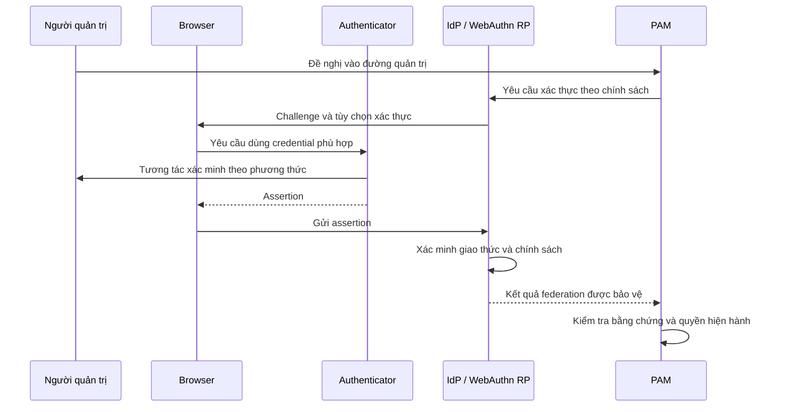

# Phishing-resistant MFA

## 1. Chống phishing phải là thuộc tính của giao thức

Trong quản lý truy cập đặc quyền (PAM), một lần đăng nhập thành công có thể dẫn tới khả năng mở phiên quản trị, sử dụng credential trong vault hoặc cấp quyền tạm trên hạ tầng nhạy cảm. Vì vậy, cần xét không chỉ việc người dùng đã thực hiện MFA, mà cả cách giao thức ngăn một bên giả mạo lấy được bằng chứng xác thực có thể dùng tại dịch vụ thật.

Theo NIST, phishing resistance là khả năng giao thức bảo vệ bí mật và đầu ra xác thực hợp lệ khỏi bên xác minh giả mạo mà không phụ thuộc vào sự cảnh giác của người dùng. Mã OTP nhập thủ công không được coi là phishing-resistant vì có thể bị chuyển tiếp sang lần xác thực khác. [NIST SP 800-63B-4, Phishing Resistance](https://pages.nist.gov/800-63-4/sp800-63b.html#phishing-resistance)

Trong bối cảnh PAM, câu hỏi thiết kế là:

> Nếu người quản trị bị dẫn tới một trang giả, cơ chế nào ngăn bằng chứng họ tạo ở đó được dùng để đăng nhập vào hệ thống thật?

Đây là yêu cầu khác với việc dùng mật khẩu mạnh, mã dùng một lần hoặc thêm một màn hình xác nhận. Những biện pháp đó có thể hữu ích trong các mô hình rủi ro riêng, nhưng nhãn “MFA” không đủ để kết luận giao thức chống phishing.

Bài học thuộc chương MFA, tập trung vào xác thực con người trước khi sử dụng quyền đặc biệt. Phần thiết kế PAM bên dưới là mô hình tham khảo để kết hợp xác thực với least privilege, JIT/JEA, vault, giám sát phiên và thu hồi quyền; không phải cấu hình cho một sản phẩm cụ thể.

## 2. Vì sao thêm một bước xác nhận vẫn có thể chưa đủ?

Hãy phân biệt hai tình huống:

| Tình huống | Câu hỏi bảo vệ |
|---|---|
| Kẻ tấn công biết mật khẩu nhưng không có yếu tố bổ sung | Cần gì để ngăn đăng nhập chỉ bằng mật khẩu bị lộ? |
| Người dùng đang tương tác với một dịch vụ giả mạo | Bằng chứng xác thực có bị dùng thay họ tại dịch vụ thật không? |

Một mã có thời hạn ngắn làm giảm thời gian sử dụng, nhưng không tự ràng buộc mã với đúng dịch vụ nhận. Tương tự, một thông báo xác nhận thông thường có thể bị người dùng chấp nhận ngoài ý định nếu không có cơ chế giao thức phù hợp.

Đối với PAM, việc đánh giá nên đi theo từng phương thức và cấu hình thực tế:

- Phương thức nào được dùng để vào IdP hoặc PAM?
- Bằng chứng được ràng buộc với bên xác minh nào?
- Có thể chuyển sang phương thức yếu hơn trên cùng đường truy cập không?
- Thêm, thay hoặc khôi phục yếu tố xác thực được bảo vệ ra sao?
- Sau xác thực, phiên và quyền được kiểm soát bằng cách nào?

Không nên đánh giá một chương trình MFA chỉ theo số người đã đăng ký một thiết bị. Một người có khóa tốt nhưng vẫn được phép dùng đường đăng nhập cũ cho cùng quyền quản trị có thể chưa được bảo vệ theo mục tiêu của chính sách.

Cũng cần phân biệt chống phát lại với chống phishing. Ngăn dùng lại một thông điệp cũ không tự chứng minh bằng chứng không thể bị chuyển tiếp trong thời gian còn hợp lệ.

## 3. WebAuthn bảo vệ mối quan hệ với dịch vụ như thế nào?

WebAuthn sử dụng credential khóa công khai có phạm vi theo relying party (RP). Dịch vụ lưu public key; quá trình xác thực tạo bằng chứng bằng private key tương ứng. RP kiểm tra challenge, origin, RP ID và chữ ký theo giao thức. Một trang ở miền giả không mặc nhiên được sử dụng credential của RP thật. [W3C WebAuthn — Relying Party Operations](https://www.w3.org/TR/webauthn-3/#sctn-rp-operations)

Ba khái niệm cần hiểu:

| Khái niệm | Ý nghĩa trong thiết kế |
|---|---|
| RP | Dịch vụ thực hiện giao thức WebAuthn và xác minh credential |
| Authenticator | Thành phần tạo hoặc sử dụng credential để đáp ứng xác thực |
| Browser/client | Thành phần trung gian thực hiện WebAuthn trong ngữ cảnh dịch vụ |

Nếu PAM đăng nhập thông qua IdP, IdP có thể là RP của WebAuthn. PAM khi đó nhận kết quả từ IdP qua giao thức federation. Không nên diễn giải rằng credential được tạo cho IdP tự trở thành credential đăng ký trực tiếp tại mọi ứng dụng PAM.

Một luồng xác thực minh họa:



Trong luồng WebAuthn, assertion được ký bằng private key của credential đã đăng ký; máy chủ đối chiếu với public key lưu trước đó. Challenge và thông tin RP tham gia vào việc xác minh lần xác thực. [Yubico — WebAuthn Client Authentication](https://developers.yubico.com/WebAuthn/WebAuthn_Developer_Guide/WebAuthn_Client_Authentication.html)

Với PAM, suy luận thiết kế từ cơ chế này là phải bảo vệ cả nơi xác thực lẫn đường truyền kết quả tới điểm cấp quyền. Một phép kiểm tra tốt ở IdP không bù được việc PAM chấp nhận bằng chứng giả hoặc bỏ qua điều kiện bắt buộc.

## 4. Chạm khóa khác với xác minh người dùng

WebAuthn phân biệt:

- **User presence — UP:** có tương tác hiện diện, chẳng hạn chạm vào authenticator.
- **User verification — UV:** authenticator xác minh người dùng bằng cơ chế như PIN hoặc sinh trắc học.

Chạm khóa không tự có nghĩa đã kiểm tra PIN hoặc sinh trắc học. Khi chính sách cần UV, phải yêu cầu và xác minh kết quả tương ứng. [Yubico — User Presence vs User Verification](https://developers.yubico.com/WebAuthn/WebAuthn_Developer_Guide/User_Presence_vs_User_Verification.html)

Điều này ảnh hưởng trực tiếp tới cách gọi một luồng là MFA:

| Cách triển khai | Điều cần xem xét |
|---|---|
| Mật khẩu và khóa bảo mật | Có hai loại yếu tố phù hợp và giao thức thực sự đáp ứng chính sách không? |
| Credential mật mã được mở bằng PIN hoặc sinh trắc học | Có bằng chứng UV được xác minh theo cơ chế được chấp nhận không? |
| Chỉ chạm một khóa không yêu cầu UV | Không được tự suy ra đã có thêm yếu tố xác minh người dùng |
| Hai lần chạm cùng một khóa | Không tự tạo thành hai yếu tố độc lập |

Đối với luồng PAM minh họa trong bài, tổ chức chọn yêu cầu credential chống phishing cùng UV cho việc kích hoạt quyền quản trị nhạy cảm. Đây là lựa chọn chính sách của mô hình, không phải tuyên bố mọi triển khai đều phải dùng đúng một trải nghiệm giao diện.

Cấu hình ở client chỉ là một phần. Máy chủ phải kiểm tra kết quả được bảo vệ trong giao thức. Không tin một trường như `user_verified: true` do giao diện tự gửi.

Một authenticator dùng chung cho nhiều người cũng không tự tạo danh tính cá nhân có thể truy vết. Tổ chức vẫn cần quản lý người sở hữu, tài khoản liên kết và trách nhiệm khi sử dụng.

## 5. Passkey, khóa bảo mật và thuộc tính lưu trữ

Passkey là credential FIDO cho xác thực không dùng mật khẩu. Passkey có thể được đồng bộ giữa thiết bị hoặc gắn với một thiết bị. Người dùng có thể mở việc sử dụng credential bằng PIN hay sinh trắc học tại thiết bị; dữ liệu sinh trắc học không được gửi cho website như một mật khẩu. [FIDO Alliance — Passkeys](https://fidoalliance.org/passkeys/)

Khi chọn phương thức cho PAM, cần đánh giá nhiều thuộc tính thay vì chỉ chọn theo tên:

| Thuộc tính | Câu hỏi cần trả lời |
|---|---|
| Nơi giữ credential | Credential nằm ở authenticator, nền tảng hay hệ thống đồng bộ nào? |
| Khả năng xuất hoặc đồng bộ | Có thể xuất hiện trên thiết bị khác theo cơ chế nào? |
| UV | Cơ chế xác minh nào được chấp nhận và kiểm tra ra sao? |
| Đăng ký | Ai được thêm credential vào tài khoản đặc quyền? |
| Khôi phục | Mất thiết bị thì người dùng lấy lại quyền bằng đường nào? |
| Quản lý tổ chức | Có thể kiểm kê, thu hồi và hỗ trợ vòng đời không? |
| Khả năng sử dụng | Có đáp ứng máy trạm quản trị và kênh truy cập thực tế không? |

Hai lựa chọn đều có thể chống phishing ở lớp giao thức nhưng có mô hình lưu trữ và khôi phục khác nhau. Ví dụ, credential được đồng bộ làm phát sinh nhu cầu đánh giá tài khoản và hệ thống đồng bộ liên quan; credential gắn thiết bị cần kế hoạch dự phòng khi mất thiết bị.

Không suy ra rằng mọi thiết bị có cổng USB đều dùng một giao thức chống phishing, hoặc một passkey bất kỳ tự đáp ứng mọi yêu cầu về khóa không xuất được. Nếu đặt mục tiêu theo một mức bảo đảm xác thực cụ thể, phải đánh giá đầy đủ tiêu chí của mức đó, không chỉ tên công nghệ.

Đối với tài khoản đặc quyền mạnh, một chính sách có thể giới hạn loại authenticator và cơ chế lưu trữ được phép. Hệ thống cần có căn cứ kỹ thuật để thực thi giới hạn đó. Việc người dùng tự đặt nickname “hardware key” không phải bằng chứng về thuộc tính credential.

## 6. Đăng ký credential là một thao tác đặc quyền

### 6.1. Đăng ký đúng người, đúng tài khoản

Nếu một bên đã chiếm được phiên yếu có thể thêm authenticator của họ vào tài khoản quản trị, họ có thể sử dụng phương thức mạnh để đăng nhập dưới danh tính sai. Chất lượng của bước đăng ký vì vậy là một phần của chất lượng toàn bộ hệ thống.

Một mô hình PAM có thể yêu cầu:

1. Xác minh danh tính và quyền đăng ký cho đúng tài khoản.
2. Yêu cầu xác thực hiện hành phù hợp trước khi thêm credential.
3. Áp dụng quy trình cấp ban đầu nếu người dùng chưa có authenticator.
4. Gắn credential với subject reference có thẩm quyền.
5. Ghi sự kiện đăng ký, actor và phương thức xác minh đã dùng.
6. Thông báo qua kênh phù hợp khi tài khoản được thêm credential.

Trong triển khai WebAuthn, máy chủ lưu credential record sau khi xác minh đăng ký theo giao thức. Tên hiển thị của một khóa chỉ hỗ trợ người dùng nhận biết, không thay thế kiểm tra đăng ký. [Yubico — WebAuthn Client Registration](https://developers.yubico.com/WebAuthn/WebAuthn_Developer_Guide/WebAuthn_Client_Registration.html)

### 6.2. Attestation không thay thế mọi kiểm tra thiết bị

Attestation có thể cung cấp thông tin về nguồn gốc hoặc đặc tính authenticator để phục vụ chính sách của RP. Việc sử dụng nó cần dựa trên mô hình tin cậy và cách xác minh phù hợp. [Yubico — Attestation](https://developers.yubico.com/WebAuthn/WebAuthn_Developer_Guide/Attestation.html)

Trong thiết kế PAM, không nên suy ra chỉ từ attestation rằng máy trạm quản trị đang an toàn, người dùng có đúng vai trò hoặc thiết bị đáp ứng mọi điều kiện vận hành. Những câu hỏi đó cần nguồn dữ liệu và kiểm soát riêng.

Nếu yêu cầu giới hạn authenticator theo một lớp nhất định, cần xác định bằng chứng nào đủ, trường hợp không có bằng chứng bị xử lý ra sao và ai có quyền sửa chính sách. Không dùng lựa chọn trình bày trên giao diện để thay cho khả năng kiểm chứng.

### 6.3. Credential dự phòng phải được kiểm kê

Có thể cấp một authenticator dự phòng riêng cho người quản trị. Cần biết nó gắn với ai, đang được bảo quản thế nào, được phép dùng vào lúc nào và cách thu hồi.

Không biến thiết bị dự phòng thành một khóa chung để nhiều người đăng nhập cùng tài khoản. Một kho dự phòng cũng cần quản lý quyền tiếp cận vật lý hoặc quy trình bàn giao phù hợp, vì thiết bị dự phòng là một đường có thể đưa tới quyền quản trị.

## 7. Xác minh ở máy chủ và truyền mức bảo đảm tới PAM

### 7.1. Không chỉ kiểm tra chữ ký

Khi PAM hoặc IdP trực tiếp làm WebAuthn RP, việc xác minh assertion cần theo toàn bộ quy trình tương ứng, gồm liên kết credential với tài khoản, challenge, ngữ cảnh dịch vụ, chữ ký và điều kiện xác minh người dùng. Có thể dùng thành phần server đã triển khai đúng giao thức thay vì tự ghép một phép kiểm tra chữ ký đơn lẻ. [Yubico — WebAuthn Server Authentication](https://developers.yubico.com/WebAuthn/WebAuthn_Developer_Guide/WebAuthn_Server_Authentication.html)

Với một hệ thống PAM tự xây, các quyết định thiết kế còn gồm:

- Challenge được cấp cho phiên tương tác và mục đích nào.
- Hạn xử lý, trạng thái đã dùng và cách chống gửi lại.
- Cách chọn đúng credential record và subject.
- Cách xử lý các origin và RP ID được phép.
- Cách ghi nhận thất bại mà không tiết lộ thông tin tài khoản không cần thiết.
- Cách cập nhật trạng thái để hai request đồng thời không tạo kết quả ngoài ý định.

Đây không phải danh sách thay thế đặc tả. Một bộ xử lý chỉ xác minh chữ ký nhưng bỏ qua ngữ cảnh có thể chấp nhận một bằng chứng không dành cho lần xác thực đang diễn ra.

### 7.2. Khi PAM dùng federation

PAM cần kiểm tra kết quả từ đúng IdP và cho đúng ứng dụng nhận. NIST nêu yêu cầu hạn chế audience và bảo vệ chống replay đối với assertion federation. [NIST SP 800-63C-4 — Assertions](https://pages.nist.gov/800-63-4/sp800-63c.html#assertions)

Trong mô hình bài học, hợp đồng tích hợp còn phải làm rõ:

| Dữ liệu | Điều PAM cần hiểu |
|---|---|
| Issuer và subject | Ai xác nhận và danh tính nào được xác nhận? |
| Audience | Bằng chứng có dành cho PAM này không? |
| Phương thức hoặc mức bảo đảm | Có đáp ứng lớp xác thực bắt buộc không? |
| Thời điểm xác thực | Lần xác thực phù hợp diễn ra khi nào? |
| Thời hạn bằng chứng | Còn được chấp nhận tại thời điểm kiểm tra không? |
| Ngữ cảnh phiên | Kết quả thuộc đúng lần tương tác đang xử lý không? |

Tên claim và ý nghĩa giá trị phụ thuộc giao thức và hợp đồng tích hợp. Không có một chuỗi `mfa` chung đủ để chứng minh mọi thuộc tính chống phishing, UV, độ mới và loại credential.

Trong thiết kế này, PAM dùng một bảng ánh xạ do quản trị có thẩm quyền kiểm soát. Giá trị chưa biết hoặc thiếu bằng chứng không được tự nâng lên mức mạnh nhất. Nếu cần step-up, PAM yêu cầu IdP thực hiện đúng lớp xác thực và kiểm tra kết quả trả về.

### 7.3. Tách sự kiện xác thực khỏi đăng nhập lại bằng phiên cũ

Một lần quay lại từ IdP có thể dựa trên SSO đã tồn tại. Một token mới được phát hành cũng không tự chứng minh người dùng vừa xác thực lại bằng phương thức cần thiết.

Do đó, cần định nghĩa độ mới bằng sự kiện xác thực có ý nghĩa trong hợp đồng tích hợp, không chỉ thời điểm PAM nhận response hoặc cookie được gia hạn. Đây là lựa chọn thực thi quan trọng khi mở quyền JIT.

## 8. Step-up gắn với hành động nhạy cảm

Không nhất thiết mọi lượt xem dashboard đều phải yêu cầu thao tác với authenticator mới. Nhưng các hành động như kích hoạt grant production, đọc một secret hoặc sửa chính sách PAM có thể cần bằng chứng mạnh và đủ mới.

Một mô hình step-up có thể thực hiện như sau:

1. PAM kiểm tra quyền của người dùng đối với hành động đang đề nghị.
2. PAM xác định phương thức và độ mới cần thiết theo chính sách.
3. Nếu bằng chứng hiện có chưa đủ, PAM tạo một giao dịch xác thực mới.
4. Giao dịch được liên kết phía máy chủ với subject, phiên và thao tác chờ xử lý.
5. Sau xác thực, PAM kiểm tra lại bằng chứng và trạng thái quyền hiện hành.
6. PAM chỉ cho tiếp tục đúng thao tác phù hợp trong thời hạn quy định.

Kết quả WebAuthn thông thường không tự là một chữ ký nghiệp vụ xác nhận mọi chi tiết tác vụ. Nếu PAM muốn ràng buộc một lần step-up với request, resource và hành động, ứng dụng phải quản lý quan hệ đó rõ ràng; không mặc định người dùng đã nhìn và duyệt một nội dung giao dịch chỉ vì họ đã xác thực.

Một mô tả trạng thái phía máy chủ có thể là:

```yaml
step_up_ref: su-maintenance-341
subject_ref: principal-oncall-17
pam_session_ref: pam-session-884
pending_operation:
  type: activate_grant
  grant_ref: grant-payments-diag-341
  request_revision: 3
required_authentication:
  policy_ref: privileged-phishing-resistant-with-uv-v2
  maximum_age_seconds: 300
transaction:
  state: pending
  expires_at: "2026-11-26T14:05:00+07:00"
  successful_use_limit: 1
```

Đây là dữ liệu giả cho trạng thái ứng dụng, không phải các field chuẩn WebAuthn hoặc cấu hình IdP có thể dùng trực tiếp. Những giá trị này phải được tạo và kiểm tra ở phía có thẩm quyền.

Nếu trong lúc step-up, grant bị thu hồi hoặc request đổi revision, hoàn thành xác thực không khôi phục quyền cũ. Xác thực mạnh chỉ chứng minh điều mà giao thức và chính sách xác thực thực sự đảm bảo; nó không tự tạo quyền.

## 9. Ví dụ: kích hoạt phiên chẩn đoán production

### 9.1. Chính sách minh họa

Một kỹ sư trực ca được cấp grant để đọc trạng thái và log vận hành đã giới hạn trên một máy ứng dụng thanh toán. Tài khoản đích và profile được thiết kế theo JEA; credential được broker sử dụng thông qua vault.

Tổ chức chọn các điều kiện:

| Điều kiện | Giá trị minh họa |
|---|---|
| Chủ thể | Danh tính cá nhân được phép dùng grant |
| Xác thực lúc kích hoạt | Lớp chống phishing cùng UV đã được xác minh |
| Độ mới | Không quá 5 phút tại lúc kích hoạt |
| Thiết bị | Đáp ứng điều kiện quản trị đã quy định |
| Cửa sổ kích hoạt | 14:00 đến trước 14:10, ngày 26-11-2026, UTC+07:00 |
| Phiên | Một phiên, tối đa 15 phút |
| Hạn truy cập tuyệt đối | 14:30 |
| Kênh và bằng chứng | Qua broker được chỉ định, recording bắt buộc |
| Secret | Không cho người dùng đọc mật khẩu đích |

Các giới hạn này là quyết định thiết kế trong ví dụ, không phải ngưỡng thời gian bắt buộc của WebAuthn.

### 9.2. Diễn biến được phép

Lúc 14:02, kỹ sư hoàn thành xác thực đáp ứng lớp cần thiết. Lúc 14:03, PAM kiểm tra grant, độ mới, subject và các điều kiện khác rồi cho kích hoạt phiên.

Deadline phiên là 14:18 theo thời lượng 15 phút, trước hạn tuyệt đối 14:30. Việc bằng chứng xác thực vượt 5 phút sau đó không tự có nghĩa phiên phải dừng ở 14:07: trong ví dụ, ngưỡng 5 phút được áp dụng tại lúc kích hoạt. Nếu tổ chức muốn tái xác thực hoặc đánh giá lại trong phiên, phải định nghĩa thêm chính sách đó.

Broker sử dụng credential đúng phạm vi. PAM ghi liên kết sự kiện xác thực với grant và phiên, nhưng không đưa private key, PIN hoặc token phiên vào audit.

### 9.3. Những trường hợp cần bị chặn hoặc xử lý riêng

- Người dùng chỉ có bằng chứng chung “đã MFA” nhưng PAM không xác định được lớp cần thiết.
- Lần xác thực phù hợp đã quá ngưỡng mới tại thời điểm kích hoạt.
- IdP trả kết quả cho subject khác với người được cấp grant.
- Grant bị thu hồi trong lúc người dùng đang hoàn thành step-up.
- Người dùng đề nghị dùng kết quả step-up cho một grant khác ngoài giao dịch cho phép.
- Recorder bắt buộc không sẵn sàng.
- Người dùng đòi đọc secret trong khi grant chỉ cho mở phiên.

Trong mỗi trường hợp, hệ thống cần phản ánh đúng nguyên nhân và luồng xử lý. Không tự đổi sang một đường truy cập rộng hơn để hoàn thành công việc.

## 10. Giới hạn bảo vệ: còn những rủi ro nào?

### 10.1. Endpoint và phiên sau đăng nhập

Chống phishing ở bước xác thực không đồng nghĩa máy trạm quản trị không bị xâm nhập. Một endpoint bị kiểm soát có thể làm lộ dữ liệu hiển thị hoặc tác động tới công việc sau đăng nhập.

Vì vậy, thiết kế PAM vẫn cần quản lý máy trạm, bảo vệ phiên, giới hạn quyền và kiểm soát dữ liệu. Không nên cho rằng sở hữu một authenticator tốt làm mọi hoạt động trên endpoint trở nên đáng tin.

Tương tự, cần bảo vệ cookie, token và kênh duy trì phiên. Nếu một credential đăng nhập khó bị lấy qua trang giả nhưng phiên ứng dụng vẫn có thể bị sử dụng trái phép qua đường khác, tổ chức phải xử lý rủi ro đó tại lớp phiên.

### 10.2. Người dùng có quyền nhưng thực hiện sai tác vụ

Một người được xác thực đúng vẫn có thể chọn nhầm tài nguyên, thao tác ngoài quy trình hoặc cố tình lạm dụng quyền. MFA không xác nhận tính đúng đắn của mọi lệnh họ chạy.

Do đó, cần kết hợp với approval, least privilege, giới hạn khả năng thao tác, cửa sổ JIT, giám sát phiên và đối soát kết quả. Đặc biệt, không dùng thành công MFA làm lý do cấp một shell toàn quyền khi tác vụ chỉ cần chẩn đoán.

### 10.3. Credential đích và đường đi vòng

Nếu người dùng có thể lấy mật khẩu quản trị và đăng nhập trực tiếp ngoài broker, việc PAM yêu cầu phương thức mạnh tại cổng vào chưa bao phủ đường dùng mật khẩu đó.

Cần kiểm kê những đường quản trị thực tế: console, VPN, SSH, RDP, API, hệ thống cloud và các tài khoản cục bộ phù hợp với hạ tầng. Mục tiêu là biết đường nào chịu chính sách, đường nào là ngoại lệ và cách hạn chế quyền ngoài đường được kiểm soát.

Đối với workload, không bắt một dịch vụ không có người tương tác dùng PIN của nhân viên để giả làm MFA. Danh tính workload, credential ngắn hạn và phân quyền dịch vụ là một thiết kế riêng cần tích hợp với PAM phù hợp.

## 11. Khôi phục, mất authenticator và tránh hạ mức bảo vệ

### 11.1. Recovery là một đường truy cập cần thiết kế

Khi người dùng mất toàn bộ authenticator, hệ thống vẫn cần một cách xử lý có trách nhiệm. Một phương án là đăng ký thêm authenticator dự phòng từ trước; các lựa chọn recovery khác cần được đánh giá theo rủi ro. [Yubico — Account Recovery](https://developers.yubico.com/WebAuthn/WebAuthn_Developer_Guide/Account_Recovery.html)

Trong mô hình PAM của bài, có thể tách ba việc:

| Việc | Phạm vi được xem xét |
|---|---|
| Khôi phục danh tính | Xác minh ai đang đề nghị lấy lại tài khoản |
| Đăng ký lại authenticator | Cho phép tạo credential mới theo quy trình |
| Truy cập đặc quyền | Chỉ được kích hoạt khi đáp ứng chính sách quyền và xác thực |

Không mặc định một mã recovery hoặc một lần helpdesk xác nhận sẽ đồng thời cho phép quản trị production. Phiên dùng để khôi phục có thể bị giới hạn chức năng và chưa được dùng cho thao tác đặc quyền.

### 11.2. Không để fallback làm mất mục tiêu chính sách

Nếu cùng tài khoản luôn được chọn “dùng OTP thay thế” để vào mọi quyền production, một tác nhân có thể chọn đường đó thay vì phương thức bắt buộc. Do vậy, fallback cần được định nghĩa theo loại quyền và điều kiện, không chỉ theo tiện lợi.

Các thay đổi phương thức, reset PIN hoặc thêm thiết bị cần có quy trình phù hợp và bằng chứng. Helpdesk cũng là một bên có khả năng tác động tới quyền đặc biệt; quyền hỗ trợ khôi phục cần được kiểm soát.

Nếu có break-glass khi IdP hoặc đường MFA không hoạt động, phải là một đường được chuẩn bị với chủ thể, phạm vi, thời hạn, cảnh báo và hậu kiểm rõ ràng. Không tự kích hoạt quyền rộng chỉ vì có lỗi xác thực.

### 11.3. Thu hồi ở nhiều lớp

Khi một authenticator bị mất hoặc nghi bị lạm dụng, cần xác định credential record nào chịu ảnh hưởng và bên nào có thẩm quyền vô hiệu hóa. Nếu xác thực ở IdP, quy trình phải tác động tới IdP chứ không chỉ xóa một nhãn thiết bị tại PAM.

Đồng thời, chính sách cần xét phiên IdP, phiên PAM, grant đang chờ kích hoạt và phiên quản trị đang chạy. Xóa một phương thức đăng nhập không tự chứng minh tất cả những đối tượng đó đã kết thúc.

Với credential có nhiều bản sao theo mô hình đồng bộ, cần hiểu phạm vi thu hồi thực tế. Không giả định vô hiệu hóa một thiết bị tự động loại bỏ mọi bản sao hoặc mọi phiên. Kết quả cần được xác nhận từ những điểm thực thi liên quan.

## 12. Triển khai cho PAM theo phạm vi đo được

Một lộ trình triển khai có thể bắt đầu từ nhóm quản trị một hệ thống lab hoặc một tập tài nguyên có owner rõ, sau đó mở rộng theo bằng chứng vận hành.

### 12.1. Kiểm kê đường xác thực và đường sử dụng quyền

Ghi nhận tài khoản đặc quyền, IdP liên quan, kênh truy cập, loại authenticator được phép, cách recovery và những ứng dụng chưa nhận được ngữ cảnh xác thực cần thiết.

Không chỉ kiểm kê người có passkey. Cần kiểm kê từng đường có thể đưa họ tới quyền quản trị, gồm đường dự phòng và tài khoản hỗ trợ.

### 12.2. Định nghĩa chính sách có thể kiểm chứng

Thay cho “bật MFA cho admin”, một mục tiêu rõ hơn có thể là:

> Mọi lần kích hoạt grant production thuộc profile được chọn phải có bằng chứng xác thực ở lớp đã quy định, đủ mới, từ IdP được tin cậy; grant và phiên vẫn chịu giới hạn riêng.

Chính sách cần nêu cách xử lý thiếu claim, IdP không đáp ứng step-up, người dùng chưa đăng ký đủ phương thức và sự cố dịch vụ. Không có dữ liệu không được coi là đã đáp ứng.

### 12.3. Chuẩn bị vận hành trước khi áp dụng rộng

Cần hướng dẫn đăng ký, sử dụng authenticator dự phòng, báo mất, xử lý recovery và kiểm tra các máy trạm hoặc kênh truy cập cần hỗ trợ. Người quản trị cần hiểu họ được yêu cầu xác thực cho dịch vụ nào và báo cáo những tương tác bất thường bằng cách nào.

Đào tạo vẫn hữu ích, nhưng không thay thế thuộc tính giao thức. Mục tiêu là hệ thống bảo vệ đúng ngay cả khi người dùng không nhận ra một trang giả.

### 12.4. Đo cả hiệu lực và tính sẵn sàng

Có thể theo dõi tỷ lệ kích hoạt thực sự đáp ứng chính sách, các lần bị từ chối do thiếu bằng chứng, số lần sử dụng recovery, sự cố mất thiết bị và thời gian xác nhận thu hồi.

Không dùng số lần hiện cửa sổ MFA làm thước đo duy nhất. Một hệ thống hỏi nhiều lần nhưng không kiểm tra đúng ngữ cảnh có thể vẫn không đạt mục tiêu.

## 13. Bằng chứng cần lưu

Một sự kiện kích hoạt quyền nên liên kết được với:

- Subject đã xác minh và bên phát hành kết quả xác thực.
- Phân loại phương thức theo hợp đồng tích hợp.
- Thời điểm xác thực và thời điểm PAM đánh giá độ mới.
- Policy reference, phiên bản và kết quả đánh giá.
- Giao dịch step-up nếu có.
- Request, grant, tài nguyên, phiên và actor thực tế.
- Kết quả cấp, từ chối, hết hạn hoặc thu hồi liên quan.

Nếu cần lưu credential reference để điều tra, phải giới hạn quyền xem và mục đích sử dụng. Không ghi PIN, private key, mã recovery, cookie phiên hoặc token có thể sử dụng vào log.

Audit nên phân biệt “xác thực đạt yêu cầu”, “đã cấp quyền” và “đã mở phiên”. Ba sự kiện có thể có kết quả khác nhau. Một xác thực thành công nhưng grant bị thu hồi vẫn phải dẫn tới từ chối sử dụng quyền.

Log cũng cần phản ánh phần chưa xác nhận trong thu hồi. Chỉ gửi một lệnh ngắt phiên chưa đủ để ghi rằng mọi truy cập đã kết thúc.

## 14. Thực hành trên môi trường được phép

Có thể thực hành bằng một RP/IdP lab và một đường PAM thử nghiệm, dùng tài khoản không có quyền production. Các kiểm tra dưới đây tập trung vào hành vi mong muốn, không cần dựng chiến dịch phishing thực tế.

| Tình huống lab | Kết quả cần xác nhận |
|---|---|
| Credential hợp lệ, UV và ngữ cảnh đáp ứng chính sách | Xác thực thành công; cấp quyền vẫn qua kiểm tra riêng |
| Thiếu UV trong luồng bắt buộc | Không coi bằng chứng là đạt lớp yêu cầu |
| Challenge cũ hoặc đã dùng | Không tạo một lần sử dụng hợp lệ mới |
| Ngữ cảnh origin hoặc RP không được chấp nhận | Phép xác minh không thành công |
| Kết quả federation sai audience hoặc subject | PAM từ chối sử dụng |
| Bằng chứng mạnh nhưng quá cũ | Yêu cầu step-up hoặc từ chối theo chính sách |
| Grant bị thu hồi trong lúc xác thực | Không cho kích hoạt grant |
| Chỉ có phiên recovery | Không tự có quyền production |
| Một credential bị thu hồi | Không dùng credential đó để xác thực mới; phiên hiện hữu xử lý theo policy |
| Recorder bắt buộc lỗi | Không tự chuyển sang đường trực tiếp |

Nếu dùng authenticator ảo trong lab, kết quả giúp kiểm tra logic tích hợp nhưng không chứng minh đặc tính phần cứng, bảo quản khóa hay quy trình cấp phát ngoài thực tế.

Đầu ra thực hành nên là một chuỗi bằng chứng từ xác thực tới quyết định cấp quyền và kết quả phiên. Người kiểm tra cần thấy không chỉ “MFA thành công”, mà cả phương thức nào được chấp nhận, ngữ cảnh nào đã được xác minh và quyền thực tế nào được cho phép.
