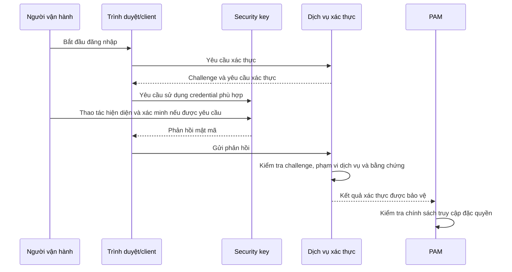

# Hardware security key

## 1. Vai trò của khóa bảo mật phần cứng trong PAM

Hardware security key là thiết bị xác thực vật lý, thường kết nối qua USB hoặc NFC tùy mẫu, được dùng để chứng minh người sử dụng kiểm soát một credential. Trong quản lý truy cập đặc quyền (Privileged Access Management, PAM), khóa bảo mật có thể bảo vệ đăng nhập vào hệ thống danh tính, cổng PAM và các bước kích hoạt quyền nhạy cảm.

Thiết bị chỉ là một phần của giải pháp. Mức bảo vệ còn phụ thuộc giao thức đang dùng, cách đăng ký khóa, yêu cầu xác minh người dùng, chính sách tại hệ thống xác thực và cách xử lý phiên sau khi đăng nhập.

Sau bài học, người học có thể:

- Phân biệt khóa FIDO2, thiết bị sinh OTP và các chế độ khác trên một thiết bị phần cứng.
- Giải thích vì sao chạm khóa không tự đồng nghĩa đã hoàn thành hai yếu tố xác thực.
- Xác định nơi áp dụng security key trong luồng truy cập đặc quyền.
- Thiết kế đăng ký, khóa dự phòng, thu hồi và khôi phục có trách nhiệm rõ ràng.
- Kiểm thử đường truy cập thực tế, kể cả phương thức thay thế và phiên đã mở.

Bài tập tập trung vào tài khoản người vận hành. Tài khoản dịch vụ và workload thường cần cơ chế danh tính, credential ngắn hạn hoặc quản lý bí mật phù hợp với tự động hóa; không nên gắn một thao tác chạm khóa của con người vào mọi lần chạy dịch vụ.

## 2. Bài toán: mật khẩu quản trị bị lộ

An dùng tài khoản định danh cá nhân để yêu cầu quyền quản trị production. Nếu hệ thống chỉ dựa vào mật khẩu, một kẻ có mật khẩu có thể thử đăng nhập từ nơi khác. Thêm một yếu tố xác thực giúp giảm rủi ro đó, nhưng các phương thức có khả năng chống tấn công khác nhau.

Với FIDO được triển khai đúng, việc chứng minh credential gắn với dịch vụ xác thực và sử dụng cơ chế khóa công khai, thay vì yêu cầu người dùng nhập một mã có thể chuyển tiếp sang nơi khác. Đây là lý do loại xác thực này được quan tâm cho tài khoản đặc quyền.

Tuy nhiên, security key không quyết định An được quản trị máy nào hay trong bao lâu. Sau khi xác thực, PAM vẫn phải kiểm tra quyền đủ điều kiện, mục đích công việc, phê duyệt, phạm vi tài nguyên, thời hạn JIT và điều kiện sử dụng.

Nếu người có khóa đăng nhập thành công nhưng được cấp quyền rộng quá nhu cầu, vấn đề least privilege vẫn tồn tại. Nếu thiết bị đầu cuối đã bị chiếm quyền và phiên bị lợi dụng sau đăng nhập, khóa vật lý cũng không tự bảo vệ mọi thao tác trong phiên đó.

## 3. Một thiết bị có thể chứa nhiều cơ chế khác nhau

Không dùng hình dáng USB hoặc tên thương mại để suy ra đặc tính bảo mật của lần xác thực. Một mẫu thiết bị có thể hỗ trợ nhiều ứng dụng; mẫu khác chỉ hỗ trợ một nhóm chức năng.

| Cơ chế | Điều cần phân biệt trong thiết kế |
|---|---|
| FIDO2/WebAuthn | Xác thực khóa công khai cho dịch vụ web; cần kiểm tra chính sách và khả năng của authenticator |
| FIDO U2F | Cơ chế FIDO thường gặp trong vai trò yếu tố bổ sung; khả năng không giống mọi thiết bị FIDO2 có user verification |
| OTP từ thiết bị phần cứng | Vẫn là mã dùng một lần; việc mã được sinh trên phần cứng không tự tạo đặc tính chống phishing của WebAuthn |
| Smart card/PIV | Cơ chế dựa trên chứng thư và tích hợp tương ứng; không phải cấu hình WebAuthn |
| Khóa hỗ trợ FIDO cho SSH | Tích hợp xác thực SSH riêng; không tự kế thừa toàn bộ luồng xác thực của cổng web PAM |

Khi lập yêu cầu, phải nêu rõ giao thức và điểm sử dụng. Câu “mọi quản trị viên dùng security key” còn thiếu: dùng ở IdP hay PAM, có bắt buộc user verification không, credential thuộc loại nào và có đường đăng nhập thay thế nào còn được chấp nhận?

Không cần bật mọi chức năng của thiết bị chỉ vì thiết bị hỗ trợ. Mỗi chức năng được sử dụng cần có cách cấp phát, quản trị và thu hồi phù hợp.

## 4. FIDO2, WebAuthn và credential gắn với thiết bị

Trong hệ sinh thái FIDO2, WebAuthn cung cấp giao diện cho ứng dụng web sử dụng credential khóa công khai; CTAP phục vụ tương tác giữa client và authenticator trong những triển khai tương ứng. Với security key, authenticator là thiết bị vật lý mà người dùng sử dụng để thực hiện thao tác xác thực.

Cần phân biệt:

- **Khóa vật lý:** thiết bị người dùng cầm giữ.
- **Credential:** thông tin xác thực được tạo và đăng ký cho một dịch vụ/tài khoản.
- **Public key:** dữ liệu phía dịch vụ sử dụng để kiểm tra bằng chứng mật mã.
- **Private key:** phần bí mật dùng để tạo bằng chứng; việc bảo vệ và khả năng xuất khóa phụ thuộc loại authenticator cùng cơ chế triển khai.

Một thiết bị có thể phục vụ nhiều dịch vụ bằng các credential riêng. Không coi nó là một mật khẩu chung được dùng lại cho mọi hệ thống.

Passkey là thuật ngữ thường gặp khi triển khai FIDO. Có passkey được đồng bộ giữa các thiết bị và có passkey gắn với một thiết bị. Vì vậy, “đã dùng passkey” chưa đủ để kết luận credential nằm trên một security key vật lý hoặc không thể đồng bộ. [Giải thích của FIDO Alliance về passkey](https://fidoalliance.org/passkeys/).

Trong yêu cầu cho PAM, nếu cần credential gắn với thiết bị phần cứng và không được xuất, phải xác định cách hệ thống chứng minh và cưỡng chế yêu cầu đó. Không dựa riêng vào việc người dùng đã chọn một nút có tên “security key” trên giao diện.

## 5. User presence và user verification

Hai khái niệm này khác nhau và ảnh hưởng trực tiếp đến cách xác định yếu tố MFA.

| Khái niệm | Mục đích | Ví dụ |
|---|---|---|
| User presence, thường ký hiệu UP | Thể hiện có tương tác của người sử dụng | Chạm vùng cảm ứng trên khóa |
| User verification, thường ký hiệu UV | Authenticator xác minh người được phép sử dụng nó | PIN hoặc sinh trắc học được hỗ trợ |

Chạm khóa không tự chứng minh danh tính của người đang chạm. Một người nhặt được thiết bị cũng có thể chạm vào nó. UP và UV phải được hiểu theo tín hiệu do giao thức cung cấp, không theo hình ảnh của thao tác trên màn hình.

Nếu chính sách yêu cầu UV, relying party cần yêu cầu và kiểm tra kết quả UV. Tùy chọn `preferred` không tương đương `required`: nó có thể chấp nhận trường hợp không thực hiện UV. [Tài liệu kỹ thuật về UP và UV](https://developers.yubico.com/WebAuthn/WebAuthn_Developer_Guide/User_Presence_vs_User_Verification.html).

Về mô hình yếu tố, mật khẩu tài khoản kết hợp bằng chứng sở hữu khóa có thể tạo thành một luồng hai yếu tố phù hợp. Một authenticator hỗ trợ UV cũng có thể kết hợp yếu tố sở hữu với PIN hoặc sinh trắc học trong luồng được triển khai tương ứng. Không kết luận “một thiết bị thì chỉ có một yếu tố”, nhưng cũng không kết luận “chạm hai lần thì có hai yếu tố”.

PIN của authenticator không nên bị nhầm với mật khẩu đăng nhập dịch vụ hoặc được yêu cầu gửi trong ticket hỗ trợ. Người dùng cần biết đúng lời nhắc của nền tảng và không cung cấp PIN cho người hỗ trợ. Cách đặt, thay và xử lý khóa PIN phải theo thiết bị và nền tảng thực tế; không giả định mọi mẫu có cùng giới hạn lần thử.

## 6. Luồng đăng ký và luồng xác thực

### 6.1. Đăng ký credential

Đăng ký tạo mối liên kết giữa credential và tài khoản. Hệ thống phải biết chính xác tài khoản nào đang được thêm phương thức xác thực và ai được phép thực hiện thao tác đó.

Ở mức khái niệm, dịch vụ phát một challenge đăng ký, client tương tác với authenticator, rồi dịch vụ kiểm tra phản hồi trước khi lưu public key cùng thông tin credential. Đăng ký thành công không có nghĩa mọi người cầm cùng loại khóa đều được đăng nhập tài khoản đó.

### 6.2. Xác thực bằng credential đã đăng ký



Với WebAuthn, quá trình xác minh gồm challenge, origin, RP ID và chữ ký, cùng các điều kiện liên quan. Challenge phải được quản lý để phản hồi cũ không được dùng lại như một lần xác thực mới. Việc kiểm tra phía server không thể được thay bằng thông báo thành công do client tự gửi. [Đặc tả WebAuthn của W3C](https://www.w3.org/TR/webauthn-3/).

Sơ đồ mô tả trách nhiệm, không phải hướng dẫn tự viết một verifier từ đầu. Khi tích hợp, dùng thành phần hoặc thư viện phù hợp và kiểm tra đầy đủ cấu hình, thay vì chỉ kiểm tra được chữ ký rồi bỏ qua ngữ cảnh của nó.

## 7. Khả năng chống phishing và những giới hạn cần hiểu

Credential WebAuthn được giới hạn theo relying party và tương tác với ngữ cảnh dịch vụ của client. Khi hệ thống thực hiện đúng các kiểm tra cần thiết, một trang giả mạo không đơn giản lấy được một mã nhập tay để dùng đăng nhập dịch vụ thật như trong luồng OTP.

Trong triển khai PAM, điều này chỉ có ý nghĩa nếu đường xác thực thực tế giữ được đặc tính đó. Nếu người dùng luôn có thể chuyển sang phương thức yếu hơn cho cùng thao tác đặc quyền, nhánh thay thế vẫn phải được đánh giá theo rủi ro tương ứng.

Security key không tự giải quyết các tình huống sau:

- Phiên hợp lệ bị đánh cắp hoặc bị lợi dụng sau khi xác thực.
- Người dùng bị lừa đăng ký thêm credential của kẻ khác vào tài khoản.
- Thiết bị đầu cuối hoặc dịch vụ xác thực bị xâm nhập.
- Người đã có quyền cố ý thực hiện thao tác ngoài nhiệm vụ.
- Cơ chế khôi phục hoặc helpdesk cấp lại quyền không kiểm tra đúng danh tính.

Vì vậy, cần bảo vệ cả quản lý phiên, đăng ký phương thức mới và khôi phục tài khoản. Không xem việc mua khóa phần cứng là bước thay thế cho các kiểm soát này.

NIST SP 800-63B-4 phân biệt các mức bảo đảm xác thực; AAL3 có yêu cầu về xác thực chống phishing, khóa không thể xuất và hai yếu tố. Tuy nhiên, đáp ứng AAL3 là thuộc tính của toàn bộ quy trình theo các yêu cầu liên quan, không phải kết luận có thể đưa ra chỉ từ việc sở hữu một khóa USB. [Hướng dẫn NIST về bảo đảm xác thực](https://pages.nist.gov/800-63-4/sp800-63b.html).

## 8. Đặt security key ở đâu trong luồng PAM?

Một triển khai có thể xác thực người dùng tại IdP, sau đó cho PAM nhận kết quả liên kết danh tính. Triển khai khác có bước xác thực trực tiếp hoặc bổ sung tại PAM. Cần mô tả rõ nơi thực hiện và nơi ra quyết định.

| Điểm sử dụng | Mục đích có thể đặt ra | Điều cần kiểm tra |
|---|---|---|
| Đăng nhập IdP | Xác thực người vận hành | PAM có nhận đúng kết quả và chủ thể đã xác thực không? |
| Đăng nhập cổng PAM | Bảo vệ truy cập chức năng PAM | Phiên trước đó có được dùng lại và trong bao lâu? |
| Kích hoạt quyền JIT | Xác thực bổ sung cho lần nâng quyền | Kết quả có đủ mới và đáp ứng phương thức yêu cầu không? |
| Lấy credential nhạy cảm | Bảo vệ thao tác tiết lộ hoặc sử dụng bí mật | Có liên kết đến yêu cầu, tài khoản và quyền được duyệt không? |
| Thay đổi cấu hình PAM | Bảo vệ chức năng quản trị nền tảng | Có kiểm soát thay đổi và trách nhiệm phù hợp không? |

Không buộc người dùng chạm khóa ở mọi màn hình theo thói quen. Hãy xác định thao tác nào cần xác thực mới, thời gian chấp nhận kết quả cũ và điều kiện cần kiểm tra lại.

Nếu PAM dùng federation, chỉ tin claim đã được xác minh từ issuer được cấu hình. Chuỗi “MFA” hoặc “hardware-key” do client gửi không phải chứng cứ. Cách diễn giải phương thức, độ mới và mức bảo đảm phải dựa trên hợp đồng tích hợp, không suy từ tên claim tùy ý.

Một lần xác thực hợp lệ cũng không tự ràng buộc mọi hành động tương lai vào đúng tài nguyên. Quyết định cấp quyền vẫn cần gắn với yêu cầu và phạm vi cụ thể; nếu muốn phê chuẩn giao dịch có nội dung cụ thể, phải thiết kế cơ chế đó riêng.

## 9. Chính sách triển khai minh họa

Ví dụ sau mô tả ý định chính sách cho tài khoản quản trị cá nhân, không phải cú pháp của một sản phẩm:

```text
Đối tượng:
  Nhân sự có quyền yêu cầu hoặc phê duyệt truy cập đặc quyền.

Phương thức:
  Credential FIDO trên loại authenticator được tổ chức cho phép.
  Yêu cầu UV đối với các luồng được phân loại cần UV.
  Nếu yêu cầu credential gắn phần cứng, phải có cách xác minh phù hợp.

Thao tác nhạy cảm:
  Kích hoạt quyền quản trị production.
  Tiết lộ credential thuộc nhóm nhạy cảm.
  Thêm phương thức xác thực hoặc sửa chính sách PAM.

Điều kiện khác:
  Thiết bị đầu cuối đáp ứng chính sách.
  Quyền và yêu cầu công việc còn hiệu lực.
  Kết quả xác thực đủ mới theo từng loại thao tác.

Khôi phục:
  Có credential dự phòng đã đăng ký độc lập.
  Có quy trình xác minh, thu hồi và ghi nhận ngoại lệ.
```

Các giới hạn như độ mới xác thực cần được định nghĩa bằng giá trị cụ thể trong hệ thống thật. Không dùng câu “xác thực gần đây” như điều kiện mà không thống nhất cách tính và điểm thực thi.

Nếu hệ thống không thể phân biệt loại authenticator theo yêu cầu, phải ghi rõ khoảng thiếu thay vì tuyên bố đã cưỡng chế hardware key. Đặc biệt, kiểm tra cả ứng dụng di động, CLI, API và đường quản trị phụ, không chỉ luồng trình duyệt được trình diễn.

## 10. Đăng ký khóa an toàn

Đăng ký là thời điểm đưa một credential mới vào tài khoản có quyền lực. Một quy trình có thể gồm:

1. Xác định đúng danh tính nhân sự và tài khoản được phép sử dụng PAM.
2. Xác minh điều kiện để thêm phương thức mới bằng quy trình đã thiết kế.
3. Cấp hoặc ghi nhận thiết bị theo trách nhiệm quản lý tài sản.
4. Người dùng đăng ký credential trên đúng dịch vụ và tài khoản.
5. Kiểm tra phương thức đáp ứng chính sách, đăng nhập thử và lưu sự kiện.
6. Thông báo việc thêm phương thức mới qua kênh được kiểm soát.

Không cho phép bất kỳ ai có một phiên yếu hoặc vừa được khôi phục tùy tiện thêm phương thức xác thực mới mà không đánh giá rủi ro. Nếu kẻ tấn công thêm được khóa của họ, đăng nhập bằng khóa đó có thể hoàn toàn hợp lệ về mật mã nhưng gắn sai chủ thể từ đầu.

Với người đã có khóa, việc thêm khóa thứ hai nên đi qua một luồng có kiểm tra phù hợp. Với người mất mọi phương thức, sử dụng nhánh khôi phục danh tính, không giả định helpdesk có thể cấp lại chỉ dựa vào email yêu cầu hoặc thông tin dễ tìm về người dùng.

Tài khoản đặc quyền nên giữ tính định danh cá nhân ở lớp truy cập PAM. Nếu nhiều người cùng dùng một tài khoản PAM và cùng chia sẻ khóa/PIN, bằng chứng xác thực khó phân biệt ai thực sự sử dụng quyền.

## 11. Attestation và xác nhận loại authenticator

Attestation có thể cung cấp bằng chứng về authenticator tại thời điểm đăng ký, tùy định dạng, thiết bị và nền tảng. Nếu tổ chức yêu cầu một tập loại thiết bị được phê duyệt, cần xác định cách kiểm tra bằng chứng, chuỗi tin cậy và thông tin metadata liên quan.

Không tin tên thiết bị hoặc thuộc tính do người dùng tự khai như bằng chứng mật mã về phần cứng. Đồng thời, không mặc định mọi trình duyệt và thiết bị đều cung cấp cùng một loại attestation hoặc một số serial duy nhất.

Việc yêu cầu attestation có tác động về tương thích, vận hành và riêng tư. Chỉ thu thập, xác minh và lưu dữ liệu phục vụ mục đích đã xác định; cần có quy trình cập nhật khi thông tin thiết bị thay đổi hoặc một mẫu bị đánh giá không còn phù hợp. [Tài liệu kỹ thuật về attestation](https://developers.yubico.com/WebAuthn/WebAuthn_Developer_Guide/Attestation.html).

Kết quả attestation cũng không thay việc xác minh nhân sự hay đánh giá thiết bị đầu cuối. Một loại authenticator được chấp nhận vẫn có thể được đăng ký vào nhầm tài khoản nếu quy trình enrollment sai.

## 12. Khóa dự phòng không phải bản sao private key

Để tránh mất khả năng làm việc khi thiết bị hỏng hoặc thất lạc, có thể đăng ký thêm một security key độc lập cho cùng tài khoản nếu hệ thống và chính sách cho phép. Khóa dự phòng tạo credential riêng; không cần sao chép private key từ khóa chính.

Nên kiểm thử khóa dự phòng khi cấp phát và theo kế hoạch phù hợp. Một thiết bị chưa được đăng ký cho dịch vụ cần thiết không trở thành phương thức dự phòng chỉ vì được cất trong tủ.

Cách bảo quản phải tránh mất cả hai khóa trong cùng một sự kiện. Nếu cả khóa chính lẫn dự phòng luôn nằm trong một túi cùng laptop, việc mất túi có thể làm mất toàn bộ phương thức.

Cũng cần xem xét dung lượng và cách chọn credential của thiết bị. Discoverable credential hỗ trợ client tìm credential phù hợp mà không cần người dùng cung cấp định danh tài khoản trước theo luồng tương ứng; non-discoverable credential dùng cách tra cứu khác. Không giả định mọi khóa có cùng khả năng hoặc dung lượng cho mọi loại credential. [Giải thích về discoverable và non-discoverable credential](https://developers.yubico.com/Passkeys/Passkey_concepts/Discoverable_vs_non-discoverable_credentials.html).

Không yêu cầu người dùng chứng minh khóa dự phòng hoạt động bằng cách gửi PIN hoặc ảnh chứa thông tin nhạy cảm cho người hỗ trợ. Bằng chứng nên là kết quả kiểm thử trong hệ thống cùng sự kiện quản lý phù hợp.

## 13. Xử lý khi mất khóa, hỏng khóa hoặc nghi lộ PIN

Khi có báo mất, cần xác định tài khoản và các dịch vụ đã đăng ký credential liên quan. Việc không còn giữ thiết bị không đồng nghĩa credential đã bị vô hiệu hóa ở các dịch vụ đó.

Một quy trình ứng phó có thể thực hiện:

- Xác minh người báo mất qua nhánh hỗ trợ phù hợp.
- Vô hiệu hóa hoặc xóa liên kết credential bị ảnh hưởng tại từng hệ thống liên quan.
- Đánh giá các phiên đang mở, token và quyền đã kích hoạt cần thu hồi.
- Kiểm tra sự kiện sử dụng bất thường từ thời điểm có khả năng mất kiểm soát.
- Khôi phục truy cập bằng credential dự phòng hoặc quy trình cấp lại.
- Ghi nhận thiết bị mới và kiểm tra lại chính sách sau khôi phục.

Không có giả định rằng một nút “thu hồi khóa” ở một dịch vụ sẽ vô hiệu hóa credential trên mọi dịch vụ khác. Phạm vi thu hồi phụ thuộc kiến trúc danh tính và từng hệ thống đã đăng ký.

Nếu tìm lại được khóa, không tự động tái sử dụng chỉ vì thiết bị trông còn nguyên. Đánh giá theo chính sách mất kiểm soát tài sản, trạng thái credential và thông tin liên quan. Cũng không hướng dẫn người dùng reset toàn bộ authenticator trước khi hiểu ảnh hưởng: reset có thể làm mất credential của nhiều dịch vụ mà chưa xử lý phiên hoặc liên kết còn ở phía server.

Với PIN bị quên hoặc khóa bị khóa do thử sai, dùng tài liệu đúng mẫu thiết bị và quy trình nội bộ. Tránh đặt một quy tắc chung về số lần thử hay cách mở khóa cho mọi sản phẩm.

## 14. Tương thích và trải nghiệm sử dụng

Trước khi triển khai rộng, kiểm tra tổ hợp thực tế: hệ điều hành, trình duyệt, loại cổng, USB hub, NFC, máy quản trị chuyên dụng và môi trường remote desktop hoặc VDI nếu có.

Khả năng chuyển tiếp thiết bị hoặc thao tác xác thực trong phiên từ xa không nên được suy ra từ việc khóa hoạt động trên máy local. Kiểm thử đúng đường truy cập và đánh giá ranh giới tin cậy được tạo thêm.

Hướng dẫn người dùng cần đủ cụ thể để phân biệt chọn thiết bị, nhập PIN đúng lời nhắc và thao tác chạm. Đối với nhu cầu tiếp cận đặc biệt, chọn thiết bị hoặc luồng được hỗ trợ phù hợp mà vẫn đáp ứng yêu cầu xác thực của công việc.

Không giải quyết lỗi tương thích bằng cách để phương thức yếu hơn luôn mở cho mọi tài khoản đặc quyền. Nếu cần một đường thay thế, phải xác định đối tượng, phạm vi, thời hạn, điều kiện kích hoạt và bằng chứng sử dụng.

## 15. Quan sát và bằng chứng cần lưu

Dữ liệu phục vụ truy vết có thể gồm người dùng, định danh credential nội bộ, loại sự kiện, kết quả, thời điểm, nguồn xác thực và phiên liên quan. Khi kích hoạt quyền, cần liên kết được kết quả xác thực với yêu cầu PAM và quyền đã cấp.

Các sự kiện quan trọng gồm thêm hoặc xóa credential, thay đổi phương thức được phép, khôi phục tài khoản, thất bại liên tiếp và việc dùng nhánh thay thế. Nội dung log cần đủ để giải thích quyết định, không chỉ ghi `MFA=true`.

Không ghi PIN, private key hay dữ liệu sinh trắc học vào log. Các định danh credential và metadata cũng nên được quản lý theo mục đích, quyền đọc và thời hạn lưu, thay vì công khai rộng rãi chỉ vì chúng không phải mật khẩu.

Đối với chức năng quản trị PAM, ghi nhận cả thay đổi chính sách xác thực. Nếu một người tạm tắt yêu cầu khóa, đăng nhập rồi bật lại, chỉ xem các lần đăng nhập thành công sẽ bỏ sót thay đổi quyết định ranh giới bảo vệ.

## 16. Bộ kiểm thử chấp nhận trong lab

Chỉ thực hiện trên tài khoản và dịch vụ lab được cho phép. Chuẩn bị khóa chính, khóa dự phòng và cách khôi phục đã được quản trị phê duyệt trước khi thử nhánh mất khóa.

| Phép thử | Điều cần chứng minh |
|---|---|
| Đăng ký khóa cho đúng tài khoản | Credential gắn đúng chủ thể và có sự kiện enrollment |
| Đăng nhập bằng khóa chưa đăng ký | Không được chấp nhận chỉ vì thiết bị cùng mẫu |
| Luồng bắt buộc UV | Phản hồi không đạt UV không được dùng để hoàn thành yêu cầu đó |
| Khóa chỉ hỗ trợ thao tác chạm | Không bị diễn giải tự động thành đã có UV |
| Phản hồi cũ hoặc challenge hết hạn | Không được dùng như lần xác thực mới |
| Dịch vụ/origin không phù hợp | Verifier không chấp nhận phản hồi ngoài ngữ cảnh được cấu hình |
| Đăng nhập qua IdP rồi kích hoạt PAM | PAM nhận đúng chủ thể, phương thức và độ mới theo hợp đồng tích hợp |
| Thử nhánh đăng nhập thay thế | Hành vi đúng chính sách, không tạo đường bỏ qua ngoài dự kiến |
| Dùng khóa dự phòng | Có thể khôi phục công việc theo phạm vi được phép |
| Thu hồi credential của khóa chính | Khóa chính không xác thực mới được; khóa dự phòng vẫn theo đúng chính sách |
| Thu hồi khi còn phiên mở | Phiên và quyền đang hoạt động được xử lý đúng cam kết |
| Thử đường VDI/CLI được hỗ trợ | Kết quả đáp ứng yêu cầu trên đúng đường sử dụng thực tế |

Không kiểm thử chống phishing bằng cách đưa người dùng đến một dịch vụ giả mạo bên ngoài tổ chức. Có thể dùng harness hoặc môi trường kiểm thử được cho phép để xác minh kiểm tra origin, RP ID và các điều kiện của luồng.

Kết quả kiểm thử cần nêu rõ phiên bản client, loại thiết bị và điểm xác thực. Một thử nghiệm thành công trong trình duyệt không chứng minh rằng đường SSH trực tiếp hoặc API quản trị cũng đã được bảo vệ tương đương.

## 17. Bài thực hành triển khai có kiểm soát

Thiết kế luồng cho một quản trị viên lab cần đăng nhập PAM và kích hoạt quyền đọc trạng thái trong thời gian giới hạn. Chọn điểm thực hiện xác thực, yêu cầu về UP/UV, loại credential được phép và cách PAM nhận kết quả.

Lập danh mục khóa chính cùng khóa dự phòng, nhưng không ghi bí mật vào hồ sơ. Mô tả luồng thêm khóa, quy tắc thay thế và các hệ thống phải thu hồi credential khi báo mất. Xác định riêng cách xử lý phiên và quyền đã kích hoạt.

Sau đó thực hiện các phép thử phù hợp trong bảng, lưu kết quả và đối chiếu với chính sách. Đầu ra đạt yêu cầu khi chứng minh được: đúng người và credential được đăng ký, phương thức đáp ứng yêu cầu, đường thay thế được kiểm soát, quyền PAM vẫn giữ phạm vi tối thiểu và việc mất thiết bị có thể xử lý mà không bỏ qua trách nhiệm xác minh danh tính.
