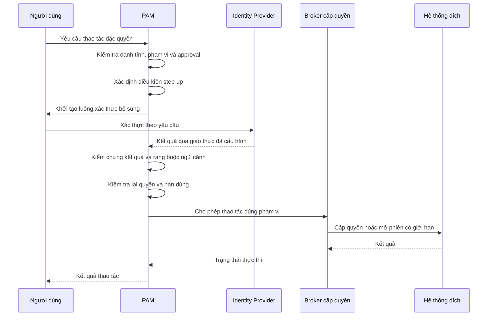

# Step-up authentication

## Mục tiêu bài học

Trong Privileged Access Management (PAM), **step-up authentication** là việc yêu cầu thêm bằng chứng xác thực khi ngữ cảnh hiện tại chưa đáp ứng điều kiện của một hành động đặc quyền. Hệ thống có thể cần phương thức mạnh hơn, lần xác thực mới hơn hoặc cả hai trước khi cho phép mở phiên quản trị, nhận credential hay thay đổi chính sách.

Step-up không cấp quyền mới chỉ vì người dùng hoàn thành một thử thách. Nó chứng minh một điều kiện xác thực để hệ thống tiếp tục kiểm tra quyền, phê duyệt và phạm vi công việc.

Sau bài học, bạn có thể:

- Phân biệt step-up, đăng nhập lại, MFA và phê duyệt truy cập.
- Chọn điểm yêu cầu step-up trong vòng đời một phiên PAM.
- Kiểm chứng bằng chứng từ Identity Provider (IdP) ở phía máy chủ.
- Ràng buộc kết quả với đúng danh tính, phiên và hành động.
- Xử lý hết hạn, đổi ngữ cảnh, retry và lỗi IdP mà không tạo đường bỏ qua.
- Xây dựng ca kiểm thử và bằng chứng audit cho luồng step-up.

## 1. Đã đăng nhập vì sao vẫn phải xác thực thêm?

Một phiên đăng nhập đủ để xem danh mục tài sản có thể chưa đủ để lấy mật khẩu quản trị production. Có hai câu hỏi khác nhau:

1. **Mức bảo đảm:** phương thức đã dùng có đáp ứng yêu cầu cho hành động nhạy cảm không?
2. **Độ mới:** bằng chứng đó có còn đủ gần thời điểm thực hiện không?

Một người có thể vừa đăng nhập bằng phương thức không đạt yêu cầu cho production. Ngược lại, người đó có thể đã dùng phương thức mạnh từ nhiều giờ trước, nhưng chính sách yêu cầu xác thực lại trước một thao tác đặc biệt.

| Phiên hiện tại | Yêu cầu thao tác | Cách xử lý có thể cần |
|---|---|---|
| Mới nhưng phương thức chưa đủ | Phương thức có bảo đảm cao hơn | Step-up về mức xác thực |
| Phương thức phù hợp nhưng quá cũ | Xác thực gần thời điểm thao tác | Xác thực lại theo chính sách |
| Vừa thiếu mức vừa thiếu độ mới | Cả hai điều kiện | Step-up với phương thức phù hợp và bằng chứng mới |
| Đủ mức và còn mới | Không có điều kiện bổ sung | Có thể dùng lại trong phạm vi chính sách cho phép |

Một hệ thống có thể dùng từ “step-up” cho cả tăng mức lẫn làm mới xác thực. Khi thiết kế, cần ghi rõ đang yêu cầu thuộc tính nào, thay vì chỉ có một cờ chung `mfa_done=true`.

### Ví dụ xuyên suốt

Lan đăng nhập PAM để xem tài sản được phép quản lý. Sau đó Lan xin mở phiên vận hành production với vai trò giới hạn trong 15 phút.

Chính sách minh họa yêu cầu:

- Lan đủ điều kiện xin vai trò.
- Yêu cầu đã được phê duyệt đúng phạm vi.
- Phương thức xác thực đáp ứng nhóm phương thức được tổ chức chấp nhận cho production.
- Bằng chứng đáp ứng yêu cầu về độ mới tại thời điểm mở phiên.
- Quyền tại đích chỉ là vai trò vận hành đã duyệt.

Hoàn thành step-up không biến vai trò vận hành thành quyền quản trị toàn hệ thống và không thay thế thời hạn JIT.

## 2. Step-up khác gì MFA và approval?

**MFA** nói về việc kết hợp những yếu tố xác thực độc lập theo thiết kế. **Step-up** nói về thời điểm hệ thống đòi bằng chứng đáp ứng điều kiện cao hơn hoặc mới hơn.

Không phải cứ thêm một màn hình là thêm yếu tố. Nhập lại mật khẩu rồi trả lời một câu hỏi bí mật vẫn có thể chỉ dựa trên những điều người dùng biết. Một phương thức nhiều yếu tố tích hợp có thể đáp ứng yêu cầu mà không cần hai màn hình riêng biệt.

**Reauthentication** là xác thực lại. Nếu lần xác thực lại chỉ dùng phương thức không đạt điều kiện, nó chưa đáp ứng step-up yêu cầu mức bảo đảm cao hơn.

**Approval** là quyết định cho phép một công việc hoặc phạm vi quyền. Người duyệt có thể chấp thuận Lan restart một dịch vụ; Lan vẫn phải hoàn thành điều kiện xác thực. Ngược lại, Lan có thể hoàn thành MFA nhưng chưa có approval để truy cập tài sản.

**Authorization** quyết định có được làm hành động cụ thể hay không. Kết quả step-up là một đầu vào của authorization, không phải giấy phép quản trị chung.

## 3. Yêu cầu step-up ở đâu trong PAM?

Những điểm thường cần xem xét gồm:

- Mở phiên SSH, RDP hoặc web console tới tài sản nhạy cảm.
- Checkout hoặc hiển thị credential từ vault.
- Yêu cầu vai trò JIT có mức tác động cao.
- Chuyển từ thao tác thông thường sang thay đổi IAM hoặc cấu hình bảo mật.
- Thay đổi phương thức xác thực, đăng ký authenticator mới hoặc sửa cơ chế khôi phục.
- Gia hạn hoặc nâng phạm vi truy cập khi chính sách yêu cầu kiểm tra mới.
- Một thay đổi ngữ cảnh đáng kể trong phiên đã tồn tại.

Không nên đặt mọi step-up chỉ ở màn hình đăng nhập đầu tiên. Từ lúc đăng nhập đến lúc dùng quyền có thể cách nhau lâu, và quyền được xin có thể thay đổi.

### Chọn ranh giới có thể thực thi

Nếu PAM chỉ môi giới mở một phiên quản trị, nó có thể kiểm tra step-up trước khi mở phiên. Nhưng nó chưa chắc hiểu mọi nút bấm hoặc lệnh trong phiên để yêu cầu thêm xác thực cho từng thao tác.

Muốn step-up tại một hành động bên trong console, cần tích hợp tại ứng dụng hoặc một điểm thực thi thực sự nhận biết và chặn được hành động đó. Không thể bảo đảm bằng việc chỉ ghi hình phiên hoặc ẩn một nút trên giao diện.

Với một command broker hoặc API quản trị có thao tác định nghĩa rõ, có thể kiểm tra trước mỗi nhóm hành động nhạy cảm. Với shell tùy ý dùng tài khoản quản trị rộng, khả năng kiểm soát ở mức thao tác thường khác biệt đáng kể.

## 4. Xác định yêu cầu xác thực trước khi tạo thử thách

Chính sách nên mô tả các thuộc tính có thể kiểm chứng:

| Thuộc tính | Câu hỏi cần trả lời |
|---|---|
| Phương thức được chấp nhận | Phương thức nào đáp ứng mức bảo đảm cần thiết? |
| Độ mới | Bằng chứng liên quan được chấp nhận trong bao lâu? |
| Danh tính | Kết quả phải thuộc người dùng nào trong PAM? |
| Phạm vi | Dùng cho một hành động hay một tập thao tác có giới hạn? |
| Thời gian hiệu lực | Kết quả step-up được dùng tới khi nào? |
| Số lần sử dụng | Một lần hay dùng lại theo chính sách? |
| Điều kiện bổ sung | Có yêu cầu thiết bị, grant, approval hoặc cửa sổ công việc không? |

Các thời hạn trong bài là ví dụ, không phải mức bắt buộc cho mọi triển khai.

### Phương thức mạnh hơn phải được định nghĩa rõ

Tổ chức cần ánh xạ phương thức IdP sang mức mà PAM hiểu. Không coi mọi trường `MFA` của mọi IdP đều đồng nghĩa.

OTP có thể tăng bảo vệ so với chỉ mật khẩu nhưng vẫn có thể bị lừa nhập vào trang giả rồi chuyển tiếp. Xác nhận push thiếu ngữ cảnh có nguy cơ bị chấp thuận do người dùng mệt mỏi hoặc nhầm lẫn. Các phương thức có ràng buộc với bên xác thực, như triển khai WebAuthn phù hợp, có thuộc tính chống phishing tốt hơn cơ chế mã có thể chuyển tiếp.

Tuy vậy, tên công nghệ chưa mô tả toàn bộ mức bảo đảm. Cần xét cấu hình, việc xác minh người dùng, quản lý thiết bị/authenticator, đồng bộ, đăng ký và khôi phục. Không tự kết luận một phương thức đạt mọi yêu cầu chỉ vì có chữ “passkey” hoặc “hardware” trong tên.

### Khôi phục không được làm yếu luồng đặc quyền

Một tài khoản dùng phương thức mạnh nhưng có thể đổi phương thức bằng một liên kết email dễ bị chiếm quyền vẫn có điểm yếu đáng kể.

Khi mất authenticator, áp dụng quy trình khôi phục có xác minh và kiểm soát phù hợp. Không tự chuyển người quản trị sang phương thức yếu hơn chỉ để giải quyết lỗi step-up. Nếu có ngoại lệ, phải là luồng riêng được kiểm soát, có phạm vi, thời hạn và bằng chứng.

## 5. Kiến trúc thực thi



Sơ đồ mô tả logic; luồng chuyển hướng và trao đổi token cụ thể phụ thuộc giao thức. PAM phải kiểm chứng kết quả từ IdP bằng cơ chế đúng của tích hợp, không tin một thông báo JavaScript từ trình duyệt rằng “đã hoàn thành MFA”.

Broker cũng phải kiểm tra quyết định có thẩm quyền. Không cho phép gọi thẳng API mở phiên để bỏ qua bước mà giao diện PAM đã yêu cầu.

## 6. Kiểm chứng bằng chứng từ IdP

Một kết quả xác thực chỉ có giá trị khi PAM biết nó được tạo bởi bên tin cậy, dành cho ứng dụng đúng, còn hiệu lực và gắn với luồng đang xử lý.

Theo giao thức sử dụng, hệ thống cần thực hiện những kiểm tra tương ứng như:

- Chữ ký hoặc cơ chế xác thực thông điệp và nguồn phát hành.
- Đối tượng nhận hoặc ứng dụng được phép sử dụng kết quả.
- Thời hạn hiệu lực và các điều kiện thời gian.
- Liên kết yêu cầu–phản hồi, chống giả mạo và phát lại.
- Ánh xạ danh tính đúng với người dùng PAM đang yêu cầu.
- Ngữ cảnh và phương thức xác thực có đáp ứng chính sách không.
- Độ mới của bằng chứng liên quan có được chứng minh không.

### Không tin cờ MFA do client gửi

Những dữ liệu như `mfa=true`, `assurance=high` hoặc `verified_at` trong payload trình duyệt không tự có giá trị. Client có thể sửa chúng.

PAM chỉ sử dụng bằng chứng được kiểm chứng từ IdP hoặc trạng thái do chính máy chủ tạo và bảo vệ sau khi xác minh. Mã frontend có thể điều khiển trải nghiệm, nhưng không được quyết định đủ điều kiện cấp quyền.

### Phân biệt thời gian phát token và thời gian xác thực

Trong các tích hợp có những claim như `iat`, `auth_time`, `acr` và `amr`, không được dùng chúng thay thế tùy ý:

| Dữ liệu | Ý nghĩa cần xem xét | Điều không được suy ra tự động |
|---|---|---|
| Thời điểm phát token, chẳng hạn `iat` | Token được phát khi nào | Người dùng vừa hoàn thành xác thực mới |
| Thời điểm xác thực, chẳng hạn `auth_time` | Mốc xác thực theo ngữ nghĩa của IdP/giao thức | Mọi yếu tố cần cho thao tác đều vừa được thực hiện |
| Ngữ cảnh xác thực, chẳng hạn `acr` | Lớp hoặc mức ngữ cảnh do tích hợp định nghĩa | Một nhãn bất kỳ luôn tương đương mức mà PAM yêu cầu |
| Phương thức, chẳng hạn `amr` | Phương thức mà IdP báo đã sử dụng | Tự đủ để kết luận mức bảo đảm, độc lập yếu tố hoặc độ mới của từng yếu tố |

Không phải phản hồi nào cũng có mọi trường. Tích hợp cần thỏa thuận và kiểm thử ngữ nghĩa, nhất là khi có IdP trung gian hoặc federation nhiều chặng.

Một token được refresh gần đây có thể vẫn dựa trên lần xác thực cũ. Nếu chính sách đòi bằng chứng mới của phương thức cụ thể, cần bảo đảm IdP cung cấp và thực thi đúng yêu cầu đó; không chỉ dựa vào thời gian tạo phiên PAM mới.

### Gửi yêu cầu không chứng minh đã được đáp ứng

Yêu cầu đăng nhập lại hoặc yêu cầu ngữ cảnh xác thực trong một giao thức là đầu vào cho IdP. PAM vẫn phải kiểm tra kết quả trả về.

Chẳng hạn một cấu hình buộc hiện màn hình đăng nhập chưa chắc buộc đúng phương thức cần thiết. Một tham số yêu cầu độ mới cũng chỉ hữu ích khi IdP hỗ trợ và kết quả có bằng chứng mà PAM xác minh được.

Nếu kết quả không đủ, từ chối tiếp tục thao tác và ghi nguyên nhân phù hợp. Không tự đánh dấu thành công vì người dùng đã quay về từ trang IdP.

## 7. Ràng buộc đúng người, đúng phiên và đúng hành động

### Cùng một danh tính

Kết quả step-up phải thuộc đúng chủ thể đang xin quyền trong PAM. Nếu Lan bắt đầu luồng nhưng trình duyệt đang có phiên IdP của một quản trị viên khác, không được dùng xác thực của người đó để nâng phiên Lan.

Dùng ánh xạ định danh có thẩm quyền theo tích hợp, không chỉ so sánh tên hiển thị hoặc email. Với nhiều issuer hoặc federation, cần phân biệt namespace và cách ánh xạ chủ thể.

Nếu có đổi tài khoản, hệ thống phải dừng hoặc yêu cầu một luồng đăng nhập rõ ràng theo thiết kế. Không âm thầm chuyển chủ thể rồi giữ request và approval của người trước.

### Cùng ngữ cảnh phiên

Một challenge nên gắn với phiên PAM khởi tạo, danh tính, thời hạn và trạng thái đang chờ. Callback từ một tab khác hoặc một luồng cũ không được tự nâng mọi phiên của người dùng.

Kết quả một lần dùng phải được tiêu thụ phía máy chủ. Một tham số `used=true` trong trình duyệt không chống được phát lại.

Chống giả mạo yêu cầu và callback cần theo đúng giao thức được triển khai. Các cơ chế như state, nonce hoặc PKCE có vai trò khác nhau trong tích hợp phù hợp; không coi một tham số duy nhất là giải pháp cho mọi loại tấn công.

### Cùng phạm vi hành động

Với thao tác nhạy cảm, có thể gắn bằng chứng đã xác minh với:

- Action ID.
- Tài sản hoặc tập tài sản đã chốt.
- Vai trò và quyền sẽ cấp.
- Phiên bản yêu cầu hoặc approval.
- Thời hạn cho phép thực thi.
- Một tham chiếu tới nội dung thao tác bất biến.

Ví dụ, step-up cho `open-session` trên `billing-prod-01` không được dùng để checkout mật khẩu của mọi tài sản.

Nếu payload đổi sau khi hoàn thành xác thực, phải kiểm tra lại phạm vi. Những thay đổi làm tăng quyền, đổi đích hoặc kéo dài thời gian không được hưởng bằng chứng đã ràng buộc với nội dung cũ.

### Xác thực không đồng nghĩa ký giao dịch

Việc người dùng thấy tên tài sản trên trang PAM và hoàn thành một phương thức chống phishing không tự chứng minh authenticator đã hiển thị và ký đúng chi tiết nghiệp vụ.

PAM có thể ràng buộc challenge với trạng thái thao tác ở máy chủ để tránh dùng sai ngữ cảnh. Nếu cần xác nhận giao dịch với bằng chứng rằng người dùng đã xác nhận chính nội dung đó trên một kênh đáng tin, phải thiết kế khả năng tương ứng. Không gán thuộc tính xác nhận giao dịch cho mọi lần MFA thông thường.

## 8. Mô hình trạng thái cho step-up

```text
ACTION_REQUESTED
    -> AUTHORIZATION_PRECHECK
    -> STEP_UP_PENDING
    -> STEP_UP_VERIFIED
    -> FINAL_AUTHORIZATION_CHECK
    -> EXECUTING
    -> COMPLETED

STEP_UP_PENDING -> FAILED / EXPIRED / CANCELLED
STEP_UP_VERIFIED -> EXPIRED / INVALIDATED
EXECUTING -> FAILED / OUTCOME_UNKNOWN
```

Đây là mô hình minh họa. Một hệ thống thực tế có thể tách nhiều trạng thái hơn nhưng cần giữ những nguyên tắc sau:

- Trong lúc chờ xác thực, thao tác nhạy cảm chưa được thực hiện.
- Thất bại hoặc hết hạn không tự rơi về luồng cho phép.
- Sau xác thực vẫn kiểm tra lại điều kiện quyền và phạm vi.
- Bằng chứng hết hạn không được gia hạn chỉ vì người dùng refresh trang.
- Khi không biết kết quả thao tác ở đích, không tự thử lại một thay đổi không an toàn.

### Bằng chứng đã xác minh có thể được lưu thế nào?

Một bản ghi phía máy chủ có thể như sau:

```yaml
# Mô hình dữ liệu minh họa, không phải cấu hình của sản phẩm.
step_up_id: stepup-example-72
actor_reference: principal-example-lan
pam_session_reference: session-example-18
action_reference: action-example-901
action_version: 2
scope_reference: scope-example-901-v2
verified_assurance: production-accepted-method
evidence_reference: evidence-example-72
verified_at: "2026-01-01T08:00:00Z"
usable_until: "2026-01-01T08:02:00Z"
usage: single_use
state: VERIFIED
```

Hai phút ở đây chỉ là ví dụ về thời gian được dùng kết quả để khởi tạo hành động. Nó không có nghĩa phiên production phải dài hai phút hay mọi thao tác được phép trong hai phút đó.

Nếu truyền bằng token thay vì giữ bản ghi hoàn toàn phía máy chủ, cần bảo vệ tính toàn vẹn, audience, mục đích, thời hạn và khả năng chống phát lại theo yêu cầu. Token có chữ ký không mặc nhiên được mã hóa; không nhét secret hoặc dữ liệu nhạy cảm vào payload chỉ vì người dùng không sửa được chữ ký.

## 9. Ba loại thời gian phải tách biệt

| Thời gian | Giới hạn gì? | Ví dụ minh họa |
|---|---|---|
| Độ tuổi tối đa của bằng chứng xác thực | Lần xác thực liên quan được chấp nhận cũ tới mức nào | Phải đáp ứng điều kiện độ mới tại lúc kích hoạt |
| Hạn dùng kết quả step-up | Được dùng kết quả đã xác minh để thực thi tới lúc nào | Hai phút, một lần dùng |
| Thời hạn grant hoặc phiên đặc quyền | Truy cập sau khi được cấp tồn tại bao lâu | Phiên vận hành tối đa 15 phút trong cửa sổ được duyệt |

Không dùng một con số thay cho cả ba. Việc được mở phiên sau step-up không cho phép phiên tồn tại vượt hạn JIT hoặc approval.

Một kết quả step-up còn hạn cũng không vượt qua việc tài khoản vừa bị đình chỉ, request bị hủy hoặc approval đã hết hiệu lực. Quyết định cuối cần kết hợp các điều kiện hiện tại.

Tại thời điểm cấp quyền, hạn cuối có thể phải là mốc sớm nhất trong cửa sổ công việc, hạn grant theo chính sách và phạm vi đã được duyệt. Bằng chứng xác thực không tự kéo dài bất kỳ mốc nào.

## 10. Pseudocode thực thi phía máy chủ

```text
function request_privileged_action(actor, session, action_input):
    action = normalize_and_store_action(action_input)

    require actor_can_request(actor, action)
    require approval_is_valid_for(action)

    requirement = policy_authentication_requirement(action, current_context)

    if not current_evidence_satisfies(session, requirement):
        challenge = create_bound_challenge(
            actor, session, action.version, action.scope, requirement
        )
        return STEP_UP_REQUIRED(challenge.reference)

    return execute_after_final_check(actor, session, action)

function complete_step_up(callback):
    evidence = verify_identity_provider_result(callback)
    challenge = load_and_validate_pending_challenge(callback)

    require evidence.maps_to(challenge.actor)
    require evidence.satisfies(challenge.requirement)
    require challenge.belongs_to_current_session
    require challenge.not_expired

    record_verified_result(challenge, evidence)
    return READY_FOR_FINAL_CHECK

function execute_after_final_check(actor, session, action):
    require current_request_version_matches(action)
    require current_authorization_and_approval_pass(actor, action)

    proof = load_bound_authentication_result(actor, session, action)
    require proof.satisfies_current_requirement
    require proof.not_expired
    require proof.not_used_when_single_use

    reserve_execution_once_and_consume_proof(proof, action)
    return broker_execute_with_reconciliation(action)
```

Pseudocode bỏ qua chi tiết giao thức và giao dịch. Một triển khai thực tế cần xác định cách kiểm tra trạng thái, tiêu thụ bằng chứng và khởi tạo tác vụ một cách nhất quán.

Không tiêu thụ bằng chứng rồi cho client tùy ý chọn action mới. Không nhận một header tự khai rằng backend khác đã hoàn thành step-up nếu không có cơ chế xác thực và ràng buộc giữa các dịch vụ.

### Retry và kết quả chưa biết

Nếu lệnh cấp quyền đã tới đích nhưng phản hồi bị mất, người dùng có thể thử lại. Cần một execution ID hoặc cơ chế tương đương để đối soát, tránh tạo hai grant.

Bằng chứng một lần dùng đã được tiêu thụ không được tự mở lại. Hệ thống có thể cho người dùng xem trạng thái tác vụ đã tồn tại; nếu phải tạo hành động mới, áp dụng điều kiện xác thực và authorization phù hợp.

## 11. Tình huống trong PAM

### Mở phiên production

Lan đã có approval nhưng bằng chứng xác thực quá cũ. PAM yêu cầu step-up, kiểm chứng kết quả, xác nhận approval còn hạn và mở phiên với vai trò giới hạn.

Nếu Lan bỏ dở challenge, phiên production không được mở. Phiên PAM thông thường có thể tiếp tục với quyền thấp hơn nếu thiết kế cho phép, nhưng không được coi là đã đạt điều kiện production.

### Hiển thị mật khẩu từ vault

Xem mật khẩu là hành động làm secret rời khỏi ranh giới vault. Step-up trước khi hiển thị có thể giảm rủi ro từ một phiên web bị bỏ quên, nhưng không thu hồi được thông tin người dùng đã nhìn thấy.

Kết hợp điều kiện xác thực với quyền checkout hẹp, lý do công việc, thời hạn lease, audit và quy trình luân chuyển credential phù hợp. Khi có thể, môi giới phiên mà không lộ secret có thể đáp ứng nhu cầu khác với việc cho xem mật khẩu.

### Sửa phương thức khôi phục

Đây là thao tác có thể ảnh hưởng mọi lần xác thực sau đó. Không chỉ yêu cầu đăng nhập lại bằng đúng một cơ chế khôi phục yếu đang bị thay đổi mà mặc định đủ an toàn.

Áp dụng chính sách bảo vệ việc đăng ký và thay thế phương thức, thông báo thay đổi, trách nhiệm hỗ trợ và các điều kiện kiểm tra phù hợp với tài khoản đặc quyền.

### Công việc tự động và tài khoản dịch vụ

Không ép một job nền phê duyệt push thay cho con người. Workload cần danh tính máy, quyền hẹp và credential có vòng đời được kiểm soát.

Nếu con người khởi tạo một job đặc quyền, có thể yêu cầu step-up lúc chấp thuận hoặc gửi job. Khi job chạy sau đó, hệ thống thực thi phải kiểm tra sự ủy quyền còn hợp lệ và dùng danh tính workload đúng thiết kế, không cất token tương tác của người dùng để phát lại vô thời hạn.

## 12. Lỗi, giới hạn và đường khôi phục

### IdP không sẵn sàng

Không cấp quyền mới chỉ vì không hoàn thành được step-up. Hiển thị lỗi có thể xử lý và giữ trạng thái thao tác rõ ràng.

Đối với phiên đã mở, cần chính sách riêng về tiếp tục, đánh giá lại và thu hồi. Không tự kéo dài grant đang có vì IdP gặp lỗi.

Một đường break-glass, nếu cần, phải được thiết kế trước với quyền hạn, thời hạn, người chịu trách nhiệm và hậu kiểm. Nó không phải một fallback im lặng sang chỉ mật khẩu.

### Người dùng bị yêu cầu xác thực liên tục

Có thể do ánh xạ phương thức sai, bằng chứng không có mốc thời gian phù hợp, luồng federation không truyền ngữ cảnh hoặc kết quả không được gắn đúng phiên.

Giới hạn vòng lặp và cung cấp mã lỗi hỗ trợ. Không khắc phục bằng cách tắt điều kiện cho toàn bộ tài sản production. Tránh hiển thị thông báo nội bộ chứa token hoặc toàn bộ phản hồi IdP.

### Nhiều challenge và xác nhận push

Giới hạn tần suất, gắn với hành động do người dùng chủ động khởi tạo và cung cấp ngữ cảnh đủ hiểu. Không tự gửi lặp vô hạn khi không được xác nhận.

Dạy người dùng từ chối một challenge họ không khởi tạo và báo cáo theo kênh hỗ trợ. Các biện pháp như hiển thị ngữ cảnh hoặc đối chiếu số có thể giảm một số nhầm lẫn nhưng không được coi là tương đương mọi thuộc tính chống phishing.

### Trình duyệt hoặc phiên ứng dụng bị chiếm quyền

Step-up không sửa được mọi rủi ro của endpoint. Mã độc trong máy hoặc session cookie bị đánh cắp vẫn là vấn đề cần xử lý.

Kết hợp bảo vệ session cookie, chống XSS/CSRF, kiểm soát thiết bị, thời hạn phiên và thu hồi. Đừng để một lần step-up mở một phiên đặc quyền rộng tồn tại quá lâu, vì điều đó tạo cơ hội dùng lại phiên sau xác thực.

## 13. Audit và dữ liệu cần bảo vệ

Nên ghi những sự kiện như:

- Hành động nào dẫn tới yêu cầu step-up.
- Yêu cầu về mức và độ mới theo phiên bản chính sách.
- Challenge được tạo, hết hạn, hủy hoặc thất bại.
- Kết quả được xác minh cho chủ thể và phạm vi nào.
- Lý do không đáp ứng điều kiện theo mã phù hợp.
- Action hoặc grant đã dùng bằng chứng.
- Việc vô hiệu bằng chứng khi ngữ cảnh thay đổi.
- Kết quả cấp quyền, phiên và thu hồi liên quan.

```json
{
  "event_type": "pam.step_up.verified",
  "actor_reference": "principal-example-lan",
  "session_reference": "session-example-18",
  "step_up_reference": "stepup-example-72",
  "action_reference": "action-example-901",
  "action_version": 2,
  "scope_reference": "scope-example-901-v2",
  "policy_version": "pam-auth-example-v3",
  "verified_context": "production-accepted-method",
  "result": "accepted"
}
```

Đây là dữ liệu minh họa. Không ghi OTP, private key, recovery code, token nguyên vẹn hoặc cookie phiên. Bản ghi kỹ thuật nên dùng tham chiếu và mã lý do thay vì sao chép toàn bộ payload xác thực.

Giới hạn quyền xem thông tin phương thức và thiết bị vì chúng có thể là dữ liệu nhạy cảm. Bảo vệ tính toàn vẹn log và liên kết được challenge → kết quả → hành động → quyền tại đích.

Có sự kiện xác thực thành công không chứng minh thao tác đã được thực hiện. Có sự kiện mở phiên không chứng minh mọi thay đổi bên trong đều có step-up riêng. Báo cáo phải giữ đúng phạm vi bằng chứng.

## 14. Bài thực hành và tiêu chí kiểm chứng

Dùng môi trường lab với IdP thử nghiệm, danh tính cá nhân và tài sản giả lập. Chuẩn bị một hành động đọc thông thường, một hành động mở phiên đặc quyền và một hành động checkout secret giả.

### Chính sách bài tập

Định nghĩa rõ:

- Phương thức hoặc ngữ cảnh nào được chấp nhận cho mỗi hành động.
- Bằng chứng nào chứng minh độ mới.
- Hạn challenge và hạn dùng kết quả.
- Phạm vi một lần dùng hoặc điều kiện dùng lại.
- Quy tắc khi action đổi hoặc approval hết hạn.
- Hành vi khi IdP lỗi hoặc kết quả thiếu dữ liệu bắt buộc.

### Các ca cần kiểm tra

| Ca | Thao tác | Kết quả mong đợi |
|---|---|---|
| Phiên đủ điều kiện | Bằng chứng phù hợp và còn mới trong phạm vi cho phép | Không yêu cầu lặp không cần thiết; vẫn kiểm tra authorization |
| Phương thức chưa đủ | Xác thực mới nhưng không đạt yêu cầu | Không được mở phiên đặc quyền |
| Bằng chứng quá cũ | Có phương thức phù hợp từ trước | Yêu cầu làm mới theo chính sách |
| Token mới từ phiên cũ | Refresh token nhưng không có xác thực mới cần thiết | Không suy độ mới chỉ từ lúc phát token |
| Sai danh tính | Hoàn thành challenge bằng tài khoản khác | Không nâng phiên người xin ban đầu |
| Phản hồi giả | Client gửi `mfa=true` hoặc sửa claim | Không được coi là bằng chứng có thẩm quyền |
| Phát lại | Dùng lại kết quả một lần dùng | Bị từ chối, không tạo thêm thao tác |
| Đổi phạm vi | Đổi tài sản hoặc vai trò sau step-up | Không dùng bằng chứng cũ cho phạm vi mới |
| Hết hạn | Chờ qua hạn dùng rồi kích hoạt | Không thực thi bằng kết quả hết hạn |
| Callback không khớp | Trả kết quả từ challenge hoặc phiên khác | Bị từ chối và có sự kiện phù hợp |
| Approval hết hạn | Step-up thành công nhưng approval không còn hợp lệ | Không cấp quyền |
| IdP lỗi | Giả lập timeout hoặc dữ liệu không đủ | Không fallback im lặng sang mức yếu hơn |
| API trực tiếp | Bỏ qua giao diện, gọi broker hoặc endpoint nhạy cảm | Kiểm tra điều kiện ở máy chủ vẫn có hiệu lực |
| Retry tác vụ | Mất phản hồi sau khi đích nhận lệnh | Đối soát, không tạo hai grant |
| Log | Kiểm tra sự kiện thành công và thất bại | Có tương quan; không chứa secret hoặc token |

Thực hiện kiểm chứng tại điểm thực thi hoặc hệ thống đích, không chỉ quan sát màn hình “MFA thành công”. Với việc thay đổi một hành động đang chờ, kiểm tra cả dữ liệu gửi từ client và bản ghi có thẩm quyền trên máy chủ.

Báo cáo nên chỉ rõ thuộc tính đã kiểm chứng và phần chưa kiểm chứng, nhất là độ mới của từng phương thức và cách IdP trung gian truyền ngữ cảnh.

## 15. Câu hỏi tự kiểm tra

1. Vì sao token vừa được phát không đủ chứng minh người dùng vừa hoàn thành phương thức cần cho step-up?
2. Nếu MFA thành công nhưng approval hết hạn, có được mở phiên không?
3. Vì sao cần ràng buộc challenge với danh tính và action thay vì chỉ ghi `mfa_done` vào phiên?
4. Step-up trước khi mở một web console có bảo đảm mọi thao tác trong console đều được xác thực riêng không?
5. Khi job chạy sau lúc người dùng hoàn thành step-up, hệ thống phải kiểm tra điều gì?

### Gợi ý đối chiếu

1. Token có thể được phát hoặc refresh từ một phiên xác thực cũ; cần bằng chứng về ngữ cảnh và thời điểm liên quan theo tích hợp.
2. Không. Xác thực chỉ là một điều kiện; approval và authorization vẫn phải hợp lệ tại thời điểm cấp quyền.
3. Để tránh đổi chủ thể, dùng lại giữa phiên, phát lại hoặc nâng phạm vi vượt hành động đã được xác minh.
4. Không. Muốn kiểm soát từng thao tác phải có điểm thực thi nhận biết và chặn được thao tác đó.
5. Kiểm tra sự ủy quyền và phạm vi còn hiệu lực, thời hạn, điều kiện chính sách hiện tại và danh tính workload dùng để thực thi.

Một luồng step-up đạt mục tiêu khi bằng chứng xác thực được kiểm chứng và chỉ có hiệu lực cho người, phiên, phạm vi và thời hạn mà chính sách cho phép. Quyền JIT/JEA, approval, quản lý credential và thu hồi tại đích vẫn phải thực hiện đầy đủ sau bước xác thực.
