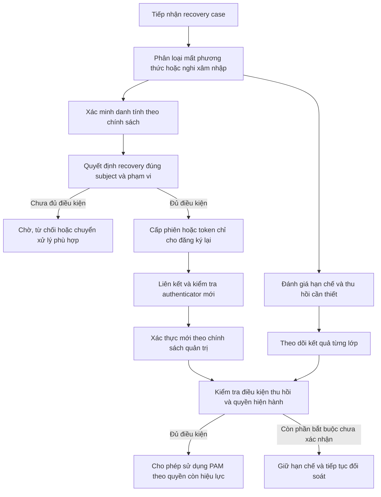

# MFA recovery

## 1. Khôi phục MFA là khôi phục khả năng chứng minh danh tính

MFA recovery là quy trình giúp chủ thể lấy lại khả năng xác thực khi không còn sử dụng được các authenticator cần thiết. Trong PAM, đây là một đường nhạy cảm: người được khôi phục có thể tiếp cận vault, mở phiên quản trị hoặc kích hoạt quyền tạm trên hạ tầng quan trọng.

NIST phân biệt account recovery với đăng nhập thông thường. Sau khi hoàn tất recovery theo yêu cầu áp dụng, chủ thể có thể liên kết authenticator mới; sự kiện recovery phải có thông báo tương ứng. Nếu vẫn xác thực được bằng những authenticator phù hợp còn lại, một số thao tác thay thế thuộc quy trình liên kết authenticator thay vì account recovery toàn phần. [NIST SP 800-63B-4 — Account Recovery](https://pages.nist.gov/800-63-4/sp800-63b.html#account-recovery)

Cần tách ba kết quả:

| Kết quả | Câu hỏi được giải quyết | Điều chưa được suy ra |
|---|---|---|
| Xác minh người yêu cầu | Có đủ căn cứ rằng đây là chủ thể của tài khoản không? | Đã có phương thức MFA mới hoạt động |
| Đăng ký lại MFA | Authenticator mới đã được liên kết và kiểm tra chưa? | Mọi phiên cũ đã kết thúc |
| Khôi phục sử dụng PAM | Chủ thể đã đáp ứng chính sách hiện hành để dùng quyền chưa? | Mọi quyền trước đây đều phải được cấp lại |

Một thao tác “reset MFA” trên giao diện có thể che giấu nhiều bước khác nhau. Nếu nó chỉ xóa phương thức cũ rồi cho đăng nhập bằng mật khẩu, đường recovery đã trở thành một đường hạ mức bảo vệ.

Bài học thuộc chương MFA, tập trung vào người quản trị và người có khả năng sử dụng quyền đặc biệt. Các luồng, trạng thái và thời hạn bên dưới là mô hình thiết kế tham khảo để kết hợp recovery với least privilege, JIT/JEA, vault, giám sát phiên và bằng chứng kiểm toán; không phải cấu hình của một sản phẩm cụ thể.

## 2. Phân loại tình huống trước khi chọn cách xử lý

Không phải mọi sự cố “không vào được MFA” đều có cùng nguyên nhân hoặc cùng phạm vi ảnh hưởng.

| Tình huống | Điều cần xác định | Hướng xử lý |
|---|---|---|
| Authenticator chính hỏng, còn phương thức dự phòng phù hợp | Phương thức còn lại có đạt yêu cầu của thao tác thay thế không? | Xác thực và liên kết lại theo chính sách |
| Mất điện thoại hoặc khóa bảo mật | Những credential và phiên nào nằm trên thiết bị? | Tiếp nhận mất thiết bị, đánh giá thu hồi, xác minh recovery |
| Mất mọi phương thức | Có bằng chứng recovery hoặc quy trình tái xác minh nào đã được thiết lập? | Dùng tổ hợp phương pháp được chính sách chấp nhận |
| Nghi tài khoản đã bị chiếm | Kẻ khác còn phiên, authenticator hay thông tin recovery nào? | Kết hợp recovery với ứng phó sự cố |
| IdP hoặc dịch vụ MFA ngừng hoạt động | Là lỗi hạ tầng hay mất phương thức của một người? | Xử lý tính sẵn sàng và đường khẩn cấp riêng |
| Đổi thiết bị có kế hoạch | Có thể liên kết thiết bị mới trước khi bỏ thiết bị cũ không? | Quy trình thay thế chủ động |

Cần ghi nhận thiết bị mất là một nguồn rủi ro, không chỉ một bất tiện đăng nhập. Tuy vậy, việc một người gửi yêu cầu recovery không đủ để hệ thống lập tức thay mọi yếu tố hoặc khóa mọi phiên của tài khoản được họ nêu.

Có thể tách **tiếp nhận báo cáo** khỏi **quyết định hạn chế hoặc thu hồi**. Những hành động có tác động tới tài khoản phải dựa trên tín hiệu, thẩm quyền và chính sách đã xác định. Cách tách này giúp tránh để một bên chưa xác minh gây từ chối dịch vụ chỉ bằng cách gửi nhiều báo cáo giả.

Với người dùng có cả tài khoản làm việc và tài khoản quản trị riêng, cần xác định đúng subject và quan hệ giữa chúng. Khôi phục tài khoản thông thường không tự khôi phục tài khoản đặc quyền hoặc mọi vai trò được liên kết.

## 3. Chuẩn bị trước khi có sự cố

### 3.1. Phương thức dự phòng cần được đăng ký và bảo quản

Đăng ký thêm một authenticator WebAuthn phù hợp có thể giúp người dùng duy trì khả năng xác thực khi mất thiết bị chính. Yubico nhấn mạnh rằng một đường cấp lại yếu có thể làm giảm giá trị của credential chống phishing; phương thức dự phòng cần được xét trong toàn bộ thiết kế. [Yubico — Account Recovery](https://developers.yubico.com/WebAuthn/WebAuthn_Developer_Guide/Account_Recovery.html)

Trong PAM, cần kiểm kê phương thức dự phòng gắn với ai, loại nào được phép, có còn sử dụng được không và được thu hồi ra sao. Không dùng một khóa chung cho cả đội để thay danh tính cá nhân.

Tách vị trí bảo quản giúp tránh mất đồng thời. Một recovery code được lưu cùng điện thoại chứa authenticator chính có thể mất theo cùng một sự cố. Việc tách cần phù hợp với mô hình lưu trữ và quy trình thực tế, không chỉ là lời nhắc trên màn hình.

### 3.2. Thông tin liên hệ phải có vòng đời

Địa chỉ thông báo, địa chỉ recovery và người liên hệ tin cậy có vai trò khác nhau. Một email nhận thông báo không tự là một phương thức đủ mạnh để lấy lại tài khoản quản trị.

Cần xác minh việc thiết lập hoặc thay đổi các kênh theo chính sách, ghi lịch sử thay đổi cần thiết và cho chủ thể kiểm tra thông tin còn đúng. Không dùng ngay một số điện thoại vừa được người yêu cầu khai trong cuộc gọi làm bằng chứng rằng họ là chủ tài khoản.

Cũng không tự khôi phục một địa chỉ cũ chỉ vì nó từng tồn tại: địa chỉ đó có thể đã bị thay do không còn kiểm soát được. Dữ liệu lịch sử là đầu vào điều tra, không mặc nhiên là nơi an toàn để gửi bí mật mới.

### 3.3. Chuẩn bị quy trình cho người có quyền mạnh

Một quản trị viên IdP, người quản trị vault và người chỉ được mở một phiên hỗ trợ có thể cần quy trình khác nhau. Chính sách nên định nghĩa trước nhóm tài khoản, phương pháp recovery chấp nhận, bên có thẩm quyền và giới hạn sau recovery.

Nếu người duy nhất quản trị IdP mất toàn bộ phương thức, một quy trình phụ thuộc hoàn toàn vào chính người đó sẽ bế tắc. Cần chuẩn bị thẩm quyền dự phòng và đường vận hành khẩn cấp có kiểm soát, thay vì nghĩ tới khi sự cố đã xảy ra.

## 4. Chọn bằng chứng phù hợp, tránh đếm nhiều tín hiệu cùng một nguồn

OWASP lưu ý rằng recovery cần giúp người dùng hợp lệ lấy lại quyền truy cập mà không tạo đường vượt MFA. Không có một phương án phù hợp cho mọi ứng dụng; cách xử lý phải xét mô hình rủi ro và khả năng kiểm soát người dùng. [OWASP — Resetting MFA](https://cheatsheetseries.owasp.org/cheatsheets/Multifactor_Authentication_Cheat_Sheet.html#resetting-mfa)

### 4.1. Những nguồn có thể tham gia quy trình

Tùy chính sách và mức bảo đảm cần đạt, quy trình có thể sử dụng authenticator còn lại, mã recovery đã cấp trước, người liên hệ đã thiết lập hoặc tái thực hiện phần xác minh danh tính phù hợp.

Không nên đọc danh sách này như một tập các lựa chọn mà mỗi mục luôn đủ khi đứng một mình. Số lượng, tổ hợp và điều kiện phải theo yêu cầu thực tế của tài khoản. Một mã recovery được chấp nhận cho ứng dụng thông thường chưa chắc đủ cho việc cấp lại phương thức của quản trị viên hạ tầng.

### 4.2. Nhiều tín hiệu không đồng nghĩa nhiều nguồn độc lập

Ví dụ, email công ty, tin nhắn chat nội bộ và cuộc gọi từ một ứng dụng đều có thể nằm trên cùng chiếc điện thoại đang nghi bị chiếm. Thu thập cả ba không tự tạo ba bằng chứng độc lập.

Tương tự, các thông tin như tên quản lý, mã nhân viên hoặc dự án đang làm có thể giúp định tuyến hỗ trợ nhưng có thể đã được biết hoặc lộ từ trước. Không coi một tập câu trả lời dễ tìm là bằng chứng đủ để cấp lại MFA đặc quyền.

Một cuộc gọi video cũng cần được đặt trong quy trình xác minh có quản lý. Nhận diện cảm tính hoặc người duyệt nói “tôi biết người này” không tự thay thế mọi yêu cầu bằng chứng.

### 4.3. Phê duyệt recovery khác với chứng minh danh tính

Người quản lý có thể xác nhận nhân viên vẫn đang làm việc và cần khôi phục để tiếp tục nhiệm vụ. Chủ sở hữu dịch vụ có thể xác nhận tác động vận hành. Đây là thông tin về quan hệ và nhu cầu, chưa chắc chứng minh người đang gửi yêu cầu chính là nhân viên đó.

Nếu quy trình đòi hỏi hai người phê duyệt, phải có hai người đủ thẩm quyền và không tự duyệt theo quy tắc. Tuy nhiên, hai người cùng xác nhận một bộ bằng chứng không đáng tin vẫn không làm bộ bằng chứng đó trở nên chắc chắn.

Trong mô hình PAM, cần lưu riêng **kết quả xác minh danh tính** và **quyết định cho phép recovery** để tránh nhầm hai việc.

## 5. Mã recovery và token tạm thời

### 5.1. Phân biệt các loại bí mật

| Loại | Chức năng | Cách xử lý đáng chú ý |
|---|---|---|
| Recovery code cấp trước | Bằng chứng dùng khi không còn phương thức thông thường | Giới hạn sử dụng, xác minh an toàn, quản lý cấp lại |
| Recovery token cấp theo một case | Cho tiếp tục một bước cụ thể trong thời hạn hẹp | Gắn với case, subject, mục đích và trạng thái |
| TOTP seed | Bí mật dùng để tính và kiểm tra OTP | Không thể quản lý như một mã recovery chỉ cần đối chiếu một lần |
| QR đăng ký authenticator | Có thể chứa dữ liệu liên kết hoặc bí mật đăng ký | Không đưa vào ticket, recording hoặc log không phù hợp |
| Credential của tài khoản đích | Cho truy cập máy, cơ sở dữ liệu hoặc dịch vụ | Thuộc vòng đời vault/PAM, không phải bí mật recovery của người dùng |

NIST yêu cầu saved recovery code được lưu dưới dạng băm phù hợp, chịu giới hạn thử và bị vô hiệu hóa sau sử dụng. Không áp dụng cách lưu này một cách máy móc cho những bí mật mà hệ thống cần sử dụng để tính toán, như TOTP seed. [NIST SP 800-63B-4 — Saved Recovery Codes](https://pages.nist.gov/800-63-4/sp800-63b.html#saved-recovery-codes)

### 5.2. Token khôi phục cần có mục đích hẹp

OWASP mô tả các thuộc tính như sinh ngẫu nhiên an toàn, độ dài phù hợp, lưu trữ an toàn, dùng một lần và hết hạn cho token/code của luồng reset. Đây là các nguyên tắc kỹ thuật hữu ích khi thiết kế token tạm, nhưng luồng reset mật khẩu không tự thay thế yêu cầu xác minh của MFA recovery. [OWASP — Forgot Password](https://cheatsheetseries.owasp.org/cheatsheets/Forgot_Password_Cheat_Sheet.html)

Trong mô hình recovery của bài, token tạm chỉ cho phép hoàn tất một bước như liên kết authenticator mới. Nó không phải bearer credential để mở toàn bộ portal PAM.

Máy chủ cần kiểm tra tối thiểu:

- Đúng subject, tenant và recovery case còn hiệu lực.
- Đúng mục đích và bước trong quy trình.
- Đúng thời hạn, số lần sử dụng và phiên tương tác được ràng buộc theo thiết kế.
- Case chưa bị hủy, thay thế hoặc thu hồi.
- Các điều kiện xác minh và phê duyệt bắt buộc vẫn hợp lệ.
- Không có thay đổi danh tính hoặc trạng thái rủi ro buộc đánh giá lại.

Không gửi token hoặc mã recovery trong lời bình ticket, log ứng dụng, tham số theo dõi hay notification cho nhiều người. Kênh hỗ trợ có thể lưu tham chiếu case và kết quả, thay vì giữ bí mật có thể sử dụng.

### 5.3. Dùng một lần phải được thực thi ở máy chủ

Hai request đồng thời có thể cùng trình một token. Việc kiểm tra “chưa dùng” rồi đánh dấu sau đó bằng hai thao tác không được bảo vệ có thể cho cả hai đi tiếp.

Hệ thống cần một cách tiêu thụ có điều kiện để chỉ một hành động hợp lệ giành được quyền sử dụng. Những bước phía sau cũng phải chống ghi trùng, tránh liên kết nhiều authenticator ngoài ý định khi client gửi lại do timeout.

Nếu đã tiêu thụ token nhưng việc liên kết thất bại, quy trình phải có trạng thái và cách tiếp tục an toàn. Không tự phục hồi token cũ thành chưa dùng mà bỏ qua khả năng nó đã bị sao chép hoặc sử dụng ở một nhánh khác.

## 6. Luồng recovery cho tài khoản đặc quyền

Một mô hình có thể tách các giai đoạn sau:



### 6.1. Tiếp nhận mà không lộ thông tin không cần thiết

Một endpoint recovery công khai không nên giúp người lạ suy ra tài khoản nào tồn tại hoặc tài khoản nào là quản trị viên. Phản hồi, giới hạn gửi và cách hỗ trợ cần cân bằng giữa khả năng dùng thật và chống lạm dụng.

Không khóa tài khoản ngay chỉ vì có một request chưa xác minh. Có thể đánh giá tín hiệu và áp dụng chính sách chống lạm dụng mà vẫn giữ đường báo mất cho chủ thể hợp lệ.

### 6.2. Cố định đối tượng và nội dung case

Case cần có subject reference ổn định, tenant, lý do, loại phương thức bị ảnh hưởng, căn cứ xác minh và revision nếu nội dung có thể thay đổi.

Nếu người yêu cầu đổi sang một tài khoản khác sau khi được xác minh, quyết định cũ không được áp dụng cho tài khoản mới. Thay người thụ hưởng, phạm vi hoặc căn cứ đáng kể cần được xử lý lại.

### 6.3. Phiên đăng ký lại có quyền tối thiểu

Một phiên chỉ dùng để đăng ký lại có thể cho:

- Xem phần thông tin tối thiểu cần để nhận biết tài khoản.
- Liên kết một phương thức thuộc loại cho phép.
- Xác nhận phương thức mới hoạt động.
- Kết thúc quy trình hoặc báo vấn đề.

Phiên đó không nên đồng thời cho đọc secret, đổi role, sửa địa chỉ recovery tùy ý, bỏ qua approval hoặc kích hoạt grant production.

Giới hạn phải được kiểm tra ở API và các dịch vụ phía sau, không chỉ ẩn nút trên giao diện. Nếu một endpoint đọc vault chỉ kiểm tra “đã có session”, phiên recovery có thể trở thành đường lấy secret.

### 6.4. Hoàn tất cần xác thực lại và đánh giá quyền

Sau khi authenticator mới được liên kết, mô hình trong bài yêu cầu một lần xác thực mới theo chính sách quản trị. Phiên recovery được kết thúc hoặc mất hiệu lực theo thiết kế.

Tiếp đó, PAM kiểm tra quyền hiện hành, trạng thái tài khoản, grant, điều kiện thiết bị và các giới hạn rủi ro. Recovery không khôi phục membership đã bị thu hồi, không kéo dài grant hết hạn và không xóa yêu cầu JIT/JEA.

## 7. Mất phương thức và nghi chiếm tài khoản cần hai cách nhìn khác nhau

Khi nghi tài khoản bị chiếm, đổi mật khẩu hoặc thêm một authenticator mới có thể chưa đủ: tác nhân khác có thể còn phiên hoạt động hoặc đã sửa thông tin recovery. OWASP khuyến nghị xét bằng chứng đã thiết lập độc lập, rà soát thay đổi trái phép và xử lý các phiên cùng đường recovery còn tồn tại. [OWASP — Account Recovery After Suspected Compromise](https://cheatsheetseries.owasp.org/cheatsheets/Forgot_Password_Cheat_Sheet.html#account-recovery-after-suspected-compromise)

Với PAM, cần kiểm tra theo từng lớp:

| Lớp | Ví dụ đối tượng cần xem xét |
|---|---|
| Danh tính | Authenticator, phương thức dự phòng, thông tin recovery, quyền hỗ trợ |
| IdP | Phiên SSO, trạng thái tài khoản, kết quả xác thực có thể còn dùng |
| Ứng dụng PAM | Phiên portal, token và các giao dịch chờ |
| Grant | Quyền đang chờ kích hoạt, quyền đã cấp và hạn sử dụng |
| Broker | Phiên quản trị đang chạy và khả năng reconnect |
| Đích | Tài khoản, quyền tạm, token hoặc credential đã được tiết lộ |
| Bằng chứng | Sự kiện thay đổi, phiên và hành động cần bảo toàn |

Phạm vi thu hồi phải dựa trên đối tượng chịu ảnh hưởng. Không đóng phiên của người khác chỉ vì họ dùng chung một IP NAT hoặc cùng một tài khoản đích được broker điều phối.

Nếu người dùng đã đọc một secret từ vault trong khoảng thời gian nghi vấn, cần đánh giá khả năng secret đó đã bị lấy và tiếp tục sử dụng ngoài PAM. Khi cần rotation hoặc thu hồi credential đích, phải xét consumer và tác động vận hành. Không mặc định reset MFA tự đổi credential trên mọi hệ thống.

Việc bảo toàn bằng chứng cũng cần phù hợp với mức độ khẩn cấp. Không xóa lịch sử authenticator hoặc phiên chỉ để làm cho trang tài khoản trông “sạch”.

## 8. Thu hồi phải có kết quả, không chỉ một lệnh đã gửi

### 8.1. Phân biệt các mốc

Một hệ thống có thể đã:

1. Ghi quyết định vô hiệu hóa authenticator.
2. Gửi yêu cầu tới IdP.
3. Được IdP xác nhận.
4. Ngăn lần xác thực mới.
5. Xử lý phiên đang tồn tại theo chính sách.
6. Đối soát grant và phiên quản trị chịu ảnh hưởng.

Những mốc này không đồng nghĩa. Xóa credential record có thể chặn xác thực mới nhưng chưa kết thúc một cookie phiên đã phát hành. Đóng phiên portal cũng không tự chứng minh mọi phiên broker đã đóng.

Trạng thái nên phản ánh từng lớp: chờ xử lý, đã xác nhận, thất bại hoặc chưa biết. Không gom tất cả thành một cờ `mfa_reset=true`.

### 8.2. Tránh khôi phục lại quyền bởi sự kiện muộn

Recovery case có thể bị hủy hoặc thay thế trong khi một sự kiện “identity verified” vẫn đang được chuyển tới hệ thống khác. Thành phần nhận phải kiểm tra case revision, trạng thái và thời hạn hiện hành trước khi cấp token hoặc cho liên kết lại.

Một case mới có thể làm token của case cũ hết hiệu lực theo chính sách. Cần xác định quy tắc này rõ và đảm bảo những thành phần thực thi cùng hiểu nó.

Thông báo được gửi lại không được tạo thêm một phiên đăng ký hoặc đặt lại số lần sử dụng. Một event ID giúp chống trùng, nhưng không thay thế kiểm tra trạng thái đối tượng.

### 8.3. Không tự gỡ hạn chế khi chưa đủ điều kiện

Có thể cho người dùng đăng ký phương thức mới trong lúc một bước thu hồi đang chờ, nhưng việc trở lại thao tác quản trị cần theo điều kiện đã định nghĩa. Nếu policy yêu cầu xác nhận chấm dứt một lớp phiên nghi bị lạm dụng, bước đó chưa xong thì không báo recovery toàn bộ đã hoàn tất.

Ngược lại, không nên buộc thu hồi những phần không liên quan chỉ để đạt một nhãn trạng thái chung. Cần ràng buộc phạm vi với case và đối tượng ảnh hưởng thực tế.

## 9. Phân quyền cho helpdesk và người vận hành

Người có quyền recovery có khả năng tác động tới phương thức đăng nhập của người khác. Đây là một quyền đặc biệt cần được kiểm kê và kiểm soát trong chính nền tảng PAM/IdP.

Một mô hình phân tách trách nhiệm có thể gồm:

| Vai trò | Phạm vi |
|---|---|
| Nhân viên tiếp nhận | Tạo case, hướng dẫn, thu thập thông tin tối thiểu |
| Người xác minh | Thực hiện phương pháp xác minh được ủy quyền |
| Người quyết định | Cho phép bước recovery theo chính sách |
| Dịch vụ thực thi | Cấp quyền đăng ký hẹp và xử lý trạng thái |
| Người giám sát | Xem bằng chứng, đối soát và điều tra ngoại lệ |

Không phải tổ chức nào cũng cần năm người khác nhau. Điều quan trọng là xác định những trách nhiệm nào không được tập trung, nhất là đối với tài khoản quản trị mạnh, và thực thi quy tắc thay vì chỉ ghi trong tài liệu.

Các kiểm soát có thể gồm quyền hỗ trợ theo tenant và nhóm tài khoản, cấm tự recovery tài khoản của mình, xác thực mạnh của người hỗ trợ, JIT cho quyền reset và quyết định nhiều người đối với lớp tài khoản nhạy cảm.

Người hỗ trợ không nên biết hoặc nhập hộ mã recovery của người dùng khi giao thức có thể cho chủ thể trình trực tiếp tới hệ thống xác minh. Ticket và recording cuộc hỗ trợ cần tránh thu thập bí mật không cần thiết.

Cũng cần quản trị quyền sửa quy trình recovery, thay danh sách người duyệt, thay thông tin liên hệ và bỏ qua bước xác minh. Nếu một người có thể tự sửa policy để reset tài khoản mạnh rồi sửa lại, việc bảo vệ riêng nút reset chưa đủ.

## 10. Ví dụ hoàn chỉnh: kỹ sư trực ca mất khóa chính

### 10.1. Bối cảnh

Kỹ sư vận hành báo mất khóa chính, không sử dụng được phương thức dự phòng và cần quay lại công việc quản trị hệ thống thanh toán. Tài khoản có thể kích hoạt grant production nhưng không có quyền thường trực trên mọi máy.

Tổ chức có một policy recovery riêng cho nhóm này, gồm phương pháp xác minh được chấp nhận, quyết định của hai trách nhiệm độc lập, phiên đăng ký hẹp và kiểm tra thu hồi trước khi khôi phục dùng PAM. Ví dụ không tuyên bố quy trình đó tự đạt một mức bảo đảm tiêu chuẩn cụ thể.

### 10.2. Trạng thái case minh họa

```yaml
recovery_case_ref: rc-oncall-518
revision: 2
tenant_ref: tenant-payments
subject_ref: principal-oncall-17
reported_event: primary_authenticator_lost
policy_ref: privileged-recovery-v3
identity_check:
  state: verified
  evidence_ref: identity-check-518
decision:
  state: authorized_for_reenrollment
  decision_refs:
    - recovery-owner-decision-518
    - recovery-security-decision-518
bootstrap_scope:
  allowed_actions:
    - enroll_approved_authenticator
    - confirm_new_authenticator
  privileged_access: denied
  expires_at: "2026-11-26T14:26:00+07:00"
  successful_enrollment_limit: 1
containment:
  old_authenticator: invalidation_confirmed
  affected_identity_sessions: invalidation_confirmed
  affected_pam_sessions: reconciliation_pending
```

Đây là dữ liệu giả mô tả trạng thái máy chủ. Không có recovery code, token hoặc bí mật authenticator trong ví dụ. Những kết quả xác minh và quyết định phải do bên có thẩm quyền tạo, không nhận trực tiếp như bằng chứng từ payload client.

### 10.3. Diễn biến

1. Lúc 14:00 ngày 26-11-2026, UTC+07:00, hệ thống tiếp nhận báo mất và tạo case.
2. Bộ phận có thẩm quyền đánh giá tín hiệu, xác định authenticator và phiên chịu ảnh hưởng.
3. Lúc 14:03, việc vô hiệu hóa authenticator cũ được xác nhận; các lớp phiên tiếp tục được đối soát riêng.
4. Lúc 14:12, phương pháp xác minh theo policy hoàn tất và được ghi bằng tham chiếu bằng chứng.
5. Lúc 14:15, các quyết định bắt buộc cho phép đăng ký lại được ghi cho đúng revision.
6. Lúc 14:16, cấp phiên đăng ký hẹp có hạn tới 14:26.
7. Lúc 14:18, kỹ sư đăng ký và xác nhận authenticator mới trong giới hạn được phép.
8. Lúc 14:20, kỹ sư thực hiện xác thực mới đáp ứng chính sách quản trị.
9. PAM vẫn chặn kích hoạt grant khi phần đối soát phiên bắt buộc chưa hoàn tất.
10. Lúc 14:22, kết quả cần thiết được xác nhận; PAM kiểm tra quyền hiện hành trước khi cho trở lại luồng thông thường.

Kỹ sư không được dùng phiên đăng ký hẹp để đọc secret trong khoảng 14:16–14:20. Cũng không tự có một grant mới chỉ vì recovery đã hoàn tất. Công việc production vẫn đi qua yêu cầu, phê duyệt, cửa sổ JIT và giới hạn JEA tương ứng.

### 10.4. Các nhánh thất bại

- Nếu bằng chứng chưa đủ: case chưa được cấp quyền đăng ký, dù công việc đang gấp.
- Nếu phiên hết hạn trước khi hoàn tất: không tự kéo dài; xử lý lại theo trạng thái và điều kiện của case.
- Nếu request gửi lại sau thành công: không tạo thêm authenticator ngoài giới hạn.
- Nếu phát hiện dấu hiệu chiếm tài khoản: chuyển sang phạm vi ứng phó phù hợp, rà soát những thay đổi liên quan.
- Nếu authenticator mới không thuộc loại cho phép: không coi là đã phục hồi mức xác thực yêu cầu.
- Nếu thu hồi ở một lớp chưa xác nhận: trạng thái phản ánh phần còn chờ và giữ hạn chế bắt buộc.

## 11. Recovery khi có sự cố hạ tầng và đường break-glass

IdP mất dịch vụ không có nghĩa authenticator của tất cả người dùng cần được reset. Reset hàng loạt có thể không khôi phục tính sẵn sàng và còn làm thay đổi danh tính ngoài nhu cầu.

Một kế hoạch khẩn cấp cần xác định:

- Hệ thống nào còn hoạt động khi IdP hoặc MFA gặp sự cố.
- Danh tính khẩn cấp nào được dùng và ai được ủy quyền.
- Credential dự phòng được bảo quản, kiểm soát tiếp cận và sử dụng ra sao.
- Phạm vi quyền, thời hạn, bằng chứng và thông báo.
- Cách đóng quyền, xử lý credential và hậu kiểm khi dịch vụ trở lại.

Đường break-glass cần được chuẩn bị để không phụ thuộc hoàn toàn vào thành phần đang lỗi. Tuy nhiên, tính độc lập đó không có nghĩa được bỏ mọi kiểm soát hoặc dùng tài khoản chung không thể truy vết.

Một lần sử dụng quyền khẩn cấp cũng không tự làm mọi người dùng được bỏ MFA sau sự cố. Việc quay về chế độ thông thường cần xác nhận trạng thái, dọn quyền tạm và xử lý credential liên quan.

Đối với workload, không dùng recovery của một nhân viên để cấp lại secret dịch vụ. Danh tính máy, credential ứng dụng và consumer cần quy trình vòng đời riêng, dù một người có thể được giao quyền thực hiện tác vụ đó qua PAM.

## 12. Bằng chứng, thông báo và quyền riêng tư

### 12.1. Audit cần nối được toàn bộ chuỗi

```text
Báo cáo hoặc yêu cầu recovery
    -> Subject, tenant và phân loại sự cố
    -> Phương pháp và kết quả xác minh
    -> Quyết định cho phép đúng revision
    -> Phiên đăng ký hẹp và lần sử dụng
    -> Authenticator mới được liên kết
    -> Xác thực mới theo chính sách
    -> Thu hồi và đối soát các lớp chịu ảnh hưởng
    -> Kết quả khôi phục sử dụng PAM
```

Nên giữ actor thực tế, người được hỗ trợ, timestamp máy chủ, policy reference, case revision, đối tượng thay đổi và kết quả. Nếu người hỗ trợ hành động thay, audit phải thể hiện cả hai danh tính.

Không ghi mã recovery, QR có secret, PIN, private key hoặc token còn dùng được. Bằng chứng định danh cũng có thể chứa dữ liệu cá nhân; nên lưu theo phạm vi cần thiết và dùng tham chiếu kiểm soát truy cập thay vì sao chép vào mọi ticket.

### 12.2. Notification là khả năng phát hiện, không phải phép xác minh

Thông báo có thể cho chủ thể biết case được tạo, phương thức thay đổi hoặc recovery đã hoàn tất, kèm cách báo cáo sự kiện không nhận ra. Nội dung không cần tiết lộ secret hoặc toàn bộ bằng chứng định danh.

Việc thông báo đã được gửi không chứng minh chủ thể đã nhận hoặc chấp thuận. Nếu một bước yêu cầu phản hồi xác minh, phải thiết kế rõ giao thức và kênh tương ứng.

Một kênh nghi bị chiếm cũng không phải nơi an toàn để gửi credential mới. Có thể cần nhiều địa chỉ hoặc kênh theo chính sách, nhưng phải tránh phát tán dữ liệu nhạy cảm cho người không có trách nhiệm.

### 12.3. Đo kết quả thay vì chỉ đo tốc độ reset

Các số liệu hữu ích có thể gồm tỷ lệ case hoàn tất đúng policy, thời gian xác minh, thời gian thu hồi được xác nhận, số case còn phần chưa đối soát, số lần thử dùng lại token và những recovery không được chủ thể nhận ra.

Thời gian xử lý nhanh có ý nghĩa vận hành, nhưng nếu dùng nó làm mục tiêu duy nhất, người hỗ trợ có thể bị thúc đẩy bỏ kiểm tra. Cần xem cả khả năng phục hồi công việc và khả năng giữ đúng ranh giới quyền.

## 13. Các lỗi thiết kế thường gặp

| Lỗi | Hệ quả | Cách điều chỉnh |
|---|---|---|
| Reset MFA rồi cho dùng mật khẩu vào production | Recovery trở thành đường hạ mức | Chỉ cấp bước đăng ký hẹp, yêu cầu xác thực mới phù hợp |
| Tin số điện thoại mới do người gọi khai | Gửi quyền khôi phục cho đối tượng chưa xác minh | Dùng quy trình và nguồn đã được kiểm tra |
| Người quản lý duyệt là đủ mọi bằng chứng | Nhầm nhu cầu nghiệp vụ với danh tính | Tách xác minh và quyết định |
| Một token dùng được nhiều lần | Có thể đăng ký thêm ngoài ý định | Tiêu thụ có điều kiện và chống ghi trùng |
| Xóa authenticator được coi là sign-out toàn bộ | Phiên hoặc grant cũ vẫn hoạt động | Theo dõi và đối soát từng lớp |
| Đổi mật khẩu đích sau mọi recovery | Có thể gây gián đoạn không cần thiết | Xét phạm vi nghi bị lộ và consumer trước khi rotation |
| Khôi phục mọi quyền cũ | Làm sống lại quyền đã hết hoặc bị thu hồi | Kiểm tra quyền hiện hành sau recovery |
| Lưu mã trong ticket để dễ hỗ trợ | Secret lan sang người xem và export | Chỉ lưu tham chiếu và kết quả |
| Cứ tạo case là khóa ngay tài khoản | Cho phép gây gián đoạn từ báo cáo giả | Tách tiếp nhận, đánh giá và hành động có thẩm quyền |
| Giữ bản sao phương thức cũ để “hoàn tác” tùy ý | Có thể đưa bí mật nghi bị lộ trở lại | Thiết kế tiến trình phục hồi an toàn và giữ lịch sử thay đổi |

## 14. Thực hành thiết kế một recovery case trong lab

Chọn một tài khoản lab có thể mở phiên quản trị thử nghiệm, không có quyền production. Mô tả tình huống mất authenticator chính và lập một recovery case chỉ bằng dữ liệu giả.

Đầu ra thực hành gồm danh tính được khôi phục, phương pháp xác minh chấp nhận, người có thẩm quyền, quyền của phiên đăng ký, thời hạn và các điều kiện cho phép trở lại PAM. Xác định riêng authenticator, phiên, grant và credential đích có thể chịu ảnh hưởng.

Sau đó, kiểm tra các tình huống:

| Tình huống | Hành vi cần xác nhận |
|---|---|
| Chỉ còn authenticator dự phòng đủ điều kiện | Đi theo quy trình thay thế phù hợp, không tự hạ mức |
| Chưa đủ bằng chứng identity | Không cấp quyền đăng ký mới |
| Hai request dùng cùng token | Chỉ một hành động hợp lệ được tiếp tục |
| Case đổi subject hoặc revision | Quyết định cũ không áp dụng nhầm |
| Phiên đăng ký gọi API vault | Bị từ chối |
| Authenticator mới đăng ký xong nhưng chưa xác thực mới | Chưa tự có quyền quản trị |
| Sự kiện case cũ đến sau khi hủy | Không phục hồi quyền |
| Thu hồi phiên broker chưa xác nhận | Giữ trạng thái và hạn chế theo policy |
| Recovery hoàn tất nhưng grant đã hết hạn | Không kéo dài hoặc cấp lại grant |
| Có dấu hiệu tài khoản bị chiếm | Rà soát phạm vi và xử lý theo luồng ứng phó |

Kết quả cần chứng minh người dùng lấy lại được khả năng xác thực mà không tạo một quyền quản trị vượt phạm vi. Một case chỉ được xem là hoàn tất theo mô hình khi phương thức mới hoạt động, các điều kiện bắt buộc đã được xác nhận và PAM tiếp tục kiểm tra quyền hiện hành ở lần sử dụng tiếp theo.
