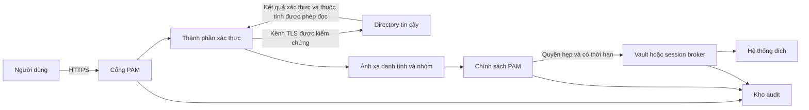

# Directory authentication

## Mục tiêu bài học

**Directory authentication** là việc sử dụng một hệ thống thư mục danh tính để xác thực người truy cập PAM. Directory có thể lưu tài khoản, trạng thái, định danh ổn định và quan hệ nhóm; PAM dựa vào những dữ liệu được kiểm chứng đó để nhận diện người dùng, sau đó áp dụng chính sách truy cập đặc quyền riêng.

Trong module Privileged Access Management, tích hợp directory giúp liên kết quyền quản trị với danh tính cá nhân và vòng đời nhân sự. Tuy nhiên, kết nối được tới directory chưa đủ để bảo đảm least privilege, MFA, quyền JIT hoặc thu hồi phiên đang hoạt động.

Sau bài học này, bạn có thể:

- Phân biệt directory, giao thức xác thực và cơ chế đồng bộ danh tính.
- Mô tả luồng tìm tài khoản và xác thực qua LDAP có bảo vệ đường truyền.
- Thiết kế định danh ổn định, ánh xạ nhóm và quyền PAM theo phạm vi.
- Quản lý tài khoản tích hợp với quyền tối thiểu.
- Xử lý dữ liệu nhóm thiếu, directory lỗi và độ trễ thu hồi.
- Kiểm chứng tích hợp bằng ca thử thực tế mà không làm lộ credential.

## 1. Directory authentication đứng ở đâu trong PAM?

Một tổ chức có thể có tài khoản cá nhân cho nhân viên trong directory và tài khoản quản trị tại nhiều hệ thống đích. PAM nằm giữa hai lớp đó:

- Người dùng xác thực với danh tính cá nhân.
- PAM kiểm tra nhóm, điều kiện truy cập và phê duyệt.
- Broker hoặc vault cung cấp đường truy cập tới tài khoản đích phù hợp.
- Hệ thống đích thực thi quyền thực tế.
- PAM và đích lưu bằng chứng để truy nguyên.

Ví dụ, Lan đăng nhập PAM bằng tài khoản cá nhân trong directory của tổ chức. Nhóm của Lan cho phép yêu cầu vai trò vận hành staging, nhưng chưa tự cấp quyền production. Khi có công việc hợp lệ, PAM cấp quyền theo thời hạn và mở phiên bằng danh tính hoặc tài khoản đích được thiết kế.

Directory authentication trả lời chủ yếu câu hỏi **người này là ai và bằng chứng đăng nhập có hợp lệ không**. Nó không tự trả lời đầy đủ người đó được làm gì trên từng tài sản.

### Ba việc dễ bị nhầm

| Hoạt động | Mục đích | Điều không tự có |
|---|---|---|
| Xác thực qua directory | Kiểm tra bằng chứng đăng nhập cho một danh tính | Quyền quản trị PAM hoặc quyền tại đích |
| Đồng bộ tài khoản và nhóm | Sao chép dữ liệu phục vụ quản lý vòng đời | Một lần xác thực người dùng đang diễn ra |
| Ánh xạ nhóm sang vai trò | Áp dụng chính sách quyền dựa trên dữ liệu nhóm | MFA, approval hoặc thực thi quyền tại hệ thống đích |

Một tài khoản xuất hiện trong cơ sở dữ liệu PAM sau đồng bộ không có nghĩa người đang cầm trình duyệt đã xác thực. Ngược lại, đăng nhập thành công không có nghĩa phải tạo một vai trò quản trị mặc định.

## 2. Directory, LDAP và các cách tích hợp

Directory là dịch vụ quản lý đối tượng danh tính. LDAP là một giao thức có thể dùng để truy vấn và thực hiện những cơ chế xác thực được server hỗ trợ. Các directory khác nhau có schema, hành vi và khả năng tích hợp khác nhau.

Không mặc định mọi nền tảng danh tính đều cung cấp LDAP giống nhau. Một dịch vụ danh tính cloud, một directory tại chỗ và một IdP federation có thể có những giao diện khác nhau.

| Cách tích hợp | Luồng chính | Lưu ý cho PAM |
|---|---|---|
| LDAP bind có TLS | PAM kết nối directory và kiểm tra credential qua bind theo cấu hình | PAM có thể phải tiếp nhận mật khẩu người dùng; cần bảo vệ và tránh lưu |
| Cơ chế dựa trên Kerberos hoặc SASL phù hợp | Dùng cơ chế xác thực được môi trường hỗ trợ | Cần cấu hình trust, tên dịch vụ, thời gian và bảo vệ kết nối đúng thiết kế |
| Federation qua IdP có nguồn danh tính từ directory | PAM kiểm chứng kết quả xác thực từ IdP | PAM không trực tiếp kiểm tra mật khẩu directory; cần kiểm chứng token/assertion và ánh xạ danh tính |
| Đồng bộ danh tính riêng | Dịch vụ provisioning đưa người dùng, nhóm vào PAM | Đây là luồng vòng đời, không thay thế bước xác thực |

Bài này tập trung vào mô hình LDAP bind có TLS để làm rõ các ranh giới tin cậy. Không phải tổ chức nào cũng nên chọn mô hình này. Nếu cần MFA, xác thực chống phishing hoặc chính sách thiết bị tập trung, federation qua IdP có thể phù hợp hơn, tùy khả năng của hệ thống.

## 3. Kiến trúc tham chiếu



Một tích hợp có thể dùng tài khoản dịch vụ chỉ đọc để tìm tài khoản và nhóm, còn credential người dùng được kiểm tra bằng một thao tác xác thực riêng.

Có ba ranh giới cần xem xét:

1. **Trình duyệt → PAM:** bảo vệ credential và phiên web.
2. **PAM → directory:** xác thực server, bảo vệ truy vấn và credential.
3. **PAM → đích:** dùng quyền, tài khoản và credential riêng phù hợp tài sản.

Không tự chuyển mật khẩu directory của người dùng tới mọi máy đích. Xác thực vào PAM và xác thực vào hệ thống đích là hai mục đích khác nhau, dù một số môi trường có thể có cơ chế liên kết được thiết kế riêng.

## 4. Luồng tìm tài khoản và xác thực qua LDAP

Một luồng khái niệm gồm các bước sau.

### Bước 1 — Nhận định danh trong đúng realm

PAM nhận tên đăng nhập và xác định directory hoặc realm được phép sử dụng. Nếu có nhiều directory, cần giải quyết rõ những tên trùng như `lan` ở hai tổ chức.

Không tự chọn realm chỉ từ một chuỗi do người dùng cung cấp rồi kết nối tới server tùy ý. Danh sách realm, endpoint và ánh xạ phải nằm trong cấu hình tin cậy.

Định danh nhập vào có thể là tên đăng nhập hoặc một dạng khác mà directory hỗ trợ. Quy tắc chuẩn hóa cần bám theo schema của môi trường; không tự bỏ domain, bỏ dấu hoặc thay đổi ký tự đến mức hai tài khoản thành một.

### Bước 2 — Từ chối dữ liệu không hợp lệ trước khi bind

Kiểm tra đầu vào có độ dài và định dạng hợp lý. Với luồng xác thực bằng mật khẩu, từ chối mật khẩu rỗng ngay từ đầu.

Điểm này quan trọng vì một số cơ chế LDAP có thể cho phép bind không xác thực hoặc anonymous với dạng đầu vào nhất định. Một kết quả bind không lỗi không được tự coi là người dùng đã chứng minh danh tính nếu ứng dụng cho phép đầu vào dẫn tới chế độ đó.

Không dùng việc “kết nối LDAP thành công” hoặc “search thành công bằng tài khoản dịch vụ” thay cho kiểm tra credential người dùng.

### Bước 3 — Tìm đúng một đối tượng người dùng

Trên kênh được bảo vệ, tài khoản tích hợp có thể tìm tài khoản trong search base đã được giới hạn. Bộ lọc phải có cơ chế escape hoặc xây dựng an toàn cho giá trị do người dùng cung cấp.

Kết quả mong đợi là **đúng một đối tượng phù hợp**:

- Không có đối tượng: đăng nhập không thành công theo cách không làm lộ thông tin không cần thiết.
- Nhiều đối tượng: lỗi ánh xạ hoặc đầu vào chưa đủ rõ; không chọn phần tử đầu tiên.
- Có đối tượng ngoài phạm vi cho phép: không chấp nhận chỉ vì tên giống.
- Có đối tượng nhưng thiếu định danh bắt buộc: chưa đủ điều kiện tạo danh tính PAM.

Phân biệt cú pháp escape của LDAP filter với cú pháp escape của distinguished name (DN). Chúng phục vụ hai loại dữ liệu khác nhau; không dùng một hàm escape chung cho mọi vị trí.

### Bước 4 — Xác thực bằng cơ chế đã cấu hình

Với mô hình simple bind, ứng dụng có thể dùng DN đã tra cứu và mật khẩu người dùng để thực hiện bind qua kênh TLS được kiểm chứng. Server directory quyết định credential và chính sách tài khoản có hợp lệ theo cơ chế đó không.

Các điều kiện bổ sung như loại tài khoản được phép dùng, realm và trạng thái cần kiểm tra phải được xác định rõ theo directory. Không giả định mọi directory có cùng thuộc tính hoặc mọi cơ chế bind đều thực thi cùng một tập chính sách.

Không được bind bằng tài khoản dịch vụ rồi coi người dùng đã xác thực vì tìm thấy tên của họ.

### Bước 5 — Lấy thuộc tính và nhóm theo nguồn tin cậy

Sau xác thực, ứng dụng dùng cơ chế có quyền đọc phù hợp để lấy định danh ổn định và thông tin nhóm cần thiết. Ghi rõ nguồn và thời điểm quan sát, nhất là khi dữ liệu được cache.

Không nhận danh sách nhóm do trình duyệt gửi để quyết định quyền. Một trường `groups: ["pam-admins"]` từ client không phải bằng chứng directory.

### Bước 6 — Tạo phiên PAM với quyền thích hợp

Ánh xạ danh tính và nhóm vào chính sách PAM. Nếu chưa có mapping, có thể không có quyền truy cập tài sản hoặc chỉ có quyền mặc định rất hạn chế theo thiết kế.

Không mặc định người dùng xác thực thành công sẽ trở thành quản trị viên. Mở phiên PAM cũng chưa đồng nghĩa mở phiên quản trị tại đích.

## 5. Bảo vệ kênh LDAP

### TLS phải có trước khi gửi credential

LDAP trên TLS có thể được triển khai bằng kết nối TLS ngay từ đầu hoặc nâng cấp kết nối bằng StartTLS, tùy cấu hình được hỗ trợ.

Với StartTLS, chỉ gửi credential sau khi nâng cấp thành công và kiểm chứng server. Nếu nâng cấp thất bại, không fallback sang bind không được mã hóa.

Với kết nối TLS trực tiếp, vẫn phải kiểm chứng chứng thư. Mã hóa tới một server giả không bảo vệ credential khỏi server đó.

Các kiểm tra cần phù hợp với hạ tầng gồm:

- Chuỗi chứng thư tới nguồn tin cậy đã cấu hình.
- Tên server khớp với endpoint được dùng.
- Thời hạn và các điều kiện chứng thư áp dụng.
- Cấu hình giao thức và thuật toán theo chính sách của tổ chức.

Nếu directory dùng CA nội bộ, quản lý trust store và việc gia hạn qua quy trình cấu hình. Không xử lý lỗi bằng tùy chọn bỏ kiểm tra chứng thư.

### Endpoint dự phòng cũng phải tin cậy

Từng endpoint failover cần được định danh và kiểm chứng đúng. Không chuyển từ hostname có chứng thư hợp lệ sang một địa chỉ khác rồi tắt hostname verification để “giữ hệ thống chạy”.

Các referral hoặc việc chuyển tiếp qua domain/forest khác cũng cần chính sách. Không để connector tự gửi credential tới bất kỳ server nào được tham chiếu mà chưa kiểm tra trust và phạm vi.

Giới hạn egress từ PAM tới những directory endpoint cần thiết. Một cấu hình directory bị sửa trái phép có thể trở thành đường lấy credential, vì vậy quyền sửa cấu hình tích hợp là quyền nhạy cảm.

## 6. Tài khoản tích hợp phải có quyền tối thiểu

Nếu cần tài khoản dịch vụ để search, chỉ cấp khả năng đọc những đối tượng và thuộc tính cần thiết. Nó thường không cần:

- Domain administrator.
- Khả năng thay mật khẩu người dùng.
- Quyền sửa nhóm đặc quyền.
- Quyền tạo tài khoản.
- Quyền thay chính sách xác thực hoặc trust.

Phạm vi cụ thể phụ thuộc directory và cấu trúc tổ chức. Cần kiểm thử quyền đọc thực tế; không đoán rằng đọc toàn directory là điều kiện bắt buộc.

Credential tài khoản tích hợp nên nằm trong cơ chế quản lý secret được phép, có người chịu trách nhiệm, giám sát và quy trình luân chuyển. Không ghi mật khẩu vào mã nguồn, URL kết nối, log hoặc file cấu hình có quyền đọc rộng.

### Tách kết nối service bind và user bind

LDAP bind có thể làm thay đổi danh tính gắn với một kết nối. Dùng cùng một connection pool cho tài khoản dịch vụ và các user bind mà không quản lý trạng thái đúng có thể gây trộn ngữ cảnh hoặc thực thi truy vấn dưới danh tính ngoài dự kiến.

Thiết kế nên tách đường kết nối hoặc bảo đảm vòng đời và reset danh tính một cách có kiểm chứng. Không trả một kết nối đã bind thành người dùng vào pool chung rồi giả định nó vẫn là tài khoản search.

Nếu dùng thư viện hoặc connector, cần hiểu hành vi pooling, reconnect và bind lại. Kết nối TCP/TLS còn sống không đồng nghĩa trạng thái xác thực vẫn đúng.

### Bảo vệ mật khẩu người dùng trong PAM

Chỉ giữ mật khẩu trong thời gian cần thiết cho bước xác thực và không lưu để dùng lại. Không đặt nó trong session cookie hoặc payload gửi tới frontend.

Hạn chế thu thập request body, memory dump và trace chứa credential. Các cơ chế xóa dữ liệu khỏi bộ nhớ phụ thuộc ngôn ngữ và runtime; không hứa xóa tuyệt đối chỉ vì gán biến thành rỗng.

Khi có phương án federation phù hợp, việc PAM không tiếp nhận mật khẩu directory có thể giảm bề mặt xử lý secret. Nó không bỏ đi nhu cầu kiểm chứng kết quả danh tính.

## 7. Định danh ổn định và tránh ghép nhầm tài khoản

Tên hiển thị, email và DN có thể thay đổi. Người dùng có thể đổi tên hoặc chuyển đơn vị, làm DN thay đổi dù vẫn là cùng một đối tượng.

PAM nên dùng định danh ổn định mà directory cung cấp, kết hợp namespace nguồn. Ví dụ khái niệm:

```text
principal = directory_source_id + stable_object_id
```

Cách mã hóa và xử lý định danh phải phù hợp với loại directory; không giả định mọi ID đều là chuỗi có thể chuyển chữ thường tùy ý.

### Vì sao không dùng email làm khóa duy nhất?

Email có thể được đổi, gán lại hoặc trùng trong các nguồn khác nhau. Nếu một địa chỉ cũ được cấp cho người mới, PAM không được nối người mới với lịch sử quyền của người cũ chỉ vì email giống nhau.

Tương tự, xóa một tài khoản rồi tạo lại cùng tên phải được xem xét như đối tượng danh tính mới nếu stable ID đã khác. Các approval, grant và quyền gán trực tiếp cũ không được tự truyền sang.

### Khi thay directory hoặc migration

Chuyển nguồn danh tính cần có kế hoạch ánh xạ, kiểm chứng và phê chuẩn. Không tự ghép tài khoản bằng tên hiển thị trên diện rộng.

Bằng chứng audit nên giữ được nguồn danh tính và định danh tại thời điểm sự kiện, đồng thời cho phép hiển thị thông tin dễ đọc hiện tại mà không sửa lịch sử chủ thể.

## 8. Ánh xạ nhóm sang quyền PAM

Nhóm directory là một đầu vào cho authorization. Nên ánh xạ vào vai trò PAM có phạm vi rõ, thay vì gán quyền quản trị toàn nền tảng cho một nhóm vận hành quá rộng.

Ví dụ:

| Nhóm nguồn minh họa | Vai trò PAM | Phạm vi |
|---|---|---|
| Nhóm vận hành staging | Người có thể yêu cầu quyền vận hành | Một tập tài sản staging đã định nghĩa |
| Nhóm chủ tài sản staging | Approver theo tài sản | Yêu cầu staging trong phạm vi được giao |
| Nhóm quản trị PAM chuyên trách | Quản trị cấu hình được phân công | Chức năng cụ thể, có kiểm soát riêng |
| Không có nhóm được ánh xạ | Không có quyền đặc quyền mặc định | Có thể chỉ xem hướng dẫn hoặc bị từ chối |

Việc được yêu cầu một vai trò không đồng nghĩa vai trò đang có hiệu lực. Approval, JIT, JEA và điều kiện xác thực vẫn được áp dụng.

### Nhóm lồng nhau và dữ liệu không đầy đủ

Không mặc định một thuộc tính liệt kê nhóm sẽ bao gồm mọi membership hiệu lực. Directory có thể có nhóm trực tiếp, nhóm lồng nhau, nhóm chính hoặc những cơ chế khác với ngữ nghĩa khác nhau.

Cần xác định:

- PAM hỗ trợ những loại membership nào.
- Có đi qua domain hoặc nguồn khác không.
- Giới hạn độ sâu và xử lý vòng lặp.
- Cách xử lý kết quả lớn, phân trang và giới hạn server.
- Chính sách khi truy vấn chỉ hoàn thành một phần.
- Quy tắc khi nhiều nhóm ánh xạ tới các quyền xung đột.

Một truy vấn nhóm bị cắt bớt không được coi là bộ dữ liệu đầy đủ. Nếu dữ liệu nhóm là điều kiện bắt buộc để quyết định quyền, cần xử lý trạng thái thiếu theo chính sách bảo thủ, không đoán ra quyền thuận lợi hơn.

### Không coi nhóm quản trị directory là vai trò PAM mặc định

Một người có nhiệm vụ quản trị directory không mặc nhiên cần quản trị cấu hình PAM hoặc xem mọi credential trong vault. Ngược lại, người quản trị PAM không nhất thiết cần quyền sửa directory.

Sự phân tách này giúp giảm tác động khi một vai trò bị chiếm quyền. Những đường quản trị có khả năng thay nhóm và tự cấp quyền PAM cần được đánh giá như đường đặc quyền gián tiếp.

## 9. Directory authentication không tự cung cấp MFA

Một LDAP bind bằng username/password thông thường không tự trở thành MFA chỉ vì máy người dùng đã đăng nhập bằng một phương thức khác.

Nếu cần xác thực nhiều yếu tố hoặc step-up, tích hợp phải có cơ chế cung cấp bằng chứng tương ứng và PAM phải kiểm chứng được. Có thể dùng IdP federation hoặc một cơ chế xác thực bổ sung được thiết kế phù hợp.

Không gắn nhãn `MFA=true` chỉ vì người dùng nằm trong nhóm có tên “MFA enabled”. Việc đăng ký phương thức và việc đã sử dụng phương thức trong lần xác thực hiện tại là hai việc khác nhau.

Tương tự, thiết bị ở mạng nội bộ không tự chứng minh MFA, trạng thái an toàn của endpoint hoặc người dùng đang thực sự hiện diện.

## 10. Vòng đời tài khoản, cache và thu hồi quyền

### Joiner, mover, leaver

Khi có người mới, dữ liệu directory có thể giúp tạo danh tính PAM theo chính sách. Khi chuyển vị trí, membership và quyền cần thay đổi. Khi nghỉ việc hoặc bị đình chỉ, hệ thống phải ngăn truy cập mới và xử lý quyền đang tồn tại.

Các bước này có thể đi qua nhiều luồng:

- Đăng nhập kiểm tra directory trực tiếp.
- Đồng bộ định kỳ.
- Sự kiện thay đổi.
- Cache nhóm trong PAM.
- Session đang hoạt động.
- Grant hoặc token tại hệ thống đích.

Không có lý do để giả định mọi luồng được cập nhật cùng một thời điểm.

### Replication và cache tạo độ trễ

Một tài khoản vừa bị khóa ở một nơi có thể chưa được mọi replica quan sát ngay. PAM có thể vẫn giữ group cache hoặc session cookie được tạo trước đó.

Cần công bố và kiểm chứng giới hạn độ trễ cho:

1. Chặn lần đăng nhập mới.
2. Ngăn mở phiên hoặc checkout credential mới.
3. Gỡ role hoặc grant JIT.
4. Kết thúc phiên đang mở.
5. Vô hiệu token hoặc phiên tại đích nếu hỗ trợ.

Nếu cần phản ứng nhanh với tài khoản bị chiếm quyền, có thể phải có cơ chế đình chỉ và thu hồi tại PAM độc lập với việc chờ replication hoàn tất.

### TTL của cache không phải bảo đảm thu hồi

Cache sống 5 phút không chứng minh mọi quyền đã bị gỡ sau 5 phút. Session PAM hoặc token đích có thể sống lâu hơn và không kiểm tra lại cache.

Thiết kế cần nối thay đổi danh tính với điểm thực thi. Khi chưa thu hồi được, lưu trạng thái còn tồn đọng và cảnh báo thay vì ghi “đã hoàn tất” chỉ vì tài khoản directory đã bị disable.

### Không dùng cache mật khẩu như fallback tùy tiện

Cache thuộc tính phục vụ quyền khác với lưu credential để xác thực offline. Nếu directory không sẵn sàng, không tự biến một lần đăng nhập thành công trong quá khứ thành bằng chứng cho người dùng hiện tại.

Một chế độ offline, nếu được yêu cầu, cần thiết kế và đánh giá riêng. Không thêm nó như cách xử lý nhanh cho lỗi kết nối directory của PAM.

## 11. Xử lý lỗi mà không làm lộ danh tính hoặc gây lockout

### Lỗi người dùng và lỗi hệ thống

Thông báo bên ngoài có thể giữ ở mức chung để giảm dò tài khoản, trong khi audit nội bộ phân biệt:

- Credential không hợp lệ.
- Tài khoản không đáp ứng chính sách.
- Kết quả search không duy nhất.
- Không kiểm chứng được TLS.
- Directory không phản hồi.
- Tài khoản tích hợp bị lỗi.
- Dữ liệu nhóm thiếu hoặc truy vấn thất bại.
- Không ánh xạ được danh tính.

Không ghi password hoặc request body nguyên vẹn để giúp chẩn đoán.

### Retry và khóa tài khoản

Retry một mật khẩu sai qua nhiều endpoint có thể làm tăng số lần thất bại và gây khóa tài khoản. Phân biệt lỗi mạng với lỗi xác thực; không tự thử lại credential sai vô hạn.

Áp dụng rate limit, thời gian chờ và giới hạn đồng thời phù hợp. Đồng thời tránh biến khóa tài khoản thành công cụ dễ gây từ chối dịch vụ; thiết kế cần phối hợp với chính sách directory.

Tài khoản dịch vụ bị đổi secret nhưng PAM chưa cập nhật có thể khiến mọi lần search thất bại. Cảnh báo phải giúp phân biệt lỗi tích hợp với việc toàn bộ người dùng nhập sai mật khẩu.

### Directory không sẵn sàng

Đối với truy cập mới không thể xác thực, không cấp quyền dựa trên suy đoán. Với phiên đã tồn tại, áp dụng chính sách đã định nghĩa về thời hạn, đánh giá lại và thu hồi; không tự kéo dài grant.

Đường break-glass nếu cần phải là quy trình riêng được quản lý, có phạm vi nhỏ, thời hạn và bằng chứng. Không fallback im lặng sang tài khoản local dùng chung không được giám sát.

## 12. Pseudocode luồng xác thực

```text
function authenticate_with_directory(realm_id, login_name, password):
    require realm_id is in configured_trusted_realms
    require login_name is valid_for_realm
    require password is not empty

    directory = load_trusted_directory_configuration(realm_id)
    search_connection = connect_with_verified_tls(directory)

    authenticate_search_identity_if_required(search_connection)
    matches = search_users(
        connection = search_connection,
        base = directory.allowed_user_base,
        filter = safely_constructed_filter(login_name)
    )

    require matches.count == 1
    user = matches.only_entry
    require user.has_required_stable_identifier
    require user.is_in_allowed_identity_scope

    user_connection = new_connection_with_verified_tls(directory)
    require authenticated_user_bind(
        user_connection,
        user.directory_identifier,
        password
    )

    attributes = read_authoritative_attributes_and_groups(user)
    require mandatory_attribute_queries_completed

    principal = map_source_and_stable_id(directory.source_id, user.stable_id)
    roles = evaluate_versioned_pam_role_mapping(principal, attributes)

    return create_pam_session(principal, roles, observed_context)
```

Đây là logic khái niệm, không phải mã có thể đưa thẳng vào production. Việc đọc trạng thái, bind, lấy nhóm và kiểm soát concurrency phải dùng ngữ nghĩa đúng của directory và connector.

Tạo session cần cơ chế bảo vệ cookie, chống session fixation, thời hạn và thu hồi. Kết quả đăng nhập thành công không miễn những kiểm tra đó.

Các thao tác đặc quyền sau đăng nhập vẫn phải kiểm tra authorization tại máy chủ. Không để một client tự quyết định vai trò chỉ vì đã nhận danh sách nhóm để hiển thị.

## 13. Bằng chứng audit cho tích hợp directory

Nên ghi các sự kiện có thể tương quan:

- Nguồn directory hoặc realm.
- Định danh chủ thể ổn định khi đã xác định hợp lệ.
- Kết quả xác thực theo nhóm lý do phù hợp.
- Endpoint hoặc connector tham gia ở mức vận hành cần thiết.
- Phiên bản cấu hình và ánh xạ quyền.
- Mốc quan sát dữ liệu nhóm, cache và trạng thái.
- Session PAM, grant và phiên đích liên quan.
- Các thay đổi cấu hình endpoint, trust store và tài khoản tích hợp.
- Lỗi thu hồi hoặc dọn dẹp còn tồn đọng.

```json
{
  "event_type": "pam.directory.authentication_succeeded",
  "directory_source": "directory-example-corporate",
  "principal_reference": "principal-example-418",
  "session_reference": "session-example-901",
  "role_mapping_version": "mapping-example-v6",
  "group_observation_reference": "observation-example-77",
  "connector_reference": "ldap-connector-example-1",
  "result": "accepted"
}
```

Đây là schema minh họa. Không ghi mật khẩu, bind secret, token hoặc toàn bộ đối tượng directory theo mặc định. Tên nhóm và thuộc tính nhân sự cũng có thể nhạy cảm; chỉ thu thập phần cần thiết, phân quyền xem và quản lý thời hạn lưu.

Sự kiện xác thực thành công chứng minh một bước đăng nhập đã được chấp nhận theo cấu hình. Nó không chứng minh người dùng đã có approval hoặc thực hiện thao tác quản trị ở đích.

## 14. Bài thực hành có kiểm chứng

Dùng directory thử nghiệm, tài khoản lab và dữ liệu giả. Không thử password spray hoặc làm khóa tài khoản production để kiểm tra tích hợp.

### Chuẩn bị

Tạo:

- Người dùng A thuộc nhóm vận hành staging.
- Người dùng B không thuộc nhóm được ánh xạ.
- Hai đối tượng có tên hiển thị giống nhau nhưng định danh ổn định khác nhau.
- Tài khoản search chỉ đọc trong phạm vi cần thiết.
- Một endpoint chính và endpoint dự phòng có TLS được cấu hình đúng.
- Một vai trò PAM cho phép yêu cầu quyền hẹp, chưa cấp quyền thường trực.

Ghi rõ schema, login attribute, stable ID, cách lấy membership và hạn cache của môi trường lab.

### Các ca kiểm tra

| Ca | Thao tác | Kết quả mong đợi |
|---|---|---|
| Đăng nhập hợp lệ | A dùng credential đúng | Nhận đúng principal và vai trò được ánh xạ |
| Sai mật khẩu | A dùng mật khẩu sai | Không có session; không retry credential vô hạn |
| Mật khẩu rỗng | Gửi username kèm password rỗng | Bị từ chối, không bị nhận nhầm thành bind đã xác thực |
| Không có mapping | B xác thực đúng | Không được tự cấp quyền quản trị hoặc quyền tài sản ngoài chính sách |
| Kết quả trùng | Đầu vào dẫn tới nhiều đối tượng phù hợp | Không chọn đối tượng đầu tiên |
| Input đặc biệt | Tên có ký tự đặc biệt theo schema lab | Không thay đổi cấu trúc LDAP filter hoặc mở rộng search |
| TLS sai | Dùng endpoint có chứng thư không được tin hoặc sai tên | Không gửi credential bằng cách bỏ kiểm tra TLS |
| StartTLS lỗi | Mô phỏng nâng cấp thất bại | Không fallback sang bind không mã hóa |
| Đổi tên | Đổi tên hoặc vị trí đối tượng nhưng giữ stable ID | Không tạo nhầm một người mới chỉ vì DN đổi |
| Tạo lại cùng tên | Xóa tài khoản thử nghiệm rồi tạo đối tượng mới cùng login | Không kế thừa quyền cũ chỉ dựa vào tên |
| Nhóm lồng nhau | Thử membership trực tiếp và gián tiếp được hỗ trợ | Kết quả đúng ngữ nghĩa đã công bố |
| Dữ liệu nhóm thiếu | Mô phỏng lỗi hoặc kết quả bị giới hạn | Không coi dữ liệu một phần là đủ để cấp quyền |
| Connection pool | Cho A và B đăng nhập đồng thời | Không trộn danh tính bind hoặc kết quả quyền |
| Disable tài khoản | Đình chỉ A trong lab | Đo được thời gian chặn truy cập mới và xử lý session/grant đang có |
| Failover | Làm endpoint chính không sẵn sàng | Chỉ dùng endpoint tin cậy, giữ kiểm tra TLS và chính sách lỗi |
| Audit | Kiểm tra log thành công và thất bại | Có tương quan cần thiết, không chứa credential |

### Báo cáo kết quả

Với mỗi ca, ghi điều kiện đầu vào, endpoint, phiên bản mapping, kết quả thực tế và bằng chứng tại điểm thực thi. Riêng thu hồi, tách thời gian quan sát tại directory, PAM, broker và đích.

Nếu chỉ kiểm tra đăng nhập mới, không kết luận đã kiểm tra thu hồi phiên đang hoạt động. Nếu chưa kiểm thử nhóm lồng nhau hoặc cross-domain, ghi rõ giới hạn thay vì coi đó là khả năng mặc định.

## 15. Sai lầm thường gặp

**Dùng tài khoản domain admin cho search.** Phạm vi quyền quá rộng làm tăng tác động khi connector bị chiếm quyền. Cấp quyền đọc đúng nhu cầu và kiểm thử.

**Tin mọi bind không lỗi là đăng nhập hợp lệ.** Cần từ chối đầu vào rỗng và bảo đảm cơ chế đã thực sự xác thực người dùng mong muốn.

**Bỏ kiểm tra chứng thư vì đã có mã hóa.** Mã hóa không thay thế xác thực server; credential vẫn có thể đi tới endpoint giả.

**Dùng email hoặc tên hiển thị làm khóa quyền lâu dài.** Những thuộc tính này có thể đổi hoặc được gán lại. Cần định danh ổn định kèm nguồn.

**Coi một thuộc tính nhóm là toàn bộ membership.** Nhóm lồng nhau, giới hạn truy vấn và ngữ nghĩa directory cần được xác định và kiểm chứng.

**Cho rằng disable directory đóng mọi phiên.** Session PAM, grant JIT và token đích có vòng đời riêng. Phải có cơ chế thu hồi và đối soát.

**Coi LDAP password bind là MFA.** Bằng chứng một mật khẩu không tự chứng minh có nhiều yếu tố hoặc điều kiện step-up.

## 16. Câu hỏi tự kiểm tra

1. Vì sao tìm được tài khoản bằng service bind không chứng minh người dùng đã xác thực?
2. Nếu StartTLS thất bại, vì sao không được tiếp tục gửi mật khẩu trên kết nối cũ?
3. Tại sao stable ID phải kết hợp với nguồn directory?
4. Người dùng vừa bị gỡ khỏi nhóm có thể vẫn truy cập PAM bằng những đường nào?
5. Vì sao việc được ánh xạ vào vai trò “người xin quyền” không đồng nghĩa đang có quyền quản trị ở đích?

### Gợi ý đối chiếu

1. Service bind chỉ chứng minh tài khoản tích hợp có thể đọc dữ liệu; chưa kiểm tra credential của người dùng.
2. Credential chưa có kênh bảo vệ được xác minh; tiếp tục sẽ phá điều kiện bảo mật của luồng.
3. Nhiều nguồn có namespace khác nhau; chỉ ID cục bộ hoặc một tên dễ đổi có thể gây ghép nhầm.
4. Dữ liệu replica, cache nhóm, session PAM, grant và token đích có thể còn hiệu lực nếu không có thu hồi phù hợp.
5. Quyền yêu cầu là một bước trong workflow; approval, điều kiện xác thực, cấp JIT/JEA và thực thi tại đích vẫn phải hoàn tất.

Directory authentication chỉ đạt mục tiêu PAM khi danh tính được xác thực đúng, ánh xạ quyền có phạm vi và thay đổi vòng đời được nối tới việc cấp cũng như thu hồi quyền thực tế. Tích hợp cần được kiểm chứng từ kênh TLS và bind tới session, vault, broker và hệ thống đích.
