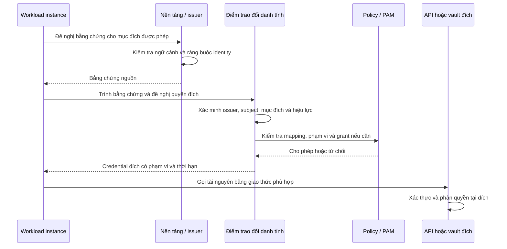

# Cloud workload authentication

## 1. Workload cũng cần danh tính, nhưng không đăng nhập như con người

Cloud workload authentication là quá trình một ứng dụng, máy ảo, container, hàm serverless hoặc job tự động chứng minh danh tính khi truy cập dịch vụ khác. Ví dụ, một job đối soát cần đọc dữ liệu từ object storage, một dịch vụ cần lấy credential cơ sở dữ liệu từ vault, hoặc một pipeline cần cập nhật cấu hình triển khai.

Trong PAM, những danh tính này có thể sử dụng quyền rất mạnh dù không có người bấm nút đăng nhập. Vì vậy, cần biết workload nào đang gọi, ai chịu trách nhiệm, bằng chứng được cấp từ đâu, quyền nào được sử dụng và có thể chấm dứt quyền ra sao.

Không nên giải quyết nhu cầu đó bằng tài khoản của một quản trị viên rồi lưu mật khẩu hay mã MFA của họ trong ứng dụng. Xác thực tương tác của con người và xác thực workload có mô hình khác nhau. Người quản lý danh tính workload có thể cần MFA và approval khi thay chính sách; workload đang chạy cần một cơ chế tự động phù hợp với nền tảng.

Mục tiêu thiết kế là giảm phân phối bí mật dài hạn, xác minh đúng chủ thể và cấp quyền đủ cho tác vụ. Tuy nhiên, credential ngắn hạn hoặc managed identity không tự bảo đảm least privilege: một workload được xác thực đúng vẫn có thể đang giữ quyền quá rộng.

Bài học thuộc chương Authentication. Các luồng và dữ liệu minh họa bên dưới mô tả cách kết hợp danh tính workload với PAM, JIT/JEA, vault, vòng đời credential và bằng chứng kiểm toán; không phải cấu hình có thể áp dụng nguyên trạng cho mọi cloud.

## 2. Tách danh tính, bằng chứng và quyền thực tế

| Thành phần | Câu hỏi | Ví dụ |
|---|---|---|
| Workload logic | Đây là dịch vụ hoặc tác vụ nào? | Dịch vụ đối soát thanh toán |
| Runtime instance | Lần chạy hoặc instance nào đang thực hiện? | Job run, pod hoặc VM instance cụ thể |
| Identity principal | Hệ thống nhận diện chủ thể bằng định danh nào? | Managed identity, service account, federated principal |
| Bằng chứng xác thực | Chủ thể chứng minh quan hệ với danh tính bằng gì? | Token, credential tạm, certificate và private key |
| Quyền | Chủ thể được thực hiện hành động nào trên đích nào? | Đọc một tập object hoặc dùng một profile vault |
| Chủ sở hữu | Ai chịu trách nhiệm về danh tính và tác động? | Nhóm vận hành dịch vụ và owner tài nguyên |

Một workload có thể có nhiều instance dùng cùng danh tính logic. Khi cần phân biệt từng lần chạy để điều tra hoặc giới hạn quyền, phải có thêm bằng chứng liên kết instance, deployment hoặc job run phù hợp.

Tên pod, nhãn môi trường hoặc chuỗi tên dịch vụ tự gửi trong HTTP header không tự chứng minh danh tính. Những giá trị đó chỉ có thể tham gia quyết định khi xuất phát từ nguồn được tin cậy và được ràng buộc với bằng chứng đã xác minh.

Cũng cần phân biệt danh tính nguồn với danh tính đích được sử dụng sau một bước trao đổi hoặc ủy quyền. Audit chỉ ghi tên service account đích có thể không đủ để biết workload bên ngoài nào đã nhận credential.

## 3. Những mô hình thường gặp

### 3.1. Danh tính do nền tảng cloud quản lý

Ứng dụng nhận bằng chứng hoặc credential thông qua cơ chế gắn danh tính với tài nguyên thực thi. Cách này giảm nhu cầu phát một bí mật dài hạn cho từng bản triển khai.

Ví dụ, Azure managed identity cho phép ứng dụng lấy Microsoft Entra token mà không tự quản lý credential của danh tính đó. System-assigned identity gắn vòng đời với tài nguyên; user-assigned identity được quản lý riêng và có thể gắn cho nhiều tài nguyên. [Microsoft — Managed identities for Azure resources](https://learn.microsoft.com/en-us/entra/identity/managed-identities-azure-resources/overview)

Trong thiết kế PAM, cần xác định ranh giới gắn danh tính. Nếu nhiều ứng dụng cùng chạy trên một tài nguyên có cùng khả năng lấy credential, quyền của danh tính có thể trở thành quyền chung cho nhiều ứng dụng hơn dự kiến.

Việc ai được gắn một identity mạnh vào compute cũng là một quyền đặc biệt. Một người không có quyền trực tiếp đọc dữ liệu nhưng có thể chạy mã dưới danh tính được phép đọc vẫn có thể tạo ra đường truy cập gián tiếp.

### 3.2. Federation từ danh tính bên ngoài

Một nền tảng nhận bằng chứng từ issuer đã thiết lập quan hệ tin cậy, xác minh nó và ánh xạ chủ thể tới quyền trong môi trường đích. Federation hữu ích khi workload nằm ở cloud khác, hạ tầng riêng hoặc hệ thống CI/CD.

Google Cloud Workload Identity Federation hỗ trợ truy cập bằng danh tính liên kết thay cho service account key. Có thể cấp quyền trực tiếp cho principal liên kết hoặc sử dụng service account impersonation theo cách tích hợp. [Google Cloud — Workload Identity Federation](https://docs.cloud.google.com/iam/docs/workload-identity-federation)

Federation không có nghĩa tin mọi token do một nhà cung cấp nổi tiếng ký. Quan hệ tin cậy phải xác định tập chủ thể được chấp nhận, mục đích token và cách ánh xạ quyền.

### 3.3. Credential tạm cho API cloud

AWS STS cung cấp temporary security credentials dùng trong mô hình role và federation. Credential có hạn sử dụng và không cần được nhúng như một access key dài hạn trong ứng dụng. [AWS — Temporary security credentials](https://docs.aws.amazon.com/IAM/latest/UserGuide/id_credentials_temp.html)

Không phải mọi credential cloud đều là một JWT để gắn trực tiếp vào HTTP bearer header. Tùy hệ thống, client có thể dùng access token, một bộ credential tạm để ký request hoặc certificate cùng private key. Phải dùng đúng giao thức và thành phần client tương ứng.

Trong mô hình PAM, việc cấp credential tạm vẫn cần ràng buộc với danh tính nguồn, phạm vi quyền và thời hạn. Một bộ credential có thời gian sống ngắn nhưng cho quyền quản trị toàn bộ tài khoản vẫn có tác động lớn trong khoảng thời gian đó.

### 3.4. Danh tính mật mã giữa các workload

Một hệ thống dịch vụ nội bộ có thể dùng certificate hoặc token để chứng minh danh tính với dịch vụ khác. SPIFFE mô tả SVID chứa danh tính workload dưới dạng tài liệu có thể xác minh mật mã, với các định dạng như X.509 hoặc JWT. [SPIFFE — Concepts](https://spiffe.io/docs/latest/spiffe-about/spiffe-concepts/)

Xác minh danh tính ở tầng này không tự cấp quyền gọi mọi API cloud. Nếu cần đi tới một hệ thống IAM khác, vẫn cần quan hệ tin cậy, ánh xạ và quyết định quyền phù hợp.

## 4. Bootstrap: ai chứng minh workload đầu tiên?

Một câu hỏi quan trọng là: nếu không phát sẵn mật khẩu, nền tảng biết phải cấp danh tính cho ai bằng cách nào?

Trong một thiết kế, nền tảng thực thi kiểm tra ngữ cảnh runtime và chính sách gắn identity. Trong thiết kế khác, một issuer được tin cậy phát bằng chứng cho workload, rồi hệ thống đích xác minh bằng chứng đó.

Điểm bắt đầu vẫn là một gốc tin cậy:

| Gốc hoặc ràng buộc tin cậy | Điều cần quản trị |
|---|---|
| Nền tảng compute | Ai có thể tạo, sửa và chạy workload dưới identity? |
| Orchestrator | Ai được chọn service account hoặc cấu hình token? |
| Issuer | Ai được phát token và kiểm soát khóa ký? |
| Mapping | Claim nào trở thành principal hoặc thuộc tính quyền? |
| Đích | Ai có thể cấp role hoặc thay resource policy? |

Không thể loại bỏ việc quản lý tin cậy chỉ bằng cách thay tên mật khẩu thành token. Mục tiêu là đặt quan hệ tin cậy vào nơi có thể kiểm chứng, thu hẹp phạm vi và quản lý vòng đời tốt hơn.

### Danh tính hợp lệ không chứng minh mã an toàn

Nếu một người có thể sửa image, thay cấu hình hoặc khởi chạy mã dưới một service account mạnh, mã đó có thể nhận bằng chứng hợp lệ của chính workload. Việc xác thực thành công khi ấy không chứng minh phiên bản phần mềm hay hành vi là an toàn.

Vì vậy, khả năng triển khai, sửa pipeline, gắn identity và thay policy đều cần được đưa vào kiểm kê đặc quyền. Bảo vệ chỉ riêng secret ở runtime là chưa đủ để quản lý đường sử dụng danh tính.

## 5. Luồng xác thực và cấp quyền minh họa

Một mô hình trung lập nhà cung cấp:



Không phải hệ thống nào cũng có đủ các thành phần tách rời như sơ đồ. Một nền tảng có thể gộp một số bước; một ứng dụng dùng managed identity có thể không tự xử lý bằng chứng nguồn.

Cần giữ rõ các quan hệ dù bước nào được gộp:

1. Workload nào được nền tảng hoặc issuer nhận diện.
2. Bằng chứng được cấp cho bên nhận hoặc mục đích nào.
3. Mapping nào chuyển chủ thể nguồn thành danh tính/quyền đích.
4. Credential nào được cấp, có hạn và phạm vi nào.
5. Tài nguyên đích kiểm tra quyền bằng cách nào.
6. Những sự kiện nào nối được toàn bộ lần sử dụng.

Bằng chứng nguồn và credential đích có thể có audience, thời hạn và cách thu hồi khác nhau. Không dùng chúng thay thế cho nhau chỉ vì cả hai đều là chuỗi ký tự.

## 6. Xác minh quan hệ tin cậy trước khi ánh xạ quyền

### 6.1. Chữ ký đúng chưa đủ

Với một luồng dùng token có claim, thiết kế verifier cần xác định:

- Issuer nào được chấp nhận và khóa nào thuộc issuer đó.
- Loại bằng chứng, thuật toán và quy trình xác minh tương ứng.
- Audience hoặc mục đích mà verifier chấp nhận.
- Subject và thuộc tính nào được dùng để nhận diện workload.
- Thời hạn, thời điểm bắt đầu hiệu lực và sai lệch thời gian cho phép.
- Các điều kiện tổ chức, môi trường, tài nguyên hoặc lần chạy bắt buộc.
- Cách xử lý bằng chứng cũ, trạng thái thu hồi và điều kiện chưa xác nhận.

Đây là các câu hỏi thiết kế; cách kiểm tra cụ thể phụ thuộc giao thức. Không lấy một danh sách chung rồi bỏ qua yêu cầu riêng của nền tảng.

Đối với JWT, đọc được payload hoặc nhận được kết quả decode không đồng nghĩa token đã được xác minh. Việc chọn metadata hoặc khóa từ dữ liệu không tin cậy cũng có thể phá quan hệ tin cậy nếu verifier không giới hạn nguồn được phép.

### 6.2. Issuer đa tenant cần điều kiện hẹp

Một issuer có thể phục vụ nhiều tổ chức hoặc nhiều repository. Trust chỉ dựa vào URL issuer có thể chấp nhận nhiều chủ thể ngoài nhu cầu.

Google Cloud lưu ý rủi ro mapping trùng, thuộc tính có thể thay đổi/tái sử dụng và issuer dùng chung nhiều tenant; các điều kiện cần thu hẹp tới nguồn danh tính có thẩm quyền. [Google Cloud — Workload Identity Federation best practices](https://docs.cloud.google.com/iam/docs/best-practices-for-using-workload-identity-federation)

Suy luận thiết kế cho PAM là: các thuộc tính quyết định quyền phải có nguồn và ý nghĩa rõ ràng. Một biến môi trường `ENVIRONMENT=production` do job tự đặt không đủ để chứng minh job được phép chạy production.

Với CI/CD, cần xét chủ thể repository/project, ngữ cảnh workflow, môi trường phát hành và những ràng buộc được issuer thực sự bảo đảm. Không mở quyền deployment nhạy cảm cho mọi job chỉ vì chúng có cùng một tên branch được nhập tự do.

### 6.3. Tránh ánh xạ nhập nhằng

Hai issuer có thể dùng cùng một chuỗi subject. Hai môi trường cũng có thể có service account cùng tên. Mapping phải phân biệt được ngữ cảnh tin cậy theo thiết kế, thay vì coi subject đơn lẻ là duy nhất toàn hệ thống.

Khi identity hoặc tài nguyên bị xóa rồi tạo lại với cùng tên hiển thị, cần đánh giá việc quyền cũ có vô tình áp dụng cho chủ thể mới hay không. Dùng định danh ổn định phù hợp và quản lý vòng đời mapping giúp tránh thừa kế quyền ngoài ý định.

Quyền sửa mapping là quyền nhạy cảm: thay một biểu thức có thể đưa thêm workload vào một principal đang có quyền mạnh mà không sửa resource policy.

## 7. Kubernetes service account và quyền cloud là hai lớp

Trong Kubernetes, ServiceAccount cung cấp danh tính cho workload trong phạm vi phù hợp. Projected token có thể có thời hạn và audience; ứng dụng xác minh token cần chấp nhận đúng audience. Việc xác minh offline và kiểm tra qua API có thể có hành vi khác nhau khi đối tượng ràng buộc bị xóa. [Kubernetes — Service Accounts](https://kubernetes.io/docs/concepts/security/service-accounts/)

Một ServiceAccount trong cluster không tự có quyền cloud. Cần một tích hợp hoặc quan hệ trust xác định nó được ánh xạ tới principal, role hoặc managed identity nào ở môi trường đích.

Các câu hỏi vận hành cần làm rõ:

| Câu hỏi | Vì sao cần? |
|---|---|
| Pod thực sự dùng ServiceAccount nào? | Tránh rơi về một danh tính mặc định dùng chung |
| Container nào nhận được token hoặc endpoint lấy credential? | Giới hạn phạm vi tiếp cận bằng chứng |
| Ai được chạy pod dưới account đó? | Đây có thể là khả năng sử dụng quyền gián tiếp |
| Token được phát cho audience nào? | Tránh dùng bằng chứng sai mục đích |
| Client đọc bản token hiện hành như thế nào? | Tránh giữ mãi bản sao đã hết hạn |
| Cloud mapping tham chiếu namespace, cluster và subject ra sao? | Tránh nhầm danh tính giữa môi trường |
| Xóa pod/account ảnh hưởng tới credential cloud đã cấp thế nào? | Không đồng nhất vòng đời hai lớp |

Không nên suy ra rằng token nguồn mất hiệu lực thì mọi credential được đổi từ nó cũng lập tức mất hiệu lực. Mỗi verifier và credential đích có cơ chế kiểm tra riêng; cần đối soát hành vi thực tế của tích hợp.

Một thiết kế cũng cần tránh để workload ứng dụng nhận quyền của node rộng hơn quyền riêng dự kiến. Ranh giới container, host, metadata endpoint và quyền vận hành phải được đánh giá trong cùng mô hình.

## 8. Quyền thường xuyên và quyền đặc biệt phải được quản lý khác nhau

### 8.1. Quyền nền cho dịch vụ chạy liên tục

Một dịch vụ có thể cần liên tục đọc một tập cấu hình hoặc ghi một loại dữ liệu. Quyền đó nên đủ hẹp và có owner, không nhất thiết yêu cầu một người duyệt mỗi lần SDK refresh credential.

Việc credential ngắn hạn được cấp lại tự động không tự là “nâng quyền JIT”. Nếu workload có thể nhận quyền mạnh bất cứ lúc nào nhờ một assignment thường trực, quyền nền thực tế vẫn mạnh.

Cần kiểm kê khả năng được cấp, không chỉ credential đang tồn tại tại một thời điểm.

### 8.2. Quyền tăng thêm cho tác vụ nhạy cảm

Một job bảo trì có thể cần quyền cao hơn bình thường trong một cửa sổ cụ thể. PAM có thể kiểm soát một grant gắn với:

- Danh tính workload và tổ chức/môi trường.
- Tác vụ, job run hoặc deployment được xác minh.
- Tài nguyên, hành động và profile quyền.
- Cửa sổ bắt đầu, hạn tuyệt đối và số lần sử dụng nếu áp dụng.
- Quyết định hoặc policy tự động có thẩm quyền.
- Điều kiện cấp lại, kết thúc và bằng chứng.

Người gửi yêu cầu có thể khác workload thực hiện. Audit cần giữ cả người hoặc hệ thống khởi tạo lẫn chủ thể chạy tác vụ, thay vì ghi mọi hành động thành một tài khoản automation chung.

JEA ở bối cảnh này là giới hạn khả năng thực hiện tác vụ: API nào, resource nào, tham số hoặc profile nào được phép. Không nên cấp role toàn quyền rồi coi thời gian ngắn là đủ.

### 8.3. Quyền đọc vault không đồng nghĩa mọi secret đều cần thiết

Một workload có thể xác thực tới vault bằng danh tính cloud rồi xin credential động hoặc secret cụ thể. Cần ánh xạ danh tính tới đúng đường dẫn/profile và quyền thao tác.

Nếu đích hỗ trợ xác thực danh tính trực tiếp, có thể không cần phát mật khẩu ứng dụng dài hạn cho quan hệ đó. Nếu đích vẫn cần password hoặc key, vault và quy trình rotation vẫn có vai trò; federation tới vault không tự loại bỏ credential đích.

Khi secret được đưa cho workload, cần biết consumer, nơi sử dụng, vòng đời và cách xử lý khi bị lộ. Không chỉ bảo vệ đường lấy secret mà bỏ qua cách ứng dụng sử dụng hoặc lưu lại.

## 9. Ví dụ: job đối soát chỉ đọc một tập dữ liệu

### 9.1. Nhu cầu và phạm vi

Một job đối soát production cần đọc tập object của kỳ đối soát đã được xác định. Nó không cần ghi, xóa object, sửa IAM hay tạo credential dài hạn.

Tổ chức chọn một identity riêng cho job và một policy cấp quyền có điều kiện. Mỗi lần chạy có run reference từ nguồn điều phối đáng tin cậy, được liên kết với tập dữ liệu và grant tương ứng.

Mô tả ý định minh họa:

```yaml
policy_ref: payments-reconciliation-access-v3
workload:
  logical_identity_ref: reconciliation-prod
  accepted_issuer_ref: approved-runtime-issuer
  required_subject_ref: workload-payments-reconciliation
  environment_ref: production
  run_binding: required
target:
  resource_ref: payments-reconciliation-input
  permitted_actions:
    - read_approved_objects
  object_set_ref: reconciliation-period-2026-11-25
  write: denied
  delete: denied
  iam_management: denied
grant:
  request_ref: reconciliation-run-731
  not_before: "2026-11-26T14:00:00+07:00"
  absolute_access_until: "2026-11-26T14:30:00+07:00"
credential_intent:
  preferred_lifetime_seconds: 600
  renewal_requires_active_grant: true
audit:
  link_run_grant_and_resource_requests: true
```

Đây là dữ liệu giả mô tả chính sách, không phải IAM syntax của AWS, Azure hoặc Google Cloud. Tên hành động, giá trị thời hạn và giới hạn phải được chuyển thành cơ chế thực thi thực sự của môi trường đích.

Một trường `preferred_lifetime_seconds: 600` không bảo đảm provider có thể cấp đúng 600 giây. Phải kiểm tra giới hạn và kết quả cấp thực tế. Nếu nền tảng không thực thi được hạn bắt buộc, cần thay thiết kế hoặc dùng điểm thực thi bổ sung đủ khả năng, không chỉ ghi giá trị mong muốn.

### 9.2. Diễn biến minh họa

1. Bộ điều phối tạo run R-731 bằng danh tính có thẩm quyền.
2. Runtime cấp bằng chứng cho workload đúng phạm vi.
3. Điểm trao đổi xác minh quan hệ issuer, subject, mục đích và run context.
4. Policy xác nhận grant còn hoạt động và chỉ cho tập object của kỳ đã chọn.
5. Workload nhận credential đích phù hợp rồi gọi API đọc.
6. Log đích được liên kết với principal, grant và run.
7. Khi cần cấp lại, hệ thống kiểm tra grant hiện hành; không lấy lần cấp trước làm quyết định vĩnh viễn.
8. Tới hạn, không phát thêm quyền ngoài cửa sổ và xử lý credential/hoạt động còn lại theo mô hình thực thi.

Nếu một request đọc object ngoài tập được phép xuất hiện, xác thực có thể vẫn thành công nhưng phân quyền phải từ chối. Đây là bằng chứng rằng authentication và authorization là hai việc khác nhau.

### 9.3. Cấp lại không được kéo dài grant ngoài ý định

Giả sử lần cấp ban đầu lúc 14:05 cho credential hết hạn lúc 14:15. Nếu cấp lại lúc 14:25, hạn truy cập tuyệt đối vẫn là 14:30.

Thiết kế phải đảm bảo credential hoặc điểm thực thi không cho quyền vượt 14:30 khi đó là yêu cầu bắt buộc. Không mặc định cộng thêm 10 phút sau mỗi lần refresh.

Tương tự, retry một job sau lỗi không được tự tạo cửa sổ quyền mới nếu run cũ hoặc grant đã hết. Việc tạo run mới và quyền mới phải theo quy tắc nghiệp vụ.

## 10. Refresh, cache và tính sẵn sàng

### 10.1. Client cần quản lý đúng credential hiện hành

Một ứng dụng có thể dùng SDK hoặc cơ chế client được nền tảng hỗ trợ để nhận và refresh credential. Cần kiểm tra:

- Nguồn credential nào được phép sử dụng trong production.
- Danh tính thực tế được chọn khi có nhiều identity.
- Cách thay credential mà không giữ bản hết hạn trong connection hoặc process khác.
- Thời gian làm mới, sai lệch đồng hồ và số lượng request đồng thời.
- Cách báo lỗi mà không in credential.
- Khả năng giới hạn retry và giảm đợt refresh đồng loạt.

Không mặc định mọi chuỗi tìm credential đều an toàn trong mọi môi trường. Nếu ứng dụng âm thầm dùng một access key từ biến môi trường hoặc file của người phát triển khi federation lỗi, danh tính thực tế có thể khác chính sách dự kiến.

Trong mô hình bài học, production giới hạn nguồn credential theo thiết kế và kiểm tra principal hiệu lực bằng dữ liệu không chứa bí mật.

### 10.2. Outage không tạo quyền mới

Khi issuer hoặc điểm trao đổi không hoạt động, ứng dụng có thể vẫn còn credential chưa hết hạn. Việc tiếp tục dùng được đến đâu tùy chính sách và cơ chế đích.

Không kéo dài expiry do client tự đặt, không dùng một credential đã hết hạn và không tự chuyển sang một khóa quản trị thường trực để che lỗi. Nếu có đường dự phòng, nó cần danh tính, quyền và cách kích hoạt riêng đã được chuẩn bị.

Cache metadata, khóa xác minh và quyết định cần có giới hạn rõ. Khi một thông tin bắt buộc không còn đủ tin cậy hoặc đủ mới, hệ thống phải xử lý theo chính sách thay vì mặc định cho phép.

### 10.3. Cấp lại credential không đồng nghĩa gia hạn mọi phiên

Một kết nối cơ sở dữ liệu, phiên ứng dụng hoặc tác vụ dài có thể có vòng đời riêng. Credential dùng để bắt đầu kết nối hết hạn không tự chứng minh kết nối đã dừng.

Nếu yêu cầu là chấm dứt tác vụ tại một deadline, cần cơ chế điều phối và thực thi tương ứng. Không suy ra điều đó chỉ từ TTL của token dùng để xác thực lúc đầu.

## 11. Bảo vệ runtime, metadata và đường lấy credential

Credential không nằm trong source code vẫn có thể bị lấy hoặc sử dụng trái phép nếu môi trường chạy bị kiểm soát.

Cần xét các đường:

| Đường tiếp cận | Rủi ro cần đánh giá |
|---|---|
| Metadata hoặc identity endpoint | Process nào có thể yêu cầu credential của compute? |
| File token được mount | Container, user hoặc process nào đọc được? |
| Socket/agent cấp danh tính | Bên gọi được nhận diện và phân quyền thế nào? |
| Bộ nhớ và crash dump | Có thể lộ credential hoặc dữ liệu đã truy cập không? |
| Log và tracing | Header, response hoặc cấu hình có chứa secret không? |
| Công cụ debug | Ai có thể chạy mã trong ngữ cảnh identity của workload? |

Một lỗ hổng khiến ứng dụng gửi request tới đích ngoài ý định có thể ảnh hưởng tới đường lấy credential nếu môi trường không có ranh giới phù hợp. Cách bảo vệ metadata và network phụ thuộc nền tảng, nên cần dùng kiểm soát đúng với môi trường thực tế thay vì một rule chung không được xác minh.

Tách workload và quyền runtime giúp giảm phạm vi ảnh hưởng. Không gắn một identity quản trị mạnh cho một host chạy nhiều ứng dụng chỉ vì cách cấu hình đó đơn giản.

Ngay cả khi không lấy được token ra ngoài, tác nhân đã kiểm soát process vẫn có thể gọi API bằng danh tính của process. Bảo vệ credential và giới hạn quyền cần được thực hiện cùng nhau.

## 12. Thu hồi và ứng phó khi workload bị xâm nhập

### 12.1. Tách ngăn cấp mới với xử lý credential đã cấp

Có thể cần nhiều hành động:

1. Ngăn workload nhận thêm bằng chứng hoặc credential mới.
2. Sửa hoặc vô hiệu hóa mapping/trust chịu ảnh hưởng.
3. Hạn chế quyền ở tài nguyên đích.
4. Dừng hoặc cô lập instance/job bị xâm nhập theo thẩm quyền.
5. Xử lý phiên, token hoặc credential đích còn hiệu lực.
6. Đánh giá secret đã đọc và consumer chịu tác động.
7. Giữ bằng chứng và xác nhận kết quả từng lớp.

Thay trust policy không tự có cùng ngữ nghĩa với thu hồi mọi credential đã phát. Cách làm và độ trễ phải được xác minh theo nền tảng.

AWS có cơ chế từ chối quyền cho các phiên role được cấp trước một mốc thời gian trong trường hợp được hỗ trợ; thao tác có thể ảnh hưởng nhiều phiên dùng cùng role. Đây là ví dụ cho thấy thu hồi cần hiểu đúng phạm vi, không mặc định là một nút vô hiệu hóa riêng từng token. [AWS — Revoke IAM role temporary security credentials](https://docs.aws.amazon.com/IAM/latest/UserGuide/id_roles_use_revoke-sessions.html)

### 12.2. Quyền dùng chung làm mở rộng tác động

Nếu nhiều dịch vụ dùng chung một role hoặc identity, thu hồi có thể làm gián đoạn cả những dịch vụ không bị xâm nhập. Ngược lại, chỉ dừng một instance chưa chắc ngăn một credential đã bị sao chép tiếp tục được dùng.

Việc thiết kế identity theo ranh giới trách nhiệm và tác động giúp thu hồi có mục tiêu hơn. Không nhất thiết mỗi request phải có một identity riêng, nhưng cần biết mức chia sẻ nào đang được chấp nhận.

### 12.3. Giữ trạng thái chưa xác nhận

Một hệ thống điều phối gửi lệnh vô hiệu hóa không có nghĩa cloud API, vault và ứng dụng đích đều đã áp dụng. Cần lưu kết quả xác nhận, lỗi và phần còn chờ.

Nếu một tác vụ đã tạo tài nguyên hoặc thay đổi cấu hình, hết hạn credential không tự hoàn tác tác động đó. Quy trình ứng phó cần xem xét hành động đã thực hiện, không chỉ khả năng đăng nhập tiếp theo.

## 13. Bằng chứng và quản trị chính hệ thống danh tính

Chuỗi bằng chứng nên liên kết:

```text
Owner và workload logic
    -> Deployment / instance / job run
    -> Issuer và danh tính nguồn đã xác minh
    -> Mapping, policy và quyết định cấp quyền
    -> Principal/role đích và lần cấp credential
    -> Request API hoặc thao tác vault
    -> Tài nguyên, hành động và kết quả
    -> Hết hạn, thu hồi và đối soát
```

Cần phân biệt người hoặc hệ thống khởi tạo với workload thực hiện. Với chuỗi impersonation/ủy quyền, nên giữ quan hệ đủ để biết danh tính nguồn nào đã dẫn tới quyền đích, theo dữ liệu tích hợp thực sự cung cấp.

Không dùng tên phiên do client tự đặt làm bằng chứng duy nhất về actor. Cũng không ghi access token, private key, credential tạm, TOTP seed hoặc secret nhận từ vault vào audit.

Các quyền có thể thay đổi mô hình tin cậy phải được quản lý như đặc quyền:

- Tạo hoặc sửa issuer/provider.
- Thay khóa ký và endpoint metadata.
- Sửa mapping, điều kiện trust hoặc role assignment.
- Gắn identity vào compute hay cho phép impersonation.
- Sửa workload, pipeline hoặc image chạy dưới identity mạnh.
- Sửa policy PAM/vault và xóa bằng chứng liên quan.

Người có quyền sửa những thành phần này có thể tạo đường tới dữ liệu mà không trực tiếp gọi API dữ liệu. Kiểm kê quyền cần bao gồm các khả năng gián tiếp đó.

## 14. Những lỗi thường gặp và thực hành lab

| Lỗi | Hệ quả | Cách điều chỉnh |
|---|---|---|
| Mọi workload dùng một identity admin | Mất phân tách và khó thu hồi có mục tiêu | Tách theo nhiệm vụ, môi trường và mức tác động |
| Tin issuer nhưng không hạn chế subject | Chủ thể ngoài nhu cầu có thể được chấp nhận | Ràng buộc tập danh tính và thuộc tính có thẩm quyền |
| Dùng tên hiển thị làm định danh bền vững | Tái sử dụng tên có thể thừa kế quyền | Quản lý định danh và vòng đời mapping |
| Token ngắn hạn nên cấp quyền rộng | Tác động vẫn lớn trong thời gian hiệu lực | Giới hạn hành động và tài nguyên |
| Xóa pod là thu hồi mọi quyền cloud | Credential đích có vòng đời riêng | Xác minh và xử lý từng lớp |
| SDK tự dùng khóa cũ khi federation lỗi | Trôi danh tính và mức quyền | Kiểm soát nguồn credential của production |
| Hết token là mọi công việc đã dừng | Phiên và tác vụ có thể còn chạy | Thiết kế deadline và điểm thực thi riêng |
| Log toàn response để debug | Credential có thể lan sang hệ thống log | Chỉ lưu metadata và tham chiếu cần thiết |
| Sửa trust không cần approval | Có thể mở đường đặc quyền gián tiếp | Quản trị thay đổi hệ thống danh tính |
| Đổi secret nhưng quên consumer | Có thể gây lỗi vận hành hoặc còn bản sao cũ | Kiểm kê consumer và đối soát vòng đời |

Để thực hành, chọn một workload lab chỉ cần đọc một tài nguyên thử nghiệm. Tạo mô hình danh tính nguồn, quan hệ trust, principal đích và policy giới hạn cho một tác vụ cụ thể. Không cần dùng tài khoản hoặc dữ liệu production.

Xác nhận lần lượt rằng workload hợp lệ thực hiện được hành động cho phép; workload khác, audience sai, credential hết hạn và hành động ngoài phạm vi đều không được tiếp tục theo đường đó. Kiểm tra cả việc client có chuyển sang nguồn credential ngoài dự kiến khi đường chính lỗi hay không.

Tiếp theo, mô phỏng hết hạn grant và dừng cấp mới. Ghi rõ credential đã cấp, phiên đã mở và tác vụ đã chạy được xử lý bằng cơ chế nào, phần nào chưa xác nhận và bằng chứng nào nối được chúng với đúng run.

Đầu ra cần chứng minh nhiều hơn “ứng dụng gọi API thành công”: phải xác định được workload nào đã xác thực, vì sao nó được nhận quyền, phạm vi nào được thực thi và cách quyền kết thúc khi tác vụ hoặc điều kiện tin cậy thay đổi.
