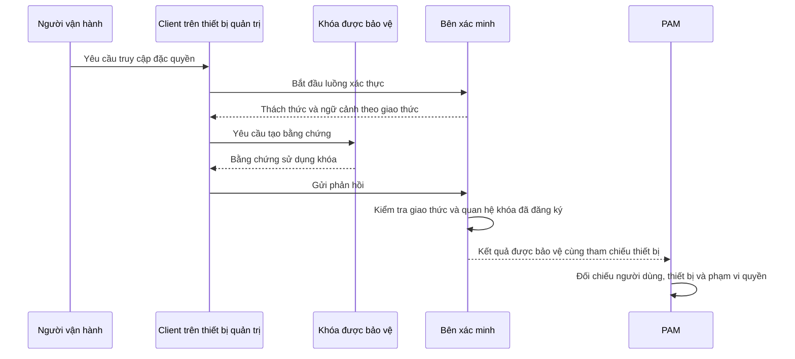

# Device-bound authentication

## 1. Device-bound authentication là gì?

Device-bound authentication là cách xác thực dựa trên một credential hoặc khóa có quan hệ ràng buộc với thiết bị hoặc authenticator cụ thể. Bên xác minh yêu cầu bằng chứng sử dụng khóa, thay vì chỉ tin tên máy, địa chỉ mạng hay một cờ do client tự khai.

Trong quản lý truy cập đặc quyền (Privileged Access Management, PAM), cơ chế này có thể giúp giới hạn việc sử dụng danh tính hoặc phiên truy cập từ thiết bị quản trị được cho phép. Tuy nhiên, phải nêu rõ **ràng buộc với thiết bị nào, tại bước nào và bằng chứng nào được kiểm tra**. Một credential gắn với security key rời không tự ràng buộc người dùng vào một laptop quản trị cụ thể.

Sau bài học, người học có thể:

- Phân biệt danh tính thiết bị, bằng chứng sở hữu khóa, trạng thái tuân thủ và quyền truy cập.
- Xác định mức bảo vệ của khóa phần cứng, chứng thư thiết bị và token có ràng buộc người gửi.
- Thiết kế enrollment và liên kết người dùng–thiết bị–khóa cho PAM.
- Kiểm tra ràng buộc ở bước cấp và sử dụng quyền, thay vì chỉ kiểm tra lúc đăng nhập.
- Lập kế hoạch thu hồi, thay thiết bị, xử lý lỗi và lưu bằng chứng.

Các sơ đồ, policy và mã giả trong bài là mô hình thiết kế. Chúng không phải cấu hình dùng chung cho mọi hệ điều hành, IdP hay sản phẩm PAM.

## 2. Tình huống: tài khoản đúng nhưng thiết bị không đúng

An được phép sử dụng một máy quản trị chuyên dụng để truy cập production. Tổ chức muốn giảm khả năng một mật khẩu hoặc token bị lấy ra khỏi máy đó rồi được sử dụng từ máy khác.

Nếu PAM chỉ kiểm tra trường `device_name` do client gửi, một client khác có thể tự khai cùng tên. Nếu chỉ kiểm tra địa chỉ IP công ty, nhiều thiết bị khác nhau có thể cùng đi qua một VPN hoặc NAT. Những tín hiệu này có thể hỗ trợ chính sách, nhưng không thay thế bằng chứng mật mã về khóa đã đăng ký.

Một thiết kế mạnh hơn có thể đăng ký khóa gắn với máy quản trị, xác minh việc sử dụng khóa và liên kết kết quả đó với đúng tài khoản cùng quyền được yêu cầu. Nếu còn muốn hạn chế việc sao chép token, đường sử dụng token cũng cần cơ chế ràng buộc tương ứng.

Không nên cam kết rằng thiết kế này ngăn mọi hoạt động từ máy đã bị chiếm quyền. Phần mềm độc hại đang chạy trên thiết bị hợp lệ vẫn có thể lợi dụng phiên hoặc khả năng sử dụng khóa mà nó tiếp cận được. Bảo vệ đầu cuối, quản lý phiên và giới hạn quyền vẫn cần thiết.

## 3. Năm câu hỏi độc lập cần trả lời

| Câu hỏi | Thành phần liên quan | Điều chưa được chứng minh chỉ bằng câu trả lời đó |
|---|---|---|
| Đây là thiết bị nào? | Danh tính thiết bị đã đăng ký | Thiết bị hiện tại có thật sự sử dụng khóa không? |
| Client có sử dụng được khóa không? | Proof of possession | Khóa nằm trong phần cứng hay được xuất sang máy khác? |
| Thiết bị đang ở trạng thái nào? | Posture, compliance, tình trạng quản lý | Người dùng có quyền quản trị tài nguyên này không? |
| Người thao tác là ai? | Xác thực người dùng, MFA nếu được yêu cầu | Thiết bị có thuộc phạm vi được phép không? |
| Người và thiết bị được làm gì? | Chính sách cấp quyền PAM | Quyền sẽ tự bị giới hạn đúng nếu lớp thực thi không hỗ trợ |

Một thiết bị đã đăng ký có thể không còn tuân thủ. Một thiết bị tuân thủ có thể thuộc người khác. Một người xác thực mạnh có thể đang dùng máy ngoài phạm vi. Chính sách phải kết hợp các điều kiện phù hợp thay vì gộp chúng thành một cờ “trusted”.

Với thiết bị dùng chung, cần liên kết đúng người dùng đang xác thực với khóa hoặc danh tính thiết bị. Không tự động coi chủ sở hữu tài sản trong kho là người đang thao tác tại thời điểm sự kiện.

## 4. Khóa gắn với phần cứng và mức bảo đảm thực tế

Một khóa được lưu trong file có thể vẫn tạo được chữ ký hợp lệ. Tuy nhiên, nếu file khóa có thể sao chép, việc chứng minh sở hữu khóa chưa chứng minh client đang chạy trên một thiết bị vật lý duy nhất.

TPM, secure element hoặc cơ chế bảo vệ phần cứng tương ứng có thể được dùng để hạn chế khả năng xuất khóa. Điều này phụ thuộc loại khóa, chính sách tạo khóa và nền tảng. Tài liệu TPM phân biệt khóa có thể di chuyển và khóa không thể di chuyển; có TPM trong máy không tự có nghĩa mọi khóa của mọi ứng dụng đều được bảo vệ theo cùng cách. [Tài liệu Microsoft về TPM](https://learn.microsoft.com/en-us/windows/security/hardware-security/tpm/tpm-fundamentals).

Khi yêu cầu mức bảo đảm cụ thể, cần xác định:

- Khóa được tạo ở đâu và thành phần nào được phép sử dụng?
- Có cho phép xuất hoặc di chuyển khóa không?
- Có bằng chứng đáng tin về thuộc tính đó không?
- Bên xác minh kiểm tra bằng chứng vào thời điểm nào?
- Nếu khả năng bảo vệ khóa thay đổi, hệ thống phát hiện và xử lý ra sao?

Nhãn “hardware-backed” do client tự gửi không đủ. Ngược lại, không nên khẳng định tuyệt đối rằng khóa không thể bị trích xuất trong mọi mô hình tấn công chỉ dựa trên tên công nghệ. Yêu cầu cần tương xứng với nền tảng, cấu hình và mức bảo đảm được kiểm chứng.

Một private key không thể xuất cũng không đồng nghĩa không ai có thể yêu cầu thiết bị ký dữ liệu khi thiết bị đang bị điều khiển. Cần kiểm soát ứng dụng được sử dụng khóa, điều kiện mở khóa và các đường truy cập sau xác thực.

## 5. Credential gắn thiết bị không luôn đồng nghĩa gắn máy làm việc

Có thể gặp ba trường hợp:

| Trường hợp | Đối tượng đang giữ khóa | Hệ quả cho chính sách PAM |
|---|---|---|
| Khóa trong TPM của máy quản trị | Nền tảng của máy đó theo cấu hình | Có thể phục vụ chứng minh khóa thuộc máy đã đăng ký |
| Credential trên security key rời | Authenticator vật lý có thể mang đi | Không tự chứng minh laptop đang dùng là máy quản trị được phép |
| Credential được đồng bộ | Hệ sinh thái đồng bộ và các thiết bị được cấp | Không tương đương yêu cầu chỉ tồn tại trên một thiết bị cụ thể |

FIDO Alliance phân biệt passkey được đồng bộ và passkey gắn với một thiết bị. Vì vậy, việc người dùng đăng nhập bằng passkey chưa đủ để kết luận rằng credential được giới hạn trên máy quản trị đang xét. [Giải thích về passkey của FIDO Alliance](https://fidoalliance.org/passkeys/).

Nếu tổ chức yêu cầu cả xác thực người dùng bằng security key và chỉ truy cập từ một máy quản trị được quản lý, đó là hai điều kiện cần được thực thi. Một khóa rời hợp lệ không thay thế điều kiện thiết bị đầu cuối.

Tương tự, credential gắn thiết bị không tự tạo MFA. Số yếu tố và yêu cầu xác minh người dùng phụ thuộc luồng xác thực thực tế; không đếm một device ID và một tên máy như hai yếu tố độc lập.

## 6. Đăng ký thiết bị và khóa: điểm bắt đầu của quan hệ tin cậy

Bằng chứng sử dụng khóa chỉ có giá trị khi hệ thống đã biết khóa đó đại diện cho thiết bị hoặc chủ thể nào. Enrollment tạo quan hệ này và cần được bảo vệ như một thao tác nhạy cảm.

Một quy trình có thể gồm:

1. Xác minh người hoặc hệ thống có quyền đăng ký thiết bị.
2. Đối chiếu thiết bị với danh mục quản lý và phạm vi sử dụng được cho phép.
3. Tạo khóa theo yêu cầu bảo vệ trên nền tảng hỗ trợ.
4. Kiểm tra bằng chứng nguồn gốc hoặc attestation nếu chính sách yêu cầu.
5. Liên kết public key hoặc chứng thư với danh tính thiết bị, chủ thể và mục đích.
6. Kiểm thử xác thực, lưu phiên bản chính sách và bằng chứng cấp phát.

Attestation có thể cung cấp bằng chứng về thuộc tính của khóa hoặc nền tảng theo cơ chế đang dùng. Nó không tự chứng minh thiết bị thuộc đúng nhân viên hoặc luôn sạch mã độc. Cần có điểm tin cậy, cách xác minh và quy tắc xử lý khi không có hoặc không hiểu bằng chứng.

Không cho phép một tài khoản vừa bị chiếm quyền tự đăng ký thiết bị mới mà không có điều kiện phù hợp. Nếu enrollment sai, mọi chữ ký hợp lệ sau đó vẫn có thể được tạo từ một thiết bị không nên được tin cậy.

Thông tin kiểm kê nên dùng định danh được quản trị, trạng thái, quan hệ chủ thể và các tham chiếu khóa. Serial hoặc hostname có thể hỗ trợ vận hành nhưng không nên được dùng riêng như bằng chứng sở hữu khóa.

## 7. Luồng xác thực ở mức khái niệm

Một luồng có thể được mô tả như sau:



Sơ đồ không định nghĩa một giao thức chữ ký mới. Triển khai phải dùng giao thức được hỗ trợ và thành phần xác minh đầy đủ: kiểm tra phản hồi trong đúng ngữ cảnh, chống sử dụng lại theo giao thức, xác định đúng khóa và xử lý thời hạn.

Một chữ ký có thể hợp lệ nhưng không phục vụ đúng yêu cầu đang xét. Vì vậy, không chấp nhận một blob “đã ký” bất kỳ mà bỏ qua đối tượng nhận, phiên, mục đích và các điều kiện mà giao thức quy định.

Nếu xác thực thực hiện tại IdP, PAM cần kiểm tra kết quả từ nguồn được cấu hình, đúng đối tượng nhận và đúng chủ thể. Một header có tên `device_id` do client tự thêm không thay thế kết quả đó.

## 8. Các cách ràng buộc thường gặp và giới hạn của chúng

### 8.1. Xác thực khóa công khai tại IdP

Người dùng có thể xác thực bằng credential được bảo vệ trên thiết bị. IdP xác minh credential rồi cung cấp kết quả cho PAM theo tích hợp danh tính.

Cần biết kết quả đó chứng minh điều gì: người dùng đã dùng một authenticator được phép, một khóa của thiết bị đã đăng ký hay cả trạng thái thiết bị? Không suy thêm thuộc tính mà IdP không xác nhận.

Đặc biệt, nếu sau xác thực PAM tạo một cookie phiên thông thường, tính chất ràng buộc của bước đăng nhập không tự chuyển thành ràng buộc mật mã cho mọi lần sử dụng cookie đó.

### 8.2. Chứng thư thiết bị và mTLS

mTLS có thể được sử dụng để client chứng minh sử dụng khóa tương ứng với chứng thư. Trong OAuth, RFC 8705 còn định nghĩa cách ràng buộc access token với chứng thư client, để resource kiểm tra token cùng quan hệ đó. Bật client authentication tại một endpoint không tự đồng nghĩa mọi access token đã trở thành certificate-bound token. [RFC 8705 về mTLS và token gắn chứng thư](https://www.rfc-editor.org/rfc/rfc8705.html).

Nếu muốn coi đây là ràng buộc thiết bị, quy trình cấp chứng thư, bảo vệ private key và ánh xạ tới thiết bị phải đáp ứng yêu cầu. Một file chứng thư công khai không đủ để đăng nhập; phần cần chứng minh là quyền sử dụng private key tương ứng.

### 8.3. Token có ràng buộc người gửi bằng DPoP

DPoP là cơ chế ở tầng ứng dụng để ràng buộc OAuth token với khóa và kiểm tra proof khi sử dụng. Nó không tự chứng minh khóa nằm trong TPM hoặc thiết bị tuân thủ. Proof cần được kiểm tra cùng token, quan hệ khóa và ngữ cảnh request; một proof hợp lệ đứng riêng không quyết định quyền truy cập. [RFC 9449 về DPoP](https://www.rfc-editor.org/rfc/rfc9449.html).

Với yêu cầu khóa gắn phần cứng, phải có cơ chế riêng bảo đảm nguồn và thuộc tính khóa. DPoP cũng không thay thế TLS hay bảo vệ đầy đủ một client đã bị chiếm quyền.

### 8.4. Kiểm tra trạng thái thiết bị

Posture hoặc compliance có thể xác nhận những điều như thiết bị thuộc quản lý, đáp ứng cấu hình hoặc chưa có trạng thái rủi ro theo nguồn quan sát. Đây là dữ liệu khác với proof of possession.

Một thiết kế có thể cần cả hai: proof cho khóa đã đăng ký và trạng thái thiết bị còn đáp ứng policy. Mỗi điều kiện cần nguồn, độ mới và hành vi khi không xác minh được.

## 9. Ràng buộc phải tiếp tục đến quyền PAM được cấp

Sau đăng nhập, PAM có thể cấp grant hoặc lease. Nếu quyết định dựa trên thiết bị, cần giữ quan hệ giữa chủ thể, thiết bị, tham chiếu khóa và phạm vi được cho phép.

Mô hình dữ liệu minh họa:

```json
{
  "request_id": "PAM-LAB-806",
  "request_revision": 1,
  "subject_reference": "idp-lab:user-an",
  "device_reference": "managed-device-17",
  "device_key_reference": "registered-key-17-v2",
  "authentication_evidence_reference": "auth-lab-806",
  "posture_evidence_reference": "posture-lab-522",
  "capability": "payment-status-read",
  "resources": ["asset-app-pay-01"],
  "maximum_duration_minutes": 15,
  "policy_version": "pam-device-policy-v3"
}
```

Đây là bản ghi phía hệ thống sau xác minh, không phải một payload mà người dùng tự gửi rồi được tin hoàn toàn. Quyền thực tế cần được cấp đúng capability và tài nguyên, thay vì dùng kết quả thiết bị hợp lệ để mở toàn bộ môi trường.

Nếu grant được dùng qua API, proxy hoặc đường lấy credential, xác định điểm nào kiểm tra ràng buộc khi sử dụng. Nếu người dùng được nhận một mật khẩu có thể dùng từ bất kỳ máy nào, việc kiểm tra thiết bị lúc checkout chưa ràng buộc mật khẩu đó với máy nhận.

Tương tự, chứng thư hoặc token ngắn hạn chỉ giúp giới hạn một số cửa sổ rủi ro. Nó không tự giới hạn tài khoản đích nếu tài khoản còn có đường xác thực dài hạn khác ngoài phạm vi PAM.

## 10. Mã giả ra quyết định theo người và thiết bị

Ví dụ dưới đây mô tả trách nhiệm kiểm tra, không phải bộ xác minh mật mã hoặc triển khai đầy đủ của một giao thức:

```text
function evaluatePrivilegedRequest(request, trustedContext):
    require validAuthenticatedSubject(trustedContext.subject)
    require request.revision == storedCurrentRevision(request.id)

    deviceProof = verifySupportedProtocolProof(trustedContext)
    if deviceProof is INVALID or UNKNOWN:
        return DENY_OR_WAIT("device-proof-unverified")

    device = resolveRegisteredDevice(deviceProof.keyReference)
    if device is missing or device.status != ACTIVE:
        return DENY("device-not-active")

    if not subjectMayUseDevice(trustedContext.subject, device):
        return DENY("subject-device-pair-not-allowed")

    if not freshVerifiedPostureMeetsPolicy(device, request):
        return DENY_OR_WAIT("posture-requirement-not-met")

    if not authenticationMeetsActionRequirement(trustedContext, request):
        return REQUIRE_STEP_UP_OR_DENY

    if not authorizedForExactScope(trustedContext.subject, request):
        return DENY("scope-not-authorized")

    return APPROVE_EXACT_SCOPE(
        subject = trustedContext.subject,
        device = device.id,
        keyReference = deviceProof.keyReference,
        scope = request.resolvedScope,
        duration = permittedDuration(request)
    )
```

`verifySupportedProtocolProof` phải thực hiện đầy đủ việc xác minh theo cơ chế đã chọn, không chỉ kiểm tra sự tồn tại của một header. `freshVerifiedPostureMeetsPolicy` phải dùng nguồn quản lý đáng tin; không đọc cờ compliance từ dữ liệu tự khai.

`DENY_OR_WAIT` cần được triển khai thành trạng thái rõ ràng theo chính sách. Chờ xác minh không được cấp quyền trong lúc chờ. Cũng không tự chuyển sang bearer token hoặc mật khẩu khi proof bắt buộc bị thiếu.

Mã giả chưa mô tả lớp thực thi khi dùng grant. Lớp đó vẫn phải giữ đúng ràng buộc mà policy cam kết; nếu không, quyết định đúng ở đầu luồng vẫn có thể dẫn đến quyền dùng được từ nơi khác.

## 11. Reverse proxy, gateway và các đường phụ

Trong hệ thống thật, kết nối có thể qua load balancer hoặc reverse proxy trước khi tới PAM. Cần chỉ rõ thành phần nào thực hiện xác minh và cách chuyển kết quả đáng tin tới backend.

Nếu một gateway xác minh client certificate rồi gửi metadata nội bộ, backend không được tin cùng header đó từ client Internet. Cần kiểm soát đường kết nối, nguồn được phép, cách bảo vệ dữ liệu nội bộ và việc loại bỏ giá trị tự khai từ bên ngoài.

Không để backend có đường truy cập trực tiếp bỏ qua gateway khi chính sách dựa vào kiểm tra của gateway. Tương tự, một API phụ, endpoint cũ hoặc đường quản trị local có thể làm mất ý nghĩa ràng buộc nếu chấp nhận credential rộng hơn.

Với proof ở tầng ứng dụng, phải kiểm thử ngữ cảnh request qua các lớp trung gian theo giao thức và cách triển khai. Không “sửa cho chạy” bằng cách bỏ qua các kiểm tra không khớp do cấu hình proxy sai.

Điều kiện thiết bị cần được kiểm tra trên các đường được tuyên bố hỗ trợ: web, CLI, API, proxy phiên hoặc kênh tự động hóa. Một demo thành công trên trình duyệt không chứng minh mọi đường đều đã có cùng mức bảo vệ.

## 12. Thời hạn, thu hồi và thay đổi trạng thái

Có nhiều vòng đời khác nhau:

| Đối tượng | Ví dụ thay đổi | Điều phải đánh giá |
|---|---|---|
| Danh tính thiết bị | Mất, thanh lý, chuyển chủ sở hữu | Có còn được phép xác thực hoặc nhận grant không? |
| Khóa/chứng thư | Thay khóa, hết hạn, nghi bị lộ | Những phiên, token và liên kết nào còn dùng khóa cũ? |
| Trạng thái thiết bị | Không còn tuân thủ hoặc bị nghi xâm nhập | Có chặn lần mới và xử lý hoạt động đang diễn ra không? |
| Phiên xác thực | Hết hạn hoặc bị thu hồi | Các ứng dụng có tiếp tục chấp nhận phiên riêng không? |
| Quyền PAM | Lease hết hạn hoặc bị hủy | Quyền ở đích và phiên quản trị có được xử lý đúng không? |

Thời hạn access token, độ mới posture và thời hạn grant không phải cùng một giá trị. Cần quyết định điều kiện nào được kiểm tra khi đăng nhập, khi kích hoạt và khi sử dụng quyền.

Với hệ thống không kiểm tra trạng thái thu hồi theo thời gian thực, phải hiểu cửa sổ còn hiệu lực thực tế. Không hứa “thu hồi thiết bị là mọi hoạt động dừng ngay” nếu chỉ chặn được lần cấp token tiếp theo.

Khi thay máy hoặc mất khả năng dùng khóa không thể di chuyển, thường cần tạo và đăng ký credential mới theo quy trình được phép. Không phá yêu cầu bảo vệ bằng cách xuất khóa cũ chỉ để chuyển máy cho tiện.

Nếu cần giai đoạn chuyển tiếp giữa khóa cũ và mới, giới hạn thời gian và đối chiếu việc đóng liên kết cũ. Thiết bị đã bàn giao không nên giữ quyền chỉ vì user account vẫn còn tồn tại.

## 13. Thiết bị dùng chung, VDI và workload

Với máy quản trị dùng chung, thiết bị có thể hợp lệ nhưng từng người dùng vẫn phải có xác thực và quyền riêng. Credential cấp cho máy không tự chứng minh ai đang yêu cầu một phiên quản trị.

Trong VDI hoặc remote desktop, cần biết private key nằm ở máy local, desktop ảo hay một thiết bị được chuyển tiếp. Chính sách “chỉ từ máy quản trị” có thể bị hiểu khác nhau nếu không xác định đúng biên hệ thống.

Một khóa ở máy VDI chứng minh điều gì về máy vật lý đang kết nối vào VDI? Một security key được chuyển tiếp chứng minh điều gì về desktop ảo? Những câu hỏi này cần được trả lời bằng sơ đồ tin cậy và phép thử, không chỉ bằng nhãn “device-bound”.

Với workload, khóa có thể gắn với một node, agent hoặc dịch vụ bảo vệ khóa. Cần tách danh tính workload, danh tính node và người khởi tạo công việc. Một khóa dùng chung từ xa có thể bảo vệ private key tốt, nhưng không tự ràng buộc mọi client gọi nó vào một endpoint vật lý duy nhất.

## 14. Bằng chứng và giám sát

Sự kiện cần giúp liên kết người dùng, thiết bị, tham chiếu khóa, policy, grant và tài nguyên. Nên phân biệt lỗi proof, khóa không đăng ký, thiết bị bị thu hồi, posture quá hạn và quyền không phù hợp; tất cả không nên bị gộp thành một mã “login failed”.

Các tín hiệu đáng xem xét gồm đăng ký thiết bị mới trước thao tác nhạy cảm, dùng khóa đã bị thu hồi, thay đổi chính sách cho phép fallback và truy cập qua endpoint không có ràng buộc dự kiến.

Không đưa private key, token đầy đủ hay dữ liệu attestation không cần thiết vào log. Dữ liệu nhận diện thiết bị cũng có tác động riêng tư và cần quyền đọc cùng thời hạn lưu phù hợp.

Có thể lưu định danh bằng chứng và kết quả xác minh để truy nguyên, kèm phiên bản policy. Một cờ `device_trusted=true` không đủ để giải thích thành phần nào đã xác minh, dựa vào nguồn nào và trong phạm vi nào.

Giám sát cả sức khỏe của dịch vụ enrollment, posture, xác minh và thu hồi. Nếu nguồn trạng thái mất cập nhật, hệ thống cần thể hiện chưa xác minh và xử lý theo chính sách; không mặc định giữ trạng thái tuân thủ vô hạn.

## 15. Những hiểu nhầm cần tránh

| Hiểu nhầm | Cách đánh giá đúng |
|---|---|
| Device ID đúng là đã chứng minh đúng thiết bị | Cần biết nguồn ID và bằng chứng liên kết với khóa |
| Có TPM nghĩa mọi khóa đều không thể xuất | Kiểm tra provider, loại khóa, cấu hình và bằng chứng |
| Có DPoP nghĩa khóa nằm trong phần cứng | Ràng buộc token và thuộc tính lưu khóa là hai vấn đề |
| Đăng nhập bằng security key nghĩa đúng laptop quản trị | Khóa rời có thể được dùng trên nhiều máy |
| Thiết bị compliant nghĩa người dùng được quyền admin | Vẫn phải kiểm tra xác thực và phạm vi quyền |
| Xác thực gắn thiết bị nghĩa cookie không thể sao chép | Phải xem cơ chế bảo vệ phiên và điểm sử dụng |
| Thu hồi thiết bị sẽ dừng mọi tác vụ ngay | Kiểm tra token, phiên, lease và tiến trình đang hoạt động |
| Một endpoint đã kiểm tra thì mọi endpoint đều có kiểm tra | Cần kiểm kê và thử đúng từng đường truy cập |

Một thiết kế tốt nói rõ mức bảo vệ đã đạt và cửa sổ còn lại. Không dùng thuật ngữ ràng buộc thiết bị như một lời hứa chung cho những lớp chưa được triển khai.

## 16. Bộ kiểm thử chấp nhận trong lab

Chỉ dùng tài khoản, token và thiết bị thử nghiệm được tổ chức cho phép. Không di chuyển credential production để thử khả năng chống sao chép.

| Phép thử | Điều cần chứng minh |
|---|---|
| Người đúng quyền từ thiết bị và khóa đã đăng ký | Được xác thực và cấp đúng phạm vi |
| Client chỉ tự khai device ID của máy hợp lệ | Không được xem là đã có proof hợp lệ |
| Khóa chưa đăng ký hoặc không còn active | Không được dùng để nhận quyền mới |
| Thiết bị hợp lệ nhưng người dùng không được phép sử dụng | Không được cấp quyền chỉ vì thiết bị đúng |
| Người dùng hợp lệ nhưng thiết bị ngoài phạm vi | Bị xử lý theo chính sách thiết bị |
| Posture đã quá hạn hoặc nguồn không phản hồi | Không được coi mặc nhiên là compliant |
| Token thử nghiệm được trình từ client không có khóa ràng buộc | Không dùng được trên đường yêu cầu proof tương ứng |
| Proof không đáp ứng kiểm tra của giao thức | Bị từ chối, không hạ cấp sang đường không ràng buộc |
| Gọi backend qua đường bỏ qua gateway | Không vượt được điều kiện được giao cho gateway |
| Thu hồi thiết bị khi còn phiên và lease | Hành vi thực tế khớp cam kết của từng lớp |
| Thay khóa và đăng ký phiên bản mới | Khóa mới hoạt động đúng, liên kết cũ được xử lý |
| Thử CLI/VDI hoặc API được hỗ trợ | Giữ đúng ý nghĩa thiết bị mà thiết kế đã xác định |

Ngoài kết quả cho phép/từ chối, lưu nguồn bằng chứng, policy áp dụng, trạng thái quyền ở đích và kết quả thu hồi. Kiểm thử luồng thành công là cần thiết nhưng chưa đủ; các trường hợp thiếu proof, sai khóa và không xác minh được trạng thái mới cho thấy ranh giới có thực sự được cưỡng chế hay không.

## 17. Bài thực hành thiết kế một đường truy cập PAM

Chọn một máy quản trị lab và một capability chỉ đọc trạng thái của máy chủ giả lập. Xác định ràng buộc với máy quản trị, với authenticator rời hay chỉ với khóa của một client; không để ba khái niệm này lẫn nhau.

Vẽ luồng enrollment, xác thực, cấp grant và sử dụng quyền. Với mỗi bước, ghi ai xác minh, dữ liệu nào được tin, khóa nằm ở đâu và điều gì xảy ra khi thiếu bằng chứng. Chọn thêm yêu cầu xác thực người dùng và trạng thái thiết bị phù hợp.

Cuối cùng, mô tả cách thay máy, thu hồi khóa, xử lý phiên đang mở và kiểm thử đường không hỗ trợ. Đầu ra hoàn chỉnh phải cho thấy một client khác không thể chỉ sao chép tên thiết bị hoặc credential có thể chuyển nhượng để nhận cùng quyền, đồng thời không đưa ra cam kết vượt quá khả năng của lớp thực thi đã chọn.
